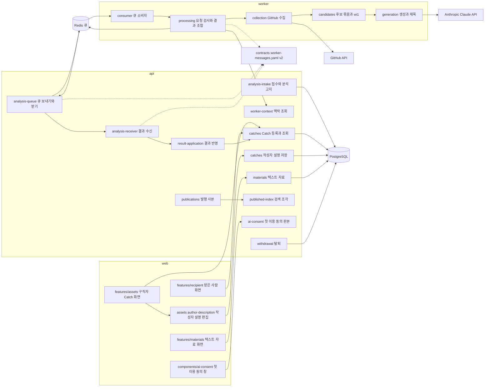
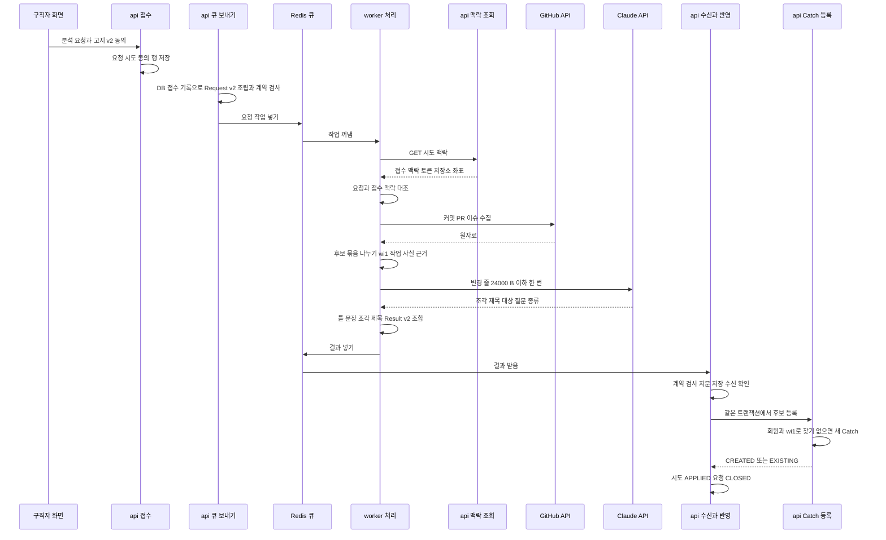
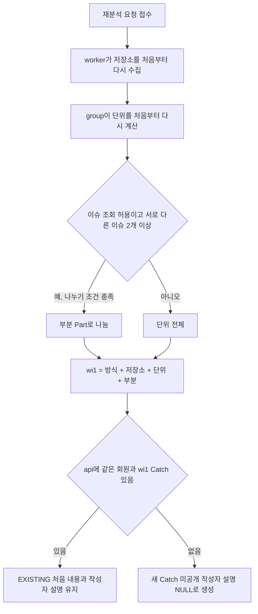
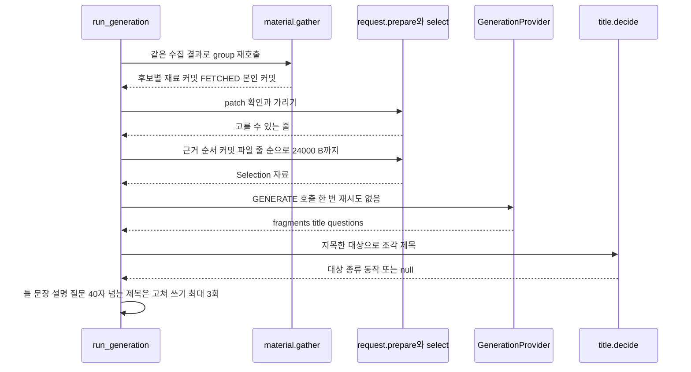
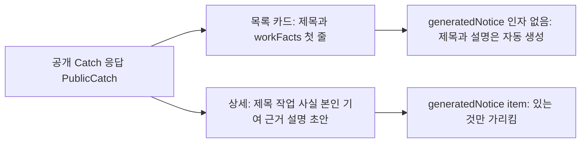
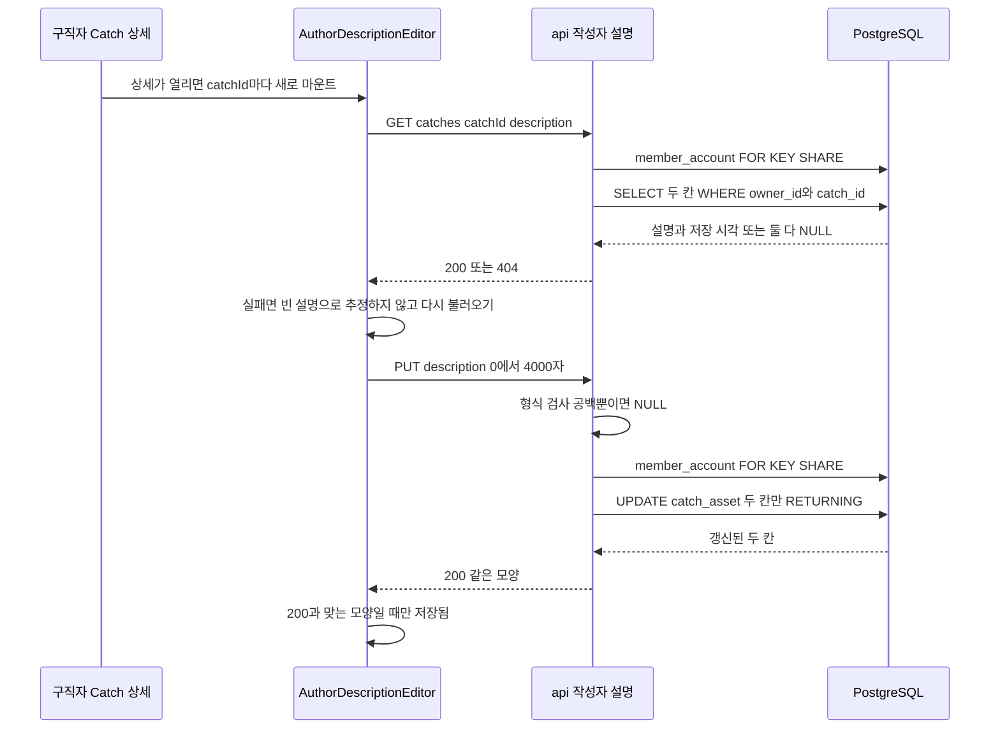
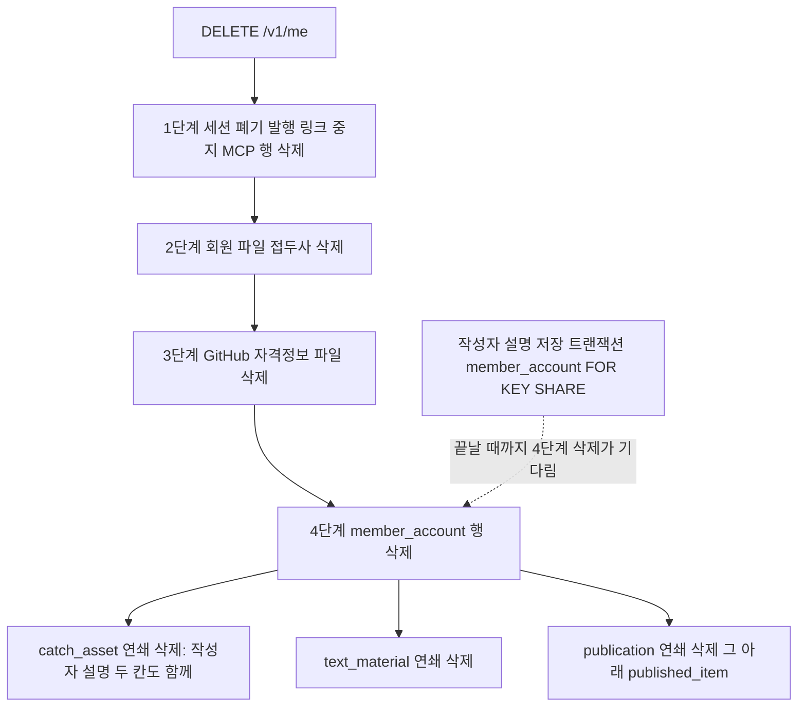

# 아키텍처 — CatchU

> 범위: 2026-11-03 집중 스캔(`kind: partial`), 기준 커밋 `9923226c`. 분석 요청에서 Catch 등록·받은 사람 화면까지의 길과, U4 #461이 더한 Catch 작성자 설명·텍스트 자료를 깊게 읽었다. 인증·공유 링크·발행 화면·RAG 질의응답 내부는 다루지 않는다.

## Architecture Analysis

### System Overview

한 저장소(모노레포)에 배포 단위 셋이 있다.

- **web**(Next.js·React): 구직자 화면(Catch 목록·상세와 작성자 설명 편집, `features/assets`), 텍스트 자료 목록·편집(`features/materials`, 주소 `/materials`), 받은 사람 화면(`features/recipient`), 외부 AI 첫 이용 동의 창(`components/ai-consent`).
- **api**(NestJS·TypeORM·PostgreSQL): 분석 접수·고지·동의 기록, 큐 보내기·받기(BullMQ/Redis), 결과 수신·반영, Catch 등록·조회·작성자 설명 저장, 텍스트 자료 저장, 발행 사본·검색 조각, 탈퇴, worker 전용 맥락 조회.
- **worker**(Python·BullMQ 소비자): 요청 하나를 자식 프로세스 하나가 맡아 GitHub 수집 → 후보 묶음·작업 동일성 → Claude 생성 → 결과 메시지 조합까지 한다. DB에 쓰지 않는다.

api와 worker는 저장소 안의 계약 파일 `api/contracts/repository-analysis/worker-messages.yaml`(메시지 스키마 v2)을 **같이 읽어** 메시지를 검사한다. 작성자 설명·텍스트 자료는 web ↔ api 사이에서만 오가며 worker와 큐 계약에는 나오지 않는다.

### Architectural Style

**서비스 셋 + 비동기 큐 + 공유 계약 파일**의 작은 분산 구조다. 근거:

- api와 worker 사이는 HTTP 호출이 아니라 큐 메시지다(api/src/analysis-queue/analysis-request.dispatcher.ts가 요청 작업을 넣고, worker가 결과·진행 알림을 돌려 넣는다).
- 예외 하나: worker가 시도마다 api의 내부 HTTP `GET /internal/analysis-attempts/:attemptId/context`로 자격정보·선택 범위·접수 맥락을 받는다(api/src/worker-context/).
- worker 안은 순수 처리 단계를 이은 파이프라인이다. 수집(`collection`)만 외부를 부르고, 후보(`candidates`)는 GitHub를 부르지 않는 순수 함수이며, 생성(`generation`)은 제공자 경계(`GenerationProvider`) 뒤에서만 외부를 부른다.
- api 안은 NestJS 모듈별 기능 묶음이고, 결과 반영은 한 트랜잭션에서 E(수신·반영)가 B(Catch 등록)를 부르는 포트 구조다(`RegistrationPort`).
- U4의 작성자 화면 API(작성자 설명·텍스트 자료)는 TypeORM 저장소 대신 **SQL 한 문장 + 소유자 조건** 모양의 저장소 클래스(`AuthorDescriptionStore`·`TextMaterialStore`)로 만들었다. 둘 다 `publications` 모듈을 import하지 않는다(U4 비기능 설계 「의존 방향」).

### Component Relationships

텍스트 대체: web의 구직자 화면과 받은 사람 화면은 api의 Catch 조회를 쓰고, 구직자 Catch 상세 안의 작성자 설명 편집은 api의 작성자 설명 저장을, 텍스트 자료 화면은 api의 텍스트 자료를 쓴다. 동의 창은 api의 첫 이용 동의 판본과 맞춘다. api 접수는 DB에 요청을 남기고, 큐 보내기가 Redis 큐에 요청 작업을 넣는다. worker 큐 소비자가 작업을 꺼내 요청 검사와 결과 조합 단계에 넘기고, 이 단계가 api 맥락 조회를 부른 뒤 GitHub 수집 → 후보 묶음 → Claude 생성으로 이어 간다. 결과는 다시 Redis 큐로 돌아가 api가 받고, 결과 수신 → 결과 반영 → Catch 등록 순으로 DB에 저장한다. 작성자 설명과 텍스트 자료도 DB에 저장한다. 발행 사본은 검색 조각이 된다. 탈퇴는 DB의 회원 행을 지운다. 큐 보내기·결과 수신(api)과 요청 검사·결과 조합(worker)은 모두 계약 파일 v2로 메시지를 검사한다.

### Data Flow

1. **접수**: 구직자가 분석을 요청하면 api가 `analysis_request`·`analysis_attempt`·`analysis_consent` 행을 만든다. 동의 행에는 고지 판본(`notice_revision`)과 동의 범위가 남는다.
2. **보내기**: api 보내기(`buildRequestMessage`)가 DB 접수 기록만으로 `Request`를 만들어 계약 검사 후 큐에 넣는다. 선택 참조·자격정보 맥락 참조에는 시도 ID를 넣는다.
3. **맥락 조회**: worker는 요청을 받으면 api 맥락 조회로 접수 기록(동의·고지 판본·허용 자료 종류)·GitHub 토큰·저장소 좌표를 받아 요청 메시지와 대조한다(`check_request`).
4. **수집**: GitHub 원자료는 메모리에만 두고 `CommitRecord`·`PullRequestRecord`·`IssueRecord`로 정규화한다. 커밋 메시지·PR 제목·PR을 연 계정은 이 기록에 있다.
5. **후보**: `group(outcome)`이 소속·병합·같은 변경·배정·커밋 묶음·나누기를 정하고, `build_candidates`가 작업 사실·기여·근거(본인 커밋 최근 20건)를 만들고 `wi1` 열쇠를 단다. 제목은 비운다.
6. **생성**: `run_generation`이 같은 수집 결과로 `group`을 다시 불러 후보와 단위를 `wi1`으로 맞추고, 근거 순서의 본인 커밋 변경 줄을 가린 뒤 24,000 B까지 골라 Claude에 한 번 보낸다. 응답에서 고른 조각으로 설명·질문·조각 제목을 만든다. 작업 사실은 바꾸지 않는다.
7. **결과**: `compose_result`가 계약 v2 `Result`로 조합하고 검사한 뒤 큐로 보낸다.
8. **수신·반영**: api가 결과를 검사·지문 대조 후 저장하고, 한 트랜잭션에서 저장소 보호 관측을 기록하고 `registerCandidates`로 Catch를 만들거나 기존 Catch를 참조한다. 새 Catch는 작성자 설명 칸을 넣지 않아 NULL이다. 요청을 `CLOSED`로 닫는다.
9. **작성자 설명**: 구직자가 Catch 상세를 열면 web이 `GET /v1/catches/{catchId}/description`로 현재 설명을 읽고, [설명 저장]에서 `PUT`으로 보낸다. api는 회원 행을 `FOR KEY SHARE`로 잡고 (회원, Catch ID) 조건으로 두 칸만 `UPDATE`한다.
10. **텍스트 자료**: `/materials` 화면이 `GET·POST /v1/text-materials`, `GET·PUT·DELETE /v1/text-materials/{id}`로 회원 자료를 다룬다. 행은 `text_material` 표에 회원 ID로 묶인다.
11. **화면·발행**: 구직자·받은 사람 화면은 Catch의 제목·작업 사실·근거·설명 초안을 보인다. 발행 사본에서 작업 사실·나의 기여·근거 관측 사실·작성자 설명이 검색 조각(`GITHUB_RECORD`·`AUTHOR_MATERIAL`)이 되고, 제목과 AI 초안은 조각이 되지 않는다. 발행·사본 만들기는 U4 제출 2 범위로 아직 코드가 없다(`publication`·`published_item`을 읽거나 쓰는 곳 없음).

### Key Design Decisions

| 결정 | 지금 모양 | 함의(이 intent 관점) |
|---|---|---|
| 작업 동일성은 불투명 열쇠 `wi1` | worker/app/candidates/identity.py가 방식·저장소·단위·부분만으로 SHA-256을 만든다. api는 해석하지 않고 (회원, 열쇠)로만 비교한다 | 소속 저장을 더해도 열쇠 만드는 법은 그대로 둘 수 있다. 나누기를 끄면 부분이 사라져 그 단위의 열쇠가 달라진다 |
| 기존 Catch는 처음 내용 고정 | api/src/catches/registration-service.ts가 같은 열쇠면 `EXISTING`으로 참조만 하고 내용을 바꾸지 않는다 | 재분석이 내용을 덮지 않는다. 새 커밋이 붙어 열쇠가 바뀌면 새 Catch가 된다(소속 저장이 막으려는 중복) |
| 작성자 설명은 Catch 행의 칸 | `catch_asset.author_description`·`author_description_updated_at`(엔티티 97~105행, 함께 채움 CHECK 38행). 엔티티에 초기값을 두지 않아 이 칸을 모르는 저장 코드가 설명을 덮지 않는다(ADR-004). 쓰는 곳은 `AuthorDescriptionStore.save` 하나 | 설명이 Catch ID에 묶여 재분석 `EXISTING`이면 유지된다. Catch 개편이 기존 Catch의 제목·작업 사실·초안을 새로 쓰게 되더라도 이 두 칸은 계속 건드리지 않아야 한다. 같은 작업이 새 Catch로 갈라지면 설명은 옛 Catch에 남는다 |
| 작성자 설명·텍스트 자료는 덮어쓰기 | 버전 비교·잠금 경고 없이 마지막 저장이 남는다(BR2.1). 갱신 시각은 DB `clock_timestamp()` | 두 탭 동시 편집은 나중 저장이 이긴다 |
| 텍스트 자료는 Catch와 따로 | `text_material`(회원 외래 키 연쇄 삭제, 회원 색인). Catch·분석과 외래 키가 없다 | Catch 개편과 직접 닿지 않는다. 발행 사본(`published_item`)은 원본과 외래 키가 없어 원본을 지워도 남는다 |
| 후보 판정과 생성의 경계 | #118(candidates)은 사실·기여·근거, #120(generation)은 제목·설명·질문과 근거 한계 끝 문구만 바꾼다 | 작업 사실에 기록의 글 한 줄을 판정 결과로 더하려면 이 경계를 바꿔야 한다 |
| 글은 고르기만, 문장은 코드 | Claude는 줄·이름·파일을 지목만 하고(`GENERATE_INSTRUCTIONS`), 문장은 틀(render.py)로 만든다 | Claude가 문장·제목 후보를 쓰는 방식으로 바꾸면 응답 모양·검사·실패 코드가 모두 바뀐다 |
| 외부로 보내는 자료 최소화 | 변경 줄과 경로·상태만 보낸다. 커밋 메시지·PR 글·SHA는 보내지 않는다(request.py) | 판정 공급자(OpenAI)로 PR 제목·커밋 메시지 첫 줄을 보내려면 고지 v3가 먼저다 |
| 계약 파일 공유 | 두 서비스가 같은 YAML을 읽고 판본 `"2"` 하나만 받는다 | 메시지 칸을 더하면 api·worker를 함께 바꾸고 함께 배포해야 한다 |
| 회원 자료는 연쇄 삭제 | 회원 행 삭제로 모든 회원 자료 표가 지워진다(`catch_asset`은 회원·분석 요청, `text_material`은 회원) | 새 소속 표도 회원(또는 Catch)에 `ON DELETE CASCADE`로 걸어야 탈퇴 시험을 통과한다 |

### Improvement Opportunities

- 커밋 → Catch 소속을 저장하는 표가 없다. 근거 표(`catch_evidence`)는 본인 커밋을 최대 20건만 담아 소속 전체를 대신할 수 없다.
- 같은 작업이 새 Catch로 갈라질 때 작성자 설명을 옮기거나 알려 주는 길이 없다. 소속 저장이 갈라짐 자체를 줄이는 쪽이 이 문제도 함께 줄인다.
- 생성 제공자 경계가 「글 하나 돌려주기」뿐이라 확률·고르기·점수를 돌려주는 판정 공급자를 받을 자리가 없다.
- 재료 고르기가 파일 종류를 보지 않는다. 종류 판정(`classify`)은 제목 모듈 안에만 있다.
- 자동 생성 안내 문장이 web 두 화면에 복제돼 있다. 구직자 상세에는 이제 사람이 쓴 설명 영역이 있어 안내의 「설명」이 AI 초안만 가리킨다는 점이 글로 드러나지 않는다.
- 계약 판본 문자열이 다섯 곳 이상에 박혀 있다.
- grouping.py 한 파일(88 KB)에 여섯 단계가 모여 있어, 나누기만 바꿔도 큰 파일을 건드린다.
- 작성자 설명·텍스트 자료 저장소가 `ownerId`·`assertMemberExists`·UUID 검사를 각자 복제한다(작은 중복).

## Interaction Diagrams

### 1. 분석 한 번: 접수에서 Catch 등록까지

텍스트 대체: 구직자가 고지 v2에 동의해 분석을 요청하면 api가 요청·시도·동의 행을 저장한다. 큐 보내기가 DB 기록만으로 Request v2를 만들고 계약 검사 후 Redis 큐에 넣는다. worker가 작업을 꺼내 api 맥락 조회로 접수 맥락·토큰·저장소 좌표를 받아 요청과 대조한 뒤 GitHub에서 커밋·PR·이슈를 수집한다. 후보를 묶고(나누기 포함) wi1 열쇠·작업 사실·근거를 만든 뒤, 변경 줄을 24,000 B 이하로 골라 Claude를 한 번 부르고, 받은 조각으로 틀 문장과 조각 제목을 만들어 Result v2로 조합해 큐에 넣는다. api는 결과를 검사·지문 저장하고 수신 확인을 보낸 뒤, 같은 트랜잭션에서 회원과 wi1로 Catch를 찾아 없으면 만들고 있으면 참조만 한 다음 시도를 APPLIED, 요청을 CLOSED로 바꾼다.

### 2. 재분석에서 같은 작업이 이어지는 방식(지금)

텍스트 대체: 재분석이 접수되면 worker가 저장소를 처음부터 다시 수집하고 단위를 처음부터 다시 계산한다. 이슈 조회가 허용되고 본인 커밋이 서로 다른 이슈를 둘 이상 가리키며 나누기 조건을 채우면 부분으로 나누고, 아니면 단위 전체로 둔다. 방식·저장소·단위·부분으로 wi1 열쇠를 만들고, api에 같은 회원·열쇠의 Catch가 있으면 처음 내용과 작성자 설명을 그대로 두고 참조만 하며, 없으면 새 Catch를 미공개·작성자 설명 없음으로 만든다. 이미 Catch에 속한 커밋을 기억하는 단계는 없다.

### 3. 후보 하나의 생성(지금)

텍스트 대체: 생성 흐름은 같은 수집 결과로 group을 다시 불러 후보마다 변경 내용을 받은 본인 커밋을 재료로 찾는다. 파일마다 patch 온전성을 확인하고 비밀값을 가린 뒤, 근거 순서의 커밋 → 파일 → 줄 순으로 24,000 B까지 골라 제공자를 한 번 부른다(재시도 없음). 응답의 조각·제목 대상·질문 종류를 검사해 틀 문장으로 설명과 질문을 만들고, 제목은 지목한 대상의 종류·동작을 코드가 정해 「대상 종류 동작」으로 만든다. 형식을 어긴 제목만 최대 3회 고쳐 쓴다.

### 4. 받은 사람 화면의 표시(지금)

텍스트 대체: 받은 사람 화면은 공개 Catch 응답을 받아 목록 카드에는 제목과 작업 사실 첫 줄을, 상세에는 제목·작업 사실·본인 기여·근거·설명 초안을 보인다. 목록 위에는 인자 없는 `generatedNotice()`가 「제목과 설명은 CatchU가 GitHub 기록에서 자동으로 만들었습니다」를, 상세에는 `generatedNotice(item)`이 제목·설명 가운데 있는 것만 가리킨 같은 안내를 둔다. 제목이 사람이 쓴 PR 제목이어도 같은 안내가 붙는다. 작성자 설명은 공개 Catch 응답에 없어 이 화면에 나오지 않는다.

### 5. 작성자 설명 열기와 저장(U4 #461)

텍스트 대체: 구직자가 Catch 상세를 열면 작성자 설명 편집기가 Catch마다 새로 마운트되어 현재 설명을 읽는다. api는 회원 행을 FOR KEY SHARE로 잡고 회원·Catch ID 조건으로 두 칸을 읽어 돌려주고, 남의 Catch·없는 Catch·형식이 틀린 ID는 모두 404다. 읽지 못하면 화면은 빈 설명으로 추정하지 않고 다시 불러오기를 보인다. 저장하면 api가 본문을 검사하고(공백뿐이면 NULL로 지움), 다시 회원 행을 잡은 뒤 catch_asset의 설명 두 칸만 UPDATE해 결과를 돌려준다. 화면은 200과 맞는 응답 모양일 때만 「저장됨」을 보이고, 실패하면 입력을 남긴다.

### 6. 탈퇴 때 작성자 설명과 텍스트 자료

텍스트 대체: 탈퇴 요청은 세션 폐기·발행 링크 중지·MCP 행 삭제, 회원 파일 삭제, 자격정보 파일 삭제를 거쳐 4단계에서 회원 행을 지운다. 그때 회원을 따라 Catch 행이 연쇄 삭제되고 그 행의 작성자 설명 두 칸도 함께 사라진다. 텍스트 자료도 회원을 따라, 발행본과 그 아래 발행 사본도 연쇄로 지워진다. 작성자 설명이나 텍스트 자료를 저장하는 트랜잭션은 회원 행을 FOR KEY SHARE로 잡으므로 그 사이의 회원 행 삭제는 저장이 끝날 때까지 기다린다. 따로 설명을 지우는 단계는 없다.
