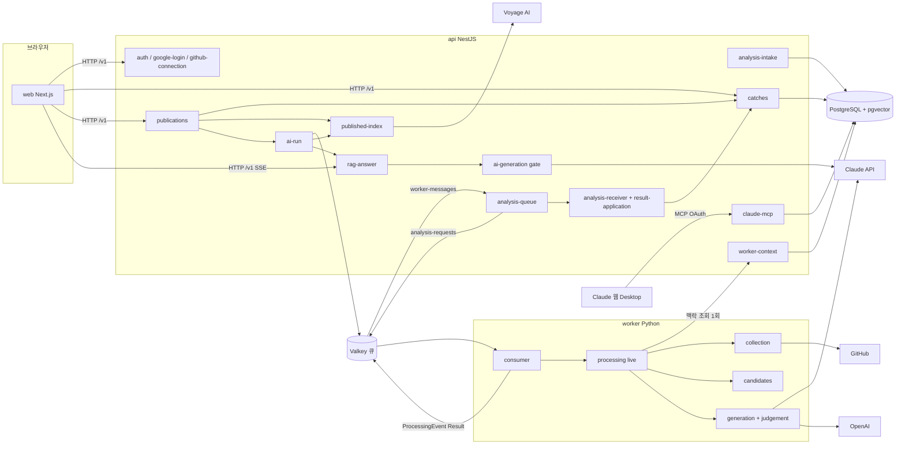
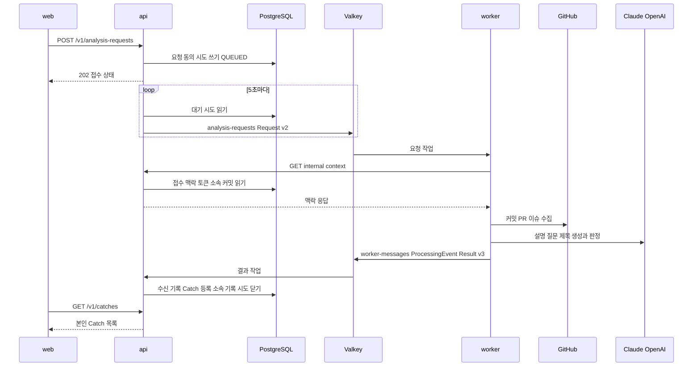
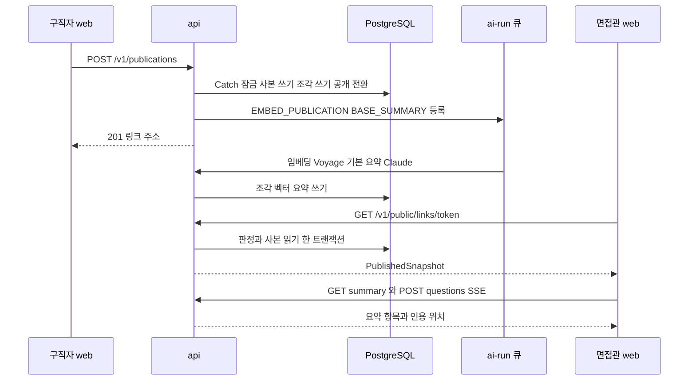
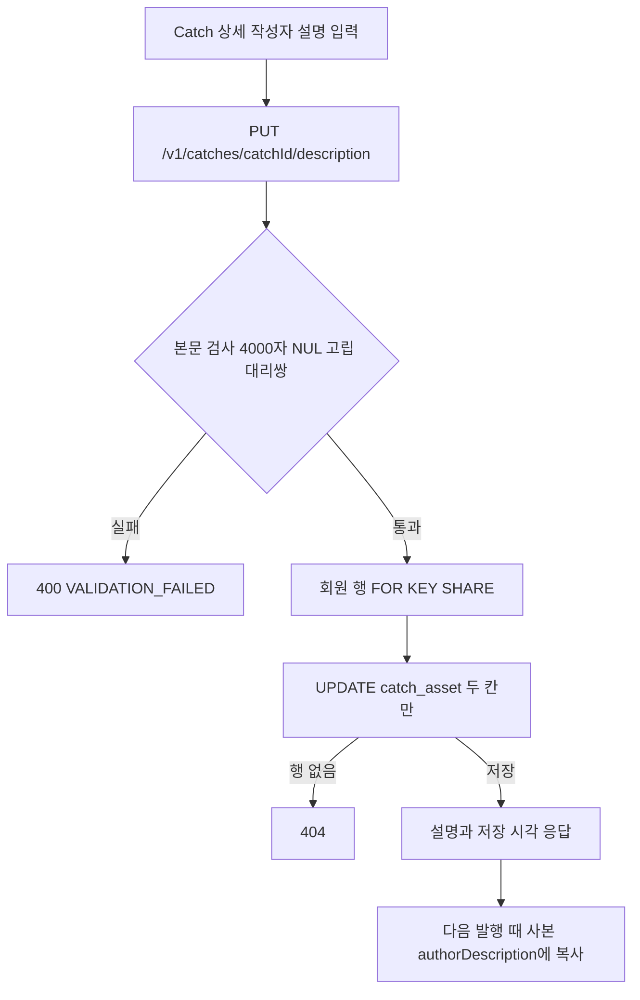

# 구조 — CatchU

> 기준: 2026-11-09 전체 다시 스캔, 커밋 `a1d0fbb4`. 구성 요소 목록과 책임은 `component-inventory.md`, 경로 표는 `api-documentation.md`에 한 번만 적었다. 여기서는 연결과 흐름만 적는다.

## Architecture Analysis

### System Overview

배포 단위 셋(web·api·worker)과 공유 자원 셋(PostgreSQL 16 + pgvector, Valkey 큐, 파일 저장 폴더)으로 이뤄진다. 외부 서비스는 Google(로그인), GitHub(OAuth·REST·GraphQL), Anthropic Claude(생성·인용), OpenAI(판정), Voyage AI(임베딩)이다.

- **web**(Next.js 16): 브라우저에서 api를 직접 부른다(`NEXT_PUBLIC_API_BASE_URL` + `/v1`). 회원 토큰은 메모리에 두고, 세션 갱신은 쿠키로 한다(`web/src/lib/api.ts`). 서버 쪽 데이터 조회는 하지 않는다.
- **api**(NestJS 12): 모든 업무 상태와 DB를 가진다. HTTP 경로, 분석 큐 보내기·받기, 백그라운드 AI 작업(`ai-run` 큐), 처리 시한 판정(1분 주기), MCP 서버를 한 프로세스에서 돈다. 큐 주소가 없으면 큐 부분을 조립하지 않는다(`api/src/application.module.ts`).
- **worker**(Python 3.12): 큐 소비자 부모 프로세스가 요청마다 자식 프로세스 하나를 띄워 수집 → 작업 단위 판정 → 생성 → 판정을 하고 결과를 큐로 보낸다. DB에 붙지 않고, 필요한 접수 맥락·GitHub 토큰·소속 커밋은 api 내부 조회 한 번으로 받는다. HTTP는 `GET /health` 하나다.

### Architectural Style

**작은 서비스 셋 + 큐로 잇는 비동기 처리**(분산 모놀리스에 가깝다). 근거:

- api가 업무 상태와 DB를 혼자 갖고, worker는 상태 없는 계산기다. worker는 결과를 한 번 보내고 다시 보내지 않는다(`worker/README.md` 「보장하지 않는 범위」).
- 서비스 사이 계약은 코드 import가 아니라 YAML 스키마 파일 하나다(`api/contracts/repository-analysis/worker-messages.yaml`, `common.yaml`). 두 쪽이 같은 파일을 읽어 검사한다(api는 ajv, worker는 jsonschema).
- api 안은 기능별 Nest 모듈(폴더 하나 = 모듈 하나)이며, 계약 번호(C-01~C-17)로 Unit 사이 인터페이스를 정한다(예: C-10 `PublicationAccess`를 `PUBLICATION_ACCESS` 토큰으로 내보냄).
- 배포는 한 호스트 Compose(개발 서버, EC2 한 대)와 EKS 설정 파일(12월 최종, 아직 자원 없음) 두 갈래다.

### Component Relationships

<!-- Text fallback: 브라우저의 web이 api의 인증, catches, publications, rag-answer 경로를 HTTP /v1로 부른다. api의 analysis-queue가 Valkey 큐 analysis-requests에 요청을 넣고 worker-messages 큐에서 알림과 결과를 받아 analysis-receiver와 result-application을 거쳐 catches가 DB에 등록한다. publications는 catches를 읽어 사본을 만들고 published-index와 ai-run을 부른다. ai-run은 같은 큐 서버의 ai-run 큐로 임베딩(Voyage)과 기본 요약(rag-answer → ai-generation gate → Claude)을 돌린다. claude-mcp는 Claude 웹·Desktop의 MCP 호출을 받아 DB를 읽는다. worker의 consumer가 큐에서 요청을 받아 processing live가 worker-context 내부 조회를 한 번 하고, collection이 GitHub를 읽고, candidates가 작업 단위를 정하고, generation과 judgement가 Claude와 OpenAI를 부른 뒤 consumer가 진행 알림과 결과를 큐로 보낸다. -->

### Data Flow

1. **분석 요청**: web `POST /v1/analysis-requests`(멱등 키) → api가 `analysis_request`·`analysis_consent`·`analysis_attempt`를 한 트랜잭션에 쓴다(`QUEUED`). 하루 횟수를 같은 트랜잭션에서 쓴다.
2. **큐 보내기**: 보내기 주기(5초, 한 번에 100건)가 대기 시도를 읽어 Request v2를 조립·검사하고 `analysis-requests` 큐에 넣는다(작업 ID = 시도 ID, 재시도 없음, `queue-spec.ts`).
3. **worker 처리**: 자식 프로세스가 요청을 계약으로 검사하고, api 내부 조회(`GET /v1/internal/analysis-attempts/:id/context`)로 접수 맥락·GitHub 토큰·선택 범위·**소속 커밋 SHA 전체**를 받는다. 수집 결과는 메모리에만 있다. 작업 단위를 정할 때 소속 커밋이 든 변경은 뺀다(`grouping.py` 7단계).
4. **결과**: Result v3(후보마다 `ownCommitShas` 1~3,000개 포함)를 `worker-messages` 큐로 보낸다. api는 스키마·맥락을 검사해 수신 기록을 남기고(`result_application_record`), 반영 서비스가 한 트랜잭션에서 Catch를 만들거나 참조하고 소속 기록·후보 등록을 쓴 뒤 시도를 닫는다.
5. **본인 열람·편집**: `GET /v1/catches`(catch_id 오름차순 cursor), 확인·불일치·공개 상태 PUT, 작성자 설명 GET·PUT.
6. **발행**: `POST /v1/publications` → 빈도 → 입력 → 동의 → (트랜잭션 밖) 토큰·비밀번호 해시 → 트랜잭션(하루 횟수, Catch를 `catch_id` 순서로 잠그고 다시 읽기, 공개 자격 확인, 전체 글 60,000자 확인, `publication`·`published_item` 쓰기, 비공개 Catch 공개로, 조각 나누기) → 커밋 뒤 `EMBED_PUBLICATION`·`BASE_SUMMARY` 작업 등록(실패해도 발행 성공).
7. **면접관 열람**: `GET /v1/public/links/:token`은 읽기 전용 REPEATABLE READ 한 트랜잭션에서 판정(중지·만료 → 작성자 비활성 → grant)과 사본 읽기를 한다. 기본 요약은 `GET .../summary`, 질의응답은 `POST .../questions`(SSE: 질문 다시 쓰기 → 의미 검색 → 인용 생성).

### Key Design Decisions

| 결정 | 근거 자리 | 이 intent에 주는 뜻 |
|---|---|---|
| Catch 본문은 등록 때 한 번 쓰고 기존 Catch는 참조만 한다(내용 합치기·갱신 없음) | `registration-service.ts` 174~219행, `new-catch-content.ts` 62~66행 | 규칙 사실을 기존 Catch에 채우려면 재생성이나 DB 초기화가 필요하다 |
| 작성자 설명은 `catch_asset`의 두 칸, 초기값 없음, 저장 경로 하나 | `catch-asset.entity.ts` 99~107행, `author-description-store.ts` | 칸 제목별 입력은 글 모양만 바꾸면 되고 DB·계약 변경이 없다 |
| 발행본은 jsonb 고정 사본, 받은 사람은 사본만 읽는다 | `publication.entity.ts`, `db-publication-access.ts` 155~185행 | 사본 칸을 더하면 옛 사본에는 그 칸이 없다. 읽는 쪽이 견뎌야 한다 |
| 사본 모양을 쓰는 곳이 api 셋·web 둘로 흩어져 있다 | `chunker.ts`, `summary-sources.ts`, `snapshot-builder.ts`, `publications-api.ts`, `recipient-api.ts` | 칸 하나에 다섯 파일을 함께 고친다(`code-quality-assessment.md`) |
| api–worker 메시지는 `additionalProperties: false` 스키마와 판본 문자열로 고정, 옛 판본을 함께 받지 않는다 | `worker-messages.yaml` 1~4·72~113행 | 후보에 칸을 더하면 Result 판본을 올리고 두 서비스를 함께 배포한다 |
| 소속 기록은 등록 트랜잭션에서 한 번 쓰고 바꾸지 않는다(충돌 무시) | `commit-assignment.entity.ts`, `registration-service.ts` 95~112행 | 작업 시각·규칙 사실은 소속 기록이 아니라 후보 칸으로 와야 한다 |
| 본인 목록 순서는 `catch_id`(무작위 UUID), 만든 시각 칸 없음 | `owner-catch-store.ts` 37~38행, 마이그레이션 `1790600000000` | 작업 시각순 정렬에는 새 칸과 cursor 모양 변경이 필요하다 |
| 받은 사람 AI 근거는 사본 필드 단위, 종류 둘 | `chunker.ts` 104~128행, `summary-sources.ts` 8~15행 | 작성자 설명은 한 필드(`authorDescription`)로 조각난다. 칸 제목 글자도 근거 글에 든다 |

### Improvement Opportunities

- 사본 모양 검사를 api 한 곳(예: `published-snapshot.ts` 옆의 검사 함수)으로 모으면 칸을 더할 때 고칠 곳이 준다. web은 api 응답을 믿지 않으므로 web 두 곳은 남는다.
- 쓰지 않는 `PublicCatchStore`와 `share_link` 표를 정리하면 「공개」의 뜻이 하나로 준다(지금은 `visibility = PUBLIC`이 발행으로만 생기고 받은 사람 쪽 옛 경로는 없다).
- `catch_asset`에 만든 시각이나 작업 시각 칸이 없어서, 정렬·「언제 한 일인가」 표시는 모두 새 자료가 필요하다.
- 큰 판정 파일(`grouping.py`, `relations.py`)은 모듈 설명이 단계를 잘 나누지만, 규칙을 더할 때 한 파일이 더 커진다. 3단계 규칙 사실은 `build.py`·`grouping.py` 밖의 새 모듈로 두는 편이 영향이 작다.

## Interaction Diagrams

### 분석 요청부터 Catch 등록까지

<!-- Text fallback: web이 분석 요청을 보내면 api가 요청·동의·시도를 QUEUED로 쓰고 202를 준다. api는 5초마다 대기 시도를 읽어 Request v2를 analysis-requests 큐에 넣는다. worker가 작업을 받아 api 내부 맥락 조회를 한 번 하고(접수 맥락, GitHub 토큰, 소속 커밋), GitHub에서 커밋·PR·이슈를 모으고, Claude와 OpenAI로 생성과 판정을 한 뒤 진행 알림과 Result v3를 worker-messages 큐로 보낸다. api는 결과를 받아 수신 기록, Catch 등록, 소속 기록, 시도 닫기를 한다. web은 GET /v1/catches로 본인 목록을 본다. -->

### 발행과 면접관 열람

<!-- Text fallback: 구직자가 발행을 요청하면 api가 한 트랜잭션에서 Catch를 잠그고 사본·조각을 쓰고 비공개 Catch를 공개로 바꾼 뒤, 커밋 뒤 EMBED_PUBLICATION과 BASE_SUMMARY 작업을 ai-run 큐에 등록하고 201과 링크 주소를 준다. ai-run 처리기가 Voyage 임베딩과 Claude 기본 요약을 만들어 DB에 쓴다. 면접관이 링크를 열면 api가 판정과 사본 읽기를 한 트랜잭션에서 하고 PublishedSnapshot을 준다. 면접관은 기본 요약과 질의응답(SSE)을 부르고, 답의 인용 위치로 사본의 칸이 강조된다. -->

### 작성자 설명 저장

<!-- Text fallback: 상세의 작성자 설명을 PUT /v1/catches/{catchId}/description로 보낸다. 본문을 검사해(4,000자, NUL, 고립 대리쌍) 실패하면 400이다. 통과하면 회원 행을 FOR KEY SHARE로 잡고 catch_asset의 설명 두 칸만 UPDATE한다. 행이 없으면 404, 저장되면 설명과 저장 시각을 돌려준다. 저장한 설명은 다음 발행 때 사본의 authorDescription으로 복사된다. 이미 만든 사본은 바뀌지 않는다. -->
