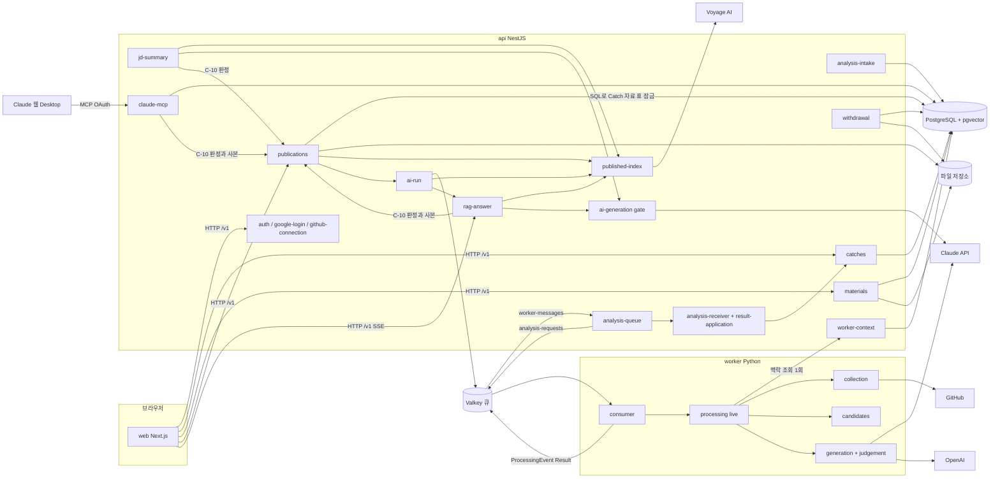
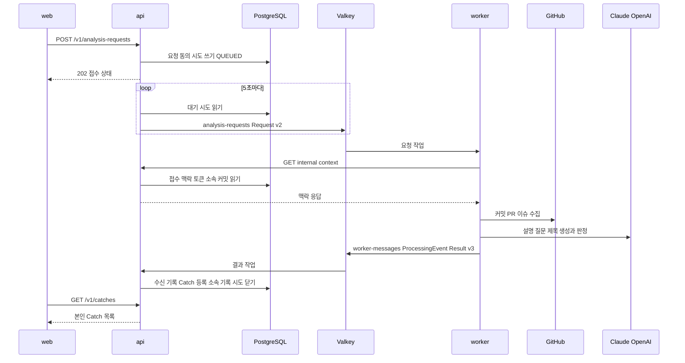
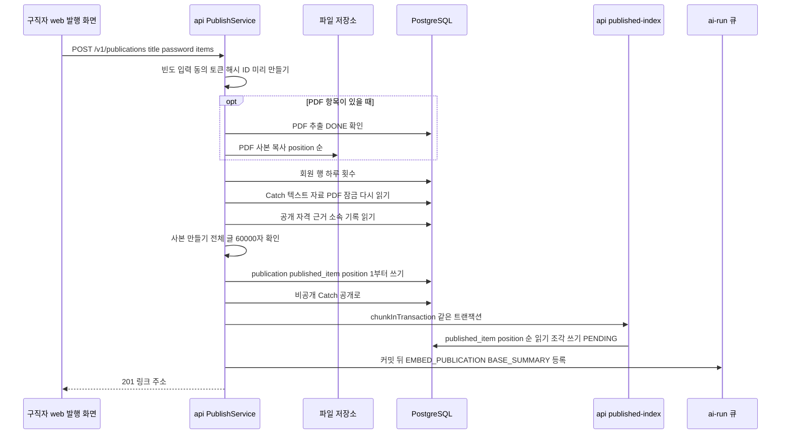
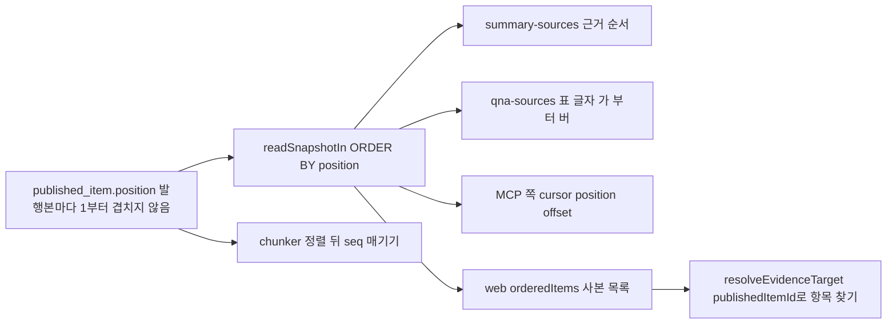
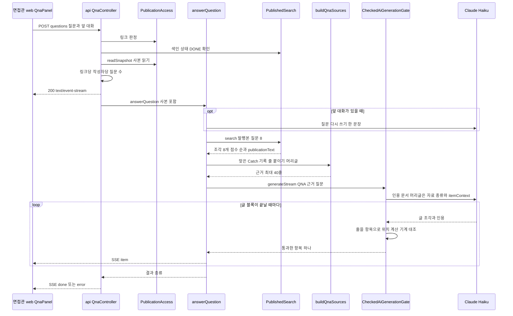
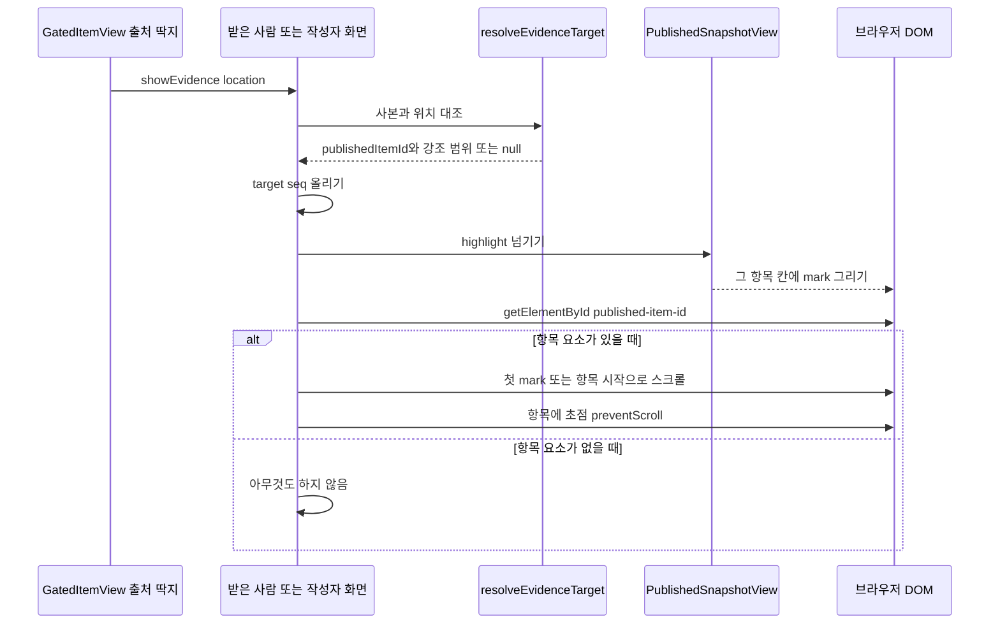
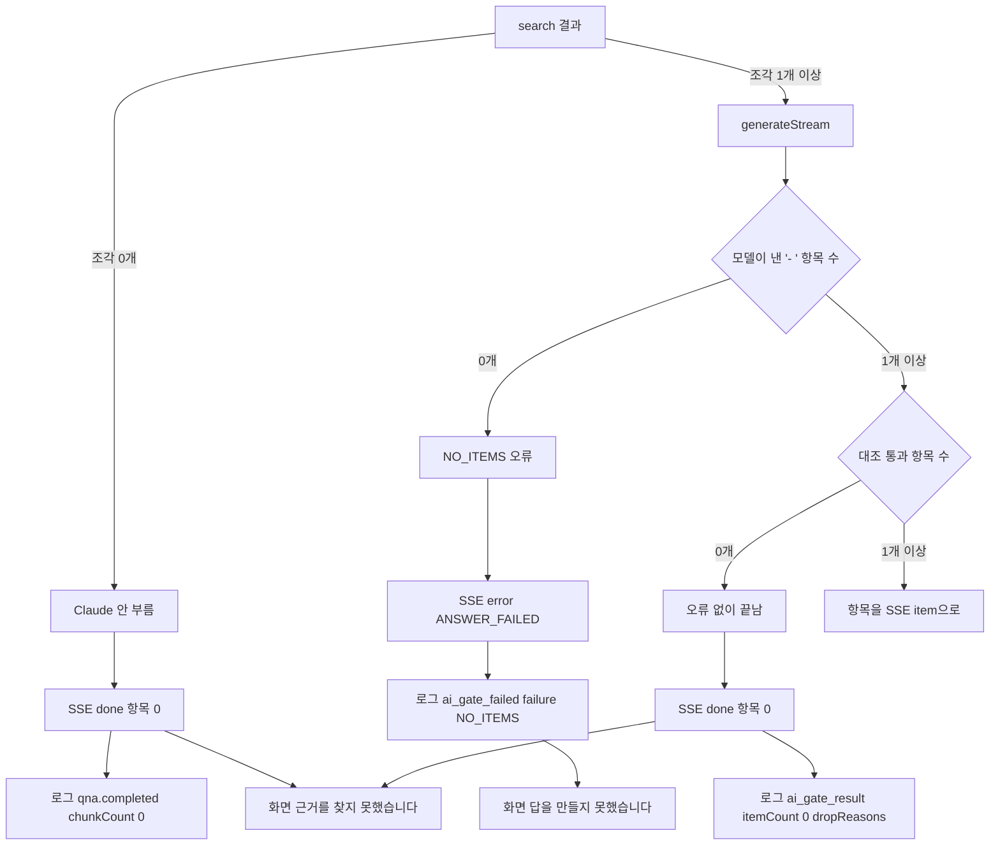
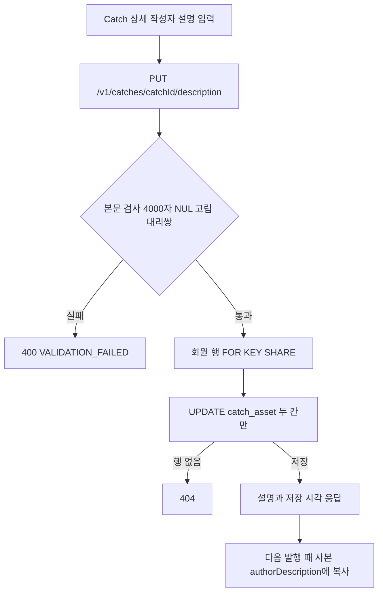

# 구조 — CatchU

> 기준: 2026-11-09 전체 다시 스캔(커밋 `a1d0fbb4`) 위에 2026-11-16 집중 스캔(커밋 `eb0d5a6c`)과 2026-11-19 집중 스캔(커밋 `aa241a4c`)을 합쳤다. 11-19에 다시 읽은 곳은 `api.publications`·`api.published-index`·`api.rag-answer`·`api.claude-mcp`(받은 링크 읽기)·`api.jd-summary`(검색 부분)·`api.catches`(본인 목록)·`api.materials`(지우기)·`api.withdrawal`·마이그레이션 배치와 web의 발행·사본·받은 사람·질의응답 패널·자료 탭·개인정보처리방침·상단 메뉴이고, 그 자리를 말하는 줄에는 「11-19 확인」을 붙였다. 「11-16 확인」 줄 가운데 `ai-generation` 게이트 안쪽은 이번에 다시 읽지 않았다. 나머지는 11-09 글 그대로다. 구성 요소 목록과 책임은 `component-inventory.md`, 경로 표는 `api-documentation.md`에 한 번만 적었다. 여기서는 연결과 흐름만 적는다.

## Architecture Analysis

### System Overview

배포 단위 셋(web·api·worker)과 공유 자원 셋(PostgreSQL 16 + pgvector, Valkey 큐, 파일 저장소 — `local` 폴더 또는 S3)으로 이뤄진다. 외부 서비스는 Google(로그인), GitHub(OAuth·REST·GraphQL), Anthropic Claude(생성·인용), OpenAI(판정), Voyage AI(임베딩)이다.

- **web**(Next.js 16): 브라우저에서 api를 직접 부른다(`NEXT_PUBLIC_API_BASE_URL` + `/v1`). 회원 토큰은 메모리에 두고, 세션 갱신은 쿠키로 한다(`web/src/lib/api.ts`). 서버 쪽 데이터 조회는 하지 않는다. 질의응답 SSE만 공용 호출 함수 대신 같은 주소 규칙의 직접 `fetch` 스트림이다(`web/src/features/rag-answer/rag-answer-api.ts`, 11-16 확인).
- **api**(NestJS 12): 모든 업무 상태와 DB를 가진다. HTTP 경로, 분석 큐 보내기·받기, 백그라운드 AI 작업(`ai-run` 큐), 처리 시한 판정(1분 주기), MCP 서버를 한 프로세스에서 돈다. 큐 주소가 없으면 큐 부분을 조립하지 않는다(`api/src/application.module.ts`). 앱 기동은 스키마를 바꾸지 않고 마이그레이션도 돌리지 않는다(`database.config.ts` 47~48행, 11-19 확인).
- **worker**(Python 3.12): 큐 소비자 부모 프로세스가 요청마다 자식 프로세스 하나를 띄워 수집 → 작업 단위 판정 → 생성 → 판정을 하고 결과를 큐로 보낸다. DB에 붙지 않고, 필요한 접수 맥락·GitHub 토큰·소속 커밋은 api 내부 조회 한 번으로 받는다. HTTP는 `GET /health` 하나다.

### Architectural Style

**작은 서비스 셋 + 큐로 잇는 비동기 처리**(분산 모놀리스에 가깝다). 근거:

- api가 업무 상태와 DB를 혼자 갖고, worker는 상태 없는 계산기다. worker는 결과를 한 번 보내고 다시 보내지 않는다(`worker/README.md` 「보장하지 않는 범위」).
- 서비스 사이 계약은 코드 import가 아니라 YAML 스키마 파일 하나다(`api/contracts/repository-analysis/worker-messages.yaml`, `common.yaml`). 두 쪽이 같은 파일을 읽어 검사한다(api는 ajv, worker는 jsonschema).
- api 안은 기능별 Nest 모듈(폴더 하나 = 모듈 하나)이며, 계약 번호(C-01~C-17)로 Unit 사이 인터페이스를 정한다(예: C-10 `PublicationAccess`를 `PUBLICATION_ACCESS` 토큰으로 내보냄, C-09 `PublishedSearch`를 `PUBLISHED_SEARCH`, C-08 `PublishedIndexWriter`를 `PUBLISHED_INDEX_WRITER`, C-01 `AiGenerationGate`를 `AI_GENERATION_GATE`).
- 배포는 한 호스트 Compose(개발 서버, EC2 한 대)와 EKS 설정 파일(12월 최종, 아직 자원 없음) 두 갈래다.

### Component Relationships

<!-- Text fallback: 브라우저의 web이 api의 인증, catches, materials, publications, rag-answer 경로를 HTTP /v1로 부른다(질의응답은 SSE). api의 analysis-queue가 Valkey 큐 analysis-requests에 요청을 넣고 worker-messages 큐에서 알림과 결과를 받아 analysis-receiver와 result-application을 거쳐 catches가 DB에 등록한다. materials는 텍스트 자료·PDF 행과 PDF 파일을 다룬다. publications는 catches 모듈을 부르지 않고 Catch·자료 표를 SQL로 직접 잠가 사본을 만들고, PDF 사본 파일을 복사하고, published-index와 ai-run을 부른다. ai-run은 같은 큐 서버의 ai-run 큐로 임베딩(published-index, Voyage)과 기본 요약(rag-answer)을 돌린다. rag-answer는 published-index 검색, ai-generation 게이트(Claude), publications의 C-10 판정과 사본 읽기를 쓴다. jd-summary도 published-index 검색, ai-generation 게이트, C-10 판정을 쓴다. claude-mcp는 Claude 웹·Desktop의 MCP 호출을 받아 본인 자료는 DB에서, 받은 링크는 C-10으로 읽는다. withdrawal은 DB 행과 파일 저장소의 회원 파일을 지운다. worker의 consumer가 큐에서 요청을 받아 processing live가 worker-context 내부 조회를 한 번 하고, collection이 GitHub를 읽고, candidates가 작업 단위를 정하고, generation과 judgement가 Claude와 OpenAI를 부른 뒤 consumer가 진행 알림과 결과를 큐로 보낸다. -->

### Data Flow

1. **분석 요청**: web `POST /v1/analysis-requests`(멱등 키) → api가 `analysis_request`·`analysis_consent`·`analysis_attempt`를 한 트랜잭션에 쓴다(`QUEUED`). 하루 횟수를 같은 트랜잭션에서 쓴다.
2. **큐 보내기**: 보내기 주기(5초, 한 번에 100건)가 대기 시도를 읽어 Request v2를 조립·검사하고 `analysis-requests` 큐에 넣는다(작업 ID = 시도 ID, 재시도 없음, `queue-spec.ts`).
3. **worker 처리**: 자식 프로세스가 요청을 계약으로 검사하고, api 내부 조회(`GET /v1/internal/analysis-attempts/:id/context`)로 접수 맥락·GitHub 토큰·선택 범위·**소속 커밋 SHA 전체**를 받는다. 수집 결과는 메모리에만 있다. 작업 단위를 정할 때 소속 커밋이 든 변경은 뺀다(`grouping.py` 7단계).
4. **결과**: Result v3(후보마다 `ownCommitShas` 1~3,000개 포함)를 `worker-messages` 큐로 보낸다. api는 스키마·맥락을 검사해 수신 기록을 남기고(`result_application_record`), 반영 서비스가 한 트랜잭션에서 Catch를 만들거나 참조하고 소속 기록·후보 등록을 쓴 뒤 시도를 닫는다.
5. **본인 열람·편집(11-19 확인)**: `GET /v1/catches`(마지막 작업 시각 최근순, 시각 없는 Catch는 맨 아래, 같으면 `catch_id` 순, cursor 판본 3에 조건까지 묶음, `authorDescription=written|unwritten` 걸러 보기), 확인·불일치·공개 상태 PUT, 작성자 설명 GET·PUT. Catch를 지우는 경로는 없다.
6. **발행(11-19 확인)**: `POST /v1/publications` → 빈도 → 입력(본문 칸 `title`·`password`·`items`만, 항목 1~20, 같은 `kind:sourceId` 한 번) → 동의 → (트랜잭션 밖) 토큰·비밀번호 해시, 발행본·항목 ID 미리 만들기, PDF가 있으면 추출 완료 확인·PDF 파일 복사 → 트랜잭션(회원 행 잡기 → 하루 횟수 → Catch를 `catch_id` 순·텍스트 자료·PDF 순으로 잠그고 다시 읽기 → 공개 자격 확인 → 근거·소속 기록 읽기 → 사본 만들기 → 전체 글 60,000자 확인 → `publication`·`published_item`(`position = 배열 자리 + 1`)·`published_pdf_page` 쓰기 → 비공개 Catch 공개로 → 조각 나누기) → 트랜잭션 실패면 PDF 접두어 정리 → 커밋 뒤 `EMBED_PUBLICATION`·`BASE_SUMMARY` 등록(실패해도 발행 성공).
7. **조각과 임베딩(11-19 확인, 11-16과 같음)**: 발행 트랜잭션 안에서 `chunkInTransaction`이 `published_item`을 `position` 순으로 읽어 `buildChunkDrafts`로 조각을 만들고 `seq`를 발행본 전체에 1부터 매겨 `published_chunk`(임베딩 없음)와 `publication_index`(PENDING, 마감 = 지금 + 10분)를 쓴다. Catch 사본은 `workFacts[i]` → `subjectContribution` → `evidence[i].representedFacts[j]` → `authorDescription` 칸마다, 텍스트 자료는 `body`, PDF는 읽을 수 있는 `pages[n]`마다 1,000자 이하 범위로 나눈다. 커밋 뒤 `EMBED_PUBLICATION` 처리기가 조각을 128개씩 Voyage `voyage-4-lite`(문서용)로 보내고 한 트랜잭션에서 벡터를 채워 `DONE`으로 바꾼다.
8. **면접관 열람(11-19 확인)**: `GET /v1/public/links/:token`은 읽기 전용 REPEATABLE READ 한 트랜잭션에서 판정(중지·만료 → 작성자 비활성 → grant)과 사본 읽기(`ORDER BY position`)를 한다. web은 `isPublishedSnapshot`으로 모양을 보고 `pickItem`으로 계약 칸만 옮긴 뒤 `PublishedSnapshotView`로 항목을 순서대로 한 목록에 그린다. 기본 요약은 `GET .../summary`, 질의응답은 `POST .../questions`, PDF 사본은 `GET .../items/:itemId/pdf`.
9. **질의응답(11-19 확인)**: 본문 검사 → 링크 판정 → 색인 `DONE` 확인(아니면 409) → **사본 읽기**(C-10 `readSnapshot`, 삭제면 404) → 질문 수(링크당 100·작성자당 300, Redis, 넘으면 429) → SSE 열기 → (앞 대화가 있을 때만) 질문 다시 쓰기(Haiku) → `search(발행본, 질문, 8)` → (조각이 있을 때만) `buildQnaSources`(맞은 Catch의 GitHub 기록 줄을 ① 같은 근거 → ② 작업 사실·나의 기여 → ③ 남은 근거 순으로 Catch마다 12줄·전체 40줄까지 붙이고, 근거마다 `itemContext` 머리글) → 게이트 `generateStream` → 항목마다 SSE `item` → `done`.
10. **기본 요약(11-16 확인, 11-19에 근거 만들기만 다시 확인)**: `BASE_SUMMARY` 처리기가 사본을 다시 읽어 조각이 아닌 사본 칸 하나를 근거 하나로 만들고(`summary-sources.ts`, `position` 순, 근거 ID `{publishedItemId}/{fieldPath}`) `generate`(Haiku)를 한 번 부른다. 항목 0개면 `FAILED`, 1개 이상이면 `base_summary`에 `DONE`과 항목을 쓴다.
11. **받은 링크 읽기(11-19 확인)**: MCP `read_shared_publication(link, cursor?)` → 토큰 꺼내기 → cursor 모양(`{position, offset}`) → C-10 판정(grant 없음, 비밀번호 링크는 거부) → 사본 읽기 → 항목마다 일반 글로 펴기 → 응답 직렬화 길이로 쪽 만들기. 판정과 사본을 캐시하지 않는다.
12. **자료 지우기·탈퇴(11-19 확인)**: 텍스트 자료는 행만, PDF는 파일 먼저 그다음 행(쪽 글 연쇄)을 지운다. 발행 사본은 원본과 외래 키가 없어 남는다. 탈퇴는 4단계이며 마지막에 `member_account`를 지워 회원 자료 표를 모두 연쇄 삭제한다.

### Key Design Decisions

| 결정 | 근거 자리 | 이 intent(#597)에 주는 뜻 |
|---|---|---|
| 발행 요청은 항목 목록 하나이고 배열 순서가 `position`이다(11-19 확인) | `publish-input.ts` 113~124행, `publish.service.ts` 243~249행 | 프리셋 구분을 받으려면 요청 모양을 바꿔야 한다. 정의 밖 칸은 지금 400이다 |
| 발행본은 jsonb 고정 사본, 원본과 외래 키 없음, 받은 사람은 사본만 읽는다(11-19 확인) | `publication.entity.ts` 51~89행, `db-publication-access.ts` 155~185행 | 프리셋을 고치거나 지워도 발행본은 그대로여야 하므로(FR4.3), 프리셋 이름·순서도 발행 때 사본에 복사해야 한다 |
| **항목 순서 번호 하나가 순서·조각·표 글자·cursor를 모두 맡는다**(11-19 확인) | `publication.entity.ts` 60·62행(`unique(publication_id, position)`, `position >= 1`), `chunker.ts` 55행, `summary-sources.ts` 98행, `qna-sources.ts` 84~90행, `mcp-shared-page.ts` 92행 | `position`을 발행본 전체에 하나로 이어 매기면 이 자리는 그대로 통한다. 프리셋 안 순서를 따로 1부터 매기면 위 자리와 DB 유일 제약이 모두 깨진다 |
| 같은 원본은 한 발행본에 한 번(11-19 확인) | `publish-input.ts` 101~103행 | 같은 Catch가 두 프리셋에 담기면 지금 검사로는 400 `arrayUnique`다(입력 문서 §7 미결) |
| 공개 자격·전체 글·하루 횟수는 발행 트랜잭션 안에서 발행본 전체로 본다(11-19 확인) | `publish.service.ts` 204·216·232~236행 | 프리셋에 담을 때와 발행할 때가 떨어지므로 막힘은 발행 때 드러난다(입력 문서 §3-3 이유). 거부 응답은 `details.catchIds`(Catch ID)와 `items[i]` 위치만 준다 |
| 조각 하나 = 사본 문자열 칸 하나의 한 범위(칸을 넘지 않음)(11-16 확인) | `chunker.ts` 105~128·152~159행, `published-chunk.entity.ts` 22행(1,000자 CHECK) | 닿지 않는다(프리셋 구분을 조각에 넣지 않는 것이 가장 단순한 안) |
| 조각은 발행 때 한 번 나누고 다시 나누지 않는다(11-19 확인) | `published-index-writer.ts` 15~25행 | 기존 발행본은 버리므로(S8) 옛 조각 문제는 없다 |
| 질의응답은 검색 결과에 같은 Catch 기록 줄을 붙이고 머리글을 단다(#559, 11-19 확인) | `qna-sources.ts` 160~196행, `qna.controller.ts` 104행 | 머리글에 프리셋 이름을 넣으면 외부 AI로 보내는 내용이 바뀐다(제약 C-R4). 넣지 않으면 닿지 않는다 |
| 머리글 표 글자는 숫자 대신 한글 20자(11-19 확인) | `qna-sources.ts` 18~23행 | 항목 상한 20을 그대로 두면 표 글자가 겹치지 않는다 |
| 사본 그리기는 받은 사람·작성자가 같은 부품을 쓴다(11-19 확인) | `snapshot-view.tsx` 244~278행, `recipient-view.tsx` 85행, `publication-detail-view.tsx` 88행 | 탭은 이 부품 한 곳에 넣으면 두 화면에 함께 생긴다 |
| 근거 이동은 사본 대조 → DOM id로 항목 찾기 → 스크롤·초점(11-19 확인) | `recipient-slots.ts` 41~52행, `recipient-screen.tsx` 58~73행, `publication-detail-screen.tsx` 123~138행 | 가리킨 항목이 다른 탭이면 그 요소가 없어 이동이 조용히 실패한다. 탭 바꾸기와 돌아갈 자리 기록이 이 흐름에 들어가야 한다 |
| 요약·질의응답 패널은 사본 부품 밖의 자리 2·3이고 사본을 받지 않는다(11-19 확인) | `recipient-view.tsx` 99~115행, `qna-panel.tsx` 41행 | 탭을 사본 부품 안에만 두면 질의응답 대화가 남는다(S4). 패널 순서를 바꾸면 자료 위로 요약을 올릴 수 있다 |
| 받은 사람 web은 계약 칸만 골라 옮긴다(11-19 확인) | `recipient-api.ts` 27~67행, `publications-api.ts` 107~119행 | 사본에 프리셋 칸을 더하면 두 검사·옮기기 함수를 함께 고쳐야 받은 사람 화면에 닿는다 |
| 회원 자료 표는 모두 `member_account`에 연쇄 삭제(11-19 확인) | 마이그레이션 `1793162230851` 12~13행, `withdrawal.service.ts` 47~55행 | 프리셋 표도 같은 외래 키면 탈퇴 코드는 그대로 둘 수 있다 |
| 텍스트 자료·PDF는 하나씩 지우고 Catch는 지울 수 없다(11-19 확인) | `text-material-store.ts` 102~112행, `pdf-materials.controller.ts` 144~157행, `owner-catches.controller.ts` | 프리셋 안 자료 행이 자료를 외래 키 연쇄로 가리키면 지울 때 저절로 빠진다(W3 상태표). Catch 쪽은 지울 길이 없다 |
| Catch 본문은 등록 때 한 번 쓰고 기존 Catch는 참조만 한다(내용 합치기·갱신 없음) | `registration-service.ts` 174~219행, `new-catch-content.ts` 62~66행(11-09) | 닿지 않는다 |
| api–worker 메시지는 `additionalProperties: false` 스키마와 판본 문자열로 고정 | `worker-messages.yaml` 1~4·72~113행(11-09) | 닿지 않는다 |
| 소속 기록은 등록 트랜잭션에서 한 번 쓰고 바꾸지 않는다 | `commit-assignment.entity.ts`, `registration-service.ts` 95~112행(11-09) | 닿지 않는다 |
| 작성자 설명은 `catch_asset`의 두 칸, 초기값 없음, 저장 경로 하나 | `catch-asset.entity.ts` 99~107행, `author-description-store.ts`(11-09) | 닿지 않는다 |
| 사본 모양을 쓰는 곳이 api 넷·web 둘로 흩어져 있다 | `chunker.ts`, `summary-sources.ts`, `snapshot-builder.ts`, `mcp-shared-text.ts`, `publications-api.ts`, `recipient-api.ts`(11-19 확인) | 사본 칸을 더하면 여섯 곳을 함께 본다. 화면 강조용 칸 목록은 `recipient-slots.ts` `fieldText`에 또 있다 |

### Improvement Opportunities

- (11-19) 근거 이동 코드가 받은 사람 화면과 작성자 상세에 같은 모양으로 두 벌 있다(`recipient-screen.tsx` 55~73행, `publication-detail-screen.tsx` 121~138행). 탭 바꾸기·돌아가기를 더하면 두 벌을 함께 고쳐야 하므로 공용 훅이나 순수 함수(「위치 → 탭·항목」)로 모으면 고칠 곳이 준다.
- (11-19) 자료 화면 탭 부품을 탭 목록·ID 앞붙임을 받는 공용 부품으로 일반화하고 화살표 키·roving tabindex를 넣으면 자료 화면·사본 탭이 같은 동작을 쓴다. 지금 텍스트 쪽 tabpanel이 빠진 것도 함께 바로잡을 수 있다.
- (11-19) 발행 거부 응답이 Catch ID와 요청 배열 위치만 주므로, 「어느 프리셋의 어느 자료」 안내는 web이 고른 프리셋의 내용으로 되짚는 것이 가장 단순하다. 서버가 프리셋을 알게 되면 응답에 프리셋 ID를 실을 수 있지만 오류 필터(`api-exception.filter.ts`)의 복사 칸을 늘려야 한다.
- (11-16) 스트림 끝 로그에 「모델 항목 수」와 `nonItemLineCount`를 실패 때도 남기는 일은 #559에서 들어갔다(커밋 `126ae048`, 게이트 파일은 11-19에 다시 읽지 않음).
- (11-09) 사본 모양 검사를 api 한 곳(예: `published-snapshot.ts` 옆의 검사 함수)으로 모으면 칸을 더할 때 고칠 곳이 준다. web은 api 응답을 믿지 않으므로 web 두 곳은 남는다.
- (11-09) 쓰지 않는 `PublicCatchStore`와 `share_link` 표를 정리하면 「공개」의 뜻이 하나로 준다.
- (11-09) 큰 판정 파일(`grouping.py`, `relations.py`)은 모듈 설명이 단계를 잘 나누지만, 규칙을 더할 때 한 파일이 더 커진다.

## Interaction Diagrams

### 분석 요청부터 Catch 등록까지 (11-09)

<!-- Text fallback: web이 분석 요청을 보내면 api가 요청·동의·시도를 QUEUED로 쓰고 202를 준다. api는 5초마다 대기 시도를 읽어 Request v2를 analysis-requests 큐에 넣는다. worker가 작업을 받아 api 내부 맥락 조회를 한 번 하고(접수 맥락, GitHub 토큰, 소속 커밋), GitHub에서 커밋·PR·이슈를 모으고, Claude와 OpenAI로 생성과 판정을 한 뒤 진행 알림과 Result v3를 worker-messages 큐로 보낸다. api는 결과를 받아 수신 기록, Catch 등록, 소속 기록, 시도 닫기를 한다. web은 GET /v1/catches로 본인 목록을 본다. -->

### 발행 트랜잭션과 조각 (11-19 확인)

<!-- Text fallback: 구직자가 제목·비밀번호·항목 목록으로 발행을 요청하면 PublishService가 빈도·입력·동의를 보고 토큰·비밀번호 해시와 발행본·항목 ID를 트랜잭션 밖에서 먼저 만든다. PDF 항목이 있으면 추출 완료를 확인하고 PDF 사본 파일을 position 순으로 복사한다. 트랜잭션 안에서 회원 행과 하루 횟수를 확인하고, Catch·텍스트 자료·PDF를 잠가 다시 읽고, 공개 자격과 근거·소속 기록을 읽어 사본을 만들고 전체 글 60,000자를 확인한 뒤 publication과 published_item(position은 요청 배열 자리 + 1)을 쓰고 비공개 Catch를 공개로 바꾼다. 같은 트랜잭션에서 published-index가 published_item을 position 순으로 읽어 조각과 색인 PENDING을 쓴다. 커밋 뒤 임베딩과 기본 요약 작업을 등록하고 201을 준다. -->

### 항목 순서 번호를 읽는 곳 (11-19 확인)

<!-- Text fallback: published_item.position은 발행본마다 1부터 겹치지 않는 값이다. readSnapshotIn이 position 순으로 사본을 읽고, chunker는 position으로 정렬해 조각 seq를 매긴다. 사본을 받는 summary-sources는 근거 순서로, qna-sources는 표 글자(가~버) 순서로, MCP 받은 링크 읽기는 쪽 cursor의 position으로, web은 orderedItems로 쓴다. 근거 이동은 position이 아니라 publishedItemId로 항목을 찾는다. -->

### 받은 사람 질의응답 (11-19 확인)

<!-- Text fallback: 면접관 화면의 QnaPanel이 질문과 앞 대화를 POST로 보낸다. QnaController는 본문 검사 뒤 PublicationAccess로 링크를 판정하고, 색인이 DONE인지 확인하고, readSnapshot으로 사본을 읽고, 링크당·작성자당 하루 질문 수를 센 뒤 200 text/event-stream을 연다. answerQuestion은 앞 대화가 있을 때만 질문을 다시 쓰고, PublishedSearch.search로 가까운 조각 8개를 받고, buildQnaSources로 맞은 Catch의 기록 줄을 상한 안에서 붙이고 근거마다 머리글을 단 근거(최대 40줄)를 만든다. 게이트의 generateStream이 근거마다 인용 문서(머리글은 자료 종류와 itemContext)를 만들어 Claude Haiku를 스트림으로 부르고, 통과한 항목만 SSE item으로 보낸다. 끝나면 done 또는 error를 보낸다. -->

### 출처 단추에서 사본 강조까지 — 지금 동작 (11-19 확인)

<!-- Text fallback: 답이나 요약 항목의 출처 딱지를 누르면 GatedItemView가 화면의 showEvidence(location)을 부른다. 화면은 resolveEvidenceTarget으로 사본과 위치를 대조해 항목과 강조 범위(범위가 맞을 때만)를 얻고 target의 seq를 올린다. PublishedSnapshotView는 그 항목 칸에 mark를 그린다. 효과가 published-item-{id} 요소를 찾아, 있으면 첫 mark(없으면 항목 시작)로 스크롤하고 항목에 초점을 둔다. 요소가 없으면(예: 그려지지 않은 탭) 아무것도 하지 않는다. 답으로 돌아가는 단추와 누른 자리 기록은 없다. -->

### 답 항목 0개의 세 길 (11-16 확인)

<!-- Text fallback: 검색 조각이 0개면 Claude를 부르지 않고 항목 0개로 done을 보내며 qna.completed에 chunkCount 0이 남는다. 조각이 있으면 generateStream을 부른다. 모델이 '- ' 항목을 하나도 내지 않으면 NO_ITEMS 오류가 되어 SSE error ANSWER_FAILED를 보내고 ai_gate_failed 로그가 남으며 화면은 "답을 만들지 못했습니다. 다시 질문해 주세요"를 보인다. 모델 항목이 있지만 모두 버려지면 오류 없이 항목 0개로 done을 보내고 ai_gate_result 로그에 itemCount 0과 버린 이유별 수가 남는다. 조각 0개와 모두 버려진 경우 화면은 "발행본에서 이 질문의 근거를 찾지 못했습니다"를 보인다. -->

### 작성자 설명 저장 (11-09)

<!-- Text fallback: 상세의 작성자 설명을 PUT /v1/catches/{catchId}/description로 보낸다. 본문을 검사해(4,000자, NUL, 고립 대리쌍) 실패하면 400이다. 통과하면 회원 행을 FOR KEY SHARE로 잡고 catch_asset의 설명 두 칸만 UPDATE한다. 행이 없으면 404, 저장되면 설명과 저장 시각을 돌려준다. 저장한 설명은 다음 발행 때 사본의 authorDescription으로 복사된다. 이미 만든 사본은 바뀌지 않는다. -->
