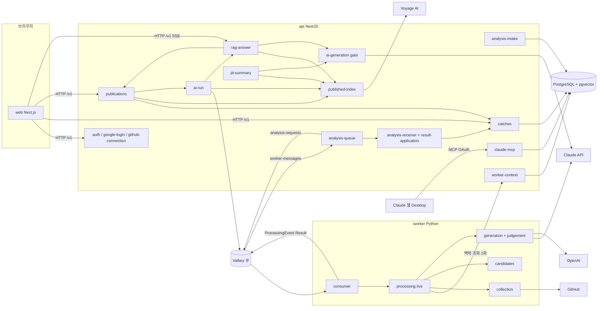
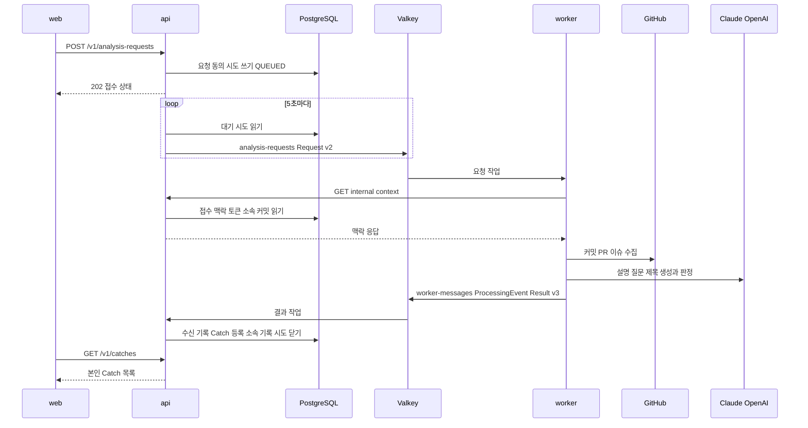
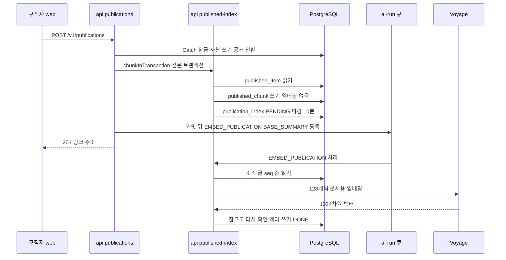
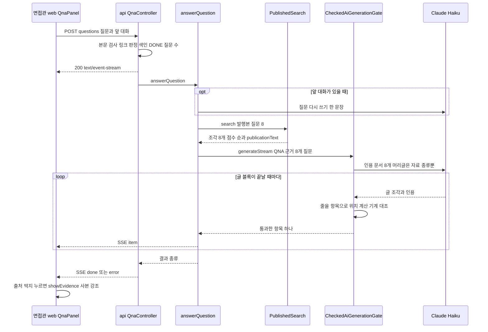
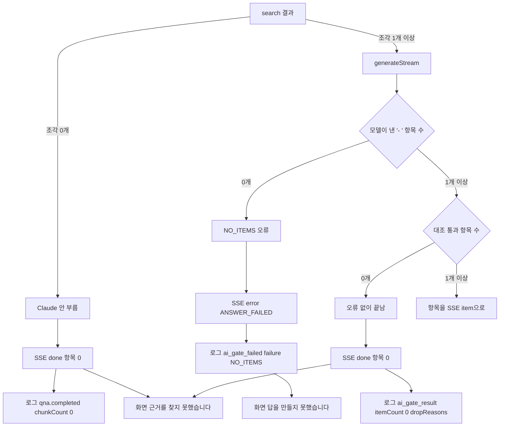
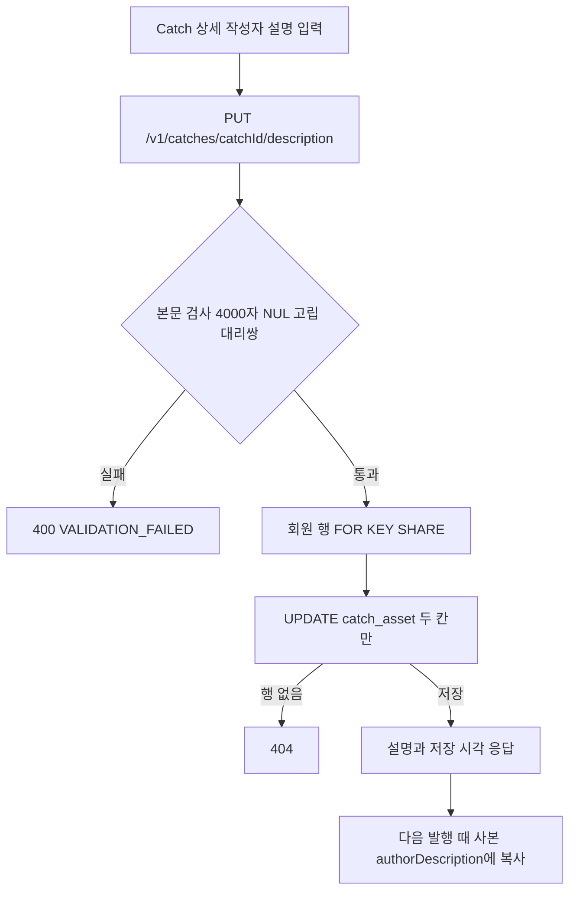

# 구조 — CatchU

> 기준: 2026-11-09 전체 다시 스캔(커밋 `a1d0fbb4`) 위에 2026-11-16 집중 스캔(커밋 `eb0d5a6c`)을 합쳤다. 11-16에 다시 읽은 곳은 `api.published-index`·`api.ai-generation`·`api.rag-answer`·`web.rag-answer`이고, 그 자리를 말하는 줄에는 「11-16 확인」을 붙였다. 나머지는 11-09 글 그대로다. 구성 요소 목록과 책임은 `component-inventory.md`, 경로 표는 `api-documentation.md`에 한 번만 적었다. 여기서는 연결과 흐름만 적는다.

## Architecture Analysis

### System Overview

배포 단위 셋(web·api·worker)과 공유 자원 셋(PostgreSQL 16 + pgvector, Valkey 큐, 파일 저장 폴더)으로 이뤄진다. 외부 서비스는 Google(로그인), GitHub(OAuth·REST·GraphQL), Anthropic Claude(생성·인용), OpenAI(판정), Voyage AI(임베딩)이다.

- **web**(Next.js 16): 브라우저에서 api를 직접 부른다(`NEXT_PUBLIC_API_BASE_URL` + `/v1`). 회원 토큰은 메모리에 두고, 세션 갱신은 쿠키로 한다(`web/src/lib/api.ts`). 서버 쪽 데이터 조회는 하지 않는다. 질의응답 SSE만 공용 호출 함수 대신 같은 주소 규칙의 직접 `fetch` 스트림이다(`web/src/features/rag-answer/rag-answer-api.ts`, 11-16 확인).
- **api**(NestJS 12): 모든 업무 상태와 DB를 가진다. HTTP 경로, 분석 큐 보내기·받기, 백그라운드 AI 작업(`ai-run` 큐), 처리 시한 판정(1분 주기), MCP 서버를 한 프로세스에서 돈다. 큐 주소가 없으면 큐 부분을 조립하지 않는다(`api/src/application.module.ts`).
- **worker**(Python 3.12): 큐 소비자 부모 프로세스가 요청마다 자식 프로세스 하나를 띄워 수집 → 작업 단위 판정 → 생성 → 판정을 하고 결과를 큐로 보낸다. DB에 붙지 않고, 필요한 접수 맥락·GitHub 토큰·소속 커밋은 api 내부 조회 한 번으로 받는다. HTTP는 `GET /health` 하나다.

### Architectural Style

**작은 서비스 셋 + 큐로 잇는 비동기 처리**(분산 모놀리스에 가깝다). 근거:

- api가 업무 상태와 DB를 혼자 갖고, worker는 상태 없는 계산기다. worker는 결과를 한 번 보내고 다시 보내지 않는다(`worker/README.md` 「보장하지 않는 범위」).
- 서비스 사이 계약은 코드 import가 아니라 YAML 스키마 파일 하나다(`api/contracts/repository-analysis/worker-messages.yaml`, `common.yaml`). 두 쪽이 같은 파일을 읽어 검사한다(api는 ajv, worker는 jsonschema).
- api 안은 기능별 Nest 모듈(폴더 하나 = 모듈 하나)이며, 계약 번호(C-01~C-17)로 Unit 사이 인터페이스를 정한다(예: C-10 `PublicationAccess`를 `PUBLICATION_ACCESS` 토큰으로 내보냄, C-09 `PublishedSearch`를 `PUBLISHED_SEARCH`, C-01 `AiGenerationGate`를 `AI_GENERATION_GATE`).
- 배포는 한 호스트 Compose(개발 서버, EC2 한 대)와 EKS 설정 파일(12월 최종, 아직 자원 없음) 두 갈래다.

### Component Relationships

<!-- Text fallback: 브라우저의 web이 api의 인증, catches, publications, rag-answer 경로를 HTTP /v1로 부른다(질의응답은 SSE). api의 analysis-queue가 Valkey 큐 analysis-requests에 요청을 넣고 worker-messages 큐에서 알림과 결과를 받아 analysis-receiver와 result-application을 거쳐 catches가 DB에 등록한다. publications는 catches를 읽어 사본을 만들고 published-index와 ai-run을 부른다. ai-run은 같은 큐 서버의 ai-run 큐로 임베딩(published-index, Voyage)과 기본 요약(rag-answer)을 돌린다. rag-answer는 published-index 검색, ai-generation 게이트(Claude), publications의 PublicationAccess를 쓴다. jd-summary도 published-index 검색과 ai-generation 게이트를 쓴다. claude-mcp는 Claude 웹·Desktop의 MCP 호출을 받아 DB를 읽는다. worker의 consumer가 큐에서 요청을 받아 processing live가 worker-context 내부 조회를 한 번 하고, collection이 GitHub를 읽고, candidates가 작업 단위를 정하고, generation과 judgement가 Claude와 OpenAI를 부른 뒤 consumer가 진행 알림과 결과를 큐로 보낸다. -->

### Data Flow

1. **분석 요청**: web `POST /v1/analysis-requests`(멱등 키) → api가 `analysis_request`·`analysis_consent`·`analysis_attempt`를 한 트랜잭션에 쓴다(`QUEUED`). 하루 횟수를 같은 트랜잭션에서 쓴다.
2. **큐 보내기**: 보내기 주기(5초, 한 번에 100건)가 대기 시도를 읽어 Request v2를 조립·검사하고 `analysis-requests` 큐에 넣는다(작업 ID = 시도 ID, 재시도 없음, `queue-spec.ts`).
3. **worker 처리**: 자식 프로세스가 요청을 계약으로 검사하고, api 내부 조회(`GET /v1/internal/analysis-attempts/:id/context`)로 접수 맥락·GitHub 토큰·선택 범위·**소속 커밋 SHA 전체**를 받는다. 수집 결과는 메모리에만 있다. 작업 단위를 정할 때 소속 커밋이 든 변경은 뺀다(`grouping.py` 7단계).
4. **결과**: Result v3(후보마다 `ownCommitShas` 1~3,000개 포함)를 `worker-messages` 큐로 보낸다. api는 스키마·맥락을 검사해 수신 기록을 남기고(`result_application_record`), 반영 서비스가 한 트랜잭션에서 Catch를 만들거나 참조하고 소속 기록·후보 등록을 쓴 뒤 시도를 닫는다.
5. **본인 열람·편집**: `GET /v1/catches`(catch_id 오름차순 cursor), 확인·불일치·공개 상태 PUT, 작성자 설명 GET·PUT.
6. **발행**: `POST /v1/publications` → 빈도 → 입력 → 동의 → (트랜잭션 밖) 토큰·비밀번호 해시 → 트랜잭션(하루 횟수, Catch를 `catch_id` 순서로 잠그고 다시 읽기, 공개 자격 확인, 전체 글 60,000자 확인, `publication`·`published_item` 쓰기, 비공개 Catch 공개로, 조각 나누기) → 커밋 뒤 `EMBED_PUBLICATION`·`BASE_SUMMARY` 작업 등록(실패해도 발행 성공).
7. **조각과 임베딩(11-16 확인)**: 발행 트랜잭션 안에서 `chunkInTransaction`이 `published_item`을 `position` 순으로 읽어 `buildChunkDrafts`로 조각을 만들고 `published_chunk`(임베딩 없음)와 `publication_index`(PENDING, 마감 = 지금 + 10분)를 쓴다. Catch 사본은 `workFacts[i]` → `subjectContribution` → `evidence[i].representedFacts[j]` → `authorDescription` 칸마다, 텍스트 자료는 `body`, PDF는 읽을 수 있는 `pages[n]`마다 1,000자 이하 범위로 나눈다. 조각에는 그 Catch 근거 주소 전체(`catchEvidenceUrls`)를 붙인다. 커밋 뒤 `EMBED_PUBLICATION` 처리기가 조각을 128개씩 Voyage `voyage-4-lite`(문서용)로 보내고 한 트랜잭션에서 벡터를 채워 `DONE`으로 바꾼다. 실패는 `FAILED`, 작성자의 [검색 다시 준비]는 조각을 다시 나누지 않고 임베딩만 다시 등록한다.
8. **면접관 열람**: `GET /v1/public/links/:token`은 읽기 전용 REPEATABLE READ 한 트랜잭션에서 판정(중지·만료 → 작성자 비활성 → grant)과 사본 읽기를 한다. 기본 요약은 `GET .../summary`, 질의응답은 `POST .../questions`.
9. **질의응답(11-16 확인)**: 본문 검사 → 링크 판정 → 색인 `DONE` 확인(아니면 409) → 링크당 하루 질문 수(Redis, 100 초과면 429) → SSE 열기 → (앞 대화가 있을 때만) 질문 다시 쓰기(Haiku, 인용 없음) → `search(발행본, 질문, 8)` → (조각이 있을 때만) 게이트 `generateStream` → 항목마다 SSE `item` → `done`. 검색은 그 발행본 조각만 코사인 거리로 정확 비교해 가까운 8개를 점수 순으로 준다. 같은 근거·같은 항목의 이웃 조각을 더하지 않는다. 조각 하나 = 근거 하나 = 인용 문서 하나이며, 문서 머리글(`context`)은 자료 종류뿐이다.
10. **기본 요약(11-16 확인)**: `BASE_SUMMARY` 처리기가 사본을 다시 읽어 조각이 아닌 사본 칸 하나를 근거 하나로 만들고(`summary-sources.ts`, 같은 칸 순서, 근거 ID `{publishedItemId}/{fieldPath}`) `generate`(Haiku)를 한 번 부른다. 항목 0개면 `FAILED`, 1개 이상이면 `base_summary`에 `DONE`과 항목을 쓴다.

### Key Design Decisions

| 결정 | 근거 자리 | 이 intent(#559)에 주는 뜻 |
|---|---|---|
| Catch 본문은 등록 때 한 번 쓰고 기존 Catch는 참조만 한다(내용 합치기·갱신 없음) | `registration-service.ts` 174~219행, `new-catch-content.ts` 62~66행(11-09) | 닿지 않는다 |
| 발행본은 jsonb 고정 사본, 받은 사람은 사본만 읽는다 | `publication.entity.ts`, `db-publication-access.ts` 155~185행(11-09) | 화면의 항목 제목 찾기는 이미 받은 사본에서 하면 된다 |
| **조각 하나 = 사본 문자열 칸 하나의 한 범위(칸을 넘지 않음)**(11-16 확인) | `chunker.ts` 105~128·152~159행, `published-chunk.entity.ts` 22행(1,000자 CHECK) | 근거 하나의 기록 줄이 줄마다 따로 검색된다. 합치면 위치 모양(`fieldPath` 하나)과 1,000자 CHECK가 함께 걸린다 |
| **조각 = 모델 근거 = 인용 문서, 문서 번호는 근거 하나에 대응**(11-16 확인) | `qna-service.ts` 48~57행, `citation-request.ts` 41~64행, `citation-locator.ts` 14~37행 | C-01 「칸 하나 안의 위치」가 이 1:1로 지켜진다. 여러 줄을 한 문서로 보내려면 블록마다 근거를 대응시키는 대응표가 필요하다 |
| **모델 문서 머리글은 자료 종류뿐**(11-16 확인) | `citation-request.ts` 22~26·52행 | 모델은 조각이 어느 Catch·어느 근거 것인지 모른다. 바꿀 곳 2 |
| **조각에 제목·AI 초안을 넣지 않는다**(FR6.4, 11-16 확인) | `chunker.ts` 104행, `summary-sources.ts` 2행, `api/test/published-index/chunker.test.cjs` 166·188행 | 「어느 Catch」는 제목 말고 다른 값(순번·저장소 이름·근거 주소)으로 알려야 한다 |
| **조각은 발행 때 한 번 나누고 다시 나누지 않는다**(11-16 확인) | `published-index-writer.ts` 15~25행 | 나누기를 바꾸면 이미 발행한 발행본은 옛 조각 그대로다 |
| **인용 항목 대조는 인용한 줄만 본다**(11-16 확인) | `fact-check.ts` 113~121·130~134행 | 같은 근거의 다른 줄 낱말을 쓴 항목은 버려진다(`fact`) |
| **스트림은 모델 항목 0개일 때만 실패, 모두 버려지면 정상 끝**(11-16 확인) | `checked-gate.ts` 204~218행, `qna-service.ts` 118~133행 | 「답 0개」가 두 화면 문구로 갈린다(`Interaction Diagrams` 「답 항목 0개」) |
| **항목 표시 부품은 사본을 받지 않는다**(11-16 확인) | `gated-item-view.tsx` 10~14행, `recipient-slots.ts` 21~31행(C-11) | 딱지 옆 제목은 부품 밖에서 찾아 넘겨야 한다. 받은 사람 패널 props는 C-11 모양이다 |
| api–worker 메시지는 `additionalProperties: false` 스키마와 판본 문자열로 고정 | `worker-messages.yaml` 1~4·72~113행(11-09) | 닿지 않는다 |
| 소속 기록은 등록 트랜잭션에서 한 번 쓰고 바꾸지 않는다 | `commit-assignment.entity.ts`, `registration-service.ts` 95~112행(11-09) | 닿지 않는다 |
| 작성자 설명은 `catch_asset`의 두 칸, 초기값 없음, 저장 경로 하나 | `catch-asset.entity.ts` 99~107행, `author-description-store.ts`(11-09) | 닿지 않는다(앞 intent: 칸 제목별 입력은 글 모양만 바꾸면 되고 DB·계약 변경이 없다) |
| 사본 모양을 쓰는 곳이 api 셋·web 둘로 흩어져 있다 | `chunker.ts`, `summary-sources.ts`, `snapshot-builder.ts`, `publications-api.ts`, `recipient-api.ts`(11-09) | 조각 나누기를 바꾸면 `chunker.ts`와 `summary-sources.ts`가 같은 칸 순서를 따로 적고 있다는 점을 함께 본다(11-16 확인) |
| 본인 목록 순서는 `catch_id`(무작위 UUID), 만든 시각 칸 없음 | `owner-catch-store.ts` 37~38행, 마이그레이션 `1790600000000`(11-09) | 닿지 않는다 |

### Improvement Opportunities

- (11-16) 검색 단위와 인용 단위를 나누면 「같은 근거 줄을 함께 보내기」와 「인용 위치는 칸 하나」가 둘 다 지켜진다. 예: 검색은 지금 조각으로 하고, 맞은 조각이 속한 근거(`evidence[i]`)의 다른 줄 칸을 사본에서 더해 근거 여러 개로 보낸다. 또는 인용 문서 하나에 여러 근거의 줄을 넣고 블록마다 근거를 대응시킨다. 두 길의 차이는 `code-quality-assessment.md` 「이 intent(#559)가 닿는 자리」.
- (11-16) 스트림 끝 로그에 「모델 항목 수」(`modelItems`)와 `nonItemLineCount`를 실패 때도 남기면 「답 0개」 원인을 로그 한 줄로 가를 수 있다. 지금 `ai_gate_failed`에는 이 칸이 없다.
- (11-09) 사본 모양 검사를 api 한 곳(예: `published-snapshot.ts` 옆의 검사 함수)으로 모으면 칸을 더할 때 고칠 곳이 준다. web은 api 응답을 믿지 않으므로 web 두 곳은 남는다.
- (11-09) 쓰지 않는 `PublicCatchStore`와 `share_link` 표를 정리하면 「공개」의 뜻이 하나로 준다.
- (11-09) `catch_asset`에 만든 시각이나 작업 시각 칸이 없어서, 정렬·「언제 한 일인가」 표시는 모두 새 자료가 필요하다.
- (11-09) 큰 판정 파일(`grouping.py`, `relations.py`)은 모듈 설명이 단계를 잘 나누지만, 규칙을 더할 때 한 파일이 더 커진다. 3단계 규칙 사실은 `build.py`·`grouping.py` 밖의 새 모듈로 두는 편이 영향이 작다.

## Interaction Diagrams

### 분석 요청부터 Catch 등록까지 (11-09)

<!-- Text fallback: web이 분석 요청을 보내면 api가 요청·동의·시도를 QUEUED로 쓰고 202를 준다. api는 5초마다 대기 시도를 읽어 Request v2를 analysis-requests 큐에 넣는다. worker가 작업을 받아 api 내부 맥락 조회를 한 번 하고(접수 맥락, GitHub 토큰, 소속 커밋), GitHub에서 커밋·PR·이슈를 모으고, Claude와 OpenAI로 생성과 판정을 한 뒤 진행 알림과 Result v3를 worker-messages 큐로 보낸다. api는 결과를 받아 수신 기록, Catch 등록, 소속 기록, 시도 닫기를 한다. web은 GET /v1/catches로 본인 목록을 본다. -->

### 발행과 조각·임베딩 (11-16 확인)

<!-- Text fallback: 구직자가 발행을 요청하면 publications가 한 트랜잭션에서 Catch를 잠그고 사본을 쓰고 공개로 바꾼 뒤, 같은 트랜잭션에서 published-index의 chunkInTransaction이 published_item을 읽어 조각(임베딩 없음)과 publication_index(PENDING, 마감 10분)를 쓴다. 커밋 뒤 EMBED_PUBLICATION과 BASE_SUMMARY를 ai-run 큐에 등록하고 201을 준다. EMBED_PUBLICATION 처리기는 조각 글을 seq 순으로 읽어 128개씩 Voyage에 문서용으로 보내 1024차원 벡터를 받고, 짧은 트랜잭션에서 상태를 다시 확인한 뒤 벡터를 채우고 DONE으로 바꾼다. -->

### 받은 사람 질의응답 (11-16 확인)

<!-- Text fallback: 면접관 화면의 QnaPanel이 질문과 최근 6개 앞 대화를 POST로 보낸다. QnaController는 본문 검사, 링크 판정, 색인 DONE 확인, 하루 질문 수를 스트림 전에 확인하고 200 text/event-stream을 연다. answerQuestion은 앞 대화가 있을 때만 Claude로 질문을 한 문장으로 다시 쓰고, PublishedSearch.search(발행본, 질문, 8)로 가까운 조각 8개를 점수 순으로 받는다. 게이트의 generateStream이 조각마다 인용 문서 하나(머리글은 자료 종류뿐)를 만들어 Claude Haiku를 스트림으로 부른다. 글 블록이 끝날 때마다 게이트가 줄을 항목으로 만들고 인용 위치를 사본 칸 범위로 계산하고 기계 대조를 해 통과한 항목만 내보내면, 컨트롤러가 SSE item으로 쓴다. 끝나면 done 또는 error를 보낸다. 화면은 출처 딱지를 누르면 showEvidence로 사본의 그 칸 범위를 강조한다. -->

### 답 항목 0개의 세 길 (11-16 확인)

<!-- Text fallback: 검색 조각이 0개면 Claude를 부르지 않고 항목 0개로 done을 보내며 qna.completed에 chunkCount 0이 남는다. 조각이 있으면 generateStream을 부른다. 모델이 '- ' 항목을 하나도 내지 않으면 NO_ITEMS 오류가 되어 SSE error ANSWER_FAILED를 보내고 ai_gate_failed 로그(failure NO_ITEMS)가 남으며 화면은 "답을 만들지 못했습니다. 다시 질문해 주세요"를 보인다. 모델 항목이 있지만 잘림·위치·대조로 모두 버려지면 오류 없이 항목 0개로 done을 보내고 ai_gate_result 로그에 itemCount 0과 버린 이유별 수(dropReasons)가 남는다. 조각 0개와 모두 버려진 경우 화면은 "발행본에서 이 질문의 근거를 찾지 못했습니다"를 보인다. 대조를 통과한 항목이 있으면 SSE item으로 보낸다. -->

### 작성자 설명 저장 (11-09)

<!-- Text fallback: 상세의 작성자 설명을 PUT /v1/catches/{catchId}/description로 보낸다. 본문을 검사해(4,000자, NUL, 고립 대리쌍) 실패하면 400이다. 통과하면 회원 행을 FOR KEY SHARE로 잡고 catch_asset의 설명 두 칸만 UPDATE한다. 행이 없으면 404, 저장되면 설명과 저장 시각을 돌려준다. 저장한 설명은 다음 발행 때 사본의 authorDescription으로 복사된다. 이미 만든 사본은 바뀌지 않는다. -->
