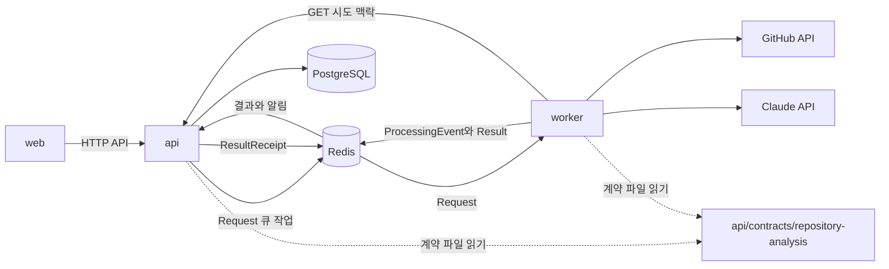
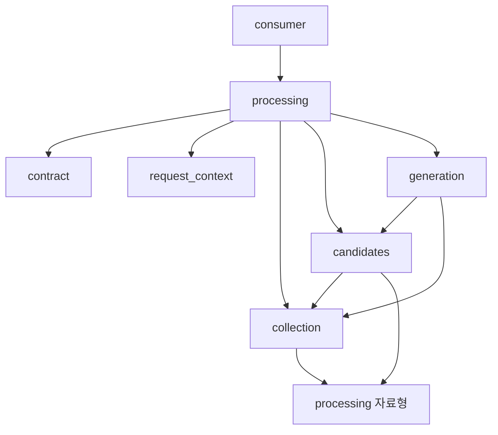
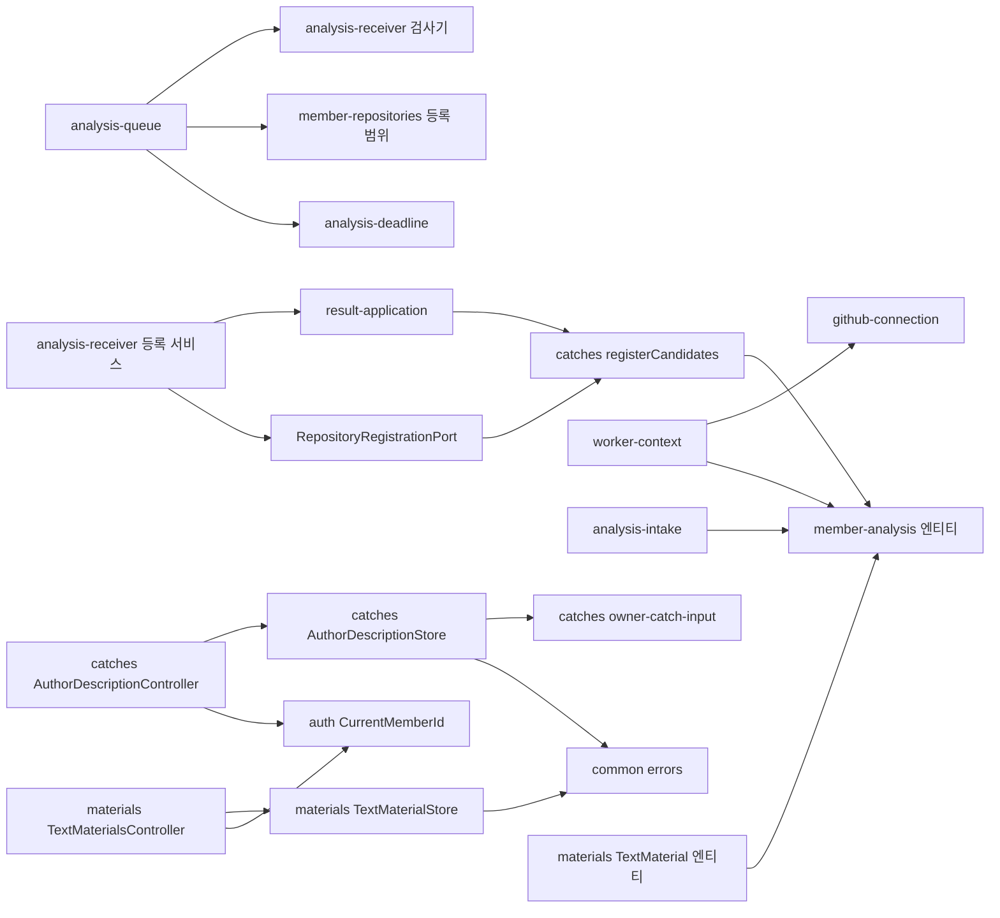

# 의존 관계 — CatchU

> 범위: 2026-11-03 집중 스캔(`kind: partial`), 기준 커밋 `9923226c`. 판본 목록은 [technology-stack.md](technology-stack.md)에 한 번만 적고, 여기에는 무엇이 무엇에 기대는지만 적는다.

## 서비스 사이의 의존

텍스트 대체: web은 api의 HTTP API를 쓴다. api는 요청을 Redis 큐 작업으로 넣고 worker가 꺼낸다. worker는 진행 알림과 결과를 큐로 돌려주고 api가 받아 수신 확인을 큐로 보낸다. worker는 시도마다 api 맥락 조회를 HTTP로 부른다. api만 PostgreSQL을 쓴다. worker는 GitHub API와 Claude API를 부른다. api와 worker는 저장소 안 같은 계약 파일을 읽는다.

| 방향 | 매개 | 묶임의 세기 |
|---|---|---|
| api → worker | Redis 큐의 `Request` | 강함: 계약 v2 `additionalProperties: false`, 판본 하나만 받음 |
| worker → api | Redis 큐의 `ProcessingEvent`·`Result` | 강함: 같은 계약. api가 결과 지문을 저장해 대조 |
| worker → api | 내부 HTTP 맥락 조회 | 중간: 응답 모양을 worker `request_context/decode.py`가 해석(계약 파일 밖) |
| api ↔ worker | 계약 파일 경로 | 저장소 구조에 묶임: worker는 `REPO_ROOT / "api/contracts/repository-analysis"`를 읽는다 |
| web → api | 공개·회원 HTTP API | Catch 응답 모양(`title`·`workFacts`·`draft` 등) |
| web → api | 작성자 설명 `GET`·`PUT /v1/catches/{catchId}/description` | 중간: 응답 모양 `{authorDescription, authorDescriptionUpdatedAt}`을 web이 검사(`isAuthorDescription`). 4,000자 상한을 두 서비스가 각자 상수로 가짐 |
| web → api | 텍스트 자료 `/v1/text-materials` | 중간: 응답 모양을 web이 검사. 제목 100·본문 20,000 상한을 두 서비스가 각자 상수로 가짐 |
| web ↔ api | 첫 이용 고지 판본 상수 | 손으로 맞춤: 두 상수가 같아야 동의 기록이 받아들여짐(시험이 대조) |

작성자 설명·텍스트 자료는 worker·큐·계약 파일과 무관하다.

## worker 안의 의존

텍스트 대체: 큐 소비자는 처리 단계를 부르고, 처리 단계는 계약 검사·맥락 조회·수집·후보·생성을 부른다. 후보는 수집 기록과 처리 자료형에 기댄다. 생성은 후보의 `group`·`work_identity`를 다시 부르고 수집 기록을 쓴다. 수집도 처리 자료형(`StageFailure`·`GenerationOutput`·`CheckedRequest`)에 기댄다.

눈여겨볼 점:

- **생성이 후보 묶음을 다시 부른다**: `generation/material.py`가 `group(outcome)`과 `work_identity`를 다시 불러 후보와 단위를 맞춘다. 후보 판정 규칙(나누기·소속 제외)을 바꾸면 생성 재료 찾기도 같은 결과를 내야 한다. 이미 소속된 커밋 목록을 빼는 처리는 두 호출 모두에 같이 들어가야 열쇠가 맞는다.
- **처리 자료형이 공용이다**: `processing/generation.py`의 `EligibleCandidate`·`GenerationOutput`을 수집·후보·생성이 함께 쓴다. 후보에 새 칸(소속 커밋 전체)을 더하면 이 자료형과 결과 조합(`processing/result.py`)이 바뀐다.
- **수집 ↔ 처리의 순환을 피하려고** `processing/live.py`는 패키지 입구에서 다시 내보내지 않는다(모듈 설명).
- **제목 모듈의 종류 판정**(`generation/title.py classify`)을 재료 순서에 쓰려면 생성 패키지 안에서 공용 위치로 옮기거나 그대로 불러 쓴다.

## api 안의 의존(이 경로)

텍스트 대체: 큐 보내기는 수신 쪽 계약 검사기, 저장소 등록 범위, 처리 시한을 쓴다. 수신 쪽 등록 서비스는 결과 반영 서비스와 저장소 등록 포트를 만들고, 포트는 Catch 등록 함수를 부른다. 맥락 조회는 GitHub 연결 서비스와 분석 엔티티를 쓴다. 접수와 Catch 등록도 분석 엔티티(`analysis_request`·`analysis_attempt`·`analysis_consent`·`member_account`)를 쓴다. 작성자 설명 컨트롤러는 저장소 클래스와 인증 데코레이터를, 저장소 클래스는 회원 Catch 입력 검사(`catchIdInput`·`isUuid`)와 공통 오류를 쓴다. 텍스트 자료 컨트롤러·저장소도 인증과 공통 오류를 쓰고, 엔티티는 회원 엔티티를 외래 키로 가리킨다.

- `catches`·`materials`는 `publications`를 import하지 않는다(U4 비기능 설계 「의존 방향」). 발행 사본은 발행 때 원본을 복사하고 원본과 외래 키를 두지 않는다.
- 작성자 설명 저장소는 등록 코드(`registration-service.ts`)와 같은 표를 쓰지만 서로 부르지 않는다. 둘은 칸으로 나뉜다: 등록은 설명 칸을 쓰지 않고, 설명 저장소는 설명 두 칸만 쓴다. 동시에 돌면 등록의 `pg_advisory_xact_lock`과 설명 `UPDATE`의 행 잠금이 따로 걸리며, 등록은 기존 행을 바꾸지 않으므로 서로 덮을 것이 없다.

## web 안의 의존(이 경로)

- `features/assets/assets-member-page.tsx` → `createAuthorDescriptionApi(api.member)` → `AssetsConnected`(`descriptionApi`) → `AssetsView`(`descriptionEditor`) → `AuthorDescriptionEditor` → `AuthorDescriptionPanel`.
- `features/assets/author-description-*`와 `features/materials/*`는 `src/lib/save-outcome.ts`(실패 구분·문구), `src/lib/view-store.ts`, `src/lib/unsaved-traverse-guard.ts`, `features/profile/use-unsaved-guard`(`UNSAVED_MESSAGE`), `components/auth/use-unsaved-changes`를 함께 쓴다.
- 받은 사람 화면(`features/recipient`)은 작성자 설명에 기대지 않는다.

## DB 표 관계(이 경로)

| 표 | 부모(연쇄 삭제) | 이 intent와 |
|---|---|---|
| `analysis_request` | 회원, 저장소 등록 | 저장소 ID를 가진 곳. Catch의 저장소는 이 행으로 찾는다 |
| `analysis_attempt` | 분석 요청 | |
| `analysis_consent` | 회원, 분석 요청 | `notice_revision`(분석 고지 판본) |
| `result_application_record` | 분석 시도 | 결과 지문 |
| `catch_asset` | 회원, 분석 요청 | 유일 (회원, `work_identity`). 저장소 칸 없음. 작성자 설명 두 칸(`author_description`·`author_description_updated_at`, 함께 NULL CHECK)이 여기 있다 |
| `catch_evidence` | Catch | 본인 커밋은 최근 20건까지 |
| `candidate_registration` | 결과 수신 기록, Catch | |
| `text_material` | 회원 | Catch와 관계 없음. `member_id` 색인 |
| `publication` → `published_item` | 회원 → 발행본 | 사본은 원본 Catch·자료와 외래 키 없음 |
| `ai_consent` | 회원 | 유일 (회원, `notice_version`) |
| (소속 표) | **없음** | 새로 만들 표. 회원 연쇄 삭제가 규칙이다 |

## 외부 의존

| 대상 | 누가 | 보내는 것 |
|---|---|---|
| GitHub REST·GraphQL | worker | 회원 토큰으로 공개 저장소 읽기 |
| Anthropic Messages API | worker | 가린 변경 줄·경로·상태(커밋 메시지·PR 글·SHA 없음) |
| Anthropic API | api | 받은 사람 쪽 AI 입력(이 스캔 범위 밖) |
| Voyage AI | api | 검색 조각 임베딩(이 스캔 범위 밖) |
| OpenAI Decisions API | 없음 | Catch 개편이 더할 판정 공급자 |

작성자 설명·텍스트 자료 API는 외부를 부르지 않는다. 발행된 사본의 설명·자료가 받은 사람 쪽 AI·임베딩으로 가는 길은 발행·검색 조각 쪽에 있다.
