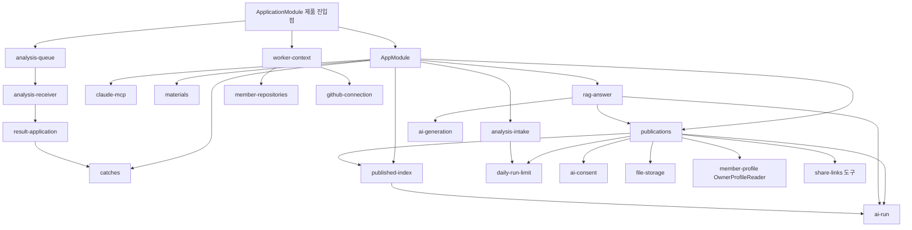

# 의존 관계 — CatchU

> 기준: 2026-11-09 전체 다시 스캔, 커밋 `a1d0fbb4`. 라이브러리 판본은 `technology-stack.md`에 한 번만 적었다. 여기서는 서비스 사이, 모듈 사이, 표 사이의 의존과 외부 서비스에 기대는 조건을 적는다.

## 서비스 사이

| 쪽 | 기대는 것 | 방식 | 깨지는 경우 |
|---|---|---|---|
| web → api | `/v1` 경로와 응답 모양 | 브라우저 fetch(`web/src/lib/api-client.ts`), CORS는 개발만 | 응답 칸 이름·모양을 바꾸면 web 검사기(`isCatch`, `isPublishedSnapshot` 등)가 「조회 실패」로 바꾼다 |
| api ↔ worker | 메시지 계약 YAML | 큐 `analysis-requests`·`worker-messages`, 양쪽이 같은 YAML을 읽어 검사 | 한쪽만 판본을 올리면 스키마 검사에서 거부(`SCHEMA_INVALID`) |
| worker → api | 내부 맥락 조회 | HTTP `GET /v1/internal/analysis-attempts/:id/context`, `X-Worker-Key` | api에서 `WORKER_CONTEXT_ENABLED`가 꺼져 있으면 LIVE 처리가 실패 결과를 보낸다 |
| api 시험 → worker | 합성 결과 세트 | `worker/fixtures/m1-synthetic/`를 `api/test/worker-messages.test.cjs`가 읽음 | 세트를 바꾸면 api 시험도 바뀐다 |
| api 이미지 → 계약 | 계약 YAML 두 개 | `api/Dockerfile`·`.dockerignore`가 복사, `application.module.ts` 14행이 경로를 정함 | 폴더를 옮기면 기동 때 검사기 준비가 실패한다 |

세 서비스 사이에 코드 import는 없다.

## api 모듈 사이 (주요 방향)

<!-- Text fallback: AppModule이 catches, publications, rag-answer, published-index, claude-mcp, materials, analysis-intake 등을 담는다. 제품 진입점 ApplicationModule은 AppModule에 worker-context와 analysis-queue를 더한다. analysis-queue는 analysis-receiver를 거쳐 result-application이 catches 등록을 부른다. publications는 published-index, ai-run, daily-run-limit, ai-consent, file-storage, member-profile의 OwnerProfileReader, share-links 도구에 기댄다. rag-answer는 publications가 내보낸 PUBLICATION_ACCESS와 ai-generation 게이트, ai-run에 기댄다. published-index는 ai-run에 처리기를 등록한다. analysis-intake는 daily-run-limit을 쓴다. worker-context는 member-repositories의 선정 공급자와 github-connection의 자격정보 함수를 쓴다. -->

- `publications`는 `catches`를 Nest import로 부르지 않고 `catch_asset`·`catch_evidence`·`analysis_request`·`repository_protection`·`text_material`을 SQL로 직접 잠그고 읽는다(`publish.service.ts` 67~89행). `catches` 쪽 칸 이름을 바꾸면 발행 SQL도 바꾼다.
- `catches`의 작성자 설명은 `publications`를 import하지 않는다(`author-description-store.ts` 25행 주석). 의존 방향은 「발행 → Catch 표」 하나다.
- `rag-answer`·`claude-mcp`·`published-index`는 사본(jsonb) 모양에 기댄다. 칸 하나를 바꿀 때 함께 고칠 파일 목록은 `code-quality-assessment.md` 「이 intent가 닿는 자리」.
- 순환 import는 이번 스캔에서 보지 못했다. 순환을 피하려고 토큰 파일을 따로 둔 곳이 있다(`rag-answer/rag-answer-tokens.ts`, `publications/publications-config.ts`).

## worker 패키지 사이

`consumer` → `processing`(runner·live) → `request_context`, `collection`, `candidates`, `generation`(→ `judgement`) → `processing.result` → `contract`. `candidates`·`generation`은 `collection.records`의 자료형을 읽는다. `collection`이 `processing.request_check`를 불러 쓰므로 `processing/live.py`는 패키지 입구에서 다시 내보내지 않는다(모듈 설명). `generation.material`은 같은 소속 커밋 집합으로 `candidates.group`을 다시 부른다(두 값이 달라지면 다른 단위를 찾는다).

## 표 사이 (외래 키와 연쇄 삭제)

| 부모 | 자식 | 지울 때 |
|---|---|---|
| `member_account` | `member_profile`, `github_connection`, `analysis_request`, `analysis_consent`, `idempotency_record`, `auth_session`, `repository_registration`, `repository_protection`, `ai_consent`, `daily_execution_count`, `catch_asset`, `text_material`, `pdf_material`, `publication`, `share_link`, `mcp_connection`·`mcp_access_token`·`mcp_authorization_code` | 연쇄 삭제(마이그레이션의 `ON DELETE CASCADE`로 확인. 10월 말 `179281797801x`가 옛 외래 키를 바꿨다. 탈퇴 4단계가 이것에 기댄다) |
| `analysis_request` | `catch_asset.source_request_id` | 연쇄 삭제 |
| `catch_asset` | `catch_evidence`, `candidate_registration`, `commit_assignment`(`(catch_id, member_id)` → `(catch_id, owner_id)`) | 연쇄 삭제 |
| `publication` | `published_item`(→ `published_pdf_page`), `publication_index`, `published_chunk`, `base_summary` | 연쇄 삭제. `published_item.source_id`는 원본을 가리키지 않는다(외래 키 없음, 사본은 원본 삭제와 무관) |
| `text_material` | (없음) | 지워도 발행 사본은 남는다 |

- `commit_assignment`의 열쇠는 `(member_id, github_repository_id, commit_sha)`이고 회원이 Catch 주인과 다르면 DB가 거부한다(`commit-assignment.entity.ts`).
- 표 정의 위치는 `component-inventory.md`의 각 모듈 「주요 파일」.

## 외부 서비스에 기대는 조건

| 서비스 | 없을 때 동작 | 근거 |
|---|---|---|
| PostgreSQL | api 기동 실패(종료 코드 1). `/health`도 안 열림 | `api/README.md` 「로컬 DB 준비」 |
| Valkey 큐 | 큐 주소가 없으면 분석 큐·`ai-run`을 조립하지 않는다. 발행은 성공하고 색인·요약은 시한으로 `FAILED` | `application.module.ts`, `ai-run.ts` 머리 주석 |
| Claude(api) | 키가 없어도 기동. 게이트·다시 쓰기 호출 때 `NOT_CONFIGURED` | `api/docs/environment.md` |
| Voyage | 운영은 키 필수(기동 실패), 개발·시험은 합성 제공자 | `api/docs/environment.md` |
| GitHub(worker) | 맥락 조회가 모름·실패면 진행 알림 없이 실패 결과 하나 | `worker/README.md` 「내부 API 요청 정보 조회」 |
| Claude·OpenAI(worker) | 생성 실패는 후보를 남기고 초안 `null`·실패 기록. 판정 키가 없으면 AI 쪽을 끈다 | `worker/README.md` 「요청 검사와 합성 결과 생성」, `worker/docs/generation-provider.md` |
| 파일 저장 폴더 | 두 값이 없으면 기동하되 파일 호출이 `StorageUnavailable`(탈퇴 2단계 500, 발행본 삭제 500) | `api/docs/environment.md` |

## 이 intent가 새로 만들 수 있는 의존

- 발행 SQL이 `repository_registration`(저장소 이름)을 읽게 되면 `publications` → `member-repositories` 표 의존이 새로 생긴다(지금은 `analysis_request.repository_id`만 읽는다).
- 결과 메시지에 작업 시각·규칙 사실을 더하면 `contract.repository-analysis` 판본, `api.analysis-receiver` 타입·검사기, `api.catches` 등록·엔티티·마이그레이션, `worker.processing` 결과 조합, `worker/fixtures/m1-synthetic`가 함께 움직인다.
