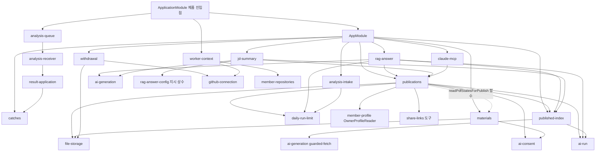

# 의존 관계 — CatchU

> 기준: 2026-11-09 전체 다시 스캔(커밋 `a1d0fbb4`) 위에 2026-11-16 집중 스캔(커밋 `eb0d5a6c`)과 2026-11-19 집중 스캔(커밋 `aa241a4c`)을 합쳤다. 11-19에 다시 확인한 것은 「발행 사본에 기대는 곳」·「받은 사람 AI 쪽 의존」·「표 사이」의 발행·자료 줄·「이 intent(#597)가 새로 만들 수 있는 의존」과 모듈 그림의 `publications`·`rag-answer`·`claude-mcp`·`jd-summary`·`materials`·`withdrawal` 줄이다. 라이브러리 판본은 `technology-stack.md`에 한 번만 적었다. 여기서는 서비스 사이, 모듈 사이, 표 사이의 의존과 외부 서비스에 기대는 조건을 적는다.

## 서비스 사이

| 쪽 | 기대는 것 | 방식 | 깨지는 경우 |
|---|---|---|---|
| web → api | `/v1` 경로와 응답 모양 | 브라우저 fetch(`web/src/lib/api-client.ts`), CORS는 개발만 | 응답 칸 이름·모양을 바꾸면 web 검사기(`isCatch`, `isPublishedSnapshot`, `parseGatedItem` 등)가 「조회 실패」로 바꾼다. 검사기는 모르는 칸을 무시하고 받은 사람 화면은 계약 칸만 옮기므로, 새 칸은 고치지 않으면 화면에 닿지 않는다(11-19 확인). 질의응답 SSE의 `item`이 검사를 못 넘으면 그 자리에서 스트림을 실패로 끝낸다(`rag-answer-api.ts` 174~179행) |
| api ↔ worker | 메시지 계약 YAML | 큐 `analysis-requests`·`worker-messages`, 양쪽이 같은 YAML을 읽어 검사 | 한쪽만 판본을 올리면 스키마 검사에서 거부(`SCHEMA_INVALID`) |
| worker → api | 내부 맥락 조회 | HTTP `GET /v1/internal/analysis-attempts/:id/context`, `X-Worker-Key` | api에서 `WORKER_CONTEXT_ENABLED`가 꺼져 있으면 LIVE 처리가 실패 결과를 보낸다 |
| api 시험 → worker | 합성 결과 세트 | `worker/fixtures/m1-synthetic/`를 `api/test/worker-messages.test.cjs`가 읽음 | 세트를 바꾸면 api 시험도 바뀐다 |
| api 이미지 → 계약 | 계약 YAML 두 개 | `api/Dockerfile`·`.dockerignore`가 복사, `application.module.ts` 14행이 경로를 정함 | 폴더를 옮기면 기동 때 검사기 준비가 실패한다 |
| api·worker·web → 같은 상한 값 | 발행본 전체 글 60,000자 | 각자 상수, 주석이 서로를 가리킴(`publications-config.ts` 25~31행) | 한쪽만 바꾸면 PDF 추출 상한과 발행 상한·화면 안내가 어긋난다(11-19 확인) |

세 서비스 사이에 코드 import는 없다.

## api 모듈 사이 (주요 방향)

<!-- Text fallback: AppModule이 catches, publications, rag-answer, published-index, claude-mcp, materials, jd-summary, withdrawal, analysis-intake 등을 담는다. 제품 진입점 ApplicationModule은 AppModule에 worker-context와 analysis-queue를 더한다. analysis-queue는 analysis-receiver를 거쳐 result-application이 catches 등록을 부른다. publications는 published-index, ai-run, daily-run-limit, ai-consent, file-storage, member-profile의 OwnerProfileReader, share-links 도구에 기대고, PDF 발행 때 materials의 readPdfStatesForPublish 함수를 직접 부른다. rag-answer, jd-summary, claude-mcp는 publications가 내보낸 PUBLICATION_ACCESS(C-10)를 쓴다. rag-answer는 published-index 검색, ai-generation 게이트, ai-run, daily-run-limit에도 기댄다. jd-summary는 published-index 검색, ai-generation 게이트, rag-answer-config의 지시 상수를 쓴다. materials는 file-storage와 ai-consent를 쓴다. withdrawal은 file-storage와 github-connection의 자격정보 보관을 쓴다. published-index는 ai-run에 처리기를 등록하고 ai-generation의 guarded-fetch로 Voyage를 부른다. worker-context는 member-repositories의 선정 공급자와 github-connection의 자격정보 함수를 쓴다. -->

- `publications`는 `catches`·`materials`를 Nest import로 부르지 않고 `catch_asset`·`catch_evidence`·`analysis_request`·`repository_registration`·`repository_protection`·`commit_assignment`·`text_material`·`pdf_material`·`pdf_page_text`를 SQL로 직접 잠그고 읽는다(`publish.service.ts` 94~127행, `pdf-publish.ts` 103~121행, 11-19 확인). PDF 사전 확인만 `materials/pdf-material-store.ts`의 함수 `readPdfStatesForPublish`를 import한다(`pdf-publish.ts` 9행).
- `catches`·`materials`는 `publications`를 import하지 않는다(`author-description-store.ts` 25행, `text-material-store.ts` 34행 주석). 의존 방향은 「발행 → 원본 표」 하나다.
- `rag-answer`·`claude-mcp`·`published-index`·web 두 곳은 사본(jsonb) 모양에 기댄다(아래 「발행 사본에 기대는 곳」).
- 순환 import는 이번 스캔에서 보지 못했다. 순환을 피하려고 토큰 파일을 따로 둔 곳이 있다(`rag-answer/rag-answer-tokens.ts`, `publications/publications-config.ts`, `published-index/embedding-types.ts`).

## 발행 사본에 기대는 곳 (11-19 확인)

| 쓰는 쪽 | 기대는 것 | 근거 | 사본 모양을 바꾸면 |
|---|---|---|---|
| `published-index` 조각 | `published_item` 행(`position`·`item_kind`·`snapshot`)과 `published_pdf_page` | `published-index-writer.ts` 95~121행, `chunker.ts` 81~146행 | 모르는 칸은 무시한다. 항목 칸을 바꾸면 `ChunkSourceError`로 발행이 실패한다 |
| `rag-answer` 요약·질의응답 | C-10 `readSnapshot` 결과의 `items[].position`·`itemKind`·`snapshot` | `summary-sources.ts` 96~114행, `qna-sources.ts` 83~101·169~196행 | 항목 순서·표 글자는 `position` 정렬에 기댄다. 모양이 틀리면 `SnapshotShapeError`(요약 `FAILED`, 질의응답 생성 실패) |
| `claude-mcp` 받은 링크 읽기 | 같은 `readSnapshot` 결과, `position`이 cursor 열쇠 | `mcp-shared-publication-reader.ts` 42~45행, `mcp-shared-page.ts` 91~97행 | `position`이 발행본 안에서 유일해야 cursor가 맞는 항목을 찾는다. 묶음을 실으려면 쪽 모양(C-15)을 바꾼다 |
| `publications` 받은 사람 열람·작성자 상세 | `readSnapshotIn` | `db-publication-access.ts` 161~185행, `publication-manage.service.ts` 84~100행 | 사본에 칸을 더하면 여기서 함께 읽어 응답에 싣는다 |
| web 작성자 상세·받은 사람 | `isPublishedSnapshot`·`orderedItems`·`pickItem`·`resolveEvidenceTarget`·`fieldText`·`itemTitleFinder` | `publications-api.ts` 107~133행, `recipient-api.ts` 27~68행, `recipient-slots.ts` 41~79행, `item-title.ts` | 새 칸은 검사·옮기기를 함께 고쳐야 받은 사람 화면에 닿는다 |
| `jd-summary` | 사본이 아닌 검색 조각(C-09) | `jd-summary-processor.ts` 28~42행 | 닿지 않는다 |

## 받은 사람 AI 쪽 의존 (11-16 확인, 질의응답 줄은 11-19 확인)

| 쓰는 쪽 | 기대는 것 | 주입·연결 | 바꾸면 함께 움직이는 것 |
|---|---|---|---|
| `rag-answer` 질의응답 | C-09 `PublishedSearch.search(…, 8)` → `ChunkHit[]` | `@Inject(PUBLISHED_SEARCH)`(`qna.controller.ts` 59행) | `ChunkHit` 칸을 바꾸면 `chunkToSource`(`qna-sources.ts` 41~50행)와 JD `jdGenerationRequest`가 함께 바뀐다 |
| `rag-answer` 질의응답 | C-10 `readSnapshot`(#559부터 질문마다 한 번) | `@Inject(PUBLICATION_ACCESS)`(`qna.controller.ts` 58·104·118~125행) | 사본 읽기가 실패하면 스트림 전 404·500이다 |
| `rag-answer` 질의응답·요약 | C-01 `AiGenerationGate.generateStream`·`generate`, `AiSource.itemContext` | `@Inject(AI_GENERATION_GATE)` | 게이트는 기본 요약·질의응답·JD 요약이 함께 쓴다. 머리글은 질의응답만 단다 |
| `rag-answer` | C-10 `PublicationAccess`(`resolveForRecipient`·`resolveForOwner`·`readSnapshot`) | `RagAnswerModule.register({ publicationAccess })`, 앱은 U4 DB 구현 | 판정 결과의 `ownerMemberId`가 작성자당 질문 수 열쇠다(`qna.controller.ts` 94·105행) |
| `jd-summary` | 같은 검색(6개), 같은 게이트(`JD_SUMMARY`, `generate`), `AUTHOR_MATERIAL_VOICE_INSTRUCTION`, C-10 판정 | `jd-summary-processor.ts` 30행, `jd-generation-request.ts` 4행, `jd-summary.service.ts` 33·43행 | 조각 글이 1,000자를 넘거나 위치 길이가 글 길이와 다르면 `JdContractInvalid` |
| `ai-generation` 위치 | 근거 `location`이 사본 칸 하나의 범위라는 전제 | `citation-locator.ts`가 `source.location.charStart + 줄 시작` | 근거가 여러 칸에 걸치면 이 계산이 틀린다. web `resolveEvidenceTarget`은 칸 하나·범위가 칸 안일 때만 강조한다 |
| web `rag-answer` 패널 | 받은 사람: C-11 `RecipientSlotProps` + 선택 `itemTitleOf`, 작성자: `publicationId`·`showEvidence`·`itemTitleOf` | `recipient-view.tsx` 99~115행, `publication-detail-view.tsx` 85~86행 | `showEvidence`는 위치 하나만 받는다. 「돌아갈 자리」를 넘기려면 이 함수 모양(C-11 evidence-highlight)과 두 화면을 함께 고친다. 자리 4 JD 패널도 같은 `RecipientSlotProps`를 받는다 |

## worker 패키지 사이 (11-09)

`consumer` → `processing`(runner·live) → `request_context`, `collection`, `candidates`, `generation`(→ `judgement`) → `processing.result` → `contract`. `candidates`·`generation`은 `collection.records`의 자료형을 읽는다. `collection`이 `processing.request_check`를 불러 쓰므로 `processing/live.py`는 패키지 입구에서 다시 내보내지 않는다(모듈 설명). `generation.material`은 같은 소속 커밋 집합으로 `candidates.group`을 다시 부른다(두 값이 달라지면 다른 단위를 찾는다).

## 표 사이 (외래 키와 연쇄 삭제)

| 부모 | 자식 | 지울 때 |
|---|---|---|
| `member_account` | `member_profile`, `github_connection`, `analysis_request`, `analysis_consent`, `idempotency_record`, `auth_session`, `repository_registration`, `repository_protection`, `ai_consent`, `daily_execution_count`, `catch_asset`, `text_material`, `pdf_material`, `publication`, `share_link`, `jd`, `jd_summary_run`, `mcp_connection`·`mcp_access_token`·`mcp_authorization_code` | 연쇄 삭제(마이그레이션의 `ON DELETE CASCADE`. 탈퇴 4단계가 이것에 기댄다. `jd`·`jd_summary_run`·`pdf_material`은 11-19 외래 키 줄로 확인) |
| `analysis_request` | `catch_asset.source_request_id` | 연쇄 삭제 |
| `catch_asset` | `catch_evidence`, `candidate_registration`, `commit_assignment`(`(catch_id, member_id)` → `(catch_id, owner_id)`) | 연쇄 삭제 |
| `publication` | `published_item`(→ `published_pdf_page`), `publication_index`, `published_chunk`, `base_summary`, `jd_summary_run`(→ `jd_summary_result`) | 연쇄 삭제. `published_chunk`는 `(publication_id, published_item_id)` 복합 외래 키로 같은 발행본의 항목만 가리킨다. `published_item.source_id`는 원본을 가리키지 않는다(사본은 원본 삭제와 무관)(11-19 확인) |
| `text_material` | (없음) | 지워도 발행 사본은 남는다(11-19 확인) |
| `pdf_material` | `pdf_page_text` | 연쇄 삭제. 원본 파일은 컨트롤러가 먼저 지운다. 발행 사본(`published_pdf_page`, 발행본 PDF 파일)은 남는다(11-19 확인) |
| `jd` | `jd_summary_run`(`(member_id, jd_id)`) | 연쇄 삭제 |

- `commit_assignment`의 열쇠는 `(member_id, github_repository_id, commit_sha)`이고 회원이 Catch 주인과 다르면 DB가 거부한다(`commit-assignment.entity.ts`, 11-09).
- 임베딩·요약 처리기는 결과를 쓰는 사이 발행본이 지워지면 외래 키 오류(23503)를 받아 다시 시도하지 않고 버린다(`embed-publication-handler.ts` 150~154행, `base-summary-handler.ts` 105~107행, 11-16 확인). JD 요약 접수도 발행본 외래 키 거부를 `LINK_UNAVAILABLE`로 바꾼다(`jd-summary.service.ts` 20~25행, 11-19 확인).
- **파일과 행의 순서(11-19 확인)**: 발행본 삭제는 파일 접두어 → 행, PDF 자료 삭제는 파일 → 행, 탈퇴는 회원 파일 → … → 회원 행 → 회원 파일 다시. 행만 지우는 SQL(예: 마이그레이션)은 이 파일들을 남긴다.
- 표 정의 위치는 `component-inventory.md`의 각 모듈 「주요 파일」.

## 외부 서비스에 기대는 조건

| 서비스 | 없을 때 동작 | 근거 |
|---|---|---|
| PostgreSQL | api 기동 실패(종료 코드 1). `/health`도 안 열림 | `api/README.md` 「로컬 DB 준비」 |
| Valkey 큐 | 큐 주소가 없으면 분석 큐·`ai-run`을 조립하지 않는다. 발행은 성공하고 색인·요약은 시한으로 `FAILED`. 질문 횟수는 세지 않고 통과한다 | `application.module.ts`, `ai-run.ts` 머리 주석, `question-counter.ts` 머리 주석 |
| Claude(api) | 키가 없어도 기동. 게이트·다시 쓰기 호출 때 `NOT_CONFIGURED`. 질의응답은 다시 쓰기가 필요할 때 `REWRITE_FAILED`, 생성 때 `GENERATION_FAILED` → SSE `error ANSWER_FAILED` | `ai-generation.module.ts`, `question-rewriter.ts`(11-16 확인) |
| Voyage | 운영은 키 필수(기동 실패), 개발·시험은 합성 제공자(같은 글에 같은 벡터, 뜻 비교가 아님). 질문 임베딩 실패는 다시 시도하지 않고 `SEARCH_FAILED` | `embedding-provider.ts`, `synthetic-embedding-provider.ts`, `published-search.ts` 98~112행(11-16 확인) |
| GitHub(worker) | 맥락 조회가 모름·실패면 진행 알림 없이 실패 결과 하나 | `worker/README.md` 「내부 API 요청 정보 조회」 |
| Claude·OpenAI(worker) | 생성 실패는 후보를 남기고 초안 `null`·실패 기록. 판정 키가 없으면 AI 쪽을 끈다 | `worker/README.md`, `worker/docs/generation-provider.md` |
| 파일 저장소 | 두 값이 없으면 기동하되 파일 호출이 `StorageUnavailable`. 발행본에 PDF가 없으면 발행은 파일 저장소를 부르지 않는다(`publish.service.ts` 4~6행 주석, 11-19 확인) | `api/docs/environment.md` |

## 이 intent(#597)가 새로 만들 수 있는 의존 (11-19 확인)

- **프리셋 표 → 원본 표**: 프리셋 안 자료 행이 `catch_asset`·`text_material`·`pdf_material`을 외래 키로 가리키면 처음으로 「원본 → 사본이 아닌 묶음」 쪽 의존이 생긴다. 지금 `published_item.source_id`는 일부러 외래 키를 두지 않았다. 종류가 셋이라 한 칸 `source_id`로는 외래 키를 걸 수 없고, 종류별 칸 셋(하나만 채움 CHECK)이나 종류별 표가 필요하다. `ON DELETE CASCADE`면 자료를 지울 때 담긴 자리도 저절로 빠지고 `materials` 코드는 그대로다.
- **프리셋 표 → `member_account`**: `ON DELETE CASCADE`면 탈퇴 코드를 고치지 않아도 지워진다.
- **발행 → 프리셋 표**: 발행 요청이 프리셋 ID를 받으면 `publications`가 프리셋 표를 잠그고 읽는다(지금 Catch·자료 표를 SQL로 직접 읽는 방식과 같은 방향). 요청이 화면이 펼친 항목 + 묶음 이름을 받으면 이 의존은 생기지 않지만 「프리셋을 고쳐도 보낸 링크는 그대로」는 사본 복사로 지켜야 한다.
- **사본 → 묶음 칸**: 사본에 묶음(이름·순서·소속 항목)을 더하면 위 「발행 사본에 기대는 곳」 여섯 줄 가운데 web 두 곳(검사·옮기기)과 `readSnapshotIn`은 반드시 바뀌고, `position`을 발행본 전체로 이어 매기면 조각·요약·머리글·MCP cursor는 그대로다.
- **web 화면 → 탭 부품**: 자료 화면의 탭 부품을 사본 탭과 함께 쓰면 `features/publications` → `features/materials` import가 새로 생긴다(지금 `publish-screen.tsx`는 이미 `features/materials/materials-api`·`pdf-clients`를 import한다). 공용 `components/` 아래로 옮기는 길도 있다.
- **web 근거 이동 → 탭 상태**: `showEvidence`가 탭을 바꾸려면 사본 부품 밖(화면)이 열린 탭을 갖고 있어야 한다. 지금 사본 부품은 탭 상태를 갖지 않는다.

## 앞 intent(#559)가 새로 만든 의존 (11-19 확인)

- 질의응답이 질문마다 C-10 `readSnapshot`을 부른다(`qna.controller.ts` 104행). 근거 붙이기는 `summary-sources.ts`의 `buildSummarySources`를 다시 쓴다(`qna-sources.ts` 9·170행). 평가 스크립트(`api/scripts/rag-eval/rag-eval.cjs`)도 같은 함수를 부른다(2행 주석).
- web 패널이 사본에서 만든 `itemTitleOf` 함수에 기댄다(선택 prop, 없으면 제목 없이 딱지만).

## 그 앞 intent(261109-new-catch)가 새로 만들 수 있던 의존 (11-09, 발행 쪽만 11-19 확인)

- 발행 SQL이 `repository_registration`(저장소 이름)을 읽는다 — 11-19 확인: LEFT JOIN으로 들어갔다(`publish.service.ts` 95~106행).
- 결과 메시지에 작업 시각·규칙 사실을 더하면 `contract.repository-analysis` 판본, `api.analysis-receiver` 타입·검사기, `api.catches` 등록·엔티티·마이그레이션, `worker.processing` 결과 조합, `worker/fixtures/m1-synthetic`가 함께 움직인다. 11-19 확인: `catch_asset`에 `revisit_facts`·`first_work_at`·`last_work_at`이 마이그레이션 `1794378756644`로 들어갔다(worker 쪽은 다시 확인하지 않음).
