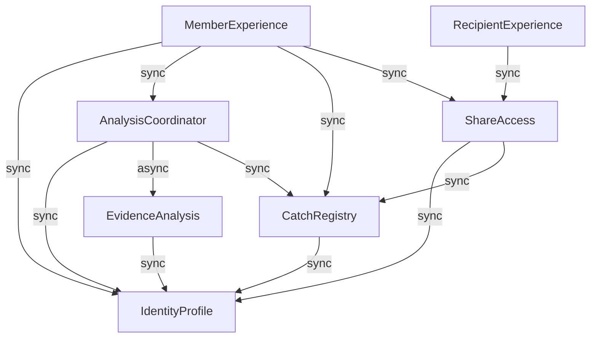

# CatchU 실제 MVP — 도메인 구성요소

2026-09-22 · intent `260914-catchu-october-mvp` · Domain Design 검토본

## 지위와 작성 기준

[Q]의 Q1~Q8과 `Looks correct` 작성 전 확인을 반영한 공통 논리 설계다. 단계 최종 승인, 담당자 상세 계약 수용, 실제 구현·시험 완료는 별도다. 과거 승인·회고·감사 원문은 수정하지 않는다. 제품 정책은 사용자가 결정하며 각 담당자는 자기 영역의 설계·구현·테스트를 맡는다. 공통 세션은 소유 책임·연결·누락/충돌을 정리한다. [P, H]

사용자는 작성 직전 다음 의미를 다시 명시했다. [U]
- 초안 없는 Catch도 **다른 공개 조건을 충족하고 사용자 확인·별도 공개 선택을 거쳐야** 공개할 수 있다.
- **F의 분석 처리 결과 소유는 결과 생성·의미에 대한 책임**이다. 서비스 DB 직접 접근이나 등록된 Catch의 저장 책임이 아니다.
- **실패 후 보완·동의 재사용·재분석·기존 Catch와 링크 변경 정책은 미결·보류**다.

아래 이름은 도메인 식별자다. 코드 패키지·DB 테이블·필드 타입·허용값·관계 수량·API/메시지 계약은 아니다. A~I와 배포 Unit을 일대일 고정하지 않는다. 기존 Next.js·NestJS·FastAPI/NCP 수동 배포는 유지하되 서버 수·DB/큐 엔진·호출 경로의 구체 구현·버전을 선택하지 않는다. [R, P]

2026-09-22 후속 적용: feasibility·Scope·인계·Practices 및 Requirements Analysis 수정본의 17:45:56 KST 승인을 기준으로 C01/C02와 사본 확인의 현재 상태만 갱신한다. Q1~Q8·기존 구조/소유/연결·해결된 FR2.1 R-01과 추적표는 그대로 재사용한다. 수정 전 판본은 [이력 보관](../../archive/2026-09-22-domain-reuse/components.md)에 남겼다. 현재 요약 확인은 문서의 최소 갱신 기준이며 C03 경계 수용·남은 사본 확인·Domain Design 최종 승인을 대신하지 않는다. [Q, R, H, C]

## Sources

- [R] [requirements.md](../requirements-analysis/requirements.md): 승인된 첫 MVP FR/NFR와 범위 밖·보류 정책, C01~C12.
- [P] [team-practices.md](../practices-discovery/team-practices.md): 담당별 책임, PR #72 공통 작업/검사/오류·로그, 기존 브랜치·PR·승인·머지, custom 테스트 순서와 첫 최소 연결 별도 승인.
- [Q] [domain-design-questions.md](domain-design-questions.md): Q1~Q8 원문·통합 요약과 작성 전 확인.
- [U] 2026-09-22 현재 대화의 `Looks correct`와 위 세 가지 명확화. 기존 요약의 의미를 보존하며 추가 호출·구현·최종 승인으로 확대하지 않는다.
- [H] [initiative-brief.md](../../ideation/approval-handoff/initiative-brief.md), [decision-log.md](../../ideation/approval-handoff/decision-log.md): 최신 A~I 담당과 보류·착수 조건.
- [W] [wireframes.md](../../ideation/rough-mockups/wireframes.md): A/E v0.10·B·C/D 기존 화면·상대 검토 차이.
- [S] [scope-document.md](../../ideation/scope-definition/scope-document.md), [intent-backlog.md](../../ideation/scope-definition/intent-backlog.md), [intent-statement.md](../../ideation/intent-capture/intent-statement.md): M01~M07과 첫 MVP 목표.
- [AR] [PR #70 고정 입력](https://github.com/JminAILab/CatchU/blob/5c54235da97d6552e420eba0f5ba8da5a78f62fc/docs/ai-dlc-input-mvp/CatchU_공통_아키텍처_검토초안.md) §3~4·§6·§10: E/F/B 경계·서비스 저장 후 결과 준비 방향. 도구·서버·보관 구체 제안 전체를 채택하지 않는다.
- [C] [C01/C02 변경 검토 기록](../../../../../../../docs/ai-dlc-input-mvp/2026-09-17_C02-C01_수용검토_변경안.md), [constraint-register.md](../../ideation/feasibility/constraint-register.md): 기준 미달을 유지한 한정 예외·제한 수용의 근거와 자료 보호·후속 확인. 과거 준비안의 작성 당시 지위와 9/22 최신 승인에 따른 현재 적용을 구분한다.

## Component Catalogue

카탈로그는 논리적 소유·형상의 정본이다. `depends_on`은 호출/요청 의존이며 응답·알림의 역방향을 새 호출로 중복 기재하지 않는다. `sync`는 해당 판단/조회에 응답이 필요하다는 뜻, `async`는 분석 요청 접수와 처리 종료가 분리된다는 뜻이다. 전송 프로토콜·큐·폴링·동기 DB 트랜잭션을 지정하지 않는다. 출처 참조는 호출 그래프와 다르며 F 원문을 영구 보존하라는 뜻이 아니다. [Q, AR]

```yaml
components:
  -
    name: "IdentityProfile"
    summary: "A — 계정·프로필·GitHub 연동의 업무 정본"
    behaviour: "로그인, GitHub 연동, 분석 동의와 공개 선택을 구분한다. 미연동 홈 진입은 허용하되 분석 권한을 뜻하지 않는다. 프로필의 자가 입력 출처를 보존하고 인증정보를 브라우저·로그에 노출하지 않는다."
    responsibilities: ["사용자 식별·현재 기본 프로필","GitHub 연동·인증정보 접근 관리"]
    depends_on: []
    dependents:
      -
        component: "AnalysisCoordinator"
        interaction: "요청자의 계정·GitHub 연동 확인"
      -
        component: "EvidenceAnalysis"
        interaction: "해당 요청에 허용된 GitHub 접근을 위한 A의 연동 경계 사용"
      -
        component: "CatchRegistry"
        interaction: "소유 사용자·연동 맥락과 접근 자격 참조"
      -
        component: "ShareAccess"
        interaction: "현재 공개 프로필과 링크 소유 사용자 참조"
      -
        component: "MemberExperience"
        interaction: "로그인·연동·프로필 화면"
    external_dependencies:
      -
        name: "Google 로그인 제공자"
        kind: "third-party-api"
        purpose: "기존 기본 로그인 진입. 구체 OAuth 계약은 후속"
      -
        name: "GitHub"
        kind: "third-party-api"
        purpose: "연동·계정 확인"
      -
        name: "서비스 영속 저장 경계"
        kind: "database"
        purpose: "A 소유 데이터 보존. 엔진·물리 분리 미선정"
    entities:
      -
        name: "MemberAccount"
        identifier: "memberId"
        attributes: ["memberId","identityReference","accountState"]
        references: []
      -
        name: "MemberProfile"
        identifier: "profileId"
        attributes: ["profileId","memberId","displayName","introduction","jobRole","technologyTags","inputProvenance","publicProfile"]
        references: []
      -
        name: "GitHubConnection"
        identifier: "connectionId"
        attributes: ["connectionId","memberId","externalAccountReference","credentialReference","connectionState"]
        references: []
  -
    name: "AnalysisCoordinator"
    summary: "E — 분석 요청·동의·작업과 결과 반영 진행"
    behaviour: "A의 사용자·연동 정보와 요청에 연결된 동의를 확인한다. F 처리와 B 등록 결과를 연결하되 접수, 처리, 반영, 열람 준비를 구분한다. 오류 없는 정상 0건과 부분 실패를 구분하고 재전달·사용자 재요청의 중복을 막는다. 과거 동의 재사용·재분석 허용은 미결이다."
    responsibilities: ["요청과 해당 동의 기록의 소유·연결","작업 진행·실패·결과 반영 상황","분석 작업과 등록 자산의 추적 연결","F가 생성·제공한 최소 생각해볼 질문을 분석 결과와 함께 B로 전달"]
    depends_on:
      -
        component: "IdentityProfile"
        interaction: "요청자의 계정·GitHub 연동 확인"
        style: "sync"
      -
        component: "EvidenceAnalysis"
        interaction: "허용 범위의 분석 요청과 최소 생각해볼 질문을 포함한 처리 결과 수신"
        style: "async"
      -
        component: "CatchRegistry"
        interaction: "최소 생각해볼 질문을 포함한 결과 전달·등록 결과 확인"
        style: "sync"
    dependents:
      -
        component: "MemberExperience"
        interaction: "선택/동의 요청과 진행·결과 준비 조회"
    external_dependencies:
      -
        name: "서비스 영속 저장 경계"
        kind: "database"
        purpose: "E 요청·동의·작업 보존. 정확한 트랜잭션/복구 계약은 후속"
    entities:
      -
        name: "AnalysisRequest"
        identifier: "requestId"
        attributes: ["requestId","memberReference","repositoryReference","analysisScope","consentReference","currentAttemptReference","submittedAt","requestOutcome"]
        references:
          -
            entity: "MemberAccount"
            owned_by: "IdentityProfile"
            relationship: "요청한 사용자"
          -
            entity: "GitHubConnection"
            owned_by: "IdentityProfile"
            relationship: "요청 시 연동 맥락"
      -
        name: "AnalysisConsent"
        identifier: "consentId"
        attributes: ["consentId","requestReference","memberReference","repositoryReference","consentedScope","noticeRevision","consentedAt"]
        references:
          -
            entity: "MemberAccount"
            owned_by: "IdentityProfile"
            relationship: "동의한 사용자"
      -
        name: "AnalysisAttempt"
        identifier: "attemptId"
        attributes: ["attemptId","requestReference","processingResultReference","processingOutcome","resultApplicationOutcome","failureInformation","registeredCatchReferences"]
        references:
          -
            entity: "AnalysisResult"
            owned_by: "EvidenceAnalysis"
            relationship: "이번 처리 결과의 식별·의미 추적"
          -
            entity: "CatchAsset"
            owned_by: "CatchRegistry"
            relationship: "등록 결과로 돌려받은 자산 참조"
  -
    name: "EvidenceAnalysis"
    summary: "F — 허용 범위의 수집·근거·후보·초안·최소 질문 처리"
    behaviour: "E 요청에 연결된 허용 범위 안에서 처리한다. 작업 사실·본인 기여·근거와 묶음의 이유/한계를 전달하고 초안 생성 결과를 구분한다. 결과 소유는 생성·의미 책임이며 서비스 DB 직접 접근 또는 등록된 Catch 저장 책임이 아니다. 없는 동기·성과를 보충하지 않고 모델 미선정·추가 호출 금지를 유지한다."
    responsibilities: ["수집·근거 및 본인 기여 판별 제안","후보 묶음·서로 다른 작업/중복 판별 제안","초안 생성 결과·누락/잘림·실패 영향 전달","최소 생각해볼 질문의 생성·의미 책임 및 E를 통한 제공"]
    depends_on:
      -
        component: "IdentityProfile"
        interaction: "해당 요청에 허용된 GitHub 접근을 위한 A의 연동 경계 사용"
        style: "sync"
    dependents:
      -
        component: "AnalysisCoordinator"
        interaction: "허용 범위의 분석 요청과 최소 생각해볼 질문을 포함한 처리 결과 수신"
    external_dependencies:
      -
        name: "GitHub"
        kind: "third-party-api"
        purpose: "동의된 선정 대상 자료 수집. API/Git 방식 미선정"
      -
        name: "서비스용 LLM 제공자 — 미선정"
        kind: "third-party-api"
        purpose: "근거에 연결된 초안 생성. 실제 제공자/등급·계약 확인 전 호출 금지"
      -
        name: "처리 자료의 격리·임시 보존 경계"
        kind: "other"
        purpose: "허용된 처리와 재전달에 필요한 최소 자료. 위치·수명·삭제 계약 미정; 서비스 DB 아님"
    entities:
      -
        name: "AnalysisResult"
        identifier: "resultId"
        attributes: ["resultId","sourceRequestReference","sourceAttemptReference","subjectReference","allowedScope","processingOutcome","failureScope","candidateReferences"]
        references:
          -
            entity: "AnalysisRequest"
            owned_by: "AnalysisCoordinator"
            relationship: "요청·허용 범위의 출처"
          -
            entity: "AnalysisAttempt"
            owned_by: "AnalysisCoordinator"
            relationship: "처리 시도의 출처"
          -
            entity: "MemberAccount"
            owned_by: "IdentityProfile"
            relationship: "분석 대상 본인"
      -
        name: "WorkCandidate"
        identifier: "candidateId"
        attributes: ["candidateId","resultReference","workFacts","subjectContribution","evidenceReferences","groupingBasis","groupingLimitations","eligibilityEvidence","reflectionQuestions"]
        references: []
      -
        name: "AnalysisEvidence"
        identifier: "evidenceId"
        attributes: ["evidenceId","sourceLocator","sourceRevision","observedContentReference","contributorReferences","coverageLimits","protectionScope"]
        references: []
      -
        name: "DraftOutcome"
        identifier: "draftOutcomeId"
        attributes: ["draftOutcomeId","candidateReference","draftContent","evidenceReferences","generationOutcome","failureInformation"]
        references: []
  -
    name: "CatchRegistry"
    summary: "B — Catch 등록·본인 확인·개별 공개 관리"
    behaviour: "근거·본인 기여와 등록 기준을 충족한 결과만 미공개 Catch로 등록한다. 초안 실패·부재는 그 자체로 등록/공개 불가 사유가 아니다. 공개에는 다른 공개 조건 충족과 사용자의 근거·본인 기여 확인 및 별도 공개 선택이 모두 필요하다. 근거 중첩만으로 중복으로 보지 않되 같은 작업의 표현만 바꾼 중복은 등록하지 않는다. 현재 숨김·원본 비공개 보호를 적용한다."
    responsibilities: ["등록 자산과 서비스 제공용 최소 근거·초안·본인용 질문 자료의 소유","본인 목록·상세·확인·불일치·공개/숨김","등록 기준 적용·중복 반영 방지","원본 상태 증거에 따른 자산 열람 보호","E가 전달한 최소 생각해볼 질문의 서비스 자료 관리·본인 화면 제공"]
    depends_on:
      -
        component: "IdentityProfile"
        interaction: "소유 사용자·연동 맥락과 접근 자격 참조"
        style: "sync"
    dependents:
      -
        component: "AnalysisCoordinator"
        interaction: "최소 생각해볼 질문을 포함한 결과 전달·등록 결과 확인"
      -
        component: "ShareAccess"
        interaction: "현재 공개·원본 보호 조건을 만족하는 자산만 조회"
      -
        component: "MemberExperience"
        interaction: "본인 자산·최소 생각해볼 질문 표시·확인·공개/숨김 화면"
    external_dependencies:
      -
        name: "서비스 영속 저장 경계"
        kind: "database"
        purpose: "B 등록 자산·허용된 최소 근거/초안·본인용 질문·현재 공개 상태 보존"
      -
        name: "GitHub 원본 상태"
        kind: "third-party-api"
        purpose: "확인된 비공개 전환의 보호 근거. 확인 주체/호출 경로·시점은 A/B 및 관련 담당 계약으로 구체화"
    entities:
      -
        name: "CatchAsset"
        identifier: "catchId"
        attributes: ["catchId","ownerReference","sourceRequestReference","sourceResultIdentity","sourceCandidateIdentity","workFacts","subjectContribution","evidenceReferences","draftContent","draftGenerationOutcome","registrationAssessment","userConfirmation","mismatchMark","visibility","restrictionReason","reflectionQuestions"]
        references:
          -
            entity: "MemberAccount"
            owned_by: "IdentityProfile"
            relationship: "자산 소유 사용자"
          -
            entity: "AnalysisRequest"
            owned_by: "AnalysisCoordinator"
            relationship: "자산이 나온 요청의 출처"
          -
            entity: "WorkCandidate"
            owned_by: "EvidenceAnalysis"
            relationship: "등록 당시 후보 식별을 출처로 추적; 실시간 조회 의존 아님"
      -
        name: "CatchEvidence"
        identifier: "catchEvidenceId"
        attributes: ["catchEvidenceId","catchReference","sourceLocator","sourceRevision","representedFacts","contributionScope","coverageLimits","sourceEvidenceIdentity"]
        references:
          -
            entity: "AnalysisEvidence"
            owned_by: "EvidenceAnalysis"
            relationship: "등록 자료의 출처 식별; F 원문 영구 보관 요구 아님"
      -
        name: "RepositoryProtection"
        identifier: "protectionId"
        attributes: ["protectionId","repositoryReference","confirmedSourceState","observationProvenance","observedAt","observationFailure","appliedRestriction"]
        references: []
  -
    name: "ShareAccess"
    summary: "C — 링크 수명과 비로그인 수신자 접근"
    behaviour: "대표나 공개 자산 없이도 기본 링크를 발급한다. 제목·유효 링크 한도, 중단·고정 만료·선택 비밀번호의 기존 규칙을 적용한다. 매 요청 링크 조건과 B의 현재 허용 자료를 확인하고 A의 현재 공개 프로필을 연결한다. 초안 없는 공개 Catch를 근거·기여 중심으로 제공하며 없는 설명을 꾸미지 않고 응답을 캐시하지 않는다."
    responsibilities: ["링크 발급·중단·만료·비밀번호","링크 조건 및 현재 자산 권한을 모두 만족하는 수신자 응답"]
    depends_on:
      -
        component: "IdentityProfile"
        interaction: "현재 공개 프로필과 링크 소유 사용자 참조"
        style: "sync"
      -
        component: "CatchRegistry"
        interaction: "현재 공개·원본 보호 조건을 만족하는 자산만 조회"
        style: "sync"
    dependents:
      -
        component: "MemberExperience"
        interaction: "발행자 링크 관리 화면"
      -
        component: "RecipientExperience"
        interaction: "해당 링크 요청에서 허용한 수신자 응답과 거부 사유 조회"
    external_dependencies:
      -
        name: "서비스 영속 저장 경계"
        kind: "database"
        purpose: "링크 수명·보호 조건 보존. 상세 보안 저장 방식은 후속"
    entities:
      -
        name: "ShareLink"
        identifier: "linkId"
        attributes: ["linkId","ownerReference","title","linkTokenReference","passwordProtectionReference","issuedAt","expiresAt","stoppedAt"]
        references:
          -
            entity: "MemberAccount"
            owned_by: "IdentityProfile"
            relationship: "발행한 사용자"
  -
    name: "MemberExperience"
    summary: "A/B/C/D — 로그인 사용자 화면의 연결"
    behaviour: "기존 화면을 재사용하며 미연동 홈, 저장소 선택/동의, 분석 상태·이력, 자산 확인/공개, 링크 관리의 각 담당 흐름을 연결한다. 조회 실패와 빈 결과를 구분한다. 작업 완료나 사용자 공개 선택을 화면이 대신 결정하지 않는다."
    responsibilities: ["각 담당 회원 화면·사용자 입력·진입/복귀","근거·기여/초안 상태·부분 실패를 구분한 표시","B 담당 본인 화면에서 CatchRegistry의 최소 생각해볼 질문 표시"]
    depends_on:
      -
        component: "IdentityProfile"
        interaction: "로그인·연동·프로필 화면"
        style: "sync"
      -
        component: "AnalysisCoordinator"
        interaction: "선택/동의 요청과 진행·결과 준비 조회"
        style: "sync"
      -
        component: "CatchRegistry"
        interaction: "본인 자산·최소 생각해볼 질문 표시·확인·공개/숨김 화면"
        style: "sync"
      -
        component: "ShareAccess"
        interaction: "발행자 링크 관리 화면"
        style: "sync"
    dependents: []
    external_dependencies: []
    entities: []
  -
    name: "RecipientExperience"
    summary: "C — 비로그인 링크 수신자 화면"
    behaviour: "ShareAccess가 허용한 프로필·근거·기여만 표시한다. 초안 부재를 생성된 설명으로 꾸미지 않는다. 비밀번호·중단·만료·빈 공개 자료와 조회 실패를 구분하며 별도 로그인/구독 조건을 추가하지 않는다."
    responsibilities: ["수신자 링크 진입·접근 조건 입력·열람","B/C가 합의할 초안 없는 공개 자료 표현"]
    depends_on:
      -
        component: "ShareAccess"
        interaction: "해당 링크 요청에서 허용한 수신자 응답과 거부 사유 조회"
        style: "sync"
    dependents: []
    external_dependencies: []
    entities: []
```

## Component Diagram



텍스트 대체: MemberExperience는 A/E/B/C의 해당 업무 경계를 호출하고 RecipientExperience는 ShareAccess만 호출한다. AnalysisCoordinator는 IdentityProfile 확인 후 EvidenceAnalysis에 분석을 요청하고 결과를 CatchRegistry에 전달한다. EvidenceAnalysis와 CatchRegistry는 A의 사용자/연동 경계를 사용한다. ShareAccess는 IdentityProfile의 공개 프로필과 CatchRegistry가 현재 허용한 자료를 조합한다. 응답·분석 결과의 귀환은 원 요청의 결과이며 별도 역방향 업무 호출로 세지 않는다. 호출 순환은 없다.

## Component Summary

| Component | Purpose | Depends On | Dependents | Entities Owned |
|---|---|---|---|---|
| IdentityProfile | A — 계정·프로필·GitHub 연동의 업무 정본 | — | AnalysisCoordinator, EvidenceAnalysis, CatchRegistry, ShareAccess, MemberExperience | MemberAccount, MemberProfile, GitHubConnection |
| AnalysisCoordinator | E — 분석 요청·동의·작업과 결과 반영 진행 | IdentityProfile, EvidenceAnalysis, CatchRegistry | MemberExperience | AnalysisRequest, AnalysisConsent, AnalysisAttempt |
| EvidenceAnalysis | F — 허용 범위의 수집·근거·후보·초안·최소 질문 처리 | IdentityProfile | AnalysisCoordinator | AnalysisResult, WorkCandidate, AnalysisEvidence, DraftOutcome |
| CatchRegistry | B — Catch 등록·본인 확인·개별 공개 관리 | IdentityProfile | AnalysisCoordinator, ShareAccess, MemberExperience | CatchAsset, CatchEvidence, RepositoryProtection |
| ShareAccess | C — 링크 수명과 비로그인 수신자 접근 | IdentityProfile, CatchRegistry | MemberExperience, RecipientExperience | ShareLink |
| MemberExperience | A/B/C/D — 로그인 사용자 화면의 연결 | IdentityProfile, AnalysisCoordinator, CatchRegistry, ShareAccess | — | 없음 |
| RecipientExperience | C — 비로그인 링크 수신자 화면 | ShareAccess | — | 없음 |

## Entity Ownership

식별자·속성명·다른 구성요소 참조만 제시한다. 같은 소유자 내부의 관계는 속성명으로 나타내며 상세 스키마는 Functional Design에서 제안한다. F의 AnalysisResult/WorkCandidate/AnalysisEvidence/DraftOutcome는 **처리 결과를 표현하는 업무 모델**이며 서비스 테이블 생성·DB 쓰기 권한을 뜻하지 않는다. B의 CatchAsset/CatchEvidence는 등록 후 제공할 자산의 책임이다. 필요한 최소 사실·출처·한계와 초안 상태를 B가 관리하므로 F 임시 처리 자료의 삭제/실패를 정상 서비스 조회의 영구 선행 조건으로 만들지 않는다. 자료의 구체 보관/삭제·필요 내용은 NFR2/7 및 후속 계약에서 결정한다. [Q1, U]

| Entity | Owning Component | Identifier | Attributes | References |
|---|---|---|---|---|
| MemberAccount | IdentityProfile | memberId | memberId, identityReference, accountState | 다른 구성요소 참조 없음 |
| MemberProfile | IdentityProfile | profileId | profileId, memberId, displayName, introduction, jobRole, technologyTags, inputProvenance, publicProfile | 다른 구성요소 참조 없음 |
| GitHubConnection | IdentityProfile | connectionId | connectionId, memberId, externalAccountReference, credentialReference, connectionState | 다른 구성요소 참조 없음 |
| AnalysisRequest | AnalysisCoordinator | requestId | requestId, memberReference, repositoryReference, analysisScope, consentReference, currentAttemptReference, submittedAt, requestOutcome | IdentityProfile.MemberAccount — 요청한 사용자<br>IdentityProfile.GitHubConnection — 요청 시 연동 맥락 |
| AnalysisConsent | AnalysisCoordinator | consentId | consentId, requestReference, memberReference, repositoryReference, consentedScope, noticeRevision, consentedAt | IdentityProfile.MemberAccount — 동의한 사용자 |
| AnalysisAttempt | AnalysisCoordinator | attemptId | attemptId, requestReference, processingResultReference, processingOutcome, resultApplicationOutcome, failureInformation, registeredCatchReferences | EvidenceAnalysis.AnalysisResult — 이번 처리 결과의 식별·의미 추적<br>CatchRegistry.CatchAsset — 등록 결과로 돌려받은 자산 참조 |
| AnalysisResult | EvidenceAnalysis | resultId | resultId, sourceRequestReference, sourceAttemptReference, subjectReference, allowedScope, processingOutcome, failureScope, candidateReferences | AnalysisCoordinator.AnalysisRequest — 요청·허용 범위의 출처<br>AnalysisCoordinator.AnalysisAttempt — 처리 시도의 출처<br>IdentityProfile.MemberAccount — 분석 대상 본인 |
| WorkCandidate | EvidenceAnalysis | candidateId | candidateId, resultReference, workFacts, subjectContribution, evidenceReferences, groupingBasis, groupingLimitations, eligibilityEvidence, reflectionQuestions | 다른 구성요소 참조 없음 |
| AnalysisEvidence | EvidenceAnalysis | evidenceId | evidenceId, sourceLocator, sourceRevision, observedContentReference, contributorReferences, coverageLimits, protectionScope | 다른 구성요소 참조 없음 |
| DraftOutcome | EvidenceAnalysis | draftOutcomeId | draftOutcomeId, candidateReference, draftContent, evidenceReferences, generationOutcome, failureInformation | 다른 구성요소 참조 없음 |
| CatchAsset | CatchRegistry | catchId | catchId, ownerReference, sourceRequestReference, sourceResultIdentity, sourceCandidateIdentity, workFacts, subjectContribution, evidenceReferences, draftContent, draftGenerationOutcome, registrationAssessment, userConfirmation, mismatchMark, visibility, restrictionReason, reflectionQuestions | IdentityProfile.MemberAccount — 자산 소유 사용자<br>AnalysisCoordinator.AnalysisRequest — 자산이 나온 요청의 출처<br>EvidenceAnalysis.WorkCandidate — 등록 당시 후보 식별을 출처로 추적; 실시간 조회 의존 아님 |
| CatchEvidence | CatchRegistry | catchEvidenceId | catchEvidenceId, catchReference, sourceLocator, sourceRevision, representedFacts, contributionScope, coverageLimits, sourceEvidenceIdentity | EvidenceAnalysis.AnalysisEvidence — 등록 자료의 출처 식별; F 원문 영구 보관 요구 아님 |
| RepositoryProtection | CatchRegistry | protectionId | protectionId, repositoryReference, confirmedSourceState, observationProvenance, observedAt, observationFailure, appliedRestriction | 다른 구성요소 참조 없음 |
| ShareLink | ShareAccess | linkId | linkId, ownerReference, title, linkTokenReference, passwordProtectionReference, issuedAt, expiresAt, stoppedAt | IdentityProfile.MemberAccount — 발행한 사용자 |

**출처 참조와 상태:** E의 분석 처리 결과/등록 결과 참조와 B의 원 요청/후보 출처는 추적용이다. 이 참조가 F의 서비스 DB 직접 접근, B의 E/F 상태 직접 갱신, 원문 영구 조회 의존을 허용하지 않는다. 후속 설계는 참조 식별과 보관 수명 차이를 계약으로 설명해야 한다. Entity 참조에 상호 추적이 있어도 업무 호출 DAG의 순환이나 공유 정본이 아니다.

## External Dependencies

| Component | Dependency | Kind | Purpose |
|---|---|---|---|
| IdentityProfile | Google 로그인 제공자 | third-party-api | 기존 기본 로그인 진입. 구체 OAuth 계약은 후속 |
| IdentityProfile | GitHub | third-party-api | 연동·계정 확인 |
| IdentityProfile | 서비스 영속 저장 경계 | database | A 소유 데이터 보존. 엔진·물리 분리 미선정 |
| AnalysisCoordinator | 서비스 영속 저장 경계 | database | E 요청·동의·작업 보존. 정확한 트랜잭션/복구 계약은 후속 |
| EvidenceAnalysis | GitHub | third-party-api | 동의된 선정 대상 자료 수집. API/Git 방식 미선정 |
| EvidenceAnalysis | 서비스용 LLM 제공자 — 미선정 | third-party-api | 근거에 연결된 초안 생성. 실제 제공자/등급·계약 확인 전 호출 금지 |
| EvidenceAnalysis | 처리 자료의 격리·임시 보존 경계 | other | 허용된 처리와 재전달에 필요한 최소 자료. 위치·수명·삭제 계약 미정; 서비스 DB 아님 |
| CatchRegistry | 서비스 영속 저장 경계 | database | B 등록 자산·허용된 최소 근거/초안·본인용 질문·현재 공개 상태 보존 |
| CatchRegistry | GitHub 원본 상태 | third-party-api | 확인된 비공개 전환의 보호 근거. 확인 주체/호출 경로·시점은 A/B 및 관련 담당 계약으로 구체화 |
| ShareAccess | 서비스 영속 저장 경계 | database | 링크 수명·보호 조건 보존. 상세 보안 저장 방식은 후속 |

저장 경계는 소유 책임과 영속 필요를 나타내며 구성요소마다 별도 DB를 만들라는 뜻이 아니다. NCP의 구체 제품/설정과 제공자/모델은 미선정 사항을 유지한다. Google/GitHub/LLM의 실제 연동·권한·과금·처리 조건이 검증됐다고 표시하지 않는다. 서비스 LLM 선택 전 제공자 종속 계약은 미결로 둔다. [R, P]

## Rationale

| Component | 분리 이유 | 대안과 한계 |
|---|---|---|
| IdentityProfile | 사용자·연동·프로필의 생애와 인증정보 보호를 한 경계에서 관리 | 인증 상태를 E/B/C에 복제하는 안은 동의·공개와 혼동되므로 제외 |
| AnalysisCoordinator | 요청과 동의, 처리·반영 진행을 연결하되 자산 공개 상태를 소유하지 않음 | Q8의 A 동의 정본 안보다 요청-동의 연결 책임이 명확. A 연동 검사는 필요 |
| EvidenceAnalysis | 허용 범위에서 결과를 생성하고 그 의미·한계를 설명하는 책임 | F가 서비스 DB나 등록 Catch를 직접 갱신하는 안은 B 소유·공개 보호를 우회하므로 제외 |
| CatchRegistry | 등록과 사용자 확인·공개·보호를 동일 자산 생애에서 관리 | Q1의 별도 결과 반영 구성요소 안은 책임/담당을 추가하므로 현재 MVP에 채택하지 않음 |
| ShareAccess | 링크 수명·접근 조건이 자산 공개 상태와 독립적으로 변함 | 링크에 권한을 복제하거나 발행 시 공개 상태만 믿는 안은 숨김 반영 요구에 부합하지 않음 |
| MemberExperience | 로그인 사용자 흐름과 입력/조회/복귀의 UI 연결. 업무 정본 없음 | D가 모든 화면 또는 모든 상태를 소유하는 안으로 해석하지 않음. 각 화면 담당 유지 |
| RecipientExperience | 비로그인 접근 조건과 허용 자료 표시를 회원 관리 화면에서 구분 | 별도 배포 서비스로 분리하는 결정 아님. 업무 권한은 ShareAccess/CatchRegistry에서 판단 |

**경계 대안 비교:** Q1에서 B가 등록을 소유하는 안은 등록·공개 생애를 일치시키는 대신 E/F/B의 결과 반영 계약이 필요하다. 별도 반영 구성요소는 복잡한 조정을 모을 수 있지만 담당·데이터 정본·실패 경계가 추가된다. 사용자는 B 책임을 유지했다. Q8에서 E 동의 소유는 요청 연결을 단순화하지만 A 연동 대조가 필요하다. A 소유는 계정 관련 기록을 모으지만 요청과 동의 대상 일치 계약을 추가한다. 사용자는 E 소유를 선택했다. 구현 전 후속 설계에서 변경이 필요하면 영향과 대안을 제시하며 이미 승인된 제품 행동을 임의 변경하지 않는다. 상세 ADR는 [decisions.md](decisions.md).

## 등록·확인·공개의 업무 규칙

| 구분 | 기준 | 실패/금지 해석 |
|---|---|---|
| 등록 | 확인 가능한 작업 사실·본인 기여·근거, 나머지 등록 조건 충족; 최초 미공개 | URL만 존재한다고 귀속을 확인한 것으로 보지 않음. 사용자 확인으로 부족한 객관적 근거를 대체하지 않음 |
| 정상 0건 | 오류 없이 분석했지만 등록 기준에 맞는 후보 없음 → 정상 완료, 새 Catch 없음 | 조회/수집/생성/반영 오류를 0건으로 숨기지 않음 |
| 부분 실패 | 실패 영향과 분리해 기준 충족을 확인한 후보만 등록·제공; 일부 실패 안내 | 전체 성공으로 표시하지 않음. 판정 불능을 기준 충족으로 간주하지 않음 |
| 초안 실패 | 근거·기여 확인 결과와 생성 실패를 분리; 다른 기준 충족 시 등록 가능 | 후보 부재나 자동 등록 불가로 치환하지 않음. 생성 기능 요구 면제 아님 |
| 초안 없는 공개 | 다른 공개 조건 충족 + 사용자 근거/본인 기여 확인 + 별도 개별 공개 선택 | 생성·등록·확인 완료만으로 공개 불가. 없는 초안을 생성된 설명으로 표시하지 않음 |
| 최소 사실 | 작은 변경·단일 커밋도 허용, 이유·성과 부재만으로 제외하지 않음 | 없는 동기·의사결정·성과를 추정하지 않음. 커밋마다 카드 생성 아님 |
| 근거 중첩 | 서로 다른 작업을 구별하고 각각 기준 충족 시 별도 등록 가능 | 동일 작업의 제목/표현만 바꾼 중복 등록 금지 |
| 원본/현재 권한 | 확인된 원본 비공개는 관련 Catch 보호, 현재 숨김은 기존 링크에도 적용 | 일시 조회 실패를 원본 비공개로 단정하지 않음. 무관한 자료/링크 전체 중단 금지 |

확인 완료 화면의 **‘지금 공개’ 기본 제안**은 유지한다. 제안은 사용자의 개별 공개 선택을 대신하지 않는다. Catch 직접 문구 편집·제한 재생성은 첫 MVP에 추가하지 않는다. Q5의 초안 없는 공개 허용은 기존 Catch 본문을 나중에 자동 보완·교체하는 허가가 아니다. [R FR3.5/4.1, Q2~Q7, U]

## FR2.1 최소 생각해볼 질문의 제공 경계

2026-09-22 사용자의 R-01 수정 요청에 따라 기존 FR2.1·M02·W04/W05의 누락된 책임을 연결한다. 새 기능이나 생성 방법의 채택이 아니다. [R FR2.1, S M02, W]

| 경계 | 기존 구성요소·자료 | 책임 |
|---|---|---|
| 생성·제공 | F EvidenceAnalysis / WorkCandidate.reflectionQuestions | 실제 기록 기반 후보·근거에 연결된 최소 생각해볼 질문을 생성하고 그 의미를 책임진다. E에 분석 결과의 일부로 제공하며 서비스 DB에 직접 저장하지 않는다. |
| 전달 | E AnalysisCoordinator / AnalysisAttempt.processingResultReference | 해당 요청·처리 결과와 질문의 연결을 보존해 B로 전달한다. E가 질문 내용의 생성자나 등록 자료의 정본이 되는 것은 아니다. |
| 서비스 자료 관리·제공 | B CatchRegistry / CatchAsset.reflectionQuestions | E가 전달한 질문을 본인 확인에 필요한 서비스 자료로 관리하고 본인 화면에 제공한다. F 임시 자료의 영구 조회에 의존하지 않는다. |
| 본인 화면 표시 | MemberExperience의 B 담당 화면 | B 자료에서 질문을 받아 W04/W05의 근거 확인 흐름에 표시한다. D에게 B의 화면·설계·테스트 책임을 넘기지 않는다. |

`reflectionQuestions`는 논리적 속성명이며 타입·수량·구체 저장 형태를 정하지 않는다. 생성 방법·API·보관 방식/수명·화면 배치 및 상태별 표시 상세는 F/E/B의 후속 설계·계약에서 제안·검토한다. 질문을 초안 생성 성공이나 사용자 답변 저장과 결합하지 않으며 기존 등록·공개 기준을 변경하지 않는다. **질문은 본인 화면용이며 ShareAccess/RecipientExperience의 수신자 공개 자료에 포함하지 않는다. 질문에 대한 답변 입력·저장 기능도 추가하지 않는다.** 후속 설계에서 실패 처리를 검토하되 실패 후 보완·동의 재사용·재분석·기존 Catch/링크 변경 정책을 확정하거나 자동/추가 호출을 허용하지 않는다.

## 연결 시나리오와 실패 경계

- **요청:** 회원 화면 → A 계정/연동 → E 대상/동의·요청 기록. A의 연동만으로 E 동의가 성립하지 않는다. 동의·접수 기록을 일관되게 남길 상세 검사/실패 계약은 A/E가 제안하고 F와 검토한다.
- **처리와 등록:** E → F 허용 범위 분석 → F 처리 결과/한계 → E 결과 반영 관리 → B 판정/저장 → E 등록/열람 준비 결과. F가 결과를 생성·임시 보존한 것만으로 등록/완료를 표시하지 않는다. 정상 0건은 Catch 저장 건수가 없어도 E에 결과 의미가 반영돼야 하며, 부분 성공·반영 실패는 전체 성공과 구분한다. 정확한 상태/메시지·원자성은 후속 계약이다.
- **본인 확인:** B의 목록/상세는 근거·기여와 초안 생성 상태를 구분한다. 단순 열람은 사용자 확인이 아니다. 저장 실패는 확인/공개 변경 성공이 아니다. 미공개 자료는 본인만 접근한다.
- **수신자:** RecipientExperience → C의 유효 링크/비밀번호/중단/만료 검사 → A 공개 프로필·B 현재 허용 자료 → 근거·기여 중심 화면. 공개 자료 0개와 조회 실패를 구분한다. 대표 없는 발급, 제목 필수/유효 제목 중복 금지/유효 링크 최대 5개, 발행 후 30일 고정 만료는 기존 요구를 유지한다.
- **실패와 중복:** 재전달·사용자 재요청으로 같은 작업의 카드가 중복으로 쌓이지 않으며 기존 자료·공개/링크 상태를 보존한다. 이것은 저장된 결과의 전달/반영 복구 계약 필요를 뜻하고 자동 분석·LLM 재호출을 허용하지 않는다. 접수 불명·조회 실패·처리 실패·반영 실패의 표현을 분리한다.
- **D 진입/복귀:** 홈에서 내 자산으로 진입, 분석 결과는 기존 A-02/분석 이력 → W03-R → 상세 → 같은 목록/출처 흐름을 재사용한다. 홈 직접 분석 결과 연결·결과별 확인 수 집계를 새로 넣지 않는다. 연결 차이는 B/D/E가 검토한다. [W]

## 담당자 검토와 보류

| 항목 | 제안·검토 책임 | 결정 시점/영향 |
|---|---|---|
| 근거/귀속/묶음/중복 | F 제안, B/E 검토 | 등록 판정·전달 계약 확정 전; 기술적 구별 가능성 미검증 |
| 동의/연동/대상·요청 | A/E 제안, F 검토 | 관련 계약 확정 전; 과거 동의 재사용·재분석 허용을 추정하지 않음 |
| 결과 반영·실패/복구 | E/F/B, D 표시 검토 | 관련 계약 확정 전; 복구 중 기존 작업 반환 등의 상대 미수용을 자동 채택하지 않음 |
| 초안 없는 공개·화면 | B/C, B/D 연결 | 실제 화면/열람 계약 전; 공개 조건을 줄이지 않음 |
| 실패 후 보완 | 사용자 제품 판단 + F/E/B 제안 | 보완 경로 확정 전; 현재 등록·공개는 초안 보완을 선행 조건으로 두지 않음 |
| 재분석·기존 Catch/링크 변화 | 사용자 제품 판단 + B/E/F/C | 해당 분기 설계/계약 전; 병합·교체·삭제·자동 포함/제외·동결을 결정하지 않음 |
| 원본 재공개·연결 해제·보관/삭제, 링크 재발행/비밀번호 변경 세부 | 관련 A/B/C/F/H 제안 + 사용자 필요한 정책 결정 | 관련 계약/자료 처리 전. 확인 주기·본인 보관·자동 복구를 약속하지 않음 |
| 서비스 LLM | ljm0850, F/E/H 관련 검토 | 종속 설계/계약 확정 전, 늦어도 생성 구현·외부 전송 전. Astra 개발용·Luna medium 실험용 구분 |

팀원 1 F/H/I, 2 A/E, 3 C/D, 4 B를 유지한다. MemberExperience가 D에게 모든 회원 화면을 배정하지 않는다. H는 환경/수동 배포·복구, I는 연결/누락·충돌과 검증 취합이며 각 기능 설계·시험을 대행하지 않는다. 지원·가용량·독립 재현 분담은 후속 계획이다. 최소 연결의 범위·순서·실제/모의 방식은 후속 계약/계획에서 정하고 첫 결과는 별도 승인한다. 최소 연결 성공은 첫 MVP 완료가 아니다. [P, H]

## 적용 범위와 승인 전 조건

- 첫 MVP는 [R]의 M01~M07 적용을 유지한다. 대표 작성/구성·발행본 보존은 첫 MVP 이후, G 품질/선택 공유/운영 조회·전체 중단/재개는 10월 제외다. 검색/JD/서류/PDF/제안/DM 등 후속 기능의 구성요소를 현재 구현 대상으로 만들지 않는다.
- [traceability.json](traceability.json)은 48개 FR 하위 ID와 11개 상위 묶음을 추적한다. 묶음은 추가 요구사항/완료 건수로 세지 않는다. OK는 첫 MVP 적용 부분의 도메인 책임 연결이지 구현/전체 요구 충족이 아니다. 첫 MVP 밖은 Deferred 또는 N/A와 근거로 남기고 가짜 구성요소로 연결하지 않는다. FR3.1/3.4의 현재 적용과 후속 부분은 구분한다.
- C01/C02는 9/22 최신 승인대로 적용한다. C01 기준 미달·R1 문맥 줄 오귀속은 유지하고 R1 한 건만 필수 추가 튜닝·재호출 선행 사유에서 제외한다. C02는 제출 후보 확보·설명 제한 결과만 제한 수용한다. 독립 원문 대조·C02 2시간/총 6시간 준수·청구·자료 보호 전체 통과는 미확인이다. 결함 해결·C01 통과가 아니며 새 결함·입력/생성 방식 변경·누출에 예외를 확대하거나 근거 없는 설명 공개를 허용하지 않는다. 확인 불가 시간의 재추정·재질문이나 추가 호출은 하지 않는다. **C03 재사용/서비스 차이의 경계 수용·남은 사본 확인·Domain Design 최종 승인은 별도**이며 도메인 설계 승인 또는 관련 착수 중 더 이른 기존 경계 전 확인한다. F의 기술 제안과 B/E 등 연결 담당 검토를 유지한다.
- 사본은 **지정한 로컬 후보 3개 삭제 확인**만 완료다. 2026-09-22 13:31:34 KST의 본문 비열람 삭제·대상별 경로 부재 확인 기록을 재사용한다. 나머지의 실험 관련 여부·전체 사본 정리·공급자 삭제는 미확인이다. 기한은 **2026-09-23 23:59 KST 또는 더 이른 도메인 설계 승인/관련 착수 경계 전**으로 유지한다. 로컬 삭제와 공급자 보관/삭제를 구분하며 추가 원문/사본 열람·복구·삭제·새 호출로 검증하지 않는다. [C, R]
- C04/05 수집 격리·최소 전송/실패 정리, C06 모델·조건, C07 동의/권한/중복 계약, C08/09 NCP·영속/복구 시험, C10 가용량, C11 실제 서비스 결과 검증, C12 12월 품질/PDF의 각 시점을 유지한다. 정량 성능·비용·SLO나 전체 품질 달성을 주장하지 않는다.
- 복구된 입력 존재 차이의 approval-handoff 안내와 초기화 Untracked는 과거 기록으로 보존한다. 표시 해소를 위한 재승인·재초기화·버전 변경·상태/감사 직접 수정은 하지 않는다.

## 검증 범위

카탈로그의 소유자/참조·호출 DAG·상호 의존 표·Mermaid와 표의 일치, FR 추적·상위 출처·상대 링크를 문서 대상으로 검사한다. Mermaid는 사용한 flowchart 제한 문법을 저장 전 검사하고 텍스트 대체를 제공한다. 브라우저 렌더링이나 실제 서비스 테스트를 수행한 것으로 표시하지 않는다. 실행 결과와 독립 설계 검토는 별도 검증/리뷰 기록으로 남긴다.
