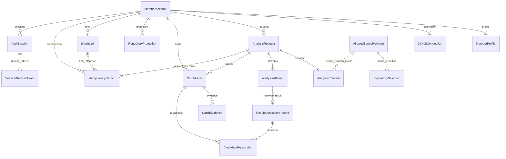

# api — Functional Design · ERD v1

## 적용 범위

개발 기준 계약의 api 논리 모델·업무 흐름이다. [entities](entities.md)의 데이터와 [rules](rules.md)의 규칙을 사용한다. 이 파일은 흐름/상태 전이의 정본이며 ERD/규칙 표는 파생 뷰다. Minimal은 계약 누락을 뜻하지 않는다. 단계 승인과 담당 PR 리뷰를 거쳐 v1로 사용하며 구현 코드는 개발 이슈에서 작성한다.

## ERD — 파생 뷰

텍스트 대체: A 회원은 프로필/현재 연동을 최대 하나씩, 요청·Catch·보호·링크·로그인 세션을 여러 개 갖는다. 로그인 세션은 교체된 Refresh 기록을 1개 이상 갖는다. 요청은 새 동의 하나와 현재 시도를 갖고, 시도는 검증된 결과 메타데이터를 최대 하나 갖는다. B Catch는 근거 1개 이상과 등록 연결 1개 이상을 갖는다. 결과별 여러 후보 등록 연결이 새 Catch 또는 기존 같은 작업을 가리킨다. IdempotencyRecord는 operation에 맞는 요청 또는 링크 하나만 참조한다. 현재 선정 저장소는 범위 판본 하나를 참조하고, 범위 판본 하나를 여러 선정이 함께 쓸 수 있다. 동의의 범위 판본은 실제 접수 때 이 범위 판본과 값으로 대조하며(점선) 외래 키가 아니다. 개발 합성 판본은 범위 판본 표에 없다. 그림의 다중 시도 관계는 이력 모델이며 현재 MVP의 자동 재시도 허가가 아니다.

## 업무 흐름

| 흐름 | 순서·원자성 | 실패/경계 |
|---|---|---|
| F1 회원/연동 | 1 JWT 주체와 로그인 세션 유효성 확인 → 2 A 계정/프로필·현재 연동 조회 → 3 허용 필드 응답/자가 입력 저장 | 타인 자원 은닉; Google 로그인·세션 갱신·GitHub 연결의 경로·수명은 [계약 요약](../../../inception/contract-design/contract-summary.md)의 회원 API. 개발용 로그인 #87과 실제 제공자 연결 구분 |
| F2 새 요청 | 1 인증/형식·멱등 키 검사 → 2 현재 연동·저장소/고지/범위 확인 → 3 회원 단위 ACTIVE·선행 이력 판정 → 4 요청·새 동의·첫 시도·멱등 연결 한 번에 저장 → 5 202 → 6 허용된 전송 연결로 요청 전달 | 동일 키 충돌 409. 동일 저장소 ACTIVE는 새 행 없이 기존 작업 200; 다른 저장소는 409. 영속 접수 실패는 202 불가. 전송 불확실은 새 요청·새 시도가 아님(대기 시도는 같은 attemptId로 큐에 넣음); 처리 시한까지 끝나지 않은 요청은 E가 실패로 닫음 |
| F3 Result 수신 | 1 식별 가능성 검사 → 2 스키마/맥락 대조 → 3 수신/반영 키·동일 payload 판정 → 4 E 메타데이터 저장 → 5 Receipt → 6 B 전달 | 세 ID 중 하나라도 식별 불가면 Receipt 없음. 맥락 오류/다른 payload/늦은 시도는 기존 값 보존. Receipt ACCEPTED는 B 반영 완료 아님 |
| F3-P ProcessingEvent 수신 | 1 자체 스키마 검사 → 2 requestId/attemptId의 요청·현재 시도 맥락 확인 → 3 F 진행 관측 반영 | BR2.15 적용. resultId/ResultReceipt를 요구하거나 생성하지 않으며, 늦은 진행 이벤트로 종결 상태를 되돌리지 않음 |
| F4 등록/반영 | 1 E가 허용 후보를 B에 전달 → 2 B 기준/동일 작업 검사 → 3 B의 Catch·근거·초안/질문·후보 등록 연결 저장 또는 기존 참조 → 4 B가 catchId/본인 열람 준비 반환 → 5 E가 등록 ID·준비/반영/종결 기록. 3~5단계를 한 트랜잭션으로 묶음 | 반영 트랜잭션 실패는 해당 변경을 전부 되돌리고 APPLY_FAILED로 기록하며, E의 주기 판정이 처리 시한을 기다리지 않고 다음 판정에서 CLOSED로 닫음. 같은 결과로 반영을 다시 하지 않고 F 재실행도 없음(사용자 재요청은 F8). 커밋 뒤 응답·확인이 유실된 뒤 같은 결과가 다시 들어오면 기존 등록 연결을 참조해 같은 catchId 반환. 일부 후보만 처리한 채 APPLIED/CLOSED로 만들지 않음 |
| F5 본인 확인/공개 | 1 본인 Catch 조회 → 2 근거·기여 확인 PUT → 3 web이 지금 공개 제안 → 4 사용자가 별도 PUBLIC PUT → 5 현재 확인/보호 재검사 후 저장 | 초안 없어도 나머지 조건 충족이면 가능. 최초 PRIVATE, 확인만으로 공개 안 함. PRIVATE·mismatch PUT은 별도 현재 상태 지정 |
| F6 링크 발급/중단 | 0 회원 발급 빈도 상한 확인(넘으면 해시·저장 없이 429 RATE_LIMITED와 Retry-After) → 1 본인+operation 멱등 → 2 회원 단위 현재 유효 링크 조회 → 3 trim 제목/5개 검사 → 4 발급 시각+30일·선택 비밀번호 참조·멱등 연결 저장 → 5 본인 중단 요청 시 stoppedAt 기록 | 만료/중단 링크는 검사 제외. 시간 기반 상태 유도. 중단은 Catch를 숨기거나 지우지 않음. 이미 중단·만료된 링크의 중단 요청은 stoppedAt을 기록하지 않고 현재 상태를 200으로 반환 |
| F7 수신자 | 1 링크 존재/중단/만료 공통 판정 → 2 unlock이면 시도 제한 확인(차단 중이면 비밀번호를 검사하지 않고 거부) → 3 필요 시 비밀번호/grant → 4 현재 소유자·PUBLIC·보호 제한 없는 집합 → 5 목록/상세 허용 투영 | 링크 불가 404 동일 문구. 유효 비밀번호 분기는 401 유지. unlock 차단은 429 LINK_UNLOCK_LIMITED와 Retry-After이며 조회 GET에는 적용하지 않음. 숨김/타인/없는 Catch 상세 404. 정상 0건 200, 조회 오류 500 |
| F8 실패 재요청 | 1 서버가 재요청 허용 두 경우인지 판단(① 실패 확정: FAILED/APPLIED/CLOSED·적합 후보 0·등록 0, 근거는 F 실패 결과 또는 E 처리 시한 판정 ② 반영 실패로 닫힘: APPLY_FAILED/CLOSED·등록 0, 처리 결과·적합 후보 수는 보지 않음) → 2 사용자가 현재 고지/범위에 새 동의 → 3 F2에서 원 요청 이력 재검사 → 4 새 consentId·requestId·attemptId 생성과 retryOfRequestId 연결 | 반영까지 끝난(APPLIED/CLOSED) 정상 0건/부분 유효 결과, 닫히지 않은 실행 불명·반영 대기·반영 실패는 대상 아님. retryOfRequestId 생략으로 우회 못 함 |

결과 원문을 E 테이블에 복제하지 않는다. 2026-10-06 팀장 결정([#23](https://github.com/JminAILab/CatchU/issues/23#issuecomment-6011538296))에 따라 서버·worker·큐·DB 장애를 앱에서 복구하지 않으며, 수락 후 B 반영 전 장애에서 미등록 결과를 다시 받는 보존·재전달과 재반영은 두지 않는다. 그런 요청은 처리 시한에 APPLY_FAILED/CLOSED로 닫히고 사용자가 F8로 재요청한다. 큐 자료 유실로 같은 시도가 드물게 한 번 더 실행되거나 시한으로 닫힌 뒤 앞 시도가 도는 중 재요청이 들어와도, 한 시도에는 먼저 받은 결과 하나만 수락하고 닫힌 시도의 결과는 거부해 Catch가 늘지 않는다. 영속 수신/재전달 보장을 주장하지 않는다. 합성 fixture 연결로 위 상태·키의 계약을 확인할 수 있다.

## 상태 전이 정본

| 대상 | 전이 | 조건 |
|---|---|---|
| request | 생성 → ACCEPTED / ACTIVE | 요청·동의·첫 시도 원자 저장 |
| processing | QUEUED → RUNNING 또는 UNCERTAIN | BR2.15로 검증한 F 진행 또는 실행 여부 불명. RECEIVED는 수신 관측이며 그 자체를 RUNNING/종결로 치환하지 않음; ResultReceipt 조건 미적용 |
| processing | RUNNING/UNCERTAIN/QUEUED → 종결 enum | 맥락에 맞는 종결 결과; 결과가 진행 알림보다 먼저 도착해도 허용. 또는 접수(submittedAt) 후 처리 시한(값은 계약)을 넘기면 E의 주기 판정이 실행 멈춤 증거 없이 FAILED로 확정하고 같은 트랜잭션에서 application NOT_READY → APPLIED, lifecycle CLOSED. 이때 failures에 stage DISPATCH(요청 전달·실행 확인 단계, 처리 시한 초과 포함)·code PROCESSING_DEADLINE_EXCEEDED·message "정해진 시간 안에 분석을 마치지 못했습니다."를 더하고 failureConfirmationReference에 같은 code |
| processing | 종결 → 동일 종결 유지 | 중복 수신은 동일 의미. 뒤늦은 RUNNING/UNCERTAIN으로 되돌리지 않음. 처리 시한으로 FAILED가 된 뒤 온 결과는 PAYLOAD_CONFLICT로 거부하고 반영하지 않음 |
| application | NOT_READY → PENDING → APPLYING → APPLIED, NOT_READY → APPLIED | 결과 수신 → 실제 반영 → 모든 후보/실패 의미 반영 확인. NOT_READY → APPLIED는 처리 중 처리 시한 초과(위 processing 행)뿐 |
| application | APPLYING → APPLY_FAILED, PENDING → APPLY_FAILED | 반영 오류(트랜잭션 전부 되돌림, 수신 기록 유지) 또는 반영 대기 중 처리 시한 초과. 시한 초과는 E의 주기 판정이 processing 결과를 그대로 두고 failures에 stage APPLICATION·code PROCESSING_DEADLINE_EXCEEDED·message "정해진 시간 안에 결과를 반영하지 못했습니다."를 더함. RECOVERING 값은 남기되 쓰지 않으며 반영 복구·재반영 경로 없음 |
| lifecycle | ACTIVE → CLOSED | APPLIED이고 추가 처리/반영 없음; APPLY_FAILED는 처리 시한을 기다리지 않고 E의 다음 주기 판정에서; 처리 시한 초과는 그 processing/application 전이와 한 트랜잭션에서. 실행이 멈췄다는 증거는 요구하지 않음. 시한 전의 실행 불명·반영 대기는 CLOSED 불가. CLOSED는 E가 더 처리·반영하지 않는다는 표시이며 F 실행이 남아 있을 수 있음 |
| Catch | PRIVATE → PUBLIC / PUBLIC → PRIVATE | 본인 별도 선택; PUBLIC 시 확인 두 값과 현재 보호 검사. confirmation은 visibility를 바꾸지 않음 |
| ShareLink | ACTIVE → STOPPED 또는 EXPIRED | 중단 시각 존재 또는 현재시각>=만료. 중단/만료 뒤 재개 API 없음. STOPPED·EXPIRED에서 나가는 전이 없음(중단 뒤 만료 시각이 지나도 STOPPED, 만료 링크 중단은 EXPIRED 유지) |

processing 종결 의미: 후보≥1/실패0=SUCCEEDED, 후보0/실패0=EMPTY, 후보≥1/실패≥1=PARTIAL_FAILED, 후보0/실패≥1=FAILED. 근거 부족/등록 기준 미달은 notProvided로 구분한다. 초기 count=0은 종결 0건이 아니므로 processing과 함께 해석한다.

ownerResultsReady는 B가 준비됐다고 확인한 등록 Catch가 있고 해당 목록이 일관되게 저장된 경우에만 true다. 부분 반영 중에는 준비된 ID만 반환할 수 있고 최종 반영 완료와 혼동하지 않는다. 등록 목록은 CandidateRegistration의 서로 다른 catchId를 유도한다. APPLIED는 0건/실패 의미 반영도 포함하므로 true를 강제하지 않는다.

retry.allowed는 [계약](../../../inception/contract-design/contract-summary.md)의 재요청 두 경우(F8의 실패 확정, 반영 실패로 닫힘)를 만족할 때만 true이고, 두 경우 모두 retry.reason은 FAILURE_WITHOUT_RESULTS다. retry.reason은 그 계약 enum으로 계산하고 별도 수정 가능한 저장 값으로 두지 않는다. 등록 성공/진행/닫히지 않은 실행 불명·반영 대기·반영 실패에서는 false다. HTTP 조회 실패는 저장 상태 전이가 아니며 HTTP·조회 timeout은 실패 확정 근거가 아니다(E의 처리 시한 판정은 근거).

## 동시성과 일관성

| 충돌 지점 | 요구되는 결과/개발 검증 |
|---|---|
| 같은 사용자 동시 POST | 회원 직렬화 및 ACTIVE 유일성으로 새 요청 하나. 같은 저장소는 기존 ID, 다른 저장소는 409 |
| 같은 멱등 키 | operation/본인 범위의 유일 키와 payload fingerprint. 자원/응답 연결 동시 커밋. 결과 불명은 같은 키 재조회/접수 |
| 같은 결과/후보 재전달 | 수신 유일 키·payload 비교와 후보별 등록 연결 유일성. 중복이면 동일 Catch; 기존 본문/공개 상태를 덮어쓰지 않음 |
| 두 후보가 같은 작업 | owner/workIdentity 유일성으로 하나, 각 CandidateRegistration은 같은 Catch 참조. 다른 작업의 겹치는 근거는 별도 Catch |
| 반영 트랜잭션 실패·시한 닫기 경합 | 해당 트랜잭션의 변경을 전부 되돌리고 APPLY_FAILED로 기록하며 E의 다음 주기 판정에서 요청을 닫음. 그 전에 E가 저장한 수신 기록은 유지. 같은 결과로 반영을 다시 하지 않으며 F 재실행 없음(사용자 재요청은 F8). 시간 초과 닫기와 결과 수신·반영이 겹치면 요청→시도 순서로 먼저 잠근 쪽만 남음. 닫기가 먼저면 그 뒤 온 결과는 PAYLOAD_CONFLICT로 거부하고 이미 받은 반영 대기 결과는 반영하지 않음(APPLY_FAILED/CLOSED 유지). 반영이 먼저 끝나 CLOSED면 닫기는 잠근 뒤 ACTIVE·시한 초과를 다시 확인해 바꾸지 않음 |
| 커밋 뒤 응답·확인 유실 | 그 뒤 같은 결과가 다시 들어오면 기존 등록 연결을 참조해 같은 catchId를 돌려줌(F 재전달·E 재반영 경로는 없음) |
| 링크 동시 발급 | 동일 회원의 판정/생성을 직렬화해 valid(t) 제목·5개를 함께 보장. 만료/중단 경계 시각과 충돌 테스트 필요 |
| 조회 중 숨김·보호·중단 | 응답 생성 시점의 일관된 현재 판정, 다음 요청마다 다시 검사. 기존 화면 실시간 회수 약속 없음 |
| 확인·공개 경쟁 | 공개 저장 시 같은 Catch의 현재 확인/보호를 재검사. 캐시된 확인만으로 공개하지 않음 |

## DTO와 저장 모델 연결

| 응답 | 정본/투영 |
|---|---|
| Member/Profile/GitHubConnection | A 모델. MemberProfile public 투영의 fieldSource=SELF_REPORTED |
| AnalysisStatus | Request+현재 Attempt+Consent+CandidateRegistration의 한 판본. resultId는 E 메타데이터 외부 참조 |
| Catch | B 정본+CatchEvidence 1:N; source*는 최초 등록 출처. 다른 후보의 EXISTING 참조가 이를 교체하지 않음 |
| PublicCatch | catchId/title/workFacts/subjectContribution/evidence/draft만; 최소 질문·확인·불일치·요청/결과/후보 ID 제외 |
| ShareLink | 현재 시각에서 state, 비밀번호 참조로 passwordRequired, 토큰 경로로 url. 제목은 수신자에게 보내지 않음 |
| 목록/오류 | 회원 items/page, 수신자 profile/catches/page. cursor는 본인/필터에 묶고 매 요청 권한 재판정; 기본20/최대100. no-store 및 code/message/details는 common.yaml 그대로 |

## 규칙 요약 — 파생 뷰

| 업무 | rules.md |
|---|---|
| 본인·연동/동의 | BR2.1·BR2.2 |
| 접수/재요청·처리/반영 | BR2.3~BR2.6·BR2.15 |
| 등록/초안·질문/공개·보호 | BR2.7~BR2.10 |
| 현재 공개 집합·링크/비밀번호 | BR2.11~BR2.13 |
| 오류/멱등·응답 형식 | BR2.14 |

## Open questions · 개발 이슈로 보완

| 항목 | 담당 / 막는 부분 |
|---|---|
| OQ-A1 (결정)/A2 | OQ-A1은 2026-10-14 계약에 반영(남은 운영 도메인·AWS 앞단은 #212). OQ-A2는 2 A·3 C: 프로필 투영 확인, 실제 공개 연결 전 |
| OQ-F1/L | 1 F/H·2 A/E: A/F 자격정보 상세, 전송은 #77 판정. F 결과 보존·재전달은 두지 않음(2026-10-06 결정). 제공자는 팀장이 실제 연결 전 선정. F 서비스 DB 제외 유지 |
| OQ-F2 | 1 F 제안·4 B/2 E 검토: workIdentity의 네임스페이스/범위·충돌 판별. 실제 중복 등록 판정 전 |
| OQ-B1 (결정) | 2026-09-24 팀장 결정: B 등록(Catch·근거·등록 연결)과 E 반영 완료 기록을 한 트랜잭션으로 저장한다. 수신 기록은 그 전에 E가 저장한다. 등록 함수의 입출력과 테이블 생성 순서는 E↔B 등록 개발 이슈에서 정한다. |
| OQ-B2/B3 | 팀장·B/E/F/C: 보완·재분석·동의 재사용·기존 Catch/링크 변경·원본 재공개/보관은 보류. 보호 관측 경로/오류 판단은 해당 실제 연결 전 |
| OQ-C1 | 3 C: grant 수명/저장·비밀번호 제한·응답 시간 은닉. 실제 보호 연결 전; 임의 grant 테이블/TTL을 이 ERD에 확정하지 않음 |

## 담당자 확인 요청

- 1 F/H/I·2 A/E: 수신 식별/실패 확정·요청/동의·원자성·#86/#87 연결 확인.
- 3 C/D: 현재 공개 자료·공통 거부/비밀번호·시간 의존 링크 제약·#88 응답 확인.
- 4 B: 서비스 정본·근거 1:N·등록/재진입·확인/별도 공개 확인. **PR #89 병합 전 필수**.

## 추적 정보

[작성 확인](functional-design-questions.md) · [추적표](traceability.json) · [Unit](../../../inception/units-generation/unit-of-work.md) · [Unit 매핑](../../../inception/units-generation/unit-of-work-story-map.md) · [requirements](../../../inception/requirements-analysis/requirements.md) · [components](../../../inception/domain-design/components.md) · [API](../../../inception/contract-design/contract-summary.md) · [common](../../../inception/contract-design/common.yaml) · [회원](../../../inception/contract-design/member-api.yaml) · [수신자](../../../inception/contract-design/recipient-api.yaml) · [worker](../../../inception/contract-design/worker-messages.yaml) · [Delivery](../../../inception/delivery-planning/bolt-plan.md).

R-01/R-02 수정본 90bf289 사용. [단독 실행](../../../inception/contract-design/single-r01-r02-verification.md)은 공식 완료 불가로 열린 상태를 유지하며 PR #89 담당 리뷰로 확인한다. 상류 승인/문구는 다시 쓰지 않는다. 첫 연결 결과 M1 승인과 Functional 전체 최종 승인은 별도다. 자료 조건: [#37](https://github.com/JminAILab/CatchU/issues/37).
