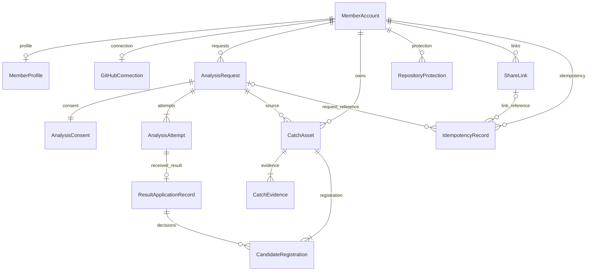

# api — Functional Design · ERD v1

## 적용 범위

개발 기준 계약의 api 논리 모델·업무 흐름이다. [entities](entities.md)의 데이터와 [rules](rules.md)의 규칙을 사용한다. 이 파일은 흐름/상태 전이의 정본이며 ERD/규칙 표는 파생 뷰다. Minimal은 계약 누락을 뜻하지 않는다. 단계 승인과 담당 PR 리뷰를 거쳐 v1로 사용하며 구현 코드는 개발 이슈에서 작성한다.

## ERD — 파생 뷰

텍스트 대체: A 회원은 프로필/현재 연동을 최대 하나씩, 요청·Catch·보호·링크를 여러 개 갖는다. 요청은 새 동의 하나와 현재 시도를 갖고, 시도는 검증된 결과 메타데이터를 최대 하나 갖는다. B Catch는 근거 1개 이상과 등록 연결 1개 이상을 갖는다. 결과별 여러 후보 등록 연결이 새 Catch 또는 기존 같은 작업을 가리킨다. IdempotencyRecord는 operation에 맞는 요청 또는 링크 하나만 참조한다. 그림의 다중 시도 관계는 이력 모델이며 현재 MVP의 자동 재시도 허가가 아니다.

## 업무 흐름

| 흐름 | 순서·원자성 | 실패/경계 |
|---|---|---|
| F1 회원/연동 | 1 JWT 주체 확인 → 2 A 계정/프로필·현재 연동 조회 → 3 허용 필드 응답/자가 입력 저장 | 타인 자원 은닉; 실제 OAuth/자격정보 수명 OQ-A1. 개발용 로그인 #87과 실제 제공자 연결 구분 |
| F2 새 요청 | 1 인증/형식·멱등 키 검사 → 2 현재 연동·저장소/고지/범위 확인 → 3 회원 단위 ACTIVE·선행 이력 판정 → 4 요청·새 동의·첫 시도·멱등 연결 한 번에 저장 → 5 202 → 6 허용된 전송 연결로 요청 전달 | 동일 키 충돌 409. 동일 저장소 ACTIVE는 새 행 없이 기존 작업 200; 다른 저장소는 409. 영속 접수 실패는 202 불가. 전송 불확실은 새 요청이 아님 |
| F3 수신 | 1 식별 가능성 검사 → 2 스키마/맥락 대조 → 3 수신/반영 키·동일 payload 판정 → 4 E 메타데이터 저장 → 5 Receipt → 6 B 전달 | 세 ID 중 하나라도 식별 불가면 Receipt 없음. 맥락 오류/다른 payload/늦은 시도는 기존 값 보존. Receipt ACCEPTED는 B 반영 완료 아님 |
| F4 등록/반영 | 1 E가 허용 후보를 B에 전달 → 2 B 기준/동일 작업 검사 → 3 Catch·근거·초안/질문·후보 등록 연결 원자 저장 또는 기존 참조 → 4 B가 catchId/본인 열람 준비 반환 → 5 E가 등록 ID·준비/반영/종결 기록 | B 저장 성공 뒤 E 실패는 등록 연결에서 복원. 일부 후보만 처리했으면 나머지 해결 전 APPLIED/CLOSED로 만들지 않음. 반영 복구는 새 분석 호출이 아님 |
| F5 본인 확인/공개 | 1 본인 Catch 조회 → 2 근거·기여 확인 PUT → 3 web이 지금 공개 제안 → 4 사용자가 별도 PUBLIC PUT → 5 현재 확인/보호 재검사 후 저장 | 초안 없어도 나머지 조건 충족이면 가능. 최초 PRIVATE, 확인만으로 공개 안 함. PRIVATE·mismatch PUT은 별도 현재 상태 지정 |
| F6 링크 발급/중단 | 1 본인+operation 멱등 → 2 회원 단위 현재 유효 링크 조회 → 3 trim 제목/5개 검사 → 4 발급 시각+30일·선택 비밀번호 참조·멱등 연결 저장 → 5 본인 중단 요청 시 stoppedAt 기록 | 만료/중단 링크는 검사 제외. 시간 기반 상태 유도. 중단은 Catch를 숨기거나 지우지 않음 |
| F7 수신자 | 1 링크 존재/중단/만료 공통 판정 → 2 필요 시 비밀번호/grant → 3 현재 소유자·PUBLIC·보호 제한 없는 집합 → 4 목록/상세 허용 투영 | 링크 불가 404 동일 문구. 유효 비밀번호 분기는 401 유지. 숨김/타인/없는 Catch 상세 404. 정상 0건 200, 조회 오류 500 |
| F8 실패 재요청 | 1 서버가 확정 실패·결과 없음·닫힘 판단 → 2 사용자가 현재 고지/범위에 새 동의 → 3 F2에서 원 요청 이력 재검사 → 4 새 ID 생성 | 정상 0건/부분 유효 결과/실행 불명/반영 미해결은 대상 아님. retryOfRequestId 생략으로 우회 못 함 |

결과 원문을 E 테이블에 복제해 복구를 해결하지 않는다. 수락 후 B 반영 전 장애에서 미등록 결과를 다시 받을 수 있는 전달/보존 방식은 OQ-F1에서 담당자가 정한다. 그 실제 연결을 확정하기 전에는 영속 수신/재전달 보장을 주장하지 않는다. 합성 fixture 연결로 위 상태·키의 계약을 확인할 수 있다.

## 상태 전이 정본

| 대상 | 전이 | 조건 |
|---|---|---|
| request | 생성 → ACCEPTED / ACTIVE | 요청·동의·첫 시도 원자 저장 |
| processing | QUEUED → RUNNING 또는 UNCERTAIN | F의 검증된 진행 또는 실행 여부 불명 |
| processing | RUNNING/UNCERTAIN/QUEUED → 종결 enum | 맥락에 맞는 종결 결과; 결과가 진행 알림보다 먼저 도착해도 허용 |
| processing | 종결 → 동일 종결 유지 | 중복 수신은 동일 의미. 뒤늦은 RUNNING/UNCERTAIN으로 되돌리지 않음 |
| application | NOT_READY → PENDING → APPLYING → APPLIED | 결과 수신 → 실제 반영 → 모든 후보/실패 의미 반영 확인 |
| application | APPLYING → APPLY_FAILED → RECOVERING → APPLIED 또는 APPLY_FAILED | 반영 오류·실제 복구 시작·재진입 결과. 이 동안 ACTIVE |
| lifecycle | ACTIVE → CLOSED | APPLIED이고 추가 처리/반영/복구 없음. 실행 불명은 CLOSED 불가 |
| Catch | PRIVATE → PUBLIC / PUBLIC → PRIVATE | 본인 별도 선택; PUBLIC 시 확인 두 값과 현재 보호 검사. confirmation은 visibility를 바꾸지 않음 |
| ShareLink | ACTIVE → STOPPED 또는 EXPIRED | 중단 시각 존재 또는 현재시각>=만료. 중단/만료 뒤 재개 API 없음 |

processing 종결 의미: 후보≥1/실패0=SUCCEEDED, 후보0/실패0=EMPTY, 후보≥1/실패≥1=PARTIAL_FAILED, 후보0/실패≥1=FAILED. 근거 부족/등록 기준 미달은 notProvided로 구분한다. 초기 count=0은 종결 0건이 아니므로 processing과 함께 해석한다.

ownerResultsReady는 B가 준비됐다고 확인한 등록 Catch가 있고 해당 목록이 일관되게 저장된 경우에만 true다. 부분 반영 중에는 준비된 ID만 반환할 수 있고 최종 반영 완료와 혼동하지 않는다. 등록 목록은 CandidateRegistration의 서로 다른 catchId를 유도한다. APPLIED는 0건/실패 의미 반영도 포함하므로 true를 강제하지 않는다.

retry.allowed는 [계약](../../../inception/contract-design/contract-summary.md)의 모든 실패 확정 조건을 만족할 때만 true다. retry.reason은 그 계약 enum으로 계산하고 별도 수정 가능한 저장 값으로 두지 않는다. 등록 성공/진행/실행 불명/반영 미해결에서는 false다. HTTP 조회 실패는 저장 상태 전이가 아니다.

## 동시성과 일관성

| 충돌 지점 | 요구되는 결과/개발 검증 |
|---|---|
| 같은 사용자 동시 POST | 회원 직렬화 및 ACTIVE 유일성으로 새 요청 하나. 같은 저장소는 기존 ID, 다른 저장소는 409 |
| 같은 멱등 키 | operation/본인 범위의 유일 키와 payload fingerprint. 자원/응답 연결 동시 커밋. 결과 불명은 같은 키 재조회/접수 |
| 같은 결과/후보 재전달 | 수신 유일 키·payload 비교와 후보별 등록 연결 유일성. 중복이면 동일 Catch; 기존 본문/공개 상태를 덮어쓰지 않음 |
| 두 후보가 같은 작업 | owner/workIdentity 유일성으로 하나, 각 CandidateRegistration은 같은 Catch 참조. 다른 작업의 겹치는 근거는 별도 Catch |
| B 저장 뒤 E 장애 | B 등록 연결과 근거/정본은 보존. 복구는 완료 후보를 건너뛰고 E 메타데이터만 일관되게 복원; F 재실행 없음 |
| 링크 동시 발급 | 동일 회원의 판정/생성을 직렬화해 valid(t) 제목·5개를 함께 보장. 만료/중단 경계 시각과 충돌 테스트 필요 |
| 조회 중 숨김·보호·중단 | 응답 생성 시점의 일관된 현재 판정, 다음 요청마다 다시 검사. 기존 화면 실시간 회수 약속 없음 |
| 확인·공개 경쟁 | 공개 저장 시 같은 Catch의 현재 확인/보호를 재검사. 캐시된 확인만으로 공개하지 않음 |

## DTO와 저장 모델 연결

| 응답 | 정본/투영 |
|---|---|
| Member/Profile/GitHubConnection | A 모델. MemberProfile public 투영의 fieldSource=SELF_REPORTED |
| AnalysisStatus | Request+현재 Attempt+Consent+CandidateRegistration의 한 판본. resultId는 E 메타데이터 외부 참조 |
| Catch | B 정본+CatchEvidence 1:N; source*는 최초 등록 출처. 다른 후보의 EXISTING 참조가 이를 교체하지 않음 |
| PublicCatch | catchId/workFacts/subjectContribution/evidence/draft만; 최소 질문·확인·불일치·요청/결과/후보 ID 제외 |
| ShareLink | 현재 시각에서 state, 비밀번호 참조로 passwordRequired, 토큰 경로로 url. 제목은 수신자에게 보내지 않음 |
| 목록/오류 | 회원 items/page, 수신자 profile/catches/page. cursor는 본인/필터에 묶고 매 요청 권한 재판정; 기본20/최대100. no-store 및 code/message/details는 common.yaml 그대로 |

## 규칙 요약 — 파생 뷰

| 업무 | rules.md |
|---|---|
| 본인·연동/동의 | BR2.1·BR2.2 |
| 접수/재요청·처리/반영 | BR2.3~BR2.6 |
| 등록/초안·질문/공개·보호 | BR2.7~BR2.10 |
| 현재 공개 집합·링크/비밀번호 | BR2.11~BR2.13 |
| 오류/멱등·응답 형식 | BR2.14 |

## Open questions · 개발 이슈로 보완

| 항목 | 담당 / 막는 부분 |
|---|---|
| OQ-A1/A2 | 2 A·3 C: 실제 OAuth/자격정보 수명·프로필 투영 확인. 실제 인증/공개 연결 전; #87 개발용 로그인은 별도 |
| OQ-F1/L | 1 F/H·2 A/E: F 임시 결과 위치/수명과 손실 없는 전달, #77 이후 전송. 제공자는 팀장이 실제 연결 전 선정. F 서비스 DB 제외 유지 |
| OQ-F2 | 1 F 제안·4 B/2 E 검토: workIdentity의 네임스페이스/범위·충돌 판별. 실제 중복 등록 판정 전 |
| OQ-B1 | 4 B·2 E: B 등록/기존 참조·준비 응답과 트랜잭션 구현. 이 ERD 제약 안의 함수/구현은 개발 이슈, 관계/유일성 변경은 계약 수정 |
| OQ-B2/B3 | 팀장·B/E/F/C: 보완·재분석·동의 재사용·기존 Catch/링크 변경·원본 재공개/보관은 보류. 보호 관측 경로/오류 판단은 해당 실제 연결 전 |
| OQ-C1 | 3 C: grant 수명/저장·비밀번호 제한·응답 시간 은닉. 실제 보호 연결 전; 임의 grant 테이블/TTL을 이 ERD에 확정하지 않음 |

## 담당자 확인 요청

- 1 F/H/I·2 A/E: 수신 식별/실패 확정·요청/동의·원자성·#86/#87 연결 확인.
- 3 C/D: 현재 공개 자료·공통 거부/비밀번호·시간 의존 링크 제약·#88 응답 확인.
- 4 B: 서비스 정본·근거 1:N·등록/재진입·확인/별도 공개 확인. **PR #89 병합 전 필수**.

## 추적 정보

[작성 확인](functional-design-questions.md) · [추적표](traceability.json) · [Unit](../../../inception/units-generation/unit-of-work.md) · [Unit 매핑](../../../inception/units-generation/unit-of-work-story-map.md) · [requirements](../../../inception/requirements-analysis/requirements.md) · [components](../../../inception/domain-design/components.md) · [API](../../../inception/contract-design/contract-summary.md) · [common](../../../inception/contract-design/common.yaml) · [회원](../../../inception/contract-design/member-api.yaml) · [수신자](../../../inception/contract-design/recipient-api.yaml) · [worker](../../../inception/contract-design/worker-messages.yaml) · [Delivery](../../../inception/delivery-planning/bolt-plan.md).

R-01/R-02 수정본 90bf289 사용. [단독 실행](../../../inception/contract-design/single-r01-r02-verification.md)은 공식 완료 불가로 열린 상태를 유지하며 PR #89 담당 리뷰로 확인한다. 상류 승인/문구는 다시 쓰지 않는다. 첫 연결 결과 M1 승인과 Functional 전체 최종 승인은 별도다. 자료 조건: [#37](https://github.com/JminAILab/CatchU/issues/37).

