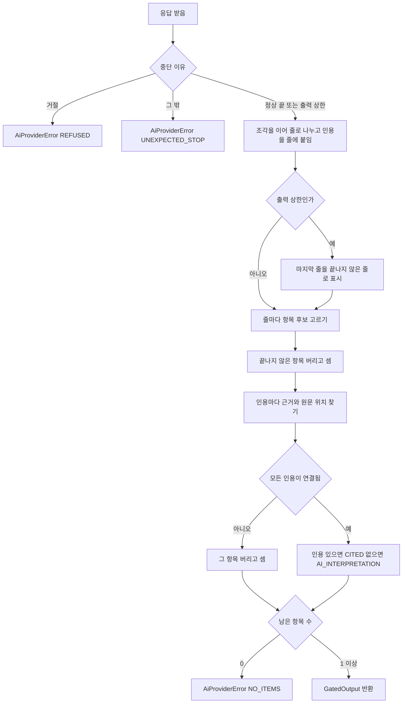
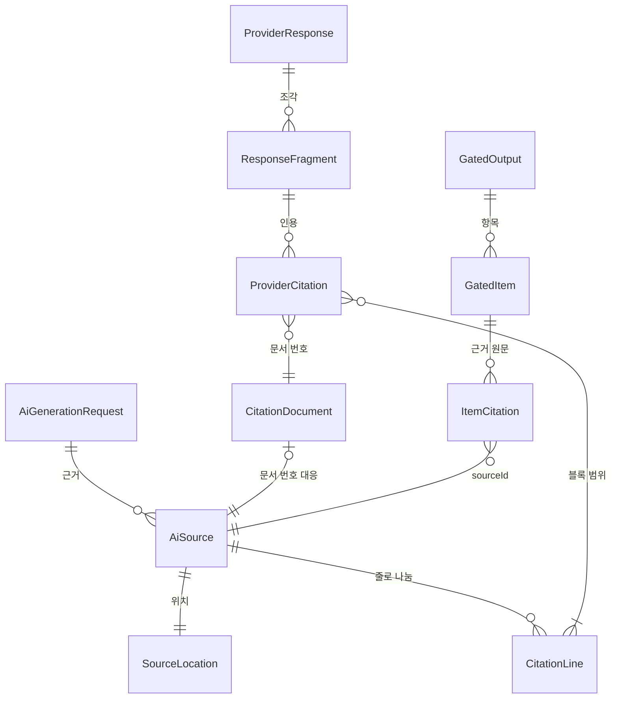

# U1 AI 생성 관문 최소 경로 — 기능 명세

## Sources

작성일: 2026-10-27. 입력: [Unit 정의](../../../inception/units-generation/unit-of-work.md)(unit-of-work)의 U1, [스토리 대응](../../../inception/units-generation/unit-of-work-story-map.md)(unit-of-work-story-map)의 US6.3 행과 U1 구현 순서, [사용자 스토리](../../../inception/user-stories/stories.md)(stories)의 US6.3, [요구사항](../../../inception/requirements-analysis/requirements.md)(requirements)의 FR6.4·FR6.5·FR6.9·NFR2·A04, [컴포넌트 목록](../../../inception/domain-design/components.md)(components)의 AiGeneration, [계약 요약](../../../inception/contract-design/contract-summary.md)(contract-summary)의 C-01과 「에러 대응 최소선」, [납품 계획](../../../inception/delivery-planning/bolt-plan.md)의 B1, [기능 설계 질문·답변](functional-design-questions.md) Q1~Q5. 엔티티의 원본은 [entities.md](entities.md), 규칙의 원본은 [rules.md](rules.md)이며 아래 ER 그림과 규칙 요약은 그 둘에서 옮긴 것이다. 워크플로와 응답 처리 흐름은 이 문서가 원본이다.

## 범위

U1은 이번 계획의 첫 Unit(walking skeleton)이다. 공용 계약 C-01의 `AiGenerationGate.generate()` 하나를 실제 Claude 인용 호출로 끝까지 돌려, 인용 기능 관문 네 가지(응답을 항목으로 묶기·인용 보존·원문 위치 연결·거부 사례 처리)를 이 저장소에서 확인한다(requirements A04, bolt-plan B1).

- **구현하는 스토리:** [stories.md](../../../inception/user-stories/stories.md)의 US6.3 「AI 문장의 근거 원문을 확인한다」 중 인용 연결 부분. 기계 대조·버림·출처 표시 규칙은 U2가 같은 스토리에서 맡는다(unit-of-work-story-map).
- **U1에 있는 것:** 줄 나누기와 위치 기록(BR1), 호출 구성(BR2), 항목 묶기(BR3), 인용 보존과 원문 위치 계산(BR4), 거부 사례 ①잘린 응답 ②거절·빈 응답(BR5).
- **U1에 없는 것(Q1·Q4):** 숫자·PR 번호·파일 이름·영어 표기 기계 대조와 버림, `generateStream`(질의응답 SSE), 숨긴 지시 방어·역량 평가 표현 금지 공통 문구, 입력 상한(`AiInputTooLarge`)은 U2. 자료 속 숨긴 지시와 검사에 걸린 항목 버리기(거부 사례 ③)도 U2. 인용과 구조화된 출력을 함께 쓸 때의 400 거절(④)은 구조화된 출력을 쓰지 않으므로 확인하지 않는다. 화면(근거 원문 강조)은 U4·U5, 근거 글을 모으는 일은 호출 Unit(C-01 caller-rule)이다.
- **두는 곳:** api의 AI 생성 공통 모듈(ADR-002). 저장하는 것은 없다.

## 워크플로

### W1. generate() 한 번

1. 요청을 받는다. `sources`가 비었으면 2~7을 건너뛰고 항목 없음·`droppedCount` 0을 돌려준다(BR2.1).
2. 근거마다 글을 줄바꿈으로 나누고 줄 끝 `\r`·`\n`을 뺀다(BR1.1). 빈 줄은 빼고 남은 줄에 0부터 블록 번호를 매기며, 줄마다 근거 글 안의 UTF-16 시작·끝을 기록한다(BR1.2·BR1.3).
3. 근거 순서대로 인용이 켜진 문서를 하나씩 만든다. 내용은 2의 줄 블록, context는 출처 종류 설명이다. 넘길 줄이 없는 근거는 문서를 만들지 않고 자리 문서로도 넘기지 않는다. 문서를 하나 만들 때마다 문서 번호 → 근거 대응표에 한 행을 더한다. 남은 문서가 없으면 1처럼 빈 결과를 돌려준다(BR1.4·BR2.1).
4. 지시를 만든다: 항목 형식 지시("한 줄에 한 항목, 줄 맨 앞은 '- ', 항목마다 사실 하나, 머리말·맺음말 없음") 뒤에 기능 지시(`instruction`). 사용자 메시지는 문서들, 그 뒤에 `userText`(있으면)다. `publicationText`는 보내지 않는다(BR2.3).
5. `model` 값의 모델로, 생각 출력을 끄고, 게이트의 출력 상한으로 Claude를 한 번 부른다(BR2.2). 호출이 실패하면 재시도 없이 `AiProviderError`로 끝낸다(BR2.4).
6. 응답을 W2로 처리한다.
7. `GatedOutput`(항목, `droppedCount`)을 돌려주고, 버림이 있었으면 수만 로그에 남긴다(BR5.5).

### W2. 응답 처리

1. 중단 이유를 본다. 거절이면 `AiProviderError(REFUSED)`(BR5.2), 정상 끝·출력 상한이 아니면 `AiProviderError(UNEXPECTED_STOP)`(BR5.4).
2. 글 조각을 순서대로 이어 줄로 나누고, 조각의 인용을 그 조각의 첫 줄바꿈 아닌 글자가 놓인 줄에 붙인다(BR3.2).
3. 중단 이유가 출력 상한이면 마지막 줄바꿈 뒤의 마지막 줄을 끝나지 않은 줄로 표시한다(BR5.1).
4. 줄마다: '- '로 시작하고 뒤에 글자가 있으면 항목 후보, 아니면 버린다(세지 않음)(BR3.1·BR3.4). 끝나지 않은 줄이 항목 후보면 버리고 `droppedCount` +1(BR5.1).
5. 항목 후보의 인용마다 문서 번호를 W1-3의 대응표로 근거에 잇고, 블록 범위로 위치를 찾고(BR4.1), 인용문을 그 범위의 원문으로 채우고(BR4.2), 출처 이름을 붙인다(BR4.3). 하나라도 연결되지 않으면 그 항목을 버리고 `droppedCount` +1(BR4.4).
6. 남은 항목에 인용이 있으면 `CITED`, 없으면 `AI_INTERPRETATION`(BR3.3).
7. 남은 항목이 0개면 `AiProviderError(NO_ITEMS)`(BR5.3). 아니면 응답 순서대로 내보낸다.

<!-- Text fallback: 응답을 받으면 중단 이유를 본다. 거절이면 REFUSED 오류, 정상 끝·출력 상한이 아닌 다른 이유면 UNEXPECTED_STOP 오류다. 정상 끝이나 출력 상한이면 조각을 이어 줄로 나누고 인용을 줄에 붙인다. 출력 상한이면 마지막 줄을 끝나지 않은 줄로 표시한다. 줄마다 항목 후보를 고르고, 끝나지 않은 항목은 버리고 센다. 인용마다 근거와 원문 위치를 찾고, 연결되지 않는 인용이 있는 항목은 버리고 센다. 나머지는 인용이 있으면 CITED, 없으면 AI_INTERPRETATION이다. 남은 항목이 0개면 NO_ITEMS 오류, 1개 이상이면 GatedOutput을 돌려준다. -->

### 상태 전이

U1에는 수명 주기를 가진 엔티티가 없다. 한 호출은 W1·W2의 순서로 끝나며 상태를 저장하지 않는다. 처리 시한·실패 기록은 호출 Unit과 AiRun(U2)이 맡는다.

## 위치 계산 예

근거 하나의 `location.charStart`가 100이고 글이 `"첫 줄\r\n\r\n셋째 줄"`이라고 하자.

| 줄 | 블록 번호 | 근거 글 안 [시작, 끝) | 사본 필드 기준 [charStart, charEnd) |
|---|---|---|---|
| `첫 줄` | 0 | [0, 3) | [100, 103) |
| (빈 줄) | 없음 | — | — |
| `셋째 줄` | 1 | [7, 11) | [107, 111) |

블록 범위 [0, 2)를 인용하면 위치는 [100, 111), `quote`는 `"첫 줄\r\n\r\n셋째 줄"`이다(BR4.1·BR4.2). 빈 줄은 블록 번호가 없지만 원문 위치는 그대로 남는다(BR1.2).

## 엔티티 관계 (entities.md에서 옮김)

<!-- Text fallback: 요청은 근거를 0개 이상 가진다. 근거는 위치 하나를 가지고 줄로 나뉜다. 줄이 있는 근거마다 인용 문서 대응표 행이 하나 있고, 인용의 문서 번호는 그 대응표 행을 가리킨다. 응답은 조각을 가지고 조각은 인용을 가진다. 인용의 블록 범위는 줄 하나 이상을 가리킨다. 결과는 항목을 가지고 항목은 근거 원문을 가지며, 근거 원문은 sourceId로 근거 하나를 가리킨다. -->

## 규칙 요약 (rules.md에서 옮김)

| 무리 | 규칙 | 요지 |
|---|---|---|
| 줄 | BR1.1~BR1.4 | 줄바꿈으로만 나누고 줄 끝 문자 제외, 빈 줄 제외·위치 유지, UTF-16 위치 기록, 근거 하나 = 문서 하나와 문서 번호 → 근거 대응표 |
| 호출 | BR2.1~BR2.4 | 빈 근거는 호출 안 함, 모델·생각 끔·출력 상한 설정, 지시 구성, 호출 실패는 재시도 없이 오류 |
| 항목 | BR3.1~BR3.4 | '- ' 줄 = 항목, 줄 안 인용 모음, CITED/AI_INTERPRETATION, 그 밖의 글은 내보내지 않음 |
| 위치 | BR4.1~BR4.4 | 블록 범위 → 원문 위치, quote는 원문, 출처 이름 두 가지, 연결 안 되면 항목 버림 |
| 거부 | BR5.1~BR5.5 | 잘린 마지막 항목만 버림, 거절·항목 없음·예상 밖 중단은 오류, 수만 기록 |

## 주요 시나리오와 확인

팀 시험 관행(team.md Testing Posture)대로 시나리오·기대 결과·실패 조건을 먼저 정한다. 세부 시험 코드는 구현 뒤 쓴다. S1~S7과 S9는 기록한 응답으로 api 시험 묶음에서 돈다. S8은 같은 묶음의 실제 호출 시험이며 Claude API 키 환경변수가 있을 때만 돌고 CI에서는 건너뛴다(Q5).

| # | 시나리오 | 기대 결과 | 실패 조건 | 규칙 |
|---|---|---|---|---|
| S1 | `\r\n`·빈 줄·공백만 있는 줄이 섞인 근거 | 빈 줄은 블록이 없고, 다른 줄의 위치가 원문 기준 UTF-16과 맞음(한글·이모지 포함) | 위치가 한 글자라도 어긋남 | BR1.1~BR1.3 |
| S2 | 근거 없음, 또는 모든 근거가 빈 줄뿐 | 호출하지 않고 항목 0·`droppedCount` 0 | Claude를 부름, 오류를 냄 | BR2.1 |
| S3 | 인용 있는 '- ' 줄, 인용 없는 '- ' 줄, 머리말이 섞인 정상 응답 | 인용 있는 줄은 `CITED`, 없는 줄은 `AI_INTERPRETATION`, 머리말은 빠지고 `droppedCount` 0 | 머리말이 항목이 됨, 인용이 다른 항목에 붙음 | BR3.1~BR3.4 |
| S4 | 여러 줄에 걸친 블록 범위 인용 | 위치는 첫 줄 시작~마지막 줄 끝, `quote`는 그 범위 원문, 출처 이름이 종류에 맞음 | 인용 기능이 이어 붙인 글을 그대로 씀 | BR4.1~BR4.3 |
| S5 | 문서 번호·블록 범위가 넘긴 범위 밖인 인용 | 그 항목만 빠지고 `droppedCount` 1 | 잘못된 위치로 내보냄, 전체 실패 | BR4.4 |
| S6 | 출력 상한에서 잘린 응답 | 끝나지 않은 마지막 항목만 빠지고 나머지는 나옴, `droppedCount` 1. 남은 항목이 없으면 `AiProviderError` | 잘린 항목을 냄, 전체를 버림 | BR5.1·BR5.3 |
| S7 | 거절 응답, 항목 없는 정상 끝 응답, 예상 밖 중단 이유, 호출 실패 | 모두 `AiProviderError`(원인 구분), 재시도 없음, 로그에 근거 글·질문·키 없음 | 빈 결과로 성공 처리, 자동 재시도 | BR2.4·BR5.2~BR5.5 |
| S8 | 실제 호출: 근거 2개, 출력 상한을 낮춤(아래 「S8 실제 호출」) | 합격 기준 ①~⑤를 모두 만족 | ①~⑤ 중 하나라도 어긋남(①만 어긋나면 상한을 낮춰 다시 돌림) | 전체 |
| S9 | 첫 근거가 빈 줄뿐이라 문서가 되지 않고 둘째 근거만 문서가 됨. 응답의 인용은 문서 번호 0을 가리킴 | 인용이 둘째 근거의 sourceId·원문 위치로 연결되고 항목이 나옴 | 첫 근거의 위치로 연결됨, 항목이 빠짐 | BR1.4·BR4.1 |

### S8 실제 호출

- **시험 자료:** 근거 2개. GitHub 기록 1개와 작성자 자료 1개이며, 각 10줄 안팎의 공개 가능한 합성 글이다.
- **출력 상한:** 완성 항목이 2개 이상 나오고 마지막 항목이 잘리는 값을 시험 코드에 상수로 둔다(BR2.2). 쓴 값은 결과 기록에 적는다.
- **합격 기준(내용이 아니라 모양으로 본다):**
  1. 중단 이유가 출력 상한이다.
  2. `CITED` 항목이 1개 이상이다.
  3. 모든 `CITED` 인용에서 두 가지가 같다. Claude가 돌려준 인용 글은 그 블록 범위의 줄을 이어 붙인 글과 글자 그대로 같다. `location`으로 원문을 잘라 낸 글은 `quote`와 같다.
  4. 끝나지 않은 마지막 항목이 빠졌다(`droppedCount`에 포함).
  5. 예외가 없다.
- **상한 전에 끝난 경우:** 응답이 상한 전에 끝나 ①이 아니면 실패가 아니다. 상한을 낮춰 다시 돌리고, 그 사실도 결과 기록에 적는다.

S8은 팀장이 돌려 '최소 연결 첫 결과' 승인 자료로 쓴다(team.md Walking Skeleton). 결과 기록에는 API 키·사용자 자료를 남기지 않는다(team.md Code Style). 최소 연결이 통과해도 U2·U5·U10의 실제 처리 성공으로 보고하지 않는다(team.md Walking Skeleton).

## 다른 Unit에 넘기는 것

- **U2:** BR1(줄 규칙)과 BR4(위치 계산)를 그대로 쓴다. C-01은 줄 구분 방식을 U2 기능 설계에서 정한다고 적었지만 이 설계에서 정했다(Q2). U2는 `generate()` 결과에 기계 대조·버림을 더하고 그 버림을 `droppedCount`에 더한다. `generateStream`도 같은 BR1~BR5를 항목 단위로 쓴다.
- **U5·U10:** C-01 모양 그대로 부른다. `AiProviderError`를 받으면 자동으로 다시 부르지 않고 실패로 기록한다.
- **U1 결과에 따른 변경:** S8이 통과하지 못하면 원문 열람부터 확보하고 다른 생성 방식을 다시 산정한다(requirements A04).

## 추적

| 수용 기준 | U1에서 | 규칙 |
|---|---|---|
| AC6.3.1 근거는 인용 원문 그대로, 출처 표시, AI 문장은 확인된 사실 아님 | 인용 단위·원문 인용문·출처 이름을 만든다. 화면 표시는 U4·U5 | BR1.1~BR1.3, BR2.3, BR3.1, BR3.2, BR4.2, BR4.3 |
| AC6.3.2 대조에 걸린 항목 버림 | U2 | — |
| AC6.3.3 근거 없는 해석은 'AI 해석' | `AI_INTERPRETATION` 분류만 한다. 버림은 U2 | BR3.3 |
| AC6.3.4 AI 설명 초안은 인용 단위에 넣지 않음 | 호출 Unit이 근거에서 뺀다(C-01 caller-rule). U1은 받은 근거만 넘긴다 | — |
| AC6.3.5 근거를 누르면 해당 구절 강조·이동 | 강조할 원문 위치를 계산한다. 강조·이동은 U4·U5 | BR1.3, BR4.1, BR4.4 |
| AC6.3.6 JD 면접 질문 대조 | U2·U10 | — |
| AC6.3.7 숨긴 지시 방어·역량 평가 표현 금지 | U2(Q1·Q4 ③) | — |

기계용 추적은 [traceability.json](traceability.json)이다.

## Assumptions & Open Questions

- 호출 Unit이 넘기는 `AiSource.text`는 사본 필드의 `[location.charStart, location.charEnd)` 범위 원문 그대로라고 본다(C-01·C-09 ChunkHit 모양). U1은 이 일치를 따로 검사하지 않는다.
- 인용 조각 하나가 두 항목 줄에 걸치는 경우는 사전 시험에서 0/215였다(Q3). BR3.2는 조각의 첫 글자가 놓인 줄에 붙이며, 드물게 생기는 걸침은 따로 막지 않는다(contract-summary 「에러 대응 최소선」 6).
- 사전 시험 도구는 저장소 밖 팀장 로컬에 있으며(Q3 답) 이 설계의 근거 기록으로만 인용한다.
