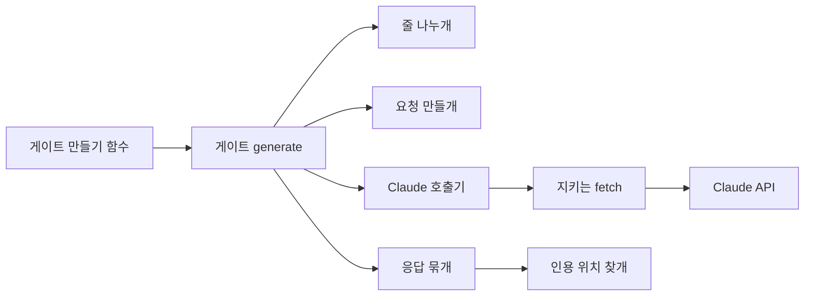

# U1 AI 생성 관문 최소 경로 — 논리 구성 요소

## Sources

작성일: 2026-10-27. 입력: [성능](../nfr-requirements/performance-requirements.md)(performance-requirements)·[보안](../nfr-requirements/security-requirements.md)(security-requirements)·[규모](../nfr-requirements/scalability-requirements.md)(scalability-requirements)·[신뢰성](../nfr-requirements/reliability-requirements.md)(reliability-requirements)·[관측](../nfr-requirements/observability-requirements.md)(observability-requirements) 요구사항, [기술 선택](../nfr-requirements/tech-stack-decisions.md)(tech-stack-decisions), [U1 기능 명세](../functional-design/functional-spec.md)(functional-spec), [계약 요약](../../../inception/contract-design/contract-summary.md)(contract-summary)의 C-01, [비기능 설계 질문·답변](nfr-design-questions.md) Q1·Q2.

## 구성 요소

모두 api의 AI 생성 공통 폴더(C-01이 정한 `api/src/ai-generation`) 안에 있고, 같은 프로세스 안에서 함수 호출로 이어진다. api 앱 모듈에는 등록하지 않는다(Q1).

| 구성 요소 | 하는 일 | 기능 규칙·요구사항 |
|---|---|---|
| 게이트 만들기 함수 | 설정(키, 출력 상한, 시간 제한, fetch)을 받아 게이트를 만든다. 키가 비었으면 만들지 않고 멈춘다. 기본값은 출력 상한 4,000 토큰, 시간 제한 45초 | NFR1.1, NFR4.1, NFR4.2 |
| 게이트(`AiGenerationGate.generate`) | W1 순서대로 아래 구성 요소를 부르고, 실패를 `AiProviderError`로 바꾸며, 호출마다 로그 한 줄을 남긴다 | 기능 설계 W1, NFR4.4, NFR6.2 |
| 줄 나누개 | 근거 글을 줄로 나누고 UTF-16 위치를 기록한다 | BR1.1~BR1.3 |
| 요청 만들개 | 인용 문서와 문서 번호 → 근거 대응표, 시스템 지시, 사용자 메시지를 만든다 | BR1.4, BR2.1, BR2.3, NFR2.3 |
| Claude 호출기 | 공식 SDK 클라이언트를 고정 주소·재시도 0·시간 제한으로 만들고, 모델·생각 끔·처리 위치 미국을 실어 한 번 부른다 | BR2.2, NFR2.1, NFR2.2 ①④ |
| 지키는 fetch | redirect 응답을 받으면 따라가지 않고 실패로 끝낸다. 응답 본문을 압축을 푼 뒤 기준으로 세어 256 KiB를 넘으면 그 자리에서 끊는다 | NFR2.2 ②③ |
| 응답 묶개 | 중단 이유를 보고, 조각을 줄로 이어 항목을 만들며, 잘린 마지막 항목과 항목이 아닌 줄을 센다 | BR3, BR5.1~BR5.4 |
| 인용 위치 찾개 | 대응표로 근거를 찾고, 블록 범위를 원문 위치·인용문·출처 이름으로 바꾼다 | BR4 |

<!-- Text fallback: 게이트 만들기 함수가 게이트를 만든다. 게이트의 generate가 줄 나누개, 요청 만들개, Claude 호출기, 응답 묶개를 차례로 부른다. Claude 호출기는 지키는 fetch를 거쳐 Claude API를 부르고, 응답 묶개는 인용 위치 찾개를 부른다. -->

## 실패 범위

- 한 번의 `generate()` 실패는 그 호출만 실패한다. 상태를 두지 않으므로 다른 호출에 번지지 않는다(scalability-requirements NFR4.3).
- U1은 앱에 등록되지 않으므로 키가 없거나 Claude가 멈춰도 api 기동과 다른 기능에는 영향이 없다(Q1).
- 바깥 의존은 Claude API 하나다. 장애 때는 호출자가 실패로 기록하고 사람이 다시 시도한다(reliability-requirements NFR4.4).

## 시험에서 바꿔 끼우는 자리

- 기록한 응답 시험은 게이트 만들기 함수에 시험용 fetch를 넘긴다. 이 fetch가 기록한 HTTP 응답(정상·잘림·거절·redirect·큰 본문·느린 응답)을 돌려주므로 SDK 응답 해석과 지키는 fetch를 함께 시험한다(Q2).
- 실제 호출 시험(S8)은 기본 fetch와 시험 상수 출력 상한으로 게이트를 만든다.

## U2에 넘기는 것

- Nest 모듈 등록과 주입, 숨긴 지시 방어 문구, 입력 상한, 기계 대조·버림, `generateStream`은 U2가 이 구성 요소 위에 더한다(Q1, 기능 설계 「다른 Unit에 넘기는 것」).
