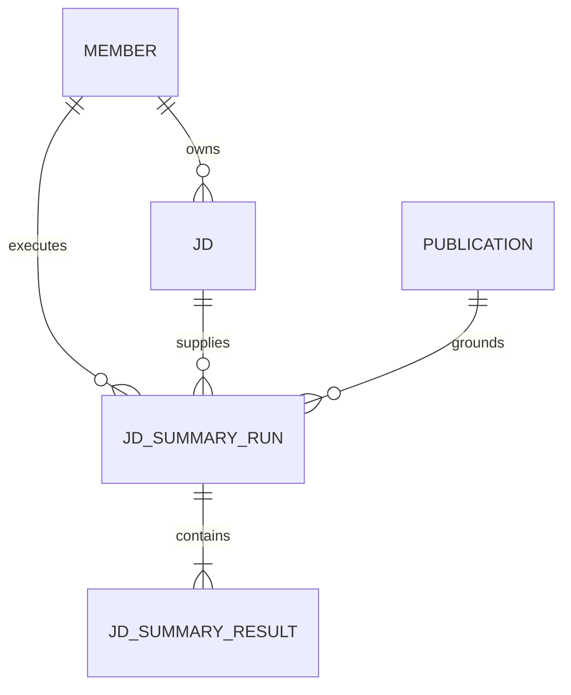

# U10 JD 관리·요약 기능 명세

기준 통합본: `e24942724e7515f083a903f4c84371414ffa0075`. 담당 Unit은 `u10-jd`이며 [#452](https://github.com/JminAILab/CatchU/issues/452)로 추적한다. 구현 대상은 [스토리](../../../inception/user-stories/stories.md)의 US6.1·US6.5다. 상류 승인 기록을 바꾸지 않는다.

이 문서는 처리 순서와 상태 전이의 정본이다. 데이터 모양은 [entities.md](entities.md), 결정 규칙은 [rules.md](rules.md), 화면 흐름은 [frontend-components.md](frontend-components.md), 수용 기준 대응은 [traceability.json](traceability.json)에 둔다.

## 1. 기능 경계와 구성

- JdManagement: 로그인 회원의 JD 목록·작성·수정·삭제. C-10·검색·생성 제공자가 없어도 준비 가능하다.
- JdSummary: 특정 발행본에 대한 개인 실행 접수·요구사항별 처리·재열람·삭제 의존 관리.
- U1/U2: 인증·공용 실행·하루 한도·첫 동의·검사된 생성 관문을 제공한다. U10은 공용 정책을 복제하지 않는다.
- U3: C-09 검색과 원문 위치·발행본 검사 글을 제공한다.
- U4: C-10 발행 접근과 C-11 공유 화면·접근 오류 처리·원문 강조를 제공한다.
- 공유 페이지 안의 정해진 영역을 사용한다. 자료 옆 사이드 패널, 기업 JD 공유, 결과 공개, 역량 점수는 만들지 않는다.

## 2. 엔터티 관계 — 파생 표현

아래는 entities.md YAML의 관계를 텍스트로 옮긴 것이다. 회원 → JD는 1:N, 회원 → 실행은 1:N, JD → 실행은 1:N, 발행본 → 실행은 1:N, 실행 → 요구사항 결과는 1:N이다. 모든 자식 참조는 부모 삭제에 연쇄 삭제된다. JD와 실행의 회원은 일치하고 발행본 작성자는 달라도 된다.

## 3. JD 관리 흐름 W1

1. 인증된 회원이 JD 관리 페이지를 열면 본인 목록만 반환한다. 처음이면 빈 목록과 작성 동작을 보여 준다.
2. 제목·본문을 입력한다. 제목 1~200자, 본문 1~20,000자, 공백만인 값은 거부한다. 길이는 UTF-16 코드 단위다. 원문을 잘라 저장하지 않는다.
3. 저장 시 본문과 제목·소유자를 검증한다. 회원 식별자는 인증 정보에서 얻고 요청 본문의 소유자를 신뢰하지 않는다.
4. 새 JD는 새 식별자를 발급한다. 수정은 본인 JD만 바꾼다. 동시 수정은 마지막으로 저장된 내용이 남으며 충돌 복원 기능은 두지 않는다.
5. 저장 실패면 입력 내용을 유지하고 오류를 안내한다. 저장은 AI 호출·AI 동의·AI 하루 횟수·발행 링크와 무관하다.
6. 삭제 전 이 JD의 요약 기록도 지워짐을 안내한다. 확인하면 본인 JD와 의존 실행·결과·입력 사본을 삭제한다. 취소는 그대로 둔다.
7. JD를 수정해도 과거 실행의 입력 사본·원문 줄·결과는 바꾸지 않는다.

## 4. 실행 접수 흐름 W2

1. 로그인 상태를 확인한다. 미로그인·만료는 401 AUTH_REQUIRED 또는 AUTH_INVALID로 보낸다.
2. C-10 `resolveForRecipient(token, grant, now)`로 링크 조건과 발행본을 확인한다. 작성자도 이 받은 사람 경로로 실행하며 소유자 권한으로 중지·만료를 우회하지 않는다.
3. 본인 JD를 읽는다. 없는 JD와 타인 JD는 같은 404 RESOURCE_UNAVAILABLE로 처리한다.
4. 원문을 CRLF 또는 LF 줄 경계로 나눈다. 공백만 있는 줄은 요구사항이 아니며, 나머지는 앞뒤 공백·불릿·문장부호를 바꾸지 않고 원문 줄 번호와 0부터의 요구사항 순서를 기록한다. 제목처럼 보이는 비어 있지 않은 줄도 자동 선별 없이 포함한다.
5. 원문 전체 길이·줄 수·줄별 길이·생성 입력의 정적 최대값을 검사한다(§5). 입력 초과는 이 시점에 422로 거부한다. 원문에서 일부 요구사항을 골라 실행하지 않는다.
6. C-04 동의를 확인한다. 동의가 없으면 403 AI_CONSENT_REQUIRED다. UI는 공용 동의 창을 사용하고 동의 후 재요청 시 모든 접수 검사를 다시 한다.
7. C-09 `getIndexState`가 DONE인지 확인한다. PENDING·FAILED는 409 INDEX_NOT_READY이며 U10이 색인을 재생성하지 않는다.
8. 하나의 저장 트랜잭션에서 JD의 소유와 읽은 판본을 다시 확인하고, C-03 `consume(실행 회원, JD_SUMMARY, now, manager)`와 새 실행·입력 사본·요구사항별 PENDING 행 저장을 묶는다. 읽은 JD가 바뀌었다면 최신 입력을 다시 검증한 후 접수한다. 삭제됐다면 접수하지 않는다. 횟수 제한이면 429, 저장 실패면 롤백하여 실행·차감만 홀로 남기지 않는다.
9. 커밋 뒤 C-02 `enqueueAfterCommit(JD_SUMMARY, runId, {runId})`를 호출한다. runId는 콜론 없는 새 키다. 브라우저에는 202와 runId를 준다.
10. ENQUEUE_FAILED도 이미 접수된 실행이다. C-02에 따라 PENDING을 유지하다 시한 조회에서 실패 확정한다. 자동 재등록하지 않고 차감한 1회를 환급하지 않는다.

## 5. 입력 상한의 계산과 검사 시점

공용 코드 근거는 `api/src/ai-generation/gate-policy.ts`의 `inputLength`, `assertGenerationRequest` 및 `checked-gate.ts`의 generate 입구다. 기준 커밋은 문서 첫 줄의 통합본이다.

**한 번의 생성 입력 길이 = 모든 sources 항목의 text.length 합 + (userText?.length 또는 0).** 문자열 길이는 UTF-16 코드 단위이며 바이트·토큰·문자소 수가 아니다.

| 포함 | 제외 |
|---|---|
| 검색 조각 각각의 text, 현재 JD 요구사항 줄인 userText | instruction, publicationText, sourceId·location·catchEvidenceUrls 등 메타데이터 |
| 같은 글이 여러 source로 오면 각 항목 길이를 모두 센다 | JD 제목·전체 본문·다른 요구사항 줄은 요청에 넣지 않으므로 세지 않는다 |

현재 공용 상한은 80,000이며 **초과(>)**일 때 AiInputTooLarge다. 80,000과 같으면 통과한다. U10이 공용 상한을 변경하거나 독자 계산으로 대체하지 않는다.

- **저장 전:** JD 제목·본문의 저장 상한을 검사한다.
- **접수 전:** 최대 20개 요구사항·한 줄 2,000자와 검색 limit 6, 현재 U3 조각 최대 1,000자를 확인한다. 한 생성 요청은 최대 `6 × 1,000 + 2,000 = 8,000`이다. 따라서 정상 제공자의 입력은 공용 80,000 안에 들어간다. 초과 JD는 실행 행·횟수 차감 전에 거부한다.
- **검색 후, 생성 직전:** 실제 hits를 sourceId=chunkId와 나머지 원문 필드 그대로 매핑하고 그 실제 요청에 공용 계산을 적용한다. 관문도 모델 호출 전에 다시 검사한다. 입력을 자르거나 조각 일부를 임의로 버려 통과시키지 않는다.
- **비정상 제공자 반환:** 6개 초과·조각 1,000자 초과 등 약속을 어기면 CONTRACT_INVALID로 해당 요구사항을 실패 처리하고 생성하지 않는다. 실제 요청이 공용 상한을 넘으면 INPUT_TOO_LARGE로 실패 처리한다. 이 방어는 접수 이후 발견한 제공자·연결 오류이며 이미 접수한 요청을 소급해 422로 바꾸지 않는다.
- **상한 변경 시:** U3 조각 상한·검색 제한 또는 U2 상한이 바뀌면 8,000의 전제를 다시 확인한다. U2 계약·공용 검사 수정이 필요하면 별도 요청하며 U10에서 조용히 수정하지 않는다.

publicationText는 발행본 전체 검색 조각 글이며 U2의 AI 해석 검사에만 쓴다. 공용 코드는 이를 모델에 보내거나 입력 상한에 합산하지 않는다. 이 사실을 전체 처리 비용이 무제한이라는 뜻으로 해석하지 않고 발행본 크기 정책은 U4의 기존 제한을 따른다.

## 6. 백그라운드 처리 W3

1. U10이 JD_SUMMARY 처리기를 등록한다. 큐에는 runId만 넣고 JD 원문·링크 토큰·grant를 넣지 않는다.
2. 실행·부모 존재, PENDING, 현재 시각 < deadlineAt을 확인한다. 그 외는 끝내며 삭제된 행을 다시 만들지 않는다.
3. 저장된 요구사항 순서대로 하나씩 처리한다. 각 단계 전과 저장 직전에 시한·실행·부모를 확인한다. 병렬 생성·자동 재시도·재개는 없다.
4. C-09 search(publicationId, jdLine, 6)를 호출한다. 다른 발행본·원본 자료를 직접 조회하거나 키워드 검색으로 대체하지 않는다.
5. hits를 C-01 sources로 매핑한다. sourceKind·원문 text·location·catchEvidenceUrls를 보존한다. publicationText는 검색 반환값을 그대로 검사에 쓴다.
6. 공용 입력 검사 후 feature=JD_SUMMARY, model=HAIKU, userText=현재 원문 줄로 generate를 한 번 호출한다. 자료의 숨긴 지시를 따르지 않고 원문 표기·역할별 결과를 요구한다. 의미·인용 검사와 영어 표기 추출은 U2 소유다.
7. 정상 반환 항목은 jdRole에 따라 근거·확인되지 않는 점·면접 질문에 넣는다. SERVER_NOTICE는 AI 해석 표시 없이 구분한다. 인용의 quote·sourceLabel·UTF-16 location을 바꾸지 않는다. droppedCount나 버린 항목은 화면에 노출하지 않는다.
8. 정상 반환과 예외를 §7 기준으로 기록한다. 요구사항 하나의 검색·생성 실패는 해당 행에 남기고 시한 안이면 다음 요구사항을 처리한다.
9. 결과 쓰기는 부모 존재·실행 PENDING·시한 전 조건과 한 트랜잭션에서 처리한다. 삭제·시한 확정과 경합하면 조건부 저장 또는 외래 키 거부로 늦은 결과를 버린다. 외부 호출 뒤 부모 재생성은 없다.
10. 전체 요구사항이 끝났으면 §7 규칙으로 실행을 마친다. 예기치 않은 처리기 전체 오류는 남은 PENDING 행에 PROCESSING_FAILED를 기록하고 실행을 FAILED로 끝낸다. 저장 자체가 불가능하면 조회 시 시한 규칙이 최종 실패를 보장한다.

## 7. 상태와 화면 의미

공용 실행 상태와 요구사항 처리 상태는 모두 PENDING/DONE/FAILED다. **EMPTY는 새 실행 상태가 아니라 DONE 결과의 resultKind**다.

| 요구사항 상황 | status / resultKind | 안내 |
|---|---|---|
| 처리 전·처리 중 | PENDING / 없음 | 처리 중 |
| 정상 반환, 인용·AI 해석 내용 존재 | DONE / CONTENT | 통과한 내용과 출처 표시 |
| 정상 반환, 검사 후 내용 0개 | DONE / EMPTY | 이번 자료에서 표시할 요약 내용이 없습니다 |
| 정상 반환, 서버 안내만 존재 | DONE / EMPTY | 결과 없음과 SERVER_NOTICE를 함께 표시 |
| 검색 조각 0개, 공용 관문이 호출 생략 | DONE / EMPTY | 원문 줄 옆에 이번에 찾은 자료가 없어 이 요구사항의 표기를 찾지 못했습니다 |
| 검색 오류·AiProviderError | FAILED / 없음 | 이 요구사항을 처리하지 못했습니다 |
| 개별 생성 호출 시간 초과 | FAILED / 없음 | 이 요구사항을 처리하지 못했습니다 |
| 전체 시한 초과로 미처리 | FAILED / 없음 | 전체 처리 시한이 지나 완료하지 못했습니다 |

C-01의 AiProviderError(reason=NO_ITEMS)도 정상 빈 반환과 다르므로 FAILED다. REFUSED·NOT_CONFIGURED·연결 오류도 EMPTY로 바꾸지 않는다. 외부 오류 원문이나 비밀값은 노출하지 않고 고정된 실패 코드로 분류한다. 조각 0개에서는 현재 U2가 서버 안내 없이 빈 결과를 반환하므로 U10의 고정 빈 자료 안내만 추가한다. 영어 이름을 자체 추출하거나 U2 결과를 만들어 내지 않는다.

생성 제공자 오류와 개별 생성 호출 시간 초과는 모두 failureCode=GENERATION_FAILED로 저장하고 §9의 실행 상세 응답에 같은 코드로 반환한다. 최초 조회와 재열람 모두 “이 요구사항을 처리하지 못했습니다.”로 안내하며 개별 호출 시간 초과 전용 코드·문구를 두지 않는다. 검색 오류는 SEARCH_FAILED로 저장한다. 전체 실행 시한 초과는 실행과 미처리 요구사항의 DEADLINE_EXCEEDED를 유지하고 “전체 처리 시한이 지나 완료하지 못했습니다.”로 구분한다.

실행 상태 전이:

| 시작 | 조건 | 종료 |
|---|---|---|
| PENDING | 전 행이 terminal이고 하나 이상 DONE | DONE |
| PENDING | 전 행 FAILED | FAILED / ALL_REQUIREMENTS_FAILED |
| PENDING | now >= deadlineAt | FAILED / DEADLINE_EXCEEDED |
| PENDING | 처리기 전체 오류 | FAILED / PROCESSING_FAILED |
| DONE 또는 FAILED | 늦은 응답·중복 전달 | 그대로 유지, 새 결과 저장 안 함 |
| 임의 상태 | 부모 삭제 | 실행·결과·입력 사본 실제 삭제 |

모든 요구사항이 EMPTY여도 실행은 DONE이고 화면 전체는 ‘결과 없음’이다. CONTENT와 FAILED가 섞이면 DONE과 함께 ‘일부 처리 실패’를 표시한다. EMPTY와 FAILED만 섞여도 DONE이며 ‘표시할 요약 없음·일부 처리 실패’를 함께 표시한다. 전체 시한 실패 시 이미 저장한 DONE 결과는 유지하고 미처리 부분과 구분한다.

상태 조회에서는 C-02 readStatus로 만료를 판정하고 PENDING일 때만 FAILED로 저장한다. 남은 요구사항도 조건부로 시한 실패로 바꾼다. 등록 실패·작업 유실은 이 경로로 무한 대기를 끝낸다. 시한 20분은 초기 설정이며 완료 시간 약속이 아니다.

## 8. 재열람·접근·삭제 W4

1. 공유 링크에서 로그인하면 그 발행본의 본인 실행 목록을 요청한다. 다른 회원의 존재·개수·제목을 반환하지 않는다.
2. 실행을 고르면 단건 상태·원문 요구사항·결과를 조회한다. 매 요청 C-10과 실행자·발행본 일치를 확인한다. 본인 runId만 알아도 다른 링크 발행본의 결과를 조회할 수 없다.
3. 비밀번호가 필요한 링크는 U4의 grant를 사용하고 비밀번호 검증을 U10이 복제하지 않는다. 로그인 오류와 링크 오류는 별도로 처리한다.
4. 링크 중지·만료는 접근만 막는다. 발행본 삭제·작성자 탈퇴는 그 발행본에 대한 타인 실행까지 삭제하되 타인의 JD는 남긴다.
5. 본인 탈퇴·JD 삭제는 관련 실행·결과·입력 사본을 삭제한다. 브라우저 캐시를 공유하지 않으며 인증 변경·접근 상실 때 화면의 결과를 비운다.
6. 재실행은 접수 흐름을 다시 밟고 횟수를 새로 소비한다. 자동 실패 재처리 버튼이나 중간 이어하기는 없다.

## 9. 외부 동작과 내부 경로

C-12 기존 경로:
- POST /v1/public/links/{token}/jd-summaries, 입력 {jdId}, 202 {runId}.
- GET /v1/public/links/{token}/jd-summaries/{runId}, 200 {status, requirements: [...]}.

U10 내부 추가 경로(기존 계약의 제거·변경 없음):
- GET/POST /v1/jds: 본인 목록과 생성.
- GET/PATCH/DELETE /v1/jds/{jdId}: 본인 상세·수정·삭제.
- GET /v1/public/links/{token}/jd-summaries: 현재 링크에서 본인이 실행한 목록.

목록은 최신순으로 20개씩, 다음 페이지 cursor를 제공한다. JD 목록은 jdId·title·updatedAt, 실행 목록은 runId·접수 당시 제목·createdAt·status·요구사항 수·결과 없음/실패 수만 반환한다. cursor는 소유 조건을 대체하지 않는다. 상세는 entities.md의 결과 순서·status·resultKind·failureCode·세 결과 칸을 담는다. JD 원본 전체는 JD 상세에서만, 원문 요구사항은 권한을 통과한 실행 상세에서만 반환한다.

| 오류 | 적용 |
|---|---|
| 401 AUTH_REQUIRED / AUTH_INVALID | 로그인 안내 |
| 401 LINK_PASSWORD_REQUIRED | C-11 onAccessLost |
| 404 LINK_UNAVAILABLE | C-11 onAccessLost |
| 404 RESOURCE_UNAVAILABLE | 타인·없는 JD/실행·실행 발행본 불일치 |
| 403 AI_CONSENT_REQUIRED | 공용 동의 창 |
| 409 INDEX_NOT_READY | 검색 준비 후 다시 실행 안내 |
| 422 INPUT_TOO_LARGE / INVALID_INPUT | 입력 수정 안내, 접수 안 함 |
| 429 DAILY_LIMIT_REACHED | 오늘 한도 안내, 잔여 횟수 미표시 |
| 저장·처리 서비스 오류 | 고정 일반 오류 안내, 원문 오류 미노출 |

## 10. 연결 준비와 완료 판정

| 경계 | 현재 근거 | 실제 연결 조건 |
|---|---|---|
| JD 관리 | 회원 인증·삭제 공용 기반, U10 소유 모델 | 본인 CRUD와 실제 저장·연쇄 삭제 연결 |
| C-09 | api/src/published-index/published-index.module.ts와 published-search.ts, 합성 임베딩 제공자 존재 | 실제 발행본 색인 DONE, 해당 발행본 hit·원문 위치 전달 |
| C-10 | api/src/publications/publication-access.ts와 in-memory-publication-access.ts | #416의 실제 DB 제공자와 요청별 링크 조건 확인. 합성 구현을 운영에 등록하지 않음 |
| C-11 | 공유 계약의 JdSummaryPanel 슬롯 | #416의 token/getGrant/onAccessLost/isLoggedIn/showEvidence 제공과 위치 이동·강조 |
| C-01 | api/src/ai-generation/checked-gate.ts | 실제 생성 관문을 소비하고 키 없음은 실패로 보임 |
| 시험용 합성 생성 | U2 시험의 주입 패턴 참고 가능 | U10 시험 디렉터리에 기존 AiGenerationGate 구현을 명시적으로 주입. 역할별 정상 항목·빈 결과·고정 오류를 재현 |

실제 C-10·공유 화면은 [#416](https://github.com/JminAILab/CatchU/issues/416)의 연결 조건이다. JD 관리와 합성 흐름 설계·구현 준비는 독립적으로 진행한다. 합성 통과를 실제 연결·AI 품질·배포 완료로 보고하지 않는다.

U10 합성 어댑터는 U2 소유 타입·검사·공용 의존 주입·운영 설정을 바꾸지 않는다. 통과 출력 형태를 직접 제공하는 시험은 U10의 처리 흐름만 검증한다. 공용 검사와 연결하는 시험은 기존 검사 관문에 시험용 호출 대역을 주입하는 별도 조합으로 구분한다. 현재 설계에 공용 계약 변경은 필요 없다. 필요해지면 변경 이유·기존 계약·원하는 입출력·영향 Unit·최소 사례를 U2에 별도 요청하고 해당 변경을 승인받기 전까지 적용하지 않는다.

## 11. 주요 확인 시나리오

구현 후 작성·실행할 검사 기준이다. 이번 설계 단계에서 실행한 시험 결과가 아니다.

| 시나리오 | 기대 결과 |
|---|---|
| 본인 JD 저장·수정·삭제, 타인 식별자 사용 | 본인만 관리, 타인 정보 미노출 |
| JD 수정 후 과거 결과 열기 | 접수 당시 원문 유지 |
| 정상 요약 | 원문 순서와 세 칸 대응, 근거 출처·위치 유지 |
| 상한 경계 | 저장/접수 상한 초과는 실행·차감 전 거부, 잘라 실행하지 않음 |
| 실제 입력 계산 | sources.text 합+userText만 계산; 80,000 허용·80,001 거부, 생성 호출 전 차단 |
| 정상 빈 출력·모든 항목 탈락·서버 안내만 | DONE/EMPTY, 호출 실패와 다른 안내 |
| AiProviderError(NO_ITEMS)·개별 생성 호출 시간 초과 | FAILED/GENERATION_FAILED, 최초 조회·재열람 모두 “이 요구사항을 처리하지 못했습니다.”로 안내하고 정상 빈 결과로 숨기지 않음 |
| 일부 실패·전체 시한 초과 | 요구사항 대응·기존 결과 유지, 미처리 부분 명시 |
| 링크 중지·타인 실행 조회 | 접근 차단, 상대 JD·결과 비공개 |
| 부모 삭제 | 실행·결과·입력 사본 삭제, 다른 회원 JD 보존 |

완료된 U7 검사는 반복하지 않는다. 실제 분석·실측 #450은 별도 담당 작업이다. U10 구현·검사·배포를 이 문서 작성만으로 완료 처리하지 않는다.

## 12. 규칙 요약 — 파생 표현

| 규칙 | 역할 |
|---|---|
| BR1.1~BR1.3 | JD 소유·입력·원본 보존 |
| BR2.1~BR2.4 | 접수 전 검증·접근·동의·한도·새 실행 |
| BR3.1~BR3.5 | 순차 처리·공용 검사·EMPTY/실패 구분·원문 대응·표기 안내 |
| BR4.1~BR4.3 | 시한·재열람·연쇄 삭제 |
| BR5.1 | U10 시험용 합성 어댑터와 U2 소유 경계 |

## Sources

[요구사항](../../../inception/requirements-analysis/requirements.md), [공유 계약](../../../inception/contract-design/contract-summary.md), [Unit 정의](../../../inception/units-generation/unit-of-work.md), [작성 전 확인과 사용자 보완](functional-design-questions.md).

