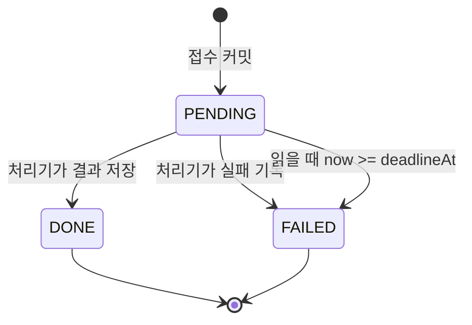
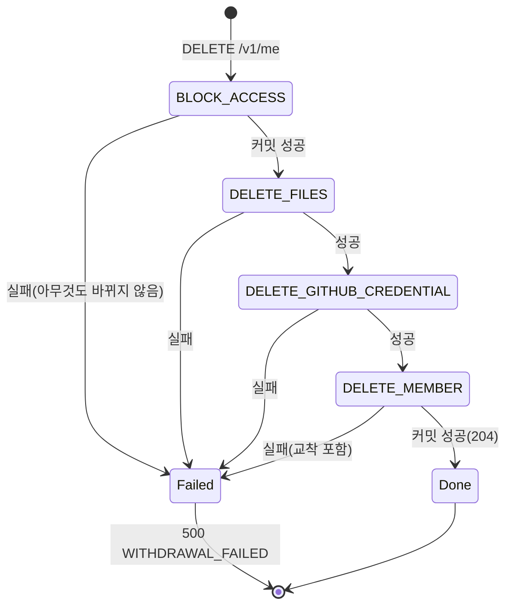
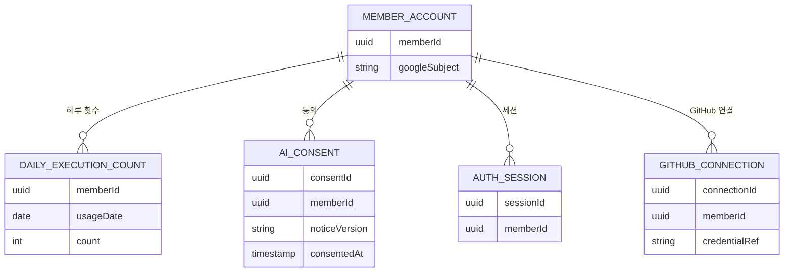

# U2 공용 기반 — 기능 명세

## Sources

작성일: 2026-10-27. 입력: [Unit 정의](../../../inception/units-generation/unit-of-work.md)(unit-of-work)의 U2, [스토리 대응](../../../inception/units-generation/unit-of-work-story-map.md)(unit-of-work-story-map), [사용자 스토리](../../../inception/user-stories/stories.md)(stories), [요구사항](../../../inception/requirements-analysis/requirements.md)(requirements), [컴포넌트 목록](../../../inception/domain-design/components.md)(components), [계약 요약](../../../inception/contract-design/contract-summary.md)(contract-summary)의 C-01~C-06·C-11과 「에러 대응 최소선」, [U1 기능 명세](../../u1-ai-generation-gate/functional-design/functional-spec.md)의 「다른 Unit에 넘기는 것」, [기능 설계 질문·답변](functional-design-questions.md) Q1~Q10과 요약 확인, [엔티티](entities.md)(엔티티 원본), [업무 규칙](rules.md)(규칙 원본). 이 파일은 흐름과 상태 전이의 원본이며, ER 그림과 규칙 요약은 entities.md·rules.md에서 옮긴 보기다.

## 범위

- **구현하는 스토리:** [stories.md](../../../inception/user-stories/stories.md)의 US1.1(로그인 대상), US6.3(기계 대조·버림·출처 표시 — 인용 연결은 U1), US6.4(하루 실행 한도), US14.1(탈퇴 순서), US14.3(재가입), US16.2(시작 안내·기본 오류), US19.1(통합 확인 진행), US19.2(확인 표·제출 자료 정리), US20.1(첫 이용 동의·고지).
- **컴포넌트:** AiGeneration의 U2 부분(입력 상한·공통 지시·기계 대조·generateStream·JD 역할), AiRun, AiUsageLimit, AiConsent, FileStorage(인터페이스·로컬), Withdrawal, StartGuide, 기존 MemberAccount·GitHubConnection의 탈퇴·로그인 대상 설정.
- **U1 게이트 코드 수정:** U1·U2는 같은 담당(팀장)이라 U2가 `api/src/ai-generation`의 게이트 코드를 직접 고친다. JD_SUMMARY일 때만 형식 지시(U1 BR2.3)와 항목 묶기(U1 BR3.4 앞 단계)를 바꾸고(BR4.1·BR4.2), 기본 요약·질의응답 동작은 바꾸지 않는다. 기존 U1 시험이 그대로 통과해야 한다.
- **U2에 없는 것:** S3 구현과 S3 접두어 삭제 확인(U8), 실행 상태 표·처리 시한 값(U3·U5·U10), 발행본·MCP 표(U4·U6), 받은 사람 화면(U4), "결과 없음" 표시(U5·U10), 공용 인프라·CI(팀장 공용 기반 작업, C07), 리허설 자체(팀 활동).
- **계약 문서:** C-01·C-11을 바꾸는 결정(Q3·Q9)은 이 설계에서 계약 문서를 고치지 않는다. 바뀌는 모양은 아래 「계약 변경 제안」에 적고 U10·U4 담당과 맞춘 뒤 통합 브랜치 대상 계약 수정 PR로 따로 한다.

## 흐름 (Workflows)

### W1 하루 실행 횟수 쓰기 — `DailyRunLimit.consume` (BR1)

1. 호출 Unit(U4 발행, U5 [다시 만들기], U7 분석, U10 JD 요약)이 실행을 접수할 때, 동의가 필요한 기능이면 먼저 W2-3 동의 확인을 한다(BR2.2).
2. `consume(memberId, kind, now, manager?)`를 부른다. usageDate = now의 한국 날짜(BR1.2).
3. (memberId, usageDate) 행에 조건부 쓰기 한 문장: 없으면 count 1로 넣고, 있으면 count < 30일 때만 1 더한다(BR1.3).
4. 쓴 행이 있으면 `ALLOWED` → 호출 Unit이 접수를 계속한다. 없으면 `LIMIT_REACHED` → 호출 Unit이 접수를 멈추고 `429 DAILY_LIMIT_REACHED`, "오늘 한도에 도달했습니다"를 보인다(BR1.4). manager로 넘긴 트랜잭션이면 호출 Unit이 되돌린다(발행은 발행하지 않음, C-03).
5. 실행이 뒤에 실패해도 count는 그대로다.

### W2 첫 이용 동의 (BR2)

1. web이 AI 실행 요청을 보내고 `403 AI_CONSENT_REQUIRED`를 받으면 U2의 공용 동의 창을 연다.
2. 동의 창은 받는 곳(Claude API·Voyage AI(운영사 MongoDB)), 보내는 기능, 올린 자료를 그대로 보낸다는 사실, 문의 경로 한 줄을 보인다(BR2.4). [동의] → `POST /v1/ai-consent { noticeVersion }`.
3. api는 판본이 현재 판본이면 행을 만들고(이미 있으면 그대로) 204, 다르면 400(BR2.3).
4. web은 같은 요청을 한 번 다시 보낸다. [닫기]면 실행하지 않는다.
5. 동의 뒤 AI 화면에는 U2의 한 줄 안내를 그 화면 Unit이 둔다. 비로그인 질의응답은 입력란 옆 같은 한 줄이 고지다(BR2.5).
6. `GET /v1/ai-consent` → `{ consented, noticeVersion }`으로 화면이 미리 확인할 수도 있다.

### W3 AI 생성 — `generate` (U1 흐름 + U2 검사)

1. **입력 상한(U2):** sources 글 길이 합 + userText 길이 > 80,000이면 `AiInputTooLarge`(BR3.1). 근거가 비면 빈 결과(U1 BR2.1).
2. **지시 구성(U2):** 기능 지시문 뒤에 공통 문구(BR3.2)를 붙인다. JD_SUMMARY면 U1의 고정 형식 지시 대신 JD용 형식 지시(머리줄 셋 허용, 면접 질문은 의문문)를 쓴다(BR4.1). 다른 기능은 U1 형식 지시 그대로다.
3. **호출·항목 묶기·위치(U1):** U1 W1·W2 그대로(줄 나누기 BR1, 호출 BR2, 항목 BR3, 위치 BR4, 거부 BR5). 단 JD_SUMMARY는 항목을 묶을 때 "- "가 아닌 줄을 버리기 전에 머리줄인지 보고 지금 칸을 바꾼다(BR4.2, U1 BR3.4 앞 단계).
4. **JD 역할(U2, JD_SUMMARY만):** "- " 항목에 지금 칸을 역할로 붙이고, 첫 머리줄 전 항목은 버린다(BR4.2). 역할 모양 검사(BR4.3).
5. **기계 대조(U2):** 항목마다 대조 낱말을 뽑아(BR3.3)
   - CITED·EVIDENCE: 인용 원문과 Catch PR 번호로 대조(BR3.4·BR4.4)
   - AI_INTERPRETATION: 숫자·PR 번호 있으면 버림, 영어 표기는 발행본 글에 있어야(BR3.5)
   - INTERVIEW_QUESTION: 남은 근거 항목의 인용 원문·Catch PR 번호·JD 줄로 대조(BR4.5). 근거 항목 대조가 먼저 끝나야 한다
   - UNCONFIRMED: 인용 있으면 BR3.4, 없으면 BR3.5(BR4.6)
6. **찾지 못함 항목(U2, JD_SUMMARY만):** JD 줄에서 대문자가 든 영어 표기(한글 없는 줄은 첫 낱말 제외, 나온 순서대로 최대 3개)가 이번 호출의 sources 글 전체에 없으면 표기마다 kind `SERVER_NOTICE`, 역할 UNCONFIRMED 항목을 끝에 더한다(BR4.7).
7. 버린 수를 droppedCount에 더하고 수만 로그로 남긴다(BR3.6). 남은 항목이 0개여도 그대로 돌려준다(BR3.7).

### W4 AI 생성 — `generateStream` (QNA, BR3.8)

1. W3-1·2와 같다(JD 머리줄 없음).
2. 스트림을 받으며 "- " 줄이 끝날 때마다 U1 규칙으로 항목을 만들고 W3-5 대조를 한다. 통과한 항목만 하나씩 내보낸다.
3. 응답 끝: 끝나지 않은 마지막 항목은 내보내지 않고(U1 BR5.1) droppedCount를 로그로 남긴다. 호출 실패는 `AiProviderError`로 끝낸다(U1 BR2.4).

### W5 백그라운드 실행 (BR5)

1. 기동: 각 Unit이 자기 kind 처리기를 한 번 등록한다(BR5.1).
2. 접수: 호출 Unit이 상태 행(PENDING, deadline_at)을 쓰고 커밋한 뒤 `enqueueAfterCommit(kind, runKey, payload)`(BR5.2·BR5.3). `ENQUEUE_FAILED`여도 접수 응답은 그대로이고 상태는 시한으로 FAILED가 된다.
3. 실행: 큐 작업 하나 = 시도 한 번. 처리기는 결과를 쓰기 전에 부모를 확인하고(BR5.7) 결과를 쓴다. 예외면 로그만 남기고 다시 돌리지 않는다(BR5.6).
4. 읽기: 상태를 읽는 자리에서 `readStatus`로 판정하고 시한이 지난 PENDING을 조건부로 FAILED로 저장한다(BR5.4·BR5.5).

### W6 파일 저장 (BR6)

1. 기동: `FILE_STORAGE_DRIVER=local`과 `FILE_STORAGE_LOCAL_ROOT`를 확인한다. 없거나 틀리면 기동 실패(BR6.1).
2. 호출: 키를 검사하고(BR6.2) put은 임시 이름 → 이름 바꾸기(BR6.4), get은 없으면 FileNotFound, delete·deletePrefix는 없으면 성공(BR6.3).

### W7 탈퇴 (BR7)

1. web 회원 정보 화면 [탈퇴] → 확인창("탈퇴하면 계정과 자료, 발행 링크, Claude 연결이 바로 지워지고 되돌릴 수 없습니다") [탈퇴하기] → `DELETE /v1/me`(BR7.1).
2. 1단계 트랜잭션: 그 회원의 모든 세션 폐기 + 중지되지 않은 발행본 `publication.stopped_at` = now(C-07) + `mcp_access_token`·`mcp_authorization_code`·`mcp_connection`의 그 회원 행 삭제(U6) → 커밋(BR7.2).
3. 2단계 `FileStorage.deletePrefix(members/{memberId}/)`.
4. 3단계 GitHub 자격정보 파일 삭제(없으면 성공).
5. 4단계 한 트랜잭션: member_account 행 삭제 → 연쇄 삭제(BR7.3·BR7.7) → `FileStorage.deletePrefix(members/{memberId}/)` 한 번 더 → 커밋. 다시 지우기가 실패하면 행 삭제도 되돌린다(계약 C-06, 2단계 뒤에 끝난 파일 쓰기를 지우기 위해).
6. 성공: 204 + Refresh 쿠키 제거 → web은 로그인 상태를 지우고 비로그인 홈에 "탈퇴했습니다"(BR7.5).
7. 실패(어느 단계든, 교착 포함): 500 `WITHDRAWAL_FAILED`, "탈퇴를 끝내지 못했습니다. 팀에 알려 주세요". 실패 단계 번호와 오류 종류만 로그. 1단계 효과는 남는다(BR7.4).

### W8 재가입 (BR7.6)

탈퇴한 Google 계정으로 로그인 → 10월 로그인 흐름이 googleSubject에 맞는 행이 없으므로 새 회원을 만든다 → 새 계정은 빈 상태로 시작하고, Claude 연결은 새 승인부터다.

### W9 시작 안내·오류 화면 (BR8)

1. 회원 홈: 여섯 단계 안내와 단계별 메뉴 링크를 늘 보인다(BR8.1).
2. 받은 사람 화면: U4가 U2의 받은 사람 안내 묶음을 화면 위쪽에 단다. Claude 연결 줄은 U9가 켤 때만 보인다(BR8.2).
3. 없는 주소 → 404 화면, 화면 오류 → 기본 오류 화면(BR8.3).

### W10 로그인 대상 설정 (BR9.1·BR9.2)

1. 배포 환경 Google OAuth 앱의 범위가 openid·email·profile뿐인지 확인한다.
2. 게시 상태를 '프로덕션'으로 바꾼다.
3. 팀원 아닌 Google 계정으로 배포 환경에 로그인해 본다.
4. 절차·날짜·결과를 `api/docs/google-login.md`에 적고 통합 확인 표에 행을 더한다.

### W11 통합 확인 진행 (BR9.4·BR9.5)

1. `docs/CatchU_통합확인.md`에 시나리오 목록과 빈 확인 표, 제출 준비 절을 둔다.
2. 1차(11/13, 개발 서버 EC2): 시나리오별로 실제로 돌리고 결과를 한 행씩 적는다. 새 저장소 등록 경로를 실제로 돌렸는지 따로 적는다.
3. 2차: 같은 방식. 이후 남은 기간은 결함 수정.
4. 팀원 아닌 1명이 시작 안내만으로 처음부터 써 보고 막힌 곳을 메모 칸에 적는다(AC16.2.4·AC19.1.6).
5. 12월 1~9일: 리허설·제출 자료 정리만(기능 개발 없음). 실패·미완료 필수 기능은 영향과 조정안을 적어 팀장에게 낸다.

## 상태 전이 (State machines)

### 실행 상태 (C-02, 호출 Unit 표의 status)

<!-- Text fallback: 실행은 접수 커밋으로 PENDING이 된다. 처리기가 결과를 저장하면 DONE, 실패를 기록하면 FAILED가 된다. 상태를 읽을 때 시한이 지났으면 FAILED로 확정한다. DONE·FAILED는 끝 상태이고 자동 재시도는 없다. 다시 하려면 사람이 새 실행을 접수한다. -->

| 지금 | 일 | 다음 | 규칙 |
|---|---|---|---|
| (없음) | 접수 커밋 | PENDING | BR5.2 |
| PENDING | 결과 저장 | DONE | BR5.7 |
| PENDING | 처리기가 실패 기록 | FAILED | BR5.6 |
| PENDING | 읽을 때 시한 지남 | FAILED | BR5.4, BR5.5 |
| DONE·FAILED | 무엇이든 | 그대로 | BR5.5(조건부 저장) |

### 탈퇴 단계

<!-- Text fallback: 탈퇴는 접근 차단(세션·링크·MCP, 한 트랜잭션) → 회원 파일 삭제 → GitHub 자격정보 파일 삭제 → 회원 행 삭제 순서로 간다. 어느 단계든 실패하면 500 WITHDRAWAL_FAILED로 끝나고 뒤 단계는 하지 않는다. 접근 차단이 커밋된 뒤의 실패에서도 차단은 되돌리지 않는다. 회원 행 삭제가 커밋돼야 204로 성공한다. -->

## ER 그림 (entities.md에서 옮김)

<!-- Text fallback: 회원 계정 하나에 하루 실행 횟수 행·동의 행·세션·GitHub 연결이 여럿 붙는다. U2가 새로 만드는 표는 하루 실행 횟수와 동의이며 둘 다 회원 행을 따라 지워진다. 세션·GitHub 연결은 10월 표다. -->

## 규칙 요약 (rules.md에서 옮김)

| 무리 | 규칙 | 요지 |
|---|---|---|
| 하루 한도 | BR1.1~BR1.7 | 계정당 30회 합산, 한국 날짜, 원자적 조건부 쓰기, 429·남은 횟수 없음, 열람 안 막음, 회원 단위 |
| 동의 | BR2.1~BR2.6 | 현재 판본 한 번, 동의 → 횟수 순서, 받는 곳·문의 경로 고지, 화면 한 줄, 분석은 10월 동의 |
| 게이트 | BR3.1~BR3.9 | 80,000자 상한, 공통 지시, 낱말 뽑기·약어 15개 예외, 인용·해석 대조, 버림은 수만, 0개도 정상, 스트림 항목 단위 |
| JD 역할 | BR4.1~BR4.8 | JD만 형식 지시·항목 묶기 변경, 역할 모양 검사, 한 호출 = 요구사항 한 줄, 면접 질문·확인되지 않는 점 대조, 서버 안내(SERVER_NOTICE) "찾지 못함" 최대 3개 |
| AiRun | BR5.1~BR5.7 | 처리기 하나, 커밋 뒤 등록, 시한은 읽을 때, 재시도 없음, 늦은 결과 버림 |
| 파일 | BR6.1~BR6.4 | local driver, 키 검사, 없는 삭제 성공, 임시 이름 |
| 탈퇴 | BR7.1~BR7.7 | 확인창, 접근 차단 → 파일 → 자격정보 → 회원 행, 실패는 500, 재가입은 새 계정 |
| 시작 안내 | BR8.1~BR8.3 | 고정 여섯 단계, 받은 사람 안내 묶음, 404·오류 화면 |
| 로그인·확인 | BR9.1~BR9.5 | 프로덕션 게시, Google만, 10월 분석 전제 검사 유지, 확인 표, 제출 준비 |

## 업무 시나리오 (시험 전에 정하는 기대 결과·실패 조건)

팀 관행(team.md Testing Posture)대로 시나리오·기대 결과·실패 조건을 먼저 정하고 세부 시험 코드는 구현 뒤 쓴다.

| # | 시나리오 | 기대 결과 | 실패 조건 |
|---|---|---|---|
| S1 | 오늘 29회 쓴 회원이 JD 요약 실행 | ALLOWED, count 30 | count가 31이 되거나 거부 |
| S2 | 오늘 30회 쓴 회원이 분석 접수 | 429 DAILY_LIMIT_REACHED "오늘 한도에 도달했습니다", 응답에 남은 횟수 없음 | 접수되거나 남은 횟수가 보임 |
| S3 | count 29에서 consume 두 번 동시 | 하나만 ALLOWED | 둘 다 ALLOWED |
| S4 | 한국 시간 23:59와 00:00에 consume | 다른 usageDate 행 | 같은 행에 합산 |
| S5 | 동의 없는 회원이 발행(U4 합성 호출) | 403 AI_CONSENT_REQUIRED, count 그대로 | 횟수가 늘거나 실행됨 |
| S6 | 옛 판본으로 POST /v1/ai-consent | 400, 행 없음 | 기록됨 |
| S7 | 근거 글 합계 80,001자 | AiInputTooLarge, Claude 호출 없음 | 호출됨 |
| S8 | CITED 항목에 인용 원문에 없는 숫자 | 그 항목만 빠지고 droppedCount +1 | 남거나 다른 항목도 빠짐 |
| S9 | CITED 항목에 Catch PR 번호(#123, catchEvidenceUrls에 /pull/123) | 남음 | 버려짐 |
| S10 | AI 해석 항목에 숫자 | 버려짐 | 남음 |
| S11 | AI 해석 항목에 "api"·"C" | api는 예외라 통과, C는 발행본 글에 없으면 버려짐 | C가 예외로 통과 |
| S12 | JD 응답: 머리줄 전 항목, 물음표 없는 면접 질문, 물음표로 끝난 확인되지 않는 점, 인용 없는 근거 | 넷 다 버려지고 droppedCount +4 | 하나라도 남음 |
| S12b | JD 응답의 머리줄 세 줄과 각 칸의 정상 항목 | 머리줄 줄은 항목이 아니고, 각 항목에 해당 역할이 붙음 | 머리줄이 버림 수에 세지거나 역할이 틀림 |
| S12c | 기본 요약·질의응답 호출(형식 지시·항목 묶기 변경 뒤) | U1 형식 지시 그대로, 기존 U1 시험 전부 통과, jdRole 없음 | U1 시험 실패 또는 jdRole이 채워짐 |
| S13 | 면접 질문이 근거 항목 인용 원문에 없는 숫자를 씀 | 버려짐 | 남음 |
| S14 | 면접 질문이 JD 줄에만 있는 영어 표기를 씀 | 남음 | 버려짐 |
| S15 | 확인되지 않는 점(인용 없음)이 JD 줄의 "3년"을 되풀이 | 버려짐(한계로 기록) | 남음 |
| S16 | JD 줄 "Kubernetes 운영 경험"에서 Kubernetes가 이번 sources 글에 없음 | "이번에 찾은 자료에서 'Kubernetes' 표기를 찾지 못함" 항목(kind SERVER_NOTICE, 역할 UNCONFIRMED)이 끝에 붙고 droppedCount 그대로 | 항목이 없거나 "경험 없음"으로 쓰거나 'AI 해석' 표시가 붙음 |
| S16b | 영어 줄 "Experience with Docker and Kubernetes in production"에서 둘 다 sources 글에 없음 | 첫 낱말 Experience는 빠지고 소문자 낱말(with·and·in·production)도 빠져 Docker·Kubernetes 두 항목만 붙음 | experience·with·and 같은 낱말 항목이 생김 |
| S16c | 한 JD 줄에 대문자 든 표기 5개가 모두 sources 글에 없음 | 나온 순서대로 앞 3개만 항목 | 4개 이상 생김 |
| S16d | 발행본 다른 곳에는 있지만 이번 sources 글에는 없는 표기 | "찾지 못함" 항목이 생김(대조 대상은 이번 sources 글) | publicationText에 있다고 빠짐 |
| S17 | 대조 뒤 남은 항목 0개 | 정상 결과 items [] | 오류로 끝남 |
| S18 | QNA 스트림 중간 잘림 | 끝난 항목만 나가고 마지막 미완 항목은 안 나감 | 미완 항목이 나감 |
| S19 | enqueueAfterCommit 중 Redis 끊김 | ENQUEUE_FAILED, 예외 없음, 시한 뒤 읽으면 FAILED | 예외로 접수 응답이 실패하거나 PENDING이 영원히 남음 |
| S20 | runKey에 ":" | ENQUEUE_FAILED | 등록됨 |
| S21 | 발행본이 지워진 뒤 BASE_SUMMARY 결과 도착 | 저장 안 하고 버림, 다시 시도 안 함 | 저장되거나 재시도 |
| S22 | FileStorage에 "members/../x" 키 | 거부, 파일 변화 없음 | 뿌리 밖 접근 |
| S23 | 없는 접두어 deletePrefix | 성공 | 오류 |
| S24 | 탈퇴 정상(U4·U6 합치기 전에는 같은 모양의 시험용 표, 합친 뒤에는 실제 표로 통합 시험) | 204, 세션·발행 링크·MCP 차단, 회원 파일·자격정보 파일·회원 행과 연쇄 표가 지워짐, 다른 회원의 JD 원본은 남음 | 무엇이든 남거나 다른 회원 자료가 지워짐 |
| S25 | 탈퇴 2단계 파일 삭제 실패(합성 저장소) | 500 WITHDRAWAL_FAILED, 링크·MCP는 막혀 있고 회원 행은 남음 | 204 응답 |
| S26 | 탈퇴 뒤 그 회원의 Access 토큰으로 요청 | 401 | 통과 |
| S27 | 탈퇴한 Google 계정으로 다시 로그인 | 새 memberId, 자료 없음 | 이전 자료가 보임 |
| S28 | 없는 주소 접속 | 404 화면과 홈 링크, 내부 정보 없음 | 스택·내부 ID 노출 |
| S29 | 팀원 아닌 Google 계정으로 배포 환경 로그인 | 로그인되어 새 회원으로 시작 | "앱이 테스트 중" 거부 |

## 계약 변경 제안 (계약 수정 PR의 입력, 이 설계에서 계약 문서를 고치지 않음)

### C-01 `GatedItem.jdRole`과 `kind` 값 `SERVER_NOTICE` (Q9·Q10, 1차 수정 요청)

- 더하는 칸: `jdRole: EVIDENCE | UNCONFIRMED | INTERVIEW_QUESTION | null` — `feature`가 `JD_SUMMARY`일 때만 채운다. 선택 칸이라 기존 호출·합성 제공자·BASE_SUMMARY·QNA 결과는 그대로 유효하다(계약의 「더하는 변경」).
- 더하는 값: `kind`에 `SERVER_NOTICE`(서버가 만든 안내). JD_SUMMARY의 "찾지 못함" 항목(BR4.7)에만 쓴다. U10 화면은 이 값에 'AI 해석' 표시를 붙이지 않는다. 기존 소비자가 모르는 값이므로 U10 화면이 이 값을 다루는 것까지 같은 PR에서 합의한다.
- check-scope 「JD 면접 질문」을 BR4.5로, 확인되지 않는 점을 BR4.6으로, 서버의 "찾지 못함" 항목을 BR4.7로 구체화하고, 한 호출은 JD 요구사항 한 줄이라는 전제를 적는다.
- U10의 합성 제공자는 역할마다 항목 하나씩을 돌려준다.
- 진행: 이 두 변경을 한 계약 수정 PR(통합 브랜치 대상)로 **U2 코드 생성 전에** 올리고, U10 담당의 PR 리뷰로 합의한다.

### C-11 받은 사람 시작 안내 붙는 자리 (Q3, U4 담당에게 알릴 것)

- 받은 사람 화면 위쪽에 U2의 받은 사람 안내 묶음을 둘 자리 하나. props는 Claude 연결 안내를 보일지(U9 켜짐 여부) 하나다. 기존 붙는 자리는 그대로다.

## 다른 Unit이 쓸 때 (소비 규칙)

- **U4 발행:** 동의 확인(`require`) → 발행 트랜잭션 안 `consume(작성자, BASE_SUMMARY, manager)` → 커밋 → `enqueueAfterCommit`. 동의 없음은 403, 한도는 429로 발행하지 않는다.
- **U5:** [다시 만들기] 접수 때 `consume`. 처리기는 세지 않는다(C-02). 질의응답은 `generateStream`, 결과 0개면 "결과 없음".
- **U7 분석:** 접수 때 `consume(ANALYSIS)`. AiConsent는 쓰지 않는다(BR2.6). AC20.1.1의 분석 부분(첫 이용 동의)은 10월 요청별 동의 화면이 맡는다.
- **U10 JD 요약:** `require` → `consume(JD_SUMMARY)` → 행 PENDING 커밋 → 등록. 처리기는 JD 요구사항마다 차례로 `generate`를 한 번씩 부른다(한 호출 = 요구사항 한 줄, FR6.1·BR4.5). `publicationText`(C-09 search 값)와 `userText`(그 요구사항 줄 하나)를 넘긴다. `AiInputTooLarge`면 422 `INPUT_TOO_LARGE`. `kind: SERVER_NOTICE` 항목에는 'AI 해석' 표시를 붙이지 않는다.
- **U8:** S3 `FileStorage` 구현과 `FILE_STORAGE_DRIVER=s3`, PDF 업로드 전 `require`.
- **모든 Unit:** 새 표는 C-06(BR7.7)을 따르고 같은 PR에서 탈퇴 삭제 표 문서에 행을 더한다.

## Assumptions & Open Questions

1. [assumption] 문의 경로 한 줄의 값(팀 연락 이메일 또는 저장소 이슈 주소)은 코드 생성 때 팀장이 정한다. 접수·회신 약속은 쓰지 않는다(FR20.2).
2. 코드 생성 착수 조건: C-01 계약 수정 PR(`jdRole`, `kind: SERVER_NOTICE`)을 U2 코드 생성 전에 올리고 U10 담당의 PR 리뷰로 합의한다. 합의 내용이 이 설계와 다르면 이 설계를 고친다.
3. [assumption] 배포 환경에서도 U8 전에는 `FILE_STORAGE_DRIVER=local`로 기동한다. PDF 업로드가 없어 저장하는 파일이 없으므로 탈퇴 2단계는 빈 접두어 삭제로 성공한다. U8이 S3 구현을 넣으면 배포 환경은 s3로 바꾼다.
4. 완료 조건: 탈퇴 1단계는 계약 이름 `publication.stopped_at`(C-07)과 U6의 `mcp_connection`·`mcp_authorization_code`·`mcp_access_token`을 쓴다. 그 표들이 통합 브랜치에 합쳐지기 전에는 같은 모양의 시험용 표로 시험하고, U4·U6를 합친 뒤 탈퇴 통합 시험을 U2 완료 조건으로 한다.
5. 열린 확인: JD 면접 질문의 물음표 규칙(BR4.3)은 처음 쓰는 것이라 코드 생성 때 실제 JD 호출 한 번으로 확인하고, 맞는 질문이 많이 버려지면 한 번만 고친다(Q9).
6. 한계("찾지 못함", BR4.7): 복수형(APIs) 같은 대문자 든 일반 낱말이 섞일 수 있다. 영어 줄이 기술명으로 시작하면 그 이름이 빠진다. 소문자 표기(k8s, npm)는 안내되지 않는다. JD 줄의 오타·다른 표기는 그대로 나온다. 표기 쌍은 12월 RAG 품질 평가 뒤 다시 본다(Q10). 확인되지 않는 점에서 JD 줄의 숫자를 되풀이한 AI 문장은 버려지며 MVP에서는 그대로 둔다(요약 확인 수정 요청).
7. 한계(에러 대응 최소선 6): 같은 회원의 동시 접수 둘이 겹쳐 생성이 한 번 더 도는 경우는 막지 않는다. 하루 횟수 자체는 BR1.3으로 넘치지 않는다.
