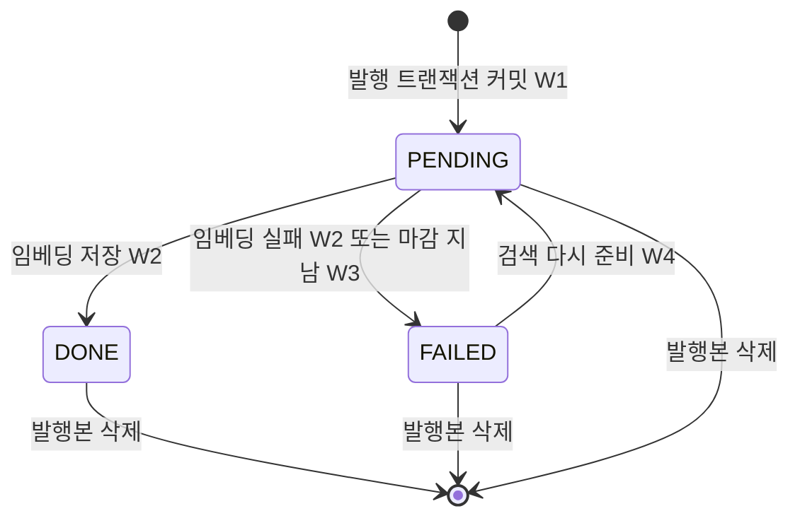
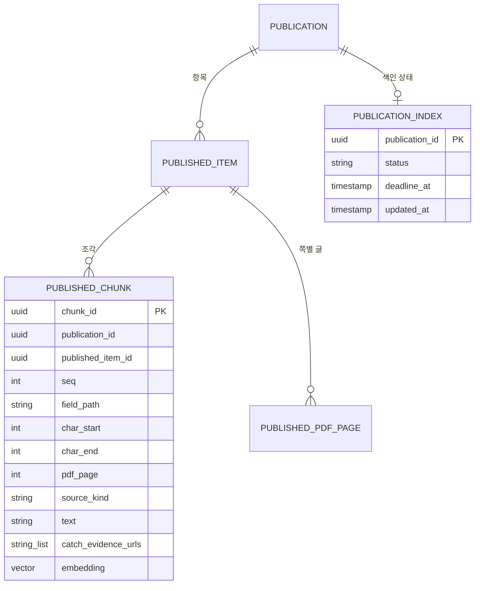

# U3 발행본 색인·검색 — 기능 명세

## Sources

작성일: 2026-10-27. 입력: [Unit 정의](../../../inception/units-generation/unit-of-work.md)(unit-of-work)의 U3, [스토리 대응](../../../inception/units-generation/unit-of-work-story-map.md)(unit-of-work-story-map)의 US4.1(발행 때 조각 나누기)·US6.2(색인 상태·검색), [사용자 스토리](../../../inception/user-stories/stories.md)(stories)의 US4.1·US6.2, [요구사항](../../../inception/requirements-analysis/requirements.md)(requirements)의 FR4.7·FR6.2·FR6.3·FR6.4·FR6.8·FR14.8·FR14.10·NFR1·NFR2, [컴포넌트 목록](../../../inception/domain-design/components.md)(components)의 PublishedIndex, [결정 기록](../../../inception/domain-design/decisions.md)의 ADR-005·ADR-007, [계약 요약](../../../inception/contract-design/contract-summary.md)(contract-summary)의 C-02·C-06·C-07·C-08·C-09와 「에러 대응 최소선」, [납품 계획](../../../inception/delivery-planning/bolt-plan.md)의 B3, [기능 설계 질문·답변](functional-design-questions.md) Q1~Q4, [엔티티](entities.md), [업무 규칙](rules.md).

## 범위

U3은 PublishedIndex 전체다(unit-of-work). 이 Unit이 구현하는 스토리는 [사용자 스토리](../../../inception/user-stories/stories.md)의 US4.1 가운데 발행 트랜잭션 안의 조각 나누기와 US6.2 가운데 색인 상태·의미 검색이다(unit-of-work-story-map). 공개 함수는 계약 C-08의 `PublishedIndexWriter`(`chunkInTransaction`·`requestReindex`)와 C-09의 `PublishedSearch`(`getIndexState`·`search`)이며 모양은 계약 그대로다. 그 밖에 C-02 `AiRun`에 `EMBED_PUBLICATION` 처리기를 등록한다.

U3에 없는 것: 화면과 HTTP 경로(작성자 [검색 다시 준비] 버튼·경로와 작성자 확인은 U4, 받은 사람의 "아직 쓸 수 없음" 표시는 U5·U10), 링크 조건 판정(C-10, U4), 발행 트랜잭션 열기와 커밋 뒤 첫 임베딩 작업 등록(C-08 publish-sequence, U4), 근거 검사(C-01, U1·U2), PDF 쪽별 글 사본 만들기(U8, 후순위). 질문 다시 쓰기·답 생성은 U5다.

정한 값(Q1~Q3): 조각 최대 길이 1,000(UTF-16 코드 단위), 임베딩 모델 `voyage-4-lite`·1024차원·코사인 거리, 임베딩 처리 시한 10분. 모델 이름·차원과 Voyage의 자료 보존·학습 사용 조건은 코드 착수 때 공식 문서로 다시 확인하고 결과를 이 문서의 「Assumptions & Open Questions」에 적는다(Q2).

## 워크플로

### W1. 발행 트랜잭션 안의 조각 나누기 — `chunkInTransaction(manager, publicationId, now)`

U4가 연 발행 트랜잭션 안에서 불린다(C-08 publish-sequence 3단계). 외부 호출이 없다(BR1.7).

1. 넘겨받은 `manager`로 그 발행본의 `published_item`을 `position` 순서로 읽는다. PDF 항목이면 `published_pdf_page`를 `page_number` 순서로 함께 읽는다.
2. 항목마다 조각 대상 필드를 정해진 순서로 고른다(BR1.1). CATCH는 `workFacts[i]` → `subjectContribution` → `evidence[i].representedFacts[j]` → `authorDescription`(null이 아닐 때), TEXT_MATERIAL은 `body`, PDF_MATERIAL은 읽을 수 있는 쪽의 `pages[n]`(BR1.5). `aiDraft`와 제목은 고르지 않는다.
3. 필드마다 범위를 나눈다(BR1.3): 1,000 이하면 범위 하나, 넘으면 문단 → 줄 → 1,000자 자리 순으로 겹치지 않게 모은다. 각 범위의 앞뒤 공백을 범위에서 빼고 빈 범위는 버린다(BR1.4).
4. 범위마다 `ChunkDraft`를 만든다. 글은 필드 문자열을 그 범위로 자른 것 그대로(BR1.2), 출처 종류는 필드로 정한다(BR1.6). CATCH 항목이면 사본 `evidence[].sourceUrl` 목록을 `catchEvidenceUrls`로 함께 담고, 아니면 빈 배열이다(BR1.10). 저장 전에 "필드 문자열의 [charStart, charEnd) = text"를 검사한다.
5. 조각을 `seq` 1부터 순서대로(BR1.9) `published_chunk`에 쓴다. `embedding`은 비워 둔다.
6. `publication_index`를 `PENDING`, `deadline_at = now + 10분`, `updated_at = now`로 쓴다(BR1.8). 조각이 0개여도 쓴다.
7. 1~6 중 어디서든 실패하면 예외를 던진다. U4가 트랜잭션 전체를 되돌려 발행이 실패하고 어떤 Catch도 공개로 바뀌지 않는다(BR1.7, AC4.1.8).

### W2. 임베딩 작업 — `EMBED_PUBLICATION` 처리기

U3이 모듈 시작 때 `AiRun.registerHandler(EMBED_PUBLICATION, …)`로 등록한다. 작업은 U4가 커밋 뒤(`EMBED_PUBLICATION-{publicationId}`) 또는 U3의 W4가(`EMBED_PUBLICATION-{publicationId}-{uuid}`) 넣는다. 시도는 1회다(C-02).

1. `payload.publicationId`의 색인 행을 읽는다. 행이 없거나 `PENDING`이 아니거나 마감이 지났으면 아무것도 쓰지 않고 끝낸다(BR2.1). 마감 지난 `PENDING`은 W3 판정으로 `FAILED` 저장한다.
2. 조각을 `seq` 순서로 읽는다. 0개면 `PENDING`·마감 전 조건으로 `DONE`을 쓰고 끝낸다(BR2.2).
3. 조각 글을 제공자 한 번 호출 상한 안의 묶음으로 나눠 `embedDocuments`를 부른다(문서용 입력, BR2.3). 돌아온 개수·차원을 검사한다.
4. 3에서 하나라도 실패하면 `status = 'PENDING'`일 때만 `FAILED`로 쓰고 끝낸다. 다시 시도하지 않는다(BR2.5). 1~5 어디서든 DB 오류 같은 예기치 못한 오류가 나면 발행본 ID와 오류 종류만 로그에 남기고 던지며, 상태는 마감 판정(W3)에 맡긴다(BR2.5).
5. 모두 받으면 한 트랜잭션에서 색인 행을 잠그고 다시 확인한다. 있고 `PENDING`이고 마감 전이면 모든 조각의 `embedding`과 `DONE`을 함께 쓰고 커밋한다. 아니면 아무것도 쓰지 않고 버린다(BR2.4). 발행본이 그사이 지워져 저장이 거부되면 다시 시도하지 않고 버린다(FR14.10).

### W3. 색인 상태 — `getIndexState(publicationId, now)`

1. 색인 행을 읽는다. 없으면 `FAILED`를 돌려준다(BR3.2).
2. C-02 `readStatus`로 판정한다. `PENDING`이고 `now >= deadline_at`이면 `FAILED`를 돌려주고, `status = 'PENDING'`일 때만 `FAILED`로 조건부 UPDATE한다(BR3.1).
3. 그 밖에는 저장된 상태를 그대로 돌려준다.

### W4. [검색 다시 준비] — `requestReindex(publicationId, now)`

U4가 작성자 확인 뒤 부른다(ADR-007, C-08).

1. W3으로 현재 상태를 판정한다. `FAILED`가 아니면(행 없음 포함) `NOT_FAILED`를 돌려준다.
2. `status = 'FAILED'`일 때만 조건부 UPDATE로 `PENDING`, `deadline_at = now + 10분`, `updated_at = now`를 쓰고 커밋한다. 바뀐 행이 0개면(그사이 다른 요청이 먼저 돌림) `NOT_FAILED`(BR4.1).
3. 커밋 뒤 `AiRun.enqueueAfterCommit(EMBED_PUBLICATION, "EMBED_PUBLICATION-{publicationId}-{새 uuid}", { publicationId })`. 조각은 다시 나누지 않고 하루 실행 제한을 부르지 않는다. 등록이 실패해도 로그만 남기고 `REQUEUED`를 돌려준다(BR4.2). 이 경우 10분 뒤 다시 `FAILED`가 된다.

### W5. 의미 검색 — `search(publicationId, query, limit)`

호출자(U5·U10)는 C-10 링크 조건 판정을 먼저 통과한 뒤 부른다.

1. `limit`가 1~50의 정수가 아니면 인자 오류를 던진다(BR5.5).
2. W3으로 상태를 판정한다. `DONE`이 아니면 `IndexNotReady`를 던진다(BR5.1).
3. 그 발행본 조각 글을 `seq` 순서로 줄바꿈 하나로 이어 `publicationText`를 만든다(BR5.7).
4. `query`가 비었거나 공백뿐이면 `{ hits: [], publicationText }`를 돌려준다(BR5.6).
5. `embedQuery(query)`(질문용 입력)를 부른다. 실패하면 발행본 ID와 오류 종류만 로그에 남기고 제공자 오류를 그대로 던진다. 다시 시도하지 않는다(BR5.3, Q4).
6. 그 발행본 조각만 코사인 거리로 정확 비교해 가까운 순 `limit`개를 고른다. 같은 점수는 `seq` 순(BR5.2, BR5.4).
7. 조각마다 `ChunkHit`를 만든다. `score = 1 - 코사인 거리`, `catchEvidenceUrls`는 조각에 저장한 칸 그대로다(BR5.8). `published_item`은 읽지 않는다(C-07 읽기 범위).
8. `{ hits, publicationText }`를 돌려준다.

### 상태 전이

<!-- Text fallback: 색인 상태는 발행 트랜잭션 커밋으로 PENDING이 된다. PENDING은 임베딩 저장으로 DONE, 임베딩 실패나 마감(10분) 경과로 FAILED가 된다. FAILED는 작성자의 검색 다시 준비로만 PENDING에 돌아간다. DONE은 바뀌지 않는다. 어느 상태든 발행본이 삭제되면 행이 연쇄 삭제된다. -->

| 지금 | 일 | 다음 | 규칙 |
|---|---|---|---|
| (없음) | 발행 트랜잭션 커밋 | PENDING, 마감 = 발행 시각 + 10분 | BR1.8 |
| PENDING(마감 전) | 임베딩 모두 저장 | DONE | BR2.4 |
| PENDING(마감 전) | 조각 0개 | DONE | BR2.2 |
| PENDING(마감 전) | 임베딩 호출 실패 | FAILED | BR2.5 |
| PENDING(마감 지남) | 상태를 읽음 | FAILED | BR3.1 |
| FAILED | 검색 다시 준비 | PENDING, 마감 = 접수 시각 + 10분 | BR4.1 |
| DONE·PENDING | 검색 다시 준비 | 그대로(NOT_FAILED) | BR4.1 |
| 어느 상태든 | 발행본 삭제·작성자 탈퇴 | 행 없음(조각도 함께) | C-06 |

## 조각 나누기 예

- Catch 항목 하나(`workFacts` 2개, `evidence` 1개에 `representedFacts` 2개, `authorDescription` 300자, `aiDraft` 있음) → 조각 6개: `workFacts[0]`, `workFacts[1]`, `subjectContribution`, `evidence[0].representedFacts[0]`, `evidence[0].representedFacts[1]`, `authorDescription`. `aiDraft`는 조각이 없다. 앞 다섯은 `GITHUB_RECORD`, 마지막은 `AUTHOR_MATERIAL`.
- 텍스트 자료 `body` 2,500자, 빈 줄로 나뉜 문단 600·300·900·700자 → 조각 3개: 문단 1+2(두 문단과 그 사이 빈 줄까지 약 900자 범위), 문단 3(900), 문단 4(700). 각 범위는 앞뒤 공백을 뺀 원문 부분이고, 조각 경계에 걸린 빈 줄은 어느 조각에도 들어가지 않는다.
- 줄바꿈 없는 1,500자 문단 → 0~1,000, 1,000~1,500의 두 조각(1,000번째 자리가 대리쌍 가운데면 999에서 자른다).
- PDF 3쪽 가운데 2쪽이 읽을 수 없음 → `pages[1]`·`pages[3]` 조각만, `pdfPage`는 1·3.

## 엔티티 관계 (entities.md에서 옮김)

이 그림은 [엔티티](entities.md)의 YAML에서 옮긴 보기용이다. 정본은 entities.md다.

<!-- Text fallback: 발행본(publication) 하나에 항목(published_item) 여럿과 색인 상태(publication_index) 하나가 딸린다. 항목 하나에 조각(published_chunk) 여럿, PDF 항목이면 쪽별 글(published_pdf_page) 여럿이 딸린다. 조각은 (publication_id, published_item_id) 복합 외래 키로 같은 발행본의 항목을 가리킨다. U3 소유는 publication_index와 published_chunk이고 모두 발행본 삭제 때 연쇄 삭제된다. -->

## 규칙 요약 (rules.md에서 옮김)

정본은 [업무 규칙](rules.md)이다.

| 묶음 | 핵심 |
|---|---|
| BR1 조각 나누기 | C-07 필드만(aiDraft·제목 제외), 원문 그대로·UTF-16 위치, 1,000자 넘는 필드만 문단→줄→자리로 나눔, 앞뒤 공백 제외, PDF는 읽을 수 있는 사본 쪽만, 발행 트랜잭션 안·외부 호출 없음·실패면 예외, 색인 행 PENDING+10분, CATCH 조각에 근거 URL 함께 저장 |
| BR2 임베딩 작업 | PENDING·마감 전에만, 조각 0개면 DONE, voyage-4-lite 1024차원 검사, 발행본 단위 한 번에 저장, 실패면 FAILED·재시도 없음, 예기치 못한 오류는 로그 뒤 던지고 마감 판정에 맡김 |
| BR3 색인 상태 | 마감 지난 PENDING은 읽을 때 FAILED 저장, 행 없으면 FAILED |
| BR4 다시 준비 | FAILED일 때만 PENDING+10분, 임베딩만 새 runKey로, 하루 제한 없음 |
| BR5 의미 검색 | DONE 아니면 IndexNotReady, 그 발행본 조각만 정확 비교, 질문 임베딩 실패는 그대로 던짐, limit 1~50, 빈 질문은 빈 결과 |
| BR6 설정·기록 | 키는 `CATCHU_EMBEDDING_API_KEY`만, 개발·시험 밖에서 키 없으면 기동 중지, 키·글은 로그에 없음 |

## 주요 시나리오와 확인

팀 관행(team.md Testing Posture)대로 업무 시나리오·기대 결과·실패 조건을 먼저 정하고 세부 시험 코드는 구현 뒤 쓴다. S1~S11은 테스트 DB와 합성 임베딩 제공자·합성 AiRun으로 api 시험 묶음에서 돈다. S12만 실제 Voyage를 부른다.

- **시험 자료:** C-07 모양의 발행본 2개. 발행본 A는 Catch 항목 1개(`aiDraft` 있음), 문단이 있는 2,500자 텍스트 자료 1개, PDF 항목 1개(3쪽 중 2쪽 읽을 수 없음)를 갖는다. 발행본 B는 텍스트 자료 1개다. 모두 공개 가능한 합성 글이다.
- **합성 임베딩 제공자:** 같은 글에 같은 1024차원 벡터를 돌려주는 결정적 구현과, 시험이 정한 글→벡터 표를 쓰는 구현, 지정한 호출에서 실패하는 구현을 둔다.

| ID | 시나리오 | 기대 결과 | 실패 조건 |
|---|---|---|---|
| S1 | 발행본 A를 트랜잭션 안에서 `chunkInTransaction` | 「조각 나누기 예」와 같은 조각·순서·출처 종류·위치. 모든 조각이 "필드 문자열의 [charStart, charEnd) = text"를 만족하고 1,000 이하. `aiDraft`·제목 글은 어느 조각에도 없다. Catch 조각의 `catchEvidenceUrls`는 사본 `evidence[].sourceUrl`, 그 밖은 빈 배열. 색인 행 PENDING, 마감 = now + 10분 | 조각 글이 원문과 한 글자라도 다름, AI 초안 글이 조각에 있음 |
| S2 | 사본 모양이 C-07과 다른 항목으로 `chunkInTransaction` | 예외가 나고 트랜잭션을 되돌리면 조각·색인 행이 하나도 남지 않는다 | 일부 조각이나 색인 행이 남음 |
| S3 | S1 뒤 임베딩 작업 실행 | 모든 조각에 1024차원 벡터, 상태 DONE, 제공자 호출은 문서용 입력 | 일부 조각만 벡터가 있는데 DONE |
| S4 | 제공자가 두 번째 묶음에서 실패 | 상태 FAILED, 어떤 조각에도 벡터가 없다, 제공자 다시 호출 없음 | 재시도함, PENDING에 남음 |
| S5 | PENDING이고 마감이 지난 행에 `getIndexState`, 그 뒤 작업 실행 | FAILED를 돌려주고 행이 FAILED로 저장된다. 그 뒤 작업은 아무것도 쓰지 않는다 | PENDING을 돌려줌, 늦은 작업이 DONE을 씀 |
| S6 | 작업 실행 전에 발행본 삭제 | 작업이 오류 없이 끝나고 아무것도 쓰지 않는다. 재시도 없음 | 예외가 큐 재시도로 이어짐 |
| S7 | FAILED·PENDING·DONE 각각에 `requestReindex` | FAILED만 REQUEUED, 상태 PENDING·새 마감, 새 runKey(콜론 없음)로 등록 1회, 하루 제한 호출 없음. PENDING·DONE은 NOT_FAILED, 등록 없음 | DONE을 PENDING으로 돌림, 하루 제한을 셈 |
| S8 | 발행본 A·B 모두 DONE, A에 `search` | A의 조각만 점수순으로 `limit`개, `ChunkHit` 칸이 C-09 모양, Catch 조각의 `catchEvidenceUrls`가 사본 `evidence[].sourceUrl`, `publicationText`는 A 조각 글 전부(`aiDraft` 없음) | B의 조각이 섞임, 위치가 원문과 안 맞음 |
| S9 | PENDING·FAILED인 발행본에 `search` | `IndexNotReady`, 제공자 호출 없음 | 빈 결과를 성공처럼 돌려줌 |
| S10 | DONE인 발행본에 `search`, 질문 임베딩 실패 / `limit` 0·51 / 공백 질문 | 제공자 오류를 그대로 던지고 로그에 질문 글 없음 / 인자 오류, 제공자 호출 없음 / 빈 hits와 `publicationText` | 오류를 빈 결과로 숨김, 로그에 질문 글 |
| S11 | 발행본 삭제와 작성자 탈퇴 | `publication_index`·`published_chunk`가 함께 지워진다(`test/db/member-cascade-delete.test.cjs` 포함) | 행이 남음 |
| S12 | 실제 Voyage 연결: `CATCHU_EMBEDDING_API_KEY`가 셸 환경변수로 있을 때만 도는 시험. 발행본 A를 나누고 실제 임베딩 뒤 A의 글과 같은 뜻의 질문으로 검색 | DONE, 그 질문에 맞는 조각이 원문 위치와 함께 위에 나온다. 키가 없으면 미실행으로 건너뛴다 | 키·조각 글이 로그·출력에 남음 |

S12는 팀 관행의 '최소 연결 첫 결과'이자 납품 계획 B3의 보일 결과("발행한 시험 발행본을 검색해 원문 위치가 붙은 조각이 나오는 것")다. 합성 제공자로 통과한 S1~S11을 실제 임베딩 성공으로 보고하지 않는다(team.md Walking Skeleton).

## 다른 Unit에 넘기는 것

- **U4:** 발행 트랜잭션 안에서 `chunkInTransaction(manager, publicationId, now)`를 부르고, 예외면 트랜잭션을 되돌린다. 작성자 확인 뒤 `requestReindex`를 부르고 `NOT_FAILED`를 화면에 알린다. [검색 다시 준비] 버튼은 `getIndexState`가 `FAILED`일 때만 보인다.
- **U5·U10:** `IndexNotReady`는 `409 INDEX_NOT_READY`로 바꾸고, 그 밖의 예외(질문 임베딩 실패 포함)는 자기 기능의 일반 실패로 처리한다(Q4). `limit`는 1~50으로 넘긴다.
- **U2:** C-02 `AiRun`에 `EMBED_PUBLICATION` 처리기를 등록한다. U2 구현 전에는 C-02 모양의 합성 AiRun으로 개발한다.
- **팀장(공용 기반):** 배포 환경의 `CATCHU_EMBEDDING_API_KEY`(SSM)와 RDS pgvector 확장. U3이 배포 환경에 들어가기 전에 필요하다(BR6.1, C07).
- **U3 자기 PR:** `published_chunk`·`publication_index` 마이그레이션(pgvector 확장 사용 포함), `api/docs/member-withdrawal-deletion.md` 표에 두 표의 "따라 지워지는 부모" 행 추가(C-06).

## 추적

[traceability.json](traceability.json)이 정본이다. US4.1·US6.2의 수용 기준 가운데 U3이 맡는 것과 다른 Unit이 맡는 것을 나눴다.

| 수용 기준 | U3 | 규칙 |
|---|---|---|
| AC4.1.1 발행 당시 내용으로 고정 | 조각·위치를 발행 트랜잭션 안에서 확정 | BR1.1·BR1.2·BR1.3·BR1.7·BR1.9 |
| AC4.1.8 발행 저장 실패 | 조각 나누기 실패도 발행 실패로 되돌려짐 | BR1.7 |
| AC6.2.1 관련 조각을 찾아 답함 | 관련 조각 찾기(질문 다시 쓰기·답은 U5) | BR2.3·BR2.4·BR5.1~BR5.4 |
| AC6.2.3 찾는 범위는 발행 사본뿐, AI 초안 제외 | 조각 대상과 검색 범위 | BR1.1·BR1.5·BR5.2 |
| AC6.2.7 자료 제외 선택 없음 | 검색에 제외 인자 없음 | BR5.2 |
| 그 밖(AC4.1.2~4.1.7·4.1.9, AC6.2.2·6.2.4~6.2.6·6.2.8) | U4·U5 | — |

## Assumptions & Open Questions

- [assumption] U2의 `AiRun`(C-02)과 U4의 발행본 표(C-07)는 아직 코드에 없다. U3은 C-07 모양의 시험 자료와 C-02 모양의 합성 AiRun으로 먼저 개발하고, 실제 연결은 통합 때 확인한다(납품 계획 B3).
- [assumption] 시연 규모에서 발행본당 조각은 수백 개 이하라 근사 색인 없이 정확 비교로 충분하다고 본다(요약 확인). 발행 크기 상한은 U4가 발행 때 다시 확인한다(FR4.7).
- 미결(코드 착수 때 확인, Q2): `voyage-4-lite`의 정확한 모델 이름·1024차원 지원, 한 번 호출의 글 개수·토큰 상한(묶음 크기), 자료 보존·학습 사용 조건(계정 설정의 학습 사용 거부 여부). 확인 결과를 이 절에 적고, 다르면 Q2 결정을 다시 묻는다.
- 한계(에러 대응 최소선 6): [검색 다시 준비] 직후 이전 임베딩 작업이 늦게 끝나면 임베딩 호출이 1회 겹친다. 같은 조각·같은 모델이라 결과가 같아 막지 않는다(BR2.6).
- 한계(에러 대응 최소선 6): 이전 작업이 늦게 실패하면 다시 준비로 새로 `PENDING`이 된 행을 `FAILED`로 만들 수 있고, 그러면 새 작업의 결과도 버려져 작성자가 [검색 다시 준비]를 한 번 더 눌러야 한다(BR2.6).
