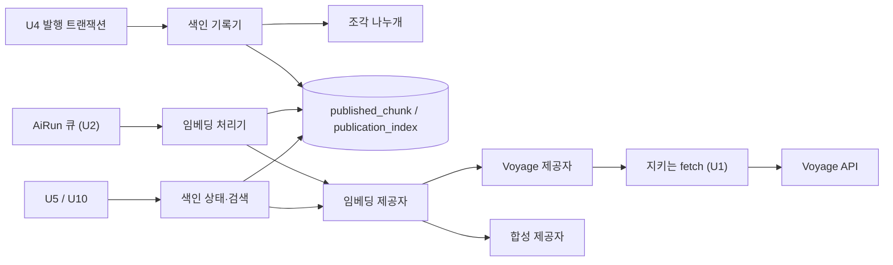

# U3 발행본 색인·검색 — 논리 구성 요소

## Sources

작성일: 2026-10-28. 입력: [성능](../nfr-requirements/performance-requirements.md)(performance-requirements)·[보안](../nfr-requirements/security-requirements.md)(security-requirements)·[규모](../nfr-requirements/scalability-requirements.md)(scalability-requirements)·[신뢰성](../nfr-requirements/reliability-requirements.md)(reliability-requirements)·[관측](../nfr-requirements/observability-requirements.md)(observability-requirements) 요구사항, [기술 선택](../nfr-requirements/tech-stack-decisions.md)(tech-stack-decisions), [U3 기능 명세](../functional-design/functional-spec.md)(functional-spec)의 W1~W5, [계약 요약](../../../inception/contract-design/contract-summary.md)(contract-summary)의 C-02·C-08·C-09, [비기능 설계 질문·답변](nfr-design-questions.md) Q1, api 현재 코드(`api/src/ai-generation/guarded-fetch.ts`, `api/src/common/node-env.ts`).

## 구성 요소

모두 api의 `api/src/published-index` 안에 있고, 같은 프로세스 안에서 함수 호출로 이어진다. U3 코드 PR에서는 api 앱 모듈에 등록하지 않는다(Q1). 시험이 만들기 함수로 직접 만든다.

| 구성 요소 | 하는 일 | 기능 규칙·요구사항 |
|---|---|---|
| 설정 읽개 `readEmbeddingConfig(env)` | `CATCHU_EMBEDDING_API_KEY`만 읽는다. 앞뒤 공백을 뺀 값이 비었으면 키 없음으로 본다 | NFR1.3, BR6.1 |
| 제공자 만들기 함수 `createEmbeddingProvider(config, env, fetch?)` | 키가 있으면 Voyage 제공자, 키가 없고 `isDevelopmentOrTest(env)`면 합성 제공자, 그 밖이면 키 값 없는 오류로 멈춘다 | NFR1.3, NFR6.1 |
| 임베딩 제공자 `EmbeddingProvider` | `embedDocuments(texts)`(문서용 입력)·`embedQuery(text)`(질문용 입력). 둘 다 벡터와 토큰 수를 돌려주거나 `EmbeddingProviderError`를 던진다. 기능 설계(entities.md)의 경계는 벡터만 돌려주지만, 관측 요구사항 NFR6.2가 Voyage 응답의 토큰 수 합을 로그에 남기라고 해서 토큰 수를 더했다. U3 안의 경계만 넓힌 것이고 계약(C-08·C-09)은 그대로다 | BR2.3, BR5.3, NFR6.2 |
| Voyage 제공자 | 고정 주소에 HTTPS 요청 하나를 보낸다. 시간 제한 신호를 걸고 지키는 fetch(U1 `createGuardedFetch`, 상한 8 MiB)를 거친다. 응답 개수·차원을 검사한다 | NFR2.1, NFR2.2, NFR2.3 |
| 합성 제공자 | 같은 글에 같은 1024차원 단위 벡터를 돌려주는 결정적 구현. 개발·시험 전용이다 | NFR1.3, 기능 설계 「주요 시나리오와 확인」 |
| 조각 나누개 | 사본 필드에서 조각 초안(글·위치·출처 종류·근거 URL)을 만드는 순수 함수. DB·외부 호출이 없다 | BR1.1~BR1.6, BR1.9, BR1.10 |
| 색인 기록기 `PublishedIndexWriter` | `chunkInTransaction`(조각 쓰기·색인 행 `PENDING`), `requestReindex`(`FAILED`일 때만 다시 등록) | W1, W4, NFR4.3 |
| 임베딩 처리기 | `EMBED_PUBLICATION` 작업 한 건을 처리한다. 묶음을 차례로 보내고 발행본 단위로 한 번에 저장한다 | W2, NFR4.1, NFR4.5, NFR5.2 |
| 색인 상태·검색 `PublishedSearch` | `getIndexState`(시한 판정), `search`(그 발행본 조각만 정확 비교) | W3, W5, NFR1.1, NFR4.4 |
| 오류 종류 | `EmbeddingProviderError`(실패 종류·HTTP 상태만), `IndexNotReady`, 인자 오류. 메시지에 글·키·주소를 넣지 않는다 | NFR6.3 |

<!-- Text fallback: U4의 발행 트랜잭션이 색인 기록기를 부르고, 색인 기록기는 조각 나누개로 조각을 만들어 published_chunk와 publication_index에 쓴다. U2의 AiRun 큐가 임베딩 처리기를 부르고, 처리기는 임베딩 제공자로 벡터를 받아 DB에 저장한다. U5·U10은 색인 상태·검색을 부르고, 검색은 임베딩 제공자로 질문 벡터를 받아 DB에서 비교한다. 임베딩 제공자는 Voyage 제공자 또는 합성 제공자이며, Voyage 제공자는 U1의 지키는 fetch를 거쳐 Voyage API를 부른다. -->

## 실패 범위

- 바깥 의존은 Voyage API 하나다. Voyage가 멈추면 임베딩은 `FAILED`, 검색은 제공자 오류가 된다. 발행·열람·기본 요약은 영향을 받지 않는다. 발행 트랜잭션 안의 조각 나누기에는 외부 호출이 없기 때문이다(reliability-requirements NFR4.5, performance-requirements NFR4.3).
- 임베딩 작업 한 건의 실패는 그 발행본 색인만 `FAILED`로 만든다. 처리기와 검색은 상태를 메모리에 두지 않아 다른 발행본에 번지지 않는다.
- 발행 트랜잭션 안의 실패(조각 나누개·기록기 예외)는 그 발행만 되돌린다(BR1.7).
- U3은 앱에 등록되지 않으므로, 키가 없어도 U3 PR이 합쳐진 뒤 api 기동과 다른 기능에 영향이 없다(Q1).

## 공유 자원

| 자원 | 주인 | U3의 쓰임 |
|---|---|---|
| PostgreSQL(api DB)과 TypeORM 연결 묶음 | 팀장(공용 기반) | `published_chunk`·`publication_index` 읽기·쓰기. 외부 호출 중에는 트랜잭션을 열어 두지 않는다(performance-design) |
| pgvector 확장 | 로컬·CI는 pgvector 판 이미지, 배포 DB는 팀장(기술 선택) | `vector(1024)` 칸과 코사인 거리 연산 |
| AiRun 큐 | U2 | `EMBED_PUBLICATION` 작업 등록과 실행. 동시 실행 수는 U2가 정한다 |
| `published_item`·`published_pdf_page` | U4·U8 | 발행 트랜잭션 안에서만 읽는다(C-07 읽기 범위) |

## 시험에서 바꿔 끼우는 자리

- S1~S11은 임베딩 제공자 자리에 시험용 제공자(결정적, 글→벡터 표, 지정한 호출에서 실패)를 넣고 C-02 모양의 합성 AiRun을 쓴다(기능 설계 「주요 시나리오와 확인」).
- Voyage 제공자의 전송 시험(주소 고정·redirect·본문 상한·시간 초과·오류 응답 본문)은 제공자 만들기 함수에 시험용 fetch를 넘겨 기록한 HTTP 응답을 돌려준다. U1 비기능 설계 Q2와 같은 방식이다.
- S12(실제 Voyage)는 기본 fetch와 셸 환경변수의 키로 제공자를 만든다.

## 통합 때 할 일(U3 담당)

- U2의 `AiRun`이 통합 브랜치에 들어온 뒤 Nest 모듈 등록·주입과 `AiRun.registerHandler(EMBED_PUBLICATION, …)`를 하는 PR을 따로 낸다. 이때부터 제공자 만들기 함수의 키 확인이 api 기동 때 돈다. 그 PR보다 먼저 팀장이 배포 환경에 `CATCHU_EMBEDDING_API_KEY`(SSM)를 넣어야 한다(Q1, 기능 설계 「다른 Unit에 넘기는 것」).
