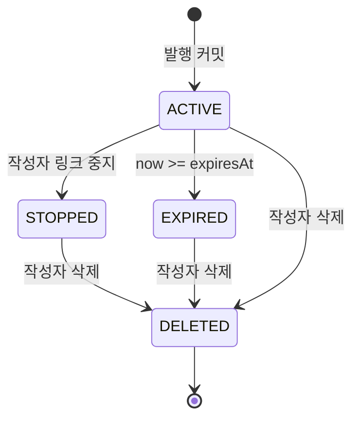
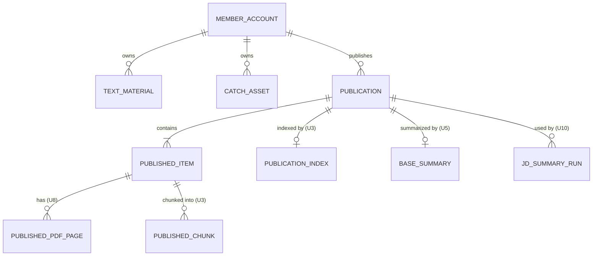

# U4 발행·링크 — 기능 명세

## Sources

작성일: 2026-10-27. 입력: [Unit 정의](../../../inception/units-generation/unit-of-work.md)(unit-of-work)의 U4, [Unit 의존](../../../inception/units-generation/unit-of-work-dependency.md), [스토리 대응](../../../inception/units-generation/unit-of-work-story-map.md)(unit-of-work-story-map), [사용자 스토리](../../../inception/user-stories/stories.md)(stories), [요구사항](../../../inception/requirements-analysis/requirements.md)(requirements), [컴포넌트 목록](../../../inception/domain-design/components.md)(components), [설계 결정](../../../inception/domain-design/decisions.md), [계약 요약](../../../inception/contract-design/contract-summary.md)(contract-summary), [Bolt 계획](../../../inception/delivery-planning/bolt-plan.md)의 B4, [기능 설계 질문·답변](functional-design-questions.md) Q1·Q2·Q5~Q9(Q3·Q4는 Q7·Q8이 대체), [엔티티](entities.md), [업무 규칙](rules.md).

## 범위

이 Unit은 [사용자 스토리](../../../inception/user-stories/stories.md)의 US1.4·US2.1·US2.2·US2.3·US3.1(텍스트 부분)·US4.1(발행 트랜잭션과 공개 전환)·US4.3·US4.4·US5.1·US5.2(PDF 사본 제외)를 구현한다. 함께 걸친 부분은 U3(발행 때 조각 나누기, 색인 상태·검색)·U5(기본 요약 패널)·U10(JD 요약 패널)·U8(PDF)이 맡는다.

| 구분 | 내용 |
|---|---|
| 하는 것 | Catch 작성자 설명, 텍스트 자료, 발행(선택·순서·공개 전환·조각 나누기 호출·작업 등록), 링크 조건 판정(C-10), 받은 사람 열람 화면과 붙는 자리(C-11), 비밀번호 통과, 작성자 발행본 목록·상세·중지·삭제, [검색 다시 준비] 버튼, 10월 공유 링크 흐름 대체 |
| 하지 않는 것 | PDF 선택·복사·열람(U8), 조각 나누기·임베딩·검색(U3), 기본 요약·질의응답(U5), JD(U10), MCP(U6·U9), 탈퇴(U2), 공용 표 `share_link`·`idempotency_record` 정리(담당 확인 필요) |
| 배포 단위 | api(NestJS)·web(Next.js). worker 변경 없음 |

## 첫 AI-DLC 제출 범위

계약 「Contract ownership rules」대로 U4가 착수 직후 먼저 내는 경계다(Q1 A). 제출은 팀 규칙에 따른 AI-DLC 제출이며, 통합 브랜치 `intent/260925-intent-12`에 합치는 것은 팀장이 한다. 이 범위는 Unit 완료와 별개다.

| 계약 | 넣는 것 | 넣지 않는 것 |
|---|---|---|
| C-07 | `publication`·`published_item` 표 정의와 마이그레이션(엔티티 문서의 제약 그대로), `member-withdrawal-deletion.md` 표에 두 표 행 추가 | 발행 API·화면 |
| C-13 | `text_material` 표 정의와 마이그레이션, 탈퇴 삭제 문서 행 추가 | 텍스트 자료 API·화면 |
| C-14 | `catch_asset`의 `author_description`·`author_description_updated_at` 칸 추가 마이그레이션(NULL 허용, 쌍 CHECK) | 설명 저장 API·화면 |
| C-10 | `PublicationAccess` 인터페이스와 판정 결과를 정할 수 있는 메모리 가짜 구현(시험 자료로 발행본·토큰·grant·상태를 넣으면 RecipientAccess·OwnerAccess·LinkUnavailable·LinkPasswordRequired·NotFound·PublishedSnapshot을 돌려준다) | 실제 DB 구현, C-11 화면 자리·형 정의(Q1 A. 형 정의를 넣을지는 회의 후 확인, OQ-U4-7) |

- 각 제공 Unit은 자기 표만 마이그레이션한다. `published_pdf_page`(U8)·`publication_index`·`published_chunk`(U3)는 만들지 않는다.
- 기존 회원 연쇄 삭제 시험(`test/db/member-cascade-delete.test.cjs`)이 새 표를 확인하게 한다(C-06 check).
- 소비 Unit: U3은 C-07 표에 시험 자료를 넣고, U5·U10은 C-10 가짜를, U6은 C-13·C-14 표에 시험 자료를 넣어 개발한다.
- **담당 확인 필요:** 코딩 절차 「코딩 운영」은 첫 주 경계 선합치를 "통합 브랜치 대상 PR"로 적고, AI-DLC Unit 제출(`aidlc unit publish`)은 Unit 완료 때의 동작이다. Unit 완료 전에 이 범위를 AI-DLC 제출로 내는 구체적 방법을 팀장과 정한다.

## 의존 처리

| 받는 계약 | 제공 | U4가 쓰는 곳 | 개발 방식(Q2 A) |
|---|---|---|---|
| C-02 `AiRun.enqueueAfterCommit` | U2 | 발행 커밋 뒤 작업 등록(BR5.5) | 시험 쪽 가짜(ENQUEUED·ENQUEUE_FAILED를 고를 수 있음) |
| C-03 `DailyRunLimit.consume` | U2 | 발행 트랜잭션 안 1회(BR5.1) | 시험 쪽 가짜(ALLOWED·LIMIT_REACHED) |
| C-04 `AiConsentGate.require` | U2 | 발행 전(BR4.7), web 공용 동의 창 | 시험 쪽 가짜. web 동의 창은 U2 제공 뒤 연결 |
| C-05 `FileStorage.deletePrefix` | U2(인터페이스·로컬) | 발행본 삭제(BR8.4) | 시험 쪽 가짜(성공·StorageUnavailable) |
| C-06 탈퇴 순서·연쇄 삭제 | U2 | 새 표 외래 키 규칙 | 계약 규칙 그대로 표에 반영 |
| C-08 `PublishedIndexWriter` | U3 | 발행 트랜잭션 안 `chunkInTransaction`, [검색 다시 준비] `requestReindex` | 시험 쪽 가짜(아무것도 쓰지 않음·예외를 던짐·REQUEUED·NOT_FAILED) |
| C-09 `PublishedSearch.getIndexState` | U3 | 작성자 화면 색인 상태(BR8.7) | **설계 전제, 담당 확인 필요(Q9)**: 계약 소비자 목록에 U4가 없어 U3 담당에게 소비자 추가를 요청한다. 합의 전에는 구현하지 않는다 |
| C-17 PDF 발행 순서 | U8(후순위) | publish-sequence 2단계 | U4는 PDF 없는 흐름만 만든다. 2단계 자리만 비워 둔다 |

- U4 운영 코드에 U2·U3 인터페이스의 임시 구현을 두지 않는다. 앱 연결(모듈 주입)은 U2·U3의 첫 제출 범위가 통합 브랜치에 합쳐진 뒤 그 인터페이스·가짜 구현을 가져다 한다.
- 소비자: U3(C-07 표), U5·U10(C-10·C-11·C-12 경로 규칙), U9(C-10), U6(C-13·C-14). U4는 이 경계의 이름·자료형·의미·오류를 바꾸지 않는다. 더하는 변경이 필요해지면 계약 문서와 함께 고치고 소비 Unit에 알리며, 깨는 변경은 멈추고 합의한다.

## 워크플로

### W1. Catch 설명 저장

1. 작성자가 Catch 상세에서 설명을 쓰고 저장한다. 화면은 기록 확인 내용·작성자 설명·AI 설명 초안을 나눠 보인다(BR1.3).
2. api가 본인 Catch인지 확인한다(BR10.1). 아니면 404.
3. 길이를 검사한다(BR1.2). 공백만이면 두 칸을 NULL로, 아니면 설명과 갱신 시각을 쓴다(BR1.1). 마지막 저장이 남는다(BR2.1).
4. 성공 응답 뒤에만 "저장됨"을 보인다. 실패하면 입력을 남기고 이유를 보인다(BR2.3). 저장 전 이탈은 경고한다(BR2.2).

### W2. 텍스트 자료 등록·수정·삭제

1. 자료 목록에서 새 자료를 만들거나 고른다. 편집 화면에 민감 정보 안내를 둔다(BR3.3).
2. 제목·본문을 검사한다(BR3.2). 본인 것만 다룬다(BR3.4).
3. 저장은 W1의 3~4와 같다. 삭제는 본인 확인 뒤 행을 지우며 이미 발행한 사본은 남는다(BR3.5).

### W3. 발행

1. 작성자가 발행 화면에서 본인 Catch·텍스트 자료를 고르고 위/아래로 순서를 정한다. 비공개 Catch를 고르면 공개 전환 안내를 보인다(BR4.4). 넣을 수 없는 Catch는 이유와 함께 고를 수 없게 표시한다(BR4.2, 화면 표시는 10월 확인 상태·보호 상태로).
2. 제목과 선택적 비밀번호를 넣는다. 확인 단계에서 고른 항목·순서·비밀번호 여부·90일 만료를 보인다(BR4.6).
3. 발행을 누르면 web은 응답까지 버튼을 막는다(BR4.9).
4. api: 빈도 제한(BR4.8) → 입력 검사(BR4.1·BR4.5의 제목·비밀번호·항목 수·중복) → 동의 확인(BR4.7) → 토큰·비밀번호 검증값 준비(BR5.4).
5. 트랜잭션: 회원 확인 → `consume(작성자, BASE_SUMMARY, manager)`(LIMIT_REACHED면 롤백·429) → 고른 원본을 정해진 순서(Catch `catch_id` 오름차순 → 텍스트 자료 `text_material_id` 오름차순)로 잠그고 다시 읽음(남의 것·없음 404, 자격 409, 전체 글 400) → `publication`·`published_item` 쓰기(BR5.3) → 고른 PRIVATE Catch를 PUBLIC으로 → `chunkInTransaction(manager, publicationId, now)` → 커밋(BR5.1). 실패하면 전체 롤백(BR5.2).
6. 커밋 뒤 두 작업 등록(BR5.5).
7. 201 응답. web은 작성자 발행본 화면으로 옮겨 실제 사본·링크 주소·접근 조건을 보인다(BR5.6).

### W4. 받은 사람 열람

1. 받은 사람이 `/s/{token}`을 연다. web은 `sessionStorage`의 그 링크 grant를 `X-Link-Grant`로 싣고 `GET /v1/public/links/{token}`을 부른다.
2. api: `resolveForRecipient(token, grant, now)`(BR6.1) → 통과하면 `readSnapshot`(BR6.4) → 200 PublishedSnapshot.
3. 404면 "이 링크는 열람할 수 없습니다" 화면, 401 LINK_PASSWORD_REQUIRED면 비밀번호 입력 화면을 보이고 그 링크 grant를 지운다.
4. 비밀번호 입력: `POST /v1/public/links/{token}/unlock`. 판정 순서는 10월 unlock 그대로다: 링크 판정(404) → 비밀번호 없는 링크(400) → 본문 검사 → 차단·시도 빈도(429, 비밀번호 확인 안 함) → 비밀번호 확인(401) → 발급 직전 링크 재판정 → grant(BR6.3). 성공하면 grant를 저장하고 1로 돌아간다.
5. 화면: 고정 발행본 안내(BR7.1) → 붙는 자리 1 발행본 자료(항목 순서, Catch는 기록·설명·AI 초안·불일치 표시 구분, BR7.5) → 2 BaseSummaryPanel(U5) → 3 QnaPanel(U5) → 4 JdSummaryPanel(U10, `isLoggedIn` 전달, BR6.6). 붙는 컴포넌트가 401 LINK_PASSWORD_REQUIRED·404 LINK_UNAVAILABLE을 받으면 `onAccessLost`로 화면을 바꾸고 grant를 지운다. 근거를 누르면 `showEvidence`로 강조한다(BR7.6).

### W5. 작성자 발행본 관리

1. 목록: 본인 발행본을 최신순으로, 제목·상태·만료 시각·링크 주소·색인 상태를 보인다(BR8.1). 색인 FAILED면 [검색 다시 준비](BR8.7). C-09 합의 전 임시 상태에서는 색인 상태와 버튼을 보이지 않는다(아래 「C-09 합의 전 임시 상태」).
2. 상세: `resolveForOwner` → `readSnapshot`. 사본·상태·만료 시각·링크 주소, 고정 안내(BR7.2), 저장소 비공개 전환 안내(BR7.3), BaseSummaryPanel 작성자 모드(publicationId·showEvidence 전달, C-11 owner-summary).
3. 링크 중지: 확인 뒤 `PUT .../stop`(BR8.2). 되살리기 없음 안내.
4. 삭제: 확인 뒤 `DELETE`(BR8.4). 성공하면 목록으로, 실패하면 "삭제되지 않았습니다"와 다시 시도. 접수만으로 성공을 표시하지 않는다.
5. [검색 다시 준비]: `POST .../reindex` → REQUEUED면 "다시 준비 중", NOT_FAILED면 현재 상태를 다시 읽어 보인다.

### W6. 10월 공유 링크 전환

U4 본체에서 10월 발급·목록·중지 API와 공유 화면, 받은 사람 공개 Catch 목록·상세 경로를 W3·W4·W5로 바꾼다(BR9.1). `/s/{token}`·`GET /v1/public/links/{token}`·unlock·grant 방식은 유지한다. 10월 링크는 이관하지 않는다. `share_link` 표와 `idempotency_record` 외래 키 정리는 담당·범위·데이터 초기화 순서를 회의 후 정한다(담당 확인 필요).

## 상태 전이

발행본 상태는 저장하지 않고 읽을 때 구한다(BR6.1, BR6.5).

<!-- Text fallback: 발행 커밋으로 ACTIVE가 된다. ACTIVE에서 작성자 중지로 STOPPED, 만료 시각이 지나면 EXPIRED가 된다. 중지가 만료보다 우선이며 STOPPED·EXPIRED에서 ACTIVE로 돌아가는 전이는 없다. 어느 상태에서든 작성자 삭제로 DELETED(행 없음)가 된다. 탈퇴 때 U2가 모든 링크를 STOPPED로 만든 뒤 회원 연쇄 삭제한다. -->

| 상태 | 받은 사람 | 작성자 |
|---|---|---|
| ACTIVE | 판정 통과(비밀번호면 grant) | 보기·중지·삭제 |
| STOPPED·EXPIRED | 404 LINK_UNAVAILABLE | 보기·삭제(되살리기 없음) |
| DELETED | 404 LINK_UNAVAILABLE | 404 RESOURCE_UNAVAILABLE |

Catch 공개 상태: 발행 트랜잭션이 커밋될 때만 PRIVATE → PUBLIC이 된다. 고르기·빼기·발행 실패는 상태를 바꾸지 않는다(BR4.4, BR5.2).

## 작성자 API (U4 안 세부)

모두 `/v1` 아래, 10월 회원 인증·CSRF·오류 본문을 쓴다(BR10.1). 남의 것·없는 것은 404 `RESOURCE_UNAVAILABLE`. 400 `VALIDATION_FAILED`의 `details`는 10월 형식이다.

| 경로 | 요청 | 성공 | 주요 오류 |
|---|---|---|---|
| `PUT /catches/{catchId}/description` | `{ description: string }` | 200 `{ authorDescription, authorDescriptionUpdatedAt }` | 400, 404 |
| `GET /text-materials` | `cursor`·`limit` | 200 `{ items: [{ textMaterialId, title, updatedAt }], page }` | 400 |
| `POST /text-materials` | `{ title, body }` | 201 TextMaterial | 400 |
| `GET /text-materials/{id}` | — | 200 TextMaterial | 404 |
| `PUT /text-materials/{id}` | `{ title, body }` | 200 TextMaterial | 400, 404 |
| `DELETE /text-materials/{id}` | — | 204 | 404 |
| `POST /publications` | `{ title, password?, items: [{ kind: CATCH \| TEXT_MATERIAL, sourceId }] }` | 201 `{ publicationId, url, state, publishedAt, expiresAt, passwordProtected }` | 400, 403 AI_CONSENT_REQUIRED, 404, 409 CONFIRMATION_REQUIRED·SOURCE_RESTRICTED(`details.catchIds`), 429 DAILY_LIMIT_REACHED·RATE_LIMITED |
| `GET /publications` | `cursor`·`limit` | 200 `{ items: [{ publicationId, title, url, state, publishedAt, expiresAt, passwordProtected, indexState }], page }`. `indexState`는 **C-09 합의 뒤에만 제공**([C-09 합의 전 임시 상태](#c-09-합의-전-임시-상태)) | 400 |
| `GET /publications/{id}` | — | 200 `{ publicationId, url, state, passwordProtected, indexState, snapshot: PublishedSnapshot }`. `indexState`는 **C-09 합의 뒤에만 제공**([C-09 합의 전 임시 상태](#c-09-합의-전-임시-상태)) | 404 |
| `PUT /publications/{id}/stop` | 본문 없음 | 200 `{ state, stoppedAt }`: 유효 링크는 `STOPPED`와 중지 시각, 이미 중지면 `STOPPED`와 처음 시각, 만료면 `{ state: EXPIRED, stoppedAt: null }`(BR8.2) | 404 |
| `DELETE /publications/{id}` | — | 204 | 404, 500(접두어 삭제 실패, DB 유지) |
| `POST /publications/{id}/reindex` | 본문 없음 | 202 `{ indexState: PENDING }` 또는 200 `{ indexState }`(NOT_FAILED). 이 경로는 **C-09 합의 뒤에만 제공**([C-09 합의 전 임시 상태](#c-09-합의-전-임시-상태)) | 404 |

- `url`만 토큰을 담는다(BR10.2). `indexState`는 C-09 `getIndexState` 결과(PENDING·DONE·FAILED)다.
- 받은 사람 경로는 C-12 그대로다: `GET /public/links/{token}`(200 PublishedSnapshot, 401, 404), `POST /public/links/{token}/unlock`(200 `{ grant }`, 400 INVALID_REQUEST(비밀번호 없는 링크, 10월 그대로)·VALIDATION_FAILED, 401 LINK_PASSWORD_INVALID, 404, 429 LINK_UNLOCK_LIMITED).

### C-09 합의 전 임시 상태

C-09 `getIndexState`를 U4가 쓰는 것은 U3 담당과 합의 전이다(Q9, OQ-U4-5). 합의 전 임시 상태는 다음과 같다.

- 작성자 목록·상세 응답에 `indexState` 칸을 두지 않고, `POST /publications/{id}/reindex` 경로와 [검색 다시 준비] 버튼을 만들지 않는다. U3 표를 직접 읽거나 버튼을 항상 보이는 식으로 대신하지 않는다.
- 이 상태는 **미완성**이다. [검색 다시 준비](BR8.7)는 U4 최종 범위에서 빠지지 않으며, 합의 뒤 칸·경로·버튼을 더하고 시험(S12의 reindex 부분 포함)을 통과하기 전에는 U4를 완료로 보고하지 않는다.
- 합의 뒤 더하는 칸과 경로는 기존 응답 칸을 바꾸지 않는 더하는 변경이라 web의 다른 화면에 영향이 없다.
- 글자 수: 검증 길이는 코드 포인트, 제목은 앞뒤 공백 제거 뒤 센다. 전체 글 합산 대상은 [엔티티](entities.md)의 SnapshotTextTotal이다.

## 엔티티 관계 (entities.md에서 옮김)

<!-- Text fallback: 회원은 텍스트 자료·Catch·발행본을 여러 개 가진다(회원 연쇄 삭제). 발행본은 항목을 1~20개 가진다. 항목의 source_id는 Catch나 텍스트 자료를 가리키지만 외래 키가 없는 사본이다. PDF 쪽 사본(U8)·색인 상태와 조각(U3)·기본 요약(U5)·JD 요약 실행(U10)은 발행본(또는 항목)을 따라 지워진다. -->

## 규칙 요약 (rules.md에서 옮김)

| 묶음 | 내용 |
|---|---|
| BR1 | Catch 설명 하나·0~4,000자·구분 표시·재분석 유지·근거 링크·공개 상태 10월 그대로 |
| BR2 | 마지막 저장·이탈 경고·저장 실패 때 입력 유지 |
| BR3 | 텍스트 자료 여러 벌·제목 1~100·본문 1~20,000·민감 정보 안내·본인만·사본 불변 |
| BR4 | 선택 1~20·자격 재확인(409)·불일치 허용·공개 전환 안내·크기(전체 60,000 임시)·발행 전 안내·동의(403)·빈도(초기 설계안)·중복 방지 없음 |
| BR5 | 발행 순서·실패 롤백·사본 모양·토큰과 90일·커밋 뒤 작업 등록·발행 후 확인 |
| BR6 | 매번 판정(404·401)·grant·unlock·사본만·작성자 접근·로그인 여부 전달 |
| BR7 | 고정 안내·원본 수정 안내·비공개 전환 뒤 유지·조회 실패 단정 금지·구분 표시·근거 강조 |
| BR8 | 목록·상세·중지·삭제(접두어 먼저)·늦은 결과 버림·자동 파기 없음·[검색 다시 준비] |
| BR9 | 10월 공유 링크 대체, 표 정리는 담당 확인 |
| BR10 | 인증·소유 확인, 비밀값 로그 금지 |

## 주요 시나리오와 확인

팀 관행대로 시나리오·기대 결과·실패 조건을 먼저 정하고 세부 시험 코드는 구현 뒤 쓴다(team.md Testing Posture). U2·U3은 계약 모양 가짜로 시험한다.

| ID | 시나리오 | 기대 결과 | 실패 조건 |
|---|---|---|---|
| S1 | 설명 저장·두 탭 저장·공백 저장·4,001자 | 마지막 저장이 남음, 공백은 NULL, 초과 400 | 초안이 설명을 덮음, 입력이 사라짐 |
| S2 | 재분석으로 같은 작업 반영 | 설명 유지, 새 작업 Catch는 NULL | 설명 변경·이동 |
| S3 | 텍스트 자료 CRUD와 남의 자료 접근 | 본인만, 남의 것 404 | 남의 자료 노출 |
| S4 | 공개 Catch 1 + 비공개 Catch 1 + 텍스트 1 발행 | 순서대로 사본 3개, 비공개 Catch가 PUBLIC, 조각 나누기 가짜가 같은 manager로 불림, 커밋 뒤 작업 2개 등록 | 순서 틀림, 등록이 커밋 전 |
| S5 | 미확인 Catch 또는 SOURCE_PRIVATE Catch를 넣어 발행 | 409, 발행본 없음, 다른 비공개 Catch도 그대로 | 일부만 저장·공개 전환 |
| S6 | 하루 횟수 LIMIT_REACHED, chunkInTransaction 예외 | 429 또는 실패, 아무것도 남지 않고 공개 전환 없음 | 발행본·공개 전환이 남음 |
| S7 | 작업 등록 ENQUEUE_FAILED | 발행 성공 응답 | 발행 실패로 보고 |
| S8 | 비밀번호 링크: grant 없음·틀린 비밀번호·맞는 비밀번호·다른 발행본 grant | 401·401·200·401 | 사본 노출 |
| S9 | 중지·만료·삭제 링크를 받은 사람이 엶 | 404 LINK_UNAVAILABLE, 작성자는 중지·만료 발행본을 계속 봄 | 받은 사람 열람 성공 |
| S10 | 발행 뒤 원본 Catch 설명·텍스트·공개 상태 변경과 원본 자료 삭제 | 사본 그대로 | 사본 변경 |
| S11 | 삭제: 접두어 삭제 성공·실패 | 성공은 연쇄 삭제·204, 실패는 500·DB 유지 | 실패인데 행 삭제 |
| S12 | 남의 발행본 상세·중지·삭제·[검색 다시 준비] | 404 | 남의 발행본 변경 |
| S13 | 만료된 링크 중지, 같은 링크 두 번 중지 | 만료는 200 `{EXPIRED, null}`, 두 번째 중지는 처음 시각 유지 | 만료 링크에 stopped_at 기록 |
| S14 | 비밀번호 시도 제한에 걸린 뒤 맞는 비밀번호, 비밀번호 없는 링크에 unlock | 429(비밀번호 확인 안 함), 400 | 제한 중 grant 발급 |
| S15 | (C-09 합의 뒤) 색인 PENDING·DONE·FAILED 발행본의 목록·상세, FAILED에서 [검색 다시 준비] | FAILED에만 버튼, 누르면 202 PENDING, NOT_FAILED면 200 현재 상태 | 버튼이 항상 보임, U3 표 직접 조회 |

S15는 C-09 합의 뒤에만 돌릴 수 있다. 합의 전에는 S15를 미실행으로 기록하며, S15 통과 전에는 U4를 완료로 보고하지 않는다.

보호 흐름 3개(FR19.1)의 링크 조건 부분은 S8·S9가 기준이다.

**최소 연결 첫 결과(Q6):** 로그인한 작성자가 Catch 1개와 텍스트 자료 1개를 골라 발행하고, 발행 직후 고정 사본을 확인한 뒤, 비로그인 브라우저에서 링크로 같은 내용을 본다.

- U3 실제 구현 전에 시험 환경에서 계약 가짜로 이 흐름을 돌린 것은 '합성 연결을 포함한 사전 확인'으로 기록하고 실제 연결 성공으로 보고하지 않는다.
- 실제 연결 첫 결과의 승인은 U2·U3 실제 구현으로 연결한 결과를 근거로 받는다.
- U4 완료에는 B4의 U3 실제 연결과 나머지 완료 기준 확인이 필요하다.
- U2·U3 실제 구현 제공 시점과 통합 확인 일정은 회의 후 맞춘다(담당 확인 필요).

## 한계

- 재전송·두 번 누르기로 발행본이 둘 생기고 하루 실행 횟수를 2회 쓸 수 있다(에러 대응 최소선 6, Q7). web은 발행 중 버튼을 막는다.
- 작업 등록이 실패하면 그 발행본의 색인·기본 요약은 시한이 지나 실패로 확정되고, 발행 때 센 하루 횟수 1회는 돌려주지 않는다(C-02).
- 전체 글 상한 60,000자는 U4 제안 임시값이며 AI 처리가 가능한지 검증하지 않았다(Q5).
- C-09 합의 전에는 작성자가 색인 실패를 화면에서 보지 못하고 [검색 다시 준비]도 쓸 수 없다. 이 상태는 미완성이며 U4 완료 전에 해소해야 한다(OQ-U4-5).

## 추적

| 스토리 | 수용 기준 | 규칙 |
|---|---|---|
| US1.4 | AC1.4.1~AC1.4.4 | BR1.3, BR1.5, BR1.6 |
| US2.1 | AC2.1.1~AC2.1.4 | BR1.1, BR1.2, BR1.3, BR3.1 |
| US2.2 | AC2.2.1~AC2.2.3 | BR2.1~BR2.3 |
| US2.3 | AC2.3.1~AC2.3.2 | BR1.4 |
| US3.1 | AC3.1.1·3·4·5(AC3.1.2는 U8) | BR3.1, BR3.3, BR3.5, BR5.3 |
| US4.1 | AC4.1.1~AC4.1.9 | BR4.1~BR4.6, BR5.1~BR5.3, BR5.6 |
| US4.4 | AC4.4.1~AC4.4.4 | BR6.1, BR6.3, BR6.4, BR6.6 |
| US4.3 | AC4.3.1~AC4.3.4 | BR7.1~BR7.4 |
| US5.1 | AC5.1.1~AC5.1.5 | BR6.1, BR8.1~BR8.3 |
| US5.2 | AC5.2.1~AC5.2.5 | BR8.4~BR8.6 |

수용 기준별 대응은 [traceability.json](traceability.json)에 있다.

## Assumptions & Open Questions

아래는 모두 '담당 확인 필요'이며 회의 후 답한다. 항목마다 합의 전 처리 방식이 다르다. 「합의 전 처리」 칸이 그 항목을 지금 어떻게 다루는지 정한다.

| # | 항목 | 확인할 상대 | 합의 전 처리 | 설계에서의 자리 |
|---|---|---|---|---|
| OQ-U4-1 | 첫 AI-DLC 제출 범위를 Unit 완료 전에 내는 방법(코딩 절차의 "통합 브랜치 대상 PR" 문장과 AI-DLC 제출의 관계) | 팀장 | 절차·일정. 범위만 정하고 내는 방법은 정하지 않음 | 「첫 AI-DLC 제출 범위」 |
| OQ-U4-2 | 회원별 발행 빈도 1분 10회 유지 여부 | 팀장 | 임시값으로 구현하고 합의 뒤 조정. 공용 계약 변경 불필요 | BR4.8 |
| OQ-U4-3 | `share_link` 표·`idempotency_record` 외래 키 정리의 담당·마이그레이션 범위·데이터 초기화와의 순서 | 팀장·관련 담당 | 건드리지 않음. 새 흐름은 그 표를 쓰지 않음 | BR9.1, W6 |
| OQ-U4-4 | 전체 글 상한 60,000자를 AI 입력 한도(U2·U5)에 맞춤 | 팀장(U2·U5 담당) | 임시값으로 구현하고 합의 뒤 조정. 검증된 값 아님 | BR4.5 |
| OQ-U4-5 | C-09 `getIndexState` 소비자에 U4 추가(계약 문서 변경은 U3 담당) | U3 담당(팀장) | 합의 전 구현하지 않음. 임시 상태는 미완성이며 U4 완료 조건에 남음 | BR8.7, 「C-09 합의 전 임시 상태」 |
| OQ-U4-6 | U2·U3 실제 구현 제공 시점과 통합 확인 일정·환경 | 팀장 | 절차·일정. 최소 연결 첫 결과 기준만 정함 | 「주요 시나리오와 확인」 |
| OQ-U4-7 | 첫 AI-DLC 제출에 C-11 `RecipientSlotProps`·`showEvidence` 형(type) 정의를 넣을지(검토 R-06 (1)) | 팀장·U5·U10 담당 | Q1 A대로 지금은 넣지 않음. 회의에서 확인하고 넣기로 하면 형 정의만 더함 | 「첫 AI-DLC 제출 범위」 |
