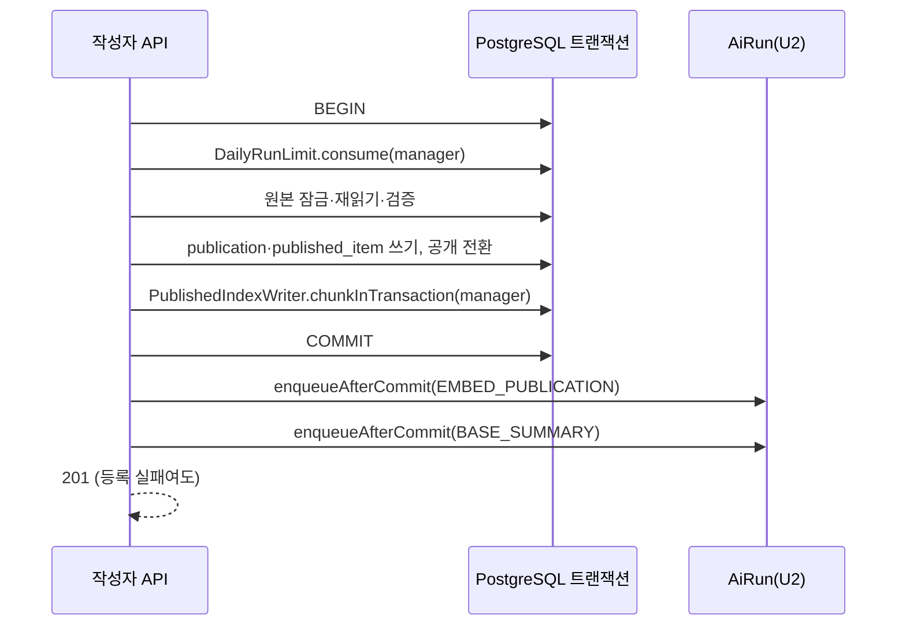

# U4 발행·링크 — 신뢰성 설계

## Sources

작성일: 2026-10-29. 입력: [U4 비기능 요구사항](../nfr-requirements/)(performance-requirements·security-requirements·scalability-requirements·reliability-requirements·observability-requirements·tech-stack-decisions) 가운데 특히 [신뢰성 요구사항](../nfr-requirements/reliability-requirements.md)(reliability-requirements) NFR5.1~NFR5.7·NFR6.1·NFR6.4, [기술 선택](../nfr-requirements/tech-stack-decisions.md)(tech-stack-decisions), [U4 기능 명세](../functional-design/functional-spec.md)(functional-spec) W3·W5, [계약 요약](../../../inception/contract-design/contract-summary.md)(contract-summary) 「에러 대응 최소선」·C-02·C-05·C-06·C-08, [비기능 설계 질문·답변](nfr-design-questions.md).

## 설계

회로 차단기·자동 재시도·대체 경로는 두지 않는다. 다시 시도는 사람이 한다(에러 대응 최소선 2).

### 발행 트랜잭션 경계

<!-- Text fallback: 하루 횟수 소비, 원본 잠금과 검증, 발행본·항목 쓰기, 공개 전환, 조각 나누기는 한 트랜잭션이다. 어느 단계든 실패하면 전부 롤백한다. 커밋 뒤 두 작업을 등록하며, 등록이 실패해도 201로 응답하고 로그만 남긴다. -->

- 트랜잭션 안 예외는 삼키지 않고 롤백 뒤 원래 코드로 응답한다. 4xx는 그 코드, 그 밖은 500 `INTERNAL_ERROR`(NFR5.1).
- 작업 등록은 커밋이 성공한 뒤에만 부르고 두 종류를 각각 등록한다. `ENQUEUE_FAILED`는 로그만 남기고 다시 등록하지 않는다(NFR5.2).

### 삭제

1. `resolveForOwner`로 소유 확인(남의 것·없음 404).
2. `FileStorage.deletePrefix(publicationPrefix(memberId, publicationId))`. 접두어가 없으면 성공.
3. 2가 실패하면 **500 `INTERNAL_ERROR`로 끝내고 DB를 지우지 않는다**. 로그에 접두어 삭제 실패 분류를 남긴다(NFR5.3).
4. 2가 성공하면 `publication` 행을 지워 외래 키 연쇄로 항목·색인·조각·요약·JD 요약 결과를 지운다(NFR5.4).

늦게 도착한 결과는 부모가 없어 외래 키가 거부하고, 버리는 것은 각 처리기 몫이다(NFR5.5). 만료는 행을 지우지 않는다(NFR5.6).

### 링크 중지

행을 `FOR UPDATE`로 잠그고 상태를 다시 구한다. ACTIVE면 `stopped_at = now`, STOPPED면 처음 값 유지, EXPIRED면 쓰지 않고 `{EXPIRED, null}`(NFR5.7).

### 화면

작성자 화면은 응답 성공 뒤에만 "저장됨"·"발행됨"·"삭제됨"을 보이고, 실패하면 입력을 남긴다. 받은 사람 화면은 10월 동작대로 조회 실패를 링크 불가로 바꾸지 않는다(NFR6.1).

### 작성자 실패 안내 (NFR7.5)

응답 코드별로 안내를 나눈다. 어떤 경우든 고른 항목·순서·제목·입력한 비밀번호 여부는 화면에 남기고, 접수만으로 성공을 표시하지 않는다. 비밀번호 원문은 안내에 넣지 않는다.

| 경우 | 응답 | 안내 | 화면 동작 | 문구 근거 |
|---|---|---|---|---|
| 발행 거부: 확인 안 됨 | 409 `CONFIRMATION_REQUIRED`, `details.catchIds` | 해당 Catch마다 "작업 사실과 나의 기여를 먼저 확인해 주세요." | `catchIds`의 Catch를 선택 목록에서 표시하고 발행하지 않음. 다른 Catch는 그대로 | 10월 `web/src/features/assets/catch-api.ts` 문구, BR4.2 |
| 발행 거부: 원본 보호 | 409 `SOURCE_RESTRICTED`, `details.catchIds` | 해당 Catch마다 "원본 저장소가 보호되어 지금은 공개할 수 없습니다." | 위와 같음 | 10월 같은 파일, BR4.2·BR7.4 |
| 발행 거부: 원본 없음·남의 것 | 404 `RESOURCE_UNAVAILABLE` | "고른 자료 중 지금 발행할 수 없는 것이 있습니다. 목록을 다시 불러와 주세요." 계열(문구는 코드 생성 때 정함) | 선택 목록을 다시 불러오게 함 | BR4.1 |
| 입력 오류 | 400 `VALIDATION_FAILED` | 10월 `details`의 칸별 이유(제목 길이·비밀번호 길이·항목 수·전체 글 상한) | 해당 칸 옆 안내 | BR4.1·BR4.5 |
| 동의 없음 | 403 `AI_CONSENT_REQUIRED` | U2 공용 동의 창 | 동의 뒤 같은 요청 다시 보냄 | BR4.7, C-04 |
| 하루 한도 | 429 `DAILY_LIMIT_REACHED` | "오늘 한도에 도달했습니다" | 남은 횟수는 보이지 않음. 발행하지 않음 | FR6.6, C-03 `http-error` |
| 빈도 초과 | 429 `RATE_LIMITED`, `Retry-After` | 잠시 뒤 다시 보내라는 안내와 남은 초(`retryAfterSeconds`가 있을 때만). 문구는 코드 생성 때 정함 | 남은 시간 동안 발행 버튼을 막고 자동으로 다시 보내지 않음. `Retry-After`가 없으면 시간을 추정하지 않음 | BR4.8, 10월 `api-client.ts` `retryAfterSeconds`·수신자 429 처리 |
| 발행 실패(그 밖) | 500·통신 실패 | "발행되지 않았습니다"와 다시 시도 | 입력 유지 | BR5.2 |
| 삭제 실패 | 500 `INTERNAL_ERROR`(접두어 삭제 실패, DB 유지) | "삭제되지 않았습니다"와 다시 시도 | 목록에 그 발행본을 그대로 둠 | BR8.4, NFR5.3 |
| 저장 실패(설명·텍스트 자료) | 400·5xx·401·통신 실패 | "저장되지 않았습니다"와 이유, 로그인 만료면 다시 로그인 안내 | 입력 유지 | BR2.3 |

- 문구가 정해진 것(10월 Catch 문구, C-03 하루 한도, BR5.2·BR8.4·BR2.3)은 그대로 쓴다. "코드 생성 때 정함"으로 둔 두 문구(원본 없음, 빈도 초과)는 위 구분 기준을 지키는 범위에서 정하며 새 기능을 더하지 않는다.
- 하루 한도와 빈도 초과는 같은 429지만 코드로 구분해 다른 안내를 보인다.
- 확인: 각 경우를 가짜 응답으로 보내는 web 시험(S5·S6·S11과 하루 한도·빈도 초과 사례)으로 안내 종류와 입력 유지를 확인한다.

### 시험

보호 흐름 3개(FR19.1)의 U4 부분만 기능 사이 실패 시험으로 둔다: 회원 자료 격리(S3·S12), 링크 중지 뒤 웹 차단(S9), 탈퇴 뒤 차단(C-06 회원 연쇄 삭제 시험이 새 표를 확인). U2·U3 경계는 시험 쪽 가짜로 성공·실패를 고른다(NFR6.4).

## Assumptions & Open Questions

- U2 실제 `AiRun`·`FileStorage` 연결 전 결과는 가짜 연결 결과로 기록하고 실제 연결 성공으로 보고하지 않는다(OQ-U4-6).
