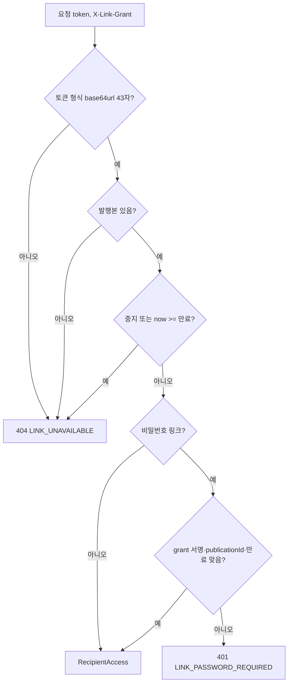

# U4 발행·링크 — 보안 설계

## Sources

작성일: 2026-10-29. 입력: [U4 비기능 요구사항](../nfr-requirements/)(performance-requirements·security-requirements·scalability-requirements·reliability-requirements·observability-requirements·tech-stack-decisions) 가운데 특히 [보안 요구사항](../nfr-requirements/security-requirements.md)(security-requirements) NFR1.1~NFR1.12·NFR2.1~NFR2.2·NFR7.1~NFR7.5와 「안내 중복 통과 조건」 G1~G7, [기술 선택](../nfr-requirements/tech-stack-decisions.md)(tech-stack-decisions), [U4 기능 명세](../functional-design/functional-spec.md)(functional-spec) W4·W5·W6, [계약 요약](../../../inception/contract-design/contract-summary.md)(contract-summary) C-10·C-11(#421)·C-12, [비기능 설계 질문·답변](nfr-design-questions.md) Q1·Q2, [#416 팀장 답변](https://github.com/JminAILab/CatchU/issues/416#issuecomment-6485884167), 10월 구현 `api/src/share-links/`·`web/src/features/recipient/`.

## 설계

### api 인증·권한 구조

- 새 모듈 `api/src/publications`(Q1 A)에 컨트롤러 두 개를 둔다.
  - 작성자 컨트롤러: 클래스에 `@Public()`을 붙이지 않는다. 10월 전역 Guard·CSRF를 그대로 받는다(NFR1.1).
  - 받은 사람 컨트롤러: `GET /public/links/{token}`과 `POST /public/links/{token}/unlock` 두 메서드에만 `@Public()`을 붙인다(NFR1.2). 10월 시험 방식대로 실제 Guard로 미지정 경로의 인증 요구를 시험한다.
- 받은 사람 경로 교체(R-02): 지금 `GET /v1/public/links/:token`은 `api/src/recipient`의 `RecipientController`가, `POST /v1/public/links/:token/unlock`은 `share-links/public-links.controller.ts`가 받고, `AppModule`이 `RecipientModule`·`ShareLinksModule`을 불러온다. 새 받은 사람 컨트롤러 등록과 아래 해제는 **한 변경(한 PR)** 에서 한다. 새 경로만 먼저 등록하거나 옛 경로만 먼저 빼는 중간 상태를 통합 브랜치에 두지 않는다.
  - 같은 변경에서 `AppModule`에서 빼는 것: `RecipientModule`(공개 프로필·`/:token/catches/:catchId` 포함), `ShareLinksModule`(`ShareLinksController`·`PublicLinksController`·`LinkAccessService`·`ShareLinksService`).
  - 이 변경이 W6(10월 공유 링크 전환)의 api 부분이다. web의 `/s/[token]/catches/[catchId]` 경로·화면 제거도 같은 변경에 넣는다(아래 「web 시험 유지·제거」).
  - 남기는 것: 재사용 도구 파일, `share-link.entity.ts`(`member-analysis.entity.ts`가 `idempotency_record`의 외래 키로 참조하고 `share_link` 표 정리는 OQ-U4-3 미결이라 지우지 않는다). `member-analysis.entity.ts`의 `createShareLink` 연산 값과 `member-analysis/idempotent-creation.ts`도 같은 이유로 바꾸지 않는다(분석 접수 `analysis-intake`도 이 도구를 쓴다).
  - 같은 변경에서 지우는 10월 전용 파일(R-07): `share-create.ts`·`share-create-fingerprint.ts`·`share-link-issuance.ts`·`share-link-list.ts`·`share-link-response.ts`·`share-link-state.ts`·`issue-rate-limit.ts`와 `share-links.service.ts`·`share-links.controller.ts`·`public-links.controller.ts`·`link-access.service.ts`·`share-links.module.ts`. 2026-10-29 기준으로 앞의 일곱 파일을 import하는 곳은 `share-links` 폴더 안의 지울 파일들뿐이다(`issue-rate-limit.ts`는 지울 컨트롤러·모듈만 쓴다. U4 발행 빈도 상수는 따로 둔다). 확인 항목: 지운 뒤 api 빌드(`npm run build`)가 통과하고, 지운 파일을 import하는 곳이 남지 않으며, `member-analysis`·`idempotent-creation`·`analysis-intake` 시험이 그대로 통과한다. 코드 생성 시점에 import 관계가 달라져 있으면 그 목록을 다시 확인하고 계획에 적는다.
  - 경로 중복 확인: `AppModule`을 띄우는 경계 시험이 등록된 (메서드, 경로) 쌍을 모아 ① 같은 쌍이 둘 이상 없고, ② `GET /v1/public/links/:token`·`POST /v1/public/links/:token/unlock`이 새 받은 사람 컨트롤러 하나에만 연결되며, ③ `/v1/public/links/:token/catches/:catchId`와 10월 발급·목록·중지 경로가 없음을 확인한다. 이 시험은 10월 `test/public-links-auth-boundary.test.cjs`·`test/recipient-module-boundary.test.cjs`를 대신한다.
- 작성자 조회는 모두 `WHERE <id> = $1 AND member_id = $2`처럼 소유자를 조건에 넣는다. 형식이 틀린 UUID·남의 것·없는 것은 같은 404 `RESOURCE_UNAVAILABLE`(NFR1.1, NFR1.8).
- 요청 본문은 10월 방식대로 정의하지 않은 필드를 거부한다. SQL은 매개변수로만 넘긴다(NFR1.8).

### 링크 판정 (C-10 `PublicationAccess`)

<!-- Text fallback: 토큰 형식이 틀리면 조회 없이 404. 발행본이 없거나 중지·만료면 404. 비밀번호 링크가 아니면 통과. 비밀번호 링크면 grant의 서명·publicationId·만료를 확인해 맞으면 통과, 아니면 401. 판정은 요청마다 하고 캐시하지 않는다. -->

- 토큰 형식 확인은 10월 `isLinkTokenFormat`을 import한다(NFR1.12, 10월 동작 그대로).
- 위 흐름도는 C-10 계약 순서다. OQ-U4-NFR-6이 정해지기 전 U4 구현은 10월처럼 「중지 또는 만료」 다음, 「비밀번호 링크?」 앞에서 소유 회원 비활성을 확인해 404로 막는다(아래 「소유 회원 비활성」).
- grant는 10월 `link-grant`의 서명·검증을 쓰고, grant가 가리키는 ID를 `publicationId`로 둔다. 수명 2시간, 링크 만료를 넘지 않는다(NFR1.6).
- `readSnapshot`은 `published_item`만 읽는다. 원본 `catch_asset`·`text_material`을 읽는 경로는 받은 사람 쪽에 두지 않는다(NFR1.4).

### 판정과 읽기의 시점 (R-04)

| 구분 | 10월 구현 | 12월 설계 |
|---|---|---|
| 판정과 읽기 | `LinkAccessService.withLinkSnapshot`이 링크 판정과 뒤따르는 읽기를 읽기 전용 REPEATABLE READ 트랜잭션 하나로 묶는다. 행 잠금은 잡지 않는다 | U4의 열람 경로(`GET /public/links/{token}`)는 10월과 같이 `resolveForRecipient`와 `readSnapshot`을 읽기 전용 REPEATABLE READ 트랜잭션 하나에서 부른다(U4 안 구현, 계약 변경 아님) |
| 진행 중 요청과 중지 | 판정 스냅샷 뒤에 커밋된 중지는 그 요청에 보이지 않는다. 그 요청은 판정 시점의 내용을 끝까지 돌려준다 | U4 열람 경로는 10월과 같다. 판정 뒤 중지가 커밋돼도 그 한 요청은 판정 시점 내용을 돌려준다 |
| 진행 중 요청과 삭제 | 같은 스냅샷이라 판정 시점 내용을 돌려준다 | U4 열람 경로는 10월과 같다. 트랜잭션 밖에서 `readSnapshot`이 따로 불려 발행본 행이 이미 없으면 빈 사본을 만들지 않고 실패한다 |
| 다음 요청 | 매번 다시 판정하므로 중지·만료·삭제 뒤 다음 요청은 404 | 같다(NFR1.3). 캐시하지 않는다 |
| U5·U10·U9의 C-10 사용 | 해당 없음 | C-10이 `resolveForRecipient`와 `readSnapshot`을 따로 정의해, 두 호출 사이에 커밋된 중지가 그 요청 한 번의 읽기에 반영되지 않을 수 있다. 이 틈을 받아들일지와 `readSnapshot`이 없는 발행본을 만났을 때의 실패 이름은 계약에 없다 → OQ-U4-NFR-5 |

### 소유 회원 비활성 (R-06)

10월 `LinkAccessService.usableLink`는 링크 판정 직후 같은 스냅샷에서 `OwnerProfileReader.readOwnerState`로 소유 회원의 `account_state`를 읽고, `ACTIVE`가 아니면 다른 불가 사유와 같은 404 `LINK_UNAVAILABLE`로 막는다(회원 행이 없으면 500). 12월 요구사항·C-10·U4 기능 설계(BR6.1)에는 이 단계가 없다. 탈퇴는 U2가 링크를 모두 중지한 뒤 연쇄 삭제하므로(C-06) 막히지만, 비활성 상태는 삭제가 아니다. 유지할지는 새 수용 판단이라 미결로 둔다.

| # | 미결 | 담당 | 결정 시점 | 합의 전 처리 |
|---|---|---|---|---|
| OQ-U4-NFR-6 | 받은 사람 판정에 10월의 소유 회원 비활성 차단(404)과 회원 행 없음 처리(500)를 남길지. 남기면 `resolveForRecipient` 판정 순서(중지·만료 다음, grant 앞)와 C-10 문구에 그 단계를 더하고 U5·U10·U9에 알린다. 빼면 비활성 회원의 유효 링크가 계속 열린다 | U4 담당 제안(C-10 소유) → U2 담당(회원 상태·탈퇴) 확인 → 팀장 결정 | 받은 사람 경로(W4) 구현 전 | 정하기 전에는 10월 동작을 바꾸지 않는 쪽으로 둔다: U4 열람 경로와 unlock은 같은 읽기 전용 스냅샷에서 소유 회원 상태를 읽어 비활성이면 404로 막고, `PublicationsModule`이 `OwnerProfileReaderModule`을 import한다(`member-profile → publications` 방향 의존은 만들지 않는다). 유효한 링크의 소유 회원 행이 같은 스냅샷에 없으면 10월처럼 데이터 불일치로 보고 500 `INTERNAL_ERROR`(고정 본문, 내부 메시지 없음)로 끝낸다. 회원 없음을 404로 바꿀지는 이 미결 안에서 함께 정한다. C-10 계약 문구는 결정 전까지 바꾸지 않는다. 시험: 비활성 소유자의 링크 열람·unlock이 404이고 다시 `ACTIVE`가 되면 열리는지, 소유 회원 행이 없을 때 열람·unlock이 500이고 응답·로그에 SQL·내부 메시지·토큰이 없는지. 10월에 회원 없음 500을 확인하는 시험은 `api/test/recipient/recipient-http.test.cjs`의 회원 없음 사례(537행 이하)뿐이며, 이 사례가 열람과 unlock(`unlockRaw`, 비밀번호 링크·비밀번호 없는 링크) 둘 다 500인지 본다. `api/test/db/public-links-unlock.test.cjs`에는 회원 없음 사례가 없다. 이 10월 시험은 `share_link` 경로를 대상으로 하고 W6에서 함께 지워지므로, 발행본 경로의 열람·unlock 회원 없음 500 시험은 코드 생성 단계에서 새로 추가한다(10월 사례와 같이 `readOwnerState` 결과만 시험 대역으로 바꾼다) |

U4 열람 경로가 `readSnapshot` 실패(발행본 없음)를 만나면 BR6.1(삭제 → 404)대로 404 `LINK_UNAVAILABLE`로 응답한다. 이것은 U4 경로 안의 처리이며 C-10 계약 문구는 바꾸지 않는다.

| # | 미결 | 담당 | 결정 시점 | 합의 전 처리 |
|---|---|---|---|---|
| OQ-U4-NFR-5 | C-10을 따로 부르는 U5·U10·U9에서 판정과 사본 읽기 사이 중지를 한 요청 분량 허용할지, 그리고 `readSnapshot`이 없는 발행본을 만났을 때 C-10에 실패 이름(예: `LinkUnavailable`)을 더할지 | U4 담당 제안(C-10 소유) → U5·U10 담당 확인 → 팀장 결정 | U5·U10이 C-10 실제 구현에 붙기 전 | U4 열람 경로는 위 10월 동등 방식. U4는 C-10 계약을 바꾸지 않고, 다른 Unit에 트랜잭션 묶기를 요구하지 않는다. 다음 요청 차단(매번 판정)은 그대로다 |

### 비밀번호 통과 (unlock)

10월 순서를 그대로 옮긴다(NFR1.7): 링크 판정(404) → 비밀번호 없는 링크(400) → 본문 검사 → 주소·링크 차단·시도 빈도(10월 `unlock-policy`의 `UnlockLimiter`·`LinkLimiter`·`RequestRateLimiter`, 429) → `hash-gate`를 거친 scrypt 비교(401) → 발급 직전 재판정 → grant. 시도 제한 키의 링크 단위는 `publicationId`다. 제한기는 프로세스 메모리이며 api 하나 전제다(scalability NFR4.13).

### 재사용하는 10월 도구 (Q1 A)

| 도구 | 쓰는 곳 | 의존 |
|---|---|---|
| `link-token`(`generateLinkToken`·`isLinkTokenFormat`·`buildRecipientLinkUrl`) | 발행·판정·`url` 만들기 | `node:crypto` |
| `link-password` | 발행 때 검증값, unlock 비교 | `node:crypto` |
| `link-grant` | grant 발급·검증 | `node:crypto`, `common/node-env` |
| `request-rate-limiter`·`unlock-limiter`·`link-limiter`·`unlock-policy`·`hash-gate` | 발행 빈도, unlock 제한 | 같은 폴더 도구만 |
| `client-address` | unlock 주소 단위 제한 | `node:net` |
| `share-links.config`(`readShareLinksConfig`·`SHARE_LINKS_CONFIG`) | 발행 응답 `url`의 web 주소, 운영 https 기동 검사 | `common/node-env`, `link-token` |

`share_link` 표·`ShareLinksModule`·`LinkAccessService`·`ShareLinksService`·`share-links.service.ts`(시계 토큰 `SHARE_LINKS_CLOCK` 포함)는 import하지 않는다. 위 도구는 표·API·Nest 모듈에 의존하지 않아 순환 의존이 없다.

### `PublicationsModule` 공급자 구성 (R-01)

도구는 순수 함수·클래스이고, 이를 묶는 Nest 공급자는 지금 `ShareLinksModule`에만 있다. `PublicationsModule`은 `ShareLinksModule`을 import하지 않고 아래 공급자를 직접 선언한다. 만드는 방법은 10월 `ShareLinksModule`과 같다.

| 공급자 | 만드는 방법 | 기동 때 검사 |
|---|---|---|
| grant 키 | `readLinkGrantKey()` | 운영(`NODE_ENV`가 development·test가 아님)에서 `LINK_GRANT_SECRET`이 없거나 64자 hex가 아니거나 `AUTH_JWT_SECRET`과 같으면 기동을 멈춘다 |
| web 주소 설정 | `readShareLinksConfig()` | 운영에서 `SHARE_LINK_WEB_BASE_URL`이 없거나 https가 아니거나 쿼리·조각·계정 정보가 있으면 기동을 멈춘다(#218) |
| unlock 정책·제어 | `PRODUCT_UNLOCK_POLICY`와 `createUnlockControls(policy)` | 없음(제한기 싱글턴을 모듈 안에서 하나만 만든다) |
| 발행 빈도 제한기 | `new RequestRateLimiter(<발행 빈도 상수>)` | 없음 |
| 시계 | U4 자기 토큰(`PUBLICATIONS_CLOCK`, `() => new Date()`). `share-links.service.ts`의 토큰을 쓰지 않는다 | 없음 |

- import하는 Nest 모듈: `OwnerProfileReaderModule`(OQ-U4-NFR-6 합의 전 처리, 소유 회원 상태 읽기). `ShareLinksModule`·`RecipientModule`은 import하지 않는다.
- grant 키와 web 주소 설정은 `useFactory`로 만들어 앱 기동 때 한 번 실행된다. 그래서 `PublicationsModule`이 앱에 등록되어 있으면 W6에서 `ShareLinksModule`을 빼도 두 기동 검사가 남는다.
- 확인 항목: W6 변경(아래 R-02)에서 `AppModule`을 띄우는 시험으로 ① 운영 설정에서 `LINK_GRANT_SECRET`이 없으면 기동 실패, ② `SHARE_LINK_WEB_BASE_URL`이 http면 기동 실패, ③ `ShareLinksModule`이 앱 모듈 목록에 없음을 확인한다. 10월 `test/link-grant.test.cjs`·설정 시험의 판정 사례는 그대로 둔다.
- 환경변수 이름(`LINK_GRANT_SECRET`·`SHARE_LINK_WEB_BASE_URL`)은 바꾸지 않는다. 배포 설정을 고칠 필요가 없게 하기 위해서다.
- 코드 생성 중 순환 의존, `ShareLinksModule` 전체 등록, 또는 위 공급자를 `PublicationsModule`에 둘 수 없는 사정이 생기면 멈추고 공용 폴더 분리(Q1 B)를 다시 검토한다.

### 비밀값과 헤더

- 토큰은 응답의 `url` 안에만 싣는다. 토큰·grant·비밀번호·자료 본문을 로그·오류·쿼리에 넣지 않는다(NFR1.9, observability NFR6.6).
- `Cache-Control: no-store`, api `Referrer-Policy: no-referrer`, web `Referrer-Policy: strict-origin-when-cross-origin`은 10월 전역 설정을 그대로 받는다. U4가 따로 두지 않는다(NFR1.9).
- 발행 전 `AiConsentGate.require`(C-04)를 트랜잭션 전에 부른다(NFR2.1). U4는 AI를 직접 부르지 않는다(NFR2.2).

### web 화면 출력 (Q2 A)

- 받은 사람 화면은 10월 `web/src/features/recipient/`를 고쳐 쓴다. 판정 응답 처리(404·401·unlock 429), `recipient-grants`의 grant 보관·삭제, 근거 링크 판정 `isGithubSourceUrl`은 동작을 바꾸지 않고 유지한다.
- `isGithubSourceUrl`의 새 사용 위치: 1번 자리 발행본 자료 안 Catch 사본의 근거 목록(`snapshot.evidence[].sourceUrl`)에서 "GitHub 근거 열기" 링크를 만들 때 쓴다. 지금 호출처(Catch 상세 화면 `recipient-screen.tsx`의 근거 링크)는 W6에서 Catch 상세와 함께 사라지고, 같은 판정·같은 표시(`target="_blank"`, `rel="noopener noreferrer"`, "(새 탭)" 안내)를 발행본 자료로 옮긴다. 본문·작성자 설명 자동 링크는 OQ-U4-NFR-1·2 결정 뒤에만 같은 함수로 더한다.

### web 시험 유지·제거 (R-03)

`web/test/recipient.test.mjs`의 시험을 세 묶음으로 나눈다. 응답 모양을 바꾸는 것은 10월 `PublicProfile`·`PublicCatch` 목록 대신 C-10 `PublishedSnapshot`을 쓰는 것뿐이며, 기대 동작은 바꾸지 않는다.

| 묶음 | 시험(10월 제목 요지) | 처리 |
|---|---|---|
| 그대로 유지 | grant를 링크별로 보관·삭제, 손상된 저장값 버림, 저장소 쓰기·지우기 실패와 복구 때 최신 grant 유지(130·143·157·192·212·228·287·305행), 근거 원문은 GitHub https만 링크(678행), 비밀번호·grant가 상태·로그에 남지 않음(685행) | 바꾸지 않는다 |
| 응답 모양만 바꿔 유지 | 토큰을 경로에 인코딩(77행, 목록용 `limit`·`cursor` 부분 제외), 손상된 성공 응답 거부(97행), 링크 불가 404(350행), 비밀번호 401(362행), unlock 성공 뒤 grant로 다시 읽기(383행), 빈 비밀번호·중복 전송(400행), 비밀번호 오류 구분(419행), 시도 제한 429와 `Retry-After`(436·462행), 확인 중 링크 불가(477행), 다시 조회 실패 때 이전 화면 유지(529행), 늦은 응답 버림(554·586행) | 기대 동작은 그대로, 성공 응답만 `PublishedSnapshot`으로 바꾼다 |
| W6와 함께 제거 | 공개 프로필·제목 null·계약 밖 필드(115행), 저장소 오류 중 상세만 불가(261행, 링크 전체 불가 때 이전 grant를 지우는 부분은 저장소 오류 조건으로 바꿔 「응답 모양만 바꿔 유지」에 남긴다), 첫 진입 프로필·목록(329행), 다음 페이지(489·510행), Catch 상세(602·624·649행), 10/8 자동 생성 안내(666행) | 공개 프로필·Catch 목록·상세가 없어지므로 W6 변경에서 지운다. 대신 발행본 첫 진입·0~4 자리 배치(G1~G4)·사본 표지 구분(NFR7.1) 시험을 더한다 |

api 쪽은 도구 단위 시험(`link-token`·`link-password`·`link-grant`·`link-limiter`·`hash-gate`·`request-rate-limiter`·`client-address`·`unlock-limiter`)을 그대로 두고, unlock 판정 DB 시험(`public-links-unlock*`·`public-links-client-address`)은 발행본 경로로 옮긴다. 10월 발급·목록·중지·수신자 조회 시험(`share-link-issuance`·`share-links-api`·`share-links-key-lock`·`share-links-manage-api`·`share-links-web-integration`·`share-create*`·`share-link-state`·`recipient/*`·두 경계 시험)은 W6 변경에서 새 경계 시험(위 「경로 중복 확인」)과 발행본 시험으로 바꾼다. 그 밖에 `share-links`를 참조하는 시험(`member-analysis`·`result-application`·`lock-wait-limit-role`·`member-cascade-delete`·`security-headers` 등)은 코드 생성 계획에서 참조 내용을 목록으로 확인한다.
- 사본·설명·자료 본문은 React 텍스트로만 그린다(NFR1.10).
- 본문·작성자 설명 안 GitHub 주소의 링크 판정은 `isGithubSourceUrl`을 그대로 쓴다(NFR1.11). 다만 자유 문장에서 주소의 끝을 정하는 기준(OQ-U4-NFR-2)과 포트 허용(OQ-U4-NFR-1)이 정해지기 전에는 본문 자동 링크를 구현하지 않는다. AI 설명 초안(`aiDraft`)에는 링크를 만들지 않는다(OQ-U4-NFR-3 합의 전 처리).
- 고정 사본·작성자 설명·AI 설명 초안은 서로 다른 표지로 나눠 그린다(NFR7.1).

### 받은 사람 화면 자리 (C-11, #421·#416)

승인된 기능 설계 W4-5 화면 순서(고정 안내 → 1~4)에 C-11 0번 자리를 더한다. 승인 기록은 고치지 않고 이 단계의 입력 변경으로 적는다.

| 화면 상태 | 위에서부터 |
|---|---|
| 판정 통과 | U4 h1(`tabIndex={-1}`, 첫 초점) → 0 `RecipientGuide`(U2, `showClaudeConnect={false}`) → U4 고정 안내(발행 시각 위주) → 1 발행본 자료(U4) → 2 BaseSummaryPanel(U5) → 3 QnaPanel(U5) → 4 JdSummaryPanel(U10) |
| 비밀번호 입력 | U4 h1(첫 초점) → U4 비밀번호 안내·입력. `RecipientGuide` 없음 |
| 접근 불가 | U4 h1(첫 초점) → 「이 링크는 열람할 수 없습니다」. `RecipientGuide` 없음 |

- 이 구성이 G1~G4(0번 개수, `showClaudeConnect`, h1 개수, 첫 초점)를 만족하는지 web 시험으로 확인한다.
- U4 고정 안내는 발행 시각 표시를 중심으로 줄이고, 구체 문구는 U4가 받은 사람 화면 연결 전에 정한다. U2 `fixed-copy`의 고정 발행본 설명, `link-conditions`, U5 외부 AI 고지, U10 JD 로그인 안내와 같은 뜻의 문장은 두지 않는다(G5·G6). U2 문구 두 건은 #423 병합 뒤 G7로 대조한다.

## 위협과 대응

| 위협 | 설계상 대응 |
|---|---|
| 남의 발행본·자료 접근 | 소유자 조건 조회, 같은 404 |
| 중지·만료 링크를 grant로 열기 | 판정이 grant보다 먼저, 매번 |
| 비밀번호 맞혀 보기 | 시도 제한이 해시보다 먼저, `hash-gate` |
| 토큰·grant 유출 | `url`에만 토큰, 로그·쿼리 금지, 10월 헤더 |
| 사본 속 스크립트·악성 링크 | React 텍스트, `isGithubSourceUrl`만 링크 |

## Assumptions & Open Questions

- OQ-U4-NFR-1~4와 OQ-U4-7은 미결 그대로다. 위 「web 화면 출력」의 합의 전 처리를 따른다.
- 10월 받은 사람 공개 프로필·Catch 목록·상세 화면과 `/s/[token]/catches/[catchId]` 경로, 10월 발급·목록·중지 API의 제거는 W6(10월 공유 링크 전환)에서 새 받은 사람 경로 등록과 한 변경으로 한다(위 「받은 사람 경로 교체」). `share_link` 표와 `share-link.entity.ts`는 건드리지 않는다(OQ-U4-3).
- OQ-U4-NFR-5(「판정과 읽기의 시점」)와 OQ-U4-NFR-6(「소유 회원 비활성」)은 미결이다.
