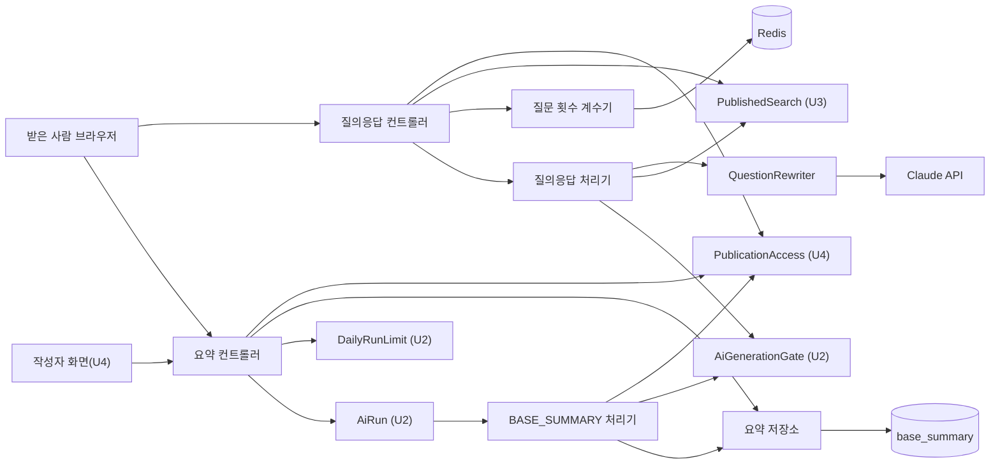

# U5 RAG 응답 — 논리 구성 요소

## Sources

작성일: 2026-10-30. 입력: [성능](../nfr-requirements/performance-requirements.md)(performance-requirements)·[보안](../nfr-requirements/security-requirements.md)(security-requirements)·[규모](../nfr-requirements/scalability-requirements.md)(scalability-requirements)·[신뢰성](../nfr-requirements/reliability-requirements.md)(reliability-requirements)·[관측](../nfr-requirements/observability-requirements.md)(observability-requirements) 요구사항, [기술 선택](../nfr-requirements/tech-stack-decisions.md)(tech-stack-decisions), [U5 기능 명세](../functional-design/functional-spec.md)(functional-spec)의 W1~W7, [계약 요약](../../../inception/contract-design/contract-summary.md)(contract-summary)의 C-01·C-02·C-03·C-09·C-10·C-11·C-12, [비기능 설계 질문·답변](nfr-design-questions.md) Q1, api 현재 구성(`api/src/app.module.ts`, `api/src/publications`, `api/src/published-index/published-index.module.ts`, `api/src/ai-generation/ai-generation.module.ts`).

## 구성 요소

api는 모두 한 모듈(예: `api/src/rag-answer`) 안에 있고 같은 프로세스 안의 함수 호출로 이어진다. 다른 Unit 구성 요소는 주입 자리로만 받는다.

| 구성 요소 | 하는 일 | 규칙·요구사항 |
|---|---|---|
| 질의응답 컨트롤러 | `POST /v1/public/links/{token}/questions`. 검증·링크·색인·횟수 확인 뒤 SSE를 열고 처리기에 넘김. keep-alive·끊김 깃발 | BR1·BR2, NFR1.1, NFR1.4, NFR4.1, NFR4.3 |
| 질의응답 처리기 | 다시 쓰기 → 검색 → 생성 순서를 한 함수로, 단계별 시간·결과를 모아 `qna.completed` 한 줄 | BR4, NFR2.5, NFR6.1 |
| 본문 검증 함수 | 질문·앞 대화 검증과 줄이기(순수 함수) | BR1.1·BR1.2, NFR1.4 |
| `QuestionRewriter`(주입 토큰 `QUESTION_REWRITER`) | 실제 구현(SDK·지키는 fetch·10초·200토큰·모델 상수)과 합성 구현 | BR4.1, NFR2.2~NFR2.4 |
| 질문 횟수 계수기 | 전용 ioredis 연결(만들 때 바로 연결, `error` 처리기, 종료 때 `quit`·`disconnect`), `INCR`+`EXPIREAT`, 실패면 통과·경고. 주소가 없으면 늘 통과하는 구현 | BR3, NFR4.4, NFR4.7, NFR6.4 |
| 한국 시간 날짜 함수 | 날짜 문자열과 다음 자정(초) 계산(순수 함수) | NFR4.7 |
| 요약 저장소 | `base_summary` 읽기·조건부 UPDATE·`INSERT … ON CONFLICT DO NOTHING` | BR5.3·BR5.4·BR6.2, NFR5.1~NFR5.3 |
| 요약 근거 만들기 함수 | 사본 → `AiSource[]`(C-07 필드 상수 표, 순수 함수) | BR5.1, NFR1.3 |
| `BASE_SUMMARY` 처리기 | AiRun에 등록, 행 판정 → 근거 → 생성 → 조건부 저장 | W3, BR5, NFR5.5 |
| 요약 컨트롤러 | 받은 사람 `GET …/summary`, 작성자 `GET /v1/publications/{id}/summary`·`POST …/regenerate` | BR6·BR7, NFR1.1, NFR1.2, NFR5.4 |
| 평가 스크립트 | `scripts/` 아래, `synthetic`·`measure` 모드, 로컬 원문·`docs/` 기록 | BR10, NFR3.1~NFR3.3 |
| web `BaseSummaryPanel`·`QnaPanel`·항목 표시 컴포넌트·문구 표 | C-11 자리 2·3, 작성자 모드 | BR8, NFR7.1, NFR7.2 |

<!-- Text fallback: 받은 사람 브라우저는 질의응답 컨트롤러와 요약 컨트롤러를, U4의 작성자 화면은 요약 컨트롤러를 부른다. 질의응답 컨트롤러는 U4 PublicationAccess로 링크를 판정하고 U3 PublishedSearch로 색인 상태를 본 뒤 Redis 질문 횟수 계수기로 세고 질의응답 처리기에 넘긴다. 처리기는 QuestionRewriter(Claude API)로 다시 쓰고 U3 검색과 U2 게이트를 부른다. 요약 컨트롤러는 U4 PublicationAccess, 요약 저장소, U2 DailyRunLimit·AiRun을 쓴다. AiRun이 BASE_SUMMARY 처리기를 부르고, 처리기는 PublicationAccess로 사본을 읽고 게이트로 생성해 요약 저장소(base_summary)에 쓴다. -->

## 앱 등록 시점(Q1)

- U5 코드 PR을 낼 때 U4의 실제 `PublicationAccess`(DB 구현)가 통합 브랜치에 있으면 그 PR에서 U5 모듈(컨트롤러·`BASE_SUMMARY` 처리기 등록·질문 횟수 연결)을 `app.module.ts`에 등록한다.
- 없으면 구성 요소와 만들기 함수만 두고 시험이 직접 만들며, U4가 합쳐진 뒤 U5 담당이 작은 PR로 앱에 등록한다. 메모리 `PublicationAccess`는 어느 경우에도 앱에 넣지 않는다.
- `base_summary` 마이그레이션은 앱 등록을 기다리지 않고 U5 코드 PR에 넣는다(U4 `publication` 표는 #422로 이미 있음). DB 시험이 이 표를 쓴다.

## 실패 범위

- 다시 쓰기·게이트·검색 실패는 그 질문 하나만 끝낸다. 요약 생성 실패는 그 발행본 요약만 `FAILED`가 된다.
- Redis 실패는 질문 횟수만 못 셀 뿐 질의응답은 계속된다.
- U5가 앱에 등록되지 않은 동안은 U5 경로가 없고 다른 기능에 영향이 없다. 등록 뒤 키가 없어도 기동은 되고 AI 호출만 실패한다.

## 공유 자원

| 자원 | 주인 | U5의 쓰임 |
|---|---|---|
| PostgreSQL과 TypeORM 연결 묶음 | 팀장(공용 기반) | `base_summary` 읽기·쓰기. AI 호출 중에는 트랜잭션을 열어 두지 않는다 |
| Redis(`CATCHU_QUEUE_REDIS_URL`) | 팀장(공용 기반) | 질문 횟수 전용 연결 하나 |
| AiRun 큐 | U2 | `BASE_SUMMARY` 작업 등록·실행 |
| Claude API 키 `CATCHU_GENERATION_API_KEY` | 팀장(공용 기반) | 게이트와 `QuestionRewriter`가 같은 키 |

## 시험에서 바꿔 끼우는 자리

`PublicationAccess`(메모리 구현), `PublishedSearch`(합성), `AiGenerationGate`(합성), `AiRun`(합성), `DailyRunLimit`(합성), `QUESTION_REWRITER`(합성), 질문 횟수 계수기(메모리 구현), 시계(고정 시각). DB 시험은 실제 테스트 DB와 마이그레이션을 쓴다.

## 다른 쪽에 넘기는 것

- **팀장(공용 기반):** EKS WAF(`catchu-edge`) 로깅이 요청 주소를 남기는지 확인한다(observability-design NFR6.3). 남긴다면 받은 사람 경로의 토큰이 남으므로 로깅을 끄거나 주소를 가린다.
- **U4:** 실제 `PublicationAccess`가 통합 브랜치에 들어오면 U5 앱 등록 PR을 낸다(Q1). C-08 publish-sequence 4의 `BASE_SUMMARY` 등록, C-11 자리 2·3과 작성자 화면 붙이기. 발행 뒤 `BASE_SUMMARY` 등록은 U5 처리기 등록과 같은 때 또는 뒤에 켠다. 먼저 켜면 AiRun이 모르는 작업 종류로 실패 처리해 그 기간 발행본은 10분 뒤 `FAILED`가 되며, 작성자가 [다시 만들기]로 복구한다(비기능 설계 수정 요청 R-04).
