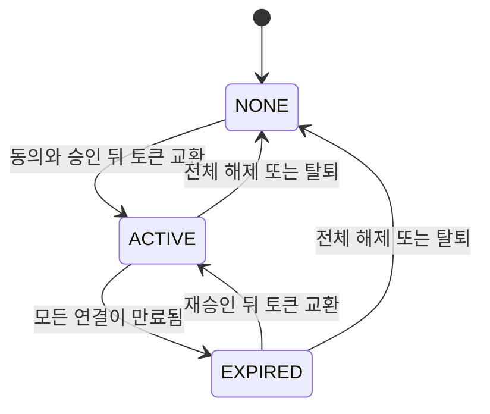
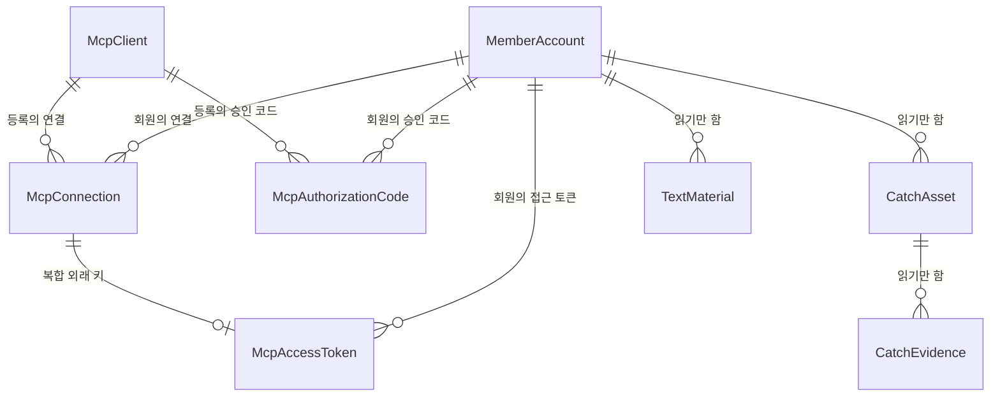

# U6 Claude MCP 본인 연결 — 기능 명세

## Sources

작성일: 2026-10-31. 입력: [Unit 정의](../../../inception/units-generation/unit-of-work.md)(unit-of-work)의 U6, [스토리 대응](../../../inception/units-generation/unit-of-work-story-map.md)(unit-of-work-story-map)의 US13.1(연결·만료·해제·빈도 제한)·US13.2(본인 조회 도구), [사용자 스토리](../../../inception/user-stories/stories.md)(stories)의 US13.1·US13.2, [요구사항](../../../inception/requirements-analysis/requirements.md)(requirements)의 FR1.5·FR13.1·FR13.2·FR13.5·FR13.6·FR14.1·FR14.6·FR14.8·FR16.3·FR19.1·NFR1, [컴포넌트 목록](../../../inception/domain-design/components.md)(components)의 ClaudeMcp, [결정 기록](../../../inception/domain-design/decisions.md)의 ADR-009, [계약 요약](../../../inception/contract-design/contract-summary.md)(contract-summary)의 C-06·C-13·C-14·C-15와 「에러 대응 최소선」, [납품 계획](../../../inception/delivery-planning/bolt-plan.md)의 B5, [기능 설계 질문·답변](functional-design-questions.md) Q1~Q6, [엔티티](entities.md), [업무 규칙](rules.md). 외부 근거: [Authentication for connectors](https://claude.com/docs/connectors/building/authentication.md), [Lazy authentication](https://claude.com/docs/connectors/building/lazy-authentication.md), [Troubleshooting](https://claude.com/docs/connectors/building/troubleshooting.md), [Build an MCP server for Claude](https://claude.com/docs/connectors/building.md), [Connector pre-submission checklist](https://claude.com/docs/connectors/building/review-criteria.md), [Add a connector that isn't in the directory](https://claude.com/docs/connectors/custom/add-unlisted.md), [MCP 권한 명세의 localhost 위험](https://modelcontextprotocol.io/specification/2025-11-25/basic/authorization#localhost-redirect-uri-risks).

## 범위

U6은 ClaudeMcp 가운데 구직자 본인 연결이다(unit-of-work). 이 Unit이 구현하는 스토리는 [사용자 스토리](../../../inception/user-stories/stories.md)의 US13.1 전체와 US13.2 전체다(unit-of-work-story-map). OAuth 규칙은 MCP 공식 SDK 인증 도구로 처리하고(ADR-009), 도구 모양은 계약 C-15를 따른다.

U6에 없는 것: 받은 사람 도구 `read_shared_publication`(U9, 후순위), 텍스트 자료 표와 작성자 설명 칸(U4, C-13·C-14 모양의 시험 자료로 개발), 탈퇴 순서(U2, BR7.4의 표 이름만 맞춘다), 앞단 경로와 개발 서버 문서(팀장, 「다른 Unit에 넘기는 것」).

정한 값: 접근 토큰 수명 7일(Q1), 돌아갈 주소는 운영에서 `https://claude.ai/api/mcp/auth_callback` 하나(Q2), 도구 호출 회원당 분당 60회(Q3), 승인 코드 5분, 응답 한 쪽 40,000자(웹·Desktop 도구 결과 한도 약 150,000자 안). 새 설정은 선택값 `MCP_ACCESS_TOKEN_TTL_SECONDS`, `MCP_DEV_REDIRECT_URIS`, `MCP_DEV_PUBLIC_ORIGIN` 셋뿐이고 필수 설정은 늘지 않는다(BR1.4).

## 워크플로

### W1 Claude가 연결을 시작한다

1. 회원이 `/profile/claude`에서 MCP 주소를 복사해 Claude에 넣는다. 주소는 api 응답의 `mcpUrl`이고 운영에서 `https://<도메인>/v1/mcp`다(BR1.1~BR1.3, BR7.5).
2. Claude가 토큰 없이 `POST /v1/mcp`를 보내면 401과 `WWW-Authenticate`를 돌려준다(BR4.8).
3. Claude가 보호 자원 메타데이터와 인증 서버 메타데이터를 읽는다(BR1.1).
4. Claude가 `POST /register`로 자기를 등록한다. 공개 클라이언트로만 받고 돌아갈 주소를 정확히 일치로 확인한다(BR2.1~BR2.3). 같은 요청에서 승인에 쓰이지 않고 7일이 지난 등록을 지운다(BR2.4). 이 주소에는 SDK IP 제한이 걸린다(BR2.5).

### W2 회원이 승인한다

1. Claude가 회원 브라우저를 `GET /authorize`로 보낸다. api가 클라이언트와 돌아갈 주소를 확인한 뒤 web의 `/profile/claude/authorize`로 넘긴다(BR3.1).
2. 로그인이 안 됐으면 기존 로그인 화면을 거쳐 돌아온다. 처음 가입한 회원은 프로필 설정을 거치며 이 흐름을 잃어 Claude에서 다시 시작한다(「Assumptions & Open Questions」의 한계).
3. web이 `GET /v1/me/mcp-connection`으로 상태를 읽는다. `NONE`이면 동의 안내를, 그 밖이면 재승인 안내를 돌아갈 주소의 호스트와 함께 보여 준다(BR3.3~BR3.5, BR7.1).
4. 회원이 승인이나 취소를 누르면 web이 `fetch`로 `POST /v1/me/mcp-connection/authorizations`를 보낸다. api가 클라이언트와 돌아갈 주소를 다시 확인하고, 승인이면 한 트랜잭션으로 코드를 만든 뒤 `redirectTo`로 답한다(BR3.2, BR3.3, BR3.6, BR3.7).
5. web이 `redirectTo`로 이동하면 Claude가 코드나 `access_denied`를 받는다. `MCP_CONSENT_REQUIRED`면 동의 안내를 다시 보여 준다. 그 밖의 실패는 화면에 오류를 보여 주고 어디로도 이동하지 않으며, 다시 시도는 회원이 한다(에러 대응 최소선 1·2).

### W3 Claude가 토큰으로 바꾼다

`POST /token`은 먼저 PKCE를 확인하고, 통과하면 코드 소비, 나머지 확인, 연결 만들기, 토큰 교체, 만료 행 정리를 한 트랜잭션으로 한다(BR4.1~BR4.6). 응답에 갱신 토큰과 권한 범위가 없다. 코드가 만료됐거나 이미 썼거나 해제로 지워졌으면 `invalid_grant`다.

### W4 Claude가 도구를 부른다

1. `POST /v1/mcp` 요청마다 토큰·만료·연결·회원 상태를 확인하고 실패하면 401이다(BR4.7, BR4.8). 세션은 없다(BR5.6).
2. `tools/call`이면 회원 기준으로 센다. 넘으면 DB를 읽지 않고 `RATE_LIMITED`다. Redis 주소가 없으면 세지 않고, Redis 오류면 세지 않고 통과시키며 경고 로그를 남긴다(BR6.1~BR6.4).
3. 토큰의 회원 것만 `cursor` 다음부터 읽는다(BR5.1~BR5.5). 잘못된 `cursor`는 `INVALID_CURSOR`, DB 실패는 로그를 남기고 `INTERNAL_ERROR`다(BR5.7).
4. 응답이 40,000자를 넘지 않게 나눈다. 항목 하나가 넘으면 글을 빼고 표시한다(BR6.5).

### W5 만료되어 다시 승인한다

토큰이 만료되면 다음 호출이 401이고 Claude가 재승인을 안내한다(BR4.7, BR4.8). 회원이 다시 연결하면 W1부터 진행하며 Claude가 새 클라이언트로 등록할 수 있다. 연결 행이 남아 있어 동의는 다시 묻지 않지만 승인 버튼은 눌러야 한다(BR3.3, BR3.4). 토큰 교환 때 새 토큰이 생기고 만료된 행이 지워진다(BR4.4).

### W6 회원이 전체 해제한다

`/profile/claude`에서 확인 뒤 `DELETE /v1/me/mcp-connection`을 보낸다. 쓰지 않은 코드, 토큰, 연결 순으로 한 트랜잭션에 지우고 204다(BR7.2). 다음 도구 호출은 401이고 쓰지 않은 코드는 `invalid_grant`다. 그 회원의 연결 행이 없어지므로 다음 연결 때 다시 동의한다(BR3.3). 웹 로그아웃은 연결을 끊지 않는다(BR7.3).

겹침의 근거: 진행 중인 토큰 교환은 코드 행을 잠그고 있으므로 해제의 코드 삭제가 기다린다. 교환이 커밋되면 그 행은 쓴 행이라 건너뛰고, 뒤의 문장들이 커밋된 연결·토큰을 보고 지운다. 해제가 먼저면 교환이 코드를 찾지 못해 `invalid_grant`다. 이 설명은 설계 추론이므로 S17에서 실제 DB로 확인한다.

### W7 회원이 탈퇴한다

U2의 탈퇴 1단계가 세 표를 `member_id`로 지워 접근을 막고, 4단계의 회원 행 삭제가 연쇄 삭제로 마무리한다(BR7.4, C-06). 다음 도구 호출은 401이다. 재가입하면 새 회원이라 다시 동의한다(FR14.6).

### 상태 전이

회원 기준 연결 상태(BR7.1):

<!-- Text fallback: NONE에서 동의·승인 뒤 토큰 교환으로 ACTIVE. ACTIVE는 모든 연결이 만료되면 EXPIRED. EXPIRED는 재승인 뒤 토큰 교환으로 ACTIVE. ACTIVE와 EXPIRED는 전체 해제나 탈퇴로 NONE. -->

승인 코드: 쓰지 않음 → 사용(토큰 교환), 쓰지 않음 → 만료(5분), 쓰지 않음 → 삭제(전체 해제·탈퇴). 사용과 만료에서 다시 쓸 수 있게 되는 전이는 없다.

클라이언트 등록: 미승인 → 승인됨(코드를 처음 만들 때), 미승인 → 삭제(7일 뒤 다음 등록 요청 때). 승인됨에서 다시 승인하면 새 코드를 만들고 `approvedAt`은 처음 값 그대로다. 승인됨 → 삭제 전이는 없다.

정리와 승인이 겹쳐도 안전하다. 정리의 삭제가 먼저 커밋되면 등록 행이 없어 잘못된 요청이 되고, 승인의 갱신이 먼저면 정리의 다시 평가에서 조건이 맞지 않아 행이 남는다(BR2.4, BR3.7).

### 공개 주소 판정

| `NODE_ENV` | `MCP_DEV_PUBLIC_ORIGIN` 없음 | `MCP_DEV_PUBLIC_ORIGIN` 값 있음 |
|---|---|---|
| `development`·`test` | `http://127.0.0.1:{PORT}` | 그 값 |
| 그 밖(`production`·미지정 포함) | `AUTH_WEB_ORIGIN` | 기동 실패 |

빈 값은 없는 것으로 본다. `MCP_DEV_REDIRECT_URIS`도 같은 기동 실패 규칙을 따른다(BR1.2, BR1.4). 승인 화면으로 보내는 주소는 어느 칸이든 `AUTH_WEB_ORIGIN`이다(BR1.3).

## 엔티티 관계 (entities.md에서 옮김)

<!-- Text fallback: 회원은 연결·승인 코드·접근 토큰을 여럿 갖는다. 클라이언트 등록은 연결·승인 코드를 여럿 갖고 회원을 가리키지 않는다. 접근 토큰은 복합 외래 키로 같은 회원·클라이언트의 연결에 달린다. Catch, 근거, 텍스트 자료는 읽기만 한다. -->

## 규칙 요약 (rules.md에서 옮김)

| BR | 묶음 | 내용 |
|---|---|---|
| BR1.1~BR1.4 | 주소·설정 | `/v1/mcp`와 앱 루트 OAuth 주소, `/revoke` 없음, 공개 주소 판정, 승인 화면 주소, 선택 설정 셋과 기동 실패 |
| BR2.1~BR2.5 | 등록·인증 전 제한 | 공개 클라이언트, 콜백 정확히 일치, 이름 200자, 안 쓴 등록 정리, 인증 전 주소의 SDK IP 제한(예외) |
| BR3.1~BR3.7 | 승인·동의 | 두 번 확인, fetch와 `redirectTo`, 회원 단위 동의, 재승인도 버튼, 호스트 표시, 거절, 승인 트랜잭션 |
| BR4.1~BR4.8 | 코드·토큰·인증 | 코드 5분·1회, 토큰 7일, 해시만 저장, 교환 트랜잭션, 교체와 정리, 갱신·범위 없음, `resource` 확인, 요청마다 확인, 401 |
| BR5.1~BR5.7 | 조회 도구 | 도구 둘(`readOnlyHint`), 소유자 조건, Catch·자료 칸, `cursor`, 세션 없음, 도구 오류 셋 |
| BR6.1~BR6.5 | 빈도·크기 | 분당 60회, Redis 없음, Redis 오류와 1초 상한, 키와 기록 없음, 40,000자 |
| BR7.1~BR7.5 | 연결 관리 | 상태, 전체 해제, 로그아웃 무관, 탈퇴용 이름과 연쇄 삭제, 화면 |
| BR8.1 | 기록 | 코드·토큰·해시·자료를 로그에 남기지 않음 |

## 주요 시나리오와 확인

팀 관행(team.md Testing Posture)대로 업무 시나리오·기대 결과·실패 조건을 먼저 정하고 세부 시험 코드는 구현 뒤 쓴다. S1~S21은 시험용 DB·Redis와 합성 회원·합성 Catch·합성 텍스트 자료로 api·web 시험 묶음에서 돈다. S22~S24만 실제 Claude를 쓴다.

- **시험 자료:** 회원 A·B. A는 공개·비공개 Catch(설명 있음과 없음, `title`이 null인 것, `draft_content`가 있는 것, 근거 2개)와 텍스트 자료, 40,000자를 넘는 텍스트 자료와 Catch를 갖는다. B는 다른 글의 Catch·텍스트 자료를 갖는다. 모두 공개 가능한 합성 글이다.
- **합성 Claude:** SDK 클라이언트 흐름을 따라 등록·승인 시작·토큰 교환·도구 호출을 부르는 시험 도우미다. 실제 Claude 동작의 증거로 보고하지 않는다.

| ID | 시나리오 | 기대 결과 | 실패 조건 |
|---|---|---|---|
| S1 | 메타데이터 조회와 토큰 없는 `POST /v1/mcp` | 메타데이터가 공개 주소를 쓰고 S256을 알린다. `/revoke`가 없다. 401에 `resource_metadata`가 있다 | web 주소를 가리킴(로컬), 401 없이 200 |
| S2 | 공개 주소 표 4칸, `MCP_DEV_REDIRECT_URIS`의 같은 칸, TTL 7일 초과, 빈 값 | 표대로 값이 정해지거나 기동 실패. 운영에서 `127.0.0.1` 기본값이 쓰이지 않는다 | 운영에 개발용 값이 있는데 기동됨 |
| S3 | 등록: 정상, `client_secret_post`로 요청, 다른 돌아갈 주소, 이름 201자, 개발 목록 주소(개발·운영 각각) | 정상과 `client_secret_post` 요청은 모두 공개 클라이언트로 저장하고, 응답에 `client_secret`이 없으며 `token_endpoint_auth_method`가 `none`이다. 다른 돌아갈 주소는 `invalid_redirect_uri`, 이름 201자는 `invalid_client_metadata`. 개발 목록은 개발에서만 받음 | 앞부분 일치 통과, 비밀값이 응답이나 표에 있음 |
| S4 | 등록 요청 때 8일 전 미승인, 8일 전 승인됨, 6일 전 미승인 등록 | 첫 행만 지워진다. 승인된 등록의 연결·토큰은 남는다 | 승인된 등록이 지워짐 |
| S5 | `/authorize`: 정상, 없는 클라이언트, 등록에 없는 돌아갈 주소, S256 아닌 PKCE, 다른 `resource` | 정상은 승인 화면으로 값이 그대로 넘어감. 없는 클라이언트와 등록에 없는 돌아갈 주소는 오류이고 그 주소로 보내지 않음. S256 아닌 PKCE와 다른 `resource`는 오류이고 승인 화면으로 넘어가지 않음 | 확인 안 된 주소로 이동 |
| S6 | 승인 요청: `NONE`에 `consent` 없음 / `NONE`에 `consent: true` / 이미 승인에 쓰인 등록으로 다시 승인 / `EXPIRED` / DENY / 로그인 없음 / 다른 돌아갈 주소 / 정의하지 않은 필드 | 409 `MCP_CONSENT_REQUIRED` / 코드와 `redirectTo`, `approved_at` 채움 / 새 코드, `approved_at`은 처음 값 그대로 / 동의 없이 코드 / `access_denied`와 `state`, 코드 없음 / 401 / 400 `MCP_AUTHORIZATION_INVALID` / 400 | 동의 없이 코드 생성, 302 응답, 재승인 거부 |
| S7 | 토큰 교환: 정상, 없는 코드, 같은 코드 두 번, 5분 지남, PKCE 틀림, 돌아갈 주소 틀림, 다른 클라이언트, 다른 `resource`, `refresh_token` 요청, 그 밖의 `grant_type` | 정상은 토큰과 `expires_in`, `refresh_token`·`scope` 없음, 표에는 해시만 있음. `refresh_token` 요청까지는 모두 `invalid_grant`, 그 밖의 `grant_type`은 `unsupported_grant_type`이고 표가 바뀌지 않음 | 코드 재사용, 원문 저장, 다른 오류 이름 |
| S8 | 같은 회원·클라이언트로 다시 승인·교환, 만료 행이 있는 회원 | 이전 토큰은 401, 새 토큰만 통과. 그 회원의 만료된 토큰·연결·코드가 지워지고 B의 행은 그대로 | 이전 토큰 통과, 다른 회원 행 삭제 |
| S9 | 도구 호출: 토큰 없음, 틀린 토큰, 만료, 연결 삭제, 회원이 ACTIVE가 아님 | 모두 401과 `WWW-Authenticate`, 이유 구분 없음. 토큰 확인 중 DB 실패는 500과 로그 | DB 실패를 401로 숨김 |
| S10 | A 토큰으로 `list_my_catches` | A의 공개·비공개 Catch만, C-15 칸(`title` null 포함), `evidenceUrls` 포함, `draft_content` 글이 응답에 없음 | B의 행, 초안 글 |
| S11 | A 토큰으로 `list_my_text_materials` | A의 텍스트 자료만, 본문 그대로, PDF 글 없음 | B의 행, 본문 변형 |
| S12 | B 토큰으로 A의 `cursor` 사용, 잘못된 `cursor`, 추가 입력 필드 | B의 행만 나옴 / `INVALID_CURSOR` / 입력 오류 | A의 행이 나옴 |
| S13 | `tools/list`, 없는 도구 호출, `GET`·`DELETE /v1/mcp` | 도구는 정확히 둘이고 `title`과 `readOnlyHint: true`가 있음, 입력 스키마는 `cursor`뿐. 쓰기·JD 요약·의미 검색 도구 없음. `GET`·`DELETE`는 405 | 도구가 더 있음, 힌트 없음, 서버에 세션이 생김 |
| S14 | 쪽 나누기: 작은 항목 여러 개, 쪽 경계 | 모든 항목이 정확히 한 번 나오고 마지막 `nextCursor`는 null | 빠짐, 중복 |
| S15 | 40,000자를 넘는 항목과 경계 근처 항목 | 응답이 상한 안, 큰 텍스트 자료는 `body` 빈 글과 `bodyOmitted: true`, 큰 Catch는 `omitted: true`이고 다음 항목으로 넘어감 | 말없이 잘림, 같은 항목에서 멈춤 |
| S16 | 빈도: 한 분에 61번째, 다른 회원, 다음 창, `tools/list`, Redis 없음(기동 로그 1회), Redis 끊김, Redis 멈춤(1초 상한) | 61번째만 `RATE_LIMITED`이고 DB 조회 없음, B는 통과, 다음 창 통과, `tools/list`는 세지 않음. Redis 없음은 로그 1회 뒤 제한 없음. Redis 오류·멈춤은 통과와 경고(오류 이름만), 호출이 걸리지 않음 | 호출이 1초 넘게 걸림, 오류가 숨겨짐 |
| S17 | 전체 해제: 정상, 반복, 쓰지 않은 코드 있음, 진행 중 교환과 겹침, 다른 회원 | 204이고 반복해도 같음, 토큰 401, 코드 `invalid_grant`, 겹쳐도 토큰이 남지 않음, B는 그대로 | 해제 뒤 토큰이 남음 |
| S18 | 상태 조회: 행 없음, 만료 전, 모두 만료, 일부만 만료. 웹 로그아웃 뒤 도구 호출 | `NONE`·`ACTIVE`·`EXPIRED`·`ACTIVE`, `mcpUrl`이 공개 주소. 로그아웃 뒤에도 도구 통과 | web 주소를 돌려줌, 로그아웃으로 끊김 |
| S19 | 탈퇴와 회원 행 삭제: 실제 표로 U2 탈퇴 시험, `test/db/member-cascade-delete.test.cjs` | 세 표의 그 회원 행이 없어지고 도구 호출이 401. 재가입은 `NONE`. 승인에 쓰인 등록은 남음 | 표 이름 어긋남으로 건너뜀, 토큰이 남음 |
| S20 | 전 시나리오의 로그·오류 응답 | 합성 코드·토큰·해시·자료 글이 없음 | 하나라도 있음 |
| S21 | web 승인 화면과 `/profile/claude`: 동의, 재승인, 오류, 요청 중 버튼, 해제 확인, 복사 주소, 시작 안내 링크 | 호스트와 안내 문구가 보이고 `clientName`은 보이지 않음. `redirectTo`로만 이동. 오류를 화면에 보임 | 쿼리 주소로 이동, 이름 표시 |
| S22 | 실제 Claude 웹: 연결, 도구로 본인 자료 조회, 40,000자에 가까운 한글 합성 자료 한 쪽 읽기, 수명을 줄인 만료 재승인, 전체 해제 | 납품 계획 B5의 보일 결과. 큰 쪽도 잘리지 않고 읽힌다. 합성 자료로 하고 응답·토큰을 로그에 남기지 않음 | 자동 갱신, 해제 뒤 접근, 큰 쪽이 잘리거나 실패(실패하면 BR6.5의 값을 낮춘다) |
| S23 | 실제 Claude Desktop: 연결 | 같은 원격 연결로 연결된다 | 연결 안 됨 |
| S24 | 다른 계정이 시작한 연결: 다른 팀원이 자기 Claude에서 연결을 시작해 승인 주소를 보내면, U6 담당이 자기 Claude 계정에 로그인한 브라우저에서 합성 자료만 있는 시험 회원으로 그 주소를 열어 승인 | 승인 응답을 받아 브라우저가 `claude.ai` 콜백으로 이동하고(코드가 만들어짐) Claude가 콜백을 거부한다. 코드가 쓰이지 않아 5분 뒤에도 시험 회원의 연결 상태가 `NONE`이고, 팀원의 Claude에서 도구를 불러도 시험 회원의 자료가 나오지 않는다 | 팀원의 Claude가 시험 회원의 합성 자료를 읽음. 이때는 막을 방법을 다시 정한다 |

S24의 판단은 Claude 화면의 문구가 아니라 시험 회원의 연결 상태와 팀원 Claude의 도구 호출로 한다. S22의 연결이 성공한 같은 환경에서 같은 브라우저와 같은 Claude 로그인으로 하고, 시작할 때 시험 회원의 연결 상태는 `NONE`이어야 한다(S22 뒤라면 전체 해제한 뒤 한다). 그래야 `NONE`이 Claude의 거부를 뜻한다. 브라우저가 `claude.ai` 콜백으로 이동하지 못했으면 코드가 만들어졌는지 알 수 없으므로 이 시도는 판단하지 않고 다시 한다. 코드는 5분이 지나면 쓸 수 없으므로(BR4.1) 콜백으로 이동한 뒤 5분이 지나도 `NONE`이면 이 시도는 막힌 것이다. 상태가 `ACTIVE`가 됐는데 팀원의 Claude에서 자료가 나오지 않으면 노출은 아니므로 그대로 적는다. 브라우저가 Claude에 로그인돼 있지 않으면 로그인 화면에서 멈춘 것을 거부로 오인할 수 있어 로그인한 상태로 한다. 승인 주소에는 그 연결의 `state`가 들어 있으므로 두 사람 사이에서만 전달하고 이슈·PR·AI에 공유하는 기록에는 결과만 남긴다(코딩 절차 「자료와 실행 로그」). 터널로 할 때는 승인 화면 주소가 U6 담당의 로컬 web을 가리켜 팀원 쪽에서는 열리지 않지만 주소창의 주소를 복사해 보내면 된다. 끝나면 팀원은 연결을 지우고 시험 회원은 전체 해제한다. 결과는 확인한 때의 Claude 동작이다.

S22의 첫 연결이 팀 관행의 '최소 연결 첫 결과'다. FR19.1의 기본 호환 확인은 `MCP_DEV_PUBLIC_ORIGIN`에 https 터널 주소를 줘서 개발 초기에 먼저 할 수 있다. 터널은 로컬 api를 개발 로그인까지 함께 노출하므로 합성 자료만 쓰고 확인 뒤 바로 닫는다. S22·S23의 전체 확인은 외부에서 닿는 HTTPS 개발 서버에서 한다(B5, `docs/CatchU_통합확인.md`의 「실제 Claude 연결」). S1~S21 통과를 실제 Claude 연결 성공으로 보고하지 않는다(team.md Walking Skeleton).

## 다른 Unit에 넘기는 것

- **팀장(#389·#276):** 앞단이 앱 루트의 `/authorize`, `/token`, `/register`, `/.well-known/oauth-protected-resource*`, `/.well-known/oauth-authorization-server*`를 api로 보내야 한다. #389 본문에 있는 `/revoke`는 두지 않는다. 개발 서버의 「MCP 빈도 제한 꺼짐」은 받아들인 위험으로 개발 서버 README 「개발 단계라 받아들이는 한계」에 적는다(#392와 같은 방식). 만료 재승인 확인 때 `MCP_ACCESS_TOKEN_TTL_SECONDS`를 잠시 줄인다.
- **계약 C-15 수정 PR(U6 담당, Unit 제출과 따로):** 레포 컨벤션 §2.1 「경계·계약 PR」대로 통합 브랜치 대상으로 낸다. 오류 `INVALID_CURSOR`·`INTERNAL_ERROR`, 필드 `bodyOmitted`·`omitted`를 더하고 Catch `title`을 실제 칸대로 `string|null`로 적는다. 해제 문구는 고치지 않는다. C-15의 소비자는 외부인 Claude라 가져다 쓰는 Unit이 없고 U9 담당은 11/13에 정하므로, 리뷰는 팀장에게 요청하고 팀장이 merge commit으로 합친다.
- **U2:** 탈퇴 코드가 부르는 세 표가 합쳐지면 탈퇴 통합 시험을 실제 표로 다시 돌린다(U2 완료 조건, S19).
- **U4:** 텍스트 자료 본문·Catch 설명의 길이 상한이 정해지면 알려 준다. 40,000자보다 작으면 BR6.5의 글 빼기는 일어나지 않는다. 시험 자료는 C-13·C-14 모양으로 쓰고 실제 표와는 통합 때 만난다.
- **U9:** 같은 원격 연결과 표, 빈도·크기 규칙에 받은 사람 도구를 더한다. 이름과 입력은 C-15를 따른다.
- **U6 자기 PR:** 네 표의 마이그레이션, `api/docs/member-withdrawal-deletion.md` 행과 `MEMBER_ROWS`(C-06), `api/docs/environment.md`와 `api/.env.example`의 새 설정, 시작 안내 링크(`web/src/features/start-guide/member-start-steps.ts`의 `publish-claude`).

## 추적

[traceability.json](traceability.json)이 정본이다. US13.1·US13.2의 수용 기준 8개를 모두 U6이 맡는다.

| 수용 기준 | 규칙 |
|---|---|
| AC13.1.1 최소 OAuth 승인으로 연결 | BR1.1·BR2.1·BR2.2·BR3.1·BR3.2·BR3.7·BR4.1·BR4.3 |
| AC13.1.2 만료되면 다시 승인 | BR3.4·BR4.2·BR4.5·BR4.7·BR4.8 |
| AC13.1.3 전체 해제로 접근 차단 | BR4.7·BR7.2·BR7.5 |
| AC13.1.4 회원 기준 빈도·응답 크기 제한 | BR6.1·BR6.4·BR6.5 |
| AC13.2.1 첫 연결에 한 번 동의 | BR3.3·BR3.5 |
| AC13.2.2 본인 Catch·텍스트 자료 조회 | BR5.1·BR5.3·BR5.4·BR5.5 |
| AC13.2.3 쓰기·JD 요약·의미 검색 도구 없음 | BR5.1 |
| AC13.2.4 다른 회원 자료를 얻을 수 없음 | BR4.7·BR5.2 |

## Assumptions & Open Questions

해석:

- MCP 주소를 앱 루트가 아닌 `/v1/mcp`로 둔 것은 지금 앞단이 `/v1/*`만 api로 보내 루트에 두면 라우팅 목록만 늘기 때문이다.
- 동의를 회원 단위로 판단한 것은 Claude가 새 연결마다 클라이언트를 등록해([Authentication for connectors](https://claude.com/docs/connectors/building/authentication.md)) 클라이언트 단위로는 AC13.2.1의 한 번 동의를 지킬 수 없기 때문이다.
- FR13.6·C-15의 「IP로 세지 않음」은 회원을 아는 도구 호출에 적용한다. 회원을 아직 모르는 인증 전 주소의 SDK IP 제한은 담당이 확인한 예외다(Q6, BR2.5).
- 등록 자체를 없애는 CIMD는 공식 문서가 등록이 많을 때 권하지만 ADR-009의 클라이언트 등록 표와 달라 쓰지 않는다. 쌓이는 등록은 BR2.4로 정리한다.
- 응답 크기의 근거: [Build an MCP server for Claude](https://claude.com/docs/connectors/building.md) 「Design within the size and timeout limits」 표의 최대 도구 결과는 claude.ai·Desktop 약 150,000자, Claude Code 25,000토큰(`MAX_MCP_OUTPUT_TOKENS`로 바꿀 수 있음)이다. FR13.1 범위는 웹·Desktop이므로 앞의 값을 따른다. [기능 설계 질문·답변](functional-design-questions.md)의 요약 확인에 적힌 「Claude 도구 결과 한도 25,000토큰」은 Claude Code의 값을 잘못 옮긴 것이고 BR6.5가 정본이다. 값 40,000자는 그대로 둔다.
- 계약과 달라지는 점: C-15의 Catch `title`은 실제 칸이 null을 허용하므로 `string|null`로 고친다(「다른 Unit에 넘기는 것」).
- 동결·비권장 상태인 SDK 인증 도구를 쓰는 것은 ADR-009의 승인된 결정이다. 판본(v1 또는 v2+legacy)은 코드 생성 계획에서 정한다.

가정:

- [assumption] U4의 텍스트 자료 표와 설명 칸은 C-13·C-14 모양 그대로 합쳐진다. U6은 시험 자료로 먼저 개발하고 실제 연결은 통합 때 확인한다(납품 계획 B5).
- [assumption] 글을 뺀 항목은 상한보다 훨씬 작다고 본다. 제목 상한은 U4 API 검증이고 근거 주소 수는 분석 범위로 묶인다. 이 가정이 틀리면 쪽 크기가 상한을 넘을 수 있으므로 U4 상한이 정해지면 다시 확인한다.
- [assumption] S24에 협조할 다른 팀원의 Claude 계정이 있다. 납품 계획의 외부 의존 표에 있는 확인 계정은 U6 담당의 것뿐이라 새 의존이다. URL로 연결을 더하는 것은 Free 플랜도 되지만 1개까지이고, Team·Enterprise는 Owner가 더해야 한다([Add a connector that isn't in the directory](https://claude.com/docs/connectors/custom/add-unlisted.md)).

첫 실제 연결 때 확인(공식 문서만으로 정할 수 없음):

- 갱신 토큰 없이 만료될 때 Claude의 표시, 공개 클라이언트 응답 수용, SDK 기본 메타데이터에 `refresh_token`이 보이는 것의 영향.
- 도구 오류가 Claude 화면에 어떻게 보이는지. [Lazy authentication](https://claude.com/docs/connectors/building/lazy-authentication.md)은 `isError`가 모델에 전달된다고 하고 [Troubleshooting](https://claude.com/docs/connectors/building/troubleshooting.md)은 `Unexpected error while invoking tool`을 설명해 두 곳이 다르다.
- Claude에서 넘어온 직후 `SameSite=Strict` 쿠키로 로그인이 복원되는지, 지워진 등록으로 다시 시도할 때 Claude가 새로 등록하는지.
- 다른 Claude 계정이 시작한 연결을 승인했을 때 Claude가 콜백을 거부하는지(S24). 운영의 돌아갈 주소는 언제나 `claude.ai` 하나이고 `clientName`을 보여 주지 않아 승인 화면은 직접 시작한 연결과 남이 시작한 연결을 구별할 정보가 없고, 막는 장치는 안내 문구뿐이다(BR3.5). 방어는 Claude 콜백이 세션과 `state`를 묶는지에 달려 있는데 [Authentication for connectors](https://claude.com/docs/connectors/building/authentication.md)에 설명이 없다. 팀원의 Claude가 시험 회원의 자료를 읽게 되면 남의 자료 노출이므로(AC13.2.4, NFR1, 에러 대응 최소선 6) 막을 방법을 다시 정한다. Unit 제출 전까지 확인하지 못하면 그때 확인하지 못했다는 사실과 함께 받아들이는 한계로 적는다.

받아들이는 한계:

- 처음 가입한 회원은 프로필 설정을 거치며 승인 흐름을 잃어 Claude에서 다시 시작해야 한다.
- Claude 쪽에서 연결을 지워도 서버는 알 수 없어 토큰은 만료나 전체 해제까지 유효하다.
- 승인에 쓰인 적 있는 `mcp_client` 행은 남는다(회원 참조 없음).
- Claude가 콜백을 `claude.com`으로 바꾸면 등록이 거부되므로 코드의 상수를 고쳐야 한다.
- 개발 서버에는 큐 주소가 없어 빈도 제한이 꺼진다(BR6.2). Redis 오류 동안에도 제한이 꺼진다(BR6.3).
- 등록 IP 한도를 넘으면 모든 회원의 새 연결이 최대 1시간 막힌다(BR2.5).
- 승인 요청과 전체 해제가 겹치면 해제 뒤에 코드가 남을 수 있다. 회원이 직접 승인한 결과이고 남의 자료 노출이 아니라 막지 않는다(에러 대응 최소선 6).
