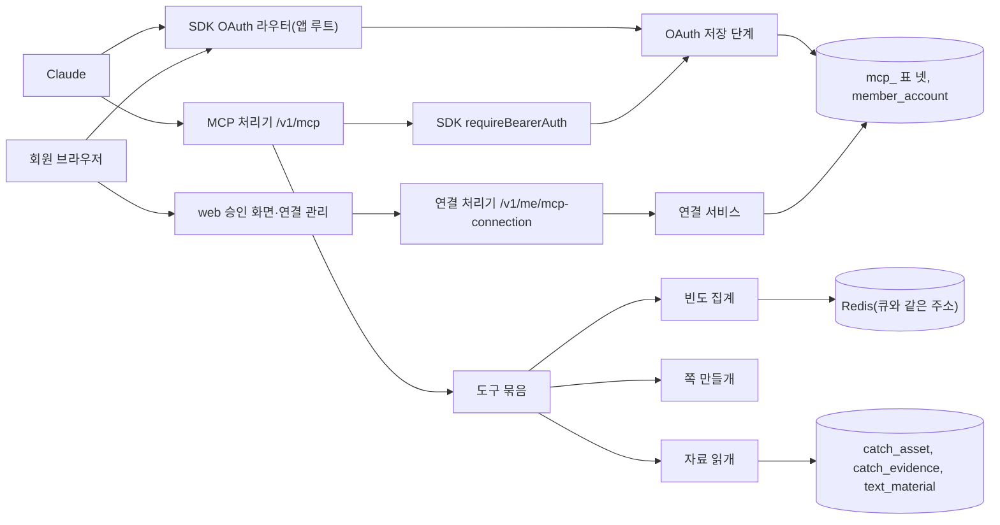

# U6 Claude MCP 본인 연결 — 논리 구성 요소

## Sources

작성일: 2026-11-01. 입력: [성능](../nfr-requirements/performance-requirements.md)(performance-requirements)·[보안](../nfr-requirements/security-requirements.md)(security-requirements)·[규모](../nfr-requirements/scalability-requirements.md)(scalability-requirements)·[신뢰성](../nfr-requirements/reliability-requirements.md)(reliability-requirements)·[관측](../nfr-requirements/observability-requirements.md)(observability-requirements) 요구사항, [기술 선택](../nfr-requirements/tech-stack-decisions.md)(tech-stack-decisions), [U6 기능 명세](../functional-design/functional-spec.md)(functional-spec)의 W1~W7과 「다른 Unit에 넘기는 것」, [계약 요약](../../../inception/contract-design/contract-summary.md)(contract-summary)의 C-06·C-13·C-14·C-15, [비기능 설계 질문·답변](nfr-design-questions.md) Q1과 요약 확인, api 현재 코드(`api/src/app.module.ts`, `api/src/app.setup.ts`, `api/src/common/errors/error-codes.ts`, `api/src/analysis-queue/analysis-queue.config.ts`).

## 구성 요소

api 쪽은 모두 `api/src/claude-mcp` 안에 있고, 같은 프로세스 안에서 함수 호출로 이어진다. `ClaudeMcpModule`을 U6 코드 PR에서 `AppModule`에 등록한다. `app.setup.ts`는 고치지 않는다.

| 구성 요소 | 하는 일 | 기능 규칙·요구사항 |
|---|---|---|
| 설정 읽개 `readMcpConfig(env)` | 공개 주소, 승인 화면 주소, `mcpUrl`, 토큰 수명, 돌아갈 주소 목록을 기동 때 정한다. 어긋나면 설정 이름만 넣은 오류로 멈춘다 | BR1.2~BR1.4, BR2.2, NFR1.9 |
| `ClaudeMcpModule` | 아래 구성 요소를 묶고 `onModuleInit`에서 `mcpAuthRouter`를 앱 루트에 건다 | BR1.1, NFR1.5 |
| OAuth 저장 단계 `McpOAuthProvider` | SDK의 `OAuthServerProvider`다. `clientsStore`(조회·등록), `authorize`, `challengeForAuthorizationCode`, `exchangeAuthorizationCode`, `exchangeRefreshToken`, `verifyAccessToken`. `revokeToken`은 없다 | BR2.1~BR2.4, BR3.1, BR4.1~BR4.7, NFR1.1, NFR1.4, NFR1.5, NFR4.4, NFR4.10 |
| MCP 처리기 `McpController` | `/v1/mcp`. POST는 `Origin` → `requireBearerAuth` → 전송이고, GET·DELETE는 `Origin` 뒤 405와 `Allow: POST`다 | BR4.8, BR5.6, NFR1.1, NFR1.2, NFR1.6, NFR1.10 |
| 도구 묶음 `McpTools.forMember(memberId)` | 요청마다 새 `McpServer`와 전송 객체를 만들고 도구 둘을 등록한다. 감싸기 하나가 빈도 → `cursor` → 조회 → 쪽 만들기 순서와 오류 변환을 맡는다 | BR5.1, BR5.7, BR6.1, NFR1.3, NFR2.1, NFR4.3, NFR4.5 |
| 자료 읽개 `McpMaterialReader` | 칸을 적은 SQL로 그 회원의 Catch·근거 주소·텍스트 자료를 `LIMIT 50`으로 읽는다. 읽기만 한다 | BR5.2~BR5.5, NFR1.3, NFR2.2, NFR4.2, NFR5.2 |
| 쪽 만들개 `buildPage`, `cursor` 부호화 | DB가 없는 순수 함수다. 40,000자 나누기와 글 빼기, `cursor` 만들기·확인 | BR5.5, BR6.5, NFR4.2 |
| 빈도 집계 `McpRateLimiter` | 전용 Redis 연결과 `EVAL` 한 번. 주소가 없거나 오류면 통과 | BR6.1~BR6.4, NFR4.3, NFR4.8, NFR4.11 |
| 연결 서비스 `McpConnectionService` | 상태 계산, 승인 트랜잭션, 전체 해제 트랜잭션 | BR3.2~BR3.7, BR7.1, BR7.2, NFR4.12 |
| 연결 처리기 `McpConnectionController` | `GET`·`DELETE /v1/me/mcp-connection`, `POST …/authorizations`. 전역 Guard를 쓰고 쓰기 둘은 `assertSessionOrigin`을 부른다 | BR3.2, BR7.1, BR7.2, NFR1.7 |
| 표 네 개와 마이그레이션 | `mcp_client`, `mcp_connection`, `mcp_authorization_code`, `mcp_access_token` | entities, BR7.4, NFR4.7, NFR5.1 |
| web `/profile/claude/authorize` | 승인 화면. 상태를 읽어 동의·재승인 안내와 호스트를 보이고, `fetch` 뒤 `redirectTo`로 이동한다 | BR3.2~BR3.6, NFR1.8 |
| web `/profile/claude` | MCP 주소 복사, 상태, 전체 해제. 프로필과 시작 안내에서 잇는다 | BR7.1, BR7.2, BR7.5 |

<!-- Text fallback: Claude는 SDK OAuth 라우터와 MCP 처리기를 부른다. 회원 브라우저는 /authorize로 SDK 라우터를 거쳐 web 승인 화면으로 가고, web은 연결 처리기를 부른다. SDK 라우터와 requireBearerAuth는 OAuth 저장 단계를 쓰고, 저장 단계는 mcp_ 표 넷과 member_account를 읽고 쓴다. MCP 처리기는 도구 묶음을 부르고, 도구 묶음은 빈도 집계로 Redis를, 자료 읽개로 catch_asset·catch_evidence·text_material을 읽고 쪽 만들개로 응답을 만든다. 연결 처리기는 연결 서비스를 거쳐 mcp_ 표를 쓴다. -->

## 실패 범위

- 바깥 의존은 PostgreSQL과 Redis뿐이다. U6은 밖을 부르지 않는다.
- PostgreSQL이 멈추면 토큰 확인이 500이고 Claude 연결 전체가 그동안 멈춘다. api의 다른 기능도 같은 DB를 쓰므로 U6만의 실패가 아니다.
- Redis가 없거나 멈추면 도구 호출은 돌고 빈도 제한만 꺼진다. 큐를 쓰는 다른 기능의 실패와 묶이지 않도록 연결을 따로 연다.
- 한 요청의 도구 실패는 그 호출의 도구 오류로 끝난다. 요청마다 서버 객체가 새로 만들어져 다른 요청에 번지지 않는다.
- U6 설정 오류는 api 기동을 멈춘다. `AppModule`에 들어가므로 개발용 값이 운영에 남아 있으면 api 전체가 뜨지 않는다. 이것이 BR1.4의 뜻이고 새 필수 설정은 없다. Redis 주소가 없어도 기동한다.
- 등록 IP 한도를 넘으면 모든 회원의 새 연결이 최대 1시간 막히지만, 이미 연결된 회원의 도구 호출은 영향이 없다(BR2.5).

## 공유 자원

| 자원 | 주인 | U6의 쓰임 |
|---|---|---|
| PostgreSQL(api DB)과 TypeORM 연결 묶음 | 팀장(공용 기반) | 네 표 읽기·쓰기, 읽는 표 조회 |
| Redis(큐 주소) | 팀장(공용 기반), 큐는 U2 | 빈도 키만. `readAnalysisQueueConfig()`를 그대로 읽고 연결은 따로 연다 |
| `member_account` | MemberAccount | `account_state`를 읽기만 한다. 외래 키 대상 |
| `catch_asset`, `catch_evidence` | Catches, 설명 칸은 U4 | 읽기만 한다(C-14) |
| `text_material` | U4 | 읽기만 한다(C-13) |
| `api/src/common/errors/error-codes.ts` | 공용 | `MCP_CONSENT_REQUIRED`(409), `MCP_AUTHORIZATION_INVALID`(400)를 더한다 |
| `api/src/app.module.ts` | 공용 | `ClaudeMcpModule` 등록 한 줄 |
| `api/package.json`·잠금 파일 | 공용 | SDK 1.32.2, zod 4.6.7 정확한 판본 |
| 앞단 경로(Caddy, ALB) | 팀장 | 앱 루트 OAuth 주소를 api로 보내야 한다(#389·#276) |

## 시험에서 바꿔 끼우는 자리

- 합성 Claude: SDK 클라이언트 흐름을 따르는 시험 도우미가 등록·승인 시작·토큰 교환·도구 호출을 부른다(기능 명세 「주요 시나리오와 확인」). 실제 Claude 동작의 증거로 보고하지 않는다.
- 시험 자료: 시험용 DB에 합성 회원 A·B와 합성 Catch·텍스트 자료를 넣는다. 만료는 `expires_at`이 지난 행을 직접 넣어 만든다. 시계를 바꿔 끼우지 않는다.
- DB 실패: 저장 단계와 자료 읽개에 넘기는 연결 자리에 실패하는 시험용 연결을 넣는다.
- Redis: `CATCHU_TEST_REDIS_URL`이 있을 때 실제로 돌고, 없으면 미실행으로 적는다. 멈춤은 받기만 하고 답하지 않는 시험용 TCP 서버로 만든다(S16).
- S22~S24는 바꿔 끼우지 않는다.

## 통합 때 할 일(U6 담당)

- **C-15 수정 PR(Unit 제출과 따로):** 통합 브랜치 대상. 오류 `INVALID_CURSOR`·`INTERNAL_ERROR`, 필드 `bodyOmitted`·`omitted`, Catch `title: string|null`을 더한다. 401 주석과 해제 문구는 고치지 않는다. 리뷰와 merge commit은 팀장이 한다.
- **팀장에게 넘김(#389·#276):** 앱 루트 경로 목록(`/revoke` 없음), 개발 서버의 「MCP 빈도 제한 꺼짐」, 만료 재승인 확인 때 `MCP_ACCESS_TOKEN_TTL_SECONDS`를 잠시 줄이는 것, EKS `api.yaml`의 큐 주소.
- **U6 자기 PR에 함께:** 마이그레이션, `api/docs/member-withdrawal-deletion.md` 행과 `MEMBER_ROWS`, `api/docs/environment.md`와 `api/.env.example`의 새 설정, 시작 안내 링크.
- **U2 담당에게 알림:** 표가 합쳐지면 탈퇴 통합 시험을 실제 표로 다시 돌린다(S19).
- **U4 담당에게 확인:** 텍스트 자료 본문·Catch 설명의 길이 상한. 정해지면 NFR4.2의 최악 메모리와 글을 뺀 항목 크기를 다시 본다.
- **실제 확인:** S22 첫 연결('최소 연결 첫 결과'), S23, S24. S22에서 `Origin` 유무, 큰 쪽의 동작, 도구 오류의 표시를 함께 본다. S24에 협조할 다른 팀원의 Claude 계정은 Unit 제출 전까지 맞춘다.
