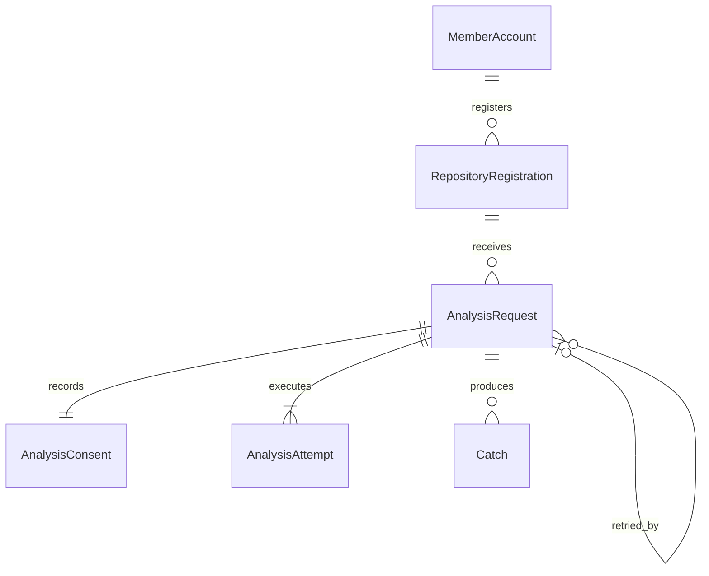

# U7 저장소·분석 — 기능 명세
## 근거와 적용 범위

작성일: 2026-10-29. [확인한 작성안](functional-design-questions.md)을 상세화한 U7 기능 설계다. 구현·실측 완료 기록이 아니다.

입력: [unit-of-work.md](../../../inception/units-generation/unit-of-work.md)(U7), [unit-of-work-story-map.md](../../../inception/units-generation/unit-of-work-story-map.md)(US1.2·US1.3), [stories.md](../../../inception/user-stories/stories.md)(수용 기준 12개), [requirements.md](../../../inception/requirements-analysis/requirements.md)(FR1.2·1.3·1.6·1.7·19.1), [components.md](../../../inception/domain-design/components.md)(RepositoryAnalysis), [contract-summary.md](../../../inception/contract-design/contract-summary.md)(공통 전제·C-03·C-04·C-06).

## 설계 결정과 변경 경계

FR1.2는 공개 저장소의 직접 등록을 요구하고 사전 선정 목록으로 대신하지 못하게 한다. URL 입력 UI는 승인 요구사항의 문구가 아니라 [사용자가 확인한 이번 설계 선택](functional-design-questions.md)이다. 기존 저장소 연결 관리 모달을 유지하고 하단의 사전 선정 목록 선택만 주소 등록으로 대체한다. JD는 U10, 발행·Catch 설명은 U4, 하루 실행 제한은 U2의 C-03이다.

기준 구현은 `5551cf8c43a468d71293932979c856e9a18132ab`의 기존 등록 공급, 분석 접수·상태·시한, worker 수집·생성, 결과 수신·반영이다. 현재는 팀 선정 DB·고정 좌표 카탈로그에 의존하므로, 화면 입력만 바꾸지 않고 아래 연결 지점을 함께 바꾼다. 분석 알고리즘과 결과 반영 보호는 재사용한다.

| 연결 지점 | 기존 의미 | U7 변경 |
|---|---|---|
| 회원 저장소 목록 | 팀 선정 저장소 | 본인이 직접 등록한 저장소 목록과 서버가 확인한 좌표·범위 판본 |
| 신규 등록 | 회원 직접 등록 입구 없음 | 공개 GitHub 주소를 받아 회원별 등록을 반환 |
| 접수 재확인 | 팀 선정과 고정 카탈로그 대조 | 본인 등록·현재 연결·공개 여부·지원 범위·현재 동의 판본 대조 |
| worker 내부 컨텍스트 | 선정 참조로 범위·좌표 조회 | 요청별 동의에 고정한 등록 참조·범위·좌표 조회, 실제 연결 신원 대조 |
| 결과의 저장소 좌표 | 고정 카탈로그 | 해당 요청의 서버 확인 좌표 사본과 저장소 ID로 반영 |
| 상태 응답 | EMPTY만으로 기록 없음 구분 불가 | 본인 커밋 관측과 수집 한계를 검증·저장하여 본인에게 전달 |

과거 10월 승인 계약은 고치지 않는다. U7 코드 PR에서 해당 서비스의 현행 설명을 이 설계에 맞춰 갱신한다. 새 내부 정보가 기존 수신 형식에 필요하면 U7 안의 송신·검증·저장을 같은 변경에서 맞춘다. 다른 Unit의 공유 계약을 바꿔야 하는 상황은 이 설계의 권한 밖이며 계약 수정 절차를 따른다.

## 데이터 모델과 규칙의 읽는 법

[entities.md](entities.md)의 YAML이 데이터 정본, [rules.md](rules.md)의 YAML이 규칙 정본이다. 아래 ER 표시는 그 파생 뷰이며 상세 필드는 중복하지 않는다. 엔티티 선언·참조·카디널리티와 중괄호 짝을 대조했다.

텍스트 대체: 회원은 여러 저장소 등록을 가진다. 등록 하나에 분석 요청이 여러 개 있을 수 있고 각 요청은 동의 한 개·시도 한 개 이상을 가진다. 후속 요청은 원 요청을 선택적으로 참조한다. 요청 결과는 Catch 0개 이상이다. Catch와 회원은 외부 소유 모델이다.

| 규칙 | 핵심 |
|---|---|
| BR1.1~BR1.4 | 직접 등록·회원 격리·실행 전 공개/지원 판정·요청별 동의 |
| BR2.1~BR2.3 | 본인 기록 판정·상한과 한계·가리기/기여 판정 |
| BR3.1 | U2 하루 횟수 소비 |
| BR4.1~BR4.3 | 상태 구분·제한된 재요청·재분석 금지 |
| BR5.1 | 실제 분석과 병합 증거로 완료 판정 |

## 흐름 F1 — 주소 등록 (US1.2)

1. 로그인 회원이 기존 모달을 연다. GitHub 연결이 없거나 재인증이 필요하면 기존 연결 관리 경로로 안내한다.
2. 하단의 공개 저장소 주소를 입력한다. 지원 입력은 `https://github.com/{owner}/{repo}`이다. 앞뒤 공백·끝 슬래시·선택적인 `.git`은 정리하되 경로가 두 조각인지 검사한다. 사용자정보·포트·쿼리·fragment·추가 하위 경로·GitHub 외 호스트는 받지 않는다. 붙여 넣은 주소로 임의 외부 요청을 보내지 않는다.
3. 서버가 고정 GitHub API 경로를 사용하여 메타데이터를 조회한다. 공개 여부와 저장소 ID를 확인한다. 소유·기여·조직 소속은 등록 허가 조건으로 조회하지 않는다.
4. 공개·지원 조건을 통과하면 서버가 확인한 ID와 좌표, 현재 수집 범위 판본으로 회원별 등록을 저장한다. 같은 회원·저장소 ID면 기존 등록을 반환한다. 이 저장은 분석 요청·동의·하루 횟수를 만들지 않는다.
5. 등록 결과의 저장소 이름과 주소를 화면에 보여 주고 분석 대상을 고정한다. 현재 고지를 불러와 사용자가 동의하고 요청할 수 있게 한다. 수정한 주소는 다시 등록 확인해야 한다.

빈 입력·잘못된 주소는 입력 옆 오류로 알리고 입력을 보존한다. 외부 조회 장애·찾을 수 없음은 등록 실패이며 빈 성공이나 비공개 판정이 아니다. 비공개임을 확인한 경우에만 비공개 이유를 보인다. 지원 조건 밖은 기존 수집 범위로 해석할 수 없는 대상이며, 새 크기·별 수·언어·fork·소유 관계 제한을 임의 추가하지 않는다.

## 흐름 F2 — 접수와 실행 (US1.2)

1. 사용자가 표시된 현재 고지를 보고 [동의하고 분석 요청]을 누른다. 본인 등록의 저장소 ID와 현재 고지·범위 판본, accepted=true를 새 요청 키와 함께 보낸다.
2. 서버는 기존 동일 키·동일 본문의 재응답을 먼저 구별한다. 이미 접수한 요청의 재응답은 현재 상태를 반환하며 새 동의·실행·하루 횟수를 만들지 않는다.
3. 신규 접수는 본인 등록, 실제 GitHub 연결, 현재 공개 여부·지원 조건, 동의 판본을 확인한다. 외부 조회는 기존 DB 접수 트랜잭션 밖에서 수행하고, 트랜잭션 안에서 회원·연결·등록·판본이 확인 대상과 같은지 대조한다. 변경됐거나 확인 불가면 다시 확인하도록 거부한다.
4. 같은 저장소의 진행 중 요청은 기존 요청으로 반환한다. 다른 저장소가 진행 중이면 기존 ANALYSIS_IN_PROGRESS다. 이전 결과 또는 재요청 조건도 기존 규칙으로 판정한다.
5. 새 요청을 만들 경우에만 C-03의 ANALYSIS 횟수를 같은 접수 트랜잭션에서 소비한다. 한도 초과면 요청·동의·시도를 저장하지 않는다. 허용하면 요청·동의·첫 시도·기존 멱등 기록을 함께 저장한다. 저장 실패 시 횟수도 함께 롤백한다.
6. 커밋 뒤 기존 큐 전달 경로를 사용하고 202를 접수로 표시한다. 큐 전송 실패가 발생한 경우 접수 횟수를 환급하지 않으며 기존 실패·시한 처리로 확인한다.
7. worker는 요청별 참조를 내부 조회해 회원·연결 계정·저장소 ID·허용 자료 종류·불변 범위를 대조한다. GitHub에서 실행 직전 공개 여부·좌표 일치를 다시 확인한다. 등록 뒤 비공개 전환·이름 불일치·자료 접근 불가는 결과에 실패로 남긴다.
8. 기존 수집 → 후보·작업 동일성 판정 → 생성 → 결과 수신·검증 → Catch 반영을 수행한다. 다른 회원의 자료로 대체하지 않고 삭제된 부모의 결과를 되살리지 않는다.

입력 범위가 바뀌면 새 판본을 발급하고 이전 동의를 덮어쓰지 않는다. 기존 참조 필드의 이름에 선정이라는 표현이 남아 있어도 의미는 서버가 발급한 회원 등록/요청 범위 참조이며, 전체 저장소로 임의 확대하지 않는다. 실행 좌표 사본은 동의 범위 참조에 묶어 결과 수신 때도 같은 자료를 사용한다.

## 흐름 F3 — 본인 커밋과 결과 판정 (US1.2)

연결 계정의 GitHub 신원과 기존 커밋 정규화·기여 판정을 사용한다. 저장소 소유만으로 커밋 작성자를 본인으로 보지 않는다.

| 수집 관측 | 결과 의미와 처리 |
|---|---|
| 필요한 커밋 조회 정상 완료·판정을 막는 범위 제한 없음·본인 커밋 0 | ownCommitObservation=NONE. 본인 기록 없음 안내, Catch 0개, 기존 정상 EMPTY로 종결 |
| 본인 커밋을 실제 확인함 | FOUND. 기존 후보 판정 계속. 후보가 없으면 본인 기록 없음 대신 생성 가능한 Catch 없음으로 안내 |
| 외부 오류·조회 중단·범위 한계 때문에 부재를 확정할 수 없음 | UNKNOWN. 수집 실패 또는 범위 한계를 안내. EMPTY만으로 NONE을 만들지 않음 |
| 후보 중 일부만 생성/반영 가능 | 기존 PARTIAL_FAILED와 실패 항목, 수집 한계 보존. 열람 준비된 Catch만 제공 |

관측 정보는 worker 결과와 함께 전달·검증·저장한다. 실패·누락 관측은 UNKNOWN으로 다루고 근거 없이 0으로 보정하지 않는다. NONE이면 생성 호출로 본인 기록을 만들어내지 않는다. 기존 정상 0건 결과는 재분석 불가 규칙을 유지한다.

## 흐름 F4 — 상태와 재요청 (US1.3)

이 절의 상태 전이가 정본이며, 처리·반영·수명 세 축을 하나의 완료 플래그로 합치지 않는다. 현재 처리/반영 엔진의 중간 상태는 유지한다.

| 사건 | 수명 | 처리 | 반영 | 화면/후속 |
|---|---|---|---|---|
| 새 접수 | ACTIVE | QUEUED | NOT_READY | 접수됨 |
| 실행 시작·진행 | ACTIVE | RUNNING 또는 기존 UNCERTAIN | NOT_READY | 진행 또는 실행 확인 중 |
| 처리 결과 수신 | ACTIVE | SUCCEEDED / EMPTY / PARTIAL_FAILED / FAILED | PENDING → APPLYING | 반영 중, 아직 완료 아님 |
| 반영 성공 | CLOSED | 수신한 처리 결과 유지 | APPLIED | 완료·0건·부분 결과·실패를 결과대로 표시 |
| 반영 실패 | ACTIVE 후 기존 종료 판정으로 CLOSED | 처리 결과 유지 | APPLY_FAILED | 반영 실패와 종료 여부 표시 |
| 기존 복구 중 | ACTIVE | 기존 처리 결과 유지 | RECOVERING | 복구 중, 새 요청 금지 |
| 처리 시한 도달: 대기/실행/불명이며 반영 전 | CLOSED | FAILED | APPLIED | 서버가 확정한 시한 실패 |
| 처리 시한 도달: 반영 대기 | CLOSED | 처리 결과 유지 | APPLY_FAILED | 반영 시한 종료 |
| 상태 조회 자체 실패 | 변경 없음 | 변경 없음 | 변경 없음 | 조회 실패와 [상태 새로고침] |

시한 판정은 기존 분석 시한 서비스의 전이 조건을 사용한다. 위 표는 어떤 조합이든 강제로 종료한다는 뜻이 아니며, 기존 닫기 대상 밖의 조합은 기존 기록·판정에 맡긴다. U2 AiRun(C-02)으로 저장소 분석 전체를 다시 만들지 않는다. 상한 실측 시 기존 worker 전체 실행 상한과 요청 처리 시한의 관계도 함께 검토한다.

재요청은 화면에서 추정하지 않고 서버 retry.allowed를 따른다. 서버는 다음 순서로 판정한다.

| 조건 | 판정 |
|---|---|
| 다른 회원·없는 원 요청 | RESOURCE_UNAVAILABLE |
| 등록 연결 또는 원 요청 Catch 본체 있음, ownerResultsReady=true | 결과 있음, 재분석 불가 |
| 최신 요청이 아니거나 다른 ACTIVE가 있음 | 재요청 불가/진행 중 |
| CLOSED + APPLY_FAILED, 등록 Catch와 본인 열람 결과 없음 | 닫힌 반영 실패: 처리 결과·적합 후보 수와 무관하게 기존 재요청 허용 후보 |
| CLOSED + FAILED + APPLIED, 후보 0·실패 배열 및 서버 실패 확정 참조/검증된 결과 반영 기록 있음 | 확인된 처리 실패: 기존 재요청 허용 후보 |
| 실행 불명, 반영 대기·처리·복구 중, 확인 근거 없음 | 재요청 불가 |
| 정상 완료·EMPTY·유효 부분 결과 | 새 분석 불가 |

허용 후보라도 현재 등록·연결·공개·범위·고지·새 동의·한도를 다시 확인한다. 성공하면 새 키·요청·동의·시도를 만들고 retryOfRequestId로 원 요청을 잇는다. 기존 Catch·원 요청·동의는 변경하지 않는다. 자동 분석 재시도·완료 재분석·부분 결과 추가 생성은 없다. 기존 생성 내부의 제한된 제목 형식 교정은 분석 자동 재실행과 다른 동작이며 U7에서 새 반복을 추가하지 않는다.

## 외부 응답과 오류 의미

회원 인증, 기존 오류 형식 {code, message}, 본인 이력/상태 조회, 요청별 동의와 기존 접수 응답을 유지한다. 아래 새로운 이유의 구체 오류 코드/필드는 U7 안 구현 계약으로 함께 맞춘다. C-03의 오류는 그대로 쓴다.

| 상황 | 사용자 결과 | 실행 여부 |
|---|---|---|
| 잘못된 저장소 주소 | 입력 위치와 올바른 형태 안내 | 없음 |
| 비공개 확인 | 비공개 저장소라 분석할 수 없음 | 없음 |
| 찾을 수 없음·접근 확인 불가 | 저장소를 확인할 수 없음 | 없음 |
| GitHub 연결 없음/재인증 | 기존 GITHUB_CONNECTION_REQUIRED, 연결 관리로 이동 | 없음 |
| 동의 없음/판본 변경 | CONSENT_REQUIRED, 현재 고지로 새 동의 | 없음 |
| 지원 범위 밖 | 지원 조건 밖인 이유 | 없음 |
| 하루 한도 | 429 DAILY_LIMIT_REACHED, 오늘 한도 도달, 남은 횟수 없음 | 없음 |
| 일반 빈도 제한/조회 장애 | 기존 안내, 분석 실패로 단정하지 않음 | 새 분석 자동 실행 없음 |
| 접수 뒤 수집·생성·반영 실패 | 기존 상태와 확인된 실패 이유 | 이미 실행한 횟수 환급 없음 |

신규 한도 오류를 일반 429의 짧은 Retry-After 대기 화면으로 합치지 않는다. 하루 한도는 당일 실행 불가 안내다. 응답 불명에서 기존 키를 보존하는 행위와 실패 재요청의 새 키는 구분한다.

## 실제 분석 완료 조건과 검증 시나리오

이슈 [#424](https://github.com/JminAILab/CatchU/issues/424)의 실제 확인·거부 사례·통합 브랜치 병합을 모두 충족해야 U7이 완료된다. US19.1의 전체 통합 진행은 U2가 맡고 U7은 아래 증거를 제공한다. 설계 검토 통과가 실제 분석 통과를 뜻하지 않는다.

| 시나리오 | 실행과 기대 결과 |
|---|---|
| V1 실제 정상 분석 | 실제 회원·GitHub 연결로 새 주소 등록 → 요청별 동의 → 실제 GitHub 수집 → 실제 생성 제공자 → 결과 수신·DB 반영 → 본인 화면 완료와 생성 Catch·근거 확인 |
| V2 약 500개 커밋 | 팀장 계정 CatchU 저장소를 기준으로 목록·상세·관계·후보·생성·반영 개수와 상한/제외 이유를 대조. 목록 500개 조회만으로 반영 성공으로 세지 않음 |
| V3 실제 거부 1~2종 | 준비 가능한 비공개 확인·동의 없음 등으로 실행 전 거부와 사용자 안내를 확인. 비공개 404는 확인 불가 사례로 구분 |
| V4 본인 기록 없음/후보 없음 | 합성 경계 검사와 가능한 실제 대상에서 NONE/FOUND/UNKNOWN을 구분, 없는 기록으로 Catch 생성하지 않음 |
| V5 상태·재요청 | 조회 실패로 자동 요청 없음, 확인된 실패만 새 동의로 재요청, 정상/부분/진행/복구 상태에는 추가 생성 없음 |
| V6 개인정보·회원 경계 | 기존 가리기와 본인 참조 검사를 회귀 확인. 다른 회원의 등록·결과 접근 불가 |

V1~V3는 실제 여부를 각각 기록한다. 합성 공급·결과 주입·10월 선정 경로의 성공은 V1을 대신하지 않는다. 실제 정상 사례는 본인 기여와 생성 가능한 후보가 있는 저장소로 준비한다. 커밋마다 Catch 하나를 요구하지 않고 기존 묶음 판정을 유지한다.

기록 항목: 날짜, 환경, 코드 커밋, 계정의 역할(비밀값 제외), 저장소·분석 대상 리비전, 요청 ID, 처리/반영/수명 최종 상태, Catch·근거 확인, 수집/후보/생성/반영 수와 한계, 거부 결과, 실패·미실행 사유. 원문 전체·자격정보는 첨부하지 않는다. FR19.1의 외부 AWS 검증은 실제 그 환경의 증거가 필요하며 로컬 성공으로 대체하지 않는다.

## 후속 설계와 구현에 넘기는 미결

- OQ2: CatchU 공개 여부 또는 팀장이 정한 대체 대상. 공개 결정 없이는 비공개 저장소를 분석 대상으로 우회하지 않는다.
- 상한 값: 목록·상세·호출·시간·생성·처리 시한을 후속 비기능 설계와 실측으로 정한다. 현재 목록 500/상세 200/호출 300/수집 10분/생성 200은 조사한 기존값이며 새 확정값이 아니다.
- C-03 실제 제공과 연결: 합성 제공자로 독립 개발할 수 있으나 U2 실제 제공자와 연결한 결과를 따로 확인한다.
- 실행 환경·자격정보가 준비되지 않아 실제 분석을 못 했으면 미실행으로 기록하고 완료 조건을 낮추지 않는다. 새 인프라·자동 복구 체계는 이 설계에 추가하지 않는다.

## 기존 구현 근거

- [접수·재요청](../../../../../../../../api/docs/analysis-intake.md), [선정 공급](../../../../../../../../api/docs/repository-selection.md).
- [상태 판정](../../../../../../../../api/src/analysis-intake/analysis-status.ts), [처리 시한](../../../../../../../../api/src/analysis-deadline/analysis-deadline.service.ts).
- [수집 상한](../../../../../../../../worker/app/collection/limits.py), [생성 상한](../../../../../../../../worker/app/generation/limits.py).
- [모달](../../../../../../../../web/src/features/repository-management/README.md), [선택·동의·재요청](../../../../../../../../web/src/features/analysis-request/README.md).

