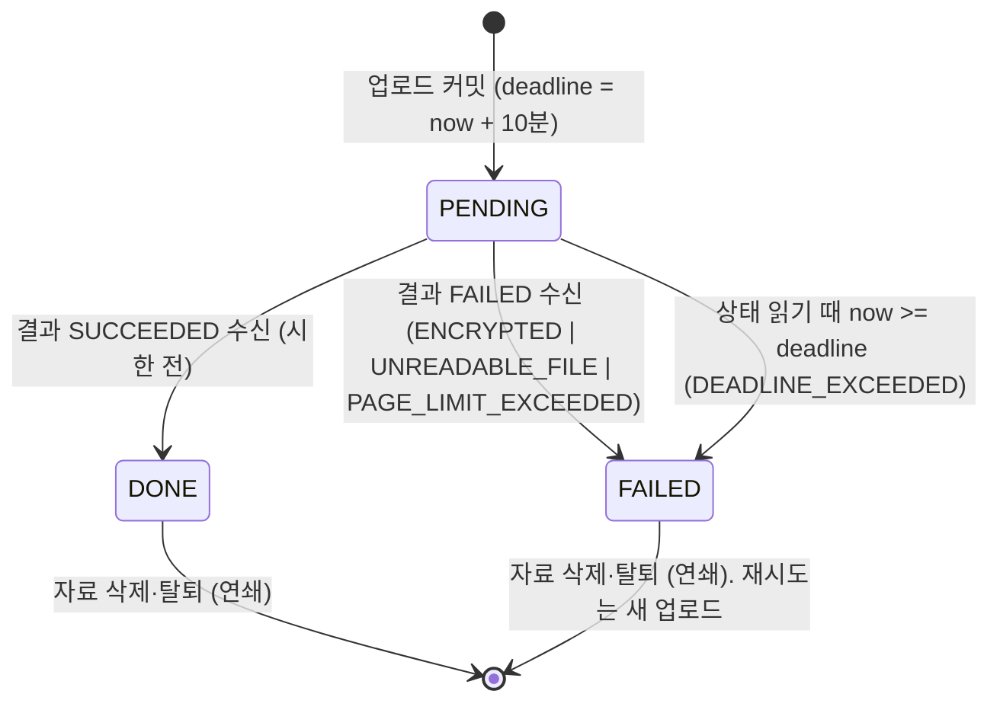
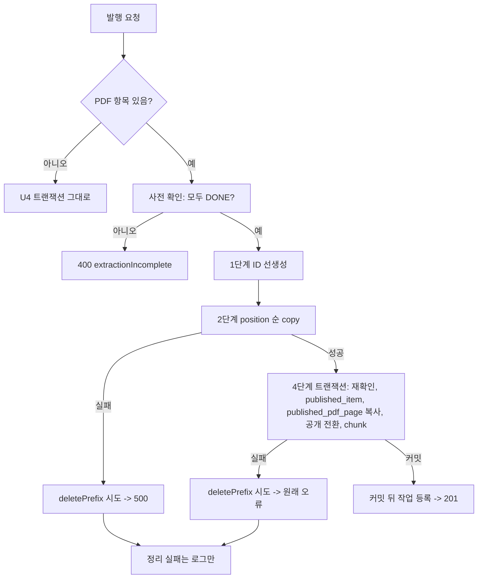
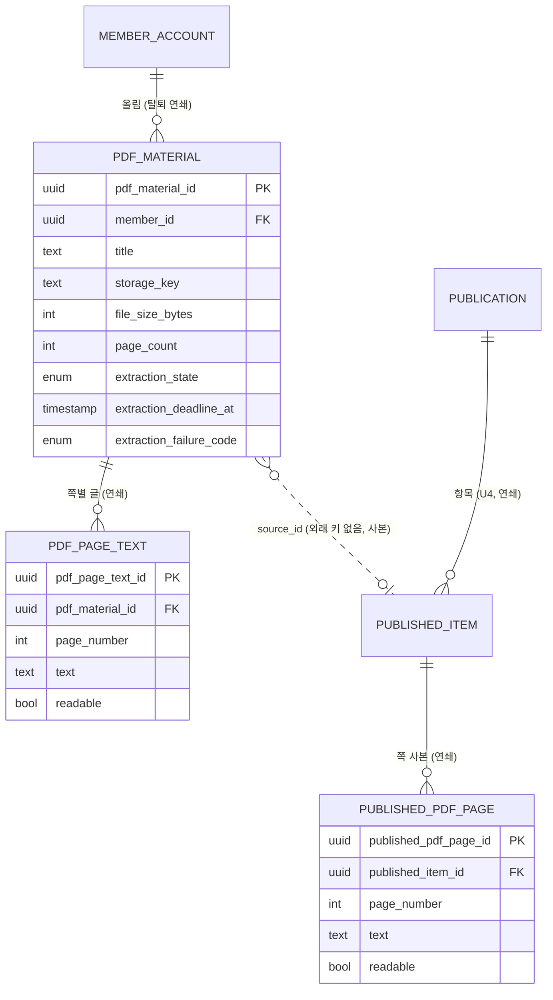

# U8 PDF 자료 — 기능 명세

작성일: 2026-11-06. Unit: `u8-pdf-materials`(#420, 후순위). 이 문서는 워크플로와 상태 전이의 정본이고, 엔티티 관계도와 규칙 요약은 [entities.md](entities.md)·[rules.md](rules.md)에서 끌어온 보기용이다. 구현 코드·SQL·프레임워크 세부는 코드 생성에서 정한다.

## Sources

- [Unit 정의](../../../inception/units-generation/unit-of-work.md) U8 절: 컴포넌트(Materials PDF 부분·PdfTextExtraction·Publication PDF 부분·FileStorage S3 구현), 책임(FR3.1 PDF 부분·FR3.3·FR3.4, S3 실제 삭제 확인), 경계(발행은 PDF를 기다리지 않음, 11/13에 계속할지 결정).
- [스토리 대응](../../../inception/units-generation/unit-of-work-story-map.md): U8 행은 US3.1(PDF 부분)·US3.2·US4.1(PDF 선택·사본)·US5.2(S3 사본 삭제). 구현 순서 "PDF 업로드·S3 → 글 추출·수신 → 발행 사본·복사 → 열람·읽을 수 없는 쪽".
- [사용자 스토리](../../../inception/user-stories/stories.md): US3.1 AC3.1.2·AC3.1.4·AC3.1.5, US3.2 AC3.2.1~AC3.2.5, US4.1 AC4.1.1·AC4.1.8·AC4.1.9의 PDF 부분, US5.2 AC5.2.2·AC5.2.4의 PDF 부분. US14.1 AC14.1.4의 S3 부분은 U2 스토리지만 Unit 정의가 U8의 확인 책임으로 둔다.
- [재승인 요구사항](../../../inception/requirements-analysis/requirements.md): FR3.1~FR3.4·FR3.6, FR4.2·FR4.4·FR4.7, FR5.2, FR14.9·FR14.10, FR20.1·FR20.3, NFR1·NFR7, C02(worker `pypdf`), C06(근거 없는 장치 금지), OQ1(S3로 결정됨, ADR-003).
- [컴포넌트 목록](../../../inception/domain-design/components.md): Materials·PdfTextExtraction·FileStorage·Publication의 behaviour와 엔티티 소유.
- [계약 요약](../../../inception/contract-design/contract-summary.md): C-04(동의), C-05(FileStorage·키), C-06(삭제 규칙·표), C-07(`published_item`·`published_pdf_page`), C-08(발행 트랜잭션), C-10(링크 판정), C-11(붙는 자리·근거 강조), C-12(받은 사람 경로), C-16(추출 메시지·수신 판정), C-17(발행 순서).
- [기능 설계 질문·답변](functional-design-questions.md) Q1~Q7과 요약 확인(2026-11-06). 담당자의 엔진 밖 초안(공유 노트 2026-11-06)은 입력으로 재사용했고 승인 문서와 다른 내용은 넣지 않았다.

## 1. 범위

| 하는 것 | 하지 않는 것(이유) |
|---|---|
| PDF 업로드·목록·상세·원본 열람·삭제(작성자) | OCR(FR3.4), 파일 교체(FR3.5 제외), PDF 수정 |
| worker의 쪽별 글 추출과 api의 결과 수신 | PDF 글의 본인 MCP 노출(FR13.2) |
| 발행의 PDF 부분: DONE 확인, 파일 복사, 사본 고정(C-17 2단계 채우기) | 조각 나누기·검색(U3), 요약·질의응답(U5), 발행 트랜잭션의 나머지(U4) |
| 받은 사람·작성자의 PDF 사본 열람과 쪽 표시, U5 근거 강조의 PDF 쪽 부분 | 공유 인프라 자체(S3 버킷·역할 #389, 개발 서버 큐 연결은 팀장) |
| FileStorage S3 드라이버, 탈퇴·발행본 삭제 때 파일이 실제로 지워지는지 확인 | 탈퇴·발행본 삭제의 순서 변경(U2·U4 소유 그대로) |

배포 단위는 api·web·worker 셋을 함께 바꾼다(Unit 정의 공통 전제). worker에 `pypdf` 의존성과 새 큐 소비자가, api에 `@aws-sdk/client-s3` 의존성이 더해진다(정확한 버전은 코드 생성에서 잠금).

구현 순서(스토리 대응의 Unit 안 순서를 따름):

1. 세 표 마이그레이션·엔티티·탈퇴 삭제 표 갱신·DB 경계 시험(계약 「첫 주 선합치」. 화면·API·worker는 넣지 않음)
2. W1 업로드·목록·원본 열람·삭제와 S3 드라이버
3. W2 추출·수신
4. W3 발행 사본·복사 — **선행 조건:** U4의 발행 경로(발행 트랜잭션·`publish-input`·받은 사람 화면)가 통합 브랜치 `intent/260925-intent-12`에 합쳐져 있어야 한다. 1~3단계는 이 조건 없이 진행한다
5. W4 열람·읽을 수 없는 쪽 — 같은 선행 조건(받은 사람 화면 1번 자리)
6. W5 삭제·탈퇴 확인 시험

U4 코드 변경의 담당: 2026-11-06 Unit 맡기 기록상 U4(`u4-publication-link`)와 U8을 같은 사람(Choi Su Young)이 맡고 있어 W3·W4의 U4 파일 수정을 U8 작업으로 한다. 담당이 바뀌면 계약 소유 규칙(소비 Unit은 직접 고치지 않고 제공 Unit 담당에게 요청)에 따라 C-17 2단계 채우기와 화면 자리를 U4 담당에게 요청한다(검토 R-04).

## 2. 워크플로

### W1. PDF 업로드·목록·원본 열람·삭제 (US3.1 PDF 부분, FR3.1·FR3.6, C-04·C-05)

**W1-A 업로드**

1. 작성 회원이 자료 화면의 PDF 탭에서 파일을 고른다. 화면은 민감 정보 안내(BR1.5)와 외부 AI 한 줄 고지(C-04)를 보인다.
2. web이 `POST /v1/pdf-materials`(multipart: `file`, `title` 선택)를 보낸다.
3. api: 회원 인증 → `AiConsentGate.require`(BR1.3; 없으면 403 `AI_CONSENT_REQUIRED`, web은 U2 공용 동의 창을 열고 같은 요청을 다시 보냄) → 본문 검사(BR1.1·BR1.2: PDF 머리 바이트, 20 MB, 제목 1~100자·없으면 파일 이름, 정의 밖 필드 거부) → 회원당 20벌 확인(BR1.2).
4. `pdfMaterialId` 생성 → `FileStorage.put(materialKey(memberId, pdfMaterialId), 본문, application/pdf)`(BR1.6).
5. 트랜잭션: `pdf_material` 행 PENDING, `extractionDeadlineAt = now + 10분`, `fileSizeBytes` → 커밋.
6. 커밋 뒤 `PdfExtract` 발송(BR2.4; 실패는 로그만).
7. 201 `{ pdfMaterialId, title, fileSizeBytes, extractionState: PENDING }`. 화면은 목록에 "글 추출 중"으로 보인다.

실패 갈래: 동의 없음 403 / 검증 실패 400 / 저장소 없음·실패 500(행 없음) / put 뒤 DB 실패 → 파일 한 번 삭제 시도 → 500(BR1.6). 하루 실행 횟수는 쓰지 않는다(BR1.4).

**W1-B 목록·상세**

1. `GET /v1/pdf-materials`(cursor·limit, 텍스트 자료 목록과 같은 방식). 행마다 BR2.2 시한 판정을 적용해 FAILED를 확정한 뒤 돌려준다. 응답 항목: `pdfMaterialId, title, fileSizeBytes, pageCount, extractionState, failureCode`.
2. `GET /v1/pdf-materials/{id}`: 위 항목 + 쪽 목록 `[{ pageNumber, readable }]`(글 본문은 싣지 않음). 화면은 FAILED면 사유별 안내(BR2.3), DONE이면 쪽 수와 "읽을 수 없음" 쪽 표지(BR6.4)를 보인다.
3. 남의 것·없음·UUID 아님은 404 `RESOURCE_UNAVAILABLE`(BR1.8).

**W1-C 작성자 원본 열람**

1. `GET /v1/pdf-materials/{id}/file`: 본인 확인(BR1.8) → `FileStorage.get(storageKey)` 스트림 → 200 `application/pdf`, `Content-Disposition: inline; filename="material.pdf"`, 캐시 없음(BR6.6). 파일 없음·저장소 실패는 500(BR6.5).
2. web은 W4와 같은 열람 도우미(fetch → Blob URL → iframe/새 탭)를 쓴다. 회원 토큰이 헤더라 일반 링크로는 열 수 없기 때문이다.

**W1-D 삭제**

1. `DELETE /v1/pdf-materials/{id}`: 본인 확인 → `FileStorage.delete(materialKey)` → 성공(없는 키 포함)하면 행 삭제(`pdf_page_text` 연쇄) → 204.
2. 저장소 삭제 실패면 500·DB 유지(BR1.7). 발행 사본은 건드리지 않는다(BR4.4). 수정·교체 API는 없다.

### W2. 쪽별 글 추출과 결과 수신 (US3.2 AC3.2.2·AC3.2.3·AC3.2.5, FR3.3·FR3.4, C-16·C-02)

**메시지(C-16 + Q5의 더하는 변경)**

```yaml
PdfExtract:            # api → worker, 큐 pdf-extraction-requests, 작업 ID = pdfMaterialId, 시도 1회
  schemaVersion: "2"
  messageId: string    # = 작업 ID
  pdfMaterialId: uuid
  memberId: uuid
  storageKey: string   # materialKey
PdfExtractionResult:   # worker → api, 10월 worker-messages 큐에 작업 이름 하나 더함, 작업 ID = messageId
  schemaVersion: "2"
  messageId: string    # message-pdf-{pdfMaterialId}-result
  pdfMaterialId: uuid
  memberId: uuid
  outcome: SUCCEEDED | FAILED
  failureCode: ENCRYPTED | UNREADABLE_FILE | PAGE_LIMIT_EXCEEDED | null   # FAILED만
  pages: [{ pageNumber: int, text: string, readable: boolean }]           # SUCCEEDED만, 글은 신뢰하지 않는 입력
Receipt:               # api → worker 수신 확인(10월 모양에 맞춤)
  schemaVersion: "2"
  messageId: string
  pdfMaterialId: uuid
  disposition: ACCEPTED | DUPLICATE | REJECTED
  code: OK | ALREADY_RECEIVED | CONTEXT_MISMATCH | STALE_ATTEMPT | SCHEMA_INVALID
```

이 모양은 U8이 소유한 계약 C-16의 더하는 변경이다(기존 필드·판정 5종 그대로, `schemaVersion`·`messageId`·`memberId`·`failureCode`를 더함). 승인 뒤 계약 문서에 같은 내용을 더한다(「다른 Unit에 넘기는 것」). 봉투 필드의 근거: 10월 worker 결과 메시지의 봉투가 `schemaVersion: "2"`(worker-messages 메시지 판본 2), `messageId: message-{종류}-{attemptId}-result`, `memberId`를 싣고 있으므로(`worker/app/processing/result.py`의 봉투), 같은 큐에 더하는 `PdfExtractionResult`도 같은 판본 번호와 같은 ID 규칙을 쓴다. `memberId`는 수신 쪽 CONTEXT_MISMATCH 판정(BR3.3)에 쓰며, `PdfExtract` 요청에는 C-16이 이미 `memberId`를 두고 있다.

1. 봉투·모양 검사의 쪽 수 상한: `pages`가 50개를 넘으면 `REJECTED/SCHEMA_INVALID`다(BR3.3). worker가 BR3.2로 먼저 막으므로 정상 경로에서는 생기지 않는다.

**worker**

1. `pdf-extraction-requests` 큐의 **별도 Worker**가 `PdfExtract`를 받는다(BR3.7). 기존 분석 소비자와 같은 worker 프로세스 안에서 돌지만 다른 큐를 소비하는 다른 Worker 인스턴스이고 동시성 한도(기본 1)도 분석 소비자의 것과 별개라, 분석 작업(시한 60분)이 돌고 있어도 추출은 기다리지 않는다. 추출 시한 10분(Q2)은 큐 대기를 포함하므로 worker가 꺼져 있으면 자료는 시한으로 FAILED가 되고 작성자가 다시 올린다.
2. `storageKey` 모양과 ID 일치 검사(BR3.6). 틀리면 결과 없이 작업 실패.
3. 파일 읽기: 배포는 S3 GetObject, 로컬·시험은 `PDF_FILE_ROOT` 공유 볼륨(BR7.4).
4. `pypdf`: 암호화면 FAILED `ENCRYPTED`; 파싱 실패 또는 쪽 수 0이면 FAILED `UNREADABLE_FILE`; 쪽 수 > 50이면 FAILED `PAGE_LIMIT_EXCEEDED`; 아니면 쪽마다(1~50) 글을 뽑고 readable 판정·NUL 제거(BR3.1·BR3.2).
5. `PdfExtractionResult`를 `worker-messages` 큐에 넣고 수신 확인을 10월 방식으로 기록한다. 거부된 결과는 다시 보내지 않는다.

**api 수신(`PdfExtractionReceiver`)** — 한 트랜잭션(BR3.3·BR3.4):

1. 봉투·모양 검사 → 실패면 `REJECTED/SCHEMA_INVALID`(ID를 알 수 없으면 10월처럼 수신 확인 없음).
2. `pdf_material` 행을 잠금 조회 → 없음·회원 불일치면 `REJECTED/CONTEXT_MISMATCH`(자료 삭제·탈퇴).
3. DONE이면 `DUPLICATE/ALREADY_RECEIVED`(내용 비교 없음).
4. FAILED, 또는 PENDING인데 시한 지남(이때 BR2.2로 FAILED 저장)이면 `REJECTED/STALE_ATTEMPT`.
5. PENDING·시한 전: SUCCEEDED면 `pdf_page_text` 전부 INSERT + `pageCount`·DONE; FAILED면 FAILED + `failureCode`. 커밋.
6. `ACCEPTED/OK`는 커밋 뒤에만. 커밋 실패는 수신 확인 없이 작업 실패(자료는 시한으로 FAILED). 쪽 일부만 남는 상태는 없다.

**추출 상태 전이(PdfMaterial.extractionState)**



<!-- Text fallback: PENDING에서 시작한다. 시한 전에 SUCCEEDED 결과가 오면 DONE, FAILED 결과가 오면 사유 코드와 함께 FAILED, 상태를 읽을 때 시한이 지났으면 DEADLINE_EXCEEDED로 FAILED가 된다. DONE·FAILED는 바뀌지 않으며 자료 삭제나 탈퇴로만 사라진다. FAILED의 재시도는 새 업로드다. -->

### W3. 발행의 PDF 부분 (US4.1 AC4.1.1·AC4.1.8·AC4.1.9의 PDF 부분, US3.1 AC3.1.5, FR3.2·FR4.7, C-17·C-07·C-08)

U4의 발행 순서(빈도 → 입력 → 동의 → 토큰 → 트랜잭션 → 커밋 뒤 작업 등록)에 C-17의 1~6단계를 끼운다. U4 발행 경로가 통합 브랜치에 합쳐진 뒤에 시작하고(§1 선행 조건), 같은 담당이 U4의 발행 서비스 파일을 고치되 C-17이 정한 순서 밖의 U4 판정은 바꾸지 않는다. 잠금 순서는 U4 BR5.1(consume → Catch catch_id 오름차순 → 텍스트 자료 text_material_id 오름차순)을 그대로 두고 그 뒤에 PDF를 더한다(BR4.2, 2026-11-06 대조).

1. 입력: 항목 종류에 `PDF_MATERIAL`을 허용한다(항목 수 1~20·중복 규칙은 U4 그대로).
2. 사전 확인(트랜잭션 밖, 복사 전): 고른 PDF를 작성자 기준으로 읽어 BR2.2 판정 → DONE이 아니면 400 `VALIDATION_FAILED` `extractionIncomplete`(BR4.1). 없음·남의 것은 U4 기존 404.
3. **1단계** `publicationId`와 모든 `publishedItemId`를 트랜잭션 전에 만든다(BR5.1).
4. **2단계** PDF 항목마다 position 순으로 `copy(materialKey → publishedPdfKey)`(BR5.2).
5. **3단계** 복사 실패 → `deletePrefix(publicationPrefix)` 1회 → 500, DB 무변경(BR5.3).
6. **4단계** 트랜잭션(U4 BR5.1 순서 유지): 회원 → `consume`(한도면 롤백) → Catch 잠금 → 텍스트 자료 잠금 → **PDF `FOR SHARE` 잠금·DONE 재확인(BR4.2)** → 자격 → 전체 글 검증(U4 현행 그대로, BR4.5) → `publication` → `published_item`(PDF: `snapshot {pageCount}`, `pdf_copy_key`) → **`published_pdf_page` ← `pdf_page_text` 복사(BR4.3)** → 공개 전환 → `chunkInTransaction`(U3가 `published_pdf_page`의 읽을 수 있는 쪽만 `pages[n]`으로 조각) → 커밋.
7. **5단계** 트랜잭션 실패(429 포함) → `deletePrefix` 1회 → 원래 오류 그대로(BR5.4).
8. **6단계** 정리 실패는 로그만(BR5.5).
9. 커밋 뒤 작업 등록·201 응답은 U4 그대로. 이후 원본 삭제·변경은 사본에 영향 없다(BR4.4).
10. 회귀 기준: PDF 항목이 없으면 1~3·5·6단계를 타지 않고 FileStorage를 부르지 않는다(BR5.6). 파일 저장소 미설정 환경에서도 PDF 없는 발행은 201이고 U4의 기존 발행 시험은 수정 없이 통과한다.

**발행 순서 요약(mermaid)**



<!-- Text fallback: PDF 항목이 없으면 U4 트랜잭션 그대로. 있으면 모두 DONE인지 확인(아니면 400), ID를 먼저 만들고 position 순으로 복사(실패면 접두어 삭제 뒤 500), 트랜잭션에서 재확인·항목·쪽 사본·공개 전환·조각 나누기(실패면 접두어 삭제 뒤 원래 오류), 커밋 뒤 작업 등록과 201. 접두어 삭제 실패는 로그만. -->

### W4. 받은 사람·작성자의 PDF 열람과 쪽 표시 (US3.2 AC3.2.1·AC3.2.3·AC3.2.4, US4.4 AC4.4.1 PDF 부분, FR4.2·FR6.5·FR3.4, C-10·C-11·C-12)

**화면(받은 사람 `/s/{token}` 1번 자리, 작성자 발행본 화면)**

1. PDF 항목은 제목·쪽 수와 쪽 목록을 보인다. 쪽마다 "n쪽", `readable=false`면 "읽을 수 없음" 표지, `readable=true`면 사본의 글을 텍스트로(BR6.4·BR3.5). 데이터는 C-10 `readSnapshot`의 `pdfPages`로 이미 온다.
2. U5 근거의 `location.pdfPage`가 있으면 `showEvidence`가 그 쪽 글의 `[charStart, charEnd)`를 강조한다(C-11 evidence-highlight, 필드 `pages[n]` → `pdfPages[n-1].text`). 쪽마다 [원본 n쪽 열기]를 둔다(FR6.5의 "원본 n쪽 열기").
3. [PDF 보기]·[새 탭에서 열기]·[원본 n쪽 열기]는 모두 BR6.3의 열람 도우미를 쓴다: `fetch(GET /v1/public/links/{token}/items/{publishedItemId}/pdf, { X-Link-Grant })` → 200이면 Blob URL → 화면 안 iframe(`#page=n`)·미리 연 새 창. 401·404는 `onAccessLost(code)`. 화면을 떠나면 Blob URL을 해제한다.

**받은 사람 원본 열람 API(C-12 더하는 변경, 제공 Unit U8)**

1. `GET /v1/public/links/{token}/items/{publishedItemId}/pdf`, 헤더 `X-Link-Grant`(선택).
2. 읽기 전용 트랜잭션: `resolveForRecipient(token, grant, now)`(BR6.1) → 항목 조회(BR6.2: 그 발행본의 `PDF_MATERIAL` 행만, 아니면 404 `LINK_UNAVAILABLE`).
3. `FileStorage.get(pdf_copy_key)` 스트림 → 200 `application/pdf`, `inline; filename="document.pdf"`, 캐시 없음. 파일 없음·저장소 실패 500(BR6.5). Range 요청은 지원하지 않는다(전체를 받는 열람 방식).
4. 시도 제한 없음, 토큰·grant·키는 로그에 없음(BR6.7).

**작성자 사본 열람** `GET /v1/publications/{id}/items/{itemId}/pdf`: `resolveForOwner`(중지·만료 뒤에도 열람) → 같은 항목 규칙 → 스트림(BR6.6).

### W5. 삭제·탈퇴·S3 (US5.2 AC5.2.2·AC5.2.4 PDF 부분, US14.1 AC14.1.4 S3 부분, FR5.2·FR14.9, ADR-003)

1. 발행본 삭제는 U4 순서 그대로(접두어 먼저, 실패면 오류·DB 유지). U8은 PDF 사본이 있는 발행본에서 파일과 `published_pdf_page`가 함께 지워지고 원본과 다른 발행본은 남는지 시험을 더한다(BR7.1).
2. 탈퇴는 U2 2단계 `deletePrefix(memberPrefix)`가 원본·사본을 함께 지운다. U8은 로컬 드라이버로 확인 시험을 더하고 S3 실제 확인은 버킷 뒤로 둔다(BR7.2).
3. S3 드라이버: BR7.3의 동작 대응표. 로컬·S3가 같은 계약 시험을 통과한다(S3는 요청을 기록하는 가짜 클라이언트). U2 소유 설정 파일에 `s3` 분기를 더하는 변경이라 U2 담당에게 알린다.
4. worker 읽기 경로는 BR7.4.

## 3. 엔티티 관계(entities.md에서 끌어옴)



<!-- Text fallback: 회원 하나가 PDF 자료 여럿을 올리고, PDF 자료 하나에 쪽별 글이 여럿 딸린다(둘 다 연쇄 삭제). 발행본 하나에 발행 항목이 여럿 있고(U4), PDF 항목 하나에 쪽 사본이 여럿 딸린다(연쇄). 발행 항목의 source_id는 원본 PDF를 가리키지만 외래 키가 없는 사본 참조다. -->

## 4. 규칙 요약(rules.md에서 끌어옴)

| 묶음 | 규칙 | 핵심 |
|---|---|---|
| BR1 업로드·원본 | BR1.1~BR1.8 | PDF만, 20 MB·50쪽·20벌·제목 100자, 동의 먼저, 하루 횟수 안 씀, 민감 정보 안내, 파일→DB→커밋→발송, 교체 없음·삭제는 원본만, 남의 것 404 |
| BR2 상태·시한 | BR2.1~BR2.4 | PENDING→DONE/FAILED 한 번, 10분 시한을 읽을 때 판정, 재시도는 다시 올리기, 발송은 커밋 뒤 |
| BR3 추출·수신 | BR3.1~BR3.7 | pypdf 쪽별·readable·NUL 제거만, 실패 사유 3종(쪽 수 0 포함), 수신 판정 5종 한 트랜잭션(쪽 50 초과 거부), 전부 아니면 전무, 글은 신뢰하지 않음, 키 모양 검사, 분석 소비자와 독립인 추출 Worker |
| BR4 발행 전제·사본 | BR4.1~BR4.5 | DONE만(400 extractionIncomplete), 트랜잭션 안 재확인, 쪽 사본 복사 고정, 원본 변경 무영향, 전체 글 상한은 팀장 결정 보류 |
| BR5 발행 순서 | BR5.1~BR5.6 | ID 선생성, position 순 복사, 실패 시 접두어 삭제, 정리 실패 로그만, PDF 없으면 저장소 미호출 |
| BR6 열람 | BR6.1~BR6.7 | C-10 판정 재사용, 그 발행본의 PDF 항목만, grant는 헤더·Blob URL, 쪽 번호·읽을 수 없음·근거 강조, 파일 없음 500, 작성자는 중지 뒤에도, 시도 제한 없음 |
| BR7 삭제·탈퇴·S3 | BR7.1~BR7.4 | 기존 삭제 순서 + 실제 삭제 확인, S3 드라이버 대응표, worker 읽기 경로 |

## 5. 다른 Unit에 넘기는 것(더하는 변경·알림)

| 대상 | 내용 | 종류 |
|---|---|---|
| 계약 C-16(U8 소유) | `PdfExtract`·`PdfExtractionResult`에 `schemaVersion`·`messageId`·`memberId`·`failureCode`, 수신 확인 모양. 승인 뒤 계약 문서에 더한다 | 더하는 변경 |
| 계약 C-12(경로 제공 Unit U8) | `GET /v1/public/links/{token}/items/{publishedItemId}/pdf` 추가. 승인 뒤 계약 문서에 더한다 | 더하는 변경 |
| U4(2026-11-06 맡기 기록상 같은 담당) | 발행 입력에 `PDF_MATERIAL` 허용, C-17 2단계 채우기, 발행 전 `publicationId`·`publishedItemId` 선생성, 받은 사람 화면 PDF 자리와 `pages[n]` 강조. U4 발행 경로가 통합 브랜치에 먼저 합쳐져야 한다. 담당이 바뀌면 U4 담당에게 요청 | U4 코드 변경(C-17이 정한 범위) |
| U2 담당(팀장) | FileStorage 설정 파일에 `s3` 드라이버 분기(기존 `local` 불변). 탈퇴 2단계의 S3 실제 삭제 확인은 U8 몫 | 더하는 변경·알림 |
| U3 담당(팀장) | `published_pdf_page` 표가 생기면 색인 시험에 PDF 항목을 더할 수 있음(U3 결정) | 알림 |
| U5 담당 | 변경 없음. "원본 n쪽 열기"는 U4 화면에서 U8이 처리하고, 읽을 수 없는 쪽은 U3 조각·U5 근거에서 이미 제외됨 | 확인 |

## 6. 시험 시나리오(코드 생성의 시험 입력)

- W1: 정상 업로드 201·PENDING / 동의 없음 403 / PDF 아님·20 MB 초과·21벌째·제목 101자 각 400 / 저장소 미설정 500·행 없음 / put 뒤 DB 실패 → 파일 삭제 시도·500 / 남의 것 404 / 삭제 때 저장소 실패 500·DB 유지.
- W2 수신 6갈래 각 1건(SCHEMA_INVALID·CONTEXT_MISMATCH·ALREADY_RECEIVED·STALE_ATTEMPT·시한 지남→FAILED 저장·OK) + "50쪽 저장 중 한 행 제약 위반이면 어떤 쪽도 남지 않고 PENDING 그대로" + 시한 지난 PENDING을 목록에서 읽으면 FAILED(DEADLINE_EXCEEDED).
- W2 worker: 암호화·파싱 실패·51쪽 각 FAILED 사유 / 글 없는 쪽 readable=false·'' / NUL 제거 / storageKey 모양 틀림 → 결과 없음.
- W3: (a) PDF 없는 발행 + 저장소 미설정 → 201, 기존 발행 시험 무수정 통과 (b) 복사 실패 → 500·DB 행 없음·deletePrefix 호출 (c) 복사 성공 뒤 한도 429 → deletePrefix 호출·DB 없음 (d) chunk 예외 → 500·정리 호출 (e) 정리 실패 → 응답 코드 유지·로그만 (f) PENDING/FAILED PDF → 400 extractionIncomplete·복사 호출 없음 (g) 정상: `published_pdf_page` 행 수 = `pdf_page_text` 행 수, `pdf_copy_key` = publishedPdfKey, 이후 원본 변경·삭제에도 사본 불변.
- W4: 비밀번호 링크 grant 없음 401 / 중지·만료·삭제 404 / 다른 발행본 항목·텍스트 항목·없는 항목·UUID 아님 404 / 파일 없음 500 / 정상 200 application/pdf / 작성자는 중지 뒤에도 200.
- W5: 발행본 삭제 뒤 접두어 파일 없음·`published_pdf_page` 없음·원본과 다른 발행본 유지 / 탈퇴 뒤 memberPrefix 아래 원본·사본 모두 없음(로컬) / S3 가짜 클라이언트로 BR7.3 대응표 각 동작.

## Assumptions & Open Questions

- 전제: 10월 결과 수신 방식(메시지 검증·수신 확인·거부 재전송 없음)과 `receipts.py`를 그대로 재사용할 수 있다(C-16). 저장소 키 모양 검사는 U2 FileStorage 로컬 드라이버의 규칙과 같다(C-05).
- 전제: U3 조각 나누기는 `published_pdf_page`의 `readable=true` 쪽만 `pages[n]`으로 조각 낸다(U3 기능 설계, C-07). 그래서 AC3.2.4(읽을 수 없는 쪽을 출처로 쓰지 않음)는 U8의 `readable` 저장과 U3·U5의 기존 규칙으로 충족된다.
- 미결(팀장, OQ-U4-4): PDF 쪽 글을 발행본 전체 글 상한(60,000자 임시값)에 넣을지와 값. 결정 전에는 U4 현행 검증을 바꾸지 않는다(BR4.5). 담당이 U2·U5 입력 한도와 대표 PDF 글자 수를 확인해 선택지별 영향을 팀장에게 전달한다. 이 결정에 딸린 항목(검토 R-02의 뒷부분): 쪽 글 총량 상한과 추출 결과 메시지의 크기 상한. 지금은 쪽 50·파일 20 MB로만 억제하고 따로 두지 않으며, 팀장이 PDF 글을 전체 글 상한에 넣기로 하면 그 값을 수신 검사(BR3.3)에도 더한다.
- 전제(검토 R-01 반영): worker는 큐마다 Worker 인스턴스를 하나씩 두는 구조(현재 `analysis-requests` Worker 하나)라, `pdf-extraction-requests`의 Worker를 더하면 분석 작업과 독립으로 돈다(BR3.7). 동시성 설정 이름은 코드 생성에서 정한다.
- 미결(팀장, 납품 판단): 11/13 1차 통합 확인에서 U8을 어디서 보일지. 개발 서버는 큐 미연결·S3 미준비라 PDF 추출이 돌지 않는다. 후보: 로컬 전체 실행으로 확인하고 개발 서버 시연에서 PDF 제외 / 개발 서버에 worker·Redis 연결(#389 변경) / 11/13에 U8 제외. 설계에는 영향이 없다.
- 미결(팀장, 확인만): S3 버킷·역할(#389) 준비 시점. 준비 전 U8 완료 보고에는 "S3 실제 복사·삭제 확인 미완"을 남긴다.

```aidlc-decisions
decisions:
  - id: OQ-U4-4
    decision: PDF 쪽 글을 발행본 전체 글 상한에 넣을지와 상한값
    owner: 팀장
    blocking: false
  - id: OQ-U8-1
    decision: 11/13 1차 통합 확인에서 U8을 보일 위치(로컬 전체 실행 / 개발 서버 큐 연결 / 제외)
    owner: 팀장
    blocking: false
  - id: OQ-U8-2
    decision: S3 버킷·역할(#389) 준비 시점 확인
    owner: 팀장
    blocking: false
```
