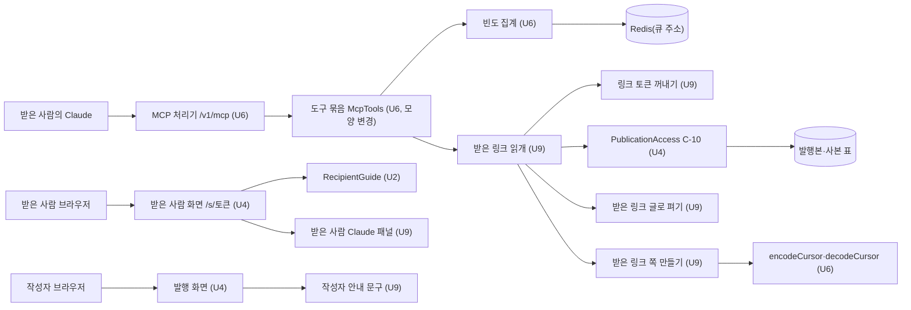

# U9 받은 사람의 Claude 연결 — 논리 구성 요소

## Sources

작성일: 2026-11-09. 입력:
- U9 비기능 요구사항: [성능](../nfr-requirements/performance-requirements.md)(performance-requirements)·[보안](../nfr-requirements/security-requirements.md)(security-requirements)·[규모](../nfr-requirements/scalability-requirements.md)(scalability-requirements)·[신뢰성](../nfr-requirements/reliability-requirements.md)(reliability-requirements)·[관찰](../nfr-requirements/observability-requirements.md)(observability-requirements)·[기술 선택](../nfr-requirements/tech-stack-decisions.md)(tech-stack-decisions)
- [U9 기능 명세](../functional-design/functional-spec.md)(functional-spec)의 W1~W6·「다른 Unit에 넘기는 것」과 [업무 규칙](../functional-design/rules.md)
- [계약 요약](../../../inception/contract-design/contract-summary.md)(contract-summary)의 C-10·C-11·C-15
- [U6 논리 구성 요소](../../u6-claude-mcp/nfr-design/logical-components.md)
- [비기능 설계 질문·답변](nfr-design-questions.md)의 요약 확인과 「Requested Changes Feedback」

코드: `api/src/app.module.ts`, `api/src/claude-mcp/claude-mcp.module.ts`, `api/src/claude-mcp/mcp-tools.ts`, `api/src/claude-mcp/mcp-log.ts`, `api/src/claude-mcp/mcp-page.ts`, `api/src/publications/publications.module.ts`, `api/src/publications/db-publication-access.ts`, `api/test/publications/publication-access-db.test.cjs`, `web/src/features/recipient/recipient-view.tsx`, `web/src/features/publications/publish-view.tsx`, `web/src/components/recipient-guide/recipient-guide.tsx`.

## 구성 요소

api 쪽은 모두 `api/src/claude-mcp/` 안에 있고, 같은 프로세스 안에서 함수 호출로 이어진다. U9 전용 새 파일 넷과 U6 파일의 모양 변경이다. 새 설정·표·마이그레이션은 없다.

| 구성 요소 | 파일 | 하는 일 | 규칙·요구사항 |
|---|---|---|---|
| 링크 토큰 꺼내기 `extractLinkToken(link)` | `mcp-shared-link.ts`(새 파일) | 앞뒤 공백을 뗀 값이 토큰 모양이면 그대로 쓰고, 주소면 경로가 `/s/{토큰}`(끝 `/` 하나 허용)으로 끝날 때 그 자리의 토큰을 쓴다. 2,048자를 넘거나 토큰을 꺼내지 못하면 null을 돌려준다. 모양은 `isLinkTokenFormat`으로 보고, 호스트·포트·쿼리·조각은 보지 않는다. 순수 함수 | BR1.3, NFR1.4, NFR4.2 |
| 받은 링크 글로 펴기 `flattenPublishedItem(item)` | `mcp-shared-text.ts`(새 파일) | Catch·텍스트 자료·PDF 항목을 BR3.1~BR3.3의 글로 편다. `aiDraft`는 읽지 않는다. 순수 함수 | BR3.1~BR3.3, BR3.5, NFR1.3, NFR7.1 |
| 받은 링크 쪽 만들기 `parseSharedCursor`·`buildSharedPage` | `mcp-shared-page.ts`(새 파일) | cursor 모양(U6 `decodeCursor`와 정수 확인)과 범위를 보고, `notice`가 첫 칸인 쪽을 만든다. 자르기는 [성능 설계](performance-design.md) 「쪽 만들기」대로 하고, nextCursor는 U6 `encodeCursor`로 만든다. 모양·범위가 틀리면 U6 `InvalidCursorError`다. 순수 함수 | BR3.4, BR4.1~BR4.5, NFR2.1, NFR4.1 |
| 받은 링크 읽개 `McpSharedPublicationReader` | `mcp-shared-publication-reader.ts`(새 파일) | Nest 공급자이고 `PUBLICATION_ACCESS`를 받는다. `readPage(link, cursor)`는 토큰 꺼내기 → cursor 모양 → `resolveForRecipient(token, null, new Date())` → `readSnapshot` → 글로 펴기 → cursor 범위 → 쪽 만들기 순서다. 토큰을 못 꺼냈을 때와 링크 거부(`LinkUnavailable`·`LinkPasswordRequired`, 판정 뒤 `NotFound`)는 같은 파일이 내보내는 `McpLinkDenied`로 던지고, 그 밖의 예외는 그대로 둔다 | BR2.1~BR2.5, BR5.2, NFR1.1, NFR1.2, NFR1.8, NFR1.9, NFR4.3 |
| 도구 묶음 `McpTools`(U6, 모양 변경) | `mcp-tools.ts` | 세 번째 도구 `read_shared_publication`을 등록한다. `call()`이 빈도 → 읽개 → 오류 변환을 맡는다 | BR1.1, BR1.2, BR5.1, BR5.3, NFR1.4, NFR1.6, NFR2.1, NFR4.5, NFR4.7, NFR6.1 |

web 쪽은 U9 새 폴더 `web/src/features/recipient-claude/`와 U4 화면 두 곳의 줄이다.

| 구성 요소 | 파일 | 하는 일 | 규칙·요구사항 |
|---|---|---|---|
| 받은 사람 Claude 패널 `ClaudeAnalyzePanel` | `claude-analyze-panel.tsx`(새 파일) | props는 `token` 하나다. 버튼을 누르면 요청 문장(지금 화면의 출처 + `/s/{토큰}`)을 `copyText`로 복사하고 안내를 펼친다. 안내는 세 단계, `/profile/claude` 링크(`routes.profileClaude`), 요청 문장이다. `aria-expanded`와 aria-live 상태 영역을 쓰고, 제목(h1)을 두지 않으며, 초점을 옮기지 않고, API를 부르지 않는다 | BR6.1~BR6.5, NFR1.7, NFR7.2 |
| 작성자 안내 문구 | 같은 폴더의 상수 하나 | BR7.1 문구를 한 곳에 두고 발행 화면 두 곳이 같이 쓴다 | BR7.1, NFR2.3 |

<!-- Text fallback: 받은 사람의 Claude는 U6의 MCP 처리기를 부르고, 처리기는 도구 묶음으로 간다. 도구 묶음은 U6 빈도 집계로 Redis를 세고, U9 받은 링크 읽개를 부른다. 읽개는 링크 토큰 꺼내기, U4의 PublicationAccess(C-10, 발행본·사본 표), 받은 링크 글로 펴기, 받은 링크 쪽 만들기를 차례로 쓰고, 쪽 만들기는 U6의 cursor 부호화를 쓴다. 받은 사람 브라우저는 U4 받은 사람 화면을 열고, 그 화면에 U2 시작 안내와 U9 패널이 붙는다. 작성자 브라우저는 U4 발행 화면을 열고, 그 화면이 U9 작성자 안내 문구를 쓴다. -->

## 실패 범위

- 바깥 의존은 PostgreSQL과 Redis뿐이다. U9는 밖을 부르지 않는다.
- PostgreSQL이 멈추면 U6 토큰 확인이 먼저 실패해 Claude 도구 전체가 멈춘다. api의 다른 기능도 같은 DB를 쓰므로 U9만의 실패가 아니다. 토큰 확인을 지나 판정·사본 읽기에서 실패하면 그 호출만 `INTERNAL_ERROR`다.
- Redis가 없거나 멈추면 빈도 제한만 꺼지고 도구 호출은 돈다.
- 한 호출의 실패는 그 호출의 도구 오류로 끝난다. 요청마다 서버 객체가 새로 만들어져 다른 요청에 번지지 않는다.
- U9는 새 설정이 없어 api 기동을 멈추게 하지 않는다. `PublicationsModule`은 이미 `AppModule`에 있으므로, `ClaudeMcpModule`이 가져와도 새 기동 실패가 생기지 않는다.
- web 패널은 서버에 기대지 않는다. 실패는 복사뿐이고 [신뢰성 설계](reliability-design.md) 「복사 실패」대로 알린다.

## 공유 자원

| 자원 | 주인 | U9의 쓰임 |
|---|---|---|
| 발행본·사본 표(PostgreSQL) | U4, PDF 쪽 사본은 U8 | C-10 `PublicationAccess`로만 읽는다. 직접 쿼리하지 않는다 |
| `PUBLICATION_ACCESS` | U4 | 판정과 사본 읽기. `PublicationsModule`이 내보낸다 |
| Redis(큐 주소) | 팀장(공용 기반) | U6 빈도 키를 같이 쓴다 |
| `isLinkTokenFormat`(`api/src/share-links/link-token.ts`) | 기존 코드(U4 판정도 쓴다) | 고치지 않고 부른다 |
| `api/src/claude-mcp/`의 U6 파일 | U6 담당(U9 담당과 같은 사람) | 아래 「U6 파일의 모양 변경」 |
| `recipient-view.tsx`, `publish-view.tsx` | U4 담당(팀원 3) | 아래 「U4 파일」 |
| `RecipientGuide`(`web/src/components/recipient-guide/`) | U2(팀장) | `showClaudeConnect`만 넘긴다. 문구는 그대로다(BR6.6) |
| `/profile/claude` 화면 | U6 | 안내에서 링크만 건다 |
| `web/src/lib/copy-text.ts` | 공용 | 그대로 부른다 |

## U6 파일의 모양 변경

기능 설계 「다른 Unit에 넘기는 것」의 목록에, 비기능 요구사항에서 늘어난 두 줄(`McpLogEntry`의 `mcp_link_denied`, `McpLogger`의 `log`)을 더해 한 목록으로 모은다. 파일은 모두 `api/src/claude-mcp/` 안이다.

| 파일 | 바꾸는 모양 | 출처 |
|---|---|---|
| `mcp-page.ts` | `encodeCursor`·`decodeCursor`를 내보낸다. `sizeOf`는 쓰지 않는다 | 기능 설계 |
| `mcp-log.ts` | `McpToolName`에 `read_shared_publication`을 더한다 | 기능 설계 |
| `mcp-log.ts` | `McpLogEntry`에 `mcp_link_denied` 사건(`tool`, `error`)을 더하고, `writeMcpLog`가 이 사건만 `log`로 보낸다 | 비기능 요구사항 NFR6.1 |
| `mcp-log.ts` | `McpLogger`에 `log`를 더한다 | 비기능 요구사항 NFR6.1 |
| `mcp-tools.ts` | `McpToolError`에 `LINK_UNAVAILABLE`·`LINK_PASSWORD_REQUIRED`를 더한다 | 기능 설계 |
| `mcp-tools.ts` | `call()`이 `McpLinkDenied`를 받아 `mcp_link_denied`를 남기고, 그 오류 코드의 `toolError`로 바꾸게 넓힌다. 그 밖의 오류는 지금처럼 `INTERNAL_ERROR`다 | 기능 설계 |
| `mcp-tools.ts` | `forMember`에 세 번째 도구를 등록하고 U9 입력 모양과 고정 문구를 둔다. 이를 위해 생성자가 받은 링크 읽개를 하나 더 받는다. Nest가 넣으므로 U6 시험의 `app.get(McpTools)`는 그대로다 | 기능 설계 |
| `mcp-tools.ts` | 맨 위 주석의 "U9가 더한다"를 고친다 | 기능 설계 |
| `claude-mcp.module.ts` | `PublicationsModule`을 가져오고, 받은 링크 읽개를 공급자로 더해 `PUBLICATION_ACCESS`를 넣는다 | 기능 설계 |

- U6 동작은 바꾸지 않는다. 기존 두 도구의 입력·응답·오류·로그와 다른 사건의 수준은 그대로다.
- `McpLogger`에 `log`를 필수 칸으로 더해도 U6 코드와 시험은 깨지지 않는다. U6 파일들은 logger를 `createMcpLogger()`(Nest `Logger`, `log`가 이미 있음)로 받고, 시험이 넘기는 기록용 logger는 `.cjs` 파일이라 타입 검사 범위(`api/tsconfig.json`의 `src/**/*.ts`) 밖이다.
- 코드 PR 완료 기준에 "U6의 기존 시험을 고치지 않고 통과한다"를 넣는다. U6 담당이 U9 담당과 같은 사람이라 따로 요청하지 않고, 코드 PR 리뷰에서 이 기준으로 확인한다.

## U4 파일

- **받은 사람 화면** `web/src/features/recipient/recipient-view.tsx`: 판정 통과 화면에서 시작 안내(slot 0) 바로 아래에 받은 사람 Claude 패널을 붙이는 한 줄을 더한다. `RecipientGuide`의 `showClaudeConnect={false}`는 같은 조건(`getGrant()`가 null)으로 바꾼다.
- **발행 화면** `web/src/features/publications/publish-view.tsx`: 작성자 안내 한 줄을 두 곳에 보인다. 비밀번호 체크 아래(체크가 꺼져 있을 때)와 확인 단계의 비밀번호 행(비밀번호 없음일 때)이다. 링크별 허용 설정은 두지 않는다.
- **리뷰:** 두 파일 모두 U4 담당 화면이다. 받은 사람 화면의 줄과 발행 화면 두 곳의 안내 줄을 U9 코드 PR에 함께 두고, U4 담당(팀원 3)에게 리뷰를 받는다.
- **C-11 자리:** 기능 명세 「다른 Unit에 넘기는 것」대로 U4 담당에게 자리 추가를 요청한다. C-11 주인이 계약 문서를 고치는 더하는 변경이다.

## 시험에서 바꿔 끼우는 자리

- **합성 Claude:** U6의 합성 MCP 클라이언트 도우미로 도구를 부른다. 실제 Claude 동작의 증거로 보고하지 않는다.
- **시험 자료:**
  - 시험 DB에 합성 회원·발행본·링크·사본을 넣는다. 기능 명세의 P1~P7과 S12의 긴 Catch 제목 발행본 둘이다.
  - PDF 항목(S6)은 U8의 쪽 사본 표에 행을 넣어 만든다. `readSnapshot`이 그 표를 읽는다.
  - 만료는 `expires_at`이 지난 행으로 만든다. 시계를 바꿔 끼우지 않는다.
- **시험 대역:** 정상 DB로 만들 수 없는 경우만 `PublicationAccess` 쪽을 바꾼다.
  - S11: 판정 뒤 중지 커밋, 판정 뒤 사본 삭제(`NotFound`).
  - S9: 작성자 회원 행 없음, 판정·사본 읽기 중 DB 오류. 작성자 회원 행 없음은 외래 키 때문에 정상 DB에서 만들 수 없어 U4 시험(`api/test/publications/publication-access-db.test.cjs`)도 대역을 쓴다.
- **Redis:** `CATCHU_TEST_REDIS_URL`이 있을 때만 실제로 돈다. 없으면 미실행으로 적는다. Redis 없음(S17)은 U6 시험처럼 큐 설정 없이(`null`) 만든 빈도 집계로 한다.
- **web:** S20~S22는 web의 기존 화면 시험으로 한다. 복사 실패(S21)는 클립보드 자리를 바꿔 끼운다.
- **S23:** 바꿔 끼우지 않는다.

## 통합 때 할 일(U9 담당)

- **C-15 계약 PR(Unit 제출과 따로):** 통합 브랜치 대상으로 `notice`와 `continued`를 더한다. 팀장에게 세 가지를 확인받는다. BR6.1의 켜는 조건, 시작 안내 Claude 줄을 그 조건으로 켜는 것, BR5.4의 남는 위험 수용이다. 남는 위험 확인은 이 PR 병합의 선행 조건이다.
- **C-11 자리 추가 요청:** U4 담당(팀원 3)에게 한다.
- **U9 코드 PR:**
  - 위 「U6 파일의 모양 변경」과 「U4 파일」의 줄을 담는다. U4 줄은 U4 담당 리뷰를 받는다.
  - U6의 기존 시험을 고치지 않고 통과한다.
- **실제 확인(S23):**
  - U9가 `main`에 오른 뒤 개발 서버에서 한다. 이것이 이 Unit의 '최소 연결 첫 결과'다.
  - 결과는 FR19 확인 표에 적는다. 함께 적을 것은 `mcp_link_denied`와 큐 연결 여부다([관찰 설계](observability-design.md) 「확인 증거」).
- **A 영역 후속:** 이름 입력 뒤 원래 화면으로 돌아오기는 기능 명세대로 따로 맡는다.

## Assumptions & Open Questions

- [assumption] U4 `PublicationsModule`은 지금처럼 `PUBLICATION_ACCESS`를 내보내고, U8 쪽 사본은 `readSnapshot`의 `pdfPages`로 온다. 바뀌면 U4·U8 담당과 맞춘다(tech-stack-decisions).
- [assumption] U4 담당이 C-11 자리 추가와 U4 두 파일의 줄을 받아들인다. 받아들이지 않으면 자리와 줄의 모양을 U4 담당과 다시 맞춘다.
- 남는 위험(security-requirements NFR2.2)의 팀장 확인은 C-15 계약 PR에서 받는다. 거부되면 기능 설계로 돌아가 U6 첫 연결 동의 문구에 이 위험을 알리는 줄을 더하는 안부터 본다.
