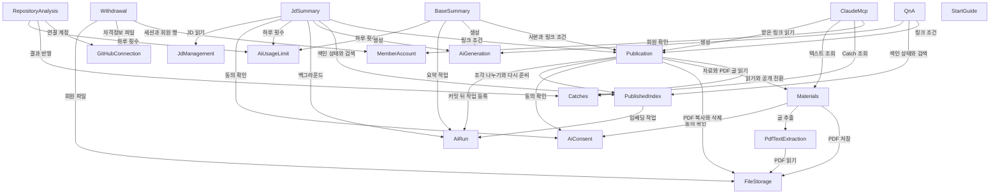

# CatchU 12월 범위 — 컴포넌트 목록

작성일: 2026-10-24. 입력: [재승인 요구사항](../requirements-analysis/requirements.md)(requirements), [사용자 스토리](../user-stories/stories.md)(stories), [도메인 설계 질문·답변](domain-design-questions.md)과 승인 질문에서 받은 팀장 수정 결정(2026-10-24, 내용은 decisions.md의 ADR-001·003·005·007·008·009). 기존 코드(`api/src`, `worker/app`)의 10월 모듈을 재사용하는 경계는 각 컴포넌트의 `behaviour`에 적었다. 이 문서는 논리 컴포넌트와 엔티티 소유만 정한다. 배포 단위(Unit)·API·DB 형식·자료형은 Unit 나누기·계약 설계·기능 설계에서 정한다. 결정 이유는 [decisions.md](decisions.md)의 ADR이다.

```yaml
components:
  - name: MemberAccount
    summary: Google 로그인 회원 계정과 세션 (10월 auth·google-login·member-profile 재사용)
    behaviour: >
      Google만으로 로그인하고 외부 사용자 로그인 대상 설정을 따른다(FR1.1). 세션 무효화로 탈퇴 즉시 로그인을 막는다.
      탈퇴 뒤 같은 Google 계정의 재가입은 새 계정이며 이전 자료를 복원하지 않는다(FR14.6). 회원 행 삭제가 회원 자료의 연쇄 삭제 기점이다(FR14.8).
    responsibilities:
      - 회원 계정과 로그인 세션
      - 재가입 시 신규 계정 생성
    depends_on: []
    dependents:
      - component: Withdrawal
        interaction: 세션 무효화와 회원 행 삭제
      - component: ClaudeMcp
        interaction: OAuth 승인 시 로그인 회원 확인
    entities:
      - name: MemberAccount
        identifier: memberId
        attributes: [memberId, googleSubject, createdAt]
      - name: AuthSession
        identifier: sessionId
        attributes: [sessionId, memberId, expiresAt]
        references:
          - entity: MemberAccount
            owned_by: MemberAccount
            relationship: 각 세션은 한 회원의 것
  - name: GitHubConnection
    summary: 회원의 GitHub 계정 연결과 자격정보 (10월 github-connection 재사용)
    behaviour: >
      GitHub 연결 본인 신원을 유지한다(FR1.2). 자격정보 파일은 DB 밖에 있으므로 탈퇴 때 따로 지운다(FR14.1).
    responsibilities:
      - GitHub 연결과 자격정보 보관·삭제
    depends_on: []
    dependents:
      - component: RepositoryAnalysis
        interaction: 분석에 쓸 연결 계정과 자격정보
      - component: Withdrawal
        interaction: DB 밖 자격정보 파일 삭제
    external_dependencies:
      - name: GitHub API
        kind: third-party-api
        purpose: 연결 계정 확인
    entities:
      - name: GitHubConnection
        identifier: connectionId
        attributes: [connectionId, memberId, githubUserId, credentialRef]
        references:
          - entity: MemberAccount
            owned_by: MemberAccount
            relationship: 각 연결은 한 회원의 것
  - name: RepositoryAnalysis
    summary: 공개 저장소 등록·분석 요청·상태와 결과 반영 (10월 member-repositories·analysis-*·member-analysis·result-application과 worker 분석 재사용)
    behaviour: >
      등록 때 소유·기여 관계를 검사하지 않고 분석에서 본인 커밋을 확인하며, 없으면 "본인 기록 없음"을 안내한다(FR1.2).
      비공개·동의 없음·지원 조건 밖·한도 초과를 실행 전에 이유별로 거부한다(AC1.2.3, AC1.2.6~1.2.8, 10월 구현 그대로).
      수집 상한을 올려 커밋 약 500개를 반영한다(FR1.6, 값은 실측). 진행·완료·실패를 화면 상태로 구분하고 확인된 서버 실패에 제한된 재요청을 둔다(FR1.3, 조건은 10월 구현 확인).
      비밀값·개인정보 가리기는 10월 규칙 그대로다(FR1.7). 분석 결과는 Catches에 반영한다.
      외부 AI 전송 동의는 10월처럼 분석 요청마다 받는 요청별 동의(AnalysisConsent)이며 재요청 때 새로 받는다. 이 요청별 동의가 FR20.1의 분석 동의를 맡는다(ADR-008).
    responsibilities:
      - 저장소 등록과 분석 요청·상태·재요청
      - 분석 요청별 외부 AI 동의
      - worker의 수집·후보·생성과 결과 수신·반영
    depends_on:
      - component: GitHubConnection
        interaction: 연결 계정·자격정보로 수집
        style: sync
      - component: Catches
        interaction: 분석 결과를 Catch로 반영(같은 작업은 기존 Catch 참조)
        style: async
      - component: AiUsageLimit
        interaction: 계정당 하루 실행 횟수 확인·차감
        style: sync
    dependents: []
    external_dependencies:
      - name: GitHub API
        kind: third-party-api
        purpose: 커밋·PR 수집
      - name: Claude API
        kind: third-party-api
        purpose: 10월 Catch 설명 초안 생성
      - name: Redis(BullMQ)
        kind: queue
        purpose: api→worker 분석 작업 전달
    entities:
      - name: RepositoryRegistration
        identifier: registrationId
        attributes: [registrationId, memberId, repositoryFullName, registeredAt]
        references:
          - entity: MemberAccount
            owned_by: MemberAccount
            relationship: 각 등록은 한 회원의 것
      - name: AnalysisConsent
        identifier: consentId
        attributes: [consentId, memberId, requestId, consentedAt]
        references:
          - entity: MemberAccount
            owned_by: MemberAccount
            relationship: 각 동의는 한 회원의 것
      - name: AnalysisRequest
        identifier: requestId
        attributes: [requestId, memberId, registrationId, status, consentRef, retryOfRequestId]
        references:
          - entity: MemberAccount
            owned_by: MemberAccount
            relationship: 각 요청은 한 회원의 것
      - name: AnalysisAttempt
        identifier: attemptId
        attributes: [attemptId, requestId, state, deadlineAt]
  - name: Catches
    summary: Catch와 근거, 작성자 설명, 공개/비공개 상태 (10월 catches 재사용)
    behaviour: >
      Catch는 기록 확인 내용·작성자 설명·AI 설명 초안을 구분해 보이고 초안이 설명을 덮어쓰지 않는다(FR1.4, FR2.1, FR2.2).
      설명은 Catch의 속성이며 재분석 때 같은 작업은 기존 Catch를 참조해 설명이 유지된다(FR2.5, ADR-004). 여러 탭은 마지막 저장이 남는다(FR2.4).
      공개/비공개는 "발행할 수 있는 상태"이며, 발행 때의 공개 전환은 10월 공개 전환 로직(같은 트랜잭션에서 회원·보호 상태를 잠그고 판정)을 그대로 쓰고 호출자(Publication)의 발행 트랜잭션 안에서 실행된다.
      미확인·원본 비공개 확인 Catch는 거부, 불일치 표시는 허용한다(FR4.1). 잠금을 새로 설계하지 않는다(ADR-001). Catch 원본 삭제는 없다(FR1.5).
    responsibilities:
      - Catch·근거·작성자 설명 저장
      - 공개/비공개 변경과 공개 전환 판정(호출자 트랜잭션 참여)
    depends_on: []
    dependents:
      - component: RepositoryAnalysis
        interaction: 분석 결과 반영
      - component: Publication
        interaction: 발행 때 Catch·설명 읽기와 공개 전환
      - component: ClaudeMcp
        interaction: 본인 Catch·설명 조회
    entities:
      - name: Catch
        identifier: catchId
        attributes: [catchId, memberId, workIdentity, visibility, verificationState, mismatchFlag, aiDraft, authorDescription, updatedAt]
        references:
          - entity: MemberAccount
            owned_by: MemberAccount
            relationship: 각 Catch는 한 회원의 것
          - entity: AnalysisRequest
            owned_by: RepositoryAnalysis
            relationship: 각 Catch는 그것을 만든 분석 요청에서 나왔다(10월 구조, 의도된 참조 순환)
      - name: CatchEvidence
        identifier: evidenceId
        attributes: [evidenceId, catchId, githubUrl, recordText]
  - name: Materials
    summary: 텍스트·PDF 자료 등록과 PDF 쪽별 글 (PDF 부분은 후순위)
    behaviour: >
      텍스트·PDF 자료를 여러 벌 등록하며 종류별 형식 제한과 URL 자료 종류는 없다(FR3.1). 상한은 개발 담당 결정이다.
      PDF 원본은 FileStorage의 회원/{memberId}/자료/... 키에 둔다. 자료 삭제는 그 원본 파일만 지운다(ADR-003).
      PDF 글 추출 결과는 Materials가 받으며 10월 결과 수신 방식(worker 인증·중복 반영 방지·지워진 부모 거부)을 따른다. 추출이 처리 시한을 넘기면 실패로 바꾸고 작성자에게 다시 올리라고 안내한다. 세부는 계약 설계에서 정한다.
      글이 없는 쪽은 "읽을 수 없음"으로 표시한다(FR3.3, FR3.4). 업로드 화면에 민감 정보 안내를 두고 개인정보를 가리지 않는다(FR3.6). 텍스트 자료도 마지막 저장·저장 실패 규칙을 따른다(FR2.4).
    responsibilities:
      - 텍스트 자료와 PDF 자료 저장·수정·삭제
      - PDF 글 추출 요청·결과 수신·처리 시한
      - PDF 쪽별 글과 읽을 수 없는 쪽 표시
    depends_on:
      - component: FileStorage
        interaction: PDF 원본 저장·삭제
        style: sync
      - component: PdfTextExtraction
        interaction: PDF 쪽별 글 추출 요청(결과는 10월 수신 방식으로 받음)
        style: async
      - component: AiConsent
        interaction: PDF 처리 전 첫 이용 동의 확인
        style: sync
    dependents:
      - component: Publication
        interaction: 발행 때 자료와 PDF 쪽별 글의 사본 만들기
      - component: ClaudeMcp
        interaction: 본인 텍스트 자료 조회
    entities:
      - name: TextMaterial
        identifier: textMaterialId
        attributes: [textMaterialId, memberId, title, body, updatedAt]
        references:
          - entity: MemberAccount
            owned_by: MemberAccount
            relationship: 각 텍스트 자료는 한 회원의 것
      - name: PdfMaterial
        identifier: pdfMaterialId
        attributes: [pdfMaterialId, memberId, title, storageKey, pageCount, extractionState, extractionDeadlineAt]
        references:
          - entity: MemberAccount
            owned_by: MemberAccount
            relationship: 각 PDF는 한 회원의 것
      - name: PdfPageText
        identifier: pdfPageTextId
        attributes: [pdfPageTextId, pdfMaterialId, pageNumber, text, readable]
  - name: PdfTextExtraction
    summary: worker의 PDF 쪽별 글 추출 (후순위)
    behaviour: >
      worker가 pypdf로 쪽마다 글을 뽑고, 뽑은 글은 신뢰할 수 없는 입력으로 다룬다. 이미지 글자 인식은 없다(FR3.3, FR3.4).
      S3에서 읽기만 하고, 결과는 10월 결과 수신 방식으로 api(Materials)에 되돌린다(ADR-003).
    responsibilities:
      - PDF 쪽별 글 추출과 읽을 수 없는 쪽 판정
    depends_on:
      - component: FileStorage
        interaction: PDF 원본 읽기
        style: sync
    dependents:
      - component: Materials
        interaction: 추출 요청을 받고 결과를 되돌림
    external_dependencies:
      - name: Redis(BullMQ)
        kind: queue
        purpose: 추출 작업 전달
    entities: []
  - name: FileStorage
    summary: 파일 저장 인터페이스 (로컬·시험은 로컬 파일, 배포는 S3)
    behaviour: >
      키는 회원/{memberId}/자료/... (PDF 원본)와 회원/{memberId}/발행본/{publicationId}/... (발행 사본)로 둔다.
      탈퇴는 회원 접두어 전체, 발행본 삭제는 그 발행본 접두어, 자료 삭제는 그 원본 파일만 지운다.
      presigned URL은 쓰지 않고 호출 컴포넌트가 권한 확인 뒤 읽어 내려준다. 버킷은 환경별 1개·공개 차단·자동 암호화·버전 관리 끔이며 권한은 역할로 받는다(ADR-003).
    responsibilities:
      - 파일 올리기·읽기·복사·접두어 목록·삭제
    depends_on: []
    dependents:
      - component: Materials
        interaction: PDF 원본 저장·삭제
      - component: PdfTextExtraction
        interaction: PDF 원본 읽기
      - component: Publication
        interaction: 발행 때 PDF 복사, 열람 때 읽기, 삭제 때 발행본 접두어 삭제
      - component: Withdrawal
        interaction: 회원 접두어 전체 삭제
    external_dependencies:
      - name: Amazon S3
        kind: object-store
        purpose: 배포 환경 파일 저장
    entities: []
  - name: Publication
    summary: 고정 발행본과 그 링크 (10월 share-links를 넓힘)
    behaviour: >
      Catch(설명 포함)·텍스트·PDF를 고른 순서로 발행 당시 내용으로 고정하고 링크와 한 트랜잭션으로 저장한다(FR4.1, FR4.7, ADR-001).
      PDF는 쪽별 글과 "읽을 수 없는 쪽" 표시까지 발행본 소유 사본(PublishedPdfPage)으로 고정하고, 파일은 발행본 접두어로 복사한다(FR3.2).
      PDF 복사는 발행 트랜잭션보다 먼저 하고 복사가 실패하면 발행 실패로 끝낸다. 트랜잭션이 실패하면 그 발행본 접두어를 지운다. 그래도 남은 파일은 탈퇴 때 회원 접두어째 지워지며 청소 장치는 두지 않는다. 세부는 계약 설계에서 정한다(팀장 결정 2026-10-24). 글 추출이 끝나지 않은 PDF는 발행에 고를 수 없고 이유를 안내한다. PDF 부분은 후순위다.
      비공개 Catch는 발행 트랜잭션 안에서 Catches의 10월 공개 전환 로직을 불러 공개로 바꾸며, 발행 저장이 실패하면 어떤 Catch도 공개로 바뀌지 않는다(FR4.7). 발행 때 권한·선택·크기를 다시 확인한다.
      발행 트랜잭션 안에서 PublishedIndex에 사본의 조각 나누기·위치 기록을 맡기고(FR4.7), 커밋 뒤 AiRun에 임베딩과 기본 요약 작업을 넣는다(ADR-005).
      링크 조건(비밀번호·만료·중지·삭제)을 판정해 웹·질의응답·JD 요약·MCP에 같은 결과를 준다(FR4.2, NFR1). 중지·만료 뒤 작성자는 계속 보고 되살리기는 없다(FR5.1).
      색인 실패일 때만 작성자에게 [검색 다시 준비]를 보이고, 작성자 요청을 PublishedIndex에 넘긴다(ADR-007).
      삭제는 FileStorage의 발행본 접두어를 먼저 지우고 DB를 지운다. 실패하면 오류를 보인다(FR5.2, ADR-003). 자동 파기는 없다.
    responsibilities:
      - 발행본과 고정 사본(자료·PDF 쪽별 글) 저장, 발행 후 확인
      - 링크 발급·비밀번호·만료·중지와 접근 판정
      - 발행 뒤 작업 등록과 [검색 다시 준비] 요청 전달
      - 발행본 삭제
    depends_on:
      - component: Catches
        interaction: Catch·설명 읽기와 발행 트랜잭션 안의 공개 전환
        style: sync
      - component: Materials
        interaction: 텍스트·PDF 자료와 PDF 쪽별 글 읽기
        style: sync
      - component: FileStorage
        interaction: PDF 사본 복사·읽기·삭제
        style: sync
      - component: AiConsent
        interaction: 발행으로 시작되는 AI 처리 전 작성자 첫 이용 동의 확인
        style: sync
      - component: PublishedIndex
        interaction: 발행 트랜잭션 안의 조각 나누기·위치 기록, [검색 다시 준비] 요청
        style: sync
      - component: AiRun
        interaction: 커밋 뒤 임베딩·기본 요약 작업 등록
        style: async
    dependents:
      - component: BaseSummary
        interaction: 사본 읽기와 링크 조건 확인
      - component: QnA
        interaction: 링크 조건 확인
      - component: JdSummary
        interaction: 링크 조건 확인과 사본 읽기
      - component: ClaudeMcp
        interaction: 받은 링크 읽기와 링크 조건 확인
    entities:
      - name: Publication
        identifier: publicationId
        attributes: [publicationId, memberId, linkTokenHash, passwordHash, expiresAt, stoppedAt, publishedAt]
        references:
          - entity: MemberAccount
            owned_by: MemberAccount
            relationship: 각 발행본은 한 작성 회원의 것
      - name: PublishedItem
        identifier: publishedItemId
        attributes: [publishedItemId, publicationId, position, itemKind, sourceId, snapshotContent, aiDraftSnapshot, pdfCopyKey]
      - name: PublishedPdfPage
        identifier: publishedPdfPageId
        attributes: [publishedPdfPageId, publishedItemId, pageNumber, text, readable]
  - name: PublishedIndex
    summary: 발행 사본의 조각·위치·임베딩, 색인 상태와 의미 검색 (RAG)
    behaviour: >
      발행 트랜잭션 안에서 Publication이 넘긴 사본으로 조각을 나누고 위치(항목·필드·글자, PDF 쪽)를 기록한다(FR4.7). PDF는 발행본 소유 사본(PublishedPdfPage)만 쓴다.
      조각에는 Catch의 GitHub 기록과 작성자 자료만 넣고 AI 설명 초안은 넣지 않는다(FR6.4). 임베딩은 발행 뒤 AiRun 작업으로 Voyage AI에 맡기고 pgvector에 둔다.
      발행본마다 색인 상태(대기·완료·실패)와 처리 시한을 두고, 상태를 읽을 때 시한이 지났으면 그 자리에서 실패로 확정한다(FR6.8, AiRun의 시한 판정). 준비 전이나 실패면 질의응답·JD 요약에 "아직 쓸 수 없음"을 돌려준다.
      [검색 다시 준비]는 실패 상태에서만 받아 상태를 대기로 돌리고 임베딩만 다시 맡기며 하루 실행 제한에 세지 않는다(ADR-007). 질문에 넘길 자료는 의미 검색으로만 고른다. 발행본 삭제 때 연쇄 삭제된다.
    responsibilities:
      - 발행 사본 조각 나누기·위치 기록
      - 임베딩 작업 처리와 색인 상태·처리 시한
      - 의미 검색
    depends_on:
      - component: AiRun
        interaction: 임베딩 작업 처리와 처리 시한
        style: async
    dependents:
      - component: Publication
        interaction: 발행 트랜잭션 안의 조각 나누기, [검색 다시 준비]
      - component: QnA
        interaction: 색인 상태 확인과 질문 관련 조각 검색
      - component: JdSummary
        interaction: 색인 상태 확인과 요구사항별 근거 조각 검색
    external_dependencies:
      - name: Voyage AI
        kind: third-party-api
        purpose: 조각과 질문 임베딩
      - name: PostgreSQL pgvector
        kind: database
        purpose: 벡터 저장·검색
    entities:
      - name: PublicationIndex
        identifier: publicationId
        attributes: [publicationId, state, deadlineAt, updatedAt]
        references:
          - entity: Publication
            owned_by: Publication
            relationship: 발행본마다 색인 상태 하나
      - name: PublishedChunk
        identifier: chunkId
        attributes: [chunkId, publicationId, publishedItemId, fieldPath, charStart, charEnd, pdfPage, sourceKind, text, embedding]
        references:
          - entity: Publication
            owned_by: Publication
            relationship: 각 조각은 한 발행본에 딸림
          - entity: PublishedItem
            owned_by: Publication
            relationship: 각 조각은 한 사본 항목의 일부
  - name: AiGeneration
    summary: Claude 인용 기능 연결과 AI 출력 근거 검사 (공용 기반)
    behaviour: >
      인용 단위(줄)를 정해 넘기고 Claude API 인용 기능으로 근거를 붙인다. 숫자·PR 번호·파일 이름·영어 표기를 근거 글과 기계 대조해 맞지 않는 항목을 경고 없이 버리고,
      근거 없는 해석은 'AI 해석'으로 표시하되 숫자·PR 번호·발행본에 없는 영어 표기가 있으면 버린다. 그 근거 글이 속한 Catch의 PR 번호는 허용한다.
      출처 표시는 근거 원문에 "GitHub 기록 원문"·"작성자 자료 원문"으로 붙인다. 숨긴 지시 방어와 역량 평가 표현 금지를 지시에 둔다(FR6.4, FR6.5).
      모델은 Haiku 5.5이고 판정 AI는 없으며, NFR3 조정 때 질의응답만 Sonnet으로 바꿀 수 있다(FR6.9). api에 둔다(ADR-002).
    responsibilities:
      - 생성 요청 구성·인용 보존·원문 위치 연결
      - 근거 대조와 항목 버림
    depends_on: []
    dependents:
      - component: BaseSummary
        interaction: 기본 요약 생성
      - component: QnA
        interaction: 질의응답 항목 생성
      - component: JdSummary
        interaction: 요구사항별 요약 생성
    external_dependencies:
      - name: Claude API
        kind: third-party-api
        purpose: 인용 기능을 쓴 생성
    entities: []
  - name: AiRun
    summary: 발행 뒤 임베딩·기본 요약·JD 요약의 백그라운드 실행 공통 (공용 기반)
    behaviour: >
      api 안에서 기존 큐(Redis/BullMQ)를 재사용한다. 작업을 받는 컴포넌트가 자기 작업 종류의 처리기를 등록하고 AiRun이 실행한다(호출 방향은 등록한 쪽→AiRun).
      접수된 실행은 브라우저를 닫아도 취소되지 않고, 처리 시한이 지나면 실패가 된다. 자동 복구·중간 재개·자동 재시도는 없다(FR6.8).
      처리 시한 판정은 처리기와 무관하게 한다: 색인·기본 요약·JD 요약의 상태를 읽을 때 deadlineAt이 지났으면 그 자리에서 실패로 확정한다. 그래서 작업 등록이 실패하거나 큐에서 작업이 사라져도 "대기"에 영원히 남지 않는다(팀장 결정 2026-10-24).
      늦게 도착한 결과는 부모(실행·발행본)가 없으면 저장이 거부되고 다시 시도하지 않고 버린다(FR14.10, ADR-002, ADR-005).
    responsibilities:
      - 백그라운드 작업 등록·실행·처리 시한·실패 처리
    depends_on: []
    dependents:
      - component: Publication
        interaction: 커밋 뒤 임베딩·기본 요약 작업 등록
      - component: PublishedIndex
        interaction: 임베딩 작업 처리기
      - component: BaseSummary
        interaction: 요약 생성 작업 처리기
      - component: JdSummary
        interaction: JD 요약 실행
    external_dependencies:
      - name: Redis(BullMQ)
        kind: queue
        purpose: api 안 백그라운드 실행
    entities: []
  - name: AiUsageLimit
    summary: 계정당 하루 실행 제한 (공용 기반)
    behaviour: >
      분석·기본 요약 생성/다시 만들기·JD 요약을 계정당 하루 횟수 하나로 합산한다. 남은 횟수는 보이지 않고 "오늘 한도에 도달했습니다"를 안내한다.
      링크 단위 합산은 없다. 값은 개발 담당 결정이다(FR6.6). 하루 경계는 한국 시간 자정이다(팀장 결정 2026-10-24). 링크당 하루 질문 횟수는 QnA가 Redis로 맡는다(팀장 결정 2026-10-24). [검색 다시 준비]는 세지 않는다.
    responsibilities:
      - 계정당 하루 실행 횟수 집계와 판정
    depends_on: []
    dependents:
      - component: RepositoryAnalysis
        interaction: 분석 실행 횟수
      - component: BaseSummary
        interaction: 요약 생성·다시 만들기 횟수
      - component: JdSummary
        interaction: JD 요약 실행 횟수
    entities:
      - name: DailyExecutionCount
        identifier: memberId+usageDate
        attributes: [memberId, usageDate, count]
        references:
          - entity: MemberAccount
            owned_by: MemberAccount
            relationship: 각 집계는 한 회원의 것
  - name: AiConsent
    summary: 외부 AI 전송 고지와 첫 이용 동의 (공용 기반)
    behaviour: >
      요약·질의응답·JD 요약·PDF 처리 첫 이용 때 한 번 동의받고 화면마다 한 줄 안내한다. 비로그인 질의응답은 입력란 옆 한 줄이 고지다.
      분석은 RepositoryAnalysis의 요청별 동의가 맡으며 이 동의와 병존한다(ADR-008). Claude API와 Voyage AI(운영사 MongoDB)를 고지하고 문의 경로 한 줄을 둔다(FR20).
    responsibilities:
      - 첫 이용 동의 기록과 동의 여부 판정
    depends_on: []
    dependents:
      - component: Materials
        interaction: PDF 처리 전 동의 확인
      - component: Publication
        interaction: 발행으로 시작되는 AI 처리 전 동의 확인
      - component: JdSummary
        interaction: JD 요약 전 동의 확인
    entities:
      - name: AiConsent
        identifier: consentId
        attributes: [consentId, memberId, noticeVersion, consentedAt]
        references:
          - entity: MemberAccount
            owned_by: MemberAccount
            relationship: 각 동의는 한 회원의 것
  - name: BaseSummary
    summary: 발행본마다 하나인 AI 기본 요약 (RAG 덩어리)
    behaviour: >
      발행 커밋 뒤 Publication이 넣은 작업을 AiRun 처리기로 받아 JD 없이 발행 당시 내용으로 만든다. 'AI 요약' 표시로 링크를 여는 모두에게 보이고, 실패하면 수신자에게는 요약 없음, 작성자에게는 다시 만들기를 보인다.
      상태를 읽을 때 처리 시한이 지났으면 실패로 확정하고 작성자는 [다시 만들기]로 다시 할 수 있다(AiRun의 시한 판정).
      색인 상태와 관계없이 열람·기본 요약은 그대로 제공한다. 다시 만들기는 하루 실행 제한을 따르고 반복 제한은 개발 담당 결정이다. 링크 중지·만료 때 수신자에게는 막고 작성자는 본다. 발행본 삭제·작성자 탈퇴 때 연쇄 삭제된다(FR2.7).
    responsibilities:
      - 기본 요약 생성·다시 만들기·상태
    depends_on:
      - component: Publication
        interaction: 사본 읽기와 링크 조건 확인
        style: sync
      - component: AiGeneration
        interaction: 인용·근거 검사를 거친 요약 생성
        style: sync
      - component: AiRun
        interaction: 요약 생성 작업 처리기 등록·다시 만들기 작업 등록
        style: async
      - component: AiUsageLimit
        interaction: 생성·다시 만들기 횟수
        style: sync
    dependents: []
    entities:
      - name: BaseSummary
        identifier: baseSummaryId
        attributes: [baseSummaryId, publicationId, status, deadlineAt, items, generatedAt]
        references:
          - entity: Publication
            owned_by: Publication
            relationship: 각 발행본에 요약 하나
  - name: QnA
    summary: 발행본 대화형 질의응답과 링크당 하루 질문 제한 (RAG 덩어리)
    behaviour: >
      로그인 없이 묻고 앞 대화를 이어 묻는다. 질문을 앞 대화에 맞게 다시 쓰고 PublishedIndex로 관련 조각을 찾아 답한다. 대화는 브라우저에만 두고 서버에 저장하지 않으며 턴·길이 상한을 둔다.
      질문마다 링크 조건과 색인 상태를 확인하고, 색인이 준비 전이거나 실패면 "질의응답을 아직 쓸 수 없음"을 보인다. 바로 답하는 경로로 검사를 통과한 항목만 SSE로 내보낸다(FR6.2, FR6.3, ADR-002).
      링크당 하루 질문 횟수는 DB 표 대신 Redis에 발행본ID+날짜 키로 세고 하루가 지나면 사라지게 한다. 이 집계는 연쇄 삭제와 무관하다(FR6.6, 팀장 결정 2026-10-24).
      Redis 장애로 셀 수 없으면 질문을 통과시키고 기록만 남긴다(전체 지출 상한은 Claude 콘솔이 막는다). 하루 경계는 한국 시간 자정이다(팀장 결정 2026-10-24).
    responsibilities:
      - 질문 재작성·검색·답 생성·SSE 전송
      - 링크당 하루 질문 횟수
    depends_on:
      - component: Publication
        interaction: 질문마다 링크 조건 확인
        style: sync
      - component: PublishedIndex
        interaction: 색인 상태 확인과 관련 조각 의미 검색
        style: sync
      - component: AiGeneration
        interaction: 인용·근거 검사를 거친 답 생성
        style: sync
    dependents: []
    external_dependencies:
      - name: Redis
        kind: cache
        purpose: 링크당 하루 질문 횟수(발행본ID+날짜 키, 하루 뒤 만료)
    entities: []
  - name: JdManagement
    summary: 로그인 회원의 JD 저장·수정·삭제 (저장소·JD 덩어리)
    behaviour: >
      별도 JD 관리 페이지에서 본인 JD를 다룬다. JD 원본은 저장한 회원의 탈퇴·본인 삭제 때만 지우며 발행본을 참조하지 않는다(FR6.7, FR14.9).
    responsibilities:
      - JD 원본 관리
    depends_on: []
    dependents:
      - component: JdSummary
        interaction: 실행할 JD 읽기
    entities:
      - name: Jd
        identifier: jdId
        attributes: [jdId, memberId, title, body, updatedAt]
        references:
          - entity: MemberAccount
            owned_by: MemberAccount
            relationship: 각 JD는 저장한 회원의 것
  - name: JdSummary
    summary: JD 요구사항별 요약 실행과 결과 (저장소·JD 덩어리)
    behaviour: >
      로그인 회원이 저장한 JD로 그 링크에 실행하고 결과는 실행한 회원만 본다. 색인이 준비 전이거나 실패면 "JD 요약을 아직 쓸 수 없음"을 보이고 실행하지 않는다.
      JD를 요구사항으로 나누고 요구사항마다 근거 조각을 찾아 차례로 생성하며, 요구사항과 결과의 대응·일부 실패·전체 시한을 다룬다. 같은 JD 재실행은 새 실행이고 재사용은 없다. 입력 상한 초과는 실행 전에 거부한다.
      본인 결과는 링크가 유효한 동안 다시 열고, 발행본 삭제·작성자 또는 실행 회원 탈퇴·그 JD 삭제 때 결과·실행·입력 사본이 연쇄 삭제된다(FR6.1, FR14.9).
    responsibilities:
      - JD 요약 실행·결과·다시 열기
    depends_on:
      - component: Publication
        interaction: 링크 조건 확인과 사본 읽기
        style: sync
      - component: PublishedIndex
        interaction: 색인 상태 확인과 요구사항별 근거 조각 검색
        style: sync
      - component: AiGeneration
        interaction: 인용·근거 검사를 거친 요구사항별 생성
        style: sync
      - component: AiRun
        interaction: 백그라운드 실행
        style: async
      - component: AiUsageLimit
        interaction: JD 요약 실행 횟수
        style: sync
      - component: AiConsent
        interaction: 실행 전 동의 확인
        style: sync
      - component: JdManagement
        interaction: 실행할 JD 읽기
        style: sync
    dependents: []
    entities:
      - name: JdSummaryRun
        identifier: runId
        attributes: [runId, memberId, publicationId, jdId, status, deadlineAt, inputCopy, createdAt]
        references:
          - entity: MemberAccount
            owned_by: MemberAccount
            relationship: 각 실행은 실행한 한 회원의 것
          - entity: Publication
            owned_by: Publication
            relationship: 각 실행은 한 발행본에 대한 것
          - entity: Jd
            owned_by: JdManagement
            relationship: 각 실행은 한 JD로 한다
      - name: JdSummaryResult
        identifier: resultId
        attributes: [resultId, runId, requirementIndex, jdLine, evidenceItems, unconfirmedPoints, interviewQuestions, status]
  - name: ClaudeMcp
    summary: Claude 웹·Desktop 원격 연결, OAuth 상태와 MCP 도구 (Claude MCP 덩어리, 받은 링크 읽기는 후순위)
    behaviour: >
      같은 원격 연결로 최소 OAuth 승인, 자동 갱신 없이 만료 시 재승인, 전체 연결 해제를 둔다(FR13.1). 같은 PostgreSQL에 클라이언트 등록·승인 코드(짧게, 한 번)·접근 토큰(해시, 회원, 만료)을 소유하고 갱신 토큰은 두지 않는다.
      전체 해제는 회원 기준으로 그 회원의 접근 토큰과 연결 기록을 모두 지우고, 탈퇴는 연쇄 삭제를 따른다. OAuth 규칙은 MCP 공식 SDK의 인증 도구로 처리하며 세부는 기능 설계에서 정한다(ADR-009).
      회원 기준 짧은 시간 요청 빈도·응답 크기만 제한하며 IP로 세지 않는다(FR13.6). 본인 도구는 Catch 조회(설명 포함, 공개·비공개)와 텍스트 자료 조회이며 첫 연결 때 한 번 동의받는다(FR13.2).
      받은 사람 도구는 비밀번호 없는 링크의 발행본 읽기 하나이고 호출마다 링크 조건을 확인한다(FR13.3, 후순위). 쓰기·JD 요약·의미 검색 도구는 없다(FR13.5).
    responsibilities:
      - OAuth 클라이언트 등록·승인 코드·접근 토큰과 동의·해제
      - 본인 조회 도구, 받은 링크 읽기 도구
      - 회원 기준 요청 빈도·응답 크기 제한
    depends_on:
      - component: MemberAccount
        interaction: OAuth 승인 시 로그인 회원 확인
        style: sync
      - component: Catches
        interaction: 본인 Catch·설명 조회
        style: sync
      - component: Materials
        interaction: 본인 텍스트 자료 조회
        style: sync
      - component: Publication
        interaction: 받은 링크 읽기와 링크 조건 확인
        style: sync
    dependents: []
    external_dependencies:
      - name: Redis
        kind: cache
        purpose: 회원 기준 짧은 시간 요청 빈도 집계
      - name: MCP 공식 SDK 인증 도구
        kind: other
        purpose: OAuth 규칙 처리
    entities:
      - name: McpConnection
        identifier: connectionId
        attributes: [connectionId, memberId, mcpClientId, consentedAt, expiresAt]
        references:
          - entity: MemberAccount
            owned_by: MemberAccount
            relationship: 각 연결은 한 회원의 것
      - name: McpClient
        identifier: mcpClientId
        attributes: [mcpClientId, clientName, redirectUris, registeredAt]
      - name: McpAuthorizationCode
        identifier: codeHash
        attributes: [codeHash, memberId, mcpClientId, expiresAt, usedAt]
        references:
          - entity: MemberAccount
            owned_by: MemberAccount
            relationship: 각 승인 코드는 한 회원의 것
      - name: McpAccessToken
        identifier: tokenHash
        attributes: [tokenHash, memberId, mcpClientId, expiresAt]
        references:
          - entity: MemberAccount
            owned_by: MemberAccount
            relationship: 각 접근 토큰은 한 회원의 것
  - name: Withdrawal
    summary: 회원 탈퇴 처리 (공용 기반)
    behaviour: >
      확인창 요청 뒤 즉시 세션을 무효화해 로그인·링크·MCP 접근을 막고, FileStorage의 회원/{memberId}/ 접두어 전체(자료와 발행 사본)와 GitHub 자격정보 파일을 지운 뒤 회원 행을 지워 연쇄 삭제한다(FR14.1, FR14.8, FR14.9).
      어느 단계든 실패하면(교착 포함) 성공으로 응답하지 않고 오류를 보인다. 2단계 삭제·재처리는 없다.
    responsibilities:
      - 탈퇴 순서 실행과 실패 응답
    depends_on:
      - component: MemberAccount
        interaction: 세션 무효화와 회원 행 삭제
        style: sync
      - component: GitHubConnection
        interaction: 자격정보 파일 삭제
        style: sync
      - component: FileStorage
        interaction: 회원 접두어 파일 삭제
        style: sync
    dependents: []
    entities: []
  - name: StartGuide
    summary: 처음 쓰는 사람의 최소 시작 안내와 기본 오류·404 화면 (공용 기반, web)
    behaviour: >
      작성 회원과 받은 사람에게 다음 행동 안내와 메뉴 연결을 보이고, 기본 오류·404 화면을 둔다. 받은 사람의 Claude 연결 안내는 후순위 기능과 함께 빠질 수 있다(FR16.3).
    responsibilities:
      - 시작 안내와 기본 오류 화면
    depends_on: []
    dependents: []
    entities: []
```

## Component Diagram



<!-- Text fallback: 화살표는 호출 방향이다. RepositoryAnalysis는 GitHubConnection·Catches·AiUsageLimit를 부른다. Materials는 FileStorage·PdfTextExtraction·AiConsent를, PdfTextExtraction은 FileStorage를 부른다. Publication은 Catches·Materials·FileStorage·AiConsent·PublishedIndex·AiRun을 부른다. PublishedIndex는 AiRun을 부른다. BaseSummary는 Publication·AiGeneration·AiRun·AiUsageLimit을 부른다. QnA는 Publication·PublishedIndex·AiGeneration을 부른다. JdSummary는 Publication·PublishedIndex·AiGeneration·AiRun·AiUsageLimit·AiConsent·JdManagement를 부른다. ClaudeMcp는 MemberAccount·Catches·Materials·Publication을, Withdrawal은 MemberAccount·GitHubConnection·FileStorage를 부른다. StartGuide는 다른 컴포넌트를 부르지 않는다. 호출 순환은 없다. -->

## Component Summary

| Component | Purpose | Depends On | Dependents | Entities Owned |
|---|---|---|---|---|
| MemberAccount | Google 로그인 계정·세션 | 없음 | Withdrawal, ClaudeMcp | MemberAccount, AuthSession |
| GitHubConnection | GitHub 연결·자격정보 | 없음 | RepositoryAnalysis, Withdrawal | GitHubConnection |
| RepositoryAnalysis | 저장소 등록·분석·요청별 동의·결과 반영 | GitHubConnection, Catches, AiUsageLimit | 없음 | RepositoryRegistration, AnalysisConsent, AnalysisRequest, AnalysisAttempt |
| Catches | Catch·근거·작성자 설명·공개 상태 | 없음 | RepositoryAnalysis, Publication, ClaudeMcp | Catch, CatchEvidence |
| Materials | 텍스트·PDF 자료와 추출 결과 수신(PDF 후순위) | FileStorage, PdfTextExtraction, AiConsent | Publication, ClaudeMcp | TextMaterial, PdfMaterial, PdfPageText |
| PdfTextExtraction | worker PDF 글 추출(후순위) | FileStorage | Materials | 없음 |
| FileStorage | 파일 저장 인터페이스(로컬/S3) | 없음 | Materials, PdfTextExtraction, Publication, Withdrawal | 없음 |
| Publication | 고정 발행본·PDF 쪽별 글 사본·링크 | Catches, Materials, FileStorage, AiConsent, PublishedIndex, AiRun | BaseSummary, QnA, JdSummary, ClaudeMcp | Publication, PublishedItem, PublishedPdfPage |
| PublishedIndex | 조각·위치·임베딩·색인 상태·의미 검색 | AiRun | Publication, QnA, JdSummary | PublicationIndex, PublishedChunk |
| AiGeneration | 인용 연결·근거 검사 | 없음 | BaseSummary, QnA, JdSummary | 없음 |
| AiRun | 백그라운드 AI 실행 공통 | 없음 | Publication, PublishedIndex, BaseSummary, JdSummary | 없음 |
| AiUsageLimit | 계정당 하루 실행 제한 | 없음 | RepositoryAnalysis, BaseSummary, JdSummary | DailyExecutionCount |
| AiConsent | 외부 AI 고지·첫 이용 동의 | 없음 | Materials, Publication, JdSummary | AiConsent |
| BaseSummary | AI 기본 요약 | Publication, AiGeneration, AiRun, AiUsageLimit | 없음 | BaseSummary |
| QnA | 대화형 질의응답·링크당 질문 제한 | Publication, PublishedIndex, AiGeneration | 없음 | 없음(질문 횟수는 Redis) |
| JdManagement | JD 저장·수정·삭제 | 없음 | JdSummary | Jd |
| JdSummary | JD 요구사항별 요약 | Publication, PublishedIndex, AiGeneration, AiRun, AiUsageLimit, AiConsent, JdManagement | 없음 | JdSummaryRun, JdSummaryResult |
| ClaudeMcp | Claude 원격 연결·OAuth·도구 | MemberAccount, Catches, Materials, Publication | 없음 | McpConnection, McpClient, McpAuthorizationCode, McpAccessToken |
| Withdrawal | 회원 탈퇴 순서 | MemberAccount, GitHubConnection, FileStorage | 없음 | 없음 |
| StartGuide | 시작 안내·기본 오류 화면 | 없음 | 없음 | 없음 |

## Entity Ownership

| Entity | Owning Component | Identifier | Attributes | References |
|---|---|---|---|---|
| MemberAccount | MemberAccount | memberId | memberId, googleSubject, createdAt | 없음 |
| AuthSession | MemberAccount | sessionId | sessionId, memberId, expiresAt | MemberAccount |
| GitHubConnection | GitHubConnection | connectionId | connectionId, memberId, githubUserId, credentialRef | MemberAccount |
| RepositoryRegistration | RepositoryAnalysis | registrationId | registrationId, memberId, repositoryFullName, registeredAt | MemberAccount |
| AnalysisConsent | RepositoryAnalysis | consentId | consentId, memberId, requestId, consentedAt | MemberAccount (10월 analysis_consent) |
| AnalysisRequest | RepositoryAnalysis | requestId | requestId, memberId, registrationId, status, consentRef, retryOfRequestId | MemberAccount, 같은 컴포넌트의 AnalysisConsent(consentRef) |
| AnalysisAttempt | RepositoryAnalysis | attemptId | attemptId, requestId, state, deadlineAt | 같은 컴포넌트의 AnalysisRequest |
| Catch | Catches | catchId | catchId, memberId, workIdentity, visibility, verificationState, mismatchFlag, aiDraft, authorDescription, updatedAt | MemberAccount, AnalysisRequest(의도된 순환) |
| CatchEvidence | Catches | evidenceId | evidenceId, catchId, githubUrl, recordText | 같은 컴포넌트의 Catch |
| TextMaterial | Materials | textMaterialId | textMaterialId, memberId, title, body, updatedAt | MemberAccount |
| PdfMaterial | Materials | pdfMaterialId | pdfMaterialId, memberId, title, storageKey, pageCount, extractionState, extractionDeadlineAt | MemberAccount |
| PdfPageText | Materials | pdfPageTextId | pdfPageTextId, pdfMaterialId, pageNumber, text, readable | 같은 컴포넌트의 PdfMaterial |
| Publication | Publication | publicationId | publicationId, memberId, linkTokenHash, passwordHash, expiresAt, stoppedAt, publishedAt | MemberAccount |
| PublishedItem | Publication | publishedItemId | publishedItemId, publicationId, position, itemKind, sourceId, snapshotContent, aiDraftSnapshot, pdfCopyKey | 같은 컴포넌트의 Publication |
| PublishedPdfPage | Publication | publishedPdfPageId | publishedPdfPageId, publishedItemId, pageNumber, text, readable | 같은 컴포넌트의 PublishedItem |
| PublicationIndex | PublishedIndex | publicationId | publicationId, state, deadlineAt, updatedAt | Publication |
| PublishedChunk | PublishedIndex | chunkId | chunkId, publicationId, publishedItemId, fieldPath, charStart, charEnd, pdfPage, sourceKind, text, embedding | Publication, PublishedItem |
| BaseSummary | BaseSummary | baseSummaryId | baseSummaryId, publicationId, status, deadlineAt, items, generatedAt | Publication |
| DailyExecutionCount | AiUsageLimit | memberId+usageDate | memberId, usageDate, count | MemberAccount |
| AiConsent | AiConsent | consentId | consentId, memberId, noticeVersion, consentedAt | MemberAccount |
| Jd | JdManagement | jdId | jdId, memberId, title, body, updatedAt | MemberAccount |
| JdSummaryRun | JdSummary | runId | runId, memberId, publicationId, jdId, status, deadlineAt, inputCopy, createdAt | MemberAccount, Publication, Jd |
| JdSummaryResult | JdSummary | resultId | resultId, runId, requirementIndex, jdLine, evidenceItems, unconfirmedPoints, interviewQuestions, status | 같은 컴포넌트의 JdSummaryRun |
| McpConnection | ClaudeMcp | connectionId | connectionId, memberId, mcpClientId, consentedAt, expiresAt | MemberAccount, 같은 컴포넌트의 McpClient |
| McpClient | ClaudeMcp | mcpClientId | mcpClientId, clientName, redirectUris, registeredAt | 없음 |
| McpAuthorizationCode | ClaudeMcp | codeHash | codeHash, memberId, mcpClientId, expiresAt, usedAt | MemberAccount, 같은 컴포넌트의 McpClient |
| McpAccessToken | ClaudeMcp | tokenHash | tokenHash, memberId, mcpClientId, expiresAt | MemberAccount, 같은 컴포넌트의 McpClient |

회원이나 회원 자료를 참조하는 모든 참조는 탈퇴 연쇄 삭제(FR14.8)를 따른다. 링크당 하루 질문 횟수는 엔티티가 아니라 QnA의 Redis 키(발행본ID+날짜, 하루 뒤 만료)다. 자료형·제약·관계 수는 기능 설계에서 정한다.

## External Dependencies

| Component | Dependency | Kind | Purpose |
|---|---|---|---|
| GitHubConnection | GitHub API | third-party-api | 연결 계정 확인 |
| RepositoryAnalysis | GitHub API | third-party-api | 커밋·PR 수집 |
| RepositoryAnalysis | Claude API | third-party-api | 10월 Catch 설명 초안 생성 |
| RepositoryAnalysis | Redis(BullMQ) | queue | api→worker 분석 작업 |
| PdfTextExtraction | Redis(BullMQ) | queue | 추출 작업 전달 |
| FileStorage | Amazon S3 | object-store | 배포 환경 파일 저장 |
| PublishedIndex | Voyage AI | third-party-api | 임베딩 |
| PublishedIndex | PostgreSQL pgvector | database | 벡터 저장·검색 |
| AiGeneration | Claude API | third-party-api | 인용 기능 생성 |
| AiRun | Redis(BullMQ) | queue | api 안 백그라운드 실행 |
| QnA | Redis | cache | 링크당 하루 질문 횟수 |
| ClaudeMcp | Redis | cache | 요청 빈도 집계 |
| ClaudeMcp | MCP 공식 SDK 인증 도구 | other | OAuth 규칙 처리 |

모든 컴포넌트의 엔티티 저장은 PostgreSQL이며 표에서 따로 적지 않았다.

## 덩어리 배치 (Unit 나누기 출발안)

| 덩어리(입력 §3) | 컴포넌트 | 비고 |
|---|---|---|
| 공용 기반(팀장) | AiGeneration, AiRun, AiUsageLimit, AiConsent, Withdrawal, StartGuide, FileStorage | 공용 계약·통합 확인 진행 포함. 공용 기반 엔티티는 MemberAccount만 참조한다 |
| 발행·링크 | Catches(설명 부분), Publication | 담당 확인 필요 |
| RAG | Materials의 PDF 부분, PdfTextExtraction, PublishedIndex, QnA, BaseSummary | 담당 확인 필요. PDF 부분은 후순위로 따로 뗀다 |
| Claude MCP | ClaudeMcp, Materials의 텍스트 부분 | 담당 확인 필요. 받은 링크 읽기는 후순위로 따로 뗀다 |
| 저장소·JD | RepositoryAnalysis, JdManagement, JdSummary | 담당 확인 필요 |
| 기존 유지 | MemberAccount, GitHubConnection | 10월 모듈 그대로, 변경은 각 기능 덩어리에서 |

최종 Unit 경계와 의존은 Unit 나누기에서 정한다. 입력은 텍스트 자료를 Claude MCP 덩어리에, PDF를 RAG 덩어리에 두었으므로 Materials는 두 덩어리에 걸친다. Unit 나누기에서 Materials를 하나로 둘지 나눌지 정한다. Publication과 PublishedIndex는 발행 트랜잭션 안에서 함께 움직이므로(ADR-005) 서로 다른 Unit이 되면 그 호출 경계를 계약 설계에서 먼저 정한다.

## Rationale

| Component | 따로 둔 이유 |
|---|---|
| MemberAccount, GitHubConnection | 10월 모듈 그대로. 계정·신원은 다른 기능과 변경 주기가 다르다 |
| RepositoryAnalysis | 10월 분석 경로(api 접수·큐·worker 수집/생성·수신·반영)와 요청별 동의를 한 흐름으로 소유한다. 이번 변경은 등록 검사 단순화와 수집 상한뿐이다(ADR-006, ADR-008) |
| Catches | Catch와 설명은 함께 바뀌고 재분석 때 같은 Catch를 참조해야 하므로 설명을 속성으로 둔다(ADR-004) |
| Materials | 작성자의 원본 자료라 발행 사본과 수명이 다르다(원본 수정이 발행본에 반영되지 않음). PDF 추출 결과 수신도 여기서 받는다 |
| PdfTextExtraction | worker에서 돌고 S3 읽기만 하는 다른 실행 환경이다. 후순위로 따로 뗄 수 있어야 한다 |
| FileStorage | 로컬·시험과 배포의 저장 방식이 달라 인터페이스로 감싼다(ADR-003) |
| Publication | 발행본·PDF 쪽별 글 사본·링크는 함께 저장되고 같은 권한 판정을 공유한다(ADR-001) |
| PublishedIndex | 임베딩·벡터 검색이라는 다른 기술과 외부 의존, 그리고 색인 상태를 가진다. 질의응답과 JD 요약이 함께 쓴다(ADR-005) |
| AiGeneration | 세 AI 기능이 같은 인용·근거 검사를 쓴다. 한 곳에 두어야 검사 규칙이 갈라지지 않는다(ADR-002) |
| AiRun | 임베딩·기본 요약·JD 요약의 접수·시한·실패 처리가 같다 |
| AiUsageLimit, AiConsent | 여러 기능이 같은 제한·동의를 확인한다. 공용 기반 엔티티는 MemberAccount만 참조해 다른 Unit을 기다리지 않는다 |
| BaseSummary, QnA, JdSummary | 실행 방식(백그라운드/바로 답하기)과 결과 수명이 서로 다르다 |
| JdManagement | JD 원본은 발행본을 참조하지 않고 저장한 회원의 수명을 따른다(FR14.9) |
| ClaudeMcp | OAuth·도구·빈도 제한이라는 다른 진입 경로다(ADR-009) |
| Withdrawal | 여러 컴포넌트의 삭제 순서와 실패 응답을 한 곳에서 지킨다 |
| StartGuide | 화면 안내만 하고 업무 규칙이 없다 |

**의도된 참조 순환:** Catch가 그것을 만든 AnalysisRequest를 참조하고(엔티티 참조), RepositoryAnalysis는 결과를 Catches에 반영한다(호출). 10월 구조(`catch_asset`→`analysis_request`) 그대로 두며, 둘 다 회원 탈퇴 때 연쇄 삭제된다. 또 PublishedIndex의 엔티티가 Publication의 엔티티를 참조하는 한편 Publication이 PublishedIndex를 부르는데, 색인은 발행본에 딸린 자료로 발행본 삭제 때 연쇄 삭제되는 같은 수명이라 그대로 둔다. 호출 그래프에는 순환이 없다.

**Alternatives Rejected:** 발행본과 링크를 나누는 안(Q1 B), AI 생성 공통을 worker에 두는 안(Q2 B), PDF를 DB에 두는 안(Q3 A), Catch 설명을 별도 컴포넌트로 두는 안(Q4 B), 색인 전체를 발행 뒤로 미루는 안과 PDF 글을 원본에서 다시 읽는 안. 이유는 [decisions.md](decisions.md)의 ADR-001~ADR-009다.
