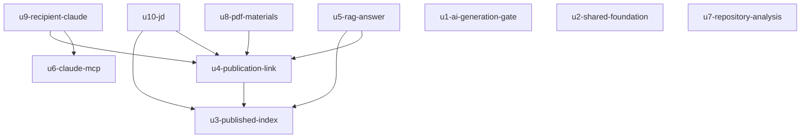

# CatchU 12월 범위 — Unit 의존

작성일: 2026-10-24. 고침: 2026-10-26 U7을 U7(저장소·분석)과 U10(JD)으로 나눔(Q4), YAML의 `depends_on`을 모두 빈 목록으로 둠(Q5). 입력: [Unit 정의](unit-of-work.md), [컴포넌트 목록](../domain-design/components.md)(components), [결정 기록](../domain-design/decisions.md)(decisions), [재승인 요구사항](../requirements-analysis/requirements.md)(requirements), [사용자 스토리](../user-stories/stories.md)(stories). 이 문서는 각 Unit이 어느 Unit을 통합·완료 전제로 하는지만 적는다. 무엇을 먼저 만들지와 담당은 납품 계획에서 정한다.

**화살표의 뜻:** 아래 그림과 표의 의존(화살표)은 "착수 전제"가 아니라 **"통합·완료 전제"**다. 모든 Unit은 계약 설계 뒤 11/2부터 계약과 합성 제공자로 병행 착수하고, 화살표가 가리키는 Unit이 구현된 뒤에 실제 연결을 확인하고 완료한다(팀장 결정 2026-10-24).

**YAML의 `depends_on`:** 팀 방식에서 Unit 맡기는 `depends_on`에 적힌 Unit이 끝나기 전에는 그 Unit을 맡지 못하게 막는다. 그래서 YAML의 `depends_on`은 모든 Unit에서 빈 목록으로 두고, 통합·완료 전제는 아래 그림과 표에만 적는다(Q5, 2026-10-26). 첫 Unit `u1-ai-generation-gate`는 YAML 맨 앞에 둔다.

## Dependency DAG

```yaml
units:
  - name: u1-ai-generation-gate
    kind: service
    depends_on: []
  - name: u2-shared-foundation
    kind: service
    depends_on: []
  - name: u3-published-index
    kind: service
    depends_on: []
  - name: u4-publication-link
    kind: service
    depends_on: []
  - name: u5-rag-answer
    kind: service
    depends_on: []
  - name: u6-claude-mcp
    kind: service
    depends_on: []
  - name: u7-repository-analysis
    kind: service
    depends_on: []
  - name: u8-pdf-materials
    kind: service
    depends_on: []
  - name: u9-recipient-claude
    kind: service
    depends_on: []
  - name: u10-jd
    kind: service
    depends_on: []
```

아래 그림과 표는 통합·완료 전제다. YAML에는 넣지 않는다.



<!-- Text fallback: 화살표는 "통합·완료 전제로 한다" 방향이다. u4는 u3을, u5는 u4와 u3을, u10은 u4와 u3을, u8은 u4를, u9는 u6과 u4를 통합·완료 전제로 한다. u1, u2, u3, u6, u7은 통합·완료 전제로 하는 Unit이 없다. 순환은 없다. -->

| Unit | 통합·완료 전제로 하는 Unit | 이유 |
|---|---|---|
| u1-ai-generation-gate | 없음 | 첫 통합 경로. 공용 계약 최소 부분과 함께 스스로 끝까지 돈다 |
| u2-shared-foundation | 없음 | 공용 기반은 통합·완료 전제로 하는 Unit이 없음(입력 §3) |
| u3-published-index | 없음 | 발행본 최소 DB 계약·사본·트랜잭션 전달 계약을 계약 설계에서 먼저 고정한다 |
| u4-publication-link | u3 | 발행 트랜잭션 안에서 조각 나누기를 부른다(ADR-005) |
| u5-rag-answer | u4, u3 | 링크 조건·사본(u4), 색인 상태·검색(u3) |
| u6-claude-mcp | 없음 | 텍스트 자료 표 모양은 계약으로 먼저 고정하고 시험용 자료로 개발한다(Q2) |
| u7-repository-analysis | 없음 | RepositoryAnalysis는 Publication·PublishedIndex에 의존하지 않는다(Q4) |
| u8-pdf-materials | u4 | PDF를 발행본에 넣는 부분이 Publication을 넓힌다 |
| u9-recipient-claude | u6, u4 | Claude 연결(u6)과 받은 링크 판정·읽기(u4) |
| u10-jd | u4, u3 | JD 요약의 링크 조건 판정과 발행본 읽기(u4), 근거 검색(u3) |

## 계약 의존 (DAG 밖)

공용 기반에 대한 의존은 DAG에 넣지 않는다. 아래 계약을 계약 설계에서 먼저 고정하고, 쓰는 Unit은 합성 제공자로 11/2부터 병행 착수한다(입력 §2-6, Q3).

| 계약 | 제공 | 쓰는 Unit |
|---|---|---|
| AI 생성 공통(인용 연결·근거 검사·출처 표시) | u1, u2 | u5, u10 |
| 백그라운드 실행(AiRun, 처리 시한 판정) | u2 | u3, u4, u5, u10 |
| 계정당 하루 실행 제한 | u2 | u4, u5, u7, u10 |
| 첫 이용 동의·고지 | u2 | u4, u10, u8 |
| 파일 저장 인터페이스 | u2 | u4, u8 |
| 탈퇴 순서·연쇄 삭제 규칙 | u2 | 모든 Unit(새 표의 외래 키) |
| 발행본·항목 최소 DB, 사본·트랜잭션 전달 | u4 | u3 |
| 텍스트 자료 표 모양 | u4 | u6 |
| Catch 설명 속성(10월 `catch_asset`에 작성자 설명 칸이 없어 새로 더함) | u4 | u6 |

이 계약들은 계약 설계에서 먼저 고정한다.

**양방향 쌍 u3↔u4:** 계약으로는 u3이 u4의 발행본·항목 모양을 쓰고, DAG로는 u4가 u3을 통합·완료 전제로 한다. u3은 계약대로 만든 발행본 시험 자료로, u4는 조각 나누기 호출 자리를 계약대로 둔 합성 구현으로 함께 시작하고, 실제 연결 확인은 u3 구현 뒤에 한다.

**바로 시작할 수 있는 부분:** u7의 저장소 등록·수집 상한(US1.2, US1.3)은 통합 전제가 되는 Unit이 없다. u10의 JD 저장(US6.5)은 u3·u4 없이 시작하며, u10→u4·u3 의존은 JD 요약의 통합·완료에만 걸린다.

## Integration points

| 경계 | 방식 | 비고 |
|---|---|---|
| u4 → u3 조각 나누기 | 같은 api 안 동기 호출, 발행 트랜잭션 참여 | 호출 경계를 계약 설계에서 먼저 정한다 |
| u4 → u2 작업 등록, u3·u5 처리기 | api 안 기존 큐(Redis/BullMQ) | 커밋 뒤 등록, 처리 시한은 상태 읽을 때 판정 |
| u5·u10 → u4 링크 조건 | 같은 api 안 동기 호출 | 웹·질의응답·JD·MCP가 같은 판정 |
| u5·u10 → u3 검색 | 같은 api 안 동기 호출 | 색인 준비 전·실패면 "아직 쓸 수 없음" |
| u6 → u4 텍스트 자료 | 공유 DB 표 읽기 | 표 모양은 계약 |
| u6 → u4 Catch 설명 | 공유 DB 표 읽기(Catch의 작성자 설명 속성) | 속성 모양은 계약, 계약 설계에서 먼저 고정 |
| u8 → worker | 기존 큐 + 10월 결과 수신 방식 | PDF 글 추출 |
| 전 Unit → u1·u2 | 계약 + 합성 제공자 | 통합 확인에서 실제 제공자로 바꾼다 |

## Parallel development opportunities

- 모든 Unit(u1~u10)은 계약 설계 뒤 11/2부터 계약과 합성 제공자로 함께 착수할 수 있다.
- 실제 연결 확인과 완료는 화살표를 따른다: u4는 u3 구현 뒤, u5·u10(JD 요약)은 u3·u4 구현 뒤, u8은 u4 구현 뒤, u9는 u4·u6 구현 뒤에 실제 연결을 확인하고 완료한다. u1·u2·u3·u6·u7은 통합 전제가 되는 Unit이 없다. 위상 순서는 여러 가지가 가능하다.
- 계약 의존만 있는 경우(공용 기반, 텍스트 자료 표, Catch 설명 속성)도 합성 제공자로 먼저 개발하고 통합 때 만난다.

## Walking skeleton

이번 계획은 첫 Unit을 작게 실제로 연결해 돌려 보는 통합 경로로 만든다. DAG의 첫 Unit은 `u1-ai-generation-gate`다. 다른 Unit 없이 공용 계약 최소 부분과 실제 Claude 인용 호출만으로 관문 네 가지를 끝까지 확인할 수 있다. 다른 Unit은 이 경로가 끝나기를 기다리지 않고 병행 착수한다(Q3). 위험: U1 관문 결과에 따라 U5·U7·U10의 AI 부분이 바뀔 수 있다(요구사항 A04). 인용 관문 네 가지는 10/24 사전 시험에서 통과했다. 다른 Unit의 병행 착수와 U1의 '최소 연결 첫 결과' 승인은 별개이며, U1 승인은 다른 Unit의 착수 조건이 아니다.
