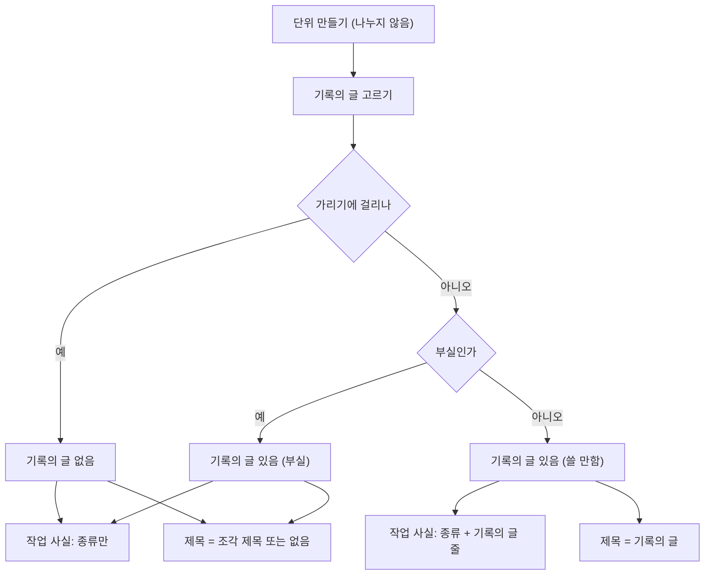
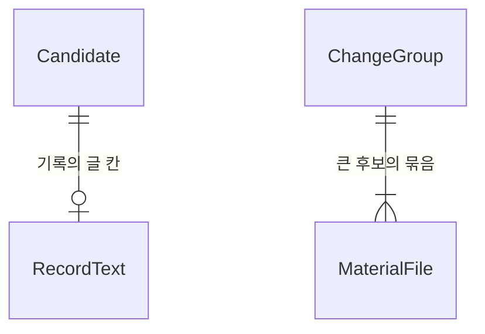

# CR1 규칙 쪽 Catch — 기능 명세

- **Unit:** CR1 `cr1-readable-catch`(첫 Unit 골격)
- **스토리:** `inception/user-stories/stories.md`의 US1.4, US2.1, US2.2(첫 줄·규칙 둘째 줄), US3.2, US4.1, US4.2, US4.3
- **정본 관계:**
  - 이 문서는 흐름의 정본이다.
  - 데이터 모양은 `entities.md`, 판단 규칙은 `rules.md`가 정본이다. 아래의 관계도와 규칙 요약은 그 두 문서에서 옮긴 것이다.
- **입력:**
  - Unit 정의 `inception/units-generation/unit-of-work.md`, 스토리 배정 `inception/units-generation/unit-of-work-story-map.md`
  - 요구사항 `inception/requirements-analysis/requirements.md`
  - 구성 요소 `inception/domain-design/components.md`
  - 계약 `inception/contract-design/contract-summary.md`(C5·C6·C7)
  - 이 단계의 답 `functional-design-questions.md`

## 1. 범위

| 바꾸는 것 | 바꾸지 않는 것 |
|---|---|
| 이슈 번호 나누기 끄기(FR2.1) | 결과 메시지·맥락 조회 계약, DB(계약 C5) |
| 기록의 글 고르기, 부실 판단, 제목 우선순위(FR5.1·FR5.2·FR5.7) | 생성 호출 자체(Claude에 바뀐 줄만 보내는 것, 조각 제목·문장 틀) |
| 작업 사실 첫 줄·둘째 줄(FR6) | 작업 동일성 열쇠 만드는 법(나뉘던 단위 제외) |
| 재료 종류 순서, 변경 묶음, 한 파일 상한(FR3) | 근거 20건 상한과 재료 커밋 범위 |
| 목록 카드 2줄, 받은 사람 안내 문장, 구직자 안내 낱말(FR8.1·FR8.3·FR8.4) | 발행 화면·공유 링크 화면의 제목 표시(Q6 A), 소개 페이지 문장 |

CR1에는 판정이 없다. 그래서 CR1의 모든 동작은 요구사항이 말하는 「AI 쪽을 껐을 때」다(FR4.1). 제목은 규칙으로 정하고, 설명은 지금의 문장 틀이다.

## 2. 흐름

### W1. 후보 글 만들기 (후보 판정)

1. 단위를 만든다. PR 단위와 PR 없이 합친 병합 단위는 이슈 번호로 나누지 않는다(BR1.1).
   - 나누기 글과 나누지 않은 이유의 한계 글은 만들지 않는다(BR1.2).
2. 단위마다 기록의 글을 고른다.
   1. PR 단위이고 PR을 연 계정이 연동 계정이며 다른 계정 커밋이 없다고 확인됐으면 PR 제목을 고른다(BR2.1).
   2. 아니면 단위 안 본인 커밋(병합 커밋 제외, 다른 곳에서 배정한 커밋 제외) 가운데 가장 이른 커밋의 첫 줄을 고른다(BR2.2).
   3. 고른 글의 첫 줄바꿈 앞을 잡고 앞뒤 공백을 뺀다(BR2.3). 비면 기록의 글이 없다.
   4. 가리기 검사에 걸리면 기록의 글이 없다. 다른 글로 바꿔 고르지 않는다(BR2.4). 검사는 후보 판정과 생성이 함께 쓰는 곳으로 옮긴 한 글 검사다.
   5. 부실 판단을 한다(BR2.5·BR2.6).
   6. 결과(종류, 글, 부실 여부)를 후보 자료의 기록의 글 칸에 한 번만 싣는다(BR2.7).
3. 작업 사실을 만든다.
   - 첫 항목은 종류다(BR4.1).
   - 기록의 글이 있고 부실이 아니면 두 번째 항목을 더한다(BR4.2).
   - 작업 사실의 다른 계정 문장만 지운다. 다른 계정 커밋 여부 값과 그 값을 쓰는 곳은 그대로다(BR4.4).
4. 나의 기여·묶음 설명·근거는 지금 규칙 그대로 만든다. 묶음 설명에서는 나누기 문장만 빠진다.
5. 값이 같은 후보를 합치면 첫 후보의 작업 사실과 기록의 글을 그대로 남긴다(BR4.5).
6. 기록의 글 칸은 후보 자료와 함께 생성 단계로 간다. 결과 메시지에는 싣지 않는다(entities.md RecordText).

### W2. 제목 정하기 (생성 단계)

1. 생성 단계는 지금처럼 후보마다 재료를 골라(W3) 생성 호출을 한다. 조각 제목과 문장 틀 설명을 받는다.
2. 후보 자료의 기록의 글 칸이 있고 부실이 아니면 제목은 기록의 글이다(BR3.1). 생성 단계는 기록의 글을 다시 계산하지 않는다(BR2.7).
   - 이 결정은 생성 호출이 성공했든, 실패했든, 고를 줄이 없거나 예산이 모자라 건너뛰었든 같다.
   - 설명 초안·생각해 볼 질문의 상태(성공·실패·NOT_GENERATED)는 지금 규칙 그대로다.
3. 아니면 조각 제목을 쓴다. 조각 제목도 없으면 제목은 없다(BR3.2).
4. 기록의 글 제목에는 40자 상한과 고쳐 쓰기를 쓰지 않는다. 기록의 글이 제목이면 조각 제목을 고쳐 쓰는 호출을 건너뛴다. 「제목만 없음」 집계는 최종 제목이 없는 경우만 센다(BR3.3).
5. 생성 단계는 작업 사실을 바꾸지 않는다(BR4.3).

### W3. 재료 고르기 (생성 단계)

1. 재료 커밋 범위는 지금과 같다. 근거에 든 본인 커밋 최근 20건 가운데 변경 내용을 받은 커밋이다.
2. 파일마다 종류를 판정한다(BR5.1).
3. 재료가 될 수 있는 줄을 모두 담아도 재료 상한 안이면 작은 후보다. 종류 순서로 담는다(BR5.2).
4. 상한을 넘으면 큰 후보다. 다음 순서로 담는다.
   1. 폴더가 처음 갈라지는 깊이로 묶음을 만든다(BR5.3).
   2. 갈라진 폴더가 모두 계층 이름이면 파일 이름 앞부분으로 다시 묶는다(BR5.4).
   3. 시험 파일을 대상 파일의 묶음으로 옮긴다(BR5.5).
   4. 묶음마다 몫(상한 ÷ 묶음 수)까지 종류 순서로 담는다(첫 채우기). 몫이 머리글 한 벌보다 작은 묶음은 첫 채우기에서 담지 않는다. 그다음 남은 양을 같은 순서로 다시 채운다(두 번째 채우기). 한 파일은 6,000 B까지다. 양은 전체 상한과 같게 직렬화한 UTF-8 바이트로 재고, 그 파일의 머리글을 포함한다(BR5.6).
5. 크기 때문에 뺀 줄을 커밋별로 표시하는 지금 처리(`select`의 크기 제외 표시)는 바꾸지 않는다.
6. 같은 수집 결과면 같은 재료가 같은 순서로 나온다(BR5.7).

### W4. 화면

1. 구직자 Catch 목록 카드와 받은 사람 목록 카드의 제목은 2줄에서 말줄임으로 끝난다. 상세는 전체다(BR6.1).
   - 제목 글은 그대로 두고 보이는 모양만 줄이므로, 카드 버튼·링크의 접근 이름에는 전체 제목이 있다.
2. 받은 사람 목록은 늘 두 절 안내를 보인다. 상세는 있는 것만 가리킨다(BR6.2).
3. 구직자 목록·상세 안내에서 「설명」이 「설명 초안」이 된다(BR6.3). FR8.4는 상세를 말하지만, 목록과 상세가 같은 안내 컴포넌트를 쓰므로 목록도 함께 바뀐다.

### 상태

CR1은 새 상태 기계를 만들지 않는다. 설명 초안의 상태(성공·실패·`NOT_GENERATED`)와 분석 처리 상태는 지금 그대로다. 제목은 상태가 아니라 W2의 우선순위로 정한다.

<!-- Text fallback: 단위를 나누지 않고 만든 뒤 기록의 글을 고른다. 가리기에 걸리면 기록의 글이 없다. 걸리지 않으면 부실인지 본다. 쓸 만한 기록의 글이면 작업 사실은 종류 줄과 기록의 글 줄이고 제목은 기록의 글이다. 부실하거나 없으면 작업 사실은 종류 줄뿐이고 제목은 조각 제목이거나 없다. -->

## 3. 시나리오 (시험 전에 정하는 기대 결과)

| # | 주어진 것 | 기대 결과 | 스토리 기준 |
|---|---|---|---|
| S1 | 본인 커밋이 서로 다른 이슈 2개를 가리키는 PR, 이슈 조회 허용 | 후보 하나, 나누기 글 없음 | AC1.4.1 |
| S2 | 커밋이 서로 다른 이슈를 가리키는 PR 없는 병합 | 후보 하나 | AC1.4.2 |
| S3 | 본인 PR, 커밋 목록 끝까지 받음, 다른 계정 커밋 없음 | 제목 = PR 제목, 둘째 줄 「PR 제목: "…"」 | AC2.1.1, AC2.2.2 |
| S4 | PR 커밋 목록이 잘림 | 기록의 글 = 가장 이른 본인 커밋 첫 줄 | AC2.1.2 |
| S5 | 첫 줄에 토큰 모양 문자열 | 기록의 글 없음, 둘째 줄 없음, 제목은 조각 제목이거나 없음 | AC2.1.3 |
| S6 | 첫 줄 「fix」 | 부실, 제목은 조각 제목, 둘째 줄 없음 | AC2.1.4, AC2.2.3 |
| S7 | 첫 줄 「로그인 오류 메시지 수정」 | 제목 = 그 글, 둘째 줄 「본인 커밋 메시지 첫 줄: "로그인 오류 메시지 수정"」 | AC2.1.5, AC2.2.2 |
| S8 | 새로 만든 Catch 셋(PR·병합·커밋 묶음) | 첫 줄에 SHA 꼴 16진수·날짜 없음 | AC2.2.1 |
| S9 | 모든 후보 | 작업 사실 어느 줄도 생성 출력이 아님 | AC2.2.4 |
| S10 | 문서 파일이 앞, 코드 파일이 뒤인 PR | 코드 줄이 먼저 담김 | AC3.2.1 |
| S11 | `FooTest.java` | 시험 | AC3.2.2 |
| S12 | 서로 다른 폴더 두 곳을 고친 큰 PR | 묶음 2개, 두 묶음 줄 모두 재료에 있음, 한 파일 6,000 B 이하 | AC3.2.3 |
| S13 | 100자 제목 | 목록 카드 2줄 말줄임, 상세 전체, 접근 이름 전체. 시험은 카드 제목에 줄임 표시 클래스가 붙고 글은 전체인지 단언하고, 2줄 말줄임 모양은 화면 확인으로 본다 | AC4.1.1, AC4.1.2 |
| S14 | 받은 사람 목록 / 설명 없는 상세 / 둘 다 없는 상세 | 두 절 / 제목 절만 / 안내 없음 | AC4.2.1~AC4.2.3 |
| S15 | 구직자 상세와 구직자 목록 | 두 곳 모두 안내에 「설명 초안」, 나머지 글 같음 | AC4.3.1, BR6.3 |
| S16 | 생성 호출이 실패한 후보, 기록의 글 쓸 만함 | 제목 = 기록의 글, 설명 초안 실패, 고쳐 쓰기 호출 없음 | BR3.1, BR3.3 |
| S17 | 「Initial commit」 | 부실 | BR2.6 |
| S18 | 나뉘지 않던 단위 | 작업 동일성 열쇠가 지금과 같음 | BR1.3 |
| S19 | 다른 계정이 연 PR에 본인 커밋 | PR 제목을 쓰지 않고 단위 안 가장 이른 본인 커밋 첫 줄 | BR2.1, BR2.2 |
| S20 | 본인 PR에 다른 계정 커밋이 섞임 | PR 제목을 쓰지 않음, 작업 사실에 다른 계정 문장 없음 | BR2.1, BR4.4 |
| S21 | 본인 커밋이 병합 커밋뿐인 단위 | 기록의 글 없음, 작업 사실 1줄 | BR2.2 |
| S22 | 첫 줄이 빈(공백뿐인) 가장 이른 커밋 | 기록의 글 없음 | BR2.3 |
| S23 | PR 없는 병합 단위, 커밋 묶음 하나·여럿, PR 조회 불허 요청의 커밋 묶음 | 「PR 없이 합친 병합」 / 「PR·병합 없이 들어간 본인 커밋」·「… 묶음」 / 「병합 없이 들어간 본인 커밋」 | BR4.1 |
| S24 | 큰 후보, 갈라진 폴더가 controller·service뿐 | 파일 이름 앞부분(User·Order)으로 묶음 | BR5.4 |
| S25 | 큰 후보, `src/a/Foo.java`와 `test/FooTest.java` | 시험 파일이 Foo의 묶음으로 옮겨짐 | BR5.5 |
| S26 | 묶음이 많아 몫이 머리글 한 벌보다 작은 큰 후보 | 첫 채우기에서 그 묶음은 비고, 두 번째 채우기가 담음, 전체 상한 안 | BR5.6 |
| S27 | 12 KB 파일 하나뿐인 작은 후보 | 파일 전체가 담김(상한 없음) | BR5.6 |
| S28 | 값이 같은 후보 둘 | 첫 후보의 작업 사실(최대 2줄)과 기록의 글이 남음 | BR4.5 |
| S29 | 단위 안 커밋과 다른 곳에서 배정한 더 이른 본인 커밋 | 단위 안 커밋의 첫 줄을 고름 | BR2.2 |

실패 조건:
- 가리기에 걸린 글이 제목이나 작업 사실에 나간다.
- 기록의 글이 잘린다.
- 작업 사실이 3줄 이상이다.
- 큰 후보에서 한 파일이 6,000 B(머리글 포함)를 넘는다.
- 같은 입력에서 재료 순서가 달라진다.
- 작업 사실 둘째 줄과 제목이 서로 다른 기록의 글 판단을 쓴다.

AC2.2.5(AI 쪽이 켜졌을 때 둘째 줄 유지)는 CR3이 맡는다.

## 4. 관계도 (entities.md에서 옮김)

<!-- Text fallback: 후보는 기록의 글 칸이 없거나 하나다. 작업 사실은 후보의 글 목록 칸(1~2항목)이다. 큰 후보의 변경 묶음은 재료 파일을 하나 이상 담는다. -->

## 5. 규칙 요약 (rules.md에서 옮김)

| 묶음 | 규칙 |
|---|---|
| 나누기 | BR1.1 나누지 않음, BR1.2 나누기 글 없음, BR1.3 나뉘던 단위만 열쇠 바뀜 |
| 기록의 글 | BR2.1 PR 제목 조건, BR2.2 단위 안 가장 이른 본인 커밋 첫 줄, BR2.3 첫 줄·안 자름, BR2.4 가리기(함께 쓰는 검사), BR2.5 부실 판단, BR2.6 부실 목록, BR2.7 한 번 계산해 한 칸에 싣기 |
| 제목 | BR3.1 쓸 만한 기록의 글, BR3.2 조각 제목, BR3.3 길이 규칙·고쳐 쓰기 없음 |
| 작업 사실 | BR4.1 종류 첫 줄(PR 조회 불허 예외), BR4.2 두 번째 항목, BR4.3 AI 글 없음, BR4.4 다른 계정 문장만 지움, BR4.5 최대 2줄·합칠 때 첫 후보, BR4.6 센 숫자 규칙 범위 |
| 재료 | BR5.1 종류 판정, BR5.2 종류 순서, BR5.3 폴더 묶음, BR5.4 계층 구조, BR5.5 시험 붙이기, BR5.6 고르게·큰 후보 한 파일 6,000 B(머리글 포함), BR5.7 결정성 |
| 화면 | BR6.1 목록 카드 2줄, BR6.2 받은 사람 안내, BR6.3 구직자 안내(목록·상세) |
| 문서·코드 정리 | BR7.1 worker 문서 크기 상한, BR7.2 나누기 코드·한계 문장 삭제 |

## 6. 다른 Unit과의 접점 (계약 C6·C7)

- **CR2:** 후보 판정(W1)의 입력에 소속 커밋 목록을 더하고, 그 목록으로 커밋을 뺀다. W1의 기록의 글은 뺀 뒤 남은 본인 커밋으로 고른다.
- **CR3:**
  - W2 뒤에 판정으로 제목을 고르는 단계를 더한다.
  - 판정이 「무엇을 했는지」에서 부실이라고 하면 작업 사실의 두 번째 항목(BR4.2)을 위치로 지운다. 표식은 없다.
  - 판정 입력의 기록의 글은 후보 자료의 기록의 글 칸(BR2.7)에서 읽는다. 다시 계산하지 않는다.
  - W3의 큰 후보에서는 재료 판정 답을 우선한다. 판정이 없거나 실패하면 W3 그대로다.
- **값의 이름:** 기록의 글 칸의 종류(`PR_TITLE`·`COMMIT_FIRST_LINE`)·글·부실 여부는 entities.md의 RecordText를 따른다.

## 7. 지금 코드와의 대응

| 흐름 | 지금 코드 |
|---|---|
| W1 나누기(지움) | `worker/app/candidates/grouping.py`의 `_split`과 `NOT_SPLIT_*` 한계, `GroupedUnit.parts`·경로 허용 목록, `identity.py`의 조각 값 |
| W1 작업 사실·묶음 설명 | `worker/app/candidates/build.py`(PR·병합·커밋 묶음 글, 다른 계정 문장, 같은 값 후보 합치기) |
| W1 가리기 검사 | `worker/app/generation/redact.py`의 `mask_text`를 후보 판정과 생성이 함께 쓰는 모듈로 옮긴다. 지금 `app.candidates`가 `app.generation`을 불러오면 `material.py`를 거쳐 불러오기 순환이 날 수 있다 |
| W1 후보 자료 | `worker/app/processing/generation.py`의 후보 자료(지금 작업 사실만 있음)에 기록의 글 칸을 더한다 |
| W2 제목 | `worker/app/generation/flow.py`(제목 고르기·고쳐 쓰기·적용, 운영 로그 집계), `title.py` |
| W3 재료 | `worker/app/generation/title.py`의 `classify`, `request.py`의 `select`, `material.py` |
| W4 구직자 화면 | `web/src/features/assets/assets-view.tsx`(목록 카드·안내), `assets.module.css` |
| W4 받은 사람 화면 | `web/src/features/recipient/recipient-screen.tsx`·`recipient-format.ts`, `recipient.module.css` |

함께 고칠 문서(BR7.1):
- `worker/docs/candidate-text.md`: 작업 사실 첫 항목 문장, 다른 계정 문장, 제목 절, 후보 순서의 나눈 부분 항목
- `worker/docs/candidate-decision.md`: 「나누기」 절을 지운다(34,053 B에서 줄어든다)
- `worker/docs/candidate-checks.md`: 나누기·다른 계정 문장 시험 설명
- `worker/docs/relation-collection.md`(35,793 B): 이슈 번호를 나누기 신호에 쓴다는 줄을 바꾼다. 늘리지 않는다
- `worker/docs/generation.md`(35,312 B): 「재료 찾기」에는 새 문서를 가리키는 줄만 둔다. 재료 순서·변경 묶음은 새 문서 `worker/docs/generation-material.md`에 쓴다
- `web/src/features/recipient/README.md`, `web/src/features/assets/README.md`: 안내 문장
- 작업 동일성 기준 문서의 「나누기」 언급

함께 고칠 시험:
- worker: `worker/tests/test_candidate_grouping.py`(작업 사실 꼴·나눈 부분), `worker/tests/candidate_scenarios.py`(`assert_member_text`의 센 숫자 검사를 CatchU 문장에만, BR4.6), `worker/tests/test_generation_material.py`, 생성 흐름·제목 시험
- web: `web/test/assets-view.test.mjs`, `web/test/recipient.test.mjs`(안내 문장)

## 8. 한계

- **종류 판정 변경의 영향:** 종류 판정(BR5.1)은 조각 제목의 「종류」에도 쓰인다. `build.gradle.kts`처럼 판정이 바뀐 파일은 조각 제목의 종류도 바뀐다. `.ipynb`는 조각 제목을 만들 수 있게 된다.
- **본인 커밋 첫 줄을 쓰는 경우:** 가리기에 걸리거나 부실한 PR 제목은 본인 커밋 첫 줄로 바꿔 고르지 않는다(BR2.4).
  - 다른 계정 커밋이 섞인 PR은 PR 제목 대신 본인 커밋 첫 줄을 쓴다. 그 첫 줄이 PR 작업 전체를 나타내지 못할 수 있다.
  - 이 경우는 CR3의 「전체를 나타내나」 판정이 다룬다.
- **재료 범위:** 재료는 여전히 근거 20건 안의 커밋에서만 고른다. 그보다 오래된 본인 커밋의 파일은 재료가 아니다.
- **작은·큰 후보 경계:** 재료 줄을 모두 담으면 상한을 조금 넘는 후보는 큰 후보가 되어, 한 파일 6,000 B 상한 때문에 큰 파일이 갑자기 잘린다. 바로 아래 크기의 작은 후보는 같은 파일을 다 담는다.
- **첫 줄 예외:** PR 조회가 허용되지 않은 요청의 커밋 묶음 첫 줄은 AC2.2.1의 세 가지 꼴 밖이다(「병합 없이 들어간 본인 커밋」, BR4.1).
- **산출물 파일:** 산출물 파일(잠금 파일·빌드 결과)은 거르지 않는다(입력 문서 §8-2). 판정이 없으면 코드처럼 보이는 산출물이 앞자리를 차지할 수 있다.
- **바뀌지 않는 안내 문장:** 소개 페이지의 「제목과 설명은 CatchU가 GitHub 기록에서 자동으로 만들었습니다」는 고치지 않는다. 구직자 안내의 「제목」 절도 그대로다(FR8.4는 한 낱말만 고친다). 기록의 글이 제목인 Catch에서는 이 문장이 정확하지 않다.
- **나뉘던 단위의 열쇠:** 지금 나뉘던 단위는 열쇠가 달라진다. 이미 등록된 그런 Catch는 다음 분석에서 새 Catch로 나올 수 있다(FR1.7 예외). 출시 직전 DB 초기화로 정리된다.
