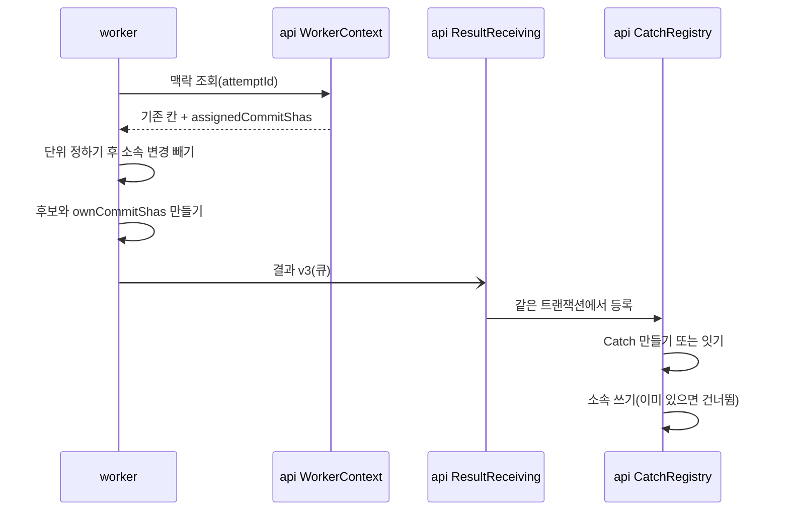
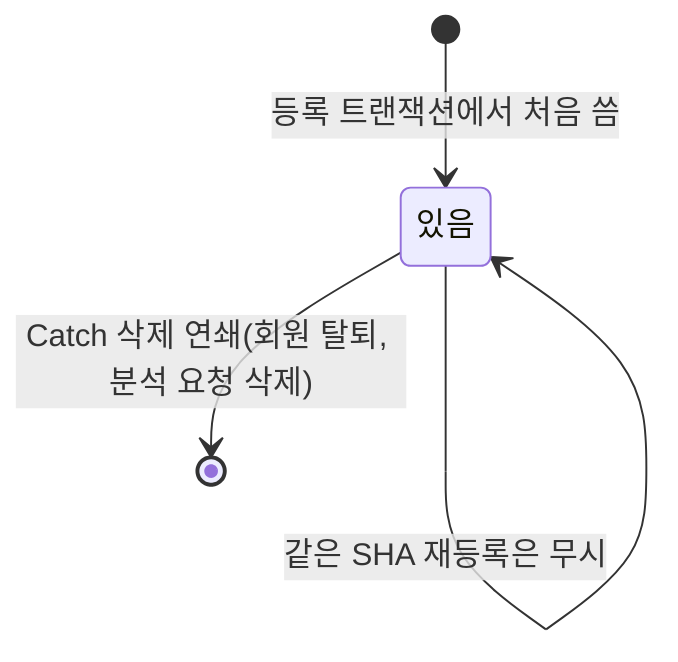
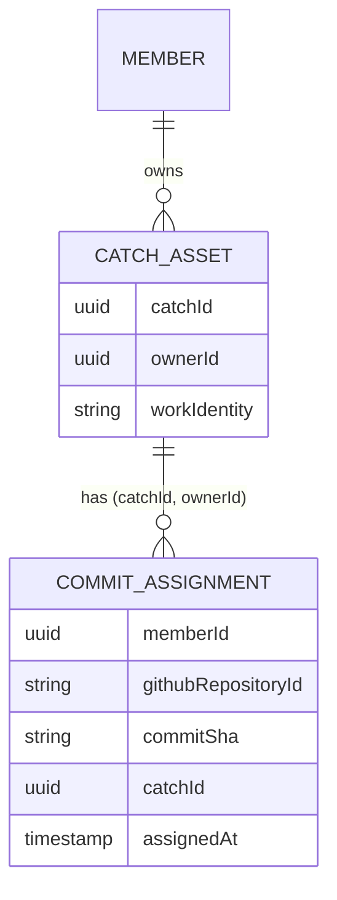

# CR2 소속 저장 — 기능 명세

입력:
- Unit `inception/units-generation/unit-of-work.md`(CR2), 스토리 `inception/user-stories/stories.md`의 US1.1·US1.2·US1.3
- 요구사항 `inception/requirements-analysis/requirements.md`의 FR1·NFR4·NFR6·NFR7·가정 A4
- 구성 요소 `inception/domain-design/components.md`, 결정 `decisions.md`(ADR-001~003), 계약 `inception/contract-design/contract-summary.md`(C1·C2)
- 이 단계의 답 `functional-design-questions.md`(Q1 A, Q2 A)
- 데이터 모양은 `entities.md`, 판단 규칙은 `rules.md`가 정본이다. 이 문서는 순서와 상태 흐름의 정본이다.

이 Unit이 구현하는 스토리: US1.1, US1.2, US1.3(`inception/user-stories/stories.md`).

## 1. 한눈에

- api가 커밋마다 소속 Catch를 기록하고, 재분석 때 worker에 그 목록을 준다.
- worker는 단위를 지금처럼 다 정한 뒤 이미 소속된 변경을 빼고, 남은 새 변경으로만 후보를 만든다.
- 같은 PR의 새 커밋은 기존 Catch에 소속만 더하고, PR 없는 새 커밋 묶음은 새 Catch가 된다.
- 화면은 바꾸지 않는다(Q2 A). 결과 메시지만 판본이 "3"으로 오른다.

## 2. 흐름

### W1. 재분석 한 번(정상)

1. 구직자가 저장소를 다시 분석한다. 접수는 회원마다 진행 중 요청을 하나만 둔다(가정 A4 성립, 아래 6).
2. worker가 요청을 꺼내 api 맥락 조회를 부른다.
3. api(WorkerContext)가 그 시도의 회원·분석 요청 저장소 ID의 소속 SHA 전체를 `assignedCommitShas`로 응답한다(BR3.1, C1).
4. worker가 응답을 해석한다. 칸이 없거나 모양이 틀리면 `CONTEXT_RESPONSE_INVALID`로 끝난다(BR2.3).
5. worker가 수집한 뒤 단위를 지금 규칙대로 다 정한다(BR1.2).
6. 각 단위에서 소속 변경을 뺀다(BR1.1). 남은 본인 기여 변경이 없으면 그 단위를 버린다(BR1.4).
7. 남은 단위로 후보를 만든다. PR·병합은 열쇠 그대로, 커밋 묶음은 남은 커밋으로 새 열쇠다(BR1.3). 기여·기록의 글·작업 사실·근거는 남은 변경으로 정한다(BR1.5).
8. 생성 단계가 재료를 찾을 때, 5~6을 같은 수집 결과와 같은 소속 집합으로 다시 해 같은 열쇠의 단위를 찾는다(BR1.6).
9. worker가 후보마다 `ownCommitShas`를 싣고 판본 "3" 결과를 보낸다(BR2.1·BR2.2).
10. api가 결과를 검사하고, 한 트랜잭션에서 후보를 등록한다. 같은 열쇠의 Catch가 없으면 만들고, 있으면 잇는다(지금 동작).
11. 같은 트랜잭션에서 그 열쇠 후보들의 `ownCommitShas`를 그 Catch 소속으로 쓴다. 이미 있는 (회원, 저장소, SHA)는 건너뛴다(BR3.2·BR3.3).
12. 트랜잭션이 끝나면 Catch와 소속이 함께 남는다. 실패하면 둘 다 남지 않는다(ADR-001).

<!-- Text fallback(아래 그림): worker가 맥락 조회로 소속 SHA를 받고, 단위를 정한 뒤 소속 변경을 빼서 후보를 만든다. 결과 v3를 큐로 보내면 api가 한 트랜잭션에서 Catch를 만들거나 잇고 소속을 쓴다. -->

### W2. 첫 분석, 합성 요청, FR10 확인 명령

- 소속 집합이 비어 뺄 것이 없다. 단위·후보·열쇠·미제공 수가 지금과 같다(BR1.7).
- 첫 분석의 결과도 판본 "3"이고, 등록 때 소속이 처음 써진다.
- 합성(MOCK) 요청은 맥락 조회를 부르지 않으므로 빈 집합이다. FR10 확인 명령(CR3)도 api 없이 돌아 빈 집합이다.
- 합성 결과도 후보마다 합성 수집 결과의 본인 커밋 SHA를 `ownCommitShas`로 싣고, api는 같은 규칙으로 소속을 쓴다(BR2.1·BR3.2).

### W3. 같은 PR에 새 커밋이 더해진 재분석(US1.2 AC1.2.1)

1. 기존 Catch A가 PR 10의 커밋 c1·c2로 만들어졌고 소속이 c1·c2 → A다.
2. PR 10에 c3이 더해졌다. 재분석의 PR 10 단위에서 c1·c2 변경을 빼면 c3만 남는다.
3. 후보의 열쇠는 PR 10 그대로다. 본인 커밋 목록은 [c3]이다.
4. api가 같은 열쇠의 A를 찾아 잇는다. A의 제목·작업 사실·근거·초안·작성자 설명 두 칸·저장 시각은 쓰지 않는다(BR3.4).
5. c3 → A 소속을 쓴다.

### W4. 통합 PR이 Unit PR 커밋을 다시 담는 재분석(US1.2 AC1.2.2)

1. Unit PR의 Catch U가 커밋 5개를 소속으로 가진다.
2. 통합 PR 20이 그 5개와 새 커밋 1개를 담는다. 5개 변경을 빼면 새 커밋 1개가 남는다.
3. 열쇠 PR 20의 Catch가 없으면 새 Catch가 되고, 새 커밋 1개만 소속이다. 5개는 U 소속 그대로다(BR3.3).

### W5. PR 없는 직접 커밋이 이어지는 재분석(US1.3 AC1.3.1)

1. 직접 커밋 d1~d3이 커밋 묶음 Catch B 소속이다.
2. 같은 작업의 직접 커밋 d4·d5가 더해졌다. 단위를 지금처럼 정하면 d1~d5가 한 커밋 묶음이 된다.
3. d1~d3을 빼면 d4·d5가 남고, 열쇠는 [d4, d5]로 새로 만든다(BR1.3). d4와 d5가 서로는 같은 파일을 고치지 않았어도 d1~d3을 거쳐 이어졌으면 한 묶음이다(Q1 A).
   - 묶음 근거는 두 끝이 d4·d5인 연결만 남긴다. 묶음 설명에는 「이미 다른 Catch에 속한 커밋을 거쳐 이어진 커밋도 한 묶음에 두었다.」를 더한다. 남은 연결이 없으면 이 문장이 근거의 전부이고, 분석은 멈추지 않는다(BR1.8).
4. 새 Catch가 생기고 d4·d5가 소속이다. B와 그 소속은 바뀌지 않는다.

### W6. 바뀐 것이 없는 재분석

1. 모든 단위의 변경이 이미 소속이라 모든 단위가 버려진다(BR1.4). 미제공 수에도 세지 않는다.
2. 후보 0개, 실패 0개라 결과는 EMPTY다. 저장소 화면은 지금 문구 「분석을 마쳤습니다. 검토할 Catch가 없습니다.」를 보인다(Q2 A). 기존 Catch는 그대로 있다.

### W7. 실패·재전송

- **소속 쓰기 실패(DB 오류):** 결과 반영 트랜잭션 전체가 롤백되고 지금처럼 반영 실패로 기록된다. Catch만 남거나 소속만 남는 경우는 없다.
- **같은 결과 재전송:** 같은 수신 기록이면 지금처럼 저장된 등록 묶음만 재응답하고 소속은 다시 쓰지 않는다(BR3.5).
- **판본 어긋남(배포 중):** worker가 옛 응답 모양을 받으면 `CONTEXT_RESPONSE_INVALID`, api가 "2" 결과를 받으면 `SCHEMA_INVALID`로 그 분석이 실패한다. 받아들인 동작이다(BR4.1).
- **소속 기록 조회 실패:** 맥락 조회가 500을 돌려주고 worker는 지금 처리대로 그 시도를 끝낸다.

## 3. 상태

소속 기록은 상태가 둘뿐이다. 새 상태 칸은 두지 않는다.

<!-- Text fallback: 소속 기록은 등록 트랜잭션에서 한 번 써지고(있음), 바뀌지 않으며, Catch가 지워질 때만 함께 사라진다(없음). -->

- Catch 상태(만들기·잇기)는 지금과 같다. CR2는 잇기 경로에 소속 쓰기만 더한다.

## 4. 엔티티 관계(파생 보기, 정본은 `entities.md`)

<!-- Text fallback: 회원 하나가 Catch 여럿을 가지고, Catch 하나가 소속 기록 여럿을 가진다. 소속 기록은 (Catch ID, 회원) 한 쌍으로 Catch를 가리킨다. -->

## 5. 규칙 요약(파생 보기, 정본은 `rules.md`)

| 묶음 | 규칙 |
|---|---|
| worker 빼기 | BR1.1 변경 단위로 소속 판정, BR1.2 단위를 정한 뒤 뺌, BR1.3 커밋 묶음만 새 열쇠, BR1.4 남은 기여 없으면 버림(미제공 아님), BR1.5 남은 변경으로 후보, BR1.6 두 곳이 같은 집합·같은 함수, BR1.7 빈 집합은 지금과 같음, BR1.8 뺀 커밋 묶음의 연결·설명 |
| worker 메시지 | BR2.1 ownCommitShas, BR2.2 결과 "3", BR2.3 맥락 조회 칸 필수 |
| api 소속 | BR3.1 맥락 조회가 소속 SHA 전체, BR3.2 등록 트랜잭션에서 쓰기, BR3.3 이미 있으면 건너뜀, BR3.4 기존 Catch 내용 그대로, BR3.5 재응답은 다시 안 씀, BR3.6 주인 회원만, BR3.7 Catch 따라 삭제 |
| 배포 | BR4.1 api·worker 함께, 진행 중 분석 없을 때 |

## 6. 확인한 것과 한계

- **가정 A4 확인:** 접수(`api/src/analysis-intake/analysis-intake.service.ts`)는 회원마다 `ACTIVE` 요청을 하나만 둔다. 소속 열쇠에 회원이 들어 있어 같은 회원의 소속을 두 분석이 동시에 쓰지 않는다. 다른 회원은 열쇠가 달라 겹치지 않는다.
- **CR2 배포 전 Catch:** 소속이 없다. 재분석 때 같은 열쇠로 이어지면서 소속이 써진다. 출시 전 마지막 DB 초기화로 지워진다.
- **보류한 변경:** 단위 미확정으로 보류한 본인 변경은 소속이어도 지금처럼 미제공(판정 불가)으로 센다. 뺄 대상을 단위에서만 고르기 때문이다(BR1.2).
- **기여 판정이 남은 변경만 본다:** 기존 PR에 아주 작은 커밋만 더해지면 기준 미달로 후보가 되지 않을 수 있다. 그 커밋은 소속이 써지지 않고 다음 재분석에서 다시 판정된다. 기존 Catch는 그대로다.
- **같은 변경의 다른 SHA:** 같은 변경으로 확인된 SHA 가운데 하나라도 소속이면 변경 전체를 뺀다. 그 변경의 새 SHA는 소속에 써지지 않지만, 다음 재분석에서도 같은 이유로 빠진다.
- **받아들인 낭비(ADR-001):** worker는 후보가 기존 Catch로 이어질지 모르므로 W3의 후보에도 생성(AI 쪽이 켜졌으면 판정도)을 부르고, 그 결과는 버려진다.
- 요구사항 「한계」(rebase로 SHA가 바뀐 커밋, PR 없는 단위의 이어지는 작업이 새 Catch)는 그대로다.

## 7. 함께 고칠 문서와 시험(코드 생성 계획의 후보)

같은 규칙을 적은 문서를 모두 고친다(프로젝트 규칙). 코드 생성 계획에서 줄 단위로 확정한다.

- **계약:** `api/contracts/repository-analysis/worker-messages.yaml`(Result 판본 "3", `Candidate.ownCommitShas`), `api/docs/worker-context.md`(C1 칸), `api/docs/repository-analysis-u7.md` 37행(「Result 모두 `schemaVersion: '2'`」)과 「기존 Catch를 보존하는 재분석」 둘째 단락(「같은 작업은 기존 Catch … 새 작업만 비공개 Catch로 추가」에 소속 커밋 빼기·같은 PR의 새 커밋은 기존 Catch 소속을 더한다)
- **worker 재료 찾기:** `worker/docs/generation-material.md` 9행(「같은 수집 결과로 `group(outcome)`을 다시 불러」), `worker/docs/generation.md` 「재료 찾기」 절, `worker/docs/candidate-text.md` 33행 — 다시 부를 때 같은 소속 집합을 넘긴다(BR1.6)
- **api:** `api/docs/catch-registration-rules.md`·`catch-registration-database.md`(소속 쓰기, 새 표), `api/docs/member-withdrawal-deletion.md` 삭제 목록 표(소속 기록 행, 「Catch」로 지워짐)
- **worker:** `worker/docs/request-context.md`(새 칸), 후보 판정 문서(빼기 규칙·열쇠). `worker/docs/candidate-decision.md`가 31,112 B라, 빼기 규칙은 새 문서(예: `worker/docs/commit-assignment.md`)에 쓰고 링크만 둔다(NFR7)
- **작업 동일성 문서:** `docs/CatchU_work_identity_cases.md` 21행 C3(「갱신은 재분석 정책에서 정한다」), `docs/CatchU_작업동일성_판별기준.md` 35행(「새 커밋·재분석에 따른 … 정책은 보류」), `docs/CatchU_work_identity_rules.md`의 재분석 관련 줄(19·86행)에 CR2 소속 규칙과 그 위치를 적는다
- **시험:**
  - api: 소속 쓰기(새 Catch·기존 Catch·이미 있음 건너뜀·다른 회원 거부), 맥락 조회의 새 칸, 결과 "2" 거부와 "3" 수신, 탈퇴 연쇄 삭제 시험에 소속 기록
  - worker: 빼기(W3·W4·W5·W6), 뺀 커밋 묶음의 연결이 비는 경우(W5, 분석이 멈추지 않고 고정 문장), 열쇠 결정성(같은 입력 두 번), 빈 집합이면 지금과 같음, 맥락 조회 칸 해석, 결과 조합의 `ownCommitShas`(합성 포함), 기존 작업 동일성 시험 유지
