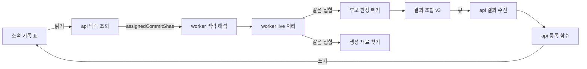

# CR2 소속 저장 — 논리 구성 요소

입력: CR2 비기능 요구사항(`nfr-requirements/*.md`), 기능 명세 `functional-design/functional-spec.md`, 계약 `inception/contract-design/contract-summary.md`(C1·C2), 지금 코드(`worker/app/request_context/decode.py`·`client.py`, `worker/app/processing/live.py`, `worker/app/candidates/build.py`·`grouping.py`, `worker/app/generation/material.py`, `api/src/catches/registration-service.ts`, `api/src/worker-context/`).

새 배포 단위나 새 인프라는 없다. 기존 api·worker 안의 자리만 바뀐다.

| 논리 구성 요소 | 있는 곳 | 바뀌는 것 | 실패 범위 |
|---|---|---|---|
| 소속 기록 표 | api DB(PostgreSQL) | 새 표 `commit_assignment`, `catch_asset`의 (catch_id, owner_id) 유일 조건 | 한 회원의 한 결과 반영(롤백) |
| 소속 쓰기 | api `catches/registration-service.ts`의 등록 함수 | Catch를 찾은 뒤 같은 트랜잭션에서 1,000행 묶음으로 충돌 무시 삽입 | 그 결과 반영 하나 |
| 소속 읽기 | api `worker-context` 서비스 | 응답에 `assignedCommitShas` 한 칸 | 그 시도의 맥락 조회(500) |
| 맥락 해석 | worker `request_context/decode.py` | 새 칸을 필수로 읽어 `DecodedContext`·`ContextFound`에 소속 집합(frozenset)을 싣는다. 응답 상한 1 MiB(`settings.py`) | 그 시도(`CONTEXT_RESPONSE_INVALID`·`CONTEXT_RESPONSE_TOO_LARGE`) |
| 소속 빼기 | worker `candidates`(단위 정하기 끝) | `group(outcome, assigned)`가 단위를 정한 뒤 소속 변경을 빼고(BR1.1~BR1.4·BR1.8), 버린 단위 수를 돌려준다 | 그 요청 하나 |
| 소속 집합 전달 | worker `processing/live.py` | `LiveGenerator`가 `found`의 소속 집합을 `build_candidates`와 `run_generation`(재료 찾기)에 같은 값으로 넘긴다(BR1.6). 합성·FR10 확인 명령은 빈 집합 기본값 | 없음(값 전달) |
| 결과 조합 | worker `processing/result.py` | 후보의 `ownCommitShas`, Result 판본 "3" | 그 결과(스키마 검사 실패면 결함) |
| 결과 수신 | api `analysis-receiver` 타입·계약 YAML | "3"만 받음, `Candidate.ownCommitShas` | 그 결과(`SCHEMA_INVALID`) |

## 경계

- 소속 기록은 api만 쓰고 읽는다. worker는 저장하지 않고, 시도마다 받은 집합으로 계산만 한다.
- 빼기는 worker 후보 판정 안의 한 함수다. 생성 재료 찾기는 같은 함수를 같은 집합으로 다시 부른다.
- 화면(web)은 바뀌지 않는다(기능 설계 Q2 A).

<!-- Text fallback: api의 소속 기록 표를 등록 함수가 쓰고 worker 맥락 조회가 읽는다. worker는 맥락 해석에서 소속 집합을 받아 live 처리가 후보 판정과 생성 재료 찾기에 같은 값으로 넘기고, 결과 조합이 ownCommitShas를 실어 v3 결과를 보낸다. -->

