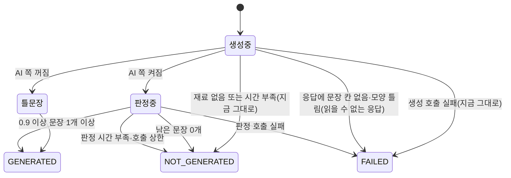
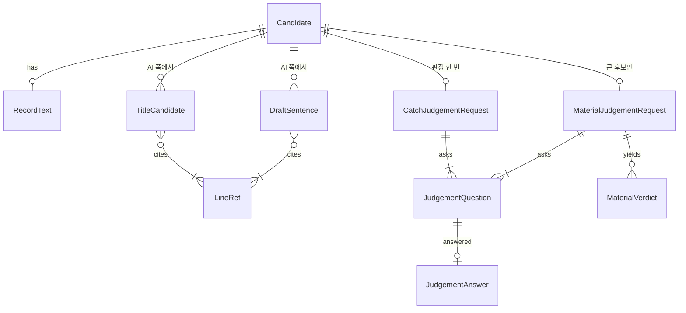

# CR3 AI 쪽 — 기능 명세

입력:
- Unit 정의 `inception/units-generation/unit-of-work.md`(CR3), 스토리 배정 `unit-of-work-story-map.md`
- 스토리 `inception/user-stories/stories.md`: 이 Unit이 맡는 것은 US2.3, US3.1, US3.3, US4.4와 US2.2의 AC2.2.4·AC2.2.5다
- 요구사항 `inception/requirements-analysis/requirements.md`, 구성 요소 `inception/domain-design/components.md`
- 계약 `inception/contract-design/contract-summary.md`(C3·C4·C5·C7)
- CR1 기능 설계 `construction/cr1-readable-catch/functional-design/`(W2·W3, 6절 접점)
- 이 단계의 답 `functional-design-questions.md`(Q1~Q7)

엔티티는 `entities.md`, 규칙은 `rules.md`의 YAML이 정본이다. 이 문서는 흐름과 상태 전이의 정본이다.

## 1. 범위

- **하는 것:** 판정 공급자 자리(OpenAI·Claude·합성), AI 쪽 켜기, 큰 후보의 재료 판정, Claude 제목 후보·설명 문장과 기계 대조, Catch 판정으로 제목 고르기·설명 거르기·작업 사실 둘째 줄 지우기, 설명 칸 숨기기, 고지 v3·첫 이용 고지 판본(FR10을 넘었을 때만), FR10 확인용 개발 명령.
- **하지 않는 것:** 결과 메시지·Catch 응답 모양 변경(C5), 소속 저장(CR2), 받은 사람 쪽 검색 조각·질의응답·요약·MCP, Catch별 제목 출처 칸, 산출물 규칙 거르기.
- **켜기 전제:** FR10 기준(BR9.3)을 넘을 때만 운영에서 켠다. 못 넘으면 코드는 합치되 판정 키를 넣지 않는다.

## 2. 흐름

### W1. AI 쪽 정하기 (LIVE 조립)

1. 분석 시도마다 LIVE 조립이 설정을 읽는다(BR1.1).
2. 켜졌으면 공급자에 맞는 판정 어댑터(OpenAI·Claude)를 만들어 생성기에 넘긴다. 꺼졌으면 넘기지 않는다.
3. 시험은 합성 판정 어댑터를 넘긴다. 외부 호출이 없다.

### W2. 큰 후보의 재료 판정 (생성 전)

1. AI 쪽이 켜졌고 후보가 큰 후보(CR1 BR5.6)면, CR1 규칙 순서로 파일을 늘어놓는다.
2. 질문을 만든다(BR6.1). 입력은 CR1 W3와 같은 출처의 파일이고, 바뀐 줄 앞 5줄은 가리기 검사를 거친다. 질문 400개에 들어가는 앞쪽 파일까지만 묻는다(BR6.2).
3. 재료 판정 요청을 한 번 보낸다. 실패하면 다시 부르지 않는다(BR2.2).
4. 답을 MaterialVerdict로 정리해 CR1 W3에 넘긴다(BR6.3). 답이 없으면 W3는 CR1 그대로다(BR6.4).

### W3. 생성 (Claude)

1. 생성 요청 자료는 지금처럼 바뀐 줄만 담는다(BR2.4).
2. AI 쪽이 켜졌으면 응답에 제목 후보 0~3개와 설명 문장 1~3개를 받는다. 후보·문장마다 근거 줄 id를 가리킨다(BR3.1·BR5.1). 조각 제목 대상(지금의 `title`)과 생각해 볼 질문은 지금처럼 받는다.
3. AI 쪽이 꺼졌으면 지금 응답(조각·제목 대상·질문)과 틀 문장 그대로다(BR1.3).
4. 응답을 읽은 뒤 후보·문장마다 기계 대조를 한다(BR3.3). 40자를 넘는 후보는 버린다.

### W4. Catch 판정과 적용 (생성 뒤)

1. 질문을 만든다(BR2.1).
   - 기록의 글이 규칙으로 부실하지 않으면 RECORD_WHAT, 조건이 맞으면 RECORD_WHOLE(BR3.2)
   - 기계 대조를 통과한 후보가 있으면 TITLE_CHOICE(후보와 NONE)
   - 통과한 문장마다 SENTENCE_TRUE
2. 질문이 있으면 판정 요청을 한 번 보낸다. 입력은 BR2.3대로다.
3. 답을 적용한다.
   - 제목: BR3.4 순서
   - 작업 사실: RECORD_WHAT이 0.5 미만이면 둘째 줄을 지운다(BR4.1)
   - 설명: 0.9 이상인 문장만 이어 쓴다(BR5.2). 하나도 없으면 NOT_GENERATED(BR5.3)
4. 판정이 실패하면 제목은 판정 없이 정하고(BR3.5), 둘째 줄은 두고(BR4.1), 설명은 FAILED다(BR5.4).
5. 판정을 보내지 않는 경우(BR2.6):
   - 생성 응답이 없는 Catch(재료 없음·생성 건너뜀·생성 호출 실패)는 판정하지 않는다. 설명·질문은 지금 상태 그대로, 제목·둘째 줄은 「판정 없음」(BR3.5·BR4.1)이다.
   - 생성은 됐지만 판정 시간(20초)이 남지 않았거나 판정 호출 상한에 닿았으면 판정하지 않는다. 설명은 NOT_GENERATED, 요청 실패 항목 GENERATION_BUDGET_EXHAUSTED 1건, 제목·둘째 줄은 「판정 없음」이다.
6. RECORD_WHAT 답만 빠진 경우도 기록의 글은 「판정 없음」으로 다룬다(BR2.5). 제목과 둘째 줄이 같은 판단을 쓴다.

### W5. 화면과 고지

1. 구직자·받은 사람 상세는 NOT_GENERATED면 설명 칸을 그리지 않는다(BR7.1).
2. 고지 v3와 첫 이용 고지 판본은 FR10을 넘었을 때 마지막 단계로 넣는다(BR8.1~BR8.3). 판정 키는 v3가 배포된 뒤에 서버에 넣는다.

### W6. FR10 확인 (개발용 명령)

1. 팀장이 저장소별로 명령을 돌린다. 공개 저장소는 실제 GitHub에서 받아 수집 결과 파일로 남기고, 비공개 CatchU는 수집 결과 파일을 넣는다.
2. 운영과 같은 W2~W4를 돌려 로컬 확인표를 쓴다(BR9.1). 결과 메시지는 보내지 않는다.
3. 팀장이 표에 맞음·틀림을 표시한다. 커밋되는 확인 기록에는 건수·결과·결정만 옮긴다(BR9.2·BR9.3).

### 상태

설명 초안 상태(Catch마다):

<!-- Text fallback: 생성 중인 Catch는 재료가 없거나 시간이 모자라면 NOT_GENERATED, 생성 호출이 실패하거나 응답에 문장 칸이 없거나 모양이 틀리면 FAILED가 된다. AI 쪽이 꺼졌으면 틀 문장으로 GENERATED다. 켜졌으면 판정으로 넘어가 0.9 이상 문장이 하나라도 있으면 GENERATED, 하나도 없으면 NOT_GENERATED, 판정을 시작할 시간이 없거나 호출 상한에 닿으면 NOT_GENERATED, 판정 호출이 실패하면 FAILED다. -->

제목 출처를 정할 때 「판정 없음」은 판정 요청이 실패했거나, 보내지 않았거나, RECORD_WHAT 답이 빠진 경우다. 이때는 BR3.5를 따른다.

제목 출처(Catch마다, AI 쪽이 켜졌을 때): 기록의 글 → AI 후보 → 전체 미달만으로 떨어진 기록의 글 → 조각 제목 → 없음(BR3.4).

## 3. 시나리오 (시험 전에 정하는 기대 결과)

| # | 주어진 것 | 기대 결과 | 규칙 | 수용 기준 |
|---|---|---|---|---|
| S1 | 공급자 OpenAI, 판정 키 없음 | 판정 호출 0번, 제목·설명은 CR1·틀 문장 | BR1.1·BR1.3 | AC2.3.1, AC3.1.5 |
| S2 | 공급자 Claude, 판정 키 없음 | 기존 생성 키로 켜지고 질문 집합이 OpenAI와 같다 | BR1.1·BR1.2 | AC2.3.2 |
| S3 | AI 쪽 켜짐, 기록의 글이 쓸 만함 | 생성 응답에 제목 후보가 있고 각 후보에 근거 줄이 있다. 생성 요청에 커밋 메시지·PR 제목이 없다 | BR3.1·BR2.4 | AC2.3.3 |
| S4 | 후보가 가리킨 줄에 없는 영어 이름(재료의 다른 줄에는 있음) | 그 후보는 버려진다 | BR3.3 | AC2.3.4 |
| S5 | RECORD_WHAT 0.4, 후보 A 고르기 0.93 | 제목 A, 둘째 줄 지움 | BR3.4·BR4.1 | AC2.3.5 |
| S6 | 기록의 글이 RECORD_WHOLE만 0.4, 후보 모두 0.9 미만 | 제목은 그 기록의 글, 둘째 줄 남음 | BR3.4·BR4.1 | AC2.3.6, AC2.2.5 |
| S7 | Catch 3개(큰 후보 1개) | Catch 판정 요청 3번, 재료 판정 1번, 전체 4번 이하. 실패해도 다시 부르지 않음 | BR2.1·BR2.2·BR6.1 | AC2.3.7, AC3.3.1 |
| S8 | 판정 요청 본문 | 바뀐 줄·경로, 기록의 글, 후보·문장 밖의 자료가 없다(Claude 판정도 같다) | BR2.3 | AC2.3.8 |
| S9 | 설명 문장 3개 중 하나 0.85 | 설명은 2문장 | BR5.2 | AC3.1.1, AC3.1.2 |
| S10 | 모든 문장 0.9 미만 | NOT_GENERATED, 실패 항목 없음, 두 상세에 설명 칸 없음 | BR5.3·BR7.1 | AC3.1.3 |
| S11 | Catch 판정 호출 오류 | 설명 FAILED(실패 항목 DRAFT), 상세에 지금 안내, 제목은 판정 없이, 둘째 줄 남음 | BR5.4·BR3.5·BR4.1 | AC3.1.4 |
| S12 | 발행 사본에서 검색 조각 만들기 | 설명 초안이 조각에 없다(지금 시험) | BR5.5 | AC3.1.6 |
| S13 | 합성 재료 판정이 X를 GENERATED로 답함 | X의 줄이 재료에 없다 | BR6.3 | AC3.3.2 |
| S14 | 같은 묶음의 A(점수 5)·B(점수 2) | A가 B보다 먼저 담긴다 | BR6.3 | AC3.3.3 |
| S15 | 재료 판정 실패 | 재료는 CR1 규칙 순서, Catch 판정은 그대로 나간다 | BR6.4 | AC3.3.4 |
| S16 | COMMON 답 파일 2개, 씨앗 묶음 2개 | 묶음 3개로 고르게 담긴다 | BR6.3 | AC3.3.3 |
| S17 | 바뀐 파일 200개인 큰 후보 | 질문 400개 이하, 묻지 못한 파일은 판정 받은 파일 뒤에 규칙 순서 | BR6.2 | AC3.3.1 |
| S18 | 41자 AI 후보 | 버려지고 고쳐 쓰기 호출이 없다 | BR3.1 | AC2.3.3 |
| S19 | AI 쪽 켜짐, 후보 모두 떨어지고 기록의 글 판정 부실, 조각 제목이 40자 넘음 | 제목 없음, 고쳐 쓰기 호출 없음 | BR3.4 | AC2.3.6 |
| S20 | 작업 사실 | 어느 줄도 생성 응답에서 오지 않는다 | BR4.2 | AC2.2.4 |
| S21 | FR10을 넘은 배포 | 고지 판본 v3, 3절에 OpenAI와 보내는 항목, 공급자 Claude면 Anthropic에 기록의 글 | BR8.2 | AC4.4.1 |
| S22 | FR10을 넘은 배포 | api·web `AI_NOTICE_VERSION`이 같은 새 값, 받는 곳에 OpenAI | BR8.3 | AC4.4.2 |
| S23 | 고지 PR | 팀장 문구 승인 기록이 PR에 있다 | BR8.2 | AC4.4.3 |
| S24 | FR10을 못 넘음 | 고지 v2·`2026-11-v1` 그대로 합친다 | BR8.1 | AC4.4.1 |
| S26 | 판정 응답에 RECORD_WHAT 답이 없음 | 제목은 규칙 결과의 기록의 글, 둘째 줄 남음(둘이 같은 판단) | BR2.5·BR3.5·BR4.1 | AC2.2.5 |
| S27 | 재료 없음·생성 건너뜀·생성 호출 실패 Catch | 판정 요청 없음, 설명은 지금 상태, 제목·둘째 줄은 판정 없음 | BR2.6 | AC2.3.7 |
| S28 | 생성 뒤 마감까지 판정 시간(20초)이 남지 않음 | 판정 요청 없음, 설명 NOT_GENERATED, 요청 실패 GENERATION_BUDGET_EXHAUSTED 1건 | BR2.6 | AC2.3.7 |
| S29 | 큰 후보 파일의 앞 5줄에 토큰 모양 글 | 그 줄은 재료 판정 요청에 없다 | BR6.1 | AC2.3.8 |
| S30 | 생성 응답에 문장 칸이 없음 | 설명 FAILED(GENERATION_RESPONSE_UNREADABLE) | BR5.1 | AC3.1.4 |
| S31 | TITLE_CHOICE에서 NONE이 0.92 | AI 후보를 쓰지 않는다 | BR3.4 | AC2.3.5 |
| S25 | 개발용 확인 명령 | 로컬 확인표에 Catch마다 후보·판정 값·빈 표시 칸, 결과 메시지 보내지 않음, 원문은 Git 밖 | BR9.1·BR9.2 | — (FR10.1) |

AC2.2.1~AC2.2.3은 CR1이 전달했다(`traceability.json`에 N/A로 적는다).

## 4. 관계도 (entities.md에서 옮김)

<!-- Text fallback: 후보는 기록의 글을 0~1개 갖는다. AI 쪽이 켜지면 제목 후보와 설명 문장을 여럿 갖고, 둘 다 근거 줄을 하나 이상 가리킨다. 후보마다 Catch 판정 요청이 0~1개 있고, 요청은 질문을 하나 이상 담으며 질문마다 답이 0~1개다. 큰 후보만 재료 판정 요청이 하나 있고, 질문과 파일별 판정 결과를 낸다. -->

## 5. 규칙 요약 (rules.md에서 옮김)

| 묶음 | 규칙 |
|---|---|
| 공급자·켜기 | BR1.1~BR1.4 |
| 판정 요청 | BR2.1~BR2.6 |
| 제목 | BR3.1~BR3.5 |
| 작업 사실 | BR4.1·BR4.2 |
| 설명 초안 | BR5.1~BR5.5 |
| 재료 판정 | BR6.1~BR6.4 |
| 화면 | BR7.1 |
| 고지 | BR8.1~BR8.3 |
| 확인 | BR9.1~BR9.3 |
| 문서 | BR10.1 |

## 6. 다른 Unit과의 접점

- **CR1(C6·C7):** 기록의 글은 후보 자료의 RecordText 칸에서 읽는다. 작업 사실 둘째 줄은 위치로 지운다. 재료는 CR1 W3 순서를 기본으로 하고 재료 판정 답을 우선한다. 접점 모양은 CR1 entities.md 그대로 쓰고 바꾸지 않는다.
- **CR2:** 같은 생성 단계(`worker.generation`)와 처리(`worker.processing`)를 고친다. CR3이 먼저 합쳐지므로 부딪힘은 CR2가 합칠 때 푼다(Unit 의존 문서). 합친 뒤 NFR2·NFR4 시험을 다시 돌린다.

## 7. 지금 코드와의 대응

| 흐름 | 지금 코드 |
|---|---|
| W1 | `worker/app/consumer/child.py` `live_assembly`, `worker/app/consumer/settings.py`(비밀 환경변수), `worker/app/processing/live.py` |
| W2 | `worker/app/generation/request.py` `select`, `groups.py`(CR1) |
| W3 | `worker/app/generation/request.py`(지시문·자료·줄 id), `response.py`(응답 키·검사), `claude.py`(출력 스키마), `render.py`(틀 문장) |
| W4 | `worker/app/generation/flow.py`(`_generate_one`·`_apply`·`_record_title`, 운영 로그 집계), `outcome.py`(실패 코드·문구), `limits.py`(호출 수·시간 제한) |
| W4 기계 대조 | 12월 `api/src/ai-generation/fact-check.ts`의 낱말 뽑기를 worker 새 모듈로 다시 짠다 |
| W5 화면 | `web/src/features/assets/assets-view.tsx`(설명 칸), `web/src/features/recipient/recipient-screen.tsx` |
| W5 고지 | `api/src/analysis-intake/analysis-notice.ts`, `api/src/ai-consent/ai-consent.gate.ts`, `web/src/components/ai-consent/ai-consent-notice.ts` |
| W6 | `worker/app/processing/__main__.py`(합성 실행) 옆에 개발용 확인 명령을 둔다 |

새로 만드는 것: 판정 구성 요소(공급자 자리·OpenAI·Claude·합성 어댑터), 기계 대조 모듈, 개발용 확인 명령, 새 문서 `worker/docs/generation-judgement.md`(BR10.1).

## 8. 한계

- **같은 질문 집합의 한계:** 「무엇을 했는지」·「전체를 나타내나」는 판정 모델의 한국어 이해에 기댄다. FR10 표본은 팀장 저장소뿐이라 일반 저장소의 부실 비율은 알 수 없다(요구사항 「한계」).
- **판정 실패 때의 제목:** 판정이 실패하면 AI 후보를 쓰지 않으므로, 기록의 글이 부실한 Catch는 조각 제목이 된다.
- **AI 쪽이 켜진 조각 제목:** 고쳐 쓰기를 부르지 않으므로(Q3 A), 마지막 단계까지 떨어진 Catch는 제목이 없을 수 있다.
- **설명 칸 숨김:** AI 쪽이 꺼져도 NOT_GENERATED면 숨긴다(Q5 A). 재료가 없거나 시간이 모자란 Catch도 설명 칸이 없다.
- **큰 PR의 재료 판정:** 파일이 많으면 앞쪽 파일만 판정한다(Q2 A). 뒤쪽의 산출물은 걸러지지 않는다.
- **질문 종류가 빠지는 경우:** 기록의 글이 없거나 규칙으로 부실한 Catch는 기록의 글 질문 없이 판정한다(BR2.1).
