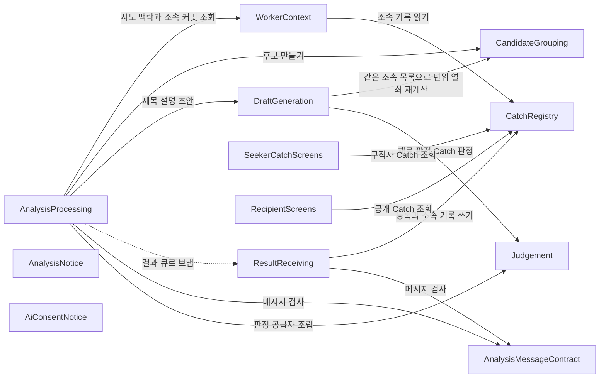

# Catch 개편 — 구성 요소

입력:
- 요구사항 `aidlc/spaces/default/intents/261103-catch-redesign/inception/requirements-analysis/requirements.md`
- 스토리 `inception/user-stories/stories.md`
- 코드 지식 `aidlc/spaces/default/codekb/CatchU/architecture.md`·`component-inventory.md`
- 이 단계의 답 `domain-design-questions.md`(Q1~Q4)

이 intent가 새로 만들거나 고치는 구성 요소만 담는다. 바꾸지 않는 구성 요소(검색 조각, 발행, 텍스트 자료, 탈퇴 서비스 코드)는 「고치지 않는 것」에 적는다. 구성 요소 이름 옆 괄호는 코드 지식의 구성 요소 이름이다.

```yaml
components:
  - name: CandidateGrouping
    summary: 수집 결과로 작업 단위와 후보를 만든다 (worker.candidates)
    behaviour: >
      이미 다른 Catch에 속한 커밋(맥락 조회로 받은 목록)을 묶는 재료에서 뺀다. 남은 새 커밋이 없는
      단위는 후보가 아니다. PR 단위는 열쇠를 PR로 유지하고, PR 없는 커밋 묶음은 남은 새 커밋만으로
      묶어 열쇠를 새로 만든다. 이슈 번호로 PR·병합을 나누지 않는다. 작업 사실 첫 줄은 종류만 쓴다(SHA·날짜 없음).
      기록의 글(본인 PR 제목, 단위 안 첫 본인 커밋 첫 줄)을 고르고, 가리기 규칙에 걸리면 쓰지 않는다.
      규칙 부실 기준으로 쓸 만하면 작업 사실 둘째 줄을 더한다. 후보마다 소속 커밋 전체를 싣는다.
      GitHub를 부르지 않는 순수 함수다.
    responsibilities:
      - 소속 커밋 제외와 단위 종류별 열쇠 규칙(FR1.3·FR1.5·FR1.8)
      - 이슈 번호 나누기 끄기(FR2.1)
      - 작업 사실 첫 줄·둘째 줄(규칙)과 기록의 글 고르기(FR5.1·FR5.2·FR6.1·FR6.2)
      - 후보별 소속 커밋 목록(FR1.4)
    depends_on: []
    dependents:
      - component: AnalysisProcessing
        interaction: 소속 커밋 목록과 수집 결과를 넘겨 후보를 받는다
      - component: DraftGeneration
        interaction: 같은 수집 결과와 같은 소속 커밋 목록으로 단위·열쇠를 다시 계산해 재료를 찾는다
    external_dependencies: []
    entities: []

  - name: DraftGeneration
    summary: 후보마다 재료를 골라 제목·설명 초안을 만들고 판정 결과를 적용한다 (worker.generation)
    behaviour: >
      재료는 코드 → 시험 → 설정 → 문서 → 그 밖 순서로 담고, 큰 후보는 변경 묶음으로 나눠 묶음마다 고르게,
      한 파일 상한 안에서 담는다. 판정이 있으면 재료 판정 답(갈래·대표 점수)을 따르고, 없거나 실패하면 규칙 순서를 쓴다.
      AI 쪽이 켜져 있으면 Claude에 바뀐 줄만 보내 제목 후보와 설명 문장 1~3개를 받는다(커밋 메시지·PR 제목은 보내지 않는다).
      후보·문장마다 가리킨 줄로 기계 대조를 한다. 판정 결과로 제목을 고르고(0.9 이상), 설명 문장을 거르며(0.9 이상),
      판정이 부실이라고 하면 작업 사실 둘째 줄을 지운다. 작업 사실에 하는 일은 이 줄 지우기 하나뿐이다.
      AI 쪽이 꺼져 있으면 지금의 조각 제목·틀 문장을 쓴다.
    responsibilities:
      - 재료 순서·변경 묶음·파일 상한(FR3.1~FR3.3)과 재료 판정 답 적용(FR4.2)
      - Claude 제목 후보·설명 문장 쓰기와 기계 대조(FR5.4·FR5.5·FR7.1)
      - 판정 결과로 제목 고르기·설명 거르기·둘째 줄 지우기(FR5.3·FR5.6·FR5.7·FR6.2·FR7.2·FR7.3)
      - AI 쪽을 껐을 때의 동작(FR7.4)
    depends_on:
      - component: CandidateGrouping
        interaction: 같은 수집 결과와 후보 판정에 넘긴 것과 같은 소속 커밋 목록으로 단위·열쇠를 다시 계산해 후보와 재료를 맞춘다(같은 입력이면 같은 열쇠, NFR4)
        style: sync
      - component: Judgement
        interaction: 큰 후보의 재료 판정, Catch마다 제목·작업 사실·설명 판정을 부른다
        style: sync
    dependents:
      - component: AnalysisProcessing
        interaction: 후보마다 제목·설명 초안·작업 사실(둘째 줄 지움 반영)을 받는다
    external_dependencies:
      - name: Anthropic Claude API
        kind: third-party-api
        purpose: 바뀐 줄로 제목 후보·설명 문장을 쓴다
    entities: []

  - name: Judgement
    summary: 판정 공급자 자리와 OpenAI·Claude·합성 어댑터 (worker 새 구성 요소)
    behaviour: >
      참일 확률·고르기·점수로만 답하는 판정 요청을 보낸다. 기본 공급자는 OpenAI Decisions(미국 처리)이고,
      설정 하나로 Claude로 바꿀 수 있으며 질문 집합은 같다. 공급자가 OpenAI면 OpenAI 판정 키가 있을 때만,
      Claude면 기존 Claude 키로 켜진다. 큰 후보의 재료 판정은 후보 하나에 한 번, 제목·작업 사실·설명 판정은
      Catch마다 한 번(최대 400 질문)이다. 자동 재시도는 없다. 판정 입력은 바뀐 줄·경로, 본인 PR 제목·커밋 메시지 첫 줄,
      AI가 쓴 후보뿐이고, 입력 글은 신뢰할 수 없는 입력으로 다룬다. 시험은 합성 어댑터로 한다.
    responsibilities:
      - 판정 공급자 자리와 켜고 끄기(FR4.1·FR4.5)
      - 재료 판정 요청(FR4.2)과 Catch 판정 요청(FR4.3)
      - 실패 시 다시 부르지 않기(FR4.4)와 판정 입력 제한(NFR1·NFR2)
    depends_on: []
    dependents:
      - component: DraftGeneration
        interaction: 재료 판정과 Catch 판정을 요청한다
      - component: AnalysisProcessing
        interaction: LIVE 조립에서 설정(키·공급자 선택)에 따라 판정 공급자를 만든다
    external_dependencies:
      - name: OpenAI Decisions API
        kind: third-party-api
        purpose: 기본 판정 공급자
      - name: Anthropic Claude API
        kind: third-party-api
        purpose: 대체 판정 공급자(FR4.5)
    entities: []

  - name: AnalysisProcessing
    summary: worker 요청 처리·결과 조합과 LIVE 조립 (worker.processing, worker.consumer, worker.request_context)
    behaviour: >
      요청을 검사한 뒤 api 맥락 조회로 이미 소속된 커밋 목록을 받아 후보 판정에 넘긴다. 생성기를 부르고,
      후보별 소속 커밋 전체를 담은 결과를 새 계약 판본으로 조합·검사해 보낸다. LIVE 조립에서 판정 공급자를
      설정(키·공급자 선택)에 따라 만든다.
    responsibilities:
      - 맥락 조회 응답의 소속 커밋 목록 읽기(FR1.2)
      - 결과에 후보별 소속 커밋 싣기와 새 판본(FR1.4·NFR6)
      - 판정 공급자 조립(FR4.1)
    depends_on:
      - component: WorkerContext
        interaction: 시도 맥락과 이미 소속된 커밋 목록을 조회한다
        style: sync
      - component: CandidateGrouping
        interaction: 후보를 만든다
        style: sync
      - component: DraftGeneration
        interaction: 제목·설명 초안을 만든다
        style: sync
      - component: Judgement
        interaction: LIVE 조립에서 판정 공급자를 만들어 생성기에 넘긴다
        style: sync
      - component: ResultReceiving
        interaction: 결과 메시지를 큐로 보낸다
        style: async
      - component: AnalysisMessageContract
        interaction: 요청·결과 메시지를 검사한다
        style: sync
    dependents: []
    external_dependencies:
      - name: Redis(BullMQ)
        kind: queue
        purpose: 요청을 받고 결과를 보낸다
    entities: []

  - name: AnalysisMessageContract
    summary: api·worker 공유 메시지 계약 (contract.repository-analysis)
    behaviour: >
      결과의 후보에 소속 커밋 전체 칸을 더하고 판본을 올린다. 큐 요청 메시지의 모양은 바꾸지 않는다.
      api와 worker는 같은 새 판본만 받으며, 옛 판본을 함께 받는 처리는 두지 않는다. 설명 없음 상태(NOT_GENERATED)는 이미 있다.
    responsibilities:
      - 결과 메시지의 소속 커밋 칸과 판본(FR1.4·NFR6)
    depends_on: []
    dependents:
      - component: AnalysisProcessing
        interaction: worker가 메시지를 검사한다
      - component: ResultReceiving
        interaction: api가 메시지를 검사한다
    external_dependencies: []
    entities: []

  - name: WorkerContext
    summary: worker 전용 맥락 조회 (api.worker-context)
    behaviour: >
      시도 맥락 응답에 그 회원·저장소(GitHub 저장소 ID)의 이미 소속된 커밋 SHA 목록을 더한다. 소속 기록은 읽기만 한다.
    responsibilities:
      - 소속 커밋 목록 제공(FR1.2)
    depends_on:
      - component: CatchRegistry
        interaction: 회원·저장소의 소속 기록을 읽는다
        style: sync
    dependents:
      - component: AnalysisProcessing
        interaction: worker가 시도마다 부른다
    external_dependencies:
      - name: PostgreSQL
        kind: database
        purpose: 시도 맥락과 소속 기록 읽기
    entities: []

  - name: ResultReceiving
    summary: 결과 수신·검사와 한 트랜잭션 반영 (api.analysis-receiver, api.result-application)
    behaviour: >
      새 판본 결과를 검사하고, 같은 트랜잭션에서 Catch 등록에 후보와 후보별 소속 커밋을 넘긴다.
    responsibilities:
      - 새 판본 결과 검사와 반영 호출(FR1.4·NFR6)
    depends_on:
      - component: CatchRegistry
        interaction: 후보 등록과 소속 기록 쓰기를 같은 트랜잭션에서 부른다
        style: sync
      - component: AnalysisMessageContract
        interaction: 결과 메시지를 검사한다
        style: sync
    dependents:
      - component: AnalysisProcessing
        interaction: worker가 결과를 큐로 보낸다
    external_dependencies:
      - name: Redis(BullMQ)
        kind: queue
        purpose: 결과를 받는다
    entities: []

  - name: CatchRegistry
    summary: Catch 등록과 소속 기록 (api.catches)
    behaviour: >
      후보마다 (회원, 작업 동일성 열쇠)로 Catch를 찾고, 없으면 만들고 있으면 잇는다. 같은 트랜잭션에서 후보의 소속 커밋을
      소속 기록에 쓴다. 이미 기록된 SHA가 다시 오면 같은 Catch든 다른 Catch든 조용히 건너뛰고 저장된 소속을 바꾸지 않으며,
      결과 반영을 실패시키지 않는다. 기존 Catch에 잇는 경우 새 커밋은 소속으로만 기록하고
      Catch의 제목·작업 사실·근거·초안·작성자 설명 두 칸은 건드리지 않는다. 소속 기록은 (Catch ID, 회원) 한 쌍으로
      Catch를 가리켜 회원이 Catch 주인과 다르면 DB가 거부한다. 소속 기록은 Catch를 따라서만 지워진다. Catch는 회원 삭제와
      분석 요청 삭제 두 길로 연쇄 삭제된다.
    responsibilities:
      - 소속 기록 쓰기·읽기(FR1.1·FR1.4·FR1.5)
      - 기존 Catch 내용·작성자 설명 보존(FR1.5)
      - 탈퇴 연쇄 삭제 경로(FR1.6)
    depends_on: []
    dependents:
      - component: ResultReceiving
        interaction: 등록과 소속 기록 쓰기
      - component: WorkerContext
        interaction: 소속 기록 읽기
      - component: SeekerCatchScreens
        interaction: 구직자 Catch 목록·상세 조회
      - component: RecipientScreens
        interaction: 공개 Catch 조회
    external_dependencies:
      - name: PostgreSQL
        kind: database
        purpose: catch_asset·소속 기록 저장
    entities:
      - name: CatchAsset
        identifier: catchId
        attributes: [catchId, ownerId, workIdentity, title, workFacts, draft, authorDescription, authorDescriptionUpdatedAt]
      - name: CommitAssignment
        identifier: (memberId, githubRepositoryId, commitSha)
        attributes: [memberId, githubRepositoryId, commitSha, catchId, assignedAt]

  - name: AnalysisNotice
    summary: 분석 고지 문구와 판본 (api.analysis-intake)
    behaviour: >
      AI 쪽을 켜는 배포와 함께 분석 고지를 v3로 올린다. 2절에 AI가 쓰고 판정으로 거른다는 것, 3절에 실제로 쓰는 판정 공급자와
      보내는 항목, 4절에 Catch에 기록의 글이 들어간다는 것을 적는다. 문구는 그 PR에서 팀장이 승인한다.
    responsibilities:
      - 분석 고지 v3(FR9.1)
    depends_on: []
    dependents: []
    external_dependencies: []
    entities: []

  - name: AiConsentNotice
    summary: 첫 이용 AI 고지 판본과 받는 곳 (api.ai-consent, web.ai-consent)
    behaviour: >
      받는 곳에 OpenAI를 더하고 판본을 올린다. web과 api의 두 상수를 같은 값으로 함께 바꾼다. AI 쪽을 켜는 배포와 함께 넣는다.
    responsibilities:
      - 첫 이용 고지 판본(FR9.2)
    depends_on: []
    dependents: []
    external_dependencies: []
    entities: []

  - name: SeekerCatchScreens
    summary: 구직자 Catch 목록·상세 (web.assets)
    behaviour: >
      목록 카드의 제목은 2줄까지 보이고 넘치면 말줄임, 상세는 전체를 보인다. 카드 링크의 접근 이름에는 전체 제목을 쓴다.
      상세 안내의 「설명」을 「설명 초안」으로 고친다. 설명 초안이 없으면(NOT_GENERATED) 설명 칸을 숨기고, 실패일 때만 지금 안내를 보인다.
    responsibilities:
      - 제목 줄 수 제한(FR8.1)
      - 설명 없음 숨김(FR8.2)
      - 안내 낱말 고치기(FR8.4)
    depends_on:
      - component: CatchRegistry
        interaction: 구직자 Catch 목록·상세를 읽는다
        style: sync
    dependents: []
    external_dependencies: []
    entities: []

  - name: RecipientScreens
    summary: 받은 사람 목록·상세 (web.recipient)
    behaviour: >
      목록 카드 제목 2줄 제한, 상세 전체. 기존 자동 생성 안내 문장(generatedNotice)을 「제목은 GitHub 기록의 글이거나
      CatchU가 만든 글이고, 설명은 CatchU가 GitHub 기록에서 자동으로 만들었습니다」로 고치고, 있는 것만 가리키는 동작은 유지한다.
      설명 초안이 없으면 설명 칸을 숨긴다.
    responsibilities:
      - 제목 줄 수 제한(FR8.1)
      - 설명 없음 숨김(FR8.2)
      - 자동 생성 안내 문장 고치기(FR8.3)
    depends_on:
      - component: CatchRegistry
        interaction: 공개 Catch를 읽는다
        style: sync
    dependents: []
    external_dependencies: []
    entities: []
```

## Component Diagram


<!-- Text fallback: worker의 AnalysisProcessing은 api의 WorkerContext로 시도 맥락과 소속 커밋을 조회하고, Judgement로 판정 공급자를 조립하며, CandidateGrouping으로 후보를, DraftGeneration으로 제목·설명 초안을 만든 뒤 결과를 큐로 ResultReceiving에 보낸다. 메시지는 AnalysisMessageContract로 검사한다. DraftGeneration은 같은 소속 목록으로 CandidateGrouping에서 단위·열쇠를 다시 계산하고 Judgement에 판정을 요청한다. WorkerContext는 CatchRegistry의 소속 기록을 읽고, ResultReceiving은 CatchRegistry에 등록과 소속 기록 쓰기를 요청한다. 두 화면은 CatchRegistry에서 Catch를 읽는다. AnalysisNotice와 AiConsentNotice는 다른 구성 요소를 부르지 않는다. -->

## Component Summary

| Component | Purpose | Depends On | Dependents | Entities Owned |
|---|---|---|---|---|
| CandidateGrouping | 작업 단위·후보·작업 사실(규칙)·기록의 글 | — | AnalysisProcessing, DraftGeneration | — |
| DraftGeneration | 재료 고르기, 제목·설명 초안, 판정 적용 | CandidateGrouping, Judgement | AnalysisProcessing | — |
| Judgement | 판정 공급자 자리와 어댑터 | — | DraftGeneration, AnalysisProcessing | — |
| AnalysisProcessing | 요청 처리·결과 조합·LIVE 조립 | WorkerContext, CandidateGrouping, DraftGeneration, Judgement, ResultReceiving, AnalysisMessageContract | — | — |
| AnalysisMessageContract | api·worker 공유 메시지 계약 | — | AnalysisProcessing, ResultReceiving | — |
| WorkerContext | worker 맥락 조회와 소속 커밋 목록 | CatchRegistry | AnalysisProcessing | — |
| ResultReceiving | 결과 검사와 한 트랜잭션 반영 | CatchRegistry, AnalysisMessageContract | AnalysisProcessing | — |
| CatchRegistry | Catch 등록과 소속 기록 | — | ResultReceiving, WorkerContext, SeekerCatchScreens, RecipientScreens | CatchAsset, CommitAssignment |
| AnalysisNotice | 분석 고지 v3 | — | — | — |
| AiConsentNotice | 첫 이용 고지 판본 | — | — | — |
| SeekerCatchScreens | 구직자 Catch 화면 | CatchRegistry | — | — |
| RecipientScreens | 받은 사람 화면 | CatchRegistry | — | — |

## Entity Ownership

| Entity | Owning Component | Identifier | Attributes | References |
|---|---|---|---|---|
| CatchAsset(기존) | CatchRegistry | catchId | catchId, ownerId, workIdentity, title, workFacts, draft, authorDescription, authorDescriptionUpdatedAt | 회원(이 intent 밖의 회원 구성 요소). (catchId, ownerId) 유일 조건을 더한다(ADR-002) |
| CommitAssignment(새) | CatchRegistry | (memberId, githubRepositoryId, commitSha) | memberId, githubRepositoryId, commitSha, catchId, assignedAt | CatchAsset을 (catchId, memberId) 한 쌍으로 가리킨다. Catch를 따라서만 지워진다(Catch는 회원 삭제·분석 요청 삭제로 지워짐) |

## External Dependencies

| Component | Dependency | Kind | Purpose |
|---|---|---|---|
| DraftGeneration | Anthropic Claude API | third-party-api | 제목 후보·설명 문장 쓰기 |
| Judgement | OpenAI Decisions API | third-party-api | 기본 판정 공급자 |
| Judgement | Anthropic Claude API | third-party-api | 대체 판정 공급자 |
| AnalysisProcessing | Redis(BullMQ) | queue | 요청 받기·결과 보내기 |
| ResultReceiving | Redis(BullMQ) | queue | 결과 받기 |
| WorkerContext | PostgreSQL | database | 시도 맥락·소속 기록 읽기 |
| CatchRegistry | PostgreSQL | database | catch_asset·소속 기록 저장 |

## Rationale

| Component | 따로 두는 이유 |
|---|---|
| CandidateGrouping | 경계와 소속을 정하는 규칙(결정적, NFR4)을 한곳에 둔다. 작업 사실의 규칙 부분도 여기서 정해, 생성이 작업 사실에 글을 더하는 길이 없다(ADR-005) |
| DraftGeneration | AI가 글을 쓰고 판정 결과를 적용하는 곳이다. 규칙(CandidateGrouping)과 바뀌는 속도·이유가 다르다 |
| Judgement | 외부 공급자·키·켜고 끄기가 생성 공급자와 다르고, 합성으로 바꿔 끼워 시험해야 한다(ADR-004) |
| AnalysisProcessing | 요청·결과·조립의 흐름만 맡는다(기존 경계 유지) |
| AnalysisMessageContract | api와 worker가 같은 판본을 함께 바꿔야 하는 공유 계약이다 |
| WorkerContext | 소속 커밋 목록을 큐 요청 대신 이 응답으로 넘긴다(ADR-003) |
| ResultReceiving | 결과 검사와 한 트랜잭션 반영의 기존 경계를 유지한다 |
| CatchRegistry | Catch와 소속 기록을 같은 트랜잭션에서 쓰므로 한 구성 요소가 둘을 소유한다(ADR-001·ADR-002) |
| AnalysisNotice·AiConsentNotice | 고지 문구·판본은 AI 쪽 켜기와 함께 바뀌고 팀장 승인을 받는다. 서로 다른 화면·판본이라 따로 둔다 |
| SeekerCatchScreens·RecipientScreens | 사람과 화면이 다르다(구직자·받은 사람) |

**고르지 않은 안(Alternatives Rejected):**
- 소속 기록만 맡는 api 구성 요소를 따로 두기: 트랜잭션 경계가 하나 늘어 등록과 소속이 어긋날 수 있다(ADR-001).
- 판정과 재료 고르기를 둘 다 생성 안에 두거나 둘 다 따로 두기: 판정은 공급자·키가 달라 분리가 필요하고, 재료 고르기는 지금 `select` 자리를 그대로 쓰는 쪽이 작다(ADR-004).
- 생성이 작업 사실 둘째 줄을 더하기: 생성이 작업 사실에 글을 더하는 길이 생겨 FR6.3을 코드 규율에 맡기게 된다(ADR-005).

## 고치지 않는 것

- 검색 조각(`api.published-index`)과 발행(`api.publications`): 조각 규칙은 그대로이고, 작업 사실의 기록의 글 줄은 기존 `GITHUB_RECORD` 조각으로 그대로 간다.
- 탈퇴(`api.withdrawal`) 서비스 코드: 소속 기록은 Catch를 따라서만 지워지고, 탈퇴 때 Catch는 회원 연쇄 삭제로 지워진다. 삭제 목록 문서에 행만 더한다(범위 문서 「함께 고칠 문서」).
- 텍스트 자료(`api.materials`·`web.materials`)와 작성자 설명 저장(`AuthorDescriptionStore`): 닿지 않는다. 등록은 설명 두 칸을 쓰지 않는다(CatchRegistry 동작).
