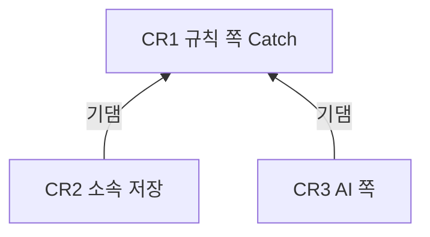

# Catch 개편 — Unit 의존

입력: `unit-of-work.md`, 구성 요소 `inception/domain-design/components.md`, 이 단계의 답(Q2 B, Q3 A).

## 의존 그래프

- CR2(소속 저장)는 CR1(규칙 쪽 Catch)에 기댄다.
  - 둘 다 후보 판정(`worker.candidates`)을 고친다.
  - CR2는 CR1이 고친 후보 판정 위에 소속 커밋 제외와 열쇠 규칙을 더한다.
- CR3(AI 쪽)은 CR1에 기댄다.
  - CR3은 CR1이 정한 기록의 글을 판정에 넣는다.
  - CR1이 정한 작업 사실 둘째 줄을 지울 수 있다.
  - CR1의 재료 순서·변경 묶음 위에 재료 판정을 얹는다.
- CR2와 CR3 사이에는 의존이 없다.


<!-- Text fallback: CR2는 CR1에 기대고, CR3도 CR1에 기댄다. CR2와 CR3 사이에는 의존이 없다. -->

```yaml
units:
  - name: cr1-readable-catch
    kind: service
    depends_on: []
  - name: cr2-commit-assignment
    kind: service
    depends_on: [cr1-readable-catch]
  - name: cr3-ai-drafts
    kind: service
    depends_on: [cr1-readable-catch]
```

## Unit 사이 연결점

| 사이 | 연결점 | 종류 | 내용 |
|---|---|---|---|
| CR1 → CR2 | 후보 판정 함수(`worker.candidates`) | 공유 코드 | CR2가 소속 커밋 목록 인자와 후보별 소속 커밋 목록을 더한다. CR1의 기록의 글·작업 사실 규칙은 그대로 쓴다 |
| CR1 → CR3 | 후보의 기록의 글과 작업 사실 둘째 줄 | 공유 코드(worker 안 자료) | CR3이 기록의 글을 판정 입력에 넣고, 판정이 부실이라고 하면 둘째 줄을 지운다(ADR-005) |
| CR1 → CR3 | 재료 고르기(`worker.generation`의 `select`) | 공유 코드 | CR3이 큰 후보에 재료 판정 답을 적용하고, 판정이 없거나 실패하면 CR1의 규칙 순서를 쓴다 |
| CR1 → CR3 | 제목 결정(`worker.generation`의 `title.py`와 생성 흐름) | 공유 코드 | CR1이 AI 쪽을 껐을 때 기록의 글과 조각 제목 가운데 고르는 규칙을 만든다. CR3이 그 위에 AI 제목 후보·판정으로 고르기를 더하고, AI 쪽이 꺼지거나 실패하면 CR1의 규칙을 쓴다(FR5.7) |
| CR1 → CR3 | 구직자·받은 사람 상세 화면(`web.assets`·`web.recipient`) | 공유 코드 | CR3이 설명 칸 숨기기를 더한다. CR1의 안내 문장·낱말은 그대로 둔다 |
| CR2 ↔ CR3 | 생성 단계(`worker.generation`)와 요청 처리(`worker.processing`) | 공유 코드, 의존 없음 | CR2는 단위·열쇠 다시 계산과 소속 목록 전달을, CR3은 재료 판정·제목·설명과 판정 공급자 조립을 고친다. 나중에 합치는 Unit이 부딪힘을 풀고, 합친 뒤 NFR4(같은 입력이면 같은 열쇠)와 NFR2(판정 호출 수) 시험을 다시 돌려 통과시킨다(Q3 A) |
| CR2 | 맥락 조회 응답·결과 메시지 | API·메시지 | api·worker가 같은 새 판본만 받는다. CR2 안에서 함께 바꾸고 함께 배포한다(NFR6) |

CR3은 결과 메시지 계약을 바꾸지 않는다. 설명 없음 상태(`NOT_GENERATED`)는 지금 계약에 있다. 그래서 CR2와 CR3은 계약 판본으로 부딪히지 않는다.

## 함께 개발할 수 있는 것

- CR1이 끝나면 CR2와 CR3은 서로의 작업 없이 각자 사본에서 만들고 시험할 수 있다.
- 가능한 순서는 CR1 → CR2 → CR3 또는 CR1 → CR3 → CR2이다.
- 어느 순서로 넣을지와 시한(제목·작업 사실·설명 11/30, 소속 저장은 출시 전 마지막 DB 초기화 전)을 어떻게 맞출지는 납품 계획에서 정한다.

## 첫 Unit 골격

- CR1이 그래프의 첫 Unit이다. 다른 Unit에 기대지 않는다.
- CR1은 계약·DB를 바꾸지 않으므로 지금의 api와 그대로 맞물린다.
- 고친 후보 판정의 결과가 실제 분석 흐름을 따라 화면까지 간다. 흐름은 결과 반영, Catch 등록, 구직자·받은 사람 화면 순이다.
- 그래서 CR2·CR3보다 먼저 혼자 돌아간다.
