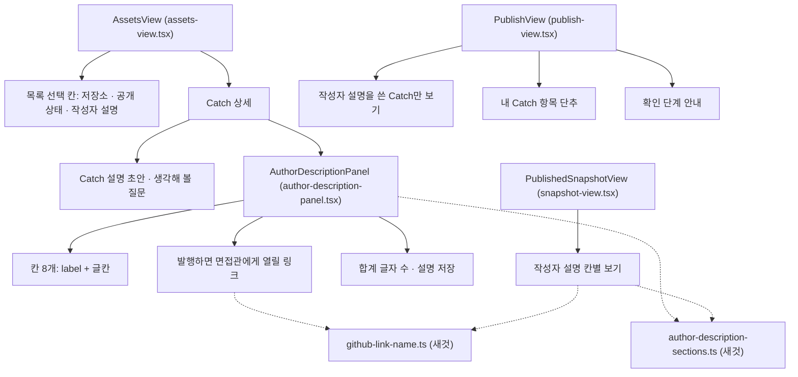

# NC1 칸 제목과 링크 이름 — 화면 부품

규칙은 `rules.md`(BR1.1~BR7.6), 흐름과 화면 상태는 `functional-spec.md`가 정본이다. 이 문서는 web 부품의 구조와 상태, 공통 함수의 모양(계약 C7), API 연결을 적는다. 함수 모양은 설계 수준이고, 이름과 세부 형은 코드 생성에서 다듬는다.

## 1. 부품 구조



Text fallback: 내 자산 화면(AssetsView)은 목록 선택 칸 셋과 Catch 상세를 그린다. 상세는 설명 초안·질문 아래에 작성자 설명 편집(AuthorDescriptionPanel)을 둔다. 편집은 칸 8개, 링크 목록, 합계 글자 수와 저장 단추로 이뤄진다. 발행 화면(PublishView)은 걸러 보기 체크 칸, 항목 단추, 확인 단계 안내를 그린다. 사본 보기(PublishedSnapshotView)는 작성자 설명을 칸별로 그린다. 편집과 사본 보기는 새 공통 함수 둘(칸 나누기·합치기, 링크 이름)을 함께 쓴다.

## 2. 공통 함수 (계약 C7)

### 2.1 `web/src/lib/author-description-sections.ts` (AuthorDescriptionSections)

```ts
export const SECTION_TITLES = ["이 작업에서 정한 것", "맡은 부분", "무엇이 문제였나", "고른 것과 버린 것",
  "어떻게 확인했나·결과", "AI가 낸 것 가운데 받아들이지 않았거나 고친 것", "짚어 볼 곳", "더 쓰기"] as const;
export type SectionTitle = (typeof SECTION_TITLES)[number];
export type Section = { title: SectionTitle; text: string; start: number; joined: boolean }; // start: 저장된 글 안 UTF-16 위치, joined: 이은 칸(BR1.2)
export function splitSections(stored: string | null): Section[];           // BR1.1~BR1.3, 글이 있는 칸만
export function sectionTexts(stored: string | null): Record<SectionTitle, string>; // 편집 화면용 8칸
export function joinSections(texts: Record<SectionTitle, string>): string;  // BR1.4, 모두 비면 ""
export function countCodePoints(text: string): number;                      // BR1.5
export const MAX_DESCRIPTION_LENGTH = 4000;
```

- `splitSections`와 `joinSections`는 왕복이 맞아야 한다(BR1.6).
- 지금 `author-description-panel.tsx`의 `MAX_LENGTH`와 `Array.from(value).length`는 이 함수로 옮긴다.

### 2.2 `web/src/lib/github-link-name.ts` (GithubLinkName)

```ts
export function githubLinkName(url: string, evidenceRepository: string | null): string; // BR2.2~BR2.5
export function evidenceRepositoryOf(sourceUrls: readonly string[]): string | null;     // BR2.4 근거 저장소
export function collectLinks(texts: readonly string[]): string[];                        // BR3.1 순서·중복 없음
```

- 링크 찾기는 지금 `github-source-url.ts`의 `splitGithubLinks`를 그대로 쓴다(BR2.1).
- NC2는 이 파일에 본인 커밋 표지 판정을 더한다. NC1은 표지를 만들지 않는다.

### 2.3 링크 요소 `GithubLink`

`snapshot-view.tsx`의 지금 링크 그리기를 부품 하나로 뺀다. 사본 보기가 쓴다(편집 화면 링크 목록은 이름 글자만 쓴다, 3.1).

| 입력 | 뜻 |
|---|---|
| `url` | 원래 주소. `href`와 `title`에 그대로 쓴다(BR2.5, BR2.7) |
| `evidenceRepository` | 근거 저장소. 없으면 null |
| `children`(선택) | 강조로 감쌀 때 이름 글자 대신 그릴 것 |

이름 글자 뒤에 숨은 「(새 탭)」을 붙인다. `target="_blank"`, `rel="noopener noreferrer"`다.

## 3. 화면 부품별 상태와 입력

### 3.1 AuthorDescriptionPanel

| 상태 | 형 | 처음 값 | 바뀌는 때 |
|---|---|---|---|
| `texts` | 칸 제목별 글 8개 | 불러온 글을 `sectionTexts`로 | 칸 입력 |
| `savedTexts` | 처음 나눈 칸 글 8개 | 불러온 글을 `sectionTexts`로 | 저장 성공 때 저장한 칸 글로 |
| `status` | 불러오는 중 · 실패 · 준비 · 저장 중 · 저장됨 · 저장 실패 · 상한 넘음 | 불러오는 중 | 지금 흐름 그대로(W1) |

- 계산하는 값:
  - `joined = joinSections(texts)`
  - `count = countCodePoints(joined)`
  - `links = collectLinks(SECTION_TITLES.map((title) => texts[title]))`
  - `dirty`: 8칸 가운데 `texts[title] !== savedTexts[title]`인 칸이 있으면 참(BR1.6). 합친 글과 저장된 글은 견주지 않는다.
- 입력: 지금 입력에 Catch 근거 주소 목록(`evidenceRepository` 계산용)을 더한다.
- 입력 검사: 저장 직전에 `count > MAX_DESCRIPTION_LENGTH`이면 요청을 보내지 않는다(BR1.5). 그 밖의 검사는 api가 한다(지금 그대로).
- 저장 중 8칸 모두 `disabled`다(BR4.5).
- 접근성 연결(BR4.5):
  - 칸마다 `<label htmlFor>`와 `<textarea rows={3}>`를 둔다.
  - 첫 글칸 `aria-describedby`는 공개 범위 안내 한 줄을 가리킨다.
  - 「짚어 볼 곳」 글칸은 안내 목록(2026-11-10 다섯에서 넷으로 줄임, BR4.4)을 가리킨다.
  - [설명 저장]은 합계 글자 줄을 가리킨다.
- 링크 목록(BR3.2, BR3.3): h4 아래 `<ul>`이고 `aria-live`는 두지 않는다. 항목은 `githubLinkName`으로 만든 이름 글자이고, 누를 수 없어 Tab 순서에 들지 않는다(다듬은 화면 interaction-spec 2절). (2026-11-10 코드 생성 때 고침: 처음에 「항목은 `GithubLink`다」로 적어 승인된 다듬은 화면과 어긋났다.)

### 3.2 AssetsView

| 상태 | 형 | 처음 값 |
|---|---|---|
| `authorDescriptionFilter` | `"all" \| "written" \| "unwritten"` | `"all"` |

- 값을 바꾸면 지금 저장소 칸처럼 목록을 첫 쪽부터 다시 불러온다(BR5.4).
- 미리보기 방식(`dataMode !== "api"`)은 고정 자료(`fixtures.ts`의 `previewCatches`)에 `hasAuthorDescription` 값을 두고, 같은 조건으로 화면 안에서 거른다.
- 빈 결과 분기 순서(BR5.5):
  1. 서버가 빈 목록을 주고 `authorDescriptionFilter !== "all"`이면 설명 조건 안내
  2. 지금 공개 상태 분기
  3. 지금 「아직 표시할 Catch가 없습니다」
- 상세 칸 순서는 BR4.1이다. 질문 아래 문구는 BR4.2, 편집 안내는 BR4.3·BR4.4다.
- 저장 뒤 지금 쪽은 다시 부르지 않는다(BR5.6).

### 3.3 PublishView

| 상태 | 형 | 처음 값 |
|---|---|---|
| `writtenOnly` | 참/거짓 | 거짓 |
| `repositories` | `RepositoryOption[]` 또는 실패 | 불러오는 중 |

- `CatchSource`에 `repositoryId`와 `hasAuthorDescription`을 더한다(`catchSourceOf`).
- `SelectedItem`에 `hasAuthorDescription`(Catch만, 자료는 null)을 더한다(BR6.5).
- 저장소 이름은 `repositories`에서 `repositoryId`로 찾는다. 실패하거나 못 찾으면 이름만 뺀다(BR6.2).
- 작은 줄(BR6.3): `[저장소 이름, 공개 상태, 설명 안 씀?, 불일치 표시됨?]`에서 빈 것을 빼고 「 · 」로 잇는다.
- 체크 칸(BR6.4):
  - 바꾸면 Catch 목록만 첫 쪽부터 다시 불러온다. 고른 자료는 그대로다.
  - `disabled`는 발행 중일 때만이다.
  - 개수 줄 「불러온 N개의 Catch」는 `aria-live="polite"`다.
- 확인 단계(BR6.6): `selected.filter((item) => item.kind === "CATCH" && item.hasAuthorDescription === false).length`가 1 이상이면 안내를 그린다.

### 3.4 PublishedSnapshotView (Catch 사본)

- 작성자 설명(BR7.1~BR7.3):
  - `splitSections(snapshot.authorDescription)`의 칸을 차례로 그린다.
  - 칸이 「더 쓰기」 하나뿐이면 h5 없이 글만 그린다.
  - 다른 칸과 함께면 「더 쓰기」의 h5를 「덧붙인 말」로 보인다.
  - 칸이 없으면 지금 「작성자 설명이 없습니다.」다.
- 칸 글 그리기는 지금 `LinkedText`에 시작 위치를 넘겨 범위를 칸 안으로 바꾼다(BR7.5).
  - 칸 범위 = `[start, start + text.length)`이다. 강조 범위와 겹치는 부분만 칸 안 위치(`- start`)로 바꾼다.
  - 겹침이 없으면 범위 없음이다.
  - `joined`가 참인 칸(이은 칸)은 범위 없음이다.
- 링크는 `GithubLink`로 그린다. 강조 위치는 원래 주소 길이로 센다(BR2.6).
- 근거 저장소는 `evidenceRepositoryOf(snapshot.evidence.map((e) => e.sourceUrl))`다.
- h5 모양은 지금 h4보다 한 단계 작은 굵은 글이고, CSS 모듈에 줄 하나를 더한다(BR7.6).

## 4. API 연결

| 화면 | 요청 | NC1에서 바뀌는 것 |
|---|---|---|
| AssetsView 목록 | `GET /v1/catches?…&authorDescription=written\|unwritten&cursor=` | 조건 하나, 응답 `hasAuthorDescription`, 커서 v2(BR5.1~BR5.3, C1) |
| AuthorDescriptionPanel | `GET`·`PUT /v1/catches/{catchId}/description` | 없음. 합친 글 하나를 그대로 보낸다 |
| PublishView 고르기 | `GET /v1/catches?…&authorDescription=written` | 체크 칸이 켜졌을 때만 조건을 붙인다 |
| PublishView 저장소 이름 | 내 자산 화면과 같은 저장소 목록 요청 | 발행 화면에서도 부른다(BR6.2). API는 그대로 |
| 사본 보기 | 지금 받은 사람·작성자 발행본 요청 | 없음 |

- api 쪽 바뀌는 곳은 다음과 같다.
  - `owner-catch-input.ts`: `ownerCatchQuery` 키에 `authorDescription`을 더하고, 커서 `v: 2`와 범위 해시에 조건을 넣는다.
  - `owner-catch-store.ts`: 목록 조건에 `author_description IS [NOT] NULL`을 넣는다.
  - `catch-reader.ts`: 지금 `READ_COLUMNS`가 `author_description`을 읽지 않으므로, 설명이 있는지 판정할 값을 읽게 한다.
  - `owner-catch-response.ts`: 목록·상세 응답에 `hasAuthorDescription`을 싣는다.
  - `api/docs/`에서 본인 목록 조건·커서·응답 칸을 적은 문서를 함께 고친다. 지금 본인 목록을 적은 문서는 `catch-owner-read-preparation.md`·`catch-visibility.md`·`publications.md`이고, 코드 계획에서 고칠 곳을 확정한다.
- web 쪽 바뀌는 곳은 다음과 같다.
  - `features/assets/types.ts`: `CatchAsset`에 `hasAuthorDescription`을 더한다.
  - `features/assets/catch-api.ts`: 목록 요청에 조건을 붙이고, 응답 검사에 `hasAuthorDescription`을 더한다.
  - `features/publications/publish-sources.ts`: `catchSourceOf`가 `repositoryId`와 `hasAuthorDescription`을 옮겨 담는다.
- 공개 Catch 응답은 바꾸지 않는다.

## 5. 시험으로 확인할 것

- 공통 함수:
  - 칸 나누기와 합치기의 왕복. 옛 글, 「더 쓰기」만, 같은 칸 두 번, 【참고】 줄
  - 합계 글자 수. 이모지가 든 글로 코드 포인트와 UTF-16의 차이를 본다
  - 링크 이름 표의 갈래(AC2.2.1~AC2.2.8)와, 표의 꼴과 맞지 않아 주소 전체로 보이는 주소(`#L10C2`, `/pull/12/files`, `/tree/main`)
  - 이은 칸 표시(같은 칸 두 번, 첫 칸 제목 줄 앞의 글)
- 화면:
  - 편집 칸 8개 `label`, 링크 목록 h4와 두 안내, 빈 결과 분기
  - 발행 작은 줄, 체크 칸과 고른 자료, 확인 안내
  - 사본 칸별 보기
  - 강조가 칸 제목 줄에 걸칠 때와 링크와 겹칠 때(AC2.2.10)
  - 이은 칸은 강조가 없음
  - 칸 제목 줄이 섞인 옛 글을 열었을 때 「저장하지 않은 변경이 있습니다」가 보이지 않음
  - 미리보기 방식의 작성자 설명 걸러 보기
- api:
  - 조건 셋(없음·written·unwritten)과 잘못된 값 400
  - 다른 조건 커서와 v1 커서 400
  - `hasAuthorDescription`과 `written` 판정이 같음(AC5.2.3)
  - 공개 Catch 응답과 공개 목록에 `hasAuthorDescription`이 없고 지금 응답과 같음

## Sources

- `rules.md`, `functional-spec.md`, `functional-design-questions.md`
- `inception/domain-design/components.md`, `inception/contract-design/contract-summary.md` C1·C7
- `inception/refined-mockups/mockups.md`, `inception/refined-mockups/interaction-spec.md`
- 지금 코드: `web/src/features/assets/assets-view.tsx`, `web/src/features/assets/author-description-panel.tsx`, `web/src/features/assets/repository-options-store.ts`, `web/src/features/publications/publish-view.tsx`, `web/src/features/publications/publish-sources.ts`, `web/src/features/publications/snapshot-view.tsx`, `web/src/lib/github-source-url.ts`, `api/src/catches/owner-catch-input.ts`, `api/src/catches/owner-catch-store.ts`
