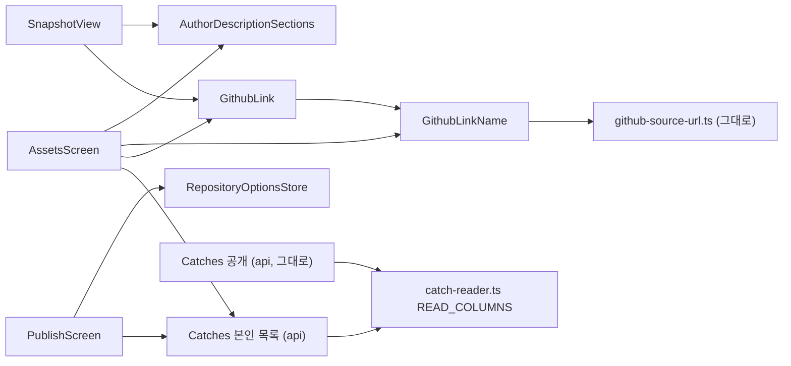

# NC1 칸 제목과 링크 이름 — 논리 구성 요소

입력:
- `performance-design.md`, `security-design.md`(이 폴더)
- 기능 설계 `construction/nc1-sections-and-links/functional-design/frontend-components.md`
- 구성 요소 `inception/domain-design/components.md`(AuthorDescriptionSections, GithubLinkName, AssetsScreen, PublishScreen, SnapshotView, Catches)
- 계약 `inception/contract-design/contract-summary.md` C1·C7

NC1은 새 서비스, 새 큐, 새 저장소, 새 인프라를 더하지 않는다. 바뀌는 곳은 지금 web과 api 배포 단위 안이다. 인프라 설계로 넘길 것은 없다.

## 1. 구성 요소 목록

| 구성 요소 | 배포 단위 | 자리 | NC1에서 하는 일 | 상태 |
|---|---|---|---|---|
| AuthorDescriptionSections | web | `web/src/lib/author-description-sections.ts` | 칸 나누기·합치기·글자 수·이은 칸 표시 | 새것, 순수 함수 |
| GithubLinkName | web | `web/src/lib/github-link-name.ts` | 링크 이름·근거 저장소·링크 모으기, 제어·서식 문자 지우기 | 새것, 순수 함수 |
| GithubLink | web | 사본 보기 옆 부품 | 링크 요소 하나(`href`·`title`·`rel`·숨은 「(새 탭)」) | 새것 |
| AssetsScreen | web | `web/src/features/assets/` | 8칸 편집, 링크 목록, 설명 조건 선택 칸, 상세 순서 | 고침 |
| PublishScreen | web | `web/src/features/publications/publish-screen.tsx`·`publish-view.tsx`·`publish-sources.ts` | 저장소 목록 불러오기, 작은 줄, 체크 칸, 확인 안내 | 고침 |
| RepositoryOptionsStore | web | `web/src/features/assets/repository-options-store.ts` | 저장소 목록을 쪽 끝까지 읽기 | 그대로, 발행 화면이 함께 씀 |
| SnapshotView | web | `web/src/features/publications/snapshot-view.tsx` | 칸별 그리기, 강조 범위 바꾸기 | 고침 |
| Catches(본인 목록·상세) | api | `api/src/catches/owner-catch-input.ts`·`owner-catch-store.ts`·`catch-reader.ts`·`owner-catch-response.ts` | 조건·커서 v2·읽기 칸·응답 칸 | 고침 |
| Catches(공개) | api | `api/src/catches/public-catch-store.ts` | 없음. 칸을 골라 담아 새 칸을 막는다 | 그대로 |

## 2. 고장 범위

- **공통 함수 둘:** 순수 함수라 바깥 상태가 없다.
  - 잘못되면 칸 나누기나 링크 이름이 틀린 글로 보일 뿐이다. 저장된 글과 API 응답은 바뀌지 않는다(BR2.8).
  - 받은 사람 화면과 작성자 발행본 상세, 편집 화면이 함께 쓰므로 한 번 고치면 세 곳이 같이 고쳐진다.
- **저장소 목록:** 발행 화면에서 실패하면 저장소 이름만 빠진다. 고르기·발행은 막히지 않는다(BR6.2).
- **본인 목록 조건:** 잘못된 조건이나 옛 커서는 400으로 끝난다. 다른 회원 범위로 번지지 않는다(회원 범위 조건이 먼저다).
- **공용 읽기 칸:** `READ_COLUMNS`는 본인·공개가 함께 쓴다. 칸 하나를 더하는 일이 공개 읽기를 깨뜨리지 않도록 공개 응답 키 집합 시험을 둔다.

## 3. 의존 방향

Text fallback:
- 내 자산 화면은 칸 함수, 링크 이름 함수, 링크 요소를 쓴다. 사본 보기는 칸 함수와 링크 요소를 쓴다.
- 링크 요소는 링크 이름 함수를 쓰고, 링크 이름 함수는 그대로 둔 판별 규칙을 쓴다.
- 발행 화면은 저장소 목록 부품과 api 본인 목록을 쓴다. 내 자산 화면도 api 본인 목록을 쓴다.
- api 본인 목록과 그대로 둔 공개 Catch는 같은 공용 읽기 칸을 읽는다.

## 4. 다음 Unit과의 접점 (C7)

- NC2는 `github-link-name.ts`에 본인 커밋 표지 판정을 더하고, `GithubLink` 뒤에 표지를 붙인다. NC1의 함수 모양(`githubLinkName(url, evidenceRepository)`)은 바꾸지 않고 함수를 더한다.
- NC3는 `owner-catch-store.ts`의 정렬과 커서를 바꾼다(커서 v3). NC1의 조건과 범위 해시 구성은 이어받는다.

## Sources

- `performance-design.md`, `security-design.md`
- `construction/nc1-sections-and-links/functional-design/frontend-components.md`
- `inception/domain-design/components.md`, `inception/contract-design/contract-summary.md` C1·C2·C7
