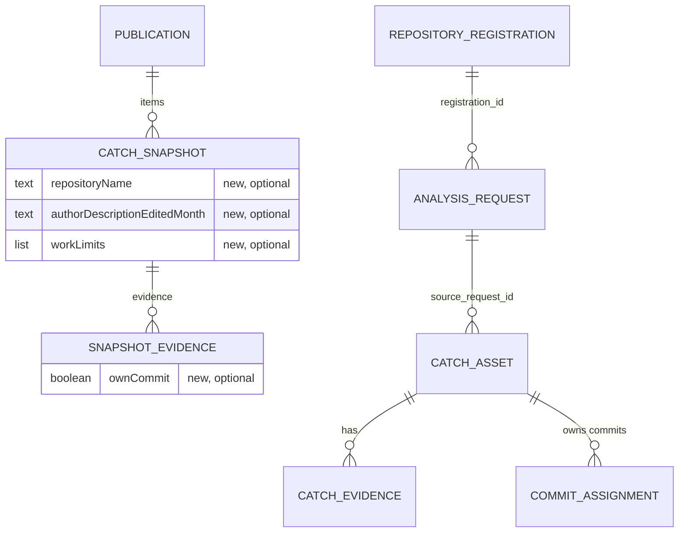

# NC2 면접관 사본 칸과 표지 — 기능 명세

입력:
- Unit `inception/units-generation/unit-of-work.md` NC2(`nc2-snapshot-fields`, service)와 `unit-of-work-story-map.md`
- 사용자 이야기 `inception/user-stories/stories.md` US6.1~US6.5, US7.1·US7.2, US8.1(8개, 수락 기준 30개)
- 요구사항 `inception/requirements-analysis/requirements.md` FR9·FR10·FR11, NFR2·NFR5~NFR7
- 구성 요소 `inception/domain-design/components.md`(Publications, SnapshotView, GithubLinkName, RecipientScreen, RagAnswer, PublishedIndex)
- 계약 `inception/contract-design/contract-summary.md` C3·C6·C7
- 다듬은 화면 `inception/refined-mockups/mockups.md` 4절, `interaction-spec.md` 4절·9절
- NC1 기능 설계 `construction/nc1-sections-and-links/functional-design/`
- 이 단계의 답 `functional-design-questions.md`(Q1~Q6)

이 문서는 흐름과 화면 상태의 정본이다. 사본 칸 모양은 `entities.md`, 규칙은 `rules.md`(BR1.1~BR5.2)의 YAML이 정본이다. 아래 관계도와 규칙 요약은 그 둘에서 옮긴 것이다. 이 Unit이 맡는 이야기는 US6.1~US6.5, US7.1·US7.2, US8.1이다.

NC2는 web·api만 고친다. worker와 결과 메시지 계약은 바꾸지 않는다(계약 C3·C6). JD 요약 지시(U10 영역)도 함께 고치므로 NC2 PR에서 U10 담당 확인을 받는다(BR5.2).

## 1. 엔티티 관계 (`entities.md`에서 옮김)



Text fallback: 발행본(Publication)은 Catch 사본(CatchSnapshot)을 여럿 가지고, 사본은 근거 항목(SnapshotEvidence)을 여럿 가진다. 사본에 저장소 이름·작성 시점·작업 전체 한계 선택 칸이, 근거 항목에 본인 커밋 여부 선택 칸이 새로 붙는다. 발행할 때 읽는 원본은 Catch(catch_asset), 그 근거(catch_evidence), 그 Catch에 속한 본인 커밋 소속 기록(commit_assignment)이고, Catch는 분석 요청(analysis_request)을, 분석 요청은 저장소 등록(repository_registration)을 가리킨다.

## 2. 흐름

### W1 발행할 때 사본 칸 담기 (US6.1, US6.2, US6.3, US7.1, US7.2)

1. 지원자가 지금처럼 [발행]을 누른다. 발행 트랜잭션 안에서 고른 Catch를 잠그고 읽는다.
2. 잠금 조회는 지금 칸에 더해 `author_description_updated_at`과, 분석 요청의 `registration_id`로 이은 저장소 등록의 `owner`·`name`을 읽는다(BR1.1).
3. 근거 조회는 지금 칸에 더해 `coverage_limits`를 읽는다. 고른 Catch의 소속 기록(`commit_assignment`)에서 본인 커밋 식별값 목록을 함께 읽는다(BR1.4).
4. 지금 발행 조건 검사(확인 여부, 분석 요청 주인, 보호 관측)는 그대로 먼저 한다.
5. Catch마다 지금 사본을 만들고 새 칸을 더한다.
   - `repositoryName`(BR1.1). 등록 행이 없으면 칸을 넣지 않는다(안전망).
   - `authorDescriptionEditedMonth`(BR1.2). 작성자 설명이 없으면 넣지 않는다.
   - `workLimits`(BR1.3). 고른 문장이 없으면 넣지 않는다.
   - 근거마다 `ownCommit`(BR1.4).
6. 발행 글자 수 합산과 조각 만들기는 지금 그대로다. 새 칸은 들지 않는다(BR1.5).
7. 사본을 저장한다. 그 뒤로 사본은 바뀌지 않는다.

### W2 면접관이 발행본을 연다 (US6.1~US6.4, US7.1, US7.2)

1. 면접관이 받은 사람 링크를 연다(또는 지원자가 작성자 발행본 상세를 연다).
2. api는 저장된 사본을 그대로 돌려준다(C-10·C-12, 바뀌지 않음).
3. web이 사본 모양을 검사한다. 새 칸이 없으면 받아들이고, 있으면 모양을 본다(BR2.1).
4. 받은 사람 web은 새 칸을 빠뜨리지 않고 화면에 넘긴다(BR2.2).
5. 사본 보기가 그린다.
   - 제목 아래 저장소 줄(BR3.1)
   - 「작성자 설명」 옆 작성 시점(BR3.2)
   - 작성자 설명 칸별 글(NC1)과 링크 이름(NC1). 본인 커밋과 맞는 링크 바로 뒤에 표지(BR4.1~BR4.5)
   - 작업 사실 아래 「이 기록으로 알 수 없는 것」(BR3.3)
6. 없는 칸은 그리지 않는다. 옛 사본은 지금 그대로다(BR3.4).

### W3 표지 판정 (US7.1, US7.2)

1. 사본 근거에서 본인 커밋 목록을 만든다(BR4.1). `ownCommit`이 true인 GitHub 근거의 (저장소, 40자 식별값)이다.
2. 작성자 설명을 칸별로 나누고 링크를 찾는다(NC1 그대로).
3. 링크마다 판본·커밋 이름이 있는 꼴이고 판본이 16진수 7~40자인지 본다(BR4.2). 아니면 표지 없음.
4. 링크 저장소가 대소문자 무시로 같고 식별값 앞부분이 맞는 본인 커밋을 센다. 정확히 하나면 표지를 붙인다(BR4.3).
5. 표지는 링크 요소 밖, 링크 바로 뒤에 그린다(BR4.4).

### W4 요약·답·JD 요약 (US6.5, US8.1)

1. 면접관이 기본 요약을 보거나 질문하거나 JD 요약을 만든다.
2. 조각과 요약 근거는 지금 고르는 칸에서만 온다. 새 칸 넷과 링크 이름·표지는 들지 않는다(BR1.5).
3. 지시 끝에 붙은 문장에 따라 작성자 자료 원문의 내용은 「작성자는 …라고 적었다」로 옮기고 '작성자 자료 원문' 딱지를 붙인다(BR5.1).
4. 근거 딱지는 'GitHub 기록 원문'과 '작성자 자료 원문' 둘뿐이다.

### FR10.3 자리를 읽는 법 (Q3 B)

FR10.3은 표지를 「판본·커밋 이름 바로 뒤」에 둔다. 이 Unit은 표지를 늘 링크 요소 밖, 링크 바로 뒤에 둔다. interaction-spec 4절의 「표지는 누르는 것이 아님」을 지키기 위해서다.

- 파일 줄·파일·폴더 링크(「a.ts · L3 · 판본 ba6bba8」)와 커밋 링크(「커밋 ba6bba8」)는 이름 끝이 판본·커밋 이름이다. 그래서 링크 바로 뒤가 곧 FR10.3의 자리다.
- 커밋 화면 바뀐 줄 링크(「커밋 ba6bba8 · 바뀐 줄 16–23」)는 이름을 나누지 않는다. 이 링크는 본인 커밋의 바뀐 줄을 가리키므로 링크 뒤 표지도 같은 뜻이다.
- NC1 코드 `github-link-name.ts`의 주석 「NC2의 본인 커밋 표지는 「커밋 xxxxxxx」 바로 뒤, 줄 꼬리 앞에 붙는다」는 이 결정에 맞게 고친다.

### 표지의 뜻 (FR10.5)

표지는 그 판본·커밋이 이 작업의 본인 커밋이라는 뜻이다. 링크가 가리키는 줄을 본인이 썼다는 뜻이 아니다. 면접관 화면에 안내 문장을 더하지 않고, 이 문서와 `web/src/features/publications/README.md`에 적는다(BR4.6).

## 3. 화면 상태

| 화면 | 상태 | 보이는 것 |
|---|---|---|
| 사본 머리 | 저장소 이름 있음 / 없음(옛 사본) | 제목 아래 작은 글자 한 줄 / 없음(BR3.1) |
| 작성자 설명 머리 | 작성 시점 있음 / 없음(설명 없음·옛 사본) | 「2026년 11월에 마지막으로 고침」 / 없음(BR3.2) |
| 작업 사실 아래 | 한계 있음 / 없음 / 옛 사본 | 굵은 제목과 목록, 펼친 채 / 없음 / 없음(BR3.3) |
| 작성자 설명 속 링크 | 본인 커밋 하나와 맞음 / 맞지 않음·둘 이상·판정 대상 아님 | 링크 뒤 표지 / 표지 없음, 부정 표지도 없음(BR4.3·BR4.4) |
| 근거 강조가 링크와 겹침 | 표지 있는 링크 | 링크만 강조로 감싸고 표지는 감싸지 않음(BR4.4) |
| 사본 모양 | 새 칸 모양이 틀림 | 지금 「올바르지 않은 응답」 처리 그대로(BR2.1) |

## 4. 화면 부품과 함수 모양 (계약 C7)

설계 수준의 모양이다. 이름과 세부 형은 코드 생성에서 다듬는다.

```ts
// web/src/lib/github-link-name.ts 에 더함 (NC2)
export type OwnCommit = { repository: string; commitId: string };          // BR4.1, 소문자 40자
export function ownCommitsOf(evidence: readonly { sourceUrl: string; sourceRevision: string; ownCommit?: boolean }[]): OwnCommit[];
export function isOwnCommitLink(url: string, ownCommits: readonly OwnCommit[]): boolean; // BR4.2·BR4.3
```

- `GithubLink`(NC1 링크 요소)는 그대로 두고, 사본 보기의 링크 그리기가 `isOwnCommitLink`가 참일 때 링크 바로 뒤에 표지 요소 하나를 더 그린다(BR4.4). 표지는 `span`이고 `kindBadge`와 같은 모양이다(BR4.5).
- 사본 보기가 링크 이름을 그릴 때 넘기던 `{ evidenceRepository }`에 본인 커밋 목록을 함께 넘긴다. 텍스트 자료 본문과 편집 화면 링크 목록에는 넘기지 않는다(BR4.7).
- `CatchSnapshot` 형(web `publications-api.ts`, api `published-snapshot.ts`)에 선택 칸 넷을 더한다(`entities.md`).
- 작성 시점 글은 사본의 "YYYY-MM"에서 바로 만든다. 시간대를 다시 계산하지 않는다(BR3.2).

## 5. 고치는 파일과 함께 고칠 문서

- api:
  - `publications/published-snapshot.ts`(형), `publications/snapshot-builder.ts`(사본 칸 담기, 상수 대조), `publications/publish.service.ts`(잠금·근거 조회 칸)
  - 한계 문장 상수 넷을 둘 곳 하나(코드 생성에서 정함)와 대조 시험(BR1.6). 본인 커밋 기여 범위 상수는 두지 않는다(BR1.4는 소속 기록으로 정함)
  - `rag-answer/rag-answer-config.ts`(지시 둘), `jd-summary/jd-generation-request.ts`(JD 요약 지시, U10 담당 확인)
  - 시험: 사본 칸 넷, 안전망 하나(BR1.1), 조각·요약 근거에 새 칸 0건(BR1.5), 지시 문장
- web:
  - `lib/github-link-name.ts`(표지 판정, 주석 고침), `features/publications/snapshot-view.tsx`(세 칸·표지), `features/publications/publications-api.ts`(모양 검사), `features/recipient/recipient-api.ts`(`pickItem`), `features/publications/publications.module.css`(표지가 kindBadge와 같은 모양을 쓰는 방법)
- 문서:
  - `api/docs/publications.md`(사본 칸 넷과 고르는 규칙, 계약 C3 주인 문서)
  - `web/src/features/publications/README.md`(표지의 뜻, FR10.5)
  - 같은 사본 모양이나 지시를 적은 다른 문서는 코드 계획에서 모두 찾아 함께 고칠 파일 목록에 넣는다.

## 6. 시험으로 확인할 것

- api 발행:
  - 새 사본에 칸 넷이 담김. 저장소 이름은 등록의 `owner/name`
  - 등록 행이 없을 때 `repositoryName`만 빠지고 발행은 됨(안전망, 시험 하나)
  - 작성 시점: 11월 고침 → "2026-11", 2026-11-30T16:00Z → "2026-12", 설명 없음 → 칸 없음
  - 한계: 두 근거에 같은 문장 → 한 번. 같은 작업 경고와 근거별 조회 상태가 섞임 → 경고만. 해당 없음 → 칸 없음
  - `ownCommit`: 이 Catch 소속 기록에 있는 커밋 주소 근거 → true. 병합 커밋 근거, PR·이슈 근거, 다른 Catch에 속한 커밋 주소 → false
  - 조각과 요약 근거에 새 칸 글자 0건
  - 문장 대조: 한계 상수 넷이 `build.py` 글자에 따옴표 경계째 있음. 원본 한 문장만 바꾼 글자로는 실패하는 반례
  - 지시 문장이 세 지시 끝에 붙음
- web:
  - 옛 사본(칸 없음)이 지금 그대로 보임
  - 세 칸 있는 사본이 받은 사람 화면에서 세 칸 모두 보임(`pickItem`이 옮김)
  - 새 칸 모양이 틀리면 올바르지 않은 응답
  - 표지: 짧은 식별값 파일 줄 링크, 대문자 40자 커밋 링크, 대소문자 다른 저장소 이름, 줄 범위 없는 파일 링크 → 붙음
  - 표지: 다른 저장소의 같은 식별값, 병합 커밋 근거, PR 마지막 커밋 판본, 7자 앞부분이 둘과 맞음, 20건 밖 본인 커밋, PR 링크, 브랜치 판본 → 안 붙음
  - 표지가 링크 요소 밖에 있고, 바뀐 줄 링크도 이름이 나뉘지 않음
  - 작성자가 쓴 「[이 작업의 본인 커밋]」은 상자 모양이 아님
  - 강조가 표지 있는 링크와 겹칠 때 표지는 강조 밖
- 빌드와 시험(이 Unit 밖): 질의응답 10개 다시 재기(FR11.2, NFR3). JD 요약은 재지 않는다(BR5.2).

## 7. 규칙 요약 (`rules.md`에서 옮김)

| 묶음 | 규칙 | 구성 요소 | 요구사항 |
|---|---|---|---|
| BR1 | 저장소 이름·작성 시점·한계 고르기·본인 커밋 여부(소속 기록)·AI 재료에서 빼기·한계 문장 대조 시험 | Publications | FR9.1~FR9.5, FR10.1·FR10.2 |
| BR2 | web 사본 모양 검사·받은 사람 칸 옮기기 | RecipientScreen, PublishScreen | FR9.6·FR9.7, FR10.2 |
| BR3 | 저장소 줄·작성 시점·이 기록으로 알 수 없는 것·옛 사본 | SnapshotView | FR9.1·FR9.2·FR9.4·FR9.6, NFR7 |
| BR4 | 본인 커밋 목록·판정하는 링크·하나와만 맞음·링크 밖 자리·모양·뜻·쓰는 곳 | GithubLinkName, SnapshotView | FR10, NFR5·NFR6 |
| BR5 | 세 AI 지시 문장·재측정 | RagAnswer, JD 요약 | FR11.1·FR11.2, NFR2 |

## 8. 연결 지점

- NC1에서 이어받는 것: `github-link-name.ts`의 링크 이름과 `GithubLink` 요소, 사본 보기의 칸별 그리기(계약 C7). NC2는 그 위에 표지 판정과 그리기를 더한다.
- 사본 칸(C3)은 선택 칸만 더하는 변경이라 api 읽기 경로(C-10·C-12)와 PublishedIndex·RagAnswer의 읽기는 바뀌지 않는다.
- NC3과는 겹치는 파일이 없다. NC3의 다시 볼 곳 사실과 작업 시각은 사본에 넣지 않는다.

## 한계

- 화면 낭독기는 진짜 표지와 작성자가 쓴 표지 흉내를 같은 글자로 읽는다(BR4.5, Q4 덧붙임).
- 본인 커밋 최근 20건 밖의 오래된 본인 커밋 링크에는 표지가 붙지 않는다.
- 같은 작업 경고가 많은 Catch는 한계 목록이 길어질 수 있다(상한 없음, Q2 A).
- JD 요약 지시를 바꾼 효과는 따로 재지 않는다(BR5.2).

## Sources

- `inception/units-generation/unit-of-work.md`, `inception/units-generation/unit-of-work-story-map.md`
- `inception/user-stories/stories.md` US6.1~US6.5, US7.1·US7.2, US8.1
- `inception/requirements-analysis/requirements.md` FR9·FR10·FR11, NFR2·NFR5~NFR7, 가정 A1·A7
- `inception/domain-design/components.md`
- `inception/contract-design/contract-summary.md` C3·C6·C7
- `inception/refined-mockups/mockups.md` 4절, `inception/refined-mockups/interaction-spec.md` 4절·9절
- `construction/nc1-sections-and-links/functional-design/rules.md`, `frontend-components.md`
- `construction/nc2-snapshot-fields/functional-design/functional-design-questions.md` Q1~Q6
- `construction/nc2-snapshot-fields/nfr-requirements/nfr-requirements-questions.md` Q2와 덧붙임(2026-11-10 BR1.4·BR1.6 고침)
- 지금 코드: `api/src/catches/entities/commit-assignment.entity.ts`, `api/src/publications/publish.service.ts`, `api/src/publications/snapshot-builder.ts`, `api/src/publications/published-snapshot.ts`, `api/src/rag-answer/rag-answer-config.ts`, `api/src/jd-summary/jd-generation-request.ts`, `web/src/lib/github-link-name.ts`, `web/src/features/publications/github-link.tsx`, `web/src/features/publications/snapshot-view.tsx`, `web/src/features/publications/publications-api.ts`, `web/src/features/recipient/recipient-api.ts`
