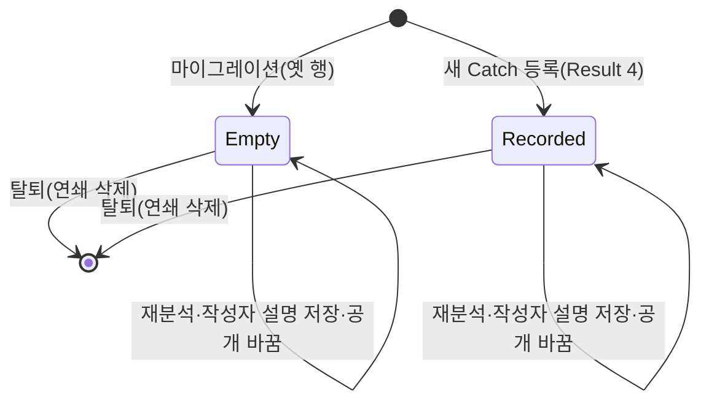
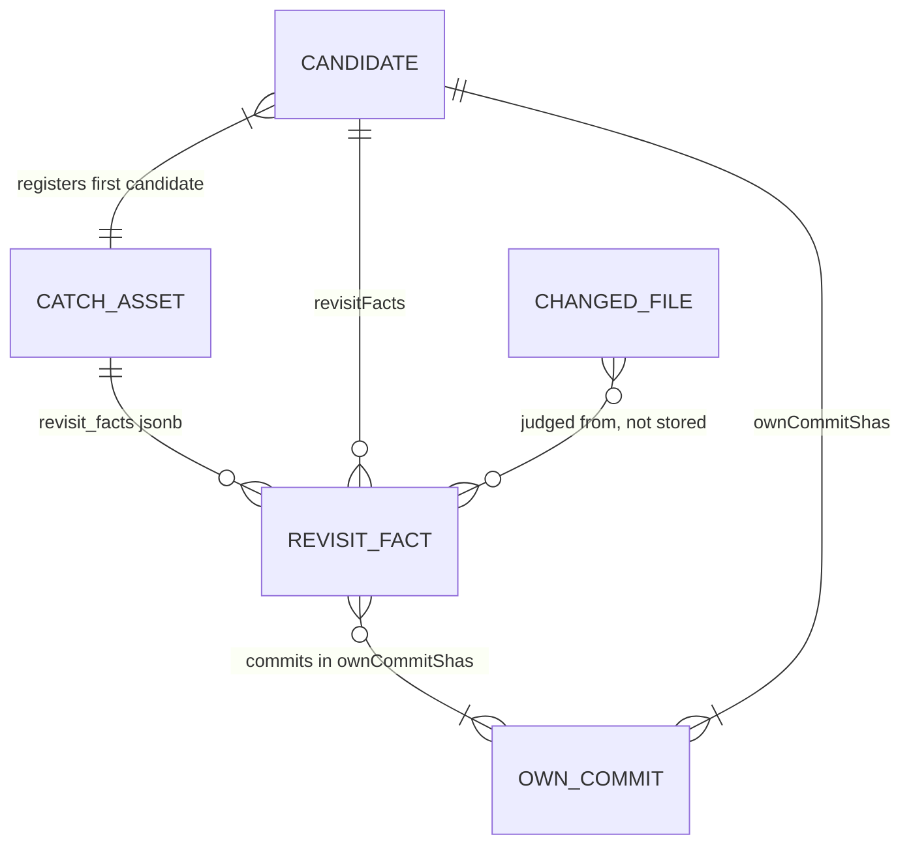

# NC3 다시 볼 곳 사실과 작업 시각 — 기능 명세

입력:
- Unit `inception/units-generation/unit-of-work.md` NC3(`nc3-revisit-facts`, service), 만드는 차례 `inception/units-generation/unit-of-work-story-map.md` 「NC3」
- 이야기 `inception/user-stories/stories.md` US9.1·US9.2·US9.3·US9.4·US10.1·US10.2·US11.1·US11.2
- 요구사항 `inception/requirements-analysis/requirements.md` FR12·FR13·FR14·FR15, NFR1·NFR6·NFR7
- 구성 요소 `inception/domain-design/components.md`, 계약 `inception/contract-design/contract-summary.md` C2·C4·C5
- 다듬은 화면 `inception/refined-mockups/mockups.md` 2절, `interaction-spec.md` 6절
- 규칙 `rules.md`(정본), 엔티티 `entities.md`(정본), 이 단계의 답 `functional-design-questions.md`

이 문서는 흐름(번호 붙은 차례)과 상태 바뀜의 정본이다. 칸 모양은 `entities.md`, 판정은 `rules.md`가 정본이고, 아래 관계 그림과 규칙 요약은 그 둘에서 옮긴 보기용이다.

## 1. 범위

- **이 Unit이 만드는 이야기:** US9.1(다시 고친 곳), US9.2(옮긴 곳·확장자 바꿈), US9.3(되돌림), US9.4(본인만 봄), US10.1(시험 파일 있음), US10.2(산출물 빼기), US11.1(작업 시각순 목록), US11.2(다음 쪽 이어짐).
- **바뀌는 곳:**
  - worker: 수집(파일 내용 식별값), 후보 판정(작업 시각), 새 RevisitFacts, 처리(결과 판본 "4"), 합성 결과
  - 공유 계약: 결과 메시지 `worker-messages.yaml`
  - api: 결과 검사·등록, `catch_asset` 칸 셋, 본인 목록 정렬·커서·응답, 분석 고지 4절
  - web: 지원자 상세의 「다시 볼 곳」 칸과 응답 검사
- **바뀌지 않는 곳:**
  - 재료 분류(`title.classify`)와 AI 재료 고르기, 생성·판정
  - 발행 사본과 받은 사람 화면·AI
  - 공개 Catch 목록, Claude 연결 읽기
  - 지원자 상세의 근거 링크(`safeEvidenceUrl`), 링크 판별 규칙
- **화면 부품 설계 문서는 따로 두지 않는다.** Unit 종류가 `service`라 `frontend-components.md`를 만들지 않는다. 바뀌는 화면은 칸 하나이고 6절에 적는다.

## 2. 흐름 W1 — 분석 중 사실과 작업 시각 계산 (worker)

1. LiveGenerator가 수집을 한다(호출 수 그대로). 커밋 상세의 파일 항목마다 `blob_sha`를 남긴다(BR1.1).
2. 후보 판정(`build_candidates`)이 후보를 만들고 같은 작업 식별값의 후보를 합친다.
3. 후보 판정이 합친 후보마다 본인 커밋 작성 시각의 최소·최대를 `firstWorkAt`·`lastWorkAt`으로 싣는다(BR4.1).
4. LiveGenerator가 후보마다 RevisitFacts를 부른다. 넘기는 것은 그 후보의 `ownCommitShas`에 든 커밋 기록뿐이다(BR2.1).
5. RevisitFacts가 판정한다.
   1. 병합 커밋을 빼고 (작성 시각, 식별값) 순서로 늘어놓는다(BR2.1).
   2. 못 받은·잘린 커밋을 경로 규칙에서 빼고, 좁은 산출물 경로를 뺀다(BR2.2·BR2.3).
   3. 켜진 규칙만 돈다(BR2.4).
      - 다시 고친 곳(BR3.1)
      - 옮긴 곳(BR3.2)
      - 확장자 바꿈(BR3.3)
      - 되돌림(BR3.4)
      - 시험 파일 있음(BR3.5)
   4. 되돌림이 켜져 있으면 되돌린 쌍은 다시 고친 곳에서 지운다. 꺼져 있으면 그 쌍은 다시 고친 곳으로 남는다(BR3.1).
   5. 종류 순서와 커밋 순서로 늘어놓고 30개까지 남긴다(BR2.5).
6. 생성 단계(`run_generation`)가 제목·초안을 채운다. 새 칸 셋은 그대로 옮긴다(BR5.1).
7. 결과 조합이 `schemaVersion: "4"`와 새 칸 셋을 담고, worker 결과 검사를 거쳐 큐로 보낸다(BR5.1).

- **실패와 경계:**
  - 4~5단계는 GitHub·AI를 부르지 않는 순수 계산이다. 판정 중 예외(기록이 없는 본인 커밋, 규격을 어긴 판정 결과 포함)는 그 후보의 `revisitFacts`만 빈 배열로 두고, 예외 종류 이름만 든 실패 로그 한 줄을 남긴 뒤 분석을 이어간다. 그 후보의 작업 시각·다른 후보·결과 판본은 그대로다. 팀 규칙 「예외를 삼키지 않는다」의 예외 한 곳이다(NFR 요구 Q1 B, NFR8.3·NFR4.3, 2026-11-11 코드 생성 때 고침).
  - 바뀐 줄 글자는 5단계 안에서만 쓰고 결과·로그에 담지 않는다(ADR-002 보안).
- **합성(MOCK) 경로:** 1~6단계 대신 합성 템플릿의 새 칸을 그대로 쓴다(BR5.3).

## 3. 흐름 W2 — 결과 받기와 등록 (api)

1. 결과 받기가 계약 검사를 한다. 판본 "3"이나 모양 위반은 SCHEMA_INVALID로 거부한다(BR5.1·BR5.2).
2. 결과 반영 트랜잭션 안에서 등록 입력을 만든다. 사실의 커밋이 그 후보의 `ownCommitShas` 밖이거나 `firstWorkAt > lastWorkAt`이면 등록 입력 오류다. 그 결과의 Catch는 하나도 등록되지 않는다(BR5.2).
3. 같은 `workIdentity` 후보 묶음마다:
   - 새 Catch면 첫 후보의 `revisitFacts`·`firstWorkAt`·`lastWorkAt`을 작업 사실·근거와 함께 쓴다(BR6.1).
   - 기존 Catch면 새 칸을 쓰지 않고 소속만 더한다(지금 그대로, BR6.1).
4. DB 검사(배열, 시각 둘 다 있음·순서)를 어기면 트랜잭션 전체가 롤백된다(BR6.2).

## 4. 흐름 W3 — 본인 목록과 「더 보기」 (api·web)

1. web이 `GET /v1/catches`를 지금 조건(저장소·작성자 설명 걸러 보기)으로 부른다.
2. api가 같은 조건에 `ORDER BY last_work_at DESC NULLS LAST, catch_id ASC`로 `limit + 1`개를 읽는다(BR7.1).
3. 다음 쪽이 있으면 마지막 항목으로 `{v: 3, scope, after: {lastWorkAt, catchId}}` 커서를 만든다(BR7.2).
4. 응답 항목마다 `revisitFacts`를 싣고 작업 시각은 싣지 않는다(BR8.1). 목록 카드에는 사실도 시각도 보이지 않는다(FR14.3).
5. 「더 보기」는 그 커서를 그대로 보낸다. api는 판본·범위·꼴을 검사하고 BR7.2의 다음 쪽 조건으로 읽는다.
6. 커서가 틀리면 400이다(판본 1·2, 다른 조건, 꼴 틀림). web은 지금 「다음 목록을 불러오지 못했습니다.」와 다시 불러오기를 보인다(NC1 BR5.2와 같음).
7. 공개 Catch 목록은 이 흐름을 쓰지 않고 지금 순서·커서 그대로다(BR7.3).

## 5. 흐름 W4 — 지원자 상세의 「다시 볼 곳」 (web)

1. 지원자가 목록 카드를 눌러 상세를 연다. web이 `GET /v1/catches/{catchId}`를 부른다.
2. web이 응답의 `revisitFacts`가 RevisitFact 배열인지 검사한다. 아니면 지금 「상세 내용을 불러오지 못했습니다」다(BR8.1).
3. 상세는 위에서부터 작업 사실·나의 기여 → 근거 → **다시 볼 곳** → Catch 설명 초안 → 생각해 볼 질문 → 작성자 설명 → 현재 확인 상태다(FR6.1, NC1이 정한 자리).
4. 사실이 하나 이상이면 칸을 그리고, 없으면 그리지 않는다(BR9.1).
5. 항목마다 종류별 문장을 만들고(BR9.2), 커밋 식별값을 링크나 글자로 그린다(BR9.3).

## 6. 화면 상태 — 「다시 볼 곳」 칸

다듬은 화면 interaction-spec 6절과 대조했다. 역할(h3 + `ul`, 커밋은 `a`), 키보드(커밋 링크만 Tab 순서), 링크 글자(식별값 7자 + 숨은 「(새 탭)」), 근거 링크를 바꾸지 않는 것이 interaction-spec과 같다. 어긋나는 곳은 없다.

| 상태 | 화면 | 근거 |
|---|---|---|
| 사실 하나 이상 | h3 「다시 볼 곳」 + 작은 글자 「본인만 확인」(지금 「생각해 볼 질문」 제목과 같은 꼴), 아래 `ul`에 항목 | BR9.1 |
| 사실 없음, 3단계 전 Catch(빈 배열) | 칸을 그리지 않음(제목도 없음) | BR9.1, AC9.1.3 |
| 실제 자료(LIVE)이고 저장소 이름이 GitHub 꼴 | 커밋 식별값 7자가 github.com 커밋 링크, 새 탭, 화면 낭독기에 「(새 탭)」 | BR9.3 |
| 예시 자료·합성(MOCK) Catch, 저장소 이름을 불러오는 중·실패·꼴 아님 | 커밋 식별값 7자를 링크 없이 글자로 | BR9.3 (Q4 A) |
| 응답의 `revisitFacts`가 모양이 틀림 | 상세 전체를 지금 「상세 내용을 불러오지 못했습니다」로 | BR8.1 |
| 발행 화면·작성자 발행본 상세·면접관 화면 | 칸 없음(사본에 사실이 없음) | BR6.3, AC9.4.1 |

**항목 문장 예(BR9.2):**

- 다시 고침: 커밋 ba6bba8에서 넣은 줄을 커밋 d42d9a3에서 다시 고침: Front/theme/src/store/firebase/firebase.ts
- 옮김: 새 파일로 옮김: src/a.js → lib/a.js (커밋 1a2b3c4)
- 확장자 바꿈: 확장자 바꿈: util.js → util.ts (커밋 1a2b3c4)
- 되돌림: 커밋 1a2b3c4의 변경을 커밋 5d6e7f8에서 되돌림
- 시험 파일: 시험 파일 있음: src/\_\_tests\_\_/a.test.ts (커밋 1a2b3c4)

경로와 커밋 식별값은 React 글자로만 그린다. 응답 검사가 꼴(40자 16진수, kind 다섯)을 이미 본다.

## 7. 상태 바뀜

### 7.1 CatchAsset의 새 칸 셋

<!-- Text fallback: 옛 행은 마이그레이션으로 빈 상태(사실 빈 배열, 시각 null)가 되고, 새 Catch는 등록 때 값이 쓰인 상태가 된다. 두 상태 모두 재분석·작성자 설명 저장·공개 바꿈으로 바뀌지 않고, 탈퇴하면 연쇄 삭제로 사라진다. -->

- **Empty:** `revisit_facts = []`, `first_work_at`·`last_work_at = null`. 목록에서 맨 아래에 있고 「다시 볼 곳」 칸이 없다.
- **Recorded:** 사실(0~30개)과 시각 둘이 있다. 사실이 0개여도 시각은 있다.
- 등록 뒤 새 칸을 고치는 경로는 없다(BR6.1). 「Catch 재생성」은 열지 않는다(FR15.3).

### 7.2 본인 목록 커서

- 첫 쪽은 커서가 없다.
- 시각 있는 쪽은 `after.lastWorkAt`이 글이다. 시각 없는 Catch까지 가면 `after.lastWorkAt`이 null이고, 그다음 쪽은 시각 없는 Catch만 이어 읽는다.
- 마지막 쪽은 `nextCursor: null`이다.
- 판본 1·2 커서는 어느 쪽에서도 400이다.

## 8. 관계 그림 (entities.md에서 옮김)

<!-- Text fallback: Catch(CATCH_ASSET)는 다시 볼 곳 사실을 jsonb 배열로 0개 이상 담는다. 결과 메시지 후보(CANDIDATE)도 사실을 0개 이상 담고, 같은 작업 후보 묶음의 첫 후보가 Catch 하나로 등록된다. 사실의 커밋은 그 후보의 본인 커밋(OWN_COMMIT) 목록 안에 있다. 수집한 파일 기록(CHANGED_FILE)은 판정 재료일 뿐 사실에 담기지 않는다. -->

## 9. 규칙 요약 (rules.md에서 옮김)

| 묶음 | 규칙 | 구성 요소 |
|---|---|---|
| BR1 수집 | BR1.1 파일 내용 식별값 남기기 | Collection |
| BR2 공통 | BR2.1 한 후보 본인 커밋·순서, BR2.2 못 받은 자료 빼기, BR2.3 좁은 산출물 목록, BR2.4 규칙 끄기, BR2.5 상한 | RevisitFacts |
| BR3 규칙 다섯 | BR3.1 다시 고친 곳, BR3.2 옮긴 곳, BR3.3 확장자 바꿈, BR3.4 되돌림, BR3.5 시험 파일 있음 | RevisitFacts |
| BR4 작업 시각 | BR4.1 합친 뒤 작성 시각 최소·최대 | CandidateGrouping |
| BR5 결과 메시지 | BR5.1 Result "4", BR5.2 api 검사, BR5.3 합성 결과 | AnalysisProcessing, ResultReception |
| BR6 등록·저장 | BR6.1 새 Catch에만 한 번, BR6.2 칸 셋 마이그레이션, BR6.3 읽지 않는 곳 | Catches, Publications |
| BR7 정렬·커서 | BR7.1 정렬, BR7.2 커서 판본 3, BR7.3 공개 목록 그대로 | Catches |
| BR8 응답 | BR8.1 사실 싣기, 시각 빼기 | Catches, AssetsScreen |
| BR9 화면 | BR9.1 칸 자리·숨김, BR9.2 문장, BR9.3 커밋 링크 | AssetsScreen |
| BR10 고지 | BR10.1 4절 한 줄, PR에서 팀장 승인 | AnalysisNotice |

## 10. 업무 시나리오와 기대 결과 (시험 먼저 정하기)

팀 시험 방식(팀 규칙 「Testing Posture」)대로 시나리오·기대 결과·실패 조건을 먼저 적는다. 세부 시험 코드는 구현 뒤에 쓴다.

| # | 시나리오 | 기대 결과 | 실패 조건 | 수락 기준 |
|---|---|---|---|---|
| S1 | TheMe 꼴: 앞 커밋이 `firebase.ts`에 줄을 넣고, 같은 후보의 뒤 커밋이 그 줄을 지우고 고쳐 넣음 | REWORKED_LINES 하나(paths [firebase.ts 경로], commits [앞, 뒤]), 상세에 두 커밋 링크 | 사실 없음, 커밋 순서 뒤바뀜 | AC9.1.1 |
| S2 | 다른 후보의 커밋이 이 후보 커밋의 줄을 지움 | 두 후보 모두 REWORKED_LINES 없음 | 다른 후보 커밋으로 사실이 생김 | AC9.1.2 |
| S3 | 사실 없는 Catch, 마이그레이션 전 Catch(빈 배열) | 상세에 「다시 볼 곳」 제목·칸 없음 | 빈 칸·빈 제목이 그려짐 | AC9.1.3 |
| S4 | LIVE Catch, 저장소 이름 `ljm0850/TheMe` / 이름 실패 / MOCK Catch | 앞은 `https://github.com/ljm0850/TheMe/commit/<40자>` 새 탭 링크와 숨은 「(새 탭)」, 나머지는 7자 글자 | 이름 없이 링크가 만들어짐, 다른 호스트 | AC9.1.4 |
| S5 | 앞 커밋이 `src/a.js`를 지우고 뒤 커밋이 같은 식별값으로 `lib/a.js`를 만듦 / 한 커밋 안 renamed | MOVED_FILE(paths [src/a.js, lib/a.js]) | 사실 없음, 식별값이 여럿인데 하나를 고름 | AC9.2.1 |
| S6 | `util.js` → `util.ts` 이름 바꿈 / `src/util.js` → `lib/util.ts` | 앞은 EXTENSION_CHANGED, 뒤는 MOVED_FILE 하나 | 둘 다 생기거나 종류가 바뀜 | AC9.2.2 |
| S7 | X 메시지에 「This reverts commit <Y 40자>」, Y는 같은 후보 / Y는 다른 후보 | 앞은 REVERTED(commits [X, Y]) 하나이고 (Y, X) REWORKED_LINES 없음, 뒤는 없음 | 다른 후보 Y로 사실이 생김, 되돌림 쌍이 다시 고침으로도 나옴 | AC9.3.1 |
| S8 | 사실이 있는 Catch를 발행하고 사본·조각·요약 근거·공개 Catch 응답을 만듦 | 어디에도 사실·작업 시각 글자가 없음 | 하나라도 나옴 | AC9.4.1, AC11.1.4 |
| S9 | `out/test/a.js`와 `src/components/ButtonTest.tsx`만 바꾼 후보 | TEST_FILES_PRESENT 없음 | 사실이 생김 | AC10.1.1 |
| S10 | `src/__tests__/a.test.ts`를 바꾼 후보 / 그 파일을 지우기만 한 후보 / 지운 시험 파일과 고친 시험 파일이 섞인 후보 | 앞은 TEST_FILES_PRESENT(paths에 그 경로), 가운데는 없음, 뒤는 고친 경로만 담김(NFR 요구 Q2 B, NFR8.4) | 사실 없음, 지운 시험 파일로 사실이 생김 | AC10.1.2 |
| S11 | 뒤 커밋이 앞 커밋의 `package-lock.json` 줄을 다시 고침 | REWORKED_LINES 없음 | 잠금 파일 사실이 생김 | AC10.2.1 |
| S12 | 산출물 목록 파일과 일반 파일을 함께 바꾼 후보 | AI 재료로 고르는 파일과 순서가 이 변경 전과 같음 | 재료 고르기가 바뀜 | AC10.2.2 |
| S13 | 마지막 작업 시각 2025-04인 A, 2025-06인 B, 시각 없는 C | 목록 순서 B, A, C | 다른 순서 | AC11.1.1 |
| S14 | 작성 시각 2025-03-02·2025-04-10, 커밋 시각은 리베이스로 2025-05-01인 후보 / 마지막 작성 시각 2025-04-20인 Catch | 첫 2025-03-02·마지막 2025-04-10이 저장되고, 목록에서 04-20 Catch가 위 | 커밋 시각을 씀 | AC11.1.2, AC14.3 |
| S15 | 마지막 작업 시각이 같은 Catch 둘을 여러 번 부름 | 늘 catch_id 순서로 같음 | 순서가 바뀜 | AC11.1.3 |
| S16 | 목록 카드와 면접관 발행본 | 작업 시각과 정렬 선택 칸이 어디에도 없음 | 하나라도 보임 | AC11.1.4 |
| S17 | 시각 있는 Catch와 없는 Catch가 섞인 45개를 20개씩 세 쪽 | 45개가 한 번씩, 시각 경계를 넘는 쪽에서도 빠짐·겹침 없음 | 빠짐·겹침 | AC11.2.1 |
| S18 | 판본 2 커서, 다른 조건 커서, lastWorkAt 꼴이 틀린 커서 | 400, web은 지금 「더 보기」 실패 안내 | 200이나 다른 안내 | FR14.4 |
| S19 | 판본 "3" 결과, 사실 커밋이 ownCommitShas 밖인 결과, 사실 31개인 결과 | 각각 SCHEMA_INVALID, 등록 입력 오류, SCHEMA_INVALID. Catch가 생기지 않음 | 등록됨 | FR15.1 |
| S20 | 같은 작업 식별값으로 기존 Catch가 있는 재분석 | 기존 Catch의 사실·시각이 그대로 | 덮어씀 | BR6.1 |

- 규칙 버림 기준(FR15.4)과 사람 대조(NFR4)는 빌드와 시험에서 TheMe로 잰다. 「다시 볼 곳」 칸의 규칙별 붙은 Catch 수를 세는 일도 그때 한다.
- 호출 수가 늘지 않는 것(NFR1)은 같은 저장소의 바꾸기 전·후 분석으로 빌드와 시험에서 본다.

## 11. 고지 4절 (BR10.1)

- 4절 「CatchU에 남는 것」의 셋째 줄 뒤에 아래 초안을 더한다. 문구는 3단계 PR에서 팀장 승인으로 확정한다.
- 초안: 「- 같은 작업 안 본인 커밋끼리 본 「다시 볼 곳」 사실(종류·파일 경로·커밋 식별값)을 Catch에 남기고 본인 화면에만 보입니다. 발행본, 받은 사람, AI 요약·질의응답에는 들어가지 않습니다.」
- 첫·마지막 작업 시각도 적을지는 그 PR에서 팀장이 정한다(C5).

## 12. 한계

- 다시 고친 곳은 줄 글자를 맞춰 본다. 앞 커밋이 넣은 줄과 글자가 같은 다른 줄을 뒤 커밋이 지우면 다시 고친 곳으로 잘못 잡힐 수 있다. 줄 번호는 보지 않는다. 틀린 줄 수는 NFR4 대조로 잰다.
- 지운 파일(removed)은 다시 고친 곳에서 보지 않는다. 앞 커밋 뒤에 이름이 바뀐 파일은 같은 후보 안의 이름 바꿈(renamed)만 따라가고, 여러 커밋에 걸쳐 지우고 새로 만든 옮김은 따라가지 않는다.
- 파일 목록이 잘린 커밋과 변경 내용을 받지 못한 커밋은 판정에서 빠진다. 그런 커밋이 많은 작업은 사실이 적게 나온다.
- 사실이 30개를 넘으면 뒤의 것은 안내 없이 빠진다(Q1 A).
- 지시 파일(`AGENTS.md` 등)은 파일 전체가 빠진다. 그래서 지원자가 손으로 고친 지시 줄도 「다시 볼 곳」에 나오지 않는다(Q2 A).
- 저장소 이름을 불러오지 못하면 커밋 식별값이 링크 없이 보인다(Q4 A).

## Sources

- `inception/units-generation/unit-of-work.md`, `inception/units-generation/unit-of-work-story-map.md`
- `inception/user-stories/stories.md` US9.1·US9.2·US9.3·US9.4·US10.1·US10.2·US11.1·US11.2
- `inception/requirements-analysis/requirements.md` FR6.1·FR12·FR13·FR14·FR15, NFR1·NFR4·NFR6·NFR7
- `inception/domain-design/components.md`, `inception/domain-design/decisions.md` ADR-002~004
- `inception/contract-design/contract-summary.md` C2·C4·C5
- `inception/refined-mockups/mockups.md` 2절, `inception/refined-mockups/interaction-spec.md` 6절
- `construction/nc1-sections-and-links/functional-design/rules.md` BR5.2
- `construction/nc3-revisit-facts/functional-design/rules.md`, `entities.md`, `functional-design-questions.md`
