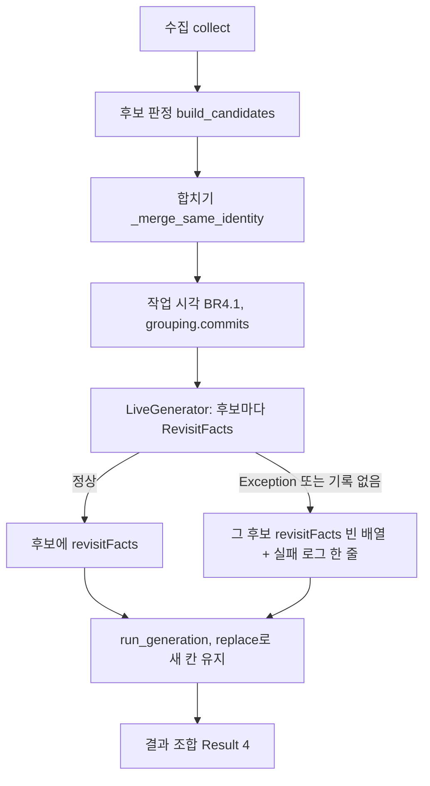

# NC3 다시 볼 곳 사실과 작업 시각 — 신뢰성 설계

입력:
- NFR 요구 `construction/nc3-revisit-facts/nfr-requirements/reliability-requirements.md`(NFR7.1~NFR7.4, NFR8.1~NFR8.4)와 `performance-requirements.md`(NFR1.2)
- 기능 명세 `construction/nc3-revisit-facts/functional-design/functional-spec.md`, 규칙 `rules.md`
- 계약 `inception/contract-design/contract-summary.md` C2·C4
- 이 단계의 답 `nfr-design-questions.md`

## 1. 계산 순서와 실패 갈래 (NFR8.3)

<!-- Text fallback: 수집 뒤 후보 판정이 후보를 만들고 합친 다음 작업 시각을 정한다. 그 뒤 LiveGenerator가 후보마다 RevisitFacts를 부르고, 정상이면 사실을 붙이고 예외나 기록 없음이면 그 후보만 빈 배열과 실패 로그 한 줄로 둔다. 둘 다 생성 단계로 가고, 생성은 replace로 새 칸을 지킨 채 결과 조합이 Result 4를 만든다. -->

- **작업 시각:**
  - `build.py`의 `build_candidates`가 `_merge_same_identity` 뒤 후보마다 `grouping.commits`에서 본인 커밋 기록을 찾아 최소·최대 `authored_at`을 정한다.
  - 기록이 없으면 지금 후보 판정 결함처럼 `ValueError`로 올린다. 그 분석은 지금 생성 실패 갈래다(BR4.1 그대로).
  - 이 자리는 팀 규칙의 예외가 아니다.
- **기록 묶음:** LiveGenerator는 `(*outcome.commits, *outcome.relations.commits)`로 식별값 → 기록 사전을 만든다. `grouping.py` 508행과 같은 묶음이다.
  - 시각이 정해진 후보는 이 사전에 모든 본인 커밋이 있다.
  - 그래서 RevisitFacts 쪽 「기록 없음」은 두 묶음이 어긋나는 코드 결함일 때만 생긴다.
- **RevisitFacts 부르기:** LiveGenerator가 `build_candidates` 뒤, `run_generation` 앞에서 후보마다 부른다.
  - 생성 마감 시각(`deadline`) 안의 시간을 쓰지만, 계산은 메모리 안에서 끝나 생성 시간에 견주면 작다(성능 설계 1절).
  - 부르는 자리에서 `Exception`을 잡는다. 잡으면 그 후보의 `revisit_facts = ()`로 두고 실패 로그 한 줄을 남긴다(관측 설계). 다른 후보는 계속 계산한다.
  - 기록이 없는 식별값을 만나면 RevisitFacts 안에서 정해진 예외 하나를 내고, 같은 자리에서 잡힌다.
- **생성 뒤:** `flow.py`의 `replace(candidate, …)`는 새 칸을 바꾸지 않으므로 그대로 남는다.
  - 시험: 생성 흐름을 거친 후보에 사실·시각이 그대로 있다.
- **합성(MOCK):** FakeGenerator는 템플릿 값을 쓰고 RevisitFacts를 부르지 않는다(BR5.3).

## 2. 기능 설계·NFR 요구와 맞추는 문서 (코드 생성 계획의 함께 고칠 파일)

프로젝트 규칙 「규칙을 바꿀 때는 같은 규칙을 적은 다른 문서를 모두 찾는다」에 따라, 아래를 코드 생성 계획의 함께 고칠 파일에 넣는다.

| 문서 | 자리 | 고칠 것 | 근거 |
|---|---|---|---|
| `construction/nc3-revisit-facts/functional-design/functional-spec.md` | 2절 W1 「실패와 경계」 첫 줄(49행) | 「삼키지 않고 지금 생성 실패 갈래로 올린다」를 NFR8.3 갈래(그 후보 사실만 빈 배열, 예외 종류 이름만 든 실패 로그, 팀 규칙의 예외 한 곳)로 바꾼다 | NFR 요구 Q1 B, 이 단계 Major 처리 덧붙임(어긋나는 문장은 이 하나뿐) |
| 같은 문서 | 10절 S10 | 지운(removed) 시험 파일은 치지 않는 경우를 더한다 | NFR8.4(Q2 B) |
| `construction/nc3-revisit-facts/functional-design/rules.md` | BR3.5 logic | 시험 파일 판정에서 상태 `removed`를 뺀다 | NFR8.4(Q2 B) |
| `construction/nc3-revisit-facts/nfr-requirements/performance-requirements.md` | NFR1.3 | 「TheMe 분석 하나에서 RevisitFacts 전체 시간은 1초 이하」와 RevisitFacts만 재는 확인을 지운다. 구조 요구(한 번 훑기, (경로, 줄 글자) 사전, 쌍마다 다시 훑지 않음)는 코드 검토로, 분석 전체 `elapsedSeconds` 바꾸기 전·후 기록만 남긴다 | 이 단계 Q1 |

- 고치지 않는 것: `rules.md` BR2.1의 「순수 계산」은 GitHub를 부르지 않는다는 뜻이라 그대로다. BR4.1(작업 시각 기록 없음은 worker 결함)도 1절 순서대로 그대로다(이 단계 Major 처리 덧붙임).

## 3. 호환과 배포 (NFR7.1~NFR7.4)

- **마이그레이션 하나:**
  - `catch_asset`에 `revisit_facts jsonb NOT NULL DEFAULT '[]'::jsonb`, `first_work_at timestamptz NULL`, `last_work_at timestamptz NULL`을 더한다.
  - 검사 둘을 둔다. `jsonb_typeof(revisit_facts) = 'array'`, 그리고 `(first_work_at IS NULL) = (last_work_at IS NULL) AND (first_work_at IS NULL OR first_work_at <= last_work_at)`다.
  - 옛 행은 기본값과 null로 채워진다. `down`은 칸과 검사를 지운다.
- **결과 판본:**
  - worker `result.py`의 `schemaVersion`과 계약 `Result.schemaVersion.enum`을 `"4"`로 같은 PR에서 바꾼다.
  - api 시험의 고정 결과(`api/test/` 결과 예시)와 worker 고정 자료(`worker/fixtures/m1-synthetic/`)도 같은 PR에서 고친다.
  - 판본 "3" 결과는 Ajv가 거부한다.
- **배포 순서:** api·worker를 함께 배포한다. PR 「리뷰 요청」에 「진행 중인 분석이 없을 때 배포, 남은 분석은 다시 함」을 적는다. 마이그레이션은 지금처럼 api 기동 때 돈다.
- **커서:**
  - 판본 1·2 커서는 `owner-catch-input.ts`가 400으로 거부한다.
  - web 「더 보기」 실패 안내는 지금 코드 그대로다(NC1 BR5.2). web 코드는 커서를 읽지 않고 받은 글을 그대로 보내므로 바꿀 것이 없다.
- **DB 초기화 전 반영(NFR7.4):** 코드에 할 일은 없다. PR 병합 시점을 팀장이 확인한다.

## 4. 시험 (NFR8.1, NFR8.2)

| 서비스 | 시험 | 시나리오 |
|---|---|---|
| worker | RevisitFacts 규칙별 시험(합성 커밋 기록), 좁은 산출물 목록, 상한·순서, 예외 갈래(예외를 내는 판정과 기록 없는 식별값), 작업 시각(합치기 뒤), 결과 판본 "4"와 합성 템플릿 | S1·S2·S5~S7·S9~S11·S14·S19, NFR8.3·NFR8.4 |
| api | 결과 검사(판본 "3" 거부, 종류별 개수·소속·시각 순서), 등록(새 Catch만 씀, 기존 그대로), DB 검사, 목록 정렬·커서 판본 3·45개 세 쪽·공개 목록 그대로, 응답에 시각 없음, 사본·조각·공개 응답에 새 글자 0건 | S8·S13~S20 |
| web | 응답 검사(모양·종류별 개수), 칸 있음·없음, 문장 다섯 꼴과 조사, 링크 조건(LIVE·api·이름 꼴), 숨은 「(새 탭)」 | S3·S4, NFR5.1·NFR5.2·NFR6.1 |

- 시험은 시간을 단정하지 않는다(이 단계 Q1).
- 기존 시험은 계속 통과한다. 커서 판본 2를 단정하는 기존 api 시험은 판본 3으로 바꾼다.

## Sources

- `construction/nc3-revisit-facts/nfr-requirements/reliability-requirements.md`, `performance-requirements.md`
- `construction/nc3-revisit-facts/functional-design/functional-spec.md`(W1, 10절), `rules.md`(BR2.1, BR3.5, BR4.1, BR5.1, BR6.2, BR7.2)
- `inception/contract-design/contract-summary.md` C2·C4
- `construction/nc3-revisit-facts/nfr-design/nfr-design-questions.md`
- 지금 코드: `worker/app/candidates/build.py`·`grouping.py`, `worker/app/processing/live.py`·`result.py`·`fake_generator.py`, `worker/app/generation/flow.py`, `api/src/catches/owner-catch-input.ts`, `api/contracts/repository-analysis/worker-messages.yaml`
