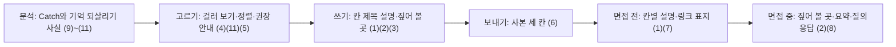

# 새 Catch — 범위 문서

## 근거

- 승인된 의도 설명 `ideation/intent-capture/intent-statement.md`: Catch 정의, 성공 기준 12개, 시한, 하지 않는 것, 정하지 않는 넷.
- 승인된 가능성 평가 `ideation/feasibility/feasibility-assessment.md`와 제약 목록 `ideation/feasibility/constraint-register.md`: 바뀌는 곳은 web·api·worker 안, 가장 큰 위험은 일정, 제약 1~17.
- 이 단계의 답 `ideation/scope-definition/scope-definition-questions.md` Q1~Q4(2026-11-09 확인).

## 최소 범위

이 intent는 입력 문서 §6의 1~3단계를 모두 담는다(의도 설명, 입력 문서 §8-1의 1). 할 일은 11개이고 모두 Must다(Q1·Q2). 공수가 가용을 넘을 때 무엇부터 줄일지는 이번 판에서 정하지 않는다(의도 설명 「Assumptions & Open Questions」).

## 범위 안

| 단계 | 할 일 | 보는 사람 |
|---|---|---|
| 1단계 지원자 화면 | (1) 칸 제목이 붙은 작성자 설명 쓰기·보기. 받은 사람 화면의 칸 제목별 보기와 빈 칸 숨김을 포함한다. (2) 짚어 볼 곳 링크와 관련 커밋 넣기. (3) 쓰기 도움 문구. (4) 본인 목록 '설명 씀/안 씀' 걸러 보기. (5) 발행 화면 '저장소마다 3~5개 권장' 안내. | 지원자, (1)의 보기는 면접관도 |
| 2단계 면접관 화면 | (6) 발행 사본의 저장소 이름·작성 시점·이 작업만의 조회 한계(화면에만). (7) '이 작업의 본인 커밋' 링크 표지. (8) 기본 요약·질의응답 지시와 질의응답 10개 재측정. | 면접관 |
| 3단계 분석 쪽 | (9) 같은 작업 안에서 다시 고친 곳·새 파일로 옮긴 곳·확장자 바꿈·되돌림. (10) 좁은 시험 파일 '있음'과 좁은 산출물 목록. (11) 작업 시각과 본인 목록 작업 시각순 정렬. | 지원자만 |

각 항목의 자세한 내용과 의존은 `intent-backlog.md`에 있다.

## 범위 밖

의도 설명 「Initial Scope Signal」의 하지 않는 것 다섯 묶음을 그대로 따른다. 이 목록이 할 일 목록의 Won't를 대신한다(Q2).

- 새로 모으지 않는다: 리뷰 글·리뷰 상태·PR 대화·이슈 댓글, 타임라인과 검사 결과, AI 세션 기록 붙여 넣기, 위키.
- 입력 문서 §8-1에서 채택하지 않은 안: 면접관에게 질문 문장 보이기, 받은 사람 AI 근거 딱지 셋, 규칙이 내는 짚어 볼 곳 후보, 병합 요청 제목, 칸마다 따로 저장, 맡은 폴더·다른 계정 섞임 한 줄, 정정 한 줄.
- 여러 작업 엮기, 맡기고 검토만 한 작업 보이기, Claude 세션에서 초안 남기기, 짚어 볼 곳을 서비스 안에서 보이기.
- 0단계(공개 저장소 수 세기, 현직 개발자와 정적 화면 비교), 면접관 화면 공통 안내 문장, Catch마다 '확인하지 않음' 표지.
- 이 intent에서 정하지 않는 넷: 제목 출처 표시, 기계 대조 빼기(#485), CatchU 저장소 공개, 출시 직전 DB 초기화 날짜.

## 만드는 순서

**의존 우선**으로 만든다(Q4). 선행 PR이 풀리는 순서대로 만들고, 같이 풀리면 1단계 → 2단계 → 3단계 순서로 한다.

| 단계 | 합치기 전에 들어가 있어야 할 것 | Source |
|---|---|---|
| 1단계 | #487, #488. 받은 사람 화면의 칸 제목별 보기가 받은 사람 화면 파일(`web/src/features/publications/snapshot-view.tsx`)을 고치기 때문이다. | Q4 |
| 2단계 | Catch 개편 CR1·CR3 PR, #488. (7) 링크 표지는 1단계 (2) 뒤에 한다. | Q3·Q4, 제약 14 |
| 3단계 | Catch 개편 PR 3개(CR1→CR3→CR2) | Q3, 제약 14 |

**가능성 단계와 달라진 점:** 제약 목록의 제약 14는 「1단계는 #487 뒤」라고 적었다. 이 단계에서 받은 사람 화면의 칸 제목별 보기를 1단계 (1)에 넣으면서 1단계 선행에 #488이 더해졌다. 1단계 선행은 이 문서를 따른다(Q4). 승인된 제약 목록은 고치지 않는다.

모든 코드 PR은 12월 intent의 1차 통합 확인(날짜 미정) 뒤 Catch 개편 PR 3개보다 늦게 통합 브랜치에 합치고, 11/30 안에 들어가야 한다(제약 12·13). 출시 직전 DB 초기화는 3단계와 Catch 개편 CR2가 통합 브랜치에 들어간 뒤에 한다(의도 설명).

## 가치 흐름

누가 무엇을 얻는지 순서대로 적는다.

1. 분석: 작업마다 Catch가 생긴다(지금 그대로). 3단계 (9)~(11)이 지원자만 보는 기억 되살리기 사실과 작업 시각을 더한다.
2. 고르기: 지원자가 본인 목록에서 설명 씀·안 씀으로 걸러 보고(4), 작업 시각순으로 정렬하고(11), 발행 화면 안내(5)를 보며 저장소마다 3~5개를 고른다.
3. 쓰기: 지원자가 고른 Catch에 칸 제목별로 판단을 쓰고(1), 짚어 볼 곳 링크와 관련 커밋을 붙인다(2). 생각해 볼 질문과 안내 문구(3)가 쓰기를 돕는다.
4. 보내기: 발행하면 사본에 저장소 이름·작성 시점·조회 한계가 붙는다(6).
5. 면접 전: 면접관이 칸 제목별로 나뉜 작성자 설명(1)을 훑고, 링크 표지(7)가 붙은 원본을 연다.
6. 면접 중: 면접관이 짚어 볼 곳(2)을 띄우고 설명을 청한다. 기본 요약·질의응답(8)은 작성자 글을 "작성자는 …라고 적었다"로 옮긴다.

<!-- Text fallback: 분석에서 Catch와 기억 되살리기 사실이 생기고, 지원자가 고르고 쓰고 보내면, 면접관이 면접 전에 칸별 설명과 링크 표지를 보고 면접 중에 짚어 볼 곳과 요약·질의응답을 쓴다. -->

## 시한

| 시한 | 대상 | Source |
|---|---|---|
| 11/30 | 1~3단계 모든 코드가 통합 브랜치에 들어감 | 제약 12 |
| 출시 직전 DB 초기화 전 | 3단계. 초기화는 3단계와 CR2 뒤에 하므로 날짜와 무관하게 판정한다. | 의도 설명 |
