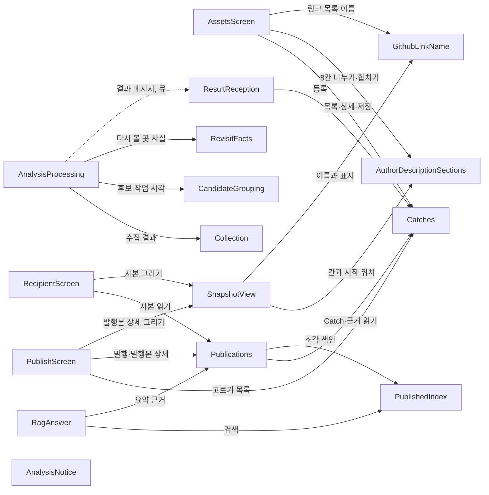

# 새 Catch — 구성 요소

입력:
- 요구사항 `aidlc/spaces/default/intents/261109-new-catch/inception/requirements-analysis/requirements.md`(FR1~FR15, NFR1~NFR8)
- 사용자 이야기 `inception/user-stories/stories.md`(US1~US11)
- 다듬은 화면 `inception/refined-mockups/mockups.md`·`interaction-spec.md`
- 코드 지식 `aidlc/spaces/default/codekb/CatchU/architecture.md`·`component-inventory.md`·`code-quality-assessment.md` 「이 intent가 닿는 자리」
- 이 단계의 답 `domain-design-questions.md`(Q1~Q4 모두 A, 덧붙임 셋)

이 intent가 새로 만들거나 고치는 구성 요소만 담는다. 구성 요소 이름 옆 괄호는 코드 지식의 구성 요소 이름이다. 새 구성 요소는 셋이다. web 공통 자리의 둘(작성자 설명 칸, GitHub 링크 이름)과 worker의 하나(다시 볼 곳 사실)다. 나머지는 기존 구성 요소를 고친다. 칸 이름·API 모양·계약 판본 숫자는 계약 설계와 기능 설계에서 정한다. 여기서는 누가 무엇을 맡는지만 정한다.

```yaml
components:
  - name: AuthorDescriptionSections
    summary: 저장된 작성자 설명 한 칸을 칸 제목 8개로 나누고 합치며 글자 수를 센다 (web.lib 새 구성 요소)
    behaviour: >
      저장된 글을 칸 제목 줄로 나눠 칸마다 글과 저장된 글 안의 시작 위치를 돌려준다. 칸 제목 줄을 읽지 못하는
      글(옛 자유 글)은 전체를 「더 쓰기」 한 칸으로 돌려준다. 8칸을 저장할 글로 합칠 때 빈 칸은 칸 제목째 넣지 않고,
      「더 쓰기」만 있으면 칸 제목 글자를 붙이지 않으며, 8칸이 모두 비면 빈 글(설명 지움)을 돌려준다.
      두 단위를 나눠 쓴다. 합계 글자 수는 저장될 글을 api(author-description-input.ts)처럼 코드 포인트로 센다(4,000자 상한용).
      칸마다의 시작 위치는 UTF-16 코드 단위다(C-11 강조 위치, published-chunk.entity.ts의 charStart·charEnd와 같다).
      기능 설계 시험에 칸 제목 앞뒤에 이모지가 있는 글의 강조 위치 사례를 넣는다. 지원자가 글 안에 칸 제목 줄과
      같은 줄을 써도 막지 않는다(그 줄부터 다른 칸으로 읽힘, 한계). 칸 제목 줄의 모양은 기능 설계에서 정한다.
      화면 안에서만 쓰고 API를 부르지 않는다. 순수 함수다.
    responsibilities:
      - 저장된 글 → 8칸과 칸마다의 시작 위치(FR1.1, FR1.5, FR2.1, FR2.2)
      - 8칸 → 저장할 글(FR1.2, FR1.4, FR1.5)
      - 칸 제목 포함 합계 글자 수(FR1.3)
      - 칸 제목과 같은 줄을 막지 않는 한계(FR1.6, FR1.8)
    depends_on: []
    dependents:
      - component: AssetsScreen
        interaction: 편집 화면이 저장된 글을 8칸에 채우고, 저장할 글과 합계 글자 수를 받는다
      - component: SnapshotView
        interaction: 발행본이 저장된 글을 칸별로 그리고, 칸마다의 시작 위치로 근거 강조 위치를 맞춘다
    external_dependencies: []
    entities: []

  - name: GithubLinkName
    summary: GitHub 링크를 읽을 수 있는 이름으로 바꾸고 「이 작업의 본인 커밋」 표지를 판정한다 (web.lib 새 구성 요소)
    behaviour: >
      링크 찾기는 지금 판별 규칙(github-source-url.ts splitGithubLinks)을 그대로 쓴다. 찾은 주소를 파일 줄·파일·폴더·커밋·PR
      모양에 따라 이름으로 바꾼다. 판본 자리가 16진수 7~40자면 앞 7자를 「판본 …」, 아니면 「브랜치 …」처럼 그 이름을 쓴다.
      근거 저장소와 다른 저장소면 「소유자/저장소 ·」를 앞에 붙인다. 질의는 이름에서만 무시하고 링크 대상은 그대로 둔다.
      퍼센트 인코딩은 이름에서만 풀고, 풀리지 않는 부분은 원문 그대로 둔다. 푼 글자의 제어 문자는 지운다(방식은 기능 설계).
      표지는 사본 근거 가운데 본인 커밋 근거와만 견준다. 저장소 이름이 대소문자 무시로 같고 링크 식별값이 본인 커밋
      식별값의 앞부분과 같을 때, 맞는 본인 커밋이 하나뿐이면 붙인다. 병합 커밋·PR·이슈 근거와 맞아도 붙이지 않는다.
      이름과 표지는 화면에서만 계산하며 API와 저장된 글을 바꾸지 않는다. 이름이 짧아져도 위치는 원문 주소 길이로 센다.
      원문 주소 길이는 C-11 강조 위치와 같은 UTF-16 코드 단위다.
      순수 함수다.
    responsibilities:
      - 링크 이름 규칙(FR3.1~FR3.4, FR3.6, NFR5 제어 문자)
      - 원문 주소 길이로 위치를 세는 것(FR3.5)
      - 본인 커밋 표지 판정(FR10.1, FR10.3, FR10.4)
    depends_on: []
    dependents:
      - component: AssetsScreen
        interaction: 「발행하면 면접관에게 열릴 링크」 목록에 같은 이름을 쓴다(표지는 쓰지 않음)
      - component: SnapshotView
        interaction: 작성자 설명 속 링크를 이름과 표지로 그린다
    external_dependencies: []
    entities: []

  - name: AssetsScreen
    summary: 지원자 내 자산 화면의 Catch 목록과 상세 (web.assets)
    behaviour: >
      목록 위에 「작성자 설명: 전체/씀/안 씀」 선택 칸을 더하고, 값을 목록 요청 조건으로 보낸다. 칸이 켜진 채 빈 목록이면
      걸러 보기 빈 결과 안내를 지금 「아직 표시할 Catch가 없습니다」 분기보다 먼저 보인다. 걸러 본 목록에서 설명을 저장해도
      지금 쪽은 그대로다. 목록 순서는 api가 정한다. 상세는 근거 → 다시 볼 곳 → 설명 초안 → 생각해 볼 질문 → 작성자 설명
      순서다. 작성자 설명은 8칸이고 저장 단추 하나로 지금 저장 경로 하나에 보낸다. 「발행하면 면접관에게 열릴 링크」 목록과
      다시 볼 곳 칸(사실이 없으면 그리지 않음, 커밋 링크는 github.com https만)을 그린다. 안내 문구를 바꾼다.
    responsibilities:
      - 작성자 설명 8칸 편집과 안내(FR1.1~FR1.7, FR4.1, FR4.2)
      - 발행하면 열릴 링크 목록(FR5)
      - 상세 칸 순서와 생각해 볼 질문 문구(FR6)
      - 「작성자 설명」 걸러 보기와 빈 결과(FR7)
      - 다시 볼 곳 칸(FR12.2, FR12.3, FR13.1)
    depends_on:
      - component: Catches
        interaction: 목록(걸러 보기·정렬)·상세·작성자 설명 저장을 HTTP로 부른다
        style: sync
      - component: AuthorDescriptionSections
        interaction: 저장된 글을 8칸으로 나누고 저장할 글과 글자 수를 받는다
        style: sync
      - component: GithubLinkName
        interaction: 링크 목록의 이름을 받는다
        style: sync
    dependents: []
    external_dependencies: []
    entities: []

  - name: PublishScreen
    summary: 발행 화면과 작성자 발행본 상세 (web.publications 발행·상세)
    behaviour: >
      「발행할 자료 고르기」에 권장 안내 한 줄과 「작성자 설명을 쓴 Catch만 보기」 체크 칸을 더한다. 체크 칸은 목록 요청 조건으로
      첫 쪽부터 다시 불러오고, 발행 중에는 누를 수 없으며, 목록 불러오기가 실패해도 쓸 수 있다. 항목 작은 줄에 저장소 이름과
      「설명 안 씀」을 이어 붙인다. 고른 자료(SelectedItem)는 고르기 목록과 따로 있어 걸러 보기가 바꾸지 않는다. 고를 때
      「작성자 설명이 있는지」를 고른 자료에 옮겨 담고, 확인 단계의 설명 없는 Catch 수는 고른 자료로 센다. 작성자 발행본 상세는
      SnapshotView를 그대로 쓴다.
    responsibilities:
      - 권장 안내(FR8.1)
      - 항목의 저장소 이름·「설명 안 씀」(FR8.2, FR8.6, FR8.7)
      - 「작성자 설명을 쓴 Catch만 보기」(FR8.3, FR8.4)
      - 확인 단계의 설명 없는 Catch 수(FR8.5)
    depends_on:
      - component: Catches
        interaction: 고르기 목록을 「작성자 설명이 있는지」 조건과 함께 HTTP로 부른다
        style: sync
      - component: Publications
        interaction: 발행 요청과 작성자 발행본 상세 읽기를 HTTP로 부른다
        style: sync
      - component: SnapshotView
        interaction: 작성자 발행본 상세를 그린다
        style: sync
    dependents: []
    external_dependencies: []
    entities: []

  - name: SnapshotView
    summary: 발행 사본을 그린다. 받은 사람 화면과 작성자 발행본 상세가 함께 쓴다 (web.publications snapshot-view)
    behaviour: >
      칸 순서(불일치 → AI 설명 초안 → 작성자 설명 → 기록에서 확인한 내용)와 근거 접기는 지금 그대로다. 작성자 설명은
      칸 제목마다 h5와 글로 나눠 그리고 빈 칸은 그리지 않는다. 「더 쓰기」만 있거나 옛 글이면 h5 없이 지금처럼 그린다.
      다른 칸과 함께인 「더 쓰기」는 「덧붙인 말」로 보인다. 근거 강조는 저장된 글 전체의 위치로 오므로, 칸마다의 시작
      위치로 바꿔 같은 글자를 강조한다(칸 제목 줄에 걸칠 때의 모양은 기능 설계). 작성자 설명 속 링크는 이름과 표지로
      그린다. 사본에 있으면 제목 아래 저장소 이름, 「작성자 설명」 옆 작성 시점, 작업 사실 아래 「이 기록으로 알 수 없는 것」을
      그리고, 없으면(옛 사본) 그리지 않는다. 모든 글은 React 텍스트로만 그린다.
    responsibilities:
      - 칸 제목별 보기와 강조 위치 맞추기(FR2.1~FR2.4)
      - 링크 이름·표지 그리기(FR3, FR10.5)
      - 사본 세 칸 그리기와 옛 사본(FR9.1, FR9.2, FR9.4, FR9.6)
    depends_on:
      - component: AuthorDescriptionSections
        interaction: 저장된 글을 칸과 시작 위치로 나눈다
        style: sync
      - component: GithubLinkName
        interaction: 링크 이름과 표지를 받는다(사본 근거의 본인 커밋 여부를 넘긴다)
        style: sync
    dependents:
      - component: PublishScreen
        interaction: 작성자 발행본 상세가 사본을 그린다
      - component: RecipientScreen
        interaction: 면접관 화면이 사본을 그린다
    external_dependencies: []
    entities: []

  - name: RecipientScreen
    summary: 면접관 링크 화면 (web.recipient)
    behaviour: >
      사본 칸을 골라 옮기는 곳(recipient-api.ts pickItem)이 세 칸과 근거별 본인 커밋 여부를 빠뜨리지 않고 옮긴다.
      옛 사본은 칸이 없어도 받아들인다. 나머지 동작은 지금 그대로다.
    responsibilities:
      - 사본 새 칸을 옮기기(FR9.7, FR10.2)
    depends_on:
      - component: Publications
        interaction: 받은 사람 경로로 사본을 읽는다
        style: sync
      - component: SnapshotView
        interaction: 사본을 그린다
        style: sync
    dependents: []
    external_dependencies: []
    entities: []

  - name: Catches
    summary: Catch 등록, 본인 Catch 목록·상세, 작성자 설명 저장 (api.catches)
    behaviour: >
      등록 때 결과의 다시 볼 곳 사실과 첫·마지막 작업 시각을 새 Catch에 담는다. 기존 Catch는 지금처럼 바꾸지 않는다.
      본인 목록은 「작성자 설명이 있는지」(저장된 설명이 비어 있지 않은지)를 목록 요청 조건으로 서버에서 거르고, 다음 쪽 커서는
      이 조건도 묶어 다른 조건의 커서를 거부한다. 기본 순서는 마지막 작업 시각이 최근인 Catch가 위, 시각 없는 Catch는 맨 아래,
      같은 시각은 Catch 식별값으로 늘 같게 한다. 목록 응답에 「작성자 설명이 있는지」를 싣는다. 상세 응답에 다시 볼 곳 사실을
      싣는다. 작업 시각은 응답에 싣지 않는다. 작성자 설명 저장은 지금처럼 4,000자(코드 포인트)이며 칸을 나누지 않는다.
      커서 모양이 바뀌며 새 정렬은 본인 목록에만 쓴다. 공개 Catch 응답(public-catch-store.ts publicResponse)은 이미 허용 칸만
      골라 담으므로 다시 볼 곳 사실과 작업 시각이 새지 않는다. 실제로 바뀌는 것은 함께 쓰는 커서 함수(ownerCatchQuery·
      nextOwnerCatchCursor)이고, 공개 목록의 순서·커서는 지금 그대로 둔다. 계약·기능 설계가 이 둘을 시험한다.
    responsibilities:
      - 새 사실 저장(FR12.1, FR14.1)
      - 「작성자 설명이 있는지」 걸러 보기와 커서(FR7.2, FR8.3, FR8.6)
      - 작업 시각순 정렬과 커서 이어짐(FR14.2, FR14.4)
      - 다시 볼 곳 사실을 본인 응답에만 싣기(FR12.2)
      - 작성자 설명 저장(지금 그대로, FR1.3)
    depends_on: []
    dependents:
      - component: AssetsScreen
        interaction: 목록·상세·작성자 설명 저장
      - component: PublishScreen
        interaction: 고르기 목록
      - component: ResultReception
        interaction: 결과 반영 트랜잭션 안에서 새 Catch를 등록한다
      - component: Publications
        interaction: 발행 때 Catch·근거 칸을 읽는다
    external_dependencies:
      - name: PostgreSQL
        kind: database
        purpose: catch_asset·catch_evidence 표
    entities:
      - name: CatchAsset
        identifier: catchId
        attributes: [ownerId, workIdentity, title, workFacts, subjectContribution, authorDescription, authorDescriptionUpdatedAt, revisitFacts, firstWorkAt, lastWorkAt, visibility]
      - name: CatchEvidence
        identifier: catchEvidenceId
        attributes: [sourceUrl, sourceRevision, representedFacts, contributionScope, coverageLimits]
        references:
          - entity: CatchAsset
            owned_by: Catches
            relationship: 각 근거는 Catch 하나에 속한다

  - name: Publications
    summary: 발행과 사본 만들기, 작성자 발행본 상세, 받은 사람 사본 읽기 (api.publications)
    behaviour: >
      발행할 때 Catch 사본에 저장소 이름, 작성 시점(작성자 설명을 마지막으로 고친 달, 한국 시간), 작업 전체 한계(같은 변경
      경고와 커밋 목록을 다 받지 못한 PR 한계, 같은 문장은 한 번), 근거마다 본인 커밋 근거인지를 더 담는다. 근거별 조회 상태
      문장은 담지 않는다. 작성자 설명이 없으면 작성 시점을 담지 않는다. 다시 볼 곳 사실과 작업 시각은 읽지 않는다.
      사본은 고정이고, 옛 사본은 그대로 돌려준다. 저장소 이름을 읽는 길과 한계 문장을 골라내는 법은 기능 설계·계약 설계에서
      정한다. 사본 칸 모양(C-07·C-10·C-12)은 판본과 함께 바꾼다.
    responsibilities:
      - 사본 세 칸(FR9.1~FR9.3)
      - 근거별 본인 커밋 여부(FR10.2)
      - 다시 볼 곳 사실을 사본에 넣지 않기(FR12.2)
    depends_on:
      - component: Catches
        interaction: 발행 때 Catch·근거·작성자 설명 시각을 읽는다
        style: sync
      - component: PublishedIndex
        interaction: 사본을 조각으로 나눠 색인한다(지금 그대로)
        style: sync
    dependents:
      - component: PublishScreen
        interaction: 발행과 작성자 발행본 상세
      - component: RecipientScreen
        interaction: 받은 사람 사본 읽기
      - component: RagAnswer
        interaction: 요약 근거를 사본에서 읽는다
    external_dependencies:
      - name: PostgreSQL
        kind: database
        purpose: 발행본과 사본(jsonb)
    entities:
      - name: Publication
        identifier: publicationId
        attributes: [ownerId, title, snapshot]
      - name: CatchSnapshot
        identifier: publishedItemId
        attributes: [title, aiDraft, authorDescription, workFacts, subjectContribution, evidence, mismatch, repositoryName, authorDescriptionEditedMonth, workLimits, evidenceOwnCommit]
        references:
          - entity: Publication
            owned_by: Publications
            relationship: 각 Catch 사본은 발행본 하나에 속한다

  - name: PublishedIndex
    summary: 사본을 조각으로 나누고 임베딩해 검색한다 (api.published-index)
    behaviour: >
      조각 대상은 지금 고르는 칸(작업 사실, 본인 기여, 근거 관측 사실, 작성자 설명)뿐이다. 새 사본 칸(저장소 이름·작성 시점·
      작업 전체 한계·근거별 본인 커밋 여부)은 고르지 않으므로 조각이 되지 않는다. 동작은 바꾸지 않고, 새 칸이 조각에 들지
      않는다는 시험만 더한다.
    responsibilities:
      - 새 사본 칸을 AI 재료에서 빼기(FR9.5, NFR2)
    depends_on: []
    dependents:
      - component: Publications
        interaction: 발행 때 조각을 만든다
      - component: RagAnswer
        interaction: 질의응답 검색
    external_dependencies:
      - name: Voyage embeddings API
        kind: third-party-api
        purpose: 조각 임베딩(지금 그대로)
    entities: []

  - name: RagAnswer
    summary: 면접관 기본 요약과 질의응답 (api.rag-answer)
    behaviour: >
      기본 요약·질의응답 지시를 바꿔 작성자 자료를 「작성자는 …라고 적었다」로 옮긴다. 근거 딱지는 지금처럼 'GitHub 기록 원문'과
      '작성자 자료 원문' 둘이다. 요약 근거는 사본에서 지금 고르는 칸만 읽고 새 칸은 읽지 않는다.
    responsibilities:
      - 작성자 주장을 작성자의 말로 옮기는 지시(FR11.1)
      - 새 사본 칸을 요약 근거에서 빼기(FR9.5, NFR2)
    depends_on:
      - component: PublishedIndex
        interaction: 질의응답 검색
        style: sync
      - component: Publications
        interaction: 요약 근거를 사본에서 읽는다
        style: sync
    dependents: []
    external_dependencies:
      - name: Anthropic Claude API
        kind: third-party-api
        purpose: 요약과 답(지금 그대로)
    entities: []

  - name: ResultReception
    summary: worker 결과 메시지를 검사하고 등록으로 넘긴다 (api.analysis-receiver)
    behaviour: >
      결과 메시지 계약 판본을 올린 Candidate의 새 칸(다시 볼 곳 사실, 첫·마지막 작업 시각)을 검사한다. 결과 반영
      (api.result-application, 고치지 않음)의 한 트랜잭션 안에서 Catch 등록으로 넘긴다. api와 worker는 함께 배포한다.
    responsibilities:
      - 새 결과 칸 검사(FR12.1, FR14.1, FR15.1)
    depends_on:
      - component: Catches
        interaction: 결과 반영 트랜잭션 안에서 새 Catch를 등록한다
        style: sync
    dependents:
      - component: AnalysisProcessing
        interaction: 결과 메시지를 큐로 보낸다
    external_dependencies:
      - name: BullMQ(Redis)
        kind: queue
        purpose: worker 결과 메시지(지금 그대로)
    entities: []

  - name: AnalysisNotice
    summary: 분석 고지 v3 (api.analysis-intake 고지)
    behaviour: >
      3단계가 결과 문장을 Catch에 남기므로 고지 4절(Catch에 남는 것)에 한 줄을 더한다. 문구를 바꾸는 PR에서 팀장이 승인한다.
    responsibilities:
      - 고지 4절 한 줄(FR15.2)
    depends_on: []
    dependents: []
    external_dependencies: []
    entities: []

  - name: Collection
    summary: GitHub 자료 수집과 정규화 (worker.collection)
    behaviour: >
      커밋 파일 기록에 파일 내용 식별값(blob sha)을 버리지 않고 남긴다. 새 호출은 없다. 지운 파일 항목에도 GitHub가 식별값을
      주는지는 기능 설계 때 실제 응답 하나로 확인한다(여러 커밋에 걸쳐 옮긴 곳을 찾으려면 지운 쪽 값이 필요하다).
    responsibilities:
      - 파일 내용 식별값 남기기(FR12.4, NFR1)
    depends_on: []
    dependents:
      - component: AnalysisProcessing
        interaction: 수집 결과를 받는다
    external_dependencies:
      - name: GitHub REST·GraphQL API
        kind: third-party-api
        purpose: 커밋·PR·이슈 수집(호출 수 그대로)
    entities: []

  - name: CandidateGrouping
    summary: 작업 단위와 후보를 만든다 (worker.candidates)
    behaviour: >
      작업 식별값이 같은 후보를 합친 뒤(build.py _merge_same_identity)의 본인 커밋 목록으로 첫·마지막 본인 커밋의 작성 시각
      (authored)을 정해 후보에 싣는다. 합치기는 첫 후보의 값을 두고 본인 커밋 목록만 이어 붙이므로, 합치기 전에 정하면 합쳐진
      후보 커밋의 시각이 빠진다. 작업 단위·작업 사실·근거 규칙은 바꾸지 않는다. GitHub를 부르지 않는다.
    responsibilities:
      - 첫·마지막 작업 시각(FR14.1)
    depends_on: []
    dependents:
      - component: AnalysisProcessing
        interaction: 후보와 본인 커밋 목록·작업 시각을 받는다
    external_dependencies: []
    entities: []

  - name: RevisitFacts
    summary: 같은 작업 안 본인 커밋끼리 본 「다시 볼 곳」 사실을 계산한다 (worker 새 구성 요소)
    behaviour: >
      후보 하나의 본인 커밋 목록과 그 커밋들의 파일 기록만 받아 규칙마다 따로 계산한다. 규칙은 다섯이다. 뒤 본인 커밋이 앞
      본인 커밋이 넣은 줄을 다시 고친 곳, 파일 내용 식별값으로 찾은 새 파일로 옮긴 곳, 확장자 바꿈, 같은 작업 안의 본인
      커밋을 가리키는 revert 표시, 시험 폴더·시험 이름 꼴만 인정하는 시험 파일 「있음」이다. 좁은 산출물 목록(잠금 파일,
      build·dist·out 폴더, 압축된 js, AI 하네스 기록·폴더, 도구가 관리하는 지시 파일 블록, 비밀 파일 경로)은 이 판정에서만
      뺀다. 규칙은 하나씩 끌 수 있다(FR15.4). 다른 작업의 커밋은 보지 않는다. patch가 없거나 파일 목록이 잘렸으면
      (records.py patch None, files_truncated) 그 파일·커밋을 판정에서 빼고 추측하지 않는다. 세부는 기능 설계에서 정한다.
      GitHub를 부르지 않는 순수 함수다.
      재료 분류(title.classify)와 AI 재료 고르기는 그대로다.
    responsibilities:
      - 다시 고친 곳·옮긴 곳·확장자 바꿈·되돌림(FR12.1, FR12.4)
      - 좁은 시험 파일 「있음」(FR13.1)
      - 좁은 산출물 목록(FR13.2)
      - 규칙 하나씩 끄기(FR15.4)
    depends_on: []
    dependents:
      - component: AnalysisProcessing
        interaction: 후보마다 사실 목록을 받는다
    external_dependencies: []
    entities: []

  - name: AnalysisProcessing
    summary: 수집 → 후보 → 생성을 잇고 결과 메시지를 만든다 (worker.processing)
    behaviour: >
      후보마다 RevisitFacts를 부르고, 사실 목록과 첫·마지막 작업 시각을 결과 메시지의 Candidate에 싣는다. 결과 메시지 계약
      판본을 올린다. 합성(MOCK) 경로의 가짜 생성기도 새 칸을 채운다. 새 GitHub·AI 호출은 없다.
    responsibilities:
      - 새 사실과 작업 시각을 결과에 싣기(FR12.1, FR14.1, FR15.1, NFR1)
    depends_on:
      - component: Collection
        interaction: 수집 결과를 받는다
        style: sync
      - component: CandidateGrouping
        interaction: 후보와 작업 시각을 받는다
        style: sync
      - component: RevisitFacts
        interaction: 후보마다 다시 볼 곳 사실을 받는다
        style: sync
      - component: ResultReception
        interaction: 결과 메시지를 큐로 보낸다
        style: async
    dependents: []
    external_dependencies:
      - name: BullMQ(Redis)
        kind: queue
        purpose: 결과 메시지 보내기(지금 그대로)
    entities: []
```

## Component Diagram



Text fallback: 지원자 화면(AssetsScreen)은 Catch API(Catches), 작성자 설명 칸(AuthorDescriptionSections), 링크 이름(GithubLinkName)을 쓴다. 발행 화면(PublishScreen)은 Catches, 발행(Publications), 사본 그리기(SnapshotView)를 쓴다. 면접관 화면(RecipientScreen)은 Publications와 SnapshotView를 쓴다. SnapshotView는 칸과 링크 이름 두 공통 부품을 쓴다. Publications는 Catches를 읽고 PublishedIndex로 색인한다. RagAnswer는 PublishedIndex와 Publications를 쓴다. worker 처리(AnalysisProcessing)는 수집, 후보 판정, 다시 볼 곳 사실을 부르고 결과를 큐로 ResultReception에 보내며, ResultReception은 Catches에 등록한다. AnalysisNotice는 혼자다.

## Component Summary

| Component | Purpose | Depends On | Dependents | Entities Owned |
|---|---|---|---|---|
| AuthorDescriptionSections | 작성자 설명 칸 나누기·합치기·글자 수(새것) | — | AssetsScreen, SnapshotView | — |
| GithubLinkName | 링크 이름과 본인 커밋 표지(새것) | — | AssetsScreen, SnapshotView | — |
| AssetsScreen | 지원자 목록·상세 | Catches, AuthorDescriptionSections, GithubLinkName | — | — |
| PublishScreen | 발행 화면·작성자 발행본 상세 | Catches, Publications, SnapshotView | — | — |
| SnapshotView | 사본 그리기 | AuthorDescriptionSections, GithubLinkName | PublishScreen, RecipientScreen | — |
| RecipientScreen | 면접관 링크 화면 | Publications, SnapshotView | — | — |
| Catches | 등록·본인 목록·작성자 설명 | — | AssetsScreen, PublishScreen, ResultReception, Publications | CatchAsset, CatchEvidence |
| Publications | 발행·사본 | Catches, PublishedIndex | PublishScreen, RecipientScreen, RagAnswer | Publication, CatchSnapshot |
| PublishedIndex | 조각·검색(동작 그대로) | — | Publications, RagAnswer | — |
| RagAnswer | 요약·질의응답 | PublishedIndex, Publications | — | — |
| ResultReception | 결과 검사 | Catches | AnalysisProcessing | — |
| AnalysisNotice | 분석 고지 v3 | — | — | — |
| Collection | 수집 | — | AnalysisProcessing | — |
| CandidateGrouping | 작업 단위·후보 | — | AnalysisProcessing | — |
| RevisitFacts | 다시 볼 곳 사실(새것) | — | AnalysisProcessing | — |
| AnalysisProcessing | 처리와 결과 메시지 | Collection, CandidateGrouping, RevisitFacts, ResultReception | — | — |

## Entity Ownership

| Entity | Owning Component | Identifier | Attributes | References |
|---|---|---|---|---|
| CatchAsset | Catches | catchId | ownerId, workIdentity, title, workFacts, subjectContribution, authorDescription, authorDescriptionUpdatedAt, **revisitFacts**, **firstWorkAt**, **lastWorkAt**, visibility | — |
| CatchEvidence | Catches | catchEvidenceId | sourceUrl, sourceRevision, representedFacts, contributionScope, coverageLimits | CatchAsset |
| Publication | Publications | publicationId | ownerId, title, snapshot | — |
| CatchSnapshot | Publications | publishedItemId | title, aiDraft, authorDescription, workFacts, subjectContribution, evidence, mismatch, **repositoryName**, **authorDescriptionEditedMonth**, **workLimits**, **evidenceOwnCommit** | Publication |

굵은 글자가 이 intent에서 더하는 속성이다. 속성 이름은 뜻을 나타내려는 것이고, 실제 칸 이름과 모양은 계약 설계·기능 설계에서 정한다. 다시 볼 곳 사실과 작업 시각은 `CatchAsset`에만 있고 `CatchSnapshot`에는 없다(FR12.2, FR14.3).

## External Dependencies

| Component | Dependency | Kind | Purpose |
|---|---|---|---|
| Catches | PostgreSQL | database | catch_asset·catch_evidence 표(칸 셋 더함, 마이그레이션) |
| Publications | PostgreSQL | database | 발행본과 사본 jsonb |
| PublishedIndex | Voyage embeddings API | third-party-api | 조각 임베딩(지금 그대로) |
| RagAnswer | Anthropic Claude API | third-party-api | 요약과 답(지시만 바뀜) |
| ResultReception, AnalysisProcessing | BullMQ(Redis) | queue | 결과 메시지(지금 그대로) |
| Collection | GitHub REST·GraphQL API | third-party-api | 수집(호출 수 그대로, NFR1) |

## Rationale

| Component | 따로 두는 까닭 |
|---|---|
| AuthorDescriptionSections | 같은 칸 해석을 편집 화면·링크 목록·발행본 세 곳이 함께 써야 칸과 강조 위치가 어긋나지 않는다. 칸 제목 줄 모양이 바뀌면 이것만 바뀐다(Q1 A, ADR-001). |
| GithubLinkName | 링크 이름 규칙은 칸과 상관없이 바뀐다. 지원자 목록과 면접관 화면의 이름이 같아야 한다(FR5.1). 표지는 이름 바로 뒤에 붙으므로 같은 곳에서 판정한다(Q1 A, ADR-001). |
| RevisitFacts | 규칙 다섯이 같은 입력(같은 작업의 본인 커밋과 파일 기록)을 쓰고, 규칙을 하나씩 버릴 수 있어야 한다. 후보 판정의 경계와 재료 분류를 건드리지 않는다(Q2 A, ADR-002). |
| CandidateGrouping(고침) | 작업 시각은 작업 단위의 성질이고, 합친 뒤의 본인 커밋 목록을 여기서만 안다(Q3 A, ADR-003). |
| Catches(고침) | Catch에 남는 새 사실의 주인이다. 등록과 본인 조회가 이미 같은 표를 쓴다(Q4 A, ADR-004). |
| Publications(고침) | 사본은 발행 때 고정되고, 사본 칸은 이 구성 요소만 쓴다. 새 사실을 사본에 넣지 않는 경계도 여기서 지킨다. |
| SnapshotView(고침) | 받은 사람 화면과 작성자 발행본 상세가 같은 표시를 쓰므로 그리기를 한곳에 둔다(지금 구조). |
| 나머지(고침) | 코드 지식의 기존 경계 그대로이고, 바뀌는 곳만 behaviour에 적었다. |

### Alternatives Rejected

- Q1 B(칸과 링크 이름을 한 구성 요소로): 따로 바뀌는 두 규칙이 섞인다. Q1 C(화면마다 따로): 화면 사이에 칸 해석과 이름이 어긋난다.
- Q2 B(규칙 사실을 후보 판정 안에): 후보 판정의 경계가 바뀌고 규칙 하나를 버리기가 어렵다.
- Q3 B(작업 시각을 RevisitFacts에서): 정렬 값이 「본인만 확인」 사실과 섞인다. 후보를 만들 때(합치기 전) 정하는 안은 합쳐진 후보 커밋의 시각이 빠져 쓰지 않는다.
- Q4 B(다시 볼 곳 사실을 새 표로): 표·외래 키·연쇄 삭제가 늘고, 요구사항에 사실을 따로 고르거나 세는 일이 없다.

## 고치지 않는 것

- 결과 반영(`api.result-application`): 한 트랜잭션 안에서 등록을 부르는 동작 그대로.
- 맥락 조회(`api.worker-context`)와 소속 커밋: 그대로. 재분석은 이미 속한 커밋을 보지 않는다.
- 생성·판정(`worker.generation`, `worker.judgement`): 재료 분류 `title.classify`와 AI 재료 고르기 그대로(FR13.1, FR13.2).
- Claude 연결(`api.claude-mcp`): `list_my_catches`는 저장된 작성자 설명을 그대로 준다(칸 제목 글도 그대로 간다).
- 링크 판별 규칙(`web/src/lib/github-source-url.ts` `splitGithubLinks`): 그대로(요구사항 「범위 밖」).
- 텍스트 자료 본문의 링크 표시: 지금처럼 주소 전체(가정 A6).

## Sources

- `inception/requirements-analysis/requirements.md` FR1~FR15, NFR1·NFR2·NFR5, 가정 A1·A4·A6·A7, 「범위 밖」
- `inception/user-stories/stories.md` US1~US11
- `inception/refined-mockups/mockups.md`, `inception/refined-mockups/interaction-spec.md`
- `aidlc/spaces/default/codekb/CatchU/architecture.md`, `aidlc/spaces/default/codekb/CatchU/component-inventory.md`, `aidlc/spaces/default/codekb/CatchU/code-quality-assessment.md` 「이 intent가 닿는 자리」
- `inception/domain-design/domain-design-questions.md` Q1~Q4
- 지금 코드: `worker/app/candidates/build.py` `_merge_same_identity`, `api/src/catches/author-description-input.ts`, `api/src/catches/entities/catch-asset.entity.ts`
