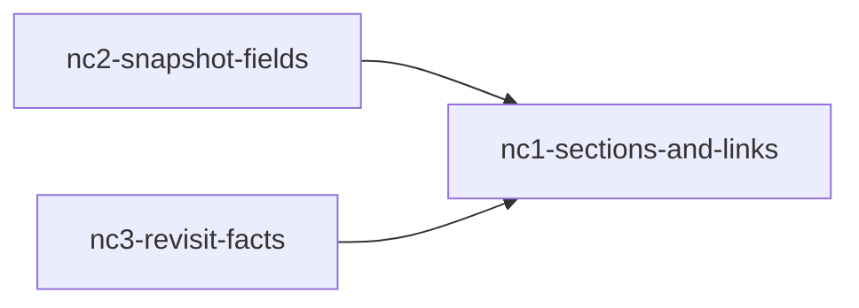

# 새 Catch — Unit 의존

근거:
- Unit 목록 `unit-of-work.md`
- 구성 요소 `inception/domain-design/components.md`, 설계 결정 `inception/domain-design/decisions.md`
- 요구사항 `inception/requirements-analysis/requirements.md`
- 이 단계의 답 Q2 A

이 문서는 무엇이 무엇에 기대는지만 적는다. 무엇을 먼저 만들고 합칠지는 일정 계획 단계에서 정한다.

## 의존 그래프

```yaml
units:
  - name: nc1-sections-and-links
    kind: ui
    depends_on: []
  - name: nc2-snapshot-fields
    kind: service
    depends_on: [nc1-sections-and-links]
  - name: nc3-revisit-facts
    kind: service
    depends_on: [nc1-sections-and-links]
```



Text fallback: NC2와 NC3은 각각 NC1에 기댄다. NC2와 NC3 사이에는 의존이 없다. 화살표는 「기댄다」를 뜻한다.

## 의존 까닭

| 의존 | 까닭 |
|---|---|
| NC2 → NC1 | 표지는 링크 이름 바로 뒤에 붙고(FR10.5), 같은 GithubLinkName의 이름 규칙 위에 표지 판정을 더한다(FR10.6). 사본 세 칸은 NC1이 칸 제목별 보기로 바꾼 SnapshotView 위에 그린다. 작성 시점은 NC1이 나눈 작성자 설명 머리 옆에 붙는다. |
| NC3 → NC1 | 본인 목록 커서 함수(`ownerCatchQuery`·`nextOwnerCatchCursor`)를 NC1은 걸러 보기 조건으로, NC3은 새 정렬로 바꾼다. 지원자 상세의 「다시 볼 곳」 자리는 NC1이 칸 순서를 바꾸며 정하고 NC3이 채운다. NC1을 합친 판 위에서 만들어 두 번 고쳐 쓰지 않는다(Q2 A). |

NC2와 NC3은 같은 코드를 고치지 않는다. NC2는 사본(api 발행, web 사본 보기)을, NC3은 분석·저장·본인 목록 정렬을 고친다. 각자 NC1을 합친 판과 지금 프로젝트만으로 코드와 시험이 통과한다.

**조건:** 「NC2와 NC3 사이 의존 없음」과 「NC2는 web·api만 고침」은 FR9.3 작업 전체 한계 문장을 고르는 방법이 worker 종류 칸 안이 아닐 때만 맞다. 그 안이 되면 NC2가 worker 변경과 결과 메시지 판본 올림에 묶이므로, 계약 설계에서 두 Unit의 의존을 다시 본다.

**Unit 밖 선행:** 범위 문서 「만드는 순서」의 선행 PR은 이미 이 작업 브랜치에 들어왔다. Catch 개편 CR1(#499)·CR3(#500)·CR2(#502), #488(PR #503), #487(PR #504)이고, 작업 브랜치 merge `a1d0fbb4`로 들였다. 그래서 NC1에 외부 선행을 더하지 않는다.

## 연결 지점

| 연결 | 무엇이 오가나 | 바뀌는 Unit |
|---|---|---|
| web 내 자산 ↔ api 본인 Catch(HTTP) | 목록 요청 조건 「작성자 설명이 있는지」, 응답 칸 「작성자 설명이 있는지」, 커서 | NC1 |
| web 내 자산 ↔ api 본인 Catch(HTTP) | 새 정렬과 커서, 상세 응답의 다시 볼 곳 사실 | NC3 |
| web 발행 ↔ api 본인 Catch(HTTP) | 고르기 목록의 같은 조건 | NC1 |
| api 발행 → 사본 jsonb(C-07) → api 사본 읽기(C-10) → web 받은 사람(C-12) | 저장소 이름, 작성 시점, 작업 전체 한계, 근거별 본인 커밋 여부 | NC2 |
| worker → 결과 메시지(큐, 계약 판본 올림) → api 결과 검사·등록 | 다시 볼 곳 사실, 첫·마지막 작업 시각 | NC3 |
| web 공통 자리(AuthorDescriptionSections, GithubLinkName) | 칸·시작 위치·링크 이름(NC1), 표지 판정(NC2) | NC1, NC2 |

## 함께 만들 수 있는 것

- NC1을 합친 뒤에는 NC2와 NC3을 서로 기다리지 않고 만들 수 있다(의존 없음). 다만 위 「조건」이 깨지면(FR9.3을 worker 종류 칸으로 고르면) 계약 설계에서 다시 본다.
- 유효한 위상 순서는 둘이다: NC1 → NC2 → NC3, NC1 → NC3 → NC2. 같은 조건을 따른다.
- 만드는 사람은 팀장 한 명이라(제약 11) 실제로 나란히 만들지는 일정 계획에서 정한다.

## Sources

- `inception/units-generation/unit-of-work.md`
- `inception/domain-design/components.md`, `inception/domain-design/decisions.md`
- `inception/requirements-analysis/requirements.md` FR6.1, FR7.2, FR10.5, FR10.6, FR14.4, 제약 11
- `inception/units-generation/units-generation-questions.md` Q2
