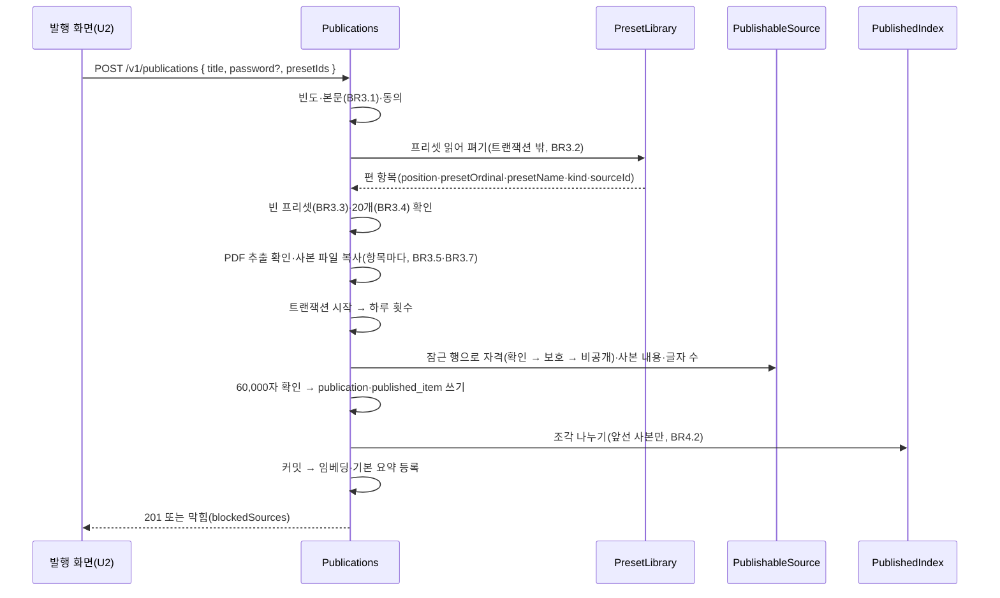
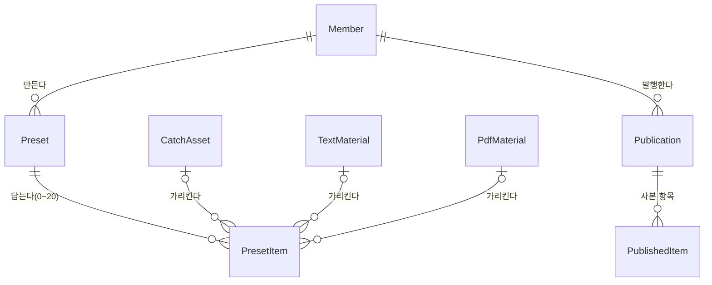

# Functional Spec — u1-preset-contract

근거: 단위 `inception/units-generation/unit-of-work.md`(U1)와 `unit-of-work-story-map.md`, 이야기 `inception/user-stories/stories.md`, 요구사항 `inception/requirements-analysis/requirements.md`, 구성 요소 `inception/domain-design/components.md`와 `decisions.md`, 계약 `inception/contract-design/contract-summary.md`, 이 단계 `entities.md`·`rules.md`·`functional-design-questions.md`(Q1~Q4).

이 단위가 구현하는 이야기(`inception/user-stories/stories.md`): US1.1~US1.6, US2.1~US2.5, US3.1, US3.3, US3.6, US4.1, US4.2의 서버 쪽. 화면 쪽은 U2(u2-applicant-screens)·U3(u3-reader-views)가 맡는다.

## 앞 단계와 달라지는 곳

| 앞 단계 문장 | 이 단계에서 | 근거 |
|---|---|---|
| ADR-002·components.md PresetLibrary 「발행 트랜잭션 안에서 프리셋 행을 읽어 그 사이에 바뀌지 않게 한다」 | 트랜잭션 밖에서 한 번 읽어 편 목록으로 끝까지 간다. 그 틈에 프리셋이 바뀌면 읽은 때의 내용으로 발행된다(BR3.2) | 이 단계 Q3(2026-11-20) |
| 계약 P-1 「자료마다의 글자 수를 싣는지는 U1 기능 설계의 첫 질문」 | 세기 경로 `POST /v1/presets/measure`를 더하고 프리셋 상세도 같은 값을 싣는다(BR2.4) | 이 단계 Q1 |

## 경로 요약(계약 P-1·P-2의 세부)

| 경로 | 요청 | 응답 | 규칙 |
|---|---|---|---|
| `GET /v1/presets` | — | `{ presets: PresetSummary[] }` | BR1.9, BR2.3 |
| `POST /v1/presets` | `{ name, items: [{ kind, sourceId }] }` | 201 `{ presetId }` | BR1.2~BR1.6 |
| `GET /v1/presets/{presetId}` | — | `PresetDetail` | BR1.1, BR2.1, BR2.2 |
| `PUT /v1/presets/{presetId}` | `{ name, items }` | 200 `{ presetId }` | BR1.7 |
| `DELETE /v1/presets/{presetId}` | — | 204 | BR1.8 |
| `POST /v1/presets/measure` | `{ items: [{ kind, sourceId }] }` 1~50개 | `{ items: ItemMeasure[] }` | BR2.4 |
| `POST /v1/publications` | `{ title, password?, presetIds }` | 지금과 같음 | BR3.1~BR3.8 |

모두 로그인 회원 경로다(Bearer Access 토큰, 지금 회원 경로와 같은 인증·CSRF). 새 오류 코드는 `PRESET_LIMIT_REACHED`(409)와 `CATCH_PRIVATE`(409) 둘이다. 오류 응답 필터는 `details.blockedSources`를 옮기고 `details.catchIds`는 더 옮기지 않는다.

## 흐름

### W1 프리셋 만들기·고치기(US1.2, US1.3, US1.4)

1. 회원 행을 확인한다(지금 회원 경로와 같음).
2. 본문을 검사한다: 이름(BR1.2), 항목 0~20개와 중복(BR1.4 앞부분).
3. 고치기면 프리셋이 그 회원의 것인지 본다(BR1.1). 만들기면 그 회원의 프리셋 수가 50개 미만인지 본다(BR1.3).
4. 담을 자료를 읽어 모두 그 회원의 것이고 있는지 본다(BR1.5). 자격은 보지 않는다.
5. BR2.1로 글자 수를 세어 합이 60,000자 이하인지 본다(BR1.4).
6. 한 트랜잭션에서 프리셋 행을 쓰고(고치기면 이름·updatedAt을 바꾸고 항목을 모두 지운 뒤) 항목을 배열 순서대로 쓴다(BR1.6, BR1.7).
7. 어느 단계에서 거부되면 아무것도 쓰지 않는다. 로그에는 ID와 오류 코드만 남긴다(BR7.1).

### W2 프리셋 목록·상세(US1.1, US1.6)

1. 회원의 프리셋을 만든 순서로 모두 읽는다(BR1.9). 상세는 하나만 읽고 BR1.1을 본다.
2. 항목이 가리키는 원본을 종류별로 한 번에 읽는다(프리셋마다 따로 읽지 않는다).
3. 항목마다 BR2.1로 글자 수, BR2.2로 이유를 정한다. 목록은 프리셋마다 BR2.3으로 요약하고, 상세는 항목마다 ItemMeasure와 제목을 싣는다.
4. 값은 저장하지 않는다. 그래서 담은 뒤 숨긴 Catch(AC1.6.1)와 길어진 원본(AC1.6.3)이 다음 열기에 바로 보인다.

### W3 세기(Q1, US1.2·US1.4의 담기 전 막기)

1. 본문 `{ items }`를 검사한다(1~50개, 중복 없음).
2. 자료가 모두 그 회원의 것이고 있는지 본다(BR1.5).
3. 자료마다 ItemMeasure를 요청 순서로 돌려준다. 편집 화면은 담긴 자료와 고르기 목록에 불러온 자료를 이 경로로 묻고, 지금 담긴 합에 더하면 60,000자를 넘는 자료의 단추를 담기 전에 막는다.

### W4 프리셋으로 발행(US2.1~US2.5)

<!-- Text fallback: 발행 화면이 프리셋 ID로 발행을 요청하면 Publications가 빈도·본문·동의를 보고, 트랜잭션 밖에서 PresetLibrary로 프리셋을 한 번 읽어 편 항목(순서 번호·프리셋 순번·이름·종류·원본 ID)을 받는다. 빈 프리셋과 20개 상한을 본 뒤 PDF 추출을 확인하고 사본 파일을 항목마다 복사한다. 트랜잭션에서 하루 횟수를 세고, PublishableSource 규칙으로 잠근 행의 자격(확인 → 보호 → 비공개)과 사본 내용·글자 수를 정한 뒤 60,000자를 보고 발행본과 항목을 쓴다. PublishedIndex가 앞선 사본만 조각으로 나누고, 커밋 뒤 임베딩과 기본 요약을 등록한다. 막히면 이유 하나와 blockedSources를 돌려준다. -->

1. 빈도·본문(BR3.1)·동의는 지금 순서 그대로다.
2. 트랜잭션 밖에서 고른 프리셋을 한 번 읽어 편다(BR3.2). 없거나 남의 프리셋이면 404. 편 순서로 position을 1부터 매기고 presetOrdinal·presetName을 붙인다.
3. 빈 프리셋(BR3.3)과 편 항목 20개(BR3.4)를 본다.
4. 편 항목에 PDF가 있으면 추출 완료를 확인하고(막히면 400 extractionIncomplete + blockedSources), 항목마다 PDF 사본 파일을 복사한다(BR3.7, C-17).
5. 트랜잭션: 회원 행 → 하루 횟수 → 중복을 없앤 원본 ID 집합으로 Catch → 텍스트 자료 → PDF를 잠그고 다시 읽는다(없으면 404) → 자격(확인 필요 → 보호 → 비공개, BR3.5) → 근거·소속 기록 → 편 항목마다 사본 내용 → 60,000자(BR3.4) → publication·published_item(presetOrdinal·presetName 포함) 쓰기 → 조각 나누기(BR4.2). 공개 전환 쓰기는 없다(BR3.6).
6. 트랜잭션이 실패하면 지금처럼 PDF 사본 접두어를 한 번 정리하고 원래 오류를 돌려준다.
7. 커밋 뒤 임베딩·기본 요약을 등록한다(지금 그대로).

### W5 사본 읽기와 앞선 사본(US2.3, US3.3, US3.6)

1. 사본 읽기(readSnapshotIn)는 published_item을 position 순으로 읽으며 presetOrdinal·presetName·itemKind·sourceId를 함께 읽는다.
2. BR4.1의 판정 함수로 항목마다 isFirstCopy를 정해 싣는다. sourceId는 사본에 싣지 않는다.
3. 기본 요약 근거와 질의응답 머리글은 isFirstCopy가 참인 항목만 쓴다(BR4.3). 받은 링크 읽기도 참인 항목만 순서대로 싣는다(BR4.4).
4. 받은 링크 열람 응답은 isFirstCopy를 빼고 presetOrdinal·presetName을 싣는다(BR4.5). 작성자 상세 응답도 presetOrdinal·presetName을 싣는다.
5. 조각 나누기는 사본 읽기를 거치지 않고 트랜잭션 안에서 published_item을 직접 읽으므로, source_id를 더 읽어 같은 판정 함수를 부른다(BR4.2).

### W6 배포와 변경 전 발행본(US3.1의 AC3.1.4)

1. 배포 전: 팀장이 파일 저장소의 `members/*/publications/`만 지운다. S3는 `--dryrun`으로 목록을 먼저 확인한다. 원본(`members/*/materials/`)과 `members/` 전체는 지우지 않는다. 로컬 폴더는 선택이다(BR5.2).
2. 배포 때 마이그레이션: 프리셋 표 둘을 만들고, publication 행을 모두 지운 뒤 published_item에 칸 둘을 더한다(BR5.1).
3. 옛 링크는 지금의 접근 불가 화면(「이 링크는 열람할 수 없습니다.」)이 된다.
4. 이 순서와 지울 곳을 배포 안내와 첫 PR 본문에 적는다. 첫 PR 본문에는 「B2가 들어올 때까지 dev 발행 화면은 발행에 실패한다」도 적는다.

### W7 자료 지우기·탈퇴(US4.1, US4.2)

1. 텍스트 자료·PDF 지우기는 지금 코드 그대로이고, 프리셋 항목은 외래 키 연쇄로 빠진다(BR6.1). 남은 항목의 position은 다시 매기지 않는다.
2. 탈퇴는 지금 순서 그대로이고, 회원 행 삭제가 프리셋과 항목을 연쇄로 지운다(BR6.2).
3. 시험: 프리셋이 있는 회원의 탈퇴가 성공하고 프리셋이 남지 않는다. 담긴 텍스트 자료·PDF를 지우면 그 항목만 빠지고 프리셋과 다른 항목, 발행본 사본은 남는다.

## 상태

Preset에는 상태 값이 없다. 「발행할 수 없음」「상한 넘음」은 저장된 상태가 아니라 읽을 때 원본으로 정하는 값이다(ADR-005). 발행본의 상태(활성·중지·만료)는 지금 그대로다.

## ER 보기(entities.md에서 끌어온 것)

<!-- Text fallback: 회원은 프리셋을 여럿 만들고, 프리셋은 항목을 0~20개 담는다. 프리셋 항목은 Catch·텍스트 자료·PDF 가운데 하나를 가리킨다. 회원은 발행본을 여럿 만들고, 발행본은 사본 항목을 가진다. 사본 항목은 프리셋을 가리키지 않고 발행 당시 프리셋 순번과 이름을 복사해 둔다. -->

## 규칙 요약(rules.md에서 끌어온 것)

| 묶음 | 규칙 |
|---|---|
| 프리셋 저장 | BR1.1 본인 것만 · BR1.2 이름 1~50자 · BR1.3 50개 · BR1.4 0~20개·중복 없음·60,000자 · BR1.5 소유·존재만 · BR1.6 배열 순서 · BR1.7 통째로 고침 · BR1.8 지우기 · BR1.9 목록 |
| 세기 | BR2.1 발행과 같은 셈 · BR2.2 이유 하나 · BR2.3 요약 · BR2.4 세기 경로 |
| 발행 | BR3.1 presetIds 1~5 · BR3.2 밖에서 한 번 읽어 폄 · BR3.3 빈 프리셋 · BR3.4 상한 · BR3.5 막힘 · BR3.6 공개 전환 없음 · BR3.7 프리셋마다 사본 · BR3.8 고정 |
| 앞선 사본 | BR4.1 판정 · BR4.2 조각 · BR4.3 요약·머리글 · BR4.4 받은 링크 읽기 · BR4.5 내보내지 않음 |
| 변경 전 발행본 | BR5.1 마이그레이션 · BR5.2 파일 |
| 지우기·탈퇴 | BR6.1 자료 지우기 · BR6.2 탈퇴 |
| 자료 보호 | BR7.1 로그·오류 |
