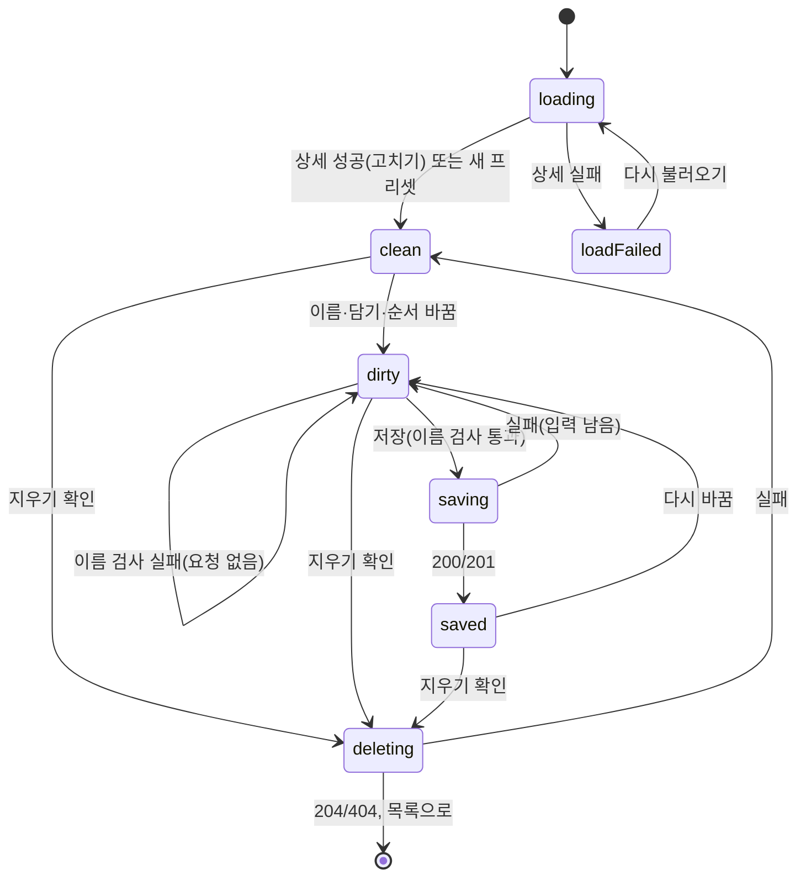

# Functional Spec — u2-applicant-screens

이 단위는 지원자가 프리셋을 만들고 고치고, 프리셋을 골라 발행하는 web 화면이다. 더해서 api 본인 Catch 목록에 조회 조건 하나(`publishable=true`)를 더하고, web 오류 응답 해석이 막힘 칸(`details.blockedSources`)을 옮기게 고친다. 이 단위가 구현하는 이야기는 `inception/user-stories/stories.md`의 US1.1~US1.6, US2.1, US2.2, US2.4이고(이야기 지도 `inception/units-generation/unit-of-work-story-map.md`), 서버 검증과 상태 계산은 U1이 맡는다.

화면의 구역·글자·상태는 다듬은 화면 `inception/refined-mockups/mockups.md` M1~M4와 `interaction-spec.md`를 그대로 따른다. 이 문서는 그 화면들이 어떤 순서로 움직이고, 어느 API를 언제 부르며, 무엇으로 막는지를 정한다. 업무 규칙의 정본은 `rules.md`, 부품 나눔은 `frontend-components.md`다.

## 맡는 것과 경계

- 구성 요소(`inception/domain-design/components.md`): PresetScreens(새 web `presets` 기능), PublishScreen(web `publications` 발행 화면), CatchLibrary(api 본인 Catch 목록 조건 하나).
- 계약(`inception/contract-design/contract-summary.md`): P-1 프리셋 경로와 P-2 발행 요청·막힘 응답의 소비자다. 요청 칸·응답 칸은 U1이 만든 api를 따른다(`api/docs/presets.md`: `GET/POST /v1/presets`, `GET/PUT/DELETE /v1/presets/{presetId}`, `POST /v1/presets/measure`).
- U1이 하는 것: 이름·항목 수·같은 자료·60,000자·50개·소유 검증, 항목 글자 수와 발행할 수 없는 이유 계산, 발행 때 다시 확인. 화면은 같은 결과를 미리 보일 뿐이고, 화면이 막지 못한 것은 서버가 거부한다.
- 이 단위가 하지 않는 것: 받은 사람 화면·작성자 상세의 탭(U3), 자료 화면 탭과 지우기 확인 문장(U3), 개인정보처리방침(U4), 모양 다듬기와 드래그(C-O4·C-T5).

## 주소와 상단 메뉴

| 화면 | 주소 | 들어오는 길 |
|---|---|---|
| 프리셋 목록 | `/presets` | 상단 메뉴 「프리셋」, 편집의 <프리셋 목록으로>, 지운 뒤, 발행 화면의 <프리셋 만들러 가기> |
| 새 프리셋 | `/presets/new` | 목록의 [새 프리셋] |
| 프리셋 고치기 | `/presets/{presetId}` | 목록의 <고치기>, 새 프리셋 첫 저장 뒤 |

- 상단 메뉴는 「내 자산 · 텍스트 자료 · 프리셋 · 발행본 · JD 관리」 순서다(BR1.1). 지금 현재 자리 판정(`pathname === href || pathname.startsWith(href + "/")`)을 그대로 쓰므로, 세 주소 모두 「프리셋」만 켜지고 「발행본」은 켜지지 않는다(BR1.2).
- 주소는 `web/src/lib/routes.ts`와 web README 「페이지 주소」 표에 함께 더한다(그 파일의 머리 주석이 정한 규칙).
- 320px 폭에서 [프로필]이 밀리는지는 이 단위의 화면 확인에서 한 번 본다(M1). 밀리면 그때 사람에게 올린다.

## 흐름 1. 프리셋 목록 (M2, US1.1·US1.6)

1. 화면을 열면 「프리셋 목록을 불러오고 있습니다.」를 보이고 `GET /v1/presets`를 한 번 부른다(NFR6, 쪽 나눔 없음).
2. 성공하면 받은 순서(만든 순서)대로 모두 보인다. 줄마다 이름, 「항목 N개 · M자」, `unpublishableCount > 0`이면 「 · 발행할 수 없는 자료 N개」, `overLimit`이면 「 · 상한을 넘었습니다」, 그리고 <고치기>(읽히는 이름 「(이름) 고치기」)(BR2.1). 글자 수는 천 단위 쉼표로 쓴다(M2의 「12,300자」).
3. 0개면 「아직 만든 프리셋이 없습니다. [새 프리셋]으로 만들어 보세요.」, 실패면 「프리셋 목록을 불러오지 못했습니다.」와 [다시 불러오기]다. 실패를 0개로 보이지 않는다(BR2.2).
4. 받은 프리셋이 50개면 [새 프리셋]을 막고 「프리셋은 50개까지 만들 수 있습니다.」를 보인다(BR2.3).
5. 로그인이 끝났으면(401) 지금 회원 화면처럼 회원 경로 가드가 로그인으로 보낸다.

## 흐름 2. 프리셋 편집 (M3, US1.2~US1.6)

### 열기

1. `/presets/new`는 빈 이름, 빈 담긴 목록으로 연다(h1 「새 프리셋」, [프리셋 지우기] 없음).
2. `/presets/{presetId}`는 `GET /v1/presets/{presetId}`로 이름과 담긴 자료(`items[]`: 종류·자료 ID·제목·글자 수·이유, 저장 순서)를 받아 연다(h1 「프리셋 고치기」). 404면 「프리셋을 찾을 수 없습니다.」와 <프리셋 목록으로>만 보이고, 그 밖의 실패는 「프리셋을 불러오지 못했습니다.」와 [다시 불러오기]다(NFR5).
3. 고르기 목록 셋을 따로 불러온다. 지금 발행 화면의 불러오기 그대로 20개씩, [더 보기]로 다음 쪽이다.
   - 내 Catch: `GET /v1/catches?publishable=true`(걸러 보기를 켜면 `&authorDescription=written`도)(BR3.2, BR5.1). 걸러 보기를 바꾸면 첫 쪽부터 다시 불러온다.
   - 내 텍스트 자료: 지금 `GET /v1/text-materials` 그대로.
   - 내 PDF 자료: 지금 PDF 목록 그대로. 글 추출이 끝난 PDF만 고를 수 있다(지금 안내 「글 추출이 완료된 PDF만 고를 수 있습니다.」).
4. 쪽을 하나 불러올 때마다, 그 쪽의 고를 수 있는 자료(Catch 전부, 텍스트 자료 전부, 추출이 끝난 PDF)를 `POST /v1/presets/measure`에 한 번 보내 글자 수를 받는다(BR3.4, 기능 설계 Q3). 한 쪽은 20개 이하라 세기 한도(50개) 안이다. 세기가 실패하면 그 쪽 자료는 글자 수를 모르는 채로 두고 글자 이유로 막지 않는다(저장 때 서버가 검사한다).

### 고치기

1. 고르기 단추를 누르면 담긴 목록 끝에 더해지고 단추는 눌림 상태(`aria-pressed=true`)가 된다. 다시 누르면 빠진다. 같은 자료는 한 번만 담긴다(BR3.3).
2. 담긴 자료가 20개면 안 담긴 단추를 모두 막고 단추 안에 「항목은 20개까지 담을 수 있습니다」를 보인다. 담긴 글자 합에 그 자료 글자 수를 더하면 60,000자를 넘는 단추는 막고 「전체 글이 60,000자를 넘습니다」를 보인다. 글자 수를 모르는 자료와 담긴 자료는 이 이유로 막지 않는다(BR3.4).
3. 「담긴 자료와 순서 (항목 N개 · M자)」의 M은 담긴 자료 글자 수의 합이다. 글자 수를 모르는 자료가 하나라도 있으면 M 대신 「글자 수를 세지 못했습니다」를 보인다.
4. [위로][아래로][빼기]로 순서를 바꾸고 뺀다. 첫 자료의 [위로], 끝 자료의 [아래로]는 막힌다. 옮긴 뒤 초점은 옮긴 항목의 같은 단추에 남는다(BR3.5).
5. 담긴 자료에 이유(`unpublishableReason`)가 있으면 그 줄에 이유 글을 붙인다(BR3.6). 이유는 편집을 열 때 상세 응답으로 받고, 이번에 새로 담은 자료는 고르기 목록이 담을 수 있는 것만 보이므로 이유가 없다.
6. 담긴 글자 합이 60,000자를 넘으면(저장한 뒤 원본이 길어진 경우) 「담긴 자료와 순서」 머리에 「전체 글이 60,000자를 넘어 발행할 수 없습니다.」를 보인다. [저장]은 막지 않는다(BR3.7, 기능 설계 Q6).
7. 이름·담기·순서를 하나라도 바꾸면 화면은 「저장하지 않은 변경 있음」이 된다. 그 상태에서 목록으로 가거나 다른 화면으로 가면 텍스트 자료 화면과 같은 경고를 같은 부품으로 쓴다(BR3.10).

### 저장

1. [저장]을 누르면 먼저 이름을 앞뒤 공백을 빼고 센다. 0자거나 51자 이상이면 요청하지 않고 이름 칸 아래 「이름을 1~50자로 써 주세요.」를 보인다(BR3.1).
2. 요청은 `{ name, items: [{ kind, sourceId }] }`, items는 담긴 목록 순서다. 새 프리셋은 `POST /v1/presets`, 고치기는 `PUT /v1/presets/{presetId}`다. 저장 중에는 [저장]을 막고 「저장하고 있습니다.」를 보인다(BR3.8).
3. 결과:

| 응답 | 화면 |
|---|---|
| 201(만들기) | 주소를 `/presets/{presetId}`로 바꾸고(뒤로 가기 기록을 더하지 않음) 상세를 다시 불러 「저장했습니다.」 |
| 200(고치기) | 상세를 다시 불러 「저장했습니다.」. 「저장하지 않은 변경 있음」이 풀린다 |
| 400 `name` | 이름 칸 아래 「이름을 1~50자로 써 주세요.」 |
| 400 `items` `maxTotalLength` | 「전체 글이 60,000자를 넘어 저장할 수 없습니다. 자료를 빼 주세요.」 |
| 400 그 밖의 `items` | 「저장하지 못했습니다. 다시 시도해 주세요.」 |
| 409 `PRESET_LIMIT_REACHED` | 「프리셋은 50개까지 만들 수 있습니다.」 |
| 404 | 담은 자료가 지워졌거나 프리셋이 지워졌다. 「담은 자료나 프리셋을 찾을 수 없습니다. 목록을 다시 불러와 주세요.」 |
| 연결 끊김·5xx·그 밖 | 「저장하지 못했습니다. 다시 시도해 주세요.」 |

   모든 실패에서 입력한 이름과 담은 자료·순서를 그대로 둔다. 실패 안내는 `role="alert"`로 읽히고 초점은 [저장]에 남는다(interaction-spec PresetEditorForm).
4. 「저장했습니다.」는 `role="status"`이고, 다음 변경이 생기면 사라진다. 상세를 다시 불러오는 데 실패하면 저장은 된 것이므로 「저장했습니다. 내용을 다시 불러오지 못했습니다.」와 [다시 불러오기]를 보인다.

### 지우기

1. [프리셋 지우기](고치기 화면에만)를 누르면 「‘(이름)’ 프리셋을 지울까요? 이미 보낸 발행본은 그대로 남습니다.」 확인을 띄운다(BR3.9). 이 확인은 지금 화면들이 쓰는 브라우저 확인(`window.confirm`)을 같은 방식으로 쓴다.
2. 취소하면 아무것도 하지 않는다. 확인하면 `DELETE /v1/presets/{presetId}`를 부르고, 204면 경고 없이 `/presets`로 간다. 404면 이미 없는 것이므로 같은 목록으로 간다. 그 밖의 실패는 「지우지 못했습니다. 다시 시도해 주세요.」를 보이고 화면에 남는다.

### 상태

<!-- Text fallback: 편집 화면은 불러오는 중에서 시작해, 상세를 받으면 깨끗함, 실패하면 불러오기 실패가 된다. 깨끗함에서 무언가 바꾸면 바뀜이 되고, 저장을 누르면 이름 검사를 통과할 때만 저장 중이 된다. 저장 중은 성공하면 저장됨, 실패하면 입력을 남긴 바뀜으로 돌아간다. 지우기를 확인하면 지우는 중이 되고, 지워지면 목록으로 나가며 실패하면 화면에 남는다. -->

지우기 실패 뒤 상태는 지우기 전 상태로 돌아간다(바뀐 입력이 있었으면 바뀜 그대로).

## 흐름 3. 프리셋으로 발행 (M4, US2.1·US2.2·US2.4)

### 고르기

1. 발행 화면을 열면 「프리셋 고르기」 자리에 「프리셋 목록을 불러오고 있습니다.」를 보이고 `GET /v1/presets`를 부른다. 0개면 「아직 만든 프리셋이 없습니다.」와 <프리셋 만들러 가기>(`/presets`)만, 실패면 「프리셋 목록을 불러오지 못했습니다.」와 [다시 불러오기]다(BR4.4).
2. 프리셋마다 고르기 단추 하나: 이름, 「항목 N개 · M자」, 막혔으면 이유 하나(BR4.2). 이유를 고르는 순서:
   1. `itemCount = 0`: 「담긴 자료가 없어 고를 수 없습니다」
   2. `unpublishableCount > 0`: 「발행할 수 없는 자료가 있습니다: (unpublishableItems 첫 자료 제목)」, 둘 이상이면 「 외 (N−1)개」를 붙인다(기능 설계 Q4)
   3. 고른 프리셋들의 항목 수 합 + 이 프리셋 항목 수 > 20: 「고르면 항목이 20개를 넘습니다」
   4. 고른 프리셋들의 글자 수 합 + 이 프리셋 글자 수 > 60,000: 「고르면 전체 글이 60,000자를 넘습니다」. 혼자서 60,000자를 넘는(`overLimit`) 프리셋도 여기에 걸린다
   같은 자료가 두 프리셋에 있으면 두 번 센다(서버도 같다). 이미 고른 프리셋은 막지 않는다(눌러서 뺄 수 있어야 한다).
3. 고르기 단추를 누르면 「고른 프리셋과 순서 (n/5)」 끝에 더해진다. 다시 누르거나 [빼기]로 뺀다. [위로][아래로]로 순서를 정한다(BR4.1). 순서 단추의 읽히는 이름은 「(이름) 위로」 꼴이다.
4. 다섯 개를 고르면 안 고른 단추를 모두 막고 「프리셋은 5개까지 고를 수 있습니다.」를 목록 위에 한 번만 보인다(`aria-live="polite"`). 이때 단추 안 이유는 1·2번일 때만 보이고 3·4번(상한)은 보이지 않는다(BR4.3).
5. 같은 이름의 프리셋은 그대로 보이고 따로 구분하지 않는다(M4 가정).

### 제목과 확인

1. 「제목과 비밀번호」는 지금 그대로다(제목 칸, 비밀번호 걸기, 안내 글).
2. [다음: 발행 내용 확인]은 고른 프리셋이 1개 이상이고 지금 제목·비밀번호 검사를 통과할 때 쓸 수 있다.
3. 「발행 내용 확인」은 지금처럼 제목·비밀번호·만료와 그 안내를 보이고, 「항목」 자리 대신 「고른 프리셋과 순서」에 프리셋 이름을 고른 순서대로 보인다(BR4.5).
4. 발행 요청은 `POST /v1/publications`에 `{ title, password?, presetIds }`(고른 순서)다(BR4.1). 지금 요청의 `items` 칸은 보내지 않는다(서버는 정의 밖 칸이라 400).

### 결과

| 응답 | 화면 |
|---|---|
| 201 | 지금 「발행됨」 그대로 |
| 409 `CONFIRMATION_REQUIRED`·`SOURCE_RESTRICTED`·`CATCH_PRIVATE`, 400 `extractionIncomplete`(모두 `details.blockedSources`) | 막힘 안내(아래). 편집 단계로 돌아간다 |
| 400 `presetIds[i]` `emptyPreset`·`presetIds` `maxItems`·`maxTotalLength` | 지금 400 안내 자리에 「고른 프리셋으로는 발행할 수 없습니다. 목록을 다시 확인해 주세요.」, 프리셋 목록을 다시 불러온다. 편집 단계로 돌아간다 |
| 404 | 고른 프리셋이나 그 안 자료가 지워졌다. 지금 404 안내 자리에 「고른 프리셋이나 그 안의 자료를 찾을 수 없습니다.」, 프리셋 목록을 다시 불러오고 새 목록에 없는 프리셋은 고른 목록에서 뺀다. 편집 단계로 돌아간다 |
| 403 동의 필요·429 빈도·하루 횟수·401·그 밖 | 지금 그대로 |

**막힘 안내(BR4.6, 기능 설계 Q5).** 막힘 응답의 `details.blockedSources`(줄마다 프리셋 ID·자료 종류·자료 ID)를 받아:

1. 「발행되지 않았습니다」를 지금 막힘 안내 자리(`role="alert"`)에 보인다.
2. 프리셋 목록(`GET /v1/presets`)을 다시 불러온다.
3. blockedSources 줄마다 「‘(프리셋 이름)’ 프리셋의 ‘(자료 이름)’ 때문에 발행할 수 없습니다.」를 한 줄씩 보인다. 프리셋 이름은 새 목록에서 프리셋 ID로, 자료 이름은 그 프리셋의 `unpublishableItems`에서 종류와 자료 ID로 찾는다. 자료 이름을 못 찾으면 그 자리에 종류(「Catch」·「텍스트 자료」·「PDF 자료」)를, 프리셋 이름을 못 찾으면 「고른 프리셋」을 쓴다. 다시 불러오기가 실패하면 지금 가진 목록에서 찾는다.
4. 새 목록으로 단추 막힘을 다시 정한다. 고른 프리셋은 막혀도 고른 목록에 남기고(지원자가 직접 뺀다), 입력한 제목·비밀번호도 남긴다.

이유 코드별 첫 줄은 지금 막힘 안내의 코드별 글을 그대로 쓰고, 새 코드 `CATCH_PRIVATE`는 「비공개 Catch는 발행할 수 없습니다.」(api 오류 문구와 같은 글)를 쓴다.

**공개 전환 안내 없앰(BR4.7).** 지금 발행 화면이 고른 비공개 Catch에 붙이던 안내(`PRIVATE_CATCH_NOTICE`)는 그리지 않는다. 프리셋에는 공개한 Catch만 담기고, 서버도 공개로 바꾸지 않는다(FR2.9).

## api 조건과 web 응답 해석

### `GET /v1/catches?publishable=true` (BR5.1, 기능 설계 Q2)

- 받는 값은 글자 `true` 하나다. 다른 값·빈 값·같은 키 두 번은 400이고 받은 값은 오류에 싣지 않는다(지금 `authorDescription` 규칙과 같다). 없으면 지금처럼 전체다.
- `true`면 지금 조건에 셋을 더한다: 공개(`visibility = 'PUBLIC'`), 작업 사실과 기여가 모두 확인됨, 원본 저장소가 보호되지 않음. 이 판정은 U1 PublishableSource의 발행 판정(확인 필요 → 보호 → 비공개)과 같은 결과여야 하고, 같은 Catch 묶음으로 두 판정을 맞춰 보는 시험으로 묶는다(project.md: 문장 대조 대신 같은 결과 시험).
- `publishable`을 커서 범위에 넣는다. 다른 조건으로 받은 커서를 이 조건에 쓰면 지금처럼 400이다.
- `authorDescription`·`repositoryId`와 함께 쓸 수 있다. 응답 모양은 바뀌지 않는다.

### `web/src/lib/api-response.ts` (BR5.2, 기능 설계 Q5)

- 오류 `details`에서 `blockedSources`를 옮긴다. 배열이고 줄마다 `presetId`·`sourceId`가 빈 글자가 아닌 글자, `kind`가 `CATCH`·`TEXT_MATERIAL`·`PDF_MATERIAL` 가운데 하나일 때만 그 세 칸을 옮기고, 모양이 어긋나면 지금 `violations`·`existingRequestId`처럼 응답 모양 어긋남으로 본다.
- `catchIds`를 옮기던 처리(타입·검사·복사)를 지운다. api가 더는 보내지 않는다(계약 P-2, U1). 그것을 쓰던 발행 화면의 「막힌 Catch 표시」(`FlaggedCatches`)도 BR4.6의 막힘 안내로 바뀐다.

## 시나리오(시험 전에 정하는 것)

팀 관행대로 시험 코드보다 먼저 아래 시나리오·기대 결과·실패 조건을 정한다. 세부 시험은 코드 생성 단계가 쓴다.

| 묶음 | 시나리오 | 기대 결과 | 실패 조건 |
|---|---|---|---|
| 메뉴 | 회원 화면, `/presets`·`/presets/new`·`/presets/{id}` | 순서 5개, 「프리셋」만 현재 자리 | 「발행본」이 함께 켜짐 |
| 목록 | 3개·50개·0개·실패 | 모두 한 번에 / 0개 안내 / 실패 안내와 다시 불러오기 | 실패가 0개로 보임 |
| 목록 | `unpublishableCount 1`, `overLimit` | 「발행할 수 없는 자료 1개」「상한을 넘었습니다」 글자 | 표시 없음 |
| 목록 | 50개 | [새 프리셋] 막힘과 안내 | 막히지 않음 |
| 편집 | 고르기 목록 요청 | `publishable=true`, 걸러 보기 켜면 `authorDescription=written`도 | 조건 빠짐 |
| 편집 | 같은 단추 두 번 | 담겼다가 빠짐 | 두 번 담김 |
| 편집 | 20개 담음 | 안 담긴 단추 막힘·이유 | 21개째 담김 |
| 편집 | 담으면 60,000자 넘는 자료 | 막힘·이유, 세기 실패한 쪽은 막지 않음 | 넘는 자료가 담기거나 세기 실패로 모두 막힘 |
| 편집 | 셋째의 [위로], 첫째·끝 | 둘째로 감, 첫 [위로]·끝 [아래로] 막힘, 초점 남음 | 순서 어긋남 |
| 편집 | 상세의 이유 PRIVATE·SOURCE_RESTRICTED | 담긴 줄에 이유 글자 | 줄이 사라짐 |
| 편집 | 글자 합 61,200 | 머리 안내, [저장] 막지 않음 | 안내 없음 |
| 저장 | 빈 이름·51자 | 요청 없음, 이름 칸 이유, 담은 자료 남음 | 요청이 감 |
| 저장 | 201·200 | 주소 `/presets/{id}`, 「저장했습니다.」 | 목록으로 감 |
| 저장 | 409·400 maxTotalLength·5xx·끊김 | 이유별 글, 입력 남음 | 입력 사라짐 |
| 저장 | `<b>` 이름 | 목록·편집·발행 화면에서 글자 그대로 | 태그로 해석 |
| 이탈 | 바꾼 뒤 목록으로 | 텍스트 자료 화면과 같은 경고 | 경고 없음 |
| 지우기 | 확인·취소·실패 | 지우고 목록 / 그대로 / 안내 | 확인 없이 지워짐 |
| 발행 | 프리셋 2개 골라 순서 바꿔 발행 | `presetIds` 고른 순서, 흐름 그대로 | `items`를 보냄 |
| 발행 | 항목 0개·발행할 수 없는 자료 3개·더하면 21개·더하면 60,001자 | 이유 하나씩(외 2개 포함), 막힘 | 고를 수 있음, 이유 둘 |
| 발행 | 5개 고름 | 안 고른 단추 막힘, 안내 한 번 | 6번째 |
| 발행 | 0개·실패 | 링크만 / 다시 불러오기 | 실패가 0개로 보임 |
| 발행 | 확인 단계 | 제목·비밀번호·만료, 고른 프리셋과 순서 | 자료 목록이 보임 |
| 발행 | 409 CATCH_PRIVATE `blockedSources` 한 줄 | 목록 다시 불러옴, 「‘P’ 프리셋의 ‘Catch C’ 때문에 발행할 수 없습니다.」, 입력 남음 | 어느 자료인지 없음 |
| 발행 | 이름 못 찾음 | 종류로 대신 | 빈 따옴표 |
| api | `publishable=true`·`false`·빈 값·두 번 | 거른 목록 / 400 / 400 / 400 | 비공개가 나옴 |
| api | 같은 Catch 묶음 | `publishable=true` 결과 = PublishableSource 판정 결과 | 둘이 다름 |
| web 응답 | `blockedSources` 옳은 모양·어긋난 모양, `catchIds` | 옮김 / 어긋남 / 옮기지 않음 | 막힘 칸이 버려짐 |

## 파생 보기

- 엔티티 관계도: 이 단위는 저장하는 엔티티가 없다(ui 단위). 프리셋 엔티티는 U1 소유다(`api/docs/presets.md` 「표」). 화면이 다루는 값은 U1 응답(`PresetSummary`·`PresetDetail`·`ItemMeasure`)과 지금 Catch·텍스트 자료·PDF 목록 응답이다.
- 업무 규칙 요약(`rules.md`가 정본): BR1 메뉴·주소, BR2 목록, BR3 편집·저장·지우기, BR4 발행 화면, BR5 api 조건과 web 응답 해석.

## Assumptions & Open Questions

- **확인 단계의 「작성자 설명이 없는 Catch N개」 안내.** 지금 「발행 내용 확인」은 고른 Catch 가운데 작성자 설명이 없는 수를 알린다(새 Catch intent BR6.5·BR6.6). 프리셋으로 고르면 화면은 프리셋 안 Catch의 설명 여부를 모른다(`PresetSummary`에 그 값이 없다). 이 설계는 요구사항 FR2.10대로 제목·비밀번호·만료와 고른 프리셋만 보이고 그 안내는 그리지 않는다. 안내를 남기려면 U1 목록 응답에 칸을 더해야 해 U1 계약이 바뀐다. 사람의 판단이 필요하다.
- **발행 화면의 「저장소마다 3~5개를 권합니다.」와 「최대 20개. 고른 순서대로…」 안내.** 지금 「발행할 자료 고르기」 머리의 이 두 줄은 다듬은 화면 M3·M4 어느 쪽에도 없어, 자료 고르기를 옮기면서 그리지 않는다(M3·M4가 정본).
- 고르기 목록의 Catch 작은 줄은 지금 글(저장소 이름 · 설명 안 씀 · 불일치 표시됨)에서 공개 상태 글만 뺀다(M3 「바뀜」). 발행 화면이 쓰던 불일치 표시(`flagged`)는 편집 화면에서 쓰지 않는다(막힘은 발행 화면만 받는다).
- 새 프리셋 첫 저장 뒤 주소를 바꿀 때 뒤로 가기 기록을 더하지 않는 것(`replace`)은 M3 Q5의 「편집 화면 주소로 바뀐다」를 가장 단순하게 읽은 것이다.
- `POST /v1/presets/measure`는 담긴 자료나 고르기 목록의 자료가 그 사이 지워졌으면 404다. 그때도 그 쪽은 세기 실패로 다루고 막지 않는다.

## Sources

- 단위 정의: `inception/units-generation/unit-of-work.md` U2, 이야기 지도 `inception/units-generation/unit-of-work-story-map.md`
- 이야기: `inception/user-stories/stories.md` US1.1~US1.6, US2.1, US2.2, US2.4
- 요구사항: `inception/requirements-analysis/requirements.md` FR1.1~FR1.14, FR2.1~FR2.10, FR6.1, NFR1, NFR3, NFR5, NFR6
- 구성 요소: `inception/domain-design/components.md` PresetScreens, PublishScreen, CatchLibrary
- 계약: `inception/contract-design/contract-summary.md` P-1, P-2
- 다듬은 화면: `inception/refined-mockups/mockups.md` M1~M4, `interaction-spec.md`
- U1 API: `api/docs/presets.md`
- 답: `construction/u2-applicant-screens/functional-design/functional-design-questions.md` Q1~Q6(2026-11-20 팀장)
- 지금 코드: `web/src/features/publications/publish-screen.tsx`·`publish-view.tsx`·`publish-sources.ts`·`publications-api.ts`, `web/src/lib/api-response.ts`·`routes.ts`, `web/src/components/header/member-header.tsx`, `web/src/features/materials/materials-screen.tsx`(이탈 경고), `api/src/catches/owner-catch-input.ts`·`owner-catch-store.ts`
