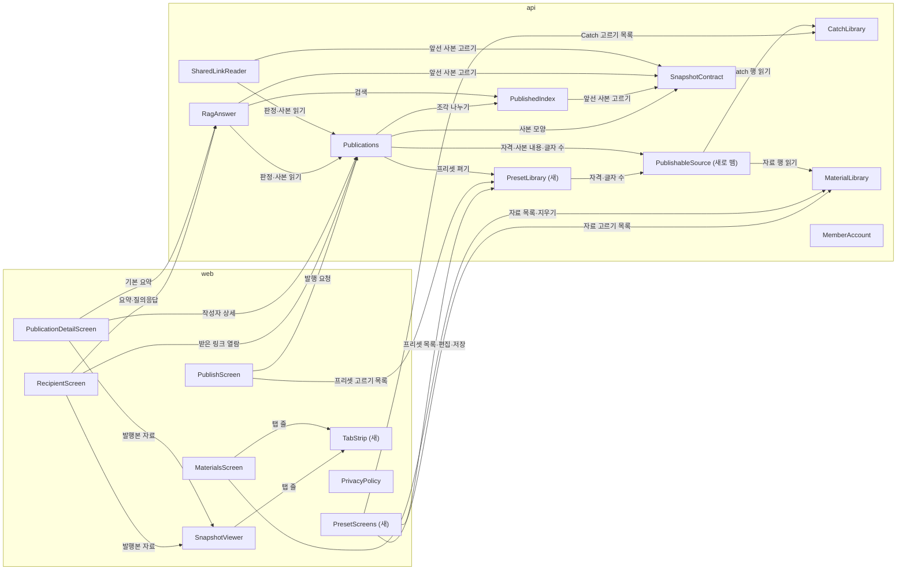

# Components — 발행 프리셋

근거: 요구사항 `inception/requirements-analysis/requirements.md`(FR1~FR7, NFR1~NFR6), 이야기 `inception/user-stories/stories.md`(US1.1~US4.4), 팀 관행 `inception/practices-discovery/team-practices.md`, 코드 지식 기록 `aidlc/spaces/default/codekb/CatchU/architecture.md`·`component-inventory.md`, 스캔 기록 `inception/reverse-engineering/developer-scan.md`, 다듬은 화면 `inception/refined-mockups/`, 이 단계 질문 `domain-design-questions.md`의 답(Q1~Q9).

이 문서는 이 작업이 만들거나 바꾸는 구성 요소와, 그것이 기대는 기존 구성 요소만 적는다. 바뀌지 않는 이웃(소유한 표를 다른 구성 요소가 가리키는 것)은 「바뀜 없음」으로 표시한다. 어느 구성 요소를 어느 배포 단위·작업 단위로 묶을지는 Units Generation이 정한다. 표의 자료형·검사 조건·관계 수는 기능 설계가 정한다.

## Component Catalogue

```yaml
components:
  - name: MemberAccount
    summary: 회원 행(바뀜 없음). 회원 자료 표가 모두 이 행에 연쇄 삭제로 묶인다
    behaviour: >
      바뀜 없음. 탈퇴가 이 행을 지우면 연쇄 삭제로 회원 자료 표가 함께 지워진다.
      이 작업의 새 표(Preset)도 같은 외래 키로 묶어 탈퇴 코드를 고치지 않는다(FR4.2, Q4).
    responsibilities:
      - 회원 식별과 회원 자료의 연쇄 삭제 기준
    depends_on: []
    dependents: []
    external_dependencies:
      - name: PostgreSQL
        kind: database
        purpose: member_account 표
    entities:
      - name: Member
        identifier: memberId
        attributes: [memberId]

  - name: CatchLibrary
    summary: 지원자의 Catch와 공개·확인 상태(api catches, 본인 목록 조회에 조건 하나 더함)
    behaviour: >
      본인 Catch 목록 조회(GET /v1/catches)에 「담을 수 있는 Catch만」 조건을 더한다. 공개이고 작업 사실과 기여가 확인됐고 원본 저장소가 보호되지 않은 Catch만 서버가 걸러 준다(FR1.5).
      화면에서 거르면 20개씩 불러올 때 고를 수 있는 것이 몇 개 남지 않기 때문이다. 조건은 지금 작성자 설명 걸러 보기와 함께 쓸 수 있고, 판정은 PublishableSource와 같은 결과여야 한다.
      그 밖의 조회와 공개 상태 바꾸기는 지금대로다. Catch를 지우는 경로는 탈퇴 말고는 없다.
      공개는 내 자산 화면에서만 바꾼다(FR1.5, FR2.9로 발행이 공개로 바꾸는 동작을 없앰).
    responsibilities:
      - Catch 등록·본인 조회·확인·공개 상태
      - 본인 목록의 「담을 수 있는 Catch만」 조건
    depends_on: []
    dependents:
      - component: PublishableSource
        interaction: 발행 자격(공개·확인·보호)과 글자 수를 셀 Catch·근거 행을 읽기 전용 SQL로 읽음
      - component: PresetScreens
        interaction: 프리셋 편집의 Catch 고르기 목록(GET /v1/catches, 담을 수 있는 Catch만)
    external_dependencies:
      - name: PostgreSQL
        kind: database
        purpose: catch_asset·catch_evidence 등 Catch 표
    entities:
      - name: CatchAsset
        identifier: catchId
        attributes: [catchId, memberId, visibility, confirmation]
        references:
          - entity: Member
            owned_by: MemberAccount
            relationship: 각 Catch는 회원 한 명의 것이다

  - name: MaterialLibrary
    summary: 텍스트 자료와 PDF 자료(api materials, api 코드 바뀜 없음)
    behaviour: >
      api 코드는 바뀌지 않는다. 텍스트 자료·PDF를 지우면 자기 행만 지우고, 프리셋 항목은 외래 키 연쇄 삭제로 DB가 함께 뺀다(FR4.1, Q4).
      PDF는 지금처럼 파일을 먼저 지우고 행을 지운다.
    responsibilities:
      - 텍스트 자료·PDF의 목록·만들기·고치기·지우기와 PDF 글 추출 상태
    depends_on: []
    dependents:
      - component: PublishableSource
        interaction: 글자 수를 셀 본문·쪽 글과 추출 상태를 읽기 전용 SQL로 읽음
      - component: PresetScreens
        interaction: 프리셋 편집의 텍스트 자료·PDF 고르기 목록
      - component: MaterialsScreen
        interaction: 자료 화면의 목록·편집·지우기
    external_dependencies:
      - name: PostgreSQL
        kind: database
        purpose: text_material·pdf_material·pdf_page_text 표
      - name: 파일 저장소
        kind: object-store
        purpose: PDF 원본 파일
    entities:
      - name: TextMaterial
        identifier: textMaterialId
        attributes: [textMaterialId, memberId, title, body]
        references:
          - entity: Member
            owned_by: MemberAccount
            relationship: 각 텍스트 자료는 회원 한 명의 것이다
      - name: PdfMaterial
        identifier: pdfMaterialId
        attributes: [pdfMaterialId, memberId, title, extractionStatus]
        references:
          - entity: Member
            owned_by: MemberAccount
            relationship: 각 PDF 자료는 회원 한 명의 것이다

  - name: PublishableSource
    summary: 「발행할 수 있는 자료인가」와 「글자 수」 규칙(새로 뗌, 발행과 프리셋이 함께 씀)
    behaviour: >
      지금 발행 모듈 안에 있는 규칙을 떼어 한 곳에 둔다(Q1).
      발행 자격: Catch는 공개이고 작업 사실과 기여가 확인됐고 원본 저장소가 보호되지 않아야 하며(FR1.5, Q10 팀장 결정으로 비공개는 자격 없음),
      PDF는 글 추출이 끝나야 하고, 자료는 요청한 지원자의 것이어야 한다(NFR2).
      자격이 없으면 이유(비공개, 확인 필요, 보호, 추출 미완료)를 하나로 정해 돌려준다(FR1.11, FR2.4).
      글자 수: 사본으로 만들 내용(Catch는 작업 사실·나의 기여·근거 문장·작성자 설명, 텍스트 자료는 본문, PDF는 읽을 수 있는 쪽 글)의 코드 포인트 합.
      지금 발행이 쓰는 셈과 같아야 하므로 사본 내용 만들기(snapshot-builder)도 함께 옮긴다.
      잠금은 하지 않는다. 발행 트랜잭션의 잠금 순서(Catch → 텍스트 자료 → PDF)는 발행 쪽이 정하고, 잠근 행에 같은 규칙 함수를 쓴다.
    responsibilities:
      - 자료 하나의 발행 자격과 그 이유
      - 자료 하나의 사본 내용과 글자 수
      - 프리셋 목록·편집 화면을 위한 읽기 전용 원본 읽기
    depends_on:
      - component: CatchLibrary
        interaction: Catch·근거 행을 읽기 전용 SQL로 읽음
        style: sync
      - component: MaterialLibrary
        interaction: 텍스트 자료 본문, PDF 추출 상태와 쪽 글을 읽기 전용 SQL로 읽음
        style: sync
    dependents:
      - component: PresetLibrary
        interaction: 저장할 때 자격·상한 확인, 목록·편집 화면의 항목 수·글자 수·발행할 수 없는 자료 세기
      - component: Publications
        interaction: 발행 트랜잭션에서 잠근 행의 자격 확인·사본 내용 만들기·전체 글 세기
    external_dependencies:
      - name: PostgreSQL
        kind: database
        purpose: Catch·자료 표 읽기(쓰지 않음)
    entities: []

  - name: PresetLibrary
    summary: 지원자의 프리셋 저장·목록·고치기·지우기와 발행용 펼치기(새 api presets 모듈)
    behaviour: >
      프리셋은 그 지원자만 읽고 쓴다. 다른 회원의 프리셋 ID는 없는 것으로 거부한다(NFR2).
      이름은 앞뒤 공백을 뺀 1~50자, 같은 이름 허용(FR1.4). 지원자당 50개, 51번째 저장은 거부(FR1.3).
      한 프리셋 안 같은 자료는 한 번, 항목 20개, 전체 글 60,000자까지(FR1.6, FR1.7). 만들 때와 고칠 때 같은 검증(FR1.13).
      항목 수·글자 수·발행할 수 없는 자료는 저장하지 않고 목록·편집 화면을 열 때마다 PublishableSource로 센다(Q5).
      그래서 담은 뒤 숨긴 Catch(FR1.11)와 길어진 원본 글(FR1.14)이 바로 보인다.
      목록은 50개까지 한 번의 요청으로 준다(NFR6).
      발행 쪽에는 「프리셋 ID 목록 → 순서대로 편 자료 목록과 프리셋 이름」을 주고, 발행 트랜잭션 안에서 프리셋 행을 읽어 그 사이에 바뀌지 않게 한다(Q2).
      프리셋 이름과 담긴 자료 내용을 로그에 남기지 않는다(NFR4).
    responsibilities:
      - Preset·PresetItem의 저장·읽기·고치기·지우기
      - 프리셋 상태(항목 수, 글자 수, 상한 넘음, 발행할 수 없는 자료와 이유) 계산
      - 발행 트랜잭션 안에서 고른 프리셋을 자료 목록으로 펴기와 소유 확인
    depends_on:
      - component: PublishableSource
        interaction: 담을 자료의 자격·글자 수 확인과 상태 세기
        style: sync
    dependents:
      - component: Publications
        interaction: 발행 때 고른 프리셋을 펴고 이름을 받음
      - component: PresetScreens
        interaction: 프리셋 목록·편집·저장·지우기 HTTP 경로
      - component: PublishScreen
        interaction: 발행 화면의 프리셋 고르기 목록과 고를 수 없는 이유
    external_dependencies:
      - name: PostgreSQL
        kind: database
        purpose: 프리셋 표 둘
    entities:
      - name: Preset
        identifier: presetId
        attributes: [presetId, memberId, name, createdAt, updatedAt]
        references:
          - entity: Member
            owned_by: MemberAccount
            relationship: 각 프리셋은 회원 한 명의 것이고, 회원 행을 지우면 함께 지워진다
      - name: PresetItem
        identifier: presetItemId
        attributes: [presetItemId, presetId, position, catchId, textMaterialId, pdfMaterialId]
        references:
          - entity: CatchAsset
            owned_by: CatchLibrary
            relationship: Catch 항목은 Catch 하나를 가리키고(종류별 칸 셋 가운데 하나만 채움), 그 Catch가 지워지면(탈퇴) 항목도 지워진다
          - entity: TextMaterial
            owned_by: MaterialLibrary
            relationship: 텍스트 자료 항목은 자료 하나를 가리키고, 그 자료를 지우면 항목도 지워진다
          - entity: PdfMaterial
            owned_by: MaterialLibrary
            relationship: PDF 항목은 PDF 하나를 가리키고, 그 PDF를 지우면 항목도 지워진다

  - name: SnapshotContract
    summary: 발행본 사본의 모양(C-07)과 「앞선 사본 고르기」 규칙
    behaviour: >
      사본 항목에 프리셋 순번(1~5)과 발행 당시 프리셋 이름을 더한다(FR2.11, Q3).
      항목 순서 번호는 발행본 전체에 이어 매기고, 순서는 고른 프리셋 순서, 그 안에서 프리셋 안 자료 순서다(FR6.1).
      사본을 읽을 때 항목마다 「앞선 사본인가」 참·거짓 값을 계산해 싣는다(Q6, Q9).
      판정은 published_item의 종류(item_kind)와 원본 ID(source_id)로 한다. 같은 종류·원본 ID 가운데 순서 번호가 가장 앞선 항목만 참이다.
      원본 ID 자체는 사본에 싣지 않는다. 조각 나누기·기본 요약 근거·질의응답 머리글·받은 링크 읽기는 이 값만 보고 참인 항목만 쓴다.
      판정 함수는 이 구성 요소 한 곳에 두고, 사본 읽기(Publications)와 조각 나누기(PublishedIndex)가 같은 함수를 부른다.
      이 값은 사본 읽기 계약(C-07·C-10)을 넓히는 변경이라 ADR-002의 PR 리뷰 대상에 든다.
    responsibilities:
      - 사본 항목 모양과 프리셋 구분 칸
      - 「앞선 사본인가」 판정 함수
    depends_on: []
    dependents:
      - component: Publications
        interaction: 사본을 쓰고 읽을 때의 모양
      - component: PublishedIndex
        interaction: 조각을 나눌 때 같은 판정 함수로 앞선 사본만 고름
      - component: RagAnswer
        interaction: 기본 요약 근거와 질의응답 머리글을 만들 때 「앞선 사본인가」 값만 봄
      - component: SharedLinkReader
        interaction: 받은 링크 읽기에서 「앞선 사본인가」 값만 봄
    external_dependencies: []
    entities: []

  - name: Publications
    summary: 발행·발행본 기록·면접관 열람(api publications, 바뀜)
    behaviour: >
      발행 요청은 { title, password?, presetIds }이고 presetIds는 1~5개, 고른 순서다(FR2.2, Q2).
      트랜잭션 안에서 PresetLibrary로 프리셋을 펴고, 지금 순서대로 Catch → 텍스트 자료 → PDF를 잠근 뒤 PublishableSource 규칙으로 자격과 전체 글을 본다.
      상한(항목 20개, 전체 글 60,000자)은 고른 프리셋의 항목을 모두 더해 세고 같은 자료가 두 프리셋에 있으면 두 번 센다(FR2.4).
      같은 자료가 여러 프리셋에 있으면 프리셋마다 사본을 따로 만든다(FR2.7). 한 프리셋 안 중복만 거부한다.
      잠그는 원본 ID는 중복을 없앤 집합이다. 사본과 PDF 사본 파일은 프리셋마다(항목마다) 따로 만들고, 전체 글자 수는 사본마다 더한다.
      비공개 Catch를 공개로 바꾸는 동작을 없앤다(FR2.9).
      막히면 응답에 어느 프리셋(presetId)의 어느 자료인지 싣는다. 오류 응답이 details에서 옮기는 칸을 하나 더한다(FR2.8, Q2).
      사본 항목마다 프리셋 순번과 발행 당시 이름을 복사하므로 프리셋을 고치거나 지워도 발행본은 그대로다(FR2.11).
      사본 읽기(readSnapshotIn)는 프리셋 구분 칸과 item_kind·source_id를 읽고, SnapshotContract의 판정 함수로 항목마다 「앞선 사본인가」 값을 싣는다. source_id는 사본에 싣지 않는다.
      받은 링크 열람 응답(받은 사람에게 가는 응답 변환)에서는 「앞선 사본인가」 값을 뺀다. 받은 사람 화면은 이 값이 없어도 된다(출처는 앞선 사본만 가리킴).
      이 변경 전 발행본은 DB 행과 파일 저장소의 발행본 PDF 사본을 모두 지운다(FR5.1). 파일을 지우는 방법은 기능 설계가 정한다.
    responsibilities:
      - 발행 트랜잭션(프리셋 펴기, 잠금, 자격·상한 확인, 사본·항목 쓰기, 조각 요청)
      - 발행본 기록과 사본 읽기(C-10), 작성자 목록·상세·중지·삭제
      - 변경 전 발행본 버리기
    depends_on:
      - component: PresetLibrary
        interaction: 고른 프리셋을 트랜잭션 안에서 자료 목록과 이름으로 폄
        style: sync
      - component: PublishableSource
        interaction: 잠근 행의 자격 확인, 사본 내용 만들기, 전체 글 세기
        style: sync
      - component: SnapshotContract
        interaction: 사본 모양
        style: sync
      - component: PublishedIndex
        interaction: 같은 트랜잭션에서 조각 나누기
        style: sync
    dependents:
      - component: RagAnswer
        interaction: C-10 판정과 사본 읽기
      - component: SharedLinkReader
        interaction: C-10 판정과 사본 읽기
      - component: PublishScreen
        interaction: 발행 요청과 막힘 응답
      - component: RecipientScreen
        interaction: 받은 링크 열람(판정·사본)
      - component: PublicationDetailScreen
        interaction: 작성자 발행본 상세
    external_dependencies:
      - name: PostgreSQL
        kind: database
        purpose: publication·published_item·published_pdf_page 표
      - name: 파일 저장소
        kind: object-store
        purpose: 발행본 PDF 사본
    entities:
      - name: Publication
        identifier: publicationId
        attributes: [publicationId, memberId, title, tokenHash, passwordVerifier, publishedAt, expiresAt, stoppedAt]
        references:
          - entity: Member
            owned_by: MemberAccount
            relationship: 각 발행본은 회원 한 명의 것이다
      - name: PublishedItem
        identifier: publishedItemId
        attributes: [publishedItemId, publicationId, position, presetOrdinal, presetName, itemKind, sourceId, title, snapshot, pdfCopyKey]

  - name: PublishedIndex
    summary: 발행본 검색 조각과 임베딩(api published-index, 바뀜)
    behaviour: >
      발행 트랜잭션 안에서 조각을 나눌 때, published_item에서 지금 읽는 열(published_item_id·position·item_kind·snapshot)에 source_id를 더해 읽고,
      SnapshotContract의 판정 함수로 「앞선 사본인가」를 정해 참인 항목만 조각으로 만든다(Q6). source_id는 조각에 쓰지 않는다.
      조각의 seq는 지금처럼 발행본 전체에 1부터 매긴다. 질의응답·JD 요약은 이 조각을 검색하므로 함께 앞선 사본만 근거로 쓴다.
      조각에 프리셋 구분과 이름을 넣지 않는다(Q7).
    responsibilities:
      - 조각 나누기·임베딩·검색
    depends_on:
      - component: SnapshotContract
        interaction: 앞선 사본 고르기
        style: sync
    dependents:
      - component: Publications
        interaction: 발행 트랜잭션의 조각 나누기
      - component: RagAnswer
        interaction: 질의응답 검색
    external_dependencies:
      - name: PostgreSQL + pgvector
        kind: database
        purpose: published_chunk·publication_index 표
      - name: Voyage AI
        kind: third-party-api
        purpose: 조각 임베딩
    entities:
      - name: PublishedChunk
        identifier: chunkId
        attributes: [chunkId, publicationId, publishedItemId, seq, fieldPath, text, embedding]
        references:
          - entity: PublishedItem
            owned_by: Publications
            relationship: 각 조각은 사본 항목 하나의 한 칸 범위이고, 발행본을 지우면 함께 지워진다

  - name: RagAnswer
    summary: 기본 요약과 받은 사람 질의응답(api rag-answer, 기본 요약 근거만 바뀜)
    behaviour: >
      기본 요약 근거를 만들 때 사본의 「앞선 사본인가」 값이 참인 항목만 근거로 쓴다(Q6).
      질의응답 근거는 조각 검색을 쓰므로 앞선 사본만 가리킨다. 질의응답 머리글을 만들 때(qna-sources.ts buildItemContexts)도 「앞선 사본인가」가 참인 항목만 본다.
      표 글자 매기기와 둘째 줄이 같은 작업 세기 모두 앞선 사본만 세므로, 겹친 사본 때문에 표 글자가 건너뛰거나 둘째 줄이 붙지 않고 외부 AI로 가는 머리글이 지금과 같다(2026-11-19 승인 검토 팀장 결정). 기능 설계에서 시험으로 묶는다.
      요약 근거와 질의응답 머리글에 프리셋 구분과 이름을 넣지 않아, 외부 AI로 보내는 내용과 개인정보처리방침의 외부 AI 절은 그대로다(Q7).
    responsibilities:
      - 기본 요약 만들기와 근거
      - 질의응답 근거 모으기와 스트림
    depends_on:
      - component: Publications
        interaction: C-10 판정과 사본 읽기
        style: sync
      - component: PublishedIndex
        interaction: 질의응답 검색
        style: sync
      - component: SnapshotContract
        interaction: 앞선 사본 고르기
        style: sync
    dependents:
      - component: RecipientScreen
        interaction: 기본 요약·질의응답 HTTP(SSE)
      - component: PublicationDetailScreen
        interaction: 작성자 화면의 기본 요약
    external_dependencies:
      - name: Claude API
        kind: third-party-api
        purpose: 요약과 답 생성(지금 게이트 경유)
    entities:
      - name: BaseSummary
        identifier: baseSummaryId
        attributes: [baseSummaryId, publicationId, status, items]
        references:
          - entity: Publication
            owned_by: Publications
            relationship: 각 기본 요약은 발행본 하나의 것이고, 발행본을 지우면 함께 지워진다

  - name: SharedLinkReader
    summary: Claude 연결의 받은 링크 읽기(api claude-mcp read_shared_publication, 바뀜)
    behaviour: >
      지금처럼 프리셋 구분 없이 항목을 순서대로 읽되, 사본의 「앞선 사본인가」 값이 참인 항목만 읽는다(Q9, FR6.2에 더함).
      쪽 나누기와 cursor는 지금처럼 항목 순서 번호를 쓴다. 빠진 사본의 순서 번호는 건너뛴다.
    responsibilities:
      - 받은 링크의 사본을 일반 글로 펴서 쪽으로 나누기
    depends_on:
      - component: Publications
        interaction: C-10 판정과 사본 읽기
        style: sync
      - component: SnapshotContract
        interaction: 앞선 사본 고르기
        style: sync
    dependents: []
    external_dependencies: []
    entities: []

  - name: TabStrip
    summary: 화살표 키로 옮기는 공용 탭 부품(web, 자료 화면 탭을 일반화)
    behaviour: >
      탭 목록·ID 앞붙임·이름을 받는다. tablist·tab·tabpanel과 aria-selected·aria-controls를 갖추고,
      화살표 키로 옮기면 그 탭이 바로 열리며 Home·End가 처음·끝으로 간다. 열린 탭만 Tab 순서에 든다(FR3.3, FR7.1, NFR1).
      긴 이름은 줄이고 화면 낭독기에는 전체 이름이 읽힌다(FR3.2).
    responsibilities:
      - 탭 줄 그리기와 키보드 동작
    depends_on: []
    dependents:
      - component: SnapshotViewer
        interaction: 프리셋 탭
      - component: MaterialsScreen
        interaction: 「텍스트 자료」「PDF 자료」 탭
    external_dependencies: []
    entities: []

  - name: SnapshotViewer
    summary: 사본 그리기와 출처 이동(web, 받은 사람 화면·작성자 상세가 함께 씀, 바뀜)
    behaviour: >
      「발행본 자료」를 프리셋 순번으로 묶어 TabStrip으로 그린다. 프리셋이 하나여도 탭 줄을 보이고, 처음 열면 첫 탭이 열린다(FR3.2).
      출처 이동은 두 화면이 함께 쓰는 함수 하나로 모은다(Q8): 가리킨 위치로 탭과 항목을 정하고, 다른 탭이면 같은 상태 바뀜에서 탭을 바꾸고,
      그 글로 옮겨 강조하고 초점을 그 항목에 둔다(FR3.5, FR3.7). [답으로 돌아가기]는 만들지 않는다(다듬은 화면 단계 2026-11-19 팀장 결정).
      겹친 사본의 둘째 것은 AI 근거에 쓰이지 않으므로 출처로 가리켜지지 않는다(Q6).
      프리셋 이름은 글자로만 그린다(NFR3).
    responsibilities:
      - 프리셋별 탭과 항목 그리기
      - 출처 이동(탭 바꾸기 포함)
    depends_on:
      - component: TabStrip
        interaction: 탭 줄
        style: sync
    dependents:
      - component: RecipientScreen
        interaction: 받은 사람 화면의 「발행본 자료」
      - component: PublicationDetailScreen
        interaction: 작성자 상세의 「발행본 자료」
    external_dependencies: []
    entities: []

  - name: RecipientScreen
    summary: 면접관 링크 화면(web recipient, 순서 바뀜)
    behaviour: >
      화면 순서를 제목 → 안내 → Claude 연결 → 발행 시각 → AI 요약 → 발행본 자료(탭) → 질문하기 → JD 요약으로 바꾼다(FR3.1).
      AI 요약과 질문하기는 탭 밖에 있어 탭을 바꿔도 대화가 남는다(FR3.4). 응답 검사·옮기기에 프리셋 구분 칸을 더한다.
      안내(「이 링크에서 할 수 있는 것」)는 dev의 모습(기본 접힘)을 따르고 건드리지 않는다.
    responsibilities:
      - 받은 링크 화면 조립과 응답 검사
    depends_on:
      - component: Publications
        interaction: 받은 링크 열람
        style: sync
      - component: RagAnswer
        interaction: 기본 요약·질의응답
        style: sync
      - component: SnapshotViewer
        interaction: 발행본 자료와 출처 이동
        style: sync
    dependents: []
    external_dependencies: []
    entities: []

  - name: PublicationDetailScreen
    summary: 작성자 발행본 상세(web publications, 출처 이동을 공용 함수로 바꿈)
    behaviour: >
      두 벌이던 출처 이동 코드를 SnapshotViewer의 공용 함수로 바꾸고, 「발행본 자료」가 받은 사람 화면과 같이 탭으로 보인다(FR3.7).
      응답 검사에 프리셋 구분 칸을 더한다.
    responsibilities:
      - 작성자 상세 화면 조립
    depends_on:
      - component: Publications
        interaction: 작성자 발행본 상세
        style: sync
      - component: RagAnswer
        interaction: 작성자 화면의 기본 요약
        style: sync
      - component: SnapshotViewer
        interaction: 발행본 자료와 출처 이동
        style: sync
    dependents: []
    external_dependencies: []
    entities: []

  - name: PresetScreens
    summary: 프리셋 목록·편집 화면(새 web presets 기능)
    behaviour: >
      상단 메뉴의 「텍스트 자료」와 「발행본」 사이에 「프리셋」을 더하고, 프리셋 화면에서는 「프리셋」만 현재 자리로 켠다(FR1.1).
      목록은 이름·항목 수·글자 수·상한 넘음·발행할 수 없는 자료 수를 보이고, 불러오는 중·비었음·실패를 구분한다(FR1.2, NFR5).
      편집은 발행 화면에서 옮겨 온 자료 고르기(누르는 단추, 「작성자 설명을 쓴 Catch만 보기」)와 위로·아래로·빼기, 이름 칸, 저장·지우기다(FR1.4~FR1.13).
      저장하지 않은 변경을 두고 떠나면 텍스트 자료 화면과 같은 경고를 쓴다. 저장하면 편집 화면에 남고 「저장했습니다.」를 보인다.
      프리셋 이름은 글자로만 그린다(NFR3).
    responsibilities:
      - 프리셋 목록·편집 화면과 상단 메뉴 항목
      - 자료 고르기(발행 화면에서 옮김)
    depends_on:
      - component: PresetLibrary
        interaction: 프리셋 목록·편집·저장·지우기
        style: sync
      - component: CatchLibrary
        interaction: Catch 고르기 목록
        style: sync
      - component: MaterialLibrary
        interaction: 텍스트 자료·PDF 고르기 목록
        style: sync
    dependents: []
    external_dependencies: []
    entities: []

  - name: PublishScreen
    summary: 발행 화면(web publications, 고르기 자리가 프리셋 고르기로 바뀜)
    behaviour: >
      「발행할 자료 고르기」와 「고른 항목과 순서」가 「프리셋 고르기」와 「고른 프리셋과 순서 (n/5)」로 바뀌고 나머지 흐름은 그대로다(FR2.1).
      다섯 개를 고르면 안 고른 단추가 모두 막히고 5개 안내는 목록 위에 한 번만 보인다. 단추 안에는 그 프리셋 자체의 이유만 보인다(FR2.3, FR2.4).
      프리셋이 없으면 프리셋 목록 화면 링크만 보인다(FR2.5). 막힘 응답의 프리셋·자료를 보인다(FR2.8). 확인 단계는 고른 프리셋과 순서를 보인다(FR2.10).
    responsibilities:
      - 프리셋 고르기·순서·발행 요청과 막힘 표시
    depends_on:
      - component: PresetLibrary
        interaction: 프리셋 목록과 고를 수 없는 이유
        style: sync
      - component: Publications
        interaction: 발행 요청
        style: sync
    dependents: []
    external_dependencies: []
    entities: []

  - name: MaterialsScreen
    summary: 자료 화면(web materials, 탭 부품과 지우기 확인 문장만 바뀜)
    behaviour: >
      「텍스트 자료」「PDF 자료」 탭을 TabStrip으로 바꿔 화살표 키로 옮겨지게 하고, 텍스트 쪽에도 tabpanel을 둔다(FR7.1).
      탭 이름과 자리는 그대로다. 지우기 확인 문장에 프리셋에 담겨 있으면 거기서도 빠진다는 말을 더한다(FR4.1).
    responsibilities:
      - 자료 화면 탭과 지우기 확인
    depends_on:
      - component: MaterialLibrary
        interaction: 자료 목록·편집·지우기
        style: sync
      - component: TabStrip
        interaction: 탭 줄
        style: sync
    dependents: []
    external_dependencies: []
    entities: []

  - name: PrivacyPolicy
    summary: 개인정보처리방침 화면과 원문 사본(web privacy, 문구 바뀜)
    behaviour: >
      저장 항목 표와 「하나씩 지우기」 문장에 프리셋을 더한다(FR4.3). 문구는 팀장 확정 문구로만 바꾸고, 원문에 없는 문장을 더하지 않는다.
      원문 사본(privacy-policy.md)과 화면(privacy-policy.tsx)을 함께 고치고, 원문 출처·SHA-256 시험도 바꾼다.
      외부 AI 절은 바뀌지 않는다(Q7).
    responsibilities:
      - 개인정보처리방침 원문 사본과 화면, 그 시험
    depends_on: []
    dependents: []
    external_dependencies: []
    entities: []
```

## Component Diagram


<!-- Text fallback: web의 PresetScreens는 api PresetLibrary(프리셋 목록·편집·저장), CatchLibrary(Catch 고르기 목록), MaterialLibrary(자료 고르기 목록)를 부른다. PublishScreen은 PresetLibrary(프리셋 고르기 목록)와 Publications(발행 요청)를 부른다. RecipientScreen은 Publications(받은 링크 열람), RagAnswer(요약·질의응답), SnapshotViewer(발행본 자료)를 쓴다. PublicationDetailScreen은 Publications, RagAnswer, SnapshotViewer를 쓴다. SnapshotViewer와 MaterialsScreen은 TabStrip을 쓰고 MaterialsScreen은 MaterialLibrary도 부른다. api에서 PresetLibrary는 PublishableSource(자격·글자 수)를 부르고, PublishableSource는 CatchLibrary와 MaterialLibrary의 표를 읽는다. Publications는 PresetLibrary(프리셋 펴기), PublishableSource(자격·사본 내용·글자 수), SnapshotContract(사본 모양), PublishedIndex(조각 나누기)를 부른다. PublishedIndex, RagAnswer, SharedLinkReader는 SnapshotContract의 앞선 사본 고르기를 쓰고, RagAnswer와 SharedLinkReader는 Publications의 판정·사본 읽기를 쓰며 RagAnswer는 PublishedIndex 검색도 쓴다. MemberAccount는 부르는 곳이 없고 회원 자료 표의 연쇄 삭제 기준이다. web의 PrivacyPolicy는 다른 구성 요소를 부르지 않는 문구 화면이다. 서로 부르는 고리는 없다. -->

## Component Summary

| Component | Purpose | Depends On | Dependents | Entities Owned |
|---|---|---|---|---|
| MemberAccount | 회원 행, 회원 자료의 연쇄 삭제 기준(바뀜 없음) | — | — | Member |
| CatchLibrary | Catch와 공개·확인 상태, 본인 목록에 「담을 수 있는 Catch만」 조건 | — | PublishableSource, PresetScreens | CatchAsset |
| MaterialLibrary | 텍스트 자료·PDF(api 바뀜 없음) | — | PublishableSource, PresetScreens, MaterialsScreen | TextMaterial, PdfMaterial |
| PublishableSource | 발행 자격·사본 내용·글자 수 규칙(새로 뗌) | CatchLibrary, MaterialLibrary | PresetLibrary, Publications | — |
| PresetLibrary | 프리셋 저장·목록·상태·발행용 펴기(새) | PublishableSource | Publications, PresetScreens, PublishScreen | Preset, PresetItem |
| SnapshotContract | 사본 모양(C-07)과 앞선 사본 고르기 | — | Publications, PublishedIndex, RagAnswer, SharedLinkReader | — |
| Publications | 발행·발행본 기록·열람·변경 전 발행본 버리기 | PresetLibrary, PublishableSource, SnapshotContract, PublishedIndex | RagAnswer, SharedLinkReader, PublishScreen, RecipientScreen, PublicationDetailScreen | Publication, PublishedItem |
| PublishedIndex | 검색 조각(앞선 사본만) | SnapshotContract | Publications, RagAnswer | PublishedChunk |
| RagAnswer | 기본 요약과 질의응답 머리글(앞선 사본만)·질의응답 | Publications, PublishedIndex, SnapshotContract | RecipientScreen, PublicationDetailScreen | BaseSummary |
| SharedLinkReader | 받은 링크 읽기(앞선 사본만) | Publications, SnapshotContract | — | — |
| TabStrip | 공용 탭 부품(새) | — | SnapshotViewer, MaterialsScreen | — |
| SnapshotViewer | 프리셋 탭으로 사본 그리기·출처 이동 공용 함수 | TabStrip | RecipientScreen, PublicationDetailScreen | — |
| RecipientScreen | 면접관 화면 순서와 응답 검사 | Publications, RagAnswer, SnapshotViewer | — | — |
| PublicationDetailScreen | 작성자 상세 | Publications, RagAnswer, SnapshotViewer | — | — |
| PresetScreens | 프리셋 목록·편집, 상단 메뉴(새) | PresetLibrary, CatchLibrary, MaterialLibrary | — | — |
| PublishScreen | 프리셋 고르기와 발행 | PresetLibrary, Publications | — | — |
| MaterialsScreen | 자료 화면 탭과 지우기 확인 | MaterialLibrary, TabStrip | — | — |
| PrivacyPolicy | 개인정보처리방침에 프리셋 저장 반영 | — | — | — |

## Entity Ownership

| Entity | Owning Component | Identifier | Attributes | References |
|---|---|---|---|---|
| Member | MemberAccount | memberId | memberId | — |
| CatchAsset | CatchLibrary | catchId | catchId, memberId, visibility, confirmation | Member |
| TextMaterial | MaterialLibrary | textMaterialId | textMaterialId, memberId, title, body | Member |
| PdfMaterial | MaterialLibrary | pdfMaterialId | pdfMaterialId, memberId, title, extractionStatus | Member |
| Preset | PresetLibrary | presetId | presetId, memberId, name, createdAt, updatedAt | Member(연쇄 삭제) |
| PresetItem | PresetLibrary | presetItemId | presetItemId, presetId, position, catchId, textMaterialId, pdfMaterialId | CatchAsset(연쇄 삭제), TextMaterial(연쇄 삭제), PdfMaterial(연쇄 삭제) — 셋 가운데 하나만 |
| Publication | Publications | publicationId | publicationId, memberId, title, tokenHash, passwordVerifier, publishedAt, expiresAt, stoppedAt | Member |
| PublishedItem | Publications | publishedItemId | publishedItemId, publicationId, position, presetOrdinal, presetName, itemKind, sourceId, title, snapshot, pdfCopyKey | — (원본 ID는 외래 키 없이 적어 둠) |
| PublishedChunk | PublishedIndex | chunkId | chunkId, publicationId, publishedItemId, seq, fieldPath, text, embedding | PublishedItem |
| BaseSummary | RagAnswer | baseSummaryId | baseSummaryId, publicationId, status, items | Publication |

새로 생기는 것은 Preset, PresetItem 둘과 PublishedItem의 칸 둘(presetOrdinal, presetName)이다. 나머지는 지금 있는 것을 이 작업이 어떻게 기대는지 보이려고 적었다.

## External Dependencies

| Component | Dependency | Kind | Purpose |
|---|---|---|---|
| MemberAccount | PostgreSQL | database | member_account 표 |
| CatchLibrary | PostgreSQL | database | Catch 표 |
| MaterialLibrary | PostgreSQL | database | 자료 표 |
| MaterialLibrary | 파일 저장소 | object-store | PDF 원본 파일 |
| PublishableSource | PostgreSQL | database | Catch·자료 표 읽기(쓰지 않음) |
| PresetLibrary | PostgreSQL | database | 프리셋 표 둘 |
| Publications | PostgreSQL | database | 발행본 표 |
| Publications | 파일 저장소 | object-store | 발행본 PDF 사본 |
| PublishedIndex | PostgreSQL + pgvector | database | 조각·색인 표 |
| PublishedIndex | Voyage AI | third-party-api | 조각 임베딩 |
| RagAnswer | Claude API | third-party-api | 요약·답 생성 |

새 외부 자원과 새 라이브러리는 없다(requirements Constraints).

## 이 작업이 건드리지만 구성 요소가 바뀌지 않는 곳

| 곳 | 바뀌는 것 | 근거 |
|---|---|---|
| 상단 메뉴(`member-header.tsx`) | 「프리셋」 항목 하나 | FR1.1 (PresetScreens 몫) |
| 오류 응답 필터(`api-exception.filter.ts`) | details에서 옮기는 칸 하나(막힌 프리셋·자료) | FR2.8, Q2 (Publications 몫) |
| 탈퇴(`withdrawal.service.ts`) | 바뀜 없음. 프리셋 표가 회원 행에 연쇄 삭제로 묶임 | FR4.2, Q4 |
| JD 요약(`jd-summary`) | 바뀜 없음. 조각 검색을 쓰므로 앞선 사본만 근거로 씀 | FR6.3, Q6 |

## Rationale

| Component | 따로 된 구성 요소인 이유 |
|---|---|
| PresetLibrary | 지원자가 발행과 따로 만들고 고치는 자료이고 자기 표 둘을 가진다. 바뀌는 때(프리셋 편집)가 발행과 다르다. 발행 모듈에 넣지 않고 새 모듈로 둔다(Q1) |
| PublishableSource | 「발행할 수 있는가」와 「글자 수」를 프리셋(담을 때·상태 셀 때)과 발행(발행 트랜잭션)이 같은 결과로 내야 한다. 한쪽에 두면 프리셋 → 발행 → 프리셋 고리가 생겨, 떼어 두 쪽이 함께 쓴다(Q1) |
| SnapshotContract | 사본 모양과 「앞선 사본 고르기」를 발행·조각·요약·받은 링크 읽기 넷이 함께 쓴다. 발행 안에 두면 조각 → 발행 → 조각 고리가 생긴다. 지금 `published-snapshot.ts`(C-07) 자리다 |
| Publications | 발행 트랜잭션과 발행본 기록을 혼자 쓰는 곳이다. 프리셋을 읽기만 하고 고치지 않는다 |
| PublishedIndex, RagAnswer, SharedLinkReader | 지금 있는 구성 요소다. 이 작업에서는 앞선 사본 고르기만 더한다(Q6, Q9) |
| TabStrip | 사본 탭과 자료 화면 탭이 같은 키보드 동작을 써야 한다(FR7.1) |
| SnapshotViewer | 받은 사람 화면과 작성자 상세가 같은 사본 그리기와 출처 이동을 쓴다. 출처 이동을 공용 함수 하나로 모은다(Q8) |
| PresetScreens | 새 화면 둘(목록, 편집)과 발행 화면에서 옮겨 온 자료 고르기다 |
| PublishScreen, RecipientScreen, PublicationDetailScreen, MaterialsScreen, PrivacyPolicy | 지금 있는 화면이다. 바뀌는 자리만 적었다 |
| CatchLibrary | 새 표가 가리키는 원본의 주인이고, 본인 목록 조회에 「담을 수 있는 Catch만」 조건이 더해진다 |
| MemberAccount, MaterialLibrary | api 코드는 바뀌지 않는다. 새 표가 가리키는 원본의 주인이라 적었다 |

### 구성 요소 경계의 선택지

- 안 A — 프리셋을 발행 모듈 안에 둔다: 판정 함수를 옮기지 않아 가장 적게 고친다. 발행 모듈이 커지고, 프리셋 코드가 발행 내부 변경에 휘말린다. 되돌리기 쉽다.
- 안 B — 새 프리셋 모듈 + 판정 규칙을 떼어 함께 쓴다: 고리가 없고 프리셋과 발행의 경계가 분명하다. 규칙 함수와 사본 내용 만들기를 옮기는 공수가 는다. 되돌리기 쉽다.
- 안 C — 새 프리셋 모듈이 발행 함수를 가져다 쓰고 발행은 프리셋 표를 SQL로 읽는다: 옮기는 코드가 적지만 두 모듈이 서로의 내부에 기댄다.
- 결정: 안 B(Q1 답). 자세한 이유는 `decisions.md` ADR-001.

### Alternatives Rejected

- 프리셋을 발행 모듈 안에 두기, 서로의 내부에 기대기(Q1의 A·C): ADR-001.
- web이 프리셋을 펴서 보내기(Q2의 B): ADR-002.
- 사본의 프리셋 구분을 새 표나 발행본 jsonb에 두기(Q3의 B·C): ADR-003.
- 종류 + 원본 ID 한 쌍으로 가리키기(Q4의 B): ADR-004.
- 프리셋 상태를 저장해 두기(Q5의 B): ADR-005.
- 겹친 사본을 그대로 AI 근거에 쓰기, 받은 링크 읽기만 그대로 두기(Q6·Q9의 A): ADR-006.
- 외부 AI에 프리셋 이름 보내기(Q7의 B): ADR-007.
- 출처 이동을 두 화면에 각각 넣기(Q8의 B): ADR-008.

## 앞 단계와 달라지는 곳

| 앞 단계 문장 | 이 단계에서 | 근거 |
|---|---|---|
| 요구사항 FR6.2 「받은 링크 읽기는 프리셋 구분을 싣지 않고, 지금처럼 항목을 순서대로 읽는다」 | 프리셋 구분은 싣지 않고 순서대로 읽되, 겹친 사본은 앞선 것만 읽는다 | Q9(2026-11-19) |
| 이야기 AC3.6.2 「같은 자료가 두 프리셋에 있는 발행본을 읽으면 그 자료가 두 번(사본마다) 나온다」 | 한 번(앞선 사본)만 나온다. 뒤 단계는 이 결정을 따른다 | Q9(2026-11-19) |
| 요구사항 「Open questions」의 설계 단계 몫 | 겹친 사본의 AI 근거(Q6), 프리셋 구분을 AI에 알릴지와 이름을 외부 AI에 보낼지(Q7), 막힘 응답 모양(Q2)을 정했다. 프리셋 화면 주소와 개인정보처리방침 확정 문구는 아래로 넘긴다 | Q2, Q6, Q7 |
| 요구사항 FR3.6, 이야기 AC3.4.2~AC3.4.4 등의 [답으로 돌아가기] | 만들지 않는다(다듬은 화면 단계에서 대신함). 이 단계는 다듬은 화면을 따른다 | `inception/refined-mockups/mockups.md` 「화면 초안과 달라진 곳」 |

## Assumptions & Open Questions

기능 설계에서 정한다.

- 프리셋 화면 주소. 「발행본」 주소 아래가 아니어야 한다(FR1.1). 다듬은 화면의 목록(M2)·편집(M3)이 따로 된 화면이다.
- 편집 화면이 자료마다의 글자 수를 어디서 얻는지(다듬은 화면 단계가 넘긴 첫 질문). 값을 얻을 수 없으면 M3의 막힘 이유와 글자 수 표시를 다시 정한다.
- 「앞선 사본인가」 값의 칸 이름과, 받은 링크 열람 응답에서 빼는 자리의 코드 위치.
- 발행 트랜잭션에서 프리셋 행을 잠그는 방식(예: FOR SHARE)과 지금 잠금 순서(Catch → 텍스트 자료 → PDF)에서의 자리. 프리셋 저장·지우기와 발행이 함께 돌 때의 결과도 함께 정한다.
- 본인 Catch 목록의 「담을 수 있는 Catch만」 조건의 쿼리 이름과, 작성자 설명 걸러 보기·cursor와 함께 쓰는 방법.
- 막힘 응답에 싣는 프리셋·자료의 모양과 오류 필터가 옮길 칸 이름.
- 저장할 때 새로 담는 자료와, 담은 뒤 발행할 수 없게 된 자료(FR1.11)를 서버가 어떻게 가르는지. 담긴 채 숨겨진 Catch 때문에 다른 고치기가 막히지 않아야 한다.
- 변경 전 발행본의 PDF 사본 파일을 지우는 방법(FR5.1). 마이그레이션은 파일 저장소를 지우지 못한다.

팀장이 정한다.

- 개인정보처리방침 확정 문구(FR4.3).
