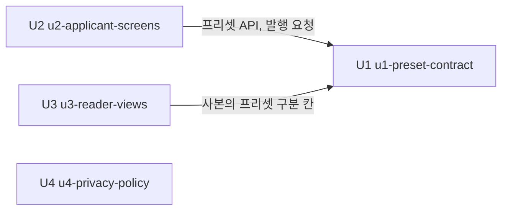

# Unit of Work Dependency — 발행 프리셋

근거: `unit-of-work.md`, 구성 요소 `inception/domain-design/components.md`의 의존(depends_on), 결정 `inception/domain-design/decisions.md`, 요구사항 `inception/requirements-analysis/requirements.md`.

이 문서는 어느 단위가 어느 단위에 기대는지만 적는다. 무엇을 먼저 만들지와 그 이유는 Delivery Planning이 정한다.

## 의존 그래프

```yaml
units:
  - name: u1-preset-contract
    kind: service
    depends_on: []
  - name: u2-applicant-screens
    kind: ui
    depends_on: [u1-preset-contract]
  - name: u3-reader-views
    kind: ui
    depends_on: [u1-preset-contract]
  - name: u4-privacy-policy
    kind: ui
    depends_on: []
```


<!-- Text fallback: U2(지원자 화면)는 U1의 프리셋 API와 발행 요청에 기대고, U3(읽는 쪽 화면)은 U1이 사본에 더하는 프리셋 구분 칸에 기댄다. U4(개인정보처리방침 문구)는 어느 단위에도 기대지 않는다. 순환은 없다. -->

| 단위 | 기대는 단위 | 왜 |
|---|---|---|
| U1 | — | api 쪽 계약·저장·AI 읽기를 모두 담는다 |
| U2 | U1 | 프리셋 목록·저장 API(PresetLibrary)와 프리셋 ID 발행 요청(Publications)이 있어야 화면과 시험이 통과한다 |
| U3 | U1 | 사본의 프리셋 순번·이름 칸으로 탭을 묶는다. 칸이 없으면 탭 시험을 만들 수 없다 |
| U4 | — | 방침 문구와 그 시험만 바꾼다. 다른 단위의 코드가 필요 없다 |

U2와 U3은 서로 기대지 않는다. 둘 다 web `publications` 기능 폴더를 건드리고, `publications-api.ts`는 둘 다 고친다(요청·막힘 응답은 U2, 사본 항목 검사는 U3). 나머지는 U2가 발행 화면과 고르기, U3이 사본 그리기·작성자 상세·받은 사람 화면이다.

## 단위 사이 연결점

| 연결 | 제공 | 사용 | 모양 |
|---|---|---|---|
| 프리셋 목록·편집·저장·지우기 | U1(PresetLibrary) | U2(PresetScreens, PublishScreen) | HTTP `/v1` 새 경로(기능 설계가 정함) |
| 발행 요청과 막힘 응답 | U1(Publications) | U2(PublishScreen) | `POST /v1/publications` `{ title, password?, presetIds }`, 막힘 응답 details에 프리셋 ID와 자료 |
| 사본(작성자 상세·받은 링크 열람) | U1(Publications, SnapshotContract) | U3(SnapshotViewer, RecipientScreen, PublicationDetailScreen) | 지금 사본 응답 + 항목마다 프리셋 순번·이름. 받은 사람 응답에는 「앞선 사본인가」 값이 없다 |
| 본인 Catch 목록 조건 | U2 안(CatchLibrary) | U2 안(PresetScreens) | `GET /v1/catches`에 조건 하나(기능 설계) |

공유하는 DB 표는 U1이 만든다(프리셋 표 둘, 발행본 항목 칸 둘). U2·U3은 표를 만들거나 바꾸지 않는다.

## 함께 만들 수 있는 단위

- U1과 U4는 서로 기대지 않는다.
- U1이 끝나면 U2와 U3은 서로 기대지 않는다.
- 가능한 순서 예: U1 → U2 → U3 → U4, U4 → U1 → U3 → U2, U1 → (U2, U3, U4 함께). 어느 것을 고를지는 Delivery Planning이 정한다.

## 첫 단위(skeleton)

이 작업의 범위 설정은 skeleton on이고, 첫 단위는 U1이다(팀 관행 면담 Q5). U1은 의존이 없고 목록 맨 앞에 있다. U1은 api만으로 프리셋 만들기 → 프리셋 ID로 발행 → 받은 링크로 사본 읽기 → 앞선 사본만 쓰는 조각·받은 링크 읽기 → 탈퇴·자료 지우기의 연쇄 삭제까지 실제로 이어 돌릴 수 있어, 뒤 단위 없이 끝까지 확인할 수 있다. U4도 의존이 없지만 첫 단위가 아니다.
