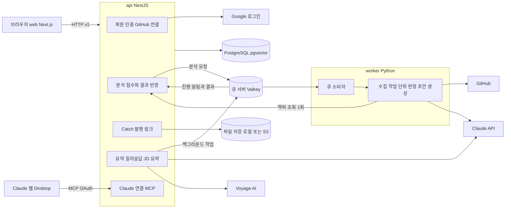

# CatchU 결정과 근거 — 왜 이렇게 만들었나

> **지위: 안내** (2026-11-16). 기준 판본은 `dev`의 `61ce82b4`다. 이 문서는 새 결정을 담지 않는다. 이미 내린 결정과 그 이유를 「질문 → 답 → 근거 문서」로 모았다. 답은 근거 문서를 줄인 것이고, 어긋나면 근거 문서가 이긴다.

세 가지를 다룬다. 기술을 왜 골랐고 무엇을 버렸나, AI와 어떻게 일했고 사람은 무엇을 정했나, 구조와 자료 흐름이 어떻게 생겼나. 근거 칸은 파일과 그 안의 절 이름을 적는다. 숫자와 날짜는 근거 문서에 적힌 그대로이고, 직접 센 숫자는 센 날과 세는 법을 함께 적었다.

## 1. 기술을 왜 골랐고 무엇을 버렸나

| 질문 | 답 | 근거 |
|---|---|---|
| 왜 web·api·worker 셋으로 나눴나 | 최상위 폴더를 배포 단위와 1:1로 맞췄다. 백엔드가 API 서버와 분석 워커 두 벌이라 `FE/BE`로 나누면 `BE/` 안에 다시 둘이 들어가 껍데기 폴더가 생긴다. 저장소를 하나로 둔 것은 나중에 쪼개기가 합치기보다 쉬워서다. | [레포 컨벤션](CatchU_레포_컨벤션.md) §1 「왜 모노레포인가」·「왜 `FE/BE`가 아닌가」 |
| Next.js·NestJS·FastAPI는 어떻게 정했나 | 2026-09-09 실현 가능성 검토에서 팀이 선호·검토안으로 냈고, 요구사항 팀 검토가 끝난 뒤 2026-09-13 팀장이 그대로 확정했다. 기록에 남은 배경은 팀 경험(팀원 1이 Nest.js·Next.js·Python 경험, 팀원 3·4는 개발 경험 없음)과 Python으로 만든 GitHub 분석 PoC다. | [실현 가능성 검토 질문·답](../aidlc/spaces/default/intents/260909-catchu-definition-review/ideation/feasibility/feasibility-questions.md) Q1·Q3·Q4 · [MVP 입력](ai-dlc-input-mvp/CatchU_mvp_input.md) §2.1 · [레포 컨벤션](CatchU_레포_컨벤션.md) 결정 이력 2026-09-11·09-13 |
| 배포 대상은 왜 AWS인가 | 2026-09-13에는 소속 기관 지원이 있던 NCP로 정했다. 기관이 AWS도 지원하게 되어 조건이 같아졌고, AWS가 쓸 수 있는 서비스와 자료가 더 잘 갖춰져 있고 기업에서도 많이 써서 2026-10-06 AWS로 바꿨다. | [레포 컨벤션](CatchU_레포_컨벤션.md) 결정 이력 2026-10-06 · [MVP 입력](ai-dlc-input-mvp/CatchU_mvp_input.md) §2.2(NCP 당시) |
| 왜 PostgreSQL·TypeORM인가 | PostgreSQL은 자산·사용자·링크의 관계 관리와 뒤의 검색 구상 때문에 골랐다. TypeORM은 팀장의 사용 경험과 취업 관점 선호로 골랐고, 그 문서는 점유율이 높다는 주장으로 적지 않는다고 밝힌다. 2026-09-23 확정. | [공통 아키텍처 검토초안](ai-dlc-input-mvp/CatchU_공통_아키텍처_검토초안.md) §5(지위: 검토용 초안) · [작업관리 결정 이력](CatchU_work_management_history.md) 2026-09-23 |
| 왜 큐를 두었나 | GitHub 분석이 오래 걸려 요청을 받은 뒤 따로 처리한다. api가 요청을 큐에 넣고 worker가 꺼내 처리한 뒤 결과를 큐로 돌려보낸다. | [MVP 입력](ai-dlc-input-mvp/CatchU_mvp_input.md) §2.1 · [공통 아키텍처 검토초안](ai-dlc-input-mvp/CatchU_공통_아키텍처_검토초안.md) §3 |
| 큐는 왜 BullMQ인가, 무엇을 버렸나 | api(Node)와 worker(Python)가 같은 큐를 쓸 수 있는지 먼저 실험했다. Node `bullmq` 6.3.11과 Python `bullmq` 3.3.0이 Redis에서 실행하는 스크립트 49개가 글자까지 같았고, 엔진 셋(Redis 7.2.11, Valkey 7.2.11, Valkey 8.1.6)에서 47개 시나리오의 판정이 모두 같았다. Redis Streams를 직접 쓰는 안은 남은 위험 둘이 똑같이 있고 메시지 회수와 수신 확인을 직접 만들어야 해서 넘어가지 않았다. | [큐 기술 검증](CatchU_큐_기술검증.md) 「결론」·「대안을 깊이 보지 않은 이유」 · [결과 기록](CatchU_queue_verification_results.md) · [재현 키트](queue-verification/README.md) |
| 큐가 해 주지 않는 것은 어떻게 했나 | BullMQ는 「최소 한 번 전달」까지만 보장한다. 분석이 두 번 돌지 않게 재시도 없음(`attempts: 1`)과 정체 복구 0회(`maxStalledCount: 0`)로 두었다. 사라지거나 끝나지 않은 요청은 접수 60분 뒤 실패로 닫고 사용자가 다시 요청한다. 앱 안에 복구 장치를 두지 않는 것은 2026-10-06 팀장 결정이다. | [큐 기술 검증](CatchU_큐_기술검증.md) 「결론」의 개발 조건·배포 전 조건 · [코딩 절차](CatchU_coding_procedures.md) 「코딩 운영」 기술 줄 |
| 서비스 LLM은 왜 Claude API의 Haiku 5.5인가 | 2026-10-14 팀장 결정. 팀장 구독에 든 월 $200 API 크레딧으로 따로 결제 없이 시작할 수 있고, 상업 약관이 보낸 자료로 학습하지 않는다고 적으며, Haiku가 가장 빠르고 싸다. 넓은 모델 비교는 하지 않기로 했다. | [#119 결정 댓글](https://github.com/JminAILab/CatchU/issues/119#issuecomment-6159097353) · [코딩 절차](CatchU_coding_procedures.md) 「코딩 운영」 기술 줄 |
| 더 큰 모델과 비교해 봤나 | 2026-10-16\~19 팀장 저장소 셋으로 Haiku와 Sonnet을 한 번씩 돌렸다. 실제 팀 프로젝트(후보 46건)에서 설명·질문 실패가 Haiku 30/92, Sonnet 5/92였지만 분석 1건 비용이 $0.04 대 $0.73(약 20배)였다. 줄마다 이름 목록을 함께 보내고 틀린 항목만 버리게 고친 뒤 Haiku가 0/92를 두 번 냈다. 그래서 Haiku를 유지했다. 판단 근거는 팀장 저장소 3개뿐이다. | [생성 호출 한도와 운영 로그](../worker/docs/generation-limits.md) 「모델」 |
| 왜 LLM 호출이 api와 worker 양쪽에 있나 | worker는 저장소 분석에서 Claude를 부른다. 면접관 화면의 질의응답은 답을 바로 흘려 보내야(SSE) 해서 api에 두었고, 기본 요약·JD 요약도 같은 근거 검사를 한 언어·한 곳에서 쓰게 api에 두었다. worker에 다 두는 안은 api→worker 동기 경로와 SSE 중계가 새로 생겨 버렸다. 대가로 외부 AI 비밀값 보호와 보안 기준을 두 곳에 적용한다. | [12월 설계 결정](../aidlc/spaces/default/intents/260925-intent-12/inception/domain-design/decisions.md) ADR-002 |
| 질의응답은 왜 임베딩 검색(RAG)인가 | 2026-10-22 포트폴리오 MVP로 방향을 바꾸며 설명할 수 있는 기능(특히 RAG)에 시간을 쓰기로 했다. 단어 검색만 쓰거나 발행본을 통째로 넘기는 안은 임베딩·벡터 검색을 보여 주지 못해 버렸고, 질문마다 방식을 고르는 판단 모델은 호출이 늘고 판단이 틀릴 수 있어 버렸다. | [11월 개발 범위 결정](CatchU_11월_범위_결정.md) 머리말·「RAG 대화형 질의응답」·「검토했지만 채택하지 않은 안」 |
| AI 답의 근거는 어떻게 붙이나 | Claude API의 인용 기능을 쓴다. 모델은 근거가 되는 줄만 가리키고 근거 글은 API가 원문에서 그대로 복사한다. 모델이 근거를 직접 옮겨 쓰게 하고 글자 일치를 보는 안은 조금만 달라도 맞는 내용이 버려져서 버렸다. 검사에 걸린 항목은 경고 없이 버린다. | [11월 개발 범위 결정](CatchU_11월_범위_결정.md) 「근거와 AI 출력 검사」·「검토했지만 채택하지 않은 안」·결정 이력 2026-10-23 |
| 판정용 AI를 따로 두지 않은 이유 | 2026-10-24 사전 시험(질문 10개·JD 1개·기본 요약 1번, Haiku와 Sonnet)에서 버림 규칙을 통과한 항목에 남의 일을 본인 것으로 쓴 것·뜻 뒤집기·역할 부풀림이 두 모델 모두 0건이었다. 판정 AI가 잡을 오류가 없었고 자료를 받는 회사만 늘어서 두지 않았다. | [11월 개발 범위 결정](CatchU_11월_범위_결정.md) 「근거와 AI 출력 검사」의 사전 시험·「검토했지만 채택하지 않은 안」·결정 이력 2026-10-24 |
| PDF는 왜 S3에 두고 미리 서명한 주소를 쓰지 않나 | DB가 큰 파일로 불어나지 않게 S3에 둔다. 열람은 api가 요청마다 링크 조건을 확인한 뒤 읽어 내려줘서 링크 조건을 우회할 길이 없다. 로컬과 시험은 같은 인터페이스로 로컬 파일을 쓴다. DB에 넣는 안은 버렸다. | [12월 설계 결정](../aidlc/spaces/default/intents/260925-intent-12/inception/domain-design/decisions.md) ADR-003 |
| Claude 연결(MCP)의 인증은 어떻게 했나 | 외부 인증 서비스를 쓰지 않고 같은 PostgreSQL에 클라이언트 등록·승인 코드·접근 토큰 표를 둔다. 토큰은 해시로만 저장하고 갱신 토큰은 없다. OAuth 규칙은 MCP 공식 SDK의 인증 도구로 처리한다. 외부 인증 서비스는 계정·비밀값·연동이 늘어 버렸다. | [12월 설계 결정](../aidlc/spaces/default/intents/260925-intent-12/inception/domain-design/decisions.md) ADR-009 |
| 발행본은 왜 고정 사본인가 | 고른 항목의 지금 내용을 보여 주면 면접관과 지원자가 같은 내용으로 이야기하기 어렵고 AI 답이 화면과 어긋난다. | [11월 개발 범위 결정](CatchU_11월_범위_결정.md) 「검토했지만 채택하지 않은 안」 |
| 브랜치·병합 규칙은 왜 이런가 | `dev`·`main`에는 PR·승인 1건·merge commit으로만 넣는다. 승인 1건은 서비스 운영 중이 아니라 즉시 병합으로 얻는 이득이 없고, 아무도 보지 않은 변경이 쌓이면 관리 비용이 커져서다. `dev` PR은 CI와 의존성 취약점 검사를 통과해야 병합된다. | [레포 컨벤션](CatchU_레포_컨벤션.md) §3·결정 이력 2026-08-24·10-03·10-05 |

### 이름과 실제 쓰임

| 질문 | 답 | 근거 |
|---|---|---|
| worker는 FastAPI 서버인가 | 아니다. 실제 실행은 큐 소비자(`python -m app.consumer`)다. 부모 프로세스가 큐에서 요청을 꺼내 요청마다 자식 프로세스 하나를 띄우고, 자식은 FastAPI를 불러오지 않는다. FastAPI로는 같은 포트의 상태 확인 `GET /health`만 연다. | [worker README](../worker/README.md) 머리말 · [분석 요청 큐 소비자](../worker/docs/queue-consumer.md) |
| web은 Next.js의 서버 쪽 기능을 쓰나 | 쓰지 않는다. 2026-09-18 구조 논의에서 브라우저가 NestJS API를 직접 부르고 Next.js는 화면·입력·API 호출·상태 표시만 맡기로 했다. 회원 토큰을 브라우저 탭 메모리에만 두기 때문에 회원 자료는 브라우저에서 부른다. | [공통 아키텍처 검토초안](ai-dlc-input-mvp/CatchU_공통_아키텍처_검토초안.md) §3·§4·§7 · [`web/src/lib/api.ts`](../web/src/lib/api.ts)·[`access-token.ts`](../web/src/lib/access-token.ts) 머리 주석 |
| 큐 서버는 Redis인가 | Redis와 통신 규약이 같은 Valkey다. 로컬과 개발 서버는 Valkey 8.1.6 컨테이너, AWS는 ElastiCache Valkey 8.1이다. 큐 검증이 Redis 7.2.11과 Valkey 두 판본에서 같은 판정을 냈다. 환경변수 이름은 `CATCHU_QUEUE_REDIS_URL` 그대로다. | [큐 기술 검증](CatchU_큐_기술검증.md) 「결론」 · [개발 서버 안내](../deploy/dev-server/README.md) · [AWS 안내](../deploy/aws/README.md) |
| api는 왜 일부 SQL과 입력 검증을 직접 썼나 | 직접 쓴 SQL은 행 잠금·충돌 무시 삽입·벡터 일괄 쓰기 자리다. 여러 영역의 저장을 한 트랜잭션으로 묶을 때는 호출하는 쪽이 연 트랜잭션을 넘겨받아 그 안에서 쓴다. 직접 쓴 검증의 예로, 프로필 수정은 DTO 변환에서 빠질 수 있는 `constructor`·`__proto__` 같은 추가 필드까지 거부하려고 원본 객체를 직접 본다. | [api 코딩 규약](../api/CONVENTIONS.md) 「트랜잭션 규약」 · [발행](../api/docs/publications.md) · [발행본 색인](../api/docs/published-index.md) · [회원 프로필](../api/docs/member-profile.md) |

## 2. AI와 어떻게 일했고 사람은 무엇을 정했나

| 질문 | 답 | 근거 |
|---|---|---|
| 어떤 방식으로 일했나 | AI-DLC 방식이다. 의도 정리부터 요구사항·설계·코드 생성까지 단계마다 AI가 질문하고 산출물을 쓰면 팀장이나 담당 팀원이 승인하거나 돌려보냈다. 단계별 질문·답·승인 기록을 `aidlc/`에 남겼다. | [루트 README](../README.md) 「AI-DLC로 만든 방식」 · [AGENTS.md](../AGENTS.md) |
| 사람이 얼마나 개입했나 | 감사 기록에 단계 승인 126회, 돌려보냄 70회가 있다. 작업 묶음(intent)별 승인·돌려보냄은 첫 제품 정의 5·1, 10월 MVP 24·4, 12월 범위 55·43, Catch 개편 19·10, 새 Catch 21·8, 문서 개편 2·4다. | `aidlc/spaces/default/intents/<intent>/audit/` 파일의 `GATE_APPROVED`·`GATE_REJECTED` 줄 수(2026-11-16에 셈) |
| 돌려보낼 때 무엇을 적었나 | 예를 들어 새 Catch의 화면 초안 단계는 세 번 돌려보냈고, 세 번째에는 고칠 곳 여덟 가지를 글로 적었다(다른 저장소 링크의 표시, 화면 낭독기용 제목, 설명 없는 Catch를 발행할 때의 안내 등). | [새 Catch 감사 기록](../aidlc/spaces/default/intents/261109-new-catch/audit)의 `rough-mockups` 단계 `GATE_REJECTED` 세 건(2026-11-09) |
| 사람이 정한 것은 무엇인가 | 범위와 방향은 팀장 결정으로 날짜와 함께 문서에 남겼다. 스택 확정(09-13), 앱 안 장애 복구를 두지 않음(10-06), 서비스 LLM(10-14), 포트폴리오 MVP로 방향 전환(10-22), 판정 AI 없음(10-24), Catch 경계는 PR 그대로(11-02), 새 Catch로 바꿈(11-09)이 그 예다. 설계 갈림길은 고른 안과 버린 안을 함께 적었다. | [레포 컨벤션](CatchU_레포_컨벤션.md) 결정 이력 · [11월 개발 범위 결정](CatchU_11월_범위_결정.md) 「검토했지만 채택하지 않은 안」·결정 이력 · [Catch 개편 입력](ai-dlc-input-catch/CatchU_Catch_개편_입력.md) §3 · [새 Catch 입력](ai-dlc-input-catch/CatchU_새_Catch_입력.md) §3·§8 · [12월 설계 결정](../aidlc/spaces/default/intents/260925-intent-12/inception/domain-design/decisions.md) |
| AI가 쓴 코드는 어떻게 검사했나 | `dev`로 가는 PR은 CI(서비스별 검사, 의존성 취약점 검사)를 통과해야 병합된다. 모든 PR에 자동 리뷰(보안·코드)가 돌고, 지적은 고치거나 반박을 답글로 단 뒤 대화를 닫는다. 병합에는 작성자 외 승인 1건이 필요하다. | [레포 컨벤션](CatchU_레포_컨벤션.md) §6 11번·결정 이력 2026-10-03·10-05 · [코딩 절차](CatchU_coding_procedures.md) 「코딩 운영」 |
| AI에게 준 규칙은 어디 있나 | 저장소의 [AGENTS.md](../AGENTS.md)와 그것이 가리키는 작업관리·코딩 절차·보안 점검 문서다. 권한·입력·화면 출력·인증·외부 호출·LLM 코드를 고칠 때 지킬 보안 기준을 따로 두었다. | [작업관리](CatchU_작업관리.md) · [코딩 절차](CatchU_coding_procedures.md) · [보안 점검](CatchU_security_checks.md) |
| AI-DLC를 처음부터 끝까지 같은 방식으로 썼나 | 아니다. 세 번 바꿨다. 2026-09-23에는 절차가 복잡해 진행이 늦어져서, 코딩은 이슈·`dev` PR로 하고 AI-DLC는 계약·기록에 쓰기로 했다. 2026-10-23 팀 회의에서 11월 개발은 AI-DLC 팀 방식으로 정했다. 2026-11-14에 그 방식을 끝내고, AI가 작업 크기에 맞는 AI-DLC 스킬을 권하면 담당이 고르는 방식으로 바꿨다. | [작업관리 결정 이력](CatchU_work_management_history.md) 2026-09-23·11-14 · [11월 개발 범위 결정](CatchU_11월_범위_결정.md) 「11월 진행 방식」 · [레포 컨벤션](CatchU_레포_컨벤션.md) 결정 이력 2026-11-14 |
| 도구가 맞지 않을 때는 어떻게 했나 | 예를 들어 AI-DLC의 Unit 합치기 명령이 실제 Unit을 거부했다. 격리 저장소에서 원인을 확인한 뒤, 단계 진행과 승인은 AI-DLC로 하고 합치기만 PR로 하기로 했다. 버린 안 셋과 이유도 적었다. | [레포 컨벤션](CatchU_레포_컨벤션.md) 결정 이력 2026-10-28 |
| 어떤 AI 도구를 썼나 | 개발·기획 보조에 Claude Max와 ChatGPT Pro를 썼다(2026-09-09 답). 저장소에는 Codex와 Claude Code용 AI-DLC 하네스가 함께 있다. 제품이 부르는 AI(Claude API, Voyage AI 임베딩)는 이것과 별개다. | [실현 가능성 검토 질문·답](../aidlc/spaces/default/intents/260909-catchu-definition-review/ideation/feasibility/feasibility-questions.md) Q4 · [루트 README](../README.md) 「구조」 · [12월 요구사항](../aidlc/spaces/default/intents/260925-intent-12/inception/requirements-analysis/requirements.md) NFR2 |
| 제품의 AI 출력은 어떻게 믿게 했나 | 모델은 고르기만 하고 맞는지는 코드가 확인한다. 분석 쪽은 모델이 가리킨 줄과 이름이 실제 자료에 있는지 대조해 틀린 항목을 버린다. 면접관 쪽은 인용 기능으로 근거를 붙이고 검사에 걸린 항목을 버린다. | [생성 호출 한도와 운영 로그](../worker/docs/generation-limits.md) 「모델」·「운영 로그」 · [11월 개발 범위 결정](CatchU_11월_범위_결정.md) 「근거와 AI 출력 검사」 |
| 누가 무엇을 했나 | 팀장은 분석 worker, AI 생성 관문, 발행본 검색과 요약·질의응답, Catch 개편, 배포·CI, 통합을 맡았다. 팀원 셋은 각각 회원·GitHub 연결·Claude 연결, 공유 링크·발행·PDF 자료, Catch 확인·저장소 등록·JD를 맡았다. | [루트 README](../README.md) 「팀」 |

## 3. 구조와 자료 흐름

글로 풀면 이렇다. 브라우저의 web은 화면만 그리고 api를 직접 부른다. api는 회원·분석 접수·Catch·발행·AI 답변·Claude 연결을 한 프로세스에서 맡고 DB를 혼자 갖는다. 분석 요청은 api가 큐에 넣고, worker의 큐 소비자가 꺼내 GitHub 수집·작업 단위 판정·Claude 초안 생성을 한 뒤 결과를 큐로 돌려보낸다. worker는 DB에 붙지 않고 필요한 맥락을 api에 한 번 묻는다. 발행 뒤의 임베딩(Voyage AI)과 기본 요약(Claude)은 api가 같은 큐 서버의 다른 큐로 돌린다. PDF는 파일 저장(로컬 폴더 또는 S3)에 둔다. Claude 웹·Desktop은 MCP로 api에 붙는다. 분석 쪽의 판정 호출은 키를 넣을 때만 켜지는 선택 기능이라 그림에서 뺐다([판정](../worker/docs/generation-judgement.md)).

더 자세한 구성도와 순서도(분석 요청부터 Catch 등록까지, 발행과 면접관 열람)는 [코드 지식의 구조 문서](../aidlc/spaces/default/codekb/CatchU/architecture.md)에 있다. 그 문서는 2026-11-09 판이라 그 뒤 바뀐 곳이 있다. 예를 들어 결과 메시지 판본은 지금 4이고 Catch에 작업 시각 칸이 생겼다.

| 질문 | 답 | 근거 |
|---|---|---|
| 전체 구성은 어떻게 생겼나 | 배포 단위 셋(web·api·worker)과 공유 자원 셋(PostgreSQL+pgvector, 큐 서버, 파일 저장)이다. api가 업무 상태와 DB를 혼자 갖고, worker는 DB에 붙지 않는다. 브라우저는 api를 직접 부른다. | [코드 지식의 구조 문서](../aidlc/spaces/default/codekb/CatchU/architecture.md) 「System Overview」·「Architectural Style」 · [공통 아키텍처 검토초안](ai-dlc-input-mvp/CatchU_공통_아키텍처_검토초안.md) §4 |
| 분석 요청은 어떻게 흐르나 | web이 요청하면 api가 요청·동의·시도를 한 트랜잭션에 쓰고 접수로 응답한다. api가 5초마다 대기 시도를 큐에 넣는다. worker가 꺼내 api 내부 조회 한 번으로 접수 맥락과 GitHub 토큰을 받고, GitHub 수집·작업 단위 판정·Claude 초안 생성을 한 뒤 결과를 큐로 보낸다. api가 결과를 검사하고 한 트랜잭션에서 Catch를 등록한다. | [코드 지식의 구조 문서](../aidlc/spaces/default/codekb/CatchU/architecture.md) 「Data Flow」 1\~4 · [api 분석 큐](../api/docs/analysis-queue.md) · [분석 요청 큐 소비자](../worker/docs/queue-consumer.md) |
| 발행과 면접관 열람은 어떻게 흐르나 | 발행하면 api가 한 트랜잭션에서 Catch를 잠그고 고정 사본과 조각을 쓴다. 커밋 뒤 임베딩과 기본 요약 작업을 api 안 큐에 넣는다. 면접관이 링크를 열면 api가 링크 조건 판정과 사본 읽기를 한 트랜잭션에서 한다. 질의응답은 질문 다시 쓰기, 의미 검색, 인용 생성 순서다. | [코드 지식의 구조 문서](../aidlc/spaces/default/codekb/CatchU/architecture.md) 「Data Flow」 6\~7 · [12월 설계 결정](../aidlc/spaces/default/intents/260925-intent-12/inception/domain-design/decisions.md) ADR-005 · [발행](../api/docs/publications.md) · [질의응답](../api/docs/rag-answer.md) |
| api와 worker는 무엇으로 약속하나 | 코드 import가 아니라 YAML 스키마 파일 하나다. 두 쪽이 같은 파일로 메시지를 검사하고, 판본 문자열을 고정해 옛 판본을 함께 받지 않는다. 지금 결과 메시지 판본은 4다. | [`worker-messages.yaml`](../api/contracts/repository-analysis/worker-messages.yaml) 머리 주석 · [코드 지식의 구조 문서](../aidlc/spaces/default/codekb/CatchU/architecture.md) 「Architectural Style」 |
| worker는 왜 DB에 붙지 않나 | 2026-09-18 구조 논의에서 worker는 서비스 DB에 직접 접근하지 않고, 큐 메시지에 GitHub 토큰 같은 비밀값을 넣지 않으며, 필요한 토큰은 api 내부 조회로 받기로 했다. | [공통 아키텍처 검토초안](ai-dlc-input-mvp/CatchU_공통_아키텍처_검토초안.md) §3·§4·§7 |
| DB는 어떻게 생겼나 | 표는 37개다(2026-11-16, migration의 `CREATE TABLE` 이름 수). 회원 자료는 부모를 따라 지워지게 외래 키를 걸어, 탈퇴는 회원 행 하나를 지워 그 자료를 함께 지운다. | [`api/src/database/migrations/`](../api/src/database/migrations) · [api 코딩 규약](../api/CONVENTIONS.md) 「DB 물리 규약」 · [탈퇴 연쇄 삭제](../api/docs/member-withdrawal-deletion.md) |
| 어디에 배포하나 | 지금은 개발 서버(EC2 한 대, Compose)에 올리고 12월 최종 환경은 EKS다. | [루트 README](../README.md) 「기술 구성과 배포」 · [개발 서버 안내](../deploy/dev-server/README.md) · [AWS 안내](../deploy/aws/README.md) |

### 제품 정의가 바뀐 네 지점

| 언제 | 무엇이 왜 바뀌었나 | 근거 |
|---|---|---|
| 2026-09-11 | 개편 전 구상(채용 플랫폼·JD 적합도, 팔로우·포스팅·공고)과 현행 기획이 섞여 사람과 AI가 잘못 읽었다. 그래서 AI-DLC로 요구사항을 승인하고 옛 문서를 지웠다. 문제의 출발은 면접관이 GitHub를 봐야 한다고 생각하지만 거의 보지 못한다는 인터뷰다. | [docs 안내](README.md) 「정리 기록」 2026-09-11 · [의도문](../aidlc/spaces/default/intents/260909-catchu-definition-review/ideation/intent-capture/intent-statement.md) 「해결하려는 문제」 |
| 2026-10-22 | 포트폴리오 MVP로 방향을 바꿨다. CatchU는 팀원의 취업 포트폴리오이고 12월 이용자는 소수다. 그래서 운영용 장치는 남의 자료를 다루는 데 꼭 필요한 것만 남기고, 그 시간을 설명할 수 있는 기능(특히 RAG)에 쓴다. | [11월 개발 범위 결정](CatchU_11월_범위_결정.md) 머리말·결정 이력 2026-10-22 |
| 2026-11-03 | Catch 개편. 「작성자가 낸 PR = Catch 경계」는 유지하되 「PR 하나 = 판단 하나」는 맞지 않는다고 봤다. 판단의 이유는 작성자 설명이 맡고, 한 번 정한 소속을 저장해 같은 작업의 중복 Catch를 막는다. 실측이 근거다. | [Catch 개편 입력](ai-dlc-input-catch/CatchU_Catch_개편_입력.md) §2 |
| 2026-11-09 | 새 Catch. AI가 코드를 쓰는 시대에는 코드보다 판단이 중요하다는 질문에서 시작했다. 진단 여섯 가지와 실측(한 저장소에서 46장이 같은 무게로 나옴 등)을 근거로, Catch를 무엇을 했는지 빨리 보는 그림, 지원자가 적은 자기 판단, 그 판단을 시험할 코드 자리와 원본으로 정했다. 판단의 증명과 평가는 주지 않는다. | [새 Catch 입력](ai-dlc-input-catch/CatchU_새_Catch_입력.md) §2 · [새 Catch 요구사항](../aidlc/spaces/default/intents/261109-new-catch/inception/requirements-analysis/requirements.md) |

## 결정 이력

- **2026-11-16** — 팀장 결정으로 만들었다. 저장소에 흩어진 결정의 이유를 한 장에서 찾아가게 하려는 것이고, 새 결정은 없다. 같은 날 이름과 실제 쓰임이 달랐던 곳(루트 README 「구조」·「기술 구성과 배포」, 레포 컨벤션 §1, 코딩 절차 「코딩 운영」)을 실제에 맞게 고쳤다.
