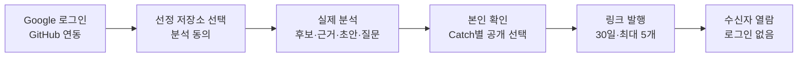

# CatchU 프로젝트 기획서 (요약)

| 항목 | 내용 |
|---|---|
| 팀명 | Jaemin_AI |
| 과제명 | 이력서-채용공고 텍스트 매칭 시스템 (학교 등록명) |
| 서비스명 | CatchU (캐치유) |
| 문서 버전 | v1.0 |
| 작성일 | 2026-09-28 |
| 기준 | `origin/dev` 9093d2e |
| 문서 지위 | 현행 갱신판 (9/4 기획발표판 v0.3 기준 갱신) |

## 변경 이력

| 버전 | 날짜 | 내용 |
|---|---|---|
| v0.3 | 2026-09-03 | 기획발표판 (2026-09-04 기획발표용) |
| v1.0 | 2026-09-28 | 현행 갱신. AI-DLC로 승인한 요구사항(2026-09-11)과 10월 MVP 산출물(2026-09-14~24), 12월 범위 보완(팀장 결정 입력)에 맞춰 범위·용어·기술·역할·성과지표를 고쳤다 |

9/4 기획발표판에서 바뀐 사실은 다음과 같다.

| 항목 | 9/4 기획발표판 (v0.3) | 현행 (v1.0) |
|---|---|---|
| 핵심 자산 이름 | 증거카드 | Catch (제목·근거·짧은 설명 초안·생각해볼 질문) |
| 로그인·분석 대상 | GitHub OAuth로 연결한 공개 저장소 | Google 로그인 → 별도 GitHub 연동 → 저장소별 분석 동의. 10월은 팀이 사전 선정한 공개 저장소만 |
| 인프라 | AWS(ECS·Aurora·S3), GitHub Actions CI/CD | 네이버 클라우드 플랫폼(NCP) 수동 배포, PostgreSQL·TypeORM·Redis. 자동 배포는 10월 범위 밖 |
| 범위 구성 | 구직자·기업·운영 기능을 한 계획에 | 1단계 10월 MVP(구직자 → 링크 → 수신자), 2단계 12월(대표 구성·서류·JD·기업·소셜·MCP·운영) |
| 어필 프리셋 | 주장 + 근거 카드 한 벌, 여러 벌 | 대표 구성(대표 주장 1개 + Catch 2~3장)으로 바꾸고 12월 1순위로 이동 |
| 공고 렌즈 | 공고 JD에 해당하는 카드 대조 | JD 한 장 요약·사이드 패널·질의응답(12월). 매칭 % 없음 |
| 카드 탐색 3층·링크 열람 기록 | 포함 | 보류 |
| 9/24 결정 | 없음 | Catch마다 제목(title), 공개 상태는 공개·미공개 두 가지, 내 자산은 Catch 탭 하나 + 저장소 연결 관리 모달 |
| 역할 | 팀장 백엔드·인프라, 팀원 3인 프론트엔드 주 담당 | 9/17 기능 영역별 재배분, 전원 풀스택 |
| 성과지표 | KPI 4개 + 최소 조건 | 승인 요구사항의 필수 조건(근거 링크 유효율 100%·타인 기여 오귀속 0건)과 사용자 조사가 공식. KPI 4개는 측정 계획 초안 |
| 일정 | 중간 발표 9/30, 최종 발표 12/18 (발표 슬라이드 일정표) | 중간 발표 2026-10-01~02, 최종 발표 2026-12-10 |

## 1. 요약표

| 항목 | 내용 |
|---|---|
| 팀명 | Jaemin_AI |
| 과제명 | 이력서-채용공고 텍스트 매칭 시스템 |
| 서비스명 | CatchU (캐치유) |
| 주제 구분 | 인공지능사관학교 파이널 프로젝트 |
| 아이디어 주제 | GitHub API와 LLM 기반으로 개발자의 커밋 기록에서 근거 링크가 붙은 경험 카드(Catch)를 만들고, 구직자가 확인·공개한 자료를 채용 담당자에게 링크로 전달하는 채용 근거 공유 서비스 |
| 한 줄 요약 | 점수 대신 근거. 시스템은 근거를 찾아 보여 주고 판단은 사람이 한다 |
| 과제명과 서비스의 관계 | 이력서와 채용공고의 '매칭'을 적합도 %·점수·순위로 하지 않는다. JD(채용공고의 직무 요건)를 기준으로 구직자의 GitHub 근거와 서류에서 관련 대목을 찾아 대조해 보여 주고(12월 JD 기능), 적합 여부의 판단은 읽는 사람이 한다 |
| 기술 | Next.js · NestJS · FastAPI(Python) · PostgreSQL(TypeORM) · Redis · GitHub API · 상용 LLM API(선정 전) · NCP |
| 기간 | 2026-08-03 시작 · 기획발표 2026-09-04 · 중간 발표 2026-10-01~02 · 최종 발표 2026-12-10 |

### 1-1. 팀원 및 역할

| 이름 | 담당 영역 (2026-09-17 재배분) | 비고 |
|---|---|---|
| 이재민 (팀장·팀원 1) | 분석 결과 생성(GitHub 수집·근거·설명 초안), NCP 배포·복구, 통합, DB 기반 | 기획 총괄, AI-DLC 공통 조율 |
| 이영연 (팀원 2) | 회원·프로필·GitHub 연동, 분석 요청·진행 상태, 인증 기반 | 풀스택 |
| 최수영 (팀원 3) | 공유 링크·수신자 열람, 본인 홈·저장소 연결 관리, 공통 오류 | 풀스택 |
| 이채아 (팀원 4) | Catch 등록·확인·공개 (내 자산 화면) | 풀스택 |

각 담당이 자기 영역의 설계·구현·테스트와 PR 설명을 맡는다. 통합 담당이 다른 영역의 시험을 대신하지 않는다.

## 2. 제안 배경 및 필요성

### 2-1. 시장 현황

| 관찰 | 수치 | 출처 |
|---|---|---|
| 기업은 신입에게도 직무 경험을 묻는다 | 신규채용 시 가장 중요한 평가 요소 1위 "직무 관련 업무 경험" 67.6%, 2026년 채용 트렌드 1위 "직무중심 채용 강화" 72.2% | 한국경영자총협회 「2026년 신규채용 실태조사」, 2026-03-10 발표 (100인 이상 기업 500개사, 2026.1.19~2.11 조사) |
| 채용이 수시로 바뀌었다 | 수시채용만 실시 54.8%, 정기공채와 병행 35.0% | 같은 조사 (35.0%는 뉴스핌 2026-03-10 보도에서 확인) |
| 기업이 먼저 찾아 연락하는 채용이 늘었다 | 헤드헌팅 활용 경력직 81.9%·신입 61.2%, 다이렉트 소싱 경력직 51.2%·신입 42.4% (복수 응답, 응답 기업 중 해당 방식을 쓰는 비율) | 고용노동부·한국고용정보원 「2024년 하반기 기업 채용동향조사」 2차 결과 (매출 상위 500대 기업 중 387개 응답, 2024.11.26~12.24 조사, 2025-03-30 보도) |
| 국내 링크드인의 규모 | 등록 회원 500만 명(인구의 9.7%). 월간 활성 이용자가 아니라 총 등록 회원 수다 | DataReportal 「Digital 2026: South Korea」, 2025-11-08 |

채용 실무는 팀이 직접 한 인터뷰로 확인했다(팀 내부 기록).

- **현직 기술 면접관 (2026-08-27):** "GitHub를 봐야 한다고 생각하지만 실제로는 거의 보지 못한다." 채용 과정에서 보는 것은 포트폴리오 중 관심 가는 프로젝트의 README 정도다. 9/4 기획발표 정리본(AI 요약)은 이 면접관의 입장을 "근거를 가져오면 판단은 내가 한다", 곧 AI 판정을 믿기 어렵다는 것으로 적었다.
- **인사담당자 인터뷰 (2026-08-27)·HR 멘토 멘토링 (2026-08):** JD에 맞는 인재를 찾기 어렵고 오래 걸리며, JD의 기술 스택을 이해하기 어려워 확인에도 시간이 든다. 이력서 1건 검토는 10분 이내라고 했다(HR 멘토). 인사담당자는 "JD를 봐도 이해하지 못하니 적합 여부를 알려 달라"며 적합도를 %로 보여 주는 기능에 관심을 보였고, 합격·불합격 결정을 AI에 맡기는 것에는 부담을 표시했다(개편 전 조사 문서의 인터뷰 기록). CatchU는 적합도 %를 내지 않고, JD에 관련된 근거를 찾아 보여 주는 방식으로 이 요구에 답한다(12월 JD 기능, 4-3).
- 인터뷰는 문제를 파악한 배경이다. 모든 채용 담당자의 특성이나 CatchU의 검증된 효과로 일반화하지 않는다.

### 2-2. 문제 정의

- **기업 쪽:** 기술 면접관은 지원자가 실제로 무엇을 했는지 확인하고 싶지만, 개발 업무와 채용을 병행하느라 GitHub까지 볼 시간이 없다. HR은 JD의 기술 요건을 이해하기 어려워 맞는 인재를 찾고 확인하는 데 시간이 든다.
- **구직자 쪽:** 개발자 본인도 자신이 무엇을 했는지 다시 꺼내지 못한다. 커밋은 남아 있지만 "그때 왜 그렇게 결정했는지"를 다시 묶어 본 적이 없고, 팀 프로젝트에서는 내 몫이 흐릿하다. 그래서 이력서에는 "React로 쇼핑몰을 만들었습니다"만 남는다.
- **공통 원인:** GitHub에 기록은 있는데 읽히지 않는다. 기록은 시간순 커밋 로그이고, 사람이 알고 싶은 것은 "무엇을 했고 어느 기록이 그 근거인가"다.
- **기존 도구의 빈자리:** 점수형 분석과 ATS의 AI 평가는 결론(점수)을 주지만 근거를 열어 보기 어렵고, 프로필 서비스는 본인이 쓴 문장이라 근거가 없다(3장).

### 2-3. 대상 사용자

| 단계 | 대상 | 상황과 고통 | CatchU에서 얻는 것 |
|---|---|---|---|
| 1단계 (10월) | **구직자** — 신입·취업준비생 개발자. 페르소나 P1 한지우(가명). 초기 사용자로 인공지능사관학교 수료생을 고려한다(구상) | 파이널 프로젝트 하나로 모든 기업에 지원한다. 커밋은 남겼지만 다시 꺼내 정리해 본 적이 없고, 면접에서 말로 다 설명하지 못한다 | 동의한 저장소에서 경험 후보·근거·짧은 설명 초안·생각해볼 질문을 확인하고, 고른 Catch만 공개해 링크로 전달한다 |
| 1단계 (10월) | **링크 수신자** — 링크를 받은 채용 담당자(HR·기술 면접관) 등. 로그인하지 않는다 | 이력서 문장을 믿을지 판단할 재료가 없다 | 기본 프로필과 현재 공개된 Catch, 그 근거인 GitHub 원본 링크를 로그인 없이 연다 |
| 2단계 (12월) | **기술 면접관(HM)** — 30~300명 규모 IT 기업 개발팀장. P3 김도윤(가명) | GitHub를 봐야 한다고 생각하지만 거의 보지 못한다. 제한된 시간 안에 실제로 한 일을 판단하기 어렵다 | JD 기준 한 장 요약·근거 확인·질의응답. 점수·순위는 없다 |
| 2단계 (12월) | **HR·리크루터** — 30~150명 규모 IT 기업, HR 1~2인. P2 박서연(가명). 소싱 대상은 주로 경력 개발자다 | JD의 기술 요건을 이해하기 어렵고, 후보를 수작업으로 검색·연락한다 | 로그인 기업 계정의 조건 검색(검색 참여에 동의한 구직자만, 순위 없음)·채용 제안·수락 후 DM, 기업 JD 프리셋 |
| 2단계 (12월) | **운영자** — 개발을 겸하는 팀원 1명. P4 이현우(가명) | 운영에 쓸 수 있는 시간이 알림을 확인하는 몇 분뿐이다 | 자동 처리 우선, 관리자 지표·신고 처리 화면 |

### 2-4. 개선 방향과 필요성

- 기업은 직무 경험을 가장 중시하고(67.6%) 수시채용과 헤드헌팅·다이렉트 소싱으로 사람을 찾는다. 구직자에게는 경험을 증명할 수단이, 기업에게는 그 증명을 짧은 시간에 확인할 수단이 필요하다.
- 두 수단의 재료는 GitHub에 있지만, 인터뷰에서 확인한 대로 채용 과정에서 거의 열리지 않는다.
- 필요한 것은 결론을 대신 내리는 점수가 아니라, 근거를 찾아 한 번에 열어 볼 수 있게 정리하는 도구다. CatchU는 이 자리를 채운다.

## 3. 유사 제품 현황 및 비교

### 3-1. 비교

2026-08 팀 조사 기준(개편 전 자료: JD 적합도 기능 벤치마킹 2026-08-31, ATS 경쟁사 분석 2026-08-27)이다. GitRoll의 기능 표기는 2026-09-28 공식 사이트에서 다시 확인했다.

| 서비스 (유형) | 주요 기능 | 장점 | 단점 (CatchU 관점) |
|---|---|---|---|
| GitRoll (점수형 GitHub 분석) | GitHub 연결 뒤 점수(Merit-based Score)·등급(Global Tier)·순위(GitHub Rank)·기술 스택·저장소 분석 제공 | "1 click, 2 steps"로 빠르게 결과를 받는다. 기술 스택을 한눈에 요약한다 | 결론이 점수·등급이라 어느 기록이 근거인지 열어 보기 어렵다. 판정 주체가 시스템이다 |
| 그리팅 AI 서류평가 (국내 ATS 내장형) | 담당자가 입력한 선호·비선호 조건으로 지원서를 100점 만점 점수화. 부분 일치 항목은 "면접에서 확인해보세요"로 표시. 자동 합불 처리 없음 | 조건별 근거를 표시하고 면접 질문으로 잇는다. ATS 흐름 안에서 바로 쓴다 | 조건을 담당자가 직접 써야 해 JD를 이해하기 어려운 HR에게 부담이다. 공식 문서가 밝힌 대로 이력서 안의 객관 정보만 평가 근거로 쓰므로, 저장소의 실제 작업은 근거가 되지 못한다 |
| 라운드HR (국내 ATS) | JD 기반 스크리닝 조건 추천, 적합·불확실·부적합 분류, 이력서 근거 문장·추천 질문 제시 | 근거 문장과 면접 질문을 함께 준다. 지원자 마이페이지로 진행 상황을 알린다 | 이력서 요약 중심이다. 저장소 기여·기술 선택 같은 실제 작업 증거는 다루지 않는다 |
| LinkedIn (프로필·소싱 플랫폼) | 자기 서술 프로필, 기업의 검색·연락, 인맥 네트워크 | HR이 후보를 직접 검색·연락하는 경로로 쓴다(HR 인터뷰). 네트워크 효과가 크다 | 본인이 쓴 문장이라 근거를 확인할 수 없다. 국내 등록 회원은 500만 명(인구 9.7%, 활성 이용자가 아닌 등록 회원 기준)이다 |
| **CatchU** | GitHub 기록에서 근거 링크가 붙은 Catch 생성 → 본인 확인·공개 → 링크 전달(10월). JD 기준 근거 대조·기업 검색·MCP(12월) | 설명 문장이 원본 근거로 이어진다. 무엇을 보여 줄지 구직자가 정한다. 기업 ATS 옆에서 링크로 동작한다 | 점수로 빠르게 거르는 용도에는 맞지 않는다. 근거 일치·기여 귀속 품질을 계속 검증해야 한다 |

### 3-2. 차별성

1. **점수가 아니라 근거.** 매칭 %·점수·순위·등급을 내지 않는다. 승인 요구사항은 이를 금지된 행동으로 정했다. Catch의 설명은 근거가 된 커밋에 연결되고, 발췌로 확인되지 않는 사실은 "제공된 발췌에서 확인할 수 없음"으로 제한한다. 9/4의 판별 기준을 유지한다. "점수 모델이 이 문장을 쓸 수 있는가." 쓸 수 있으면 CatchU의 것이 아니다.
2. **무엇을 보여 줄지는 구직자가 정한다.** 분석 결과는 처음에 미공개이고, 본인이 근거를 확인한 뒤 Catch마다 공개를 고른다. 숨기면 이미 보낸 링크에도 다음 조회부터 반영된다. 결과물이 아니라 판단의 흔적을 담는 Catch 4구획(무엇을 했나 / 판단의 흐름 / 궤적 및 기록 / 기록에 없는 것) 방향은 유지하되, 10월은 근거·짧은 설명 초안·생각해볼 질문부터 제공한다.
3. **ATS를 대체하지 않고 옆에 선다.** 구직자는 링크를 보내고 수신자는 로그인 없이 연다. 지원 접수와 전형은 기업의 기존 ATS에서 한다. 국내외 ATS가 MCP로 외부 AI 도구와 연결되는 흐름(그리팅·나인하이어·Greenhouse·Ashby, 2026-08 조사)에 맞춰 12월에는 CatchU도 MCP를 제공한다.

## 4. 제안 내용

### 4-1. 개발 목표

GitHub에 흩어진 개발자의 실제 활동을 근거가 붙은 Catch로 정리해, 구직자는 자신의 경험을 다시 꺼내 골라 전달하고 채용 담당자는 점수가 아닌 원본 근거로 직접 판단하게 한다.

### 4-2. 1단계 — 10월 MVP (승인 범위)

구직자에서 수신자까지 한 흐름을 실제 서비스(NCP 외부 URL)에서 완주하는 것이 목표다. 과거 PoC 결과나 모의 응답으로 대신하지 않는다. 기능 묶음 M01~M07은 10월 MVP 범위 문서의 ID다.

그림 1. 10월 MVP 주 경로

| ID | 기능 | 주요 내용 (정량 기준) | 담당 |
|---|---|---|---|
| M01 | 로그인·프로필·GitHub 연동, 저장소 선택·분석 동의 | Google 로그인. GitHub 미연동도 홈에 들어가지만 분석 전에 연동·동의를 확인한다. 팀이 사전 선정한 공개 저장소 목록 안에서만 요청한다. 동의 내용을 버튼 앞에 보이고 버튼 1개로 동의와 요청을 함께 한다. 진행 중 분석은 사용자당 1건 | 이영연, 최수영(화면) |
| M02 | 실제 분석과 경험 후보·근거·짧은 설명 초안·생각해볼 질문 | 실제 저장소 자료로 생성한다. Catch마다 제목 1개(평가하는 말 없이 '무엇을 했나'를 짧게, 구직자 수정 불가)와 근거 1개 이상. 근거가 부족하면 설명 제한·후보 보류로 표시한다 | 이재민(생성), 이채아(등록) |
| M03 | Catch 확인·공개 (내 자산 Catch 탭) | 공개 상태 2가지(공개·미공개), 최초 미공개. 본인 확인 뒤 별도로 공개하고 불일치를 표시할 수 있다. 저장소 필터가 있는 목록과 상세 모달. 설명의 직접 수정·재생성은 없다 | 이채아 |
| M04 | 링크 발행·비로그인 열람 | 대표 구성 없이 발행한다. 제목 필수(수신자에게는 비표시), 유효 링크 최대 5개, 발행 시점부터 30일 고정 만료, 중단, 선택 비밀번호. 수신자는 기본 프로필과 현재 공개 Catch 전체를 보며, 요청마다 현재 권한을 검사한다 | 최수영 |
| M05 | 진행·실패·재요청·중복 방지·자료 보존, 원본 비공개 대응 | 저장소 상태 아이콘 4종(분석 중·성공·부분 실패·실패). 실패는 새 동의로 재요청한다. 재방문이 새 분석을 만들지 않고, 실패해도 기존 자료·링크를 보존한다. 원본이 비공개로 바뀐 것이 확인되면 관련 Catch 열람을 막는다 | 이영연, 최수영, 이채아, 이재민 |
| M06 | 권한·동의·자료 최소화·비밀값 보호·호출 상한, 빈/로딩/실패/권한 안내·기본 접근성 | 타인 자료와 없는 자료를 같은 응답으로 숨긴다. 수신자 응답은 캐시하지 않는다. 공통 오류 형식을 쓴다 | 전원 (공통 오류 최수영) |
| M07 | NCP 수동 배포·외부 URL·자료 영속과 복구·통합 재시험 | 재시작·재배포 뒤에도 자료·공개·링크 상태를 보존하고, 합의한 복구 시나리오의 실행 증거를 남긴다 | 이재민 |

운영 기능(품질 신호·운영 기록 조회·신규 분석과 AI 호출의 전체 중단·재개)은 회의 결정으로 10월 범위에서 뺐고 12월 후순위로 옮겼다.

### 4-3. 2단계 — 12월 (미승인 계획)

12월 범위는 두 갈래다. 표의 **'팀장 결정'**은 12월 범위 보완 문서(`docs/ai-dlc-input-december/CatchU_12월_범위_보완.md`)가 12월 포함으로 정한 항목이다. **'승인 12월 계획'**은 9/11 승인 요구사항이 12월로 둔 항목인데, 12월 범위 보완은 이 가운데 여러 항목(여러 벌의 대표 프리셋, 목록 밖 저장소, 재생성, 조건 검색, 제안·DM, 품질 판정 등)의 포함 여부와 순서를 12월 요구사항 분석에서 다시 정하기로 했다. 12월 작업은 AI-DLC로 요구사항 분석 승인까지 진행하며, 세부 동작도 그때 정한다. 팀장이 밝힌 순서는 대표 구성(1순위)과 운영 기능(후순위, 가능하면 포함) 두 가지다. 가용량이 부족하면 검색·소싱의 완성도를 먼저 줄여 검토한다는 방침이 승인 요구사항에 있다. 모든 항목의 12월 완성을 약속하지 않는다.

| 영역 | 기능 | 근거 |
|---|---|---|
| 구직자 자산 | **대표 구성(1순위):** 대표 주장 작성·수정, Catch 2~3장 선택·교체, 미리보기, 발행 시점 구성 보존. 승인 요구사항에서는 10월 항목이었으나 10월 MVP 범위에서 빠졌다 | 팀장 결정 |
| 구직자 자산 | 여러 벌의 대표 프리셋과 링크별 선택(1순위에 넣지 않음) | 승인 12월 계획 |
| 구직자 자산 | 서류: 자기소개서(텍스트)·포트폴리오(PDF 또는 URL)·이력서(PDF)를 여러 벌 등록하고 링크 발행 때 고른다. 발행 당시 내용 보존 | 팀장 결정 (승인 12월 계획 FR5를 적용) |
| 구직자 자산 | 프로필 상세(학력·경력 등), 본인 카드 검색, 온보딩 | 팀장 결정 |
| 구직자 자산 | 목록 밖 공개 저장소 분석, 서술 오류 Catch의 한도 있는 재생성 | 승인 12월 계획 |
| JD 기능 | JD 한 장 요약·사이드 패널·질의응답. 비로그인 수신자도 JD를 입력해 쓰며 링크 단위 사용 한도를 둔다. 매칭 %는 어떤 질문에도 내지 않는다 | 승인 12월 계획, 팀장 재확인 |
| 기업 | 기업 등록·소속·직책 권한, 회사 프로필, 기업 JD 프리셋(같은 기업 안 공유), 간단한 채용공고(지원은 외부 ATS 링크) | 팀장 결정 |
| 기업 | 조건 검색(검색 참여에 동의한 구직자만, 기본 미노출, 유사도 순위 없음), 채용 제안·수신 통제·개별 차단, 수락 후 텍스트 DM·동의한 연락처 공유 | 승인 12월 계획 |
| 소셜 | 팔로우·포스팅·피드, 구직자끼리의 공개 범위(전체·맞팔), 구직자 간 DM, 알림(분석 완료·실패 포함). 승인 요구사항이 '범위 밖'으로 둔 소셜 기능을 팀장이 12월 포함으로 바꿨다 | 팀장 결정 |
| 연결 | MCP. 구직자는 자기 LLM에서 CatchU 데이터를 이용하고, 기업은 받은 링크 범위와 검색 참여 구직자 탐색을 이용한다. 화면·링크와 같은 권한 규칙을 따른다 | 팀장 결정 |
| 운영 | 운영 기능(후순위): 품질 신호, 운영 기록 조회, 신규 분석·AI 호출 전체 중단·재개, 관리자 지표. 관리자 처리(신고·제재, 기업 등록 관리, 공고 관리), 고객센터 | 팀장 결정 |
| 품질 | 근거·귀속 품질 판정(6장 공식 지표) | 승인 12월 계획 |
| 과금 준비 | 운영진 지급 마일리지(7-3) | 팀장 결정 |

### 4-4. 하지 않는 것

| 항목 | 처리 | 근거 |
|---|---|---|
| 적합도 %·점수·유사도 순위·등급, 검색 무결과를 역량 부재로 판정 | 하지 않는다 (위반으로 검사) | 승인 요구사항 FR6·FR7.4, 금지된 파생 행동 |
| 합격 여부 판정·자동 컷오프, AI 생성 코드 판별 | 하지 않는다. 판단과 진정성 확인은 사람과 면접의 몫 | 9/4 설계 원칙 유지 |
| 지원 접수·전형 관리, ATS 직접 연동 | 하지 않는다. 기업의 기존 ATS와 역할을 나눈다 | 승인 요구사항 범위 밖 |
| 자기소개서·대표 주장 자동 작성과 첨삭, Catch 설명의 직접 수정 | 하지 않는다(현재 미채택). 구직자의 해석은 대표 주장에 쓴다 | 승인 요구사항 FR3.5, 미채택 항목 |
| 동의 없는 분석·비공개 저장소 분석·크롤링, 외부 AI 제공자의 학습 사용 | 하지 않는다 | FR1.1, NFR2 |
| 10월에 서류·JD 기능·기업 검색과 제안·DM·대표 구성·운영 기능·목록 밖 저장소·재생성·자동 배포 | 10월에는 하지 않는다. 12월 포함 또는 12월 요구사항 분석에서 재검토(4-3) | 10월 MVP 범위 문서 |
| 링크 만료 기간의 선택·연장 | 10월에는 하지 않는다(12월 후보) | FR4.5 |
| 만료·중단된 링크 되살리기 | 하지 않는다. 필요하면 새 링크를 발행한다 | 12월 범위 보완 |
| 카드 탐색 3층(Catch → 커밋 원문 → diff 서비스 안 탐색), 링크 열람 기록 | 보류 | 12월 범위 보완 |
| MFA 등 계정 보안 설정, 구직자 신원 인증 | 프로젝트 구현 범위 밖 | 12월 범위 보완 |
| 기업 인증 | 우선순위상 사실상 범위 밖. 제안·DM은 반복 발송 제한과 개별 차단으로 대응한다 | 12월 범위 보완 |
| 마일리지의 현금 구매·환전 | 두지 않는다 | 12월 범위 보완 |

## 5. 수행 방법

### 5-1. 데이터 확보방안

| 구분 | 내용 |
|---|---|
| 출처 | GitHub API. 사용자가 GitHub를 연동한 뒤 고르고 동의한 공개 저장소만 분석한다. 10월은 팀이 사전 선정한 저장소 목록 안에서만 분석한다. 연결 계정이 소유하거나 커밋한 공개 저장소로 넓히는 것은 승인 12월 계획이며, 포함 여부는 12월 요구사항 분석에서 정한다 |
| 동의 | 로그인·GitHub 연동·분석 동의·Catch 공개는 서로 대신하지 않는다. 저장소마다 분석 동의를 받고, 실패 뒤 재요청도 새 동의로 한다 |
| 수집 항목 | 커밋 메타데이터·메시지·변경 파일과 근거에 필요한 diff 발췌. 전량 복구를 목표로 하지 않고 누락·잘림은 탐지해 설명 범위를 제한한다. 수집 방식(API만 또는 Git 병행)과 항목 상세는 설계에서 정한다 |
| 수집·전송하지 않는 것 | 비공개·미동의 저장소, 크롤링. 공동 기여자 식별 정보는 가명화하고 비밀값은 마스킹한다. 외부 AI에는 최소 발췌만 보내며, 약관으로 학습 미사용이 보장된 유료 API 등급만 쓴다(NFR2) |
| PoC 실측 (2026-08) | 팀장 본인의 공개 저장소 3개(팀 프로젝트 저장소 포함)를 규칙 기반(LLM 미사용)으로 처리해 사건 420건, 그중 본인 주도 사건 113건을 추출하고 카드 실물 2장(서사형·스냅샷형)을 만들었다. 8/30 회상 실험에서는 커밋 메시지 원문 4건 중 3건으로 본인이 경험을 떠올렸다(참여자 본인 1명, 일반화하지 않음). 사건 경계가 실제 작업 단위와 맞는지는 판정하지 않았다 |
| 제한 LLM 실험 (2026-09-16·17) | 저장소 소유자 동의 아래 최소 발췌로 실험했다. 9/16 최소 실험에서 나온 과장·단정 문제는 9/17 재검증에서 재발하지 않았다. 재검증에서 근거 충분성(C02)은 후보 3건 모두 '발췌로 확인되는 기여만 말하는' 설명 제한 조건으로 사용 가능했다. 초안 사실성(C01)은 3건 중 2건 충족, 1건은 문맥 줄 오귀속 1건으로 기준 미달이었다. 9/22 해당 1건에 한정한 예외와 제한 수용으로 개발을 이어 가며, 서비스 전체의 품질 확보로 보지 않는다. 실험 모델은 서비스 모델이 아니다 |
| 평가 데이터 | 12월 품질 판정은 동의받은 정해진 검증 표본으로 한다(표본 규모·구성은 미정). KPI 초안은 팀 프로젝트를 포함한 평가 저장소 3~5개와 사람이 먼저 쓰는 정답표를 쓴다 |

### 5-2. 추진 전략과 일정

- **승인 원본과 구현을 나눈다.** 요구사항·설계·계약(API 명세 v1·ERD v1)은 AI-DLC(AI가 단계별 산출물을 만들고 사람이 단계마다 승인하는 개발 절차)로 승인해 원본으로 두고, 구현은 이슈 단위 PR로 한다. 계약의 부족·오류는 이슈로 올려 AI-DLC로 고친다.
- **PoC를 먼저 하고 조건부로 진행한다.** 8월 규칙 기반 PoC → 9/14 PoC 분석 → 9/16·17 제한 LLM 실험 → 9/22 조건부 수용 순서로 성립 여부를 확인한 뒤 구현에 들어갔다. PoC 코드는 분석 보고서의 권고(로직 참조·순수 함수 이식·나머지 재작성)를 바탕으로 채택 범위를 검토하며, 그대로 옮겨 일정을 줄인다고 전제하지 않는다.
- **제공자 비종속으로 먼저 만든다.** 서비스 LLM은 개발 중후반, 실제 제공자 연결 전에 선정한다. 그 전에는 제공자 비종속 인터페이스와 가짜 생성기, 합성 자료로 연결한다.

| 기간 | 추진 내용 | 담당 |
|---|---|---|
| 2026-08-03~08-31 | 기획·페르소나·그라운드룰, 카드 추출 PoC, 현직 기술 면접관·HR 인터뷰(8/27) | 전원 / PoC 이재민 |
| 2026-09-04 | 기획발표 | 전원 |
| 2026-09-09~09-11 | 첫 AI-DLC 작업: 방향·초기 범위·요구사항 검토, 요구사항 승인(9/11) | 전원, 조율 이재민 |
| 2026-09-14~09-24 | 10월 MVP 작업: 목적·실현 가능성(9/22 승인)·범위·요구사항·도메인·계약 설계, API 명세 v1·ERD v1 병합(9/24), 역할 재배분(9/17). 흑백 와이어프레임 v2.2(9/23, 검토초안) | 전원 |
| 2026-09-23~ | 저장소 뼈대(web·api·worker 초기화 9/23), 인증 기반(9/27), 9/28부터 기능 이슈별 구현 | 영역별 담당 |
| 2026-10-01~02 | 중간 발표 | 전원 |
| 2026-10~ | 10월 MVP 구현·통합·NCP 수동 배포·복구 검증. 배포가 늦으면 로컬 실행으로 시연하되 NCP 배포 완료로 기록하지 않는다 | 영역별 담당, 배포·통합 이재민 |
| 12월 범위 (날짜 미정) | 12월 AI-DLC 작업은 요구사항 분석 승인까지 하고, 도메인 설계·계약·ERD는 10월 MVP 개발 뒤에 한다 | 전원 |
| 2026-12-10 | 최종 발표 | 전원 |

9/28 기준 진행 상황과 WBS는 `12_진행현황.md`에 둔다.

### 5-3. 기능별 기술

| 기능 | 담당 | 프레임워크·라이브러리·외부 API |
|---|---|---|
| 화면 전체 (구직자·수신자) | 영역별 담당 | Next.js |
| 로그인·회원·GitHub 연동 (M01) | 이영연 | NestJS. Google 로그인 뒤 CatchU Access JWT로 회원 API 보호(OAuth 세부 경로는 설계 중). GitHub 연동은 OAuth App·GitHub App 중 선택 예정 |
| 분석 요청·상태 (M01·M05) | 이영연 | NestJS, Redis 기반 작업 큐(전송 방식은 검증 뒤 결정, BullMQ 우선 검증 후보), 상태는 주기적 조회 |
| 수집·근거·설명 초안 생성 (M02) | 이재민 | FastAPI(Python), GitHub REST API(Git 이력 병행 여부는 미정), 상용 LLM API(선정 전, 제공자 비종속 인터페이스), PoC의 가명화·사건 묶기 규칙 참조 |
| Catch 등록·확인·공개 (M03) | 이채아 | NestJS, TypeORM, PostgreSQL |
| 링크 발행·수신자 열람 (M04) | 최수영 | NestJS(링크 한정 비밀번호 확인, 30일 만료, 응답 캐시 금지), Next.js |
| 공통 오류·권한 (M06) | 최수영·전원 | NestJS 공통 오류 형식, OpenAPI 계약 |
| 배포·복구 (M07) | 이재민 | NCP 수동 배포, PostgreSQL. 컨테이너 이미지·Docker Compose, 분석 결과 보존용 NCP Object Storage는 아키텍처 검토초안의 방향 |

시스템 구성도·기술 선정 근거·PoC 상세는 `11_시스템구성_기술검토.md`에 둔다.

### 5-4. 협업 방식

- **그라운드룰(2026-08-04):** 데일리 스크럼 9:30(20분 이내), 주간 회의 월요일, 회고 금요일, 30분 이상 막히면 GitHub Issue 작성 후 Slack으로 도움 요청, 주 1회 작업일지, 의견이 2:2로 갈리면 강사 의견을 듣고 재논의.
- **작업 흐름:** 이슈 → `영역/작업내용` 브랜치 → `dev` PR → 작성자 외 승인 1건 → merge commit. 이슈와 PR은 양식을 채우고 GitHub Projects로 진행을 본다.
- **AI 활용:** AI-DLC는 요구사항·설계·계약의 승인 기록에 쓰고, 코딩에는 담당자가 원할 때만 쓴다. 각자 Codex·Claude Code를 쓰되, 코드의 이해·실행 확인·테스트 책임은 담당자에게 있다.

## 6. 목표 및 성과지표

### 6-1. 공식 지표 (승인 요구사항 기준)

| 지표 | 기준 | 근거 문구 (요약) | 시점 |
|---|---|---|---|
| 근거 링크 유효율 | 100% (필수 조건) | NFR3: 동의한 정해진 검증 표본·검사 대상 결과에서 근거 링크 유효율 100%, 타인 기여 오귀속 0건을 각 항목의 필수 조건으로 둔다 | 12월 |
| 타인 기여 오귀속 | 0건 (필수 조건) | 위와 같음. 두 지표만으로 전체 통과나 실사용 무오류를 주장하지 않고, 설명의 근거 일치·묶음 오류 판정 기준은 승인 요구사항의 미결 항목 OQ12에서 정한다 | 12월 |
| 사용자 검증 | 만족도·체감 유용성·개선 의견 조사 | FR10.6: 조사와 팀 내부 기능·자료 품질 확인을 분리하고, 직접 사용한 응답과 시연만 본 응답을 구분한다. HM이 참여하지 못하면 HM 업무 효과는 미검증으로 남긴다 | 제공 기능을 검증할 때 |
| 10월 MVP 완료 | M01~M07 전체의 실제 흐름·거부와 실패·보호·배포와 복구 증거 | 10월 MVP 의도문·범위 문서: NCP 외부 URL에서 확인하며, 기능 일부 성공이나 로컬 시연을 전체 완료로 보지 않는다 | 10월 |

'면접관이 5분 안에 작업 내용과 물어볼 지점을 찾는다'는 후속 가설이며 이번 완료 조건이 아니다.

### 6-2. 측정 계획 (초안, 목표값 미정)

`docs/CatchU_KPI_성공기준_v4_1.md`(2026-09-03 초안, 회의 안건 4건 미확정)의 KPI 4개다. 공식 지표가 아니며 측정 일정·표본은 정하지 않았다. 관련 미결은 승인 요구사항의 미결 항목 OQ12(품질 표본·판정)와 OQ15(조사 참여자·문항)다.

| KPI (초안) | 묻는 것 | 계산식 | 측정 방법 |
|---|---|---|---|
| 사실 일치율 (1순위) | AI가 만든 Catch를 믿을 수 있는가 | 근거와 일치하는 Catch ÷ 평가 대상 Catch | Catch를 보기 전에 2명이 GitHub 원본만 보고 독립적으로 쓴 정답표와 대조 |
| 귀속 정확도 | 그 일을 이 사람이 했는가 | 귀속이 맞는 Catch ÷ 팀 프로젝트 Catch | 같은 정답표, 팀 프로젝트 저장소만 대상 |
| 경험 회수율 | 잊고 있던 경험을 되찾아 줬는가 | Catch로 회수한 경험 ÷ 스스로 쓰지 못한 정답표 경험 | 수료생 5명 세션: CatchU 없이 30분 작성 → Catch 열람 → 확인 |
| 근거 확인 성공률 | Catch에서 원본까지 도달하는가 | 원본 도달 성공 ÷ 과제 수 | 위 세션에 병합 |

- **목표값:** LLM 없이 키워드·파일 확장자 규칙만으로 만든 기준선을 먼저 재고, 그보다 얼마나 나은지로 정한다. 사실 일치율이 규칙 기반과 비슷하면 실패로 본다(LLM을 쓸 이유가 없음).
- **KPI로 쓰지 않는 것:** 취업·채용 성공률(관여하지 않는 구간), 기업 실무자의 실제 업무 시간(통제 불가), 클릭·체류·재방문.

## 7. 기대효과 및 활용방안

### 7-1. 기대효과

| 대상 | 기대효과 | 확인 방법과 한계 |
|---|---|---|
| 구직자 | 잊고 있던 경험을 근거와 함께 다시 찾고, 팀 프로젝트에서 본인 기여를 구분한 자료를 갖는다. 한 번 정리한 Catch를 여러 지원에 링크로 다시 쓴다 | 사용자 조사(FR10.6)와 KPI 초안의 경험 회수율로 확인한다. 현재 미검증 |
| 링크 수신자 (HR·HM) | 이력서 문장을 믿을지 고민하는 대신 링크 하나로 공개 Catch와 GitHub 원본 근거를 확인하고, 면접에서 확인할 지점을 스스로 고른다 | HM 업무 효과는 HM이 조사에 참여할 때만 확인하며, 참여하지 못하면 미검증으로 남긴다 |
| 양쪽 | 판정을 시스템이 하지 않으므로 "AI가 나를 평가했다"는 반발과 AI 점수에 대한 불신을 줄이는 것을 목표로 한다 | 인터뷰의 HM 입장에 근거한 설계 판단이며 효과는 미검증이다 |

### 7-2. 활용·확장

- **대상 확장:** 신입·취업준비생 → 경력 개발자. 12월의 기업 검색·채용 제안·기업 MCP가 헤드헌팅 경로가 된다.
- **연결 확장:** MCP로 구직자의 LLM과 기업의 ATS·AI 도구에서 CatchU 데이터를 같은 권한 규칙으로 쓴다.
- **저장소 확장:** GitHub → GitLab 등.
- **사용자층 확장:** AI 보편화로 개발자가 아닌 사람의 GitHub 활용이 늘면 대상을 넓힐 수 있다(9/4 Q&A).
- **용도 확장:** Catch는 채용 밖에서도 개발자 본인의 회고·성장 기록으로 남는다.

### 7-3. 수익 모델

9/4 기획발표 Q&A에서 답한 방향을 유지한다. 구직자가 링크를 발행할 때 과금하고, 기업이 헤드헌팅(연결되지 않은 지원자의 정보 열람)을 할 때 과금한다. 링크드인 모델을 참조했다. 12월 범위 보완은 이 과금 지점을 실제 결제 없이 먼저 운영해 보는 단계를 둔다.

| 단계 | 운영 방식 | 근거 |
|---|---|---|
| 방향 | 구직자 링크 발행 시 과금, 기업 헤드헌팅(연결되지 않은 지원자 정보 열람) 시 과금 | 9/4 기획발표 Q&A |
| 10월 | 링크 발행 무료. 잔액·차감 기능 없음 | 12월 범위 보완 §4 |
| 12월 (미승인 계획) | 운영진이 지급하는 마일리지를 구직자의 링크 발행, 기업의 제안 발송, 구직자 응답 시 페이백, 기업의 구직자 탐색 중 정보 열람에 우선 적용한다. 현금으로 사거나 바꿀 수 없다. 직접 링크 열람은 차감하지 않는다(직접 링크의 근거 열람을 구독으로 제한하지 않는 승인 요구사항과 같다) | 12월 범위 보완 §2 |
| 이후 (미결) | 실제 결제·가격·구독 차등. 결제 대행 가맹에는 사업자등록증이 기본 서류라는 조사 메모(확인 전)가 있고, 마일리지의 법적 성격은 12월 적용 전 기관이나 전문가에게 확인한다 | 승인 요구사항 OQ7, 12월 범위 보완 §2 |

## 원본과 근거

### 팀 원본

| 파일 | 지위 |
|---|---|
| `docs/deliverables/원본/2026-09-04_기획발표/CatchU_기획서_v0_3.docx` | 9/4 기획발표판 기획서 v0.3. 이 문서의 갱신 전 판본 |
| `docs/deliverables/원본/2026-09-04_기획발표/CatchU_발표슬라이드_재료_v2_4섹션.md`, `기획발표_발표자료_18장.pptx` | 9/4 발표 문구·슬라이드 |
| `docs/deliverables/원본/2026-09-04_기획발표/CatchU_기획발표_회의정리.md` | 9/4 Q&A·액션 아이템(AI 요약본). 수익 모델·타깃 확장 답변의 출처 |
| `aidlc/spaces/default/intents/260909-catchu-definition-review/ideation/intent-capture/intent-statement.md` | 승인. 문제·대상·검증 경계 |
| `aidlc/spaces/default/intents/260909-catchu-definition-review/ideation/approval-handoff/initiative-brief.md` | 승인 인계. 10월·12월 범위 개요 |
| `aidlc/spaces/default/intents/260909-catchu-definition-review/inception/requirements-analysis/requirements.md` | 승인 요구사항(2026-09-11). FR6·FR7.4·FR10.6·NFR2·NFR3, 범위 밖·금지 행동, OQ7·OQ12·OQ15·OQ16 |
| `aidlc/spaces/default/intents/260914-catchu-october-mvp/ideation/intent-capture/intent-statement.md` | 승인. 10월 MVP 대상·완료 확인 |
| `aidlc/spaces/default/intents/260914-catchu-october-mvp/ideation/scope-definition/scope-document.md` | 승인 산출물. M01~M07, 링크 기준, 10월 제외 |
| `aidlc/spaces/default/intents/260914-catchu-october-mvp/inception/requirements-analysis/requirements.md` | 승인 산출물. 10월 FR·NFR 적용, 서비스 LLM 미선정 |
| `aidlc/spaces/default/intents/260914-catchu-october-mvp/inception/contract-design/contract-summary.md` | API 명세 v1. 동시 분석 1건, 공개 상태, 링크 5개·30일 |
| `aidlc/spaces/default/intents/260914-catchu-october-mvp/inception/delivery-planning/team-allocation.md` | 현행 담당(9/17 재배분) |
| `aidlc/spaces/default/intents/260914-catchu-october-mvp/ideation/feasibility/constraint-register.md` | 9/22 승인. C01 기준 미달·한정 예외, C02 제한 수용 |
| `docs/ai-dlc-input-mvp/CatchU_mvp_input.md`, `docs/ai-dlc-input-mvp/CatchU_공통_아키텍처_검토초안.md` | 팀장 결정 입력(스택·NCP 확정)과 아키텍처 검토초안(승인 설계 아님) |
| `docs/ai-dlc-input-mvp/2026-09-14_followup.md` | 9/24 팀장 결정(Catch 제목, 공개·미공개, 내 자산 구조) |
| `docs/ai-dlc-input-december/CatchU_12월_범위_보완.md` | 팀장 결정 입력. 12월 범위·마일리지. 미승인 |
| `docs/CatchU_작업관리.md`, `docs/CatchU_그라운드룰_2026-08-04.md` | 코딩 운영(9/23)·협업 규칙 |
| `docs/페르소나_P1_취준생_v3_0.md` ~ `docs/페르소나_P4_운영자_v2_0.md` | 페르소나(가명). 태그 [추론] 항목은 가설 |
| `docs/CatchU_KPI_성공기준_v4_1.md` | KPI 초안. 미확정 |
| `aidlc/spaces/default/knowledge/documents/CatchU_PoC_분석_1차_2026-09-14.md`, `CatchU_feasibility_최소실험_2026-09-16.md`, `CatchU_C02_C01_재검증_2026-09-17.md` | PoC 분석(사건 420·본인 주도 113), 제한 LLM 실험 결과 |
| `git show 1d88a02^:docs/JD적합도_기능_벤치마킹_보고서.md`, `1d88a02^:docs/ATS_경쟁사_분석_보고서_2026-08.docx`, `1d88a02^:docs/링크드인과_경력_개발자_채용.docx` | 개편 전 조사(2026-08). 유사 서비스 비교와 시장 수치의 출발 자료 |
| 현직 기술 면접관 인터뷰(2026-08-27), 인사담당자 인터뷰(2026-08-27), HR 멘토 멘토링(2026-08) | 팀 내부 기록. 날짜는 페르소나 P2·P3의 근거 표기, 인사담당자의 적합도 % 관련 발언은 개편 전 JD 적합도 벤치마킹 보고서 §2 |

### 외부 자료

- 한국경영자총협회, 「2026년 신규채용 실태조사」, 2026-03-10 발표. 100인 이상 기업 500개사, 2026.1.19~2.11 조사(㈜서던포스트). 수치는 9/4 기획서 v0.3에서 옮기고, KDI 경제정보센터 게시 요약본(2026-03-13 게재)에서 67.6%·72.2%·54.8%를 2026-09-28 재확인했다. 35.0%는 뉴스핌 2026-03-10 보도에서 2026-09-28 확인했다. https://eiec.kdi.re.kr/policy/domesticView.do?ac=0000203504 , https://www.newspim.com/news/view/20260310001155
- 고용노동부·한국고용정보원, 「2024년 하반기 기업 채용동향조사」 2차 결과. 매출 상위 500대 기업 중 387개 응답, 2024.11.26~12.24 조사. 이투데이 2025-03-30 보도로 확인. https://www.etoday.co.kr/news/view/2457210
- DataReportal(Simon Kemp), 「Digital 2026: South Korea」, 2025-11-08. 링크드인 수치는 광고 도구 공개 등록 회원 기준. https://datareportal.com/reports/digital-2026-south-korea
- GitRoll 공식 사이트, 2026-09-28 확인. https://gitroll.io
- 그리팅 AI 서류평가 공식 가이드(guide.greetinghr.com), 라운드HR 공식 제품 페이지·AI 이력서 스크리닝 가이드. 개편 전 팀 조사(2026-08-27·31)에서 인용했으며 이번에 다시 확인하지 않았다.
