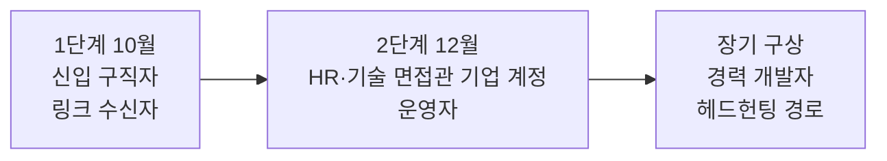
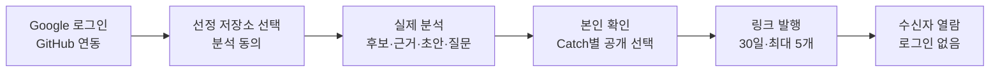
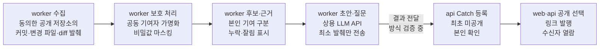

# CatchU 프로젝트 기획서 (기획발표용)

| 항목 | 내용 |
|---|---|
| 팀명 | Jaemin_AI |
| 과제명 | 이력서-채용공고 텍스트 매칭 시스템 (학교 등록명) |
| 서비스명 | CatchU (캐치유) |
| 주제 구분 | 인공지능사관학교 파이널 프로젝트 |
| 발표 | 2026년 10월 1~2일 중간 발표 |
| 팀원 | 이재민(팀장) · 이영연 · 최수영 · 이채아 |
| 문서 버전 | v1.0 |
| 작성일 | 2026-09-28 |
| 기준 | `origin/dev` 9093d2e |
| 문서 지위 | 현행 갱신판 (9/4 기획발표판 v0.3 기준 갱신). 요약판(`01_프로젝트기획서_요약.md`)과 같은 사실·수치를 쓰고, 기획발표 양식의 외부 환경·시장·STP·일정표·참여 인원·피드백 반영 절을 더했다 |

## 변경 이력

| 버전 | 날짜 | 내용 |
|---|---|---|
| v0.3 | 2026-09-03 | 기획발표판 (2026-09-04 기획발표용) |
| v1.0 | 2026-09-28 | 현행 갱신. AI-DLC로 승인한 요구사항(2026-09-11)과 10월 MVP 산출물(2026-09-14~24), 12월 범위 보완(팀장 결정 입력)에 맞춰 범위·용어·기술·역할·성과지표를 고쳤다. 외부 환경 분석(PEST), 국내 시장 현황, STP, 월별 일정표, 9/4 발표 피드백 반영 내역을 새로 넣었다 |

이 문서의 'AI-DLC'는 AI가 단계별 산출물을 만들고 사람이 단계마다 승인하는 개발 절차다. 팀은 요구사항·설계·계약의 승인 기록에 쓴다. 'FR'·'NFR'은 승인 요구사항의 기능·비기능 요구사항 ID, 'OQ'는 같은 문서의 미결 항목 ID다.

9/4 기획발표판에서 바뀐 사실은 다음과 같다.

| 항목 | 9/4 기획발표판 (v0.3) | 현행 (v1.0) |
|---|---|---|
| 핵심 자산 이름 | 증거카드 | Catch (제목·근거·짧은 설명 초안·생각해볼 질문) |
| 로그인·분석 대상 | GitHub OAuth로 연결한 공개 저장소 | Google 로그인 → 별도 GitHub 연동 → 저장소별 분석 동의. 10월은 팀이 사전 선정한 공개 저장소만 |
| 인프라 | AWS(ECS·Aurora·S3), GitHub Actions CI/CD | 네이버 클라우드 플랫폼(NCP) 수동 배포, PostgreSQL·TypeORM·Redis. 자동 배포는 10월 범위 밖 |
| 범위 구성 | 구직자·기업·운영 기능을 한 계획에 | 1단계 10월 MVP(구직자 → 링크 → 수신자), 2단계 12월(대표 구성·서류·JD·기업·소셜·MCP·운영) |
| 어필 프리셋 | 주장 + 근거 카드 한 벌, 여러 벌 | 대표 구성(대표 주장 1개 + Catch 2~3장)으로 바꾸고 12월 1순위로 이동 |
| 공고 렌즈 | 공고 JD에 해당하는 카드 대조 | JD 한 장 요약·사이드 패널·질의응답(12월). 매칭 % 없음 |
| 카드 탐색 3층·링크 열람 기록 | 포함 | 보류 |
| 9/24 결정 | 없음 | Catch마다 제목(title), 공개 상태는 공개·미공개 두 가지, 내 자산은 Catch 탭 하나 + 저장소 연결 관리 모달 |
| 역할 | 팀장 백엔드·인프라, 팀원 3인 프론트엔드 주 담당 | 9/17 기능 영역별 재배분, 전원 풀스택 |
| 성과지표 | KPI 4개 + 최소 조건 | 승인 요구사항의 필수 조건(근거 링크 유효율 100%·타인 기여 오귀속 0건)과 사용자 조사가 공식. KPI 4개는 측정 계획 초안 |
| 일정 | 중간 발표 9/30, 최종 발표 12/18 (발표 슬라이드 일정표) | 중간 발표 2026-10-01~02, 최종 발표 2026-12-10 |

기술 구성도·기술 선정 근거·PoC 상세는 `11_시스템구성_기술검토.md`, WBS·진척·남은 마일스톤은 `12_진행현황.md`, 요구사항 전체는 `03`·`04` 요구사항 정의서가 맡는다. 이 문서에서는 요약하고 해당 문서를 가리킨다.

## 1. 요약표

| 항목 | 내용 |
|---|---|
| 팀명 | Jaemin_AI |
| 과제명 | 이력서-채용공고 텍스트 매칭 시스템 |
| 서비스명 | CatchU (캐치유) |
| 주제 구분 | 인공지능사관학교 파이널 프로젝트 |
| 아이디어 주제 | GitHub API와 LLM 기반으로 개발자의 커밋 기록에서 근거 링크가 붙은 경험 카드(Catch)를 만들고, 구직자가 확인·공개한 자료를 채용 담당자에게 링크로 전달하는 채용 근거 공유 서비스 |
| 한 줄 요약 | 점수 대신 근거. 시스템은 근거를 찾아 보여 주고 판단은 사람이 한다 |
| 과제명과 서비스의 관계 | 이력서와 채용공고의 '매칭'을 적합도 %·점수·순위로 하지 않는다. JD(채용공고의 직무 요건)를 기준으로 구직자의 GitHub 근거와 서류에서 관련 대목을 찾아 대조해 보여 주고(12월 JD 기능), 적합 여부의 판단은 읽는 사람이 한다 |
| 기술 | Next.js · NestJS · FastAPI(Python) · PostgreSQL(TypeORM) · Redis · GitHub API · 상용 LLM API(선정 전) · NCP |
| 기간 | 2026-08-03 시작 · 기획발표 2026-09-04 · 중간 발표 2026-10-01~02 · 최종 발표 2026-12-10 |

### 1-1. 팀원 및 역할

| 이름 | 담당 영역 (2026-09-17 재배분) | 비고 |
|---|---|---|
| 이재민 (팀장·팀원 1) | 분석 결과 생성(GitHub 수집·근거·설명 초안), NCP 배포·복구, 통합, DB 기반 | 기획 총괄, AI-DLC 공통 조율 |
| 이영연 (팀원 2) | 회원·프로필·GitHub 연동, 분석 요청·진행 상태, 인증 기반 | 풀스택 |
| 최수영 (팀원 3) | 공유 링크·수신자 열람, 본인 홈·저장소 연결 관리, 공통 오류 | 풀스택 |
| 이채아 (팀원 4) | Catch 등록·확인·공개 (내 자산 화면) | 풀스택 |

맡은 산출물·이슈와 경험은 9장에 적었다.

## 2. 외부 환경 분석 (PEST)

CatchU가 기대는 외부 변화를 정치·법제, 경제, 사회, 기술 네 갈래로 본다. 수치는 공공 조사와 공식 발표에서 확인한 것만 쓰고, 기업이 낸 자료는 그렇다고 표시했다. 각 절의 '해석'은 팀의 판단이며 검증된 효과가 아니다.

### 2-1. 정치·법제 (P)

| 관찰 | 내용 | 출처 |
|---|---|---|
| 국내 AI 기본법 시행 | 「인공지능 발전과 신뢰 기반 조성 등에 관한 기본법」(법률 제20676호)이 2025-01-21 공포, 2026-01-22 시행됐다. 채용·대출 심사처럼 기본권에 큰 영향을 주는 영역의 AI를 고영향 AI로 다루고, 해당 제품·서비스는 AI 기반임을 이용자에게 미리 알려야 한다. 정부는 1년 이상 계도 기간을 운영한다 | 국가법령정보센터, 법무법인 세종 뉴스레터(2026-02-11) |
| 해외 규제 | EU AI Act는 채용·선발에 쓰는 AI(지원서 분석·필터링, 후보 평가)를 고위험 AI(부속서 III 제4항)로 분류한다 | EU AI Act 부속서 III |
| 팀의 자료 원칙 | 구직자가 분석에 동의한 공개 저장소만 분석한다(FR1.1·FR1.2). 외부 AI에는 최소 발췌만 보내고, 약관으로 학습 미사용이 보장된 유료 API 등급만 쓴다(NFR2). 크롤링은 하지 않는다(9/4 기획서 원칙 유지) | 승인 요구사항, 9/4 발표 자료 |

- **해석:** 채용에 쓰는 AI가 판단·평가를 대신할수록 고지·설명·사람의 감독 요구가 커지는 방향이다. CatchU가 점수·판정을 내지 않고 근거를 보여 주는 설계는 이 방향과 같다. 다만 CatchU가 법상 고영향 AI에 해당하는지는 판단하지 않았다.

### 2-2. 경제 (E)

| 관찰 | 수치 | 출처 |
|---|---|---|
| 전체 구인·채용 인원 감소 | 2025년 3분기 구인인원 120만 6천 명(전년 동기 대비 9만 명 감소), 채용인원 110만 5천 명(6만 8천 명 감소). 전 산업·1인 이상 사업체 기준이며 개발 직군만의 수치가 아니다 | 고용노동부 「2025년 하반기 직종별사업체노동력조사」, 2025-12-30 발표 |
| 기업의 신규채용 계획 | 100인 이상 기업 500개사 중 66.6%가 2026년 신규채용 계획이 있다고 답했다(전년 60.8%) | 한국경영자총협회 「2026년 신규채용 실태조사」, 2026-03-10 발표 |
| 기업이 먼저 찾아 연락하는 채용 | 헤드헌팅 활용 경력직 81.9%·신입 61.2%, 다이렉트 소싱 경력직 51.2%·신입 42.4%. 다이렉트 소싱을 쓰는 이유는 업무성과·평판 검증 35.1%, 직무 적합성 확보 33.2% | 고용노동부·한국고용정보원 「2024년 하반기 기업 채용동향조사」 2차 결과, 2025-03-30 보도 |

- **해석:** 전체 구인 인원은 줄었고(2025년 3분기) 신규채용 계획이 있는 기업 비율은 늘어(2026년) 채용 여건을 한 방향으로 단정할 수 없다. 다만 기업이 직접 찾아 나설 때 가장 많이 든 이유가 '업무성과·평판 검증'이라는 점은 검증할 수 있는 근거 자료의 수요를 뒷받침한다.

### 2-3. 사회 (S)

| 관찰 | 수치 | 출처 |
|---|---|---|
| 신입에게도 직무 경험을 묻는다 | 신규채용 시 가장 중요한 평가 요소 1위 "직무 관련 업무 경험" 67.6%, 2026년 채용 트렌드 1위 "직무중심 채용 강화" 72.2% | 한국경영자총협회 「2026년 신규채용 실태조사」, 2026-03-10 발표 (100인 이상 기업 500개사, 2026.1.19~2.11 조사) |
| 수시채용이 표준이 됐다 | 수시채용만 실시 54.8%, 정기공채와 병행 35.0%, 정기공채만 10.2% | 같은 조사 |
| 서류 문장의 신호가 약해진다 | AI로 작성된 것으로 추정되는 자기소개서 비율 2024년 48.5% → 2025년 64.4%, 전 문항 AI 작성 추정 8.9% → 20.6%. AI 서류평가 업체가 자사 탐지 도구로 낸 추정치이며 공공 통계가 아니다 | 무하유 「2026 AI 채용 트렌드 리포트」, 벤처타임즈 2026-01-08 보도 |
| 국내 링크드인의 규모 | 등록 회원 500만 명(인구의 9.7%). 월간 활성 이용자가 아니라 총 등록 회원 수다 | DataReportal 「Digital 2026: South Korea」, 2025-11-08 |

- **해석:** 경험을 묻는 채용은 늘었는데, 경험을 말하는 서류 문장은 누가 썼는지 가리기 어려워지고 있다. 원본 작업 기록으로 이어지는 자료의 가치가 커진다고 본다. 경력을 보여 주는 프로필 채널인 링크드인의 국내 등록 규모는 인구의 9.7%다.

### 2-4. 기술 (T)

| 관찰 | 수치·내용 | 출처 |
|---|---|---|
| 개발 활동이 GitHub에 쌓인다 | 전 세계 GitHub 개발자 1억 8천만 명 이상, 지난 1년 신규 3,600만 명 이상. 한국 GitHub 개발자 계정 266만 개, 1년 새 45만 개(20%) 증가. 계정 수이며 실제 인원·활동 개발자 수와 같지 않다 | GitHub 「Octoverse 2025」(2025-10-28), 한국 수치는 e4ds news 2025-10-30 보도 |
| AI 코딩 도구가 보편화됐다 | GitHub 신규 개발자의 80% 가까이가 가입 첫 주에 Copilot을 쓴다 | GitHub 「Octoverse 2025」 |
| AI 결과를 그대로 믿지는 않는다 | 개발자 84%가 개발에 AI 도구를 쓰거나 쓸 계획이지만, 45.7%는 AI 출력의 정확성을 신뢰하지 않는다 | Stack Overflow 「2025 Developer Survey」, 2025-07-29 발표 |
| ATS가 외부 AI와 연결된다 | 국내외 ATS가 MCP로 외부 AI 도구와 연결되는 흐름(그리팅·나인하이어·Greenhouse·Ashby) | 팀 조사(ATS 경쟁사 분석, 2026-08-27, 개편 전 자료) |

- **해석:** 완성된 코드만으로는 누가 어떻게 만들었는지 보기 어려워진다. 커밋 시간순 기록에 남는 판단의 흔적은 그래도 사람에게 남는 층위라고 본다(9/4 가설, 미검증). LLM은 기록을 읽고 요약하는 비용을 낮췄지만, 출력을 그대로 믿기 어렵다는 점도 분명하다. 그래서 CatchU는 설명마다 근거 링크를 붙이고 발췌로 확인되지 않는 사실은 쓰지 않게 제한한다.

### 2-5. 종합

| 요인 | 기회 | 위협 | CatchU의 대응 |
|---|---|---|---|
| 정치·법제 | 채용 AI에 설명·사람 감독을 요구하는 흐름 | 채용 AI 규제 강화, 개인정보·외부 AI 전송 부담 | 점수·판정 없음(금지 행동으로 검사), 동의 기반 분석, 최소 발췌·학습 미사용 등급만 사용 |
| 경제 | 직접 발굴·검증 수요(다이렉트 소싱 이유 1위 업무성과·평판 검증) | 구인 인원 감소로 기업의 새 도구 도입 여력이 줄 수 있다 | ATS를 대체하지 않고 링크로 옆에 선다. 수신자는 로그인·가입 없이 연다 |
| 사회 | 직무 경험 중시(67.6%), 수시채용 확산 | 서류 신뢰 하락. 기업이 먼저 찾는 채용은 신입보다 경력에서 많다(다이렉트 소싱 신입 42.4%·경력 51.2%) | 원본 근거로 이어지는 Catch, 무엇을 보여 줄지는 구직자가 결정 |
| 기술 | GitHub 기록 축적, LLM으로 요약 비용 하락, MCP 연결 | AI 출력 오류. GitHub 연동과 LLM 요약만으로는 따라 하기 쉽다(팀 판단) | 근거 링크·기여 귀속 품질을 필수 조건(NFR3)으로 두고 검증. 판단의 흔적을 담는 Catch 구조로 차별화 |

## 3. 국내 시장 규모 및 현황

### 3-1. 채용 수요와 방식

| 지표 | 수치 | 의미 | 출처 |
|---|---|---|---|
| 신규채용 계획 기업 비율 | 66.6% (100인 이상 500개사 응답 중) | 표본 비율이며 전체 기업 수로 늘려 계산하지 않는다 | 한국경영자총협회, 2026-03-10 |
| 채용 방식 | 수시채용만 54.8%, 병행 35.0%, 정기공채만 10.2% | 수시채용을 하는 기업이 89.8%로, 연중 필요한 때 사람을 찾는다 | 같은 조사 |
| 가장 중요한 평가 요소 | 직무 관련 업무 경험 67.6% | 증명할 경험의 수요 | 같은 조사 |
| 채용 경로 | 채용공고 활용 신입 88.1%·경력 83.7%, 헤드헌팅 신입 61.2%·경력 81.9%, 다이렉트 소싱 신입 42.4%·경력 51.2% | 공고와 함께 기업이 먼저 찾는 경로가 넓게 쓰인다. 매출 상위 500대 기업 중 387개 응답 기준 | 고용노동부·한국고용정보원, 2025-03-30 보도 |
| 전체 구인 인원 | 2025년 3분기 120만 6천 명(전년 동기 대비 9만 명 감소) | 전 산업 기준으로 구인 규모가 줄었다. 개발 직군만의 수치가 아니다 | 고용노동부, 2025-12-30 |

채용 실무는 팀이 직접 한 인터뷰로 확인했다(팀 내부 기록).

- **현직 기술 면접관 (2026-08-27):** "GitHub를 봐야 한다고 생각하지만 실제로는 거의 보지 못한다." 채용 과정에서 보는 것은 포트폴리오 중 관심 가는 프로젝트의 README 정도다. 9/4 기획발표 정리본(AI 요약)은 이 면접관의 입장을 "근거를 가져오면 판단은 내가 한다", 곧 AI 판정을 믿기 어렵다는 것으로 적었다.
- **인사담당자 인터뷰 (2026-08-27)·HR 멘토 멘토링 (2026-08):** JD에 맞는 인재를 찾기 어렵고 오래 걸리며, JD의 기술 스택을 이해하기 어려워 확인에도 시간이 든다. 이력서 1건 검토는 10분 이내라고 했다(HR 멘토 한 사람의 발언이며 통계가 아니다). 필터링에 쓸 근거와 기술 대조를 원했고, 적합도를 %로 보여 주는 기능에 관심을 보였다. 합격·불합격 결정을 AI에 맡기는 것에는 부담을 표시했다(개편 전 조사 문서의 인터뷰 기록).
- 인터뷰는 문제를 파악한 배경이다. 모든 채용 담당자의 특성이나 CatchU의 검증된 효과로 일반화하지 않는다.

### 3-2. 대상 사용자 규모

금액 기준 시장 규모 대신, 확인된 사용자 규모 지표를 단계별로 놓았다. 확인하지 못한 칸은 비워 두지 않고 "미확인"으로 적었다.

| 범위 | 지표 | 수치 | 한계 |
|---|---|---|---|
| 개발 활동 기록이 있는 사람 (상한) | 한국 GitHub 개발자 계정 | 266만 개, 1년 새 45만 개 증가 | 계정 수. 중복·비활동 계정과 비개발자 계정이 섞일 수 있다 |
| 경력을 온라인 프로필로 보여 주는 사람 | 국내 링크드인 등록 회원 | 500만 명(인구 9.7%) | 등록 회원 수이며 개발자만의 수가 아니다 |
| 1단계 표적: 공개 저장소에 프로젝트 기록이 있는 신입·취업준비 개발자 | — | 미확인 | 공공 통계로 확인하지 못했다 |
| 초기 사용자 (구상) | 인공지능사관학교 수료생 | 미확인 | 승인 요구사항의 가정(A1). 실제 참여자·이용자 확보는 OQ15에서 확인 |
| 2단계 표적: 개발 직군을 채용하는 IT 기업의 HR(30~150명 규모)·개발팀장(30~300명 규모) | — | 미확인 | 페르소나 P2·P3의 대상 정의 |

### 3-3. 유사 제품 현황 및 비교

2026-08 팀 조사 기준(개편 전 자료: JD 적합도 기능 벤치마킹 2026-08-31, ATS 경쟁사 분석 2026-08-27)이다. GitRoll의 기능 표기는 2026-09-28 공식 사이트에서 다시 확인했다.

| 서비스 (유형) | 주요 기능 | 장점 | 단점 (CatchU 관점) |
|---|---|---|---|
| GitRoll (점수형 GitHub 분석) | GitHub 연결 뒤 점수(Merit-based Score)·등급(Global Tier)·순위(GitHub Rank)·기술 스택·저장소 분석 제공 | "1 click, 2 steps"로 빠르게 결과를 받는다. 기술 스택을 한눈에 요약한다 | 결론이 점수·등급이라 어느 기록이 근거인지 열어 보기 어렵다. 판정 주체가 시스템이다 |
| 그리팅 AI 서류평가 (국내 ATS 내장형) | 담당자가 입력한 선호·비선호 조건으로 지원서를 100점 만점 점수화. 부분 일치 항목은 "면접에서 확인해보세요"로 표시. 자동 합불 처리 없음 | 조건별 근거를 표시하고 면접 질문으로 잇는다. ATS 흐름 안에서 바로 쓴다 | 조건을 담당자가 직접 써야 해 JD를 이해하기 어려운 HR에게 부담이다. 공식 문서가 밝힌 대로 이력서 안의 객관 정보만 평가 근거로 쓰므로, 저장소의 실제 작업은 근거가 되지 못한다 |
| 라운드HR (국내 ATS) | JD 기반 스크리닝 조건 추천, 적합·불확실·부적합 분류, 이력서 근거 문장·추천 질문 제시 | 근거 문장과 면접 질문을 함께 준다. 지원자 마이페이지로 진행 상황을 알린다 | 이력서 요약 중심이다. 저장소 기여·기술 선택 같은 실제 작업 증거는 다루지 않는다 |
| LinkedIn (프로필·소싱 플랫폼) | 자기 서술 프로필, 기업의 검색·연락, 인맥 네트워크 | HR이 후보를 직접 검색·연락하는 경로로 쓴다(HR 인터뷰). 네트워크 효과가 크다 | 본인이 쓴 문장이라 근거를 확인할 수 없다. 국내 등록 회원은 500만 명(인구 9.7%, 활성 이용자가 아닌 등록 회원 기준)이다 |
| **CatchU** | GitHub 기록에서 근거 링크가 붙은 Catch 생성 → 본인 확인·공개 → 링크 전달(10월). JD 기준 근거 대조·기업 검색·MCP(12월) | 설명 문장이 원본 근거로 이어진다. 무엇을 보여 줄지 구직자가 정한다. 기업 ATS 옆에서 링크로 동작한다 | 점수로 빠르게 거르는 용도에는 맞지 않는다. 근거 일치·기여 귀속 품질을 계속 검증해야 한다 |

같은 조사에서 본 시장 흐름은 두 가지다. JD 적합도를 점수로 보여 주는 기능은 국내 ATS에 이미 상용화돼 있고, 조사한 사례 모두 자동 합불 처리는 하지 않으며 점수에 근거를 함께 붙인다. 또 ATS의 경쟁 단위가 지원자 관리 화면에서 외부 AI 도구와의 연결(MCP)로 옮겨 가고 있다. CatchU는 점수 쪽이 아니라 근거 쪽에, ATS 안이 아니라 ATS 옆에 선다.

### 3-4. 시장 규모 산정의 한계

- **금액 규모:** 채용 플랫폼·HR테크 시장의 금액 규모는 정부·공공기관·협회 자료로 확인하지 못해 싣지 않았다. 확인된 것은 민간 기업의 추정치뿐이었다.
- **9/4 발표 답변의 '2026년 공채 예정 기업 약 54%':** 발표 당시 답변이며(AI 요약본 표기) 원 출처를 찾지 못했다. 같은 경총 조사에서 확인되는 값은 "수시채용만 54.8%, 병행 35.0%, 정기공채만 10.2%"이므로 이 문서는 확인된 값을 쓴다.
- **개편 전 조사의 수치:** 개편 전 팀 조사에 있던 채용 담당자 설문 수치(이력서 10분 이내 검토 비율, 개인 깃허브 확인 비율)는 원문을 확인하지 못해 싣지 않았다.

## 4. STP

### 4-1. 세분화 (Segmentation)

구직자는 경력 단계와 공개 코드 기록의 유무로, 기업은 규모·채용 방식과 역할(HR·기술 면접관)로 나눴다. 근거는 페르소나 P1~P4(가명)와 승인 문서다.

| 쪽 | 세그먼트 | 특징 | 판단 | 근거 |
|---|---|---|---|---|
| 구직자 | 신입·취업준비 개발자, 공개 저장소에 프로젝트 기록 있음 | 파이널 프로젝트 하나로 모든 기업에 지원한다. 커밋은 남겼지만 다시 꺼내 정리해 본 적이 없다 | **1단계 표적** | 승인 의도문(초기 대상 신입·취업준비생), P1 |
| 구직자 | 경력 개발자, 공개 기록 있음 | 기업의 헤드헌팅·다이렉트 소싱 대상이다(경력직 헤드헌팅 81.9%) | 2단계 이후 | P2 설계 노트, 고용노동부 조사 |
| 구직자 | 경력 개발자, 회사 코드가 비공개라 공개 기록 부족 | 증명 수단이 막혀 있다 | 제외(우선순위 낮음, 8/31 결정) | P1 |
| 구직자 | 공개 코드 기록이 없는 구직자, 이력서-공고 텍스트 매칭만 원하는 사람 | 연결할 저장소가 없으면 Catch가 성립하지 않는다 | 제외(요약형 서비스의 고객) | P1 |
| 기업 | 30~150명 규모 IT 기업, HR 1~2인이 개발 채용을 겸함 | 후보를 수작업으로 검색·연락하고, JD의 기술 요건을 이해하기 어렵다 | 2단계 표적(P2) | P2 |
| 기업 | 30~300명 규모 IT 기업의 개발팀장(기술 면접관) | GitHub를 봐야 한다고 생각하지만 거의 보지 못한다. 판단은 직접 하려 한다 | 1단계는 링크 수신자로, 2단계 표적(P3) | P3, 인터뷰 |
| 기업 | 대기업 공채 HR, 소싱 전담 조직 | 지원자가 몰려 발견 도구보다 선별 도구가 필요하다 | 제외 | P2 |
| 기업 | 사내 비공개 코드 중심 도메인, GitHub를 평가에 쓰지 않는 기업 | 지원자의 공개 코드가 없거나 쓰지 않는다 | 제외 | P3 |

### 4-2. 표적 (Targeting)

| 단계 | 표적 | 고른 이유 | 제공하는 것 |
|---|---|---|---|
| 1단계 (10월) | **구직자** — 신입·취업준비생 개발자(P1 한지우). **링크 수신자** — 링크를 받은 채용 담당자(HR·기술 면접관) 등, 로그인하지 않음 | 매칭이 없어도 가치가 성립한다(경험 재발견·근거·링크 전달). 승인된 10월 범위다 | 동의한 저장소에서 경험 후보·근거·짧은 설명 초안·생각해볼 질문을 확인하고, 고른 Catch만 공개해 링크로 전달. 수신자는 기본 프로필과 현재 공개 Catch, 그 근거인 GitHub 원본 링크를 로그인 없이 연다 |
| 2단계 (12월, 미승인 계획) | **기술 면접관(HM)** P3 김도윤, **HR·리크루터** P2 박서연, **운영자** P4 이현우 | 12월 JD 기능·기업 기능·운영 기능의 사용자다 | HM: JD 기준 한 장 요약·근거 확인·질의응답(점수·순위 없음). HR: 조건 검색(검색 참여에 동의한 구직자만, 순위 없음)·채용 제안·수락 후 DM, 기업 JD 프리셋. 운영자: 자동 처리 우선, 관리자 지표·신고 처리 화면 |
| 장기 (구상) | 경력 개발자와 이들을 찾는 기업 | 지금 가입한 신입이 경력자가 되면 소싱 대상이 된다는 팀의 시간축 논리(P2 설계 노트, 미검증) | 12월의 기업 검색·채용 제안·기업 MCP가 헤드헌팅 경로가 된다 |

- **초기 사용자:** 인공지능사관학교 수료생을 고려한다. 페르소나 P1은 수료 기수 단톡방에서 서비스를 알게 되는 경로를 가정한다. 실제 참여자 확보는 확인 전이다(OQ15).
- **표적 사이의 어긋남을 인정한다:** HR이 소싱하는 대상은 주로 경력 개발자이고, 1단계 구직자는 신입이다. 그래서 1단계는 구직자가 자신을 증명하는 도구로 가치를 내고, 검색·소싱은 사용자가 쌓인 뒤 작동한다고 본다(P2 설계 노트). 승인 요구사항도 가용량이 부족하면 검색·소싱의 완성도를 먼저 줄여 검토하도록 했다.

### 4-3. 포지셔닝 (Positioning)

두 축으로 놓았다. 가로축은 판정을 누가 하는가, 세로축은 설명에서 원본 근거까지 열어 볼 수 있는가다.

| 근거 열람 / 판정 주체 | 시스템이 판정 (점수·등급·순위) | 시스템이 점수·분류 제시, 결정은 사람 | 사람이 판정 (시스템은 재료만) |
|---|---|---|---|
| 원본 작업 기록까지 열람 | — | — | **CatchU** (Catch → GitHub 원본 커밋) |
| 이력서 속 근거 문장 제시 | — | 그리팅 AI 서류평가, 라운드HR | — |
| 근거를 열어 보기 어렵거나 자기 서술 | GitRoll | — | LinkedIn, 채용공고 플랫폼 |

- **포지셔닝 문장:** GitHub 기록으로 자신을 증명해야 하는 신입 개발자와 그 증명을 짧은 시간에 확인해야 하는 채용 담당자에게, CatchU는 설명마다 원본 근거가 붙은 Catch를 링크 하나로 전달하는 채용 근거 공유 서비스다. 점수형 GitHub 분석·ATS의 AI 평가와 달리 판정은 사람이 하고, 자기 서술 프로필과 달리 문장마다 원본 기록이 붙는다.
- **판별 기준 (9/4 유지):** "점수 모델이 이 문장을 쓸 수 있는가." 쓸 수 있으면 CatchU의 것이 아니다.
- **포기한 것:** HR 인터뷰에서는 JD 적합도를 %로 보여 주면 유용하겠다는 의견이 있었다(JD 적합도 기능 벤치마킹, 2026-08-31). 팀은 기술 면접관의 입장("판단은 내가 한다")을 따라 적합도 % 표시를 채택하지 않았고(8/31), 승인 요구사항은 이를 금지된 행동으로 정했다. 대신 12월 JD 기능에서 JD 기준 관련 대목과 근거를 정리해 보여 준다. 이 선택으로 HR이 원하는 것을 온전히 주지 못하는 한계가 있다(P2 설계 노트).

그림 1. 단계별 표적의 확장

## 5. 필요성·차별성·기대효과·활용방안

### 5-1. 문제 정의

- **기업 쪽:** 기술 면접관은 지원자가 실제로 무엇을 했는지 확인하고 싶지만, 개발 업무와 채용을 병행하느라 GitHub까지 볼 시간이 없다. HR은 JD의 기술 요건을 이해하기 어려워 맞는 인재를 찾고 확인하는 데 시간이 든다.
- **구직자 쪽:** 개발자 본인도 자신이 무엇을 했는지 다시 꺼내지 못한다. 커밋은 남아 있지만 "그때 왜 그렇게 결정했는지"를 다시 묶어 본 적이 없고, 팀 프로젝트에서는 내 몫이 흐릿하다. 그래서 이력서에는 "React로 쇼핑몰을 만들었습니다"만 남는다.
- **공통 원인:** GitHub에 기록은 있는데 읽히지 않는다. 기록은 시간순 커밋 로그이고, 사람이 알고 싶은 것은 "무엇을 했고 어느 기록이 그 근거인가"다.
- **기존 도구의 빈자리:** 점수형 분석과 ATS의 AI 평가는 결론(점수)을 주지만 근거를 열어 보기 어렵고, 프로필 서비스는 본인이 쓴 문장이라 근거가 없다(3-3).

### 5-2. 필요성

- 기업은 직무 경험을 가장 중시하고(67.6%) 수시채용과 직접 발굴로 사람을 찾는다. 구직자에게는 경험을 증명할 수단이, 기업에게는 그 증명을 짧은 시간에 확인할 수단이 필요하다.
- 기업이 직접 찾아 나설 때 가장 많이 든 이유는 업무성과·평판 검증(35.1%)과 직무 적합성 확보(33.2%)다. 확인할 수 있는 근거가 필요한 자리다.
- 두 수단의 재료는 GitHub에 있지만, 인터뷰에서 확인한 대로 채용 과정에서 거의 열리지 않는다. 한편 서류 문장은 AI 작성이 늘어 신호가 약해지고 있다(업체 추정치).
- 필요한 것은 결론을 대신 내리는 점수가 아니라, 근거를 찾아 한 번에 열어 볼 수 있게 정리하는 도구다. CatchU는 이 자리를 채운다.

### 5-3. 차별성

1. **점수가 아니라 근거.** 매칭 %·점수·순위·등급을 내지 않는다. 승인 요구사항은 이를 금지된 행동으로 정했다. Catch의 설명은 근거가 된 커밋에 연결되고, 발췌로 확인되지 않는 사실은 "제공된 발췌에서 확인할 수 없음"으로 제한한다.
2. **무엇을 보여 줄지는 구직자가 정한다.** 분석 결과는 처음에 미공개이고, 본인이 근거를 확인한 뒤 Catch마다 공개를 고른다. 숨기면 이미 보낸 링크에도 다음 조회부터 반영된다. 결과물이 아니라 판단의 흔적을 담는 Catch 4구획(무엇을 했나 / 판단의 흐름 / 궤적 및 기록 / 기록에 없는 것) 방향은 유지하되, 10월은 근거·짧은 설명 초안·생각해볼 질문부터 제공한다.
3. **ATS를 대체하지 않고 옆에 선다.** 구직자는 링크를 보내고 수신자는 로그인 없이 연다. 지원 접수와 전형은 기업의 기존 ATS에서 한다. 국내외 ATS가 MCP로 외부 AI 도구와 연결되는 흐름(그리팅·나인하이어·Greenhouse·Ashby, 2026-08 조사)에 맞춰 12월에는 CatchU도 MCP를 제공한다.

### 5-4. 기대효과

| 대상 | 기대효과 | 확인 방법과 한계 |
|---|---|---|
| 구직자 | 잊고 있던 경험을 근거와 함께 다시 찾고, 팀 프로젝트에서 본인 기여를 구분한 자료를 갖는다. 한 번 정리한 Catch를 여러 지원에 링크로 다시 쓴다 | 사용자 조사(FR10.6)와 KPI 초안의 경험 회수율로 확인한다. 현재 미검증 |
| 링크 수신자 (HR·HM) | 이력서 문장을 믿을지 고민하는 대신 링크 하나로 공개 Catch와 GitHub 원본 근거를 확인하고, 면접에서 확인할 지점을 스스로 고른다 | HM 업무 효과는 HM이 조사에 참여할 때만 확인하며, 참여하지 못하면 미검증으로 남긴다 |
| 양쪽 | 판정을 시스템이 하지 않으므로 "AI가 나를 평가했다"는 반발과 AI 점수에 대한 불신을 줄이는 것을 목표로 한다 | 인터뷰의 HM 입장에 근거한 설계 판단이며 효과는 미검증이다 |

### 5-5. 활용방안·확장

- **대상 확장:** 신입·취업준비생 → 경력 개발자. 12월의 기업 검색·채용 제안·기업 MCP가 헤드헌팅 경로가 된다.
- **연결 확장:** MCP로 구직자의 LLM과 기업의 ATS·AI 도구에서 CatchU 데이터를 같은 권한 규칙으로 쓴다.
- **저장소 확장:** GitHub → GitLab 등.
- **사용자층 확장:** AI 보편화로 개발자가 아닌 사람의 GitHub 활용이 늘면 대상을 넓힐 수 있다(9/4 Q&A).
- **용도 확장:** Catch는 채용 밖에서도 개발자 본인의 회고·성장 기록으로 남는다.

## 6. 개발 목표·내용

### 6-1. 개발 목표

GitHub에 흩어진 개발자의 실제 활동을 근거가 붙은 Catch로 정리해, 구직자는 자신의 경험을 다시 꺼내 골라 전달하고 채용 담당자는 점수가 아닌 원본 근거로 직접 판단하게 한다.

### 6-2. 1단계 — 10월 MVP (승인 범위)

구직자에서 수신자까지 한 흐름을 실제 서비스(NCP 외부 URL)에서 완주하는 것이 목표다. 과거 PoC 결과나 모의 응답으로 대신하지 않는다. 기능 묶음 M01~M07은 10월 MVP 범위 문서의 ID다.

그림 2. 10월 MVP 주 경로

| ID | 기능 | 주요 내용 (정량 기준) | 담당 |
|---|---|---|---|
| M01 | 로그인·프로필·GitHub 연동, 저장소 선택·분석 동의 | Google 로그인. GitHub 미연동도 홈에 들어가지만 분석 전에 연동·동의를 확인한다. 팀이 사전 선정한 공개 저장소 목록 안에서만 요청한다. 동의 내용을 버튼 앞에 보이고 버튼 1개로 동의와 요청을 함께 한다. 진행 중 분석은 사용자당 1건 | 이영연, 최수영(화면) |
| M02 | 실제 분석과 경험 후보·근거·짧은 설명 초안·생각해볼 질문 | 실제 저장소 자료로 생성한다. Catch마다 제목 1개(평가하는 말 없이 '무엇을 했나'를 짧게, 구직자 수정 불가)와 근거 1개 이상. 근거가 부족하면 설명 제한·후보 보류로 표시한다 | 이재민(생성), 이채아(등록) |
| M03 | Catch 확인·공개 (내 자산 Catch 탭) | 공개 상태 2가지(공개·미공개), 최초 미공개. 본인 확인 뒤 별도로 공개하고 불일치를 표시할 수 있다. 저장소 필터가 있는 목록과 상세 모달. 설명의 직접 수정·재생성은 없다 | 이채아 |
| M04 | 링크 발행·비로그인 열람 | 대표 구성 없이 발행한다. 제목 필수(수신자에게는 비표시), 유효 링크 최대 5개, 발행 시점부터 30일 고정 만료, 중단, 선택 비밀번호. 수신자는 기본 프로필과 현재 공개 Catch 전체를 보며, 요청마다 현재 권한을 검사한다 | 최수영 |
| M05 | 진행·실패·재요청·중복 방지·자료 보존, 원본 비공개 대응 | 저장소 상태 아이콘 4종(분석 중·성공·부분 실패·실패). 실패는 새 동의로 재요청한다. 재방문이 새 분석을 만들지 않고, 실패해도 기존 자료·링크를 보존한다. 원본이 비공개로 바뀐 것이 확인되면 관련 Catch 열람을 막는다 | 이영연, 최수영, 이채아, 이재민 |
| M06 | 권한·동의·자료 최소화·비밀값 보호·호출 상한, 빈/로딩/실패/권한 안내·기본 접근성 | 타인 자료와 없는 자료를 같은 응답으로 숨긴다. 수신자 응답은 캐시하지 않는다. 공통 오류 형식을 쓴다 | 전원 (공통 오류 최수영) |
| M07 | NCP 수동 배포·외부 URL·자료 영속과 복구·통합 재시험 | 재시작·재배포 뒤에도 자료·공개·링크 상태를 보존하고, 합의한 복구 시나리오의 실행 증거를 남긴다 | 이재민 |

운영 기능(품질 신호·운영 기록 조회·신규 분석과 AI 호출의 전체 중단·재개)은 회의 결정으로 10월 범위에서 뺐고 12월 후순위로 옮겼다.

### 6-3. 2단계 — 12월 (미승인 계획)

12월 범위는 두 갈래다. 표의 **'팀장 결정'**은 12월 범위 보완 문서(`docs/ai-dlc-input-december/CatchU_12월_범위_보완.md`)가 12월 포함으로 정한 항목이다. **'승인 12월 계획'**은 9/11 승인 요구사항이 12월로 둔 항목인데, 12월 범위 보완은 이 가운데 여러 항목(여러 벌의 대표 프리셋, 목록 밖 저장소, 재생성, 조건 검색, 제안·DM, 품질 판정 등)의 포함 여부와 순서를 12월 요구사항 분석에서 다시 정하기로 했다. 12월 작업은 AI-DLC로 요구사항 분석 승인까지 진행하며, 세부 동작도 그때 정한다. 팀장이 밝힌 순서는 대표 구성(1순위)과 운영 기능(후순위, 가능하면 포함) 두 가지다. 가용량이 부족하면 검색·소싱의 완성도를 먼저 줄여 검토한다는 방침이 승인 요구사항에 있다. 모든 항목의 12월 완성을 약속하지 않는다.

| 영역 | 기능 | 근거 |
|---|---|---|
| 구직자 자산 | **대표 구성(1순위):** 대표 주장 작성·수정, Catch 2~3장 선택·교체, 미리보기, 발행 시점 구성 보존. 승인 요구사항에서는 10월 항목이었으나 10월 MVP 범위에서 빠졌다 | 팀장 결정 |
| 구직자 자산 | 여러 벌의 대표 프리셋과 링크별 선택(1순위에 넣지 않음) | 승인 12월 계획 |
| 구직자 자산 | 서류: 자기소개서(텍스트)·포트폴리오(PDF 또는 URL)·이력서(PDF)를 여러 벌 등록하고 링크 발행 때 고른다. 발행 당시 내용 보존 | 팀장 결정 (승인 12월 계획 FR5를 적용) |
| 구직자 자산 | 프로필 상세(학력·경력 등), 본인 카드 검색, 온보딩 | 팀장 결정 |
| 구직자 자산 | 목록 밖 공개 저장소 분석, 서술 오류 Catch의 한도 있는 재생성 | 승인 12월 계획 |
| JD 기능 | JD 한 장 요약·사이드 패널·질의응답. 비로그인 수신자도 JD를 입력해 쓰며 링크 단위 사용 한도를 둔다. 매칭 %는 어떤 질문에도 내지 않는다 | 승인 12월 계획, 팀장 재확인 |
| 기업 | 기업 등록·소속·직책 권한, 회사 프로필, 기업 JD 프리셋(같은 기업 안 공유), 간단한 채용공고(지원은 외부 ATS 링크) | 팀장 결정 |
| 기업 | 조건 검색(검색 참여에 동의한 구직자만, 기본 미노출, 유사도 순위 없음), 채용 제안·수신 통제·개별 차단, 수락 후 텍스트 DM·동의한 연락처 공유 | 승인 12월 계획 |
| 소셜 | 팔로우·포스팅·피드, 구직자끼리의 공개 범위(전체·맞팔), 구직자 간 DM, 알림(분석 완료·실패 포함). 승인 요구사항이 '범위 밖'으로 둔 소셜 기능을 팀장이 12월 포함으로 바꿨다 | 팀장 결정 |
| 연결 | MCP. 구직자는 자기 LLM에서 CatchU 데이터를 이용하고, 기업은 받은 링크 범위와 검색 참여 구직자 탐색을 이용한다. 화면·링크와 같은 권한 규칙을 따른다 | 팀장 결정 |
| 운영 | 운영 기능(후순위): 품질 신호, 운영 기록 조회, 신규 분석·AI 호출 전체 중단·재개, 관리자 지표. 관리자 처리(신고·제재, 기업 등록 관리, 공고 관리), 고객센터 | 팀장 결정 |
| 품질 | 근거·귀속 품질 판정(6-5 공식 지표) | 승인 12월 계획 |
| 과금 준비 | 운영진 지급 마일리지(10장) | 팀장 결정 |

### 6-4. 하지 않는 것

| 항목 | 처리 | 근거 |
|---|---|---|
| 적합도 %·점수·유사도 순위·등급, 검색 무결과를 역량 부재로 판정 | 하지 않는다 (위반으로 검사) | 승인 요구사항 FR6·FR7.4, 금지된 파생 행동 |
| 합격 여부 판정·자동 컷오프, AI 생성 코드 판별 | 하지 않는다. 판단과 진정성 확인은 사람과 면접의 몫 | 9/4 설계 원칙 유지 |
| 지원 접수·전형 관리, ATS 직접 연동 | 하지 않는다. 기업의 기존 ATS와 역할을 나눈다 | 승인 요구사항 범위 밖 |
| 자기소개서·대표 주장 자동 작성과 첨삭, Catch 설명의 직접 수정 | 하지 않는다(현재 미채택). 구직자의 해석은 대표 주장에 쓴다 | 승인 요구사항 FR3.5, 미채택 항목 |
| 동의 없는 분석·비공개 저장소 분석·크롤링, 외부 AI 제공자의 학습 사용 | 하지 않는다 | FR1.1, NFR2 |
| 10월에 서류·JD 기능·기업 검색과 제안·DM·대표 구성·운영 기능·목록 밖 저장소·재생성·자동 배포 | 10월에는 하지 않는다. 12월 포함 또는 12월 요구사항 분석에서 재검토(6-3) | 10월 MVP 범위 문서 |
| 링크 만료 기간의 선택·연장 | 10월에는 하지 않는다(12월 후보) | FR4.5 |
| 만료·중단된 링크 되살리기 | 하지 않는다. 필요하면 새 링크를 발행한다 | 12월 범위 보완 |
| 카드 탐색 3층(Catch → 커밋 원문 → diff 서비스 안 탐색), 링크 열람 기록 | 보류 | 12월 범위 보완 |
| MFA 등 계정 보안 설정, 구직자 신원 인증 | 프로젝트 구현 범위 밖 | 12월 범위 보완 |
| 기업 인증 | 우선순위상 사실상 범위 밖. 제안·DM은 반복 발송 제한과 개별 차단으로 대응한다 | 12월 범위 보완 |
| 마일리지의 현금 구매·환전 | 두지 않는다 | 12월 범위 보완 |

### 6-5. 목표 및 성과지표

#### 6-5-1. 공식 지표 (승인 요구사항 기준)

| 지표 | 기준 | 근거 문구 (요약) | 시점 |
|---|---|---|---|
| 근거 링크 유효율 | 100% (필수 조건) | NFR3: 동의한 정해진 검증 표본·검사 대상 결과에서 근거 링크 유효율 100%, 타인 기여 오귀속 0건을 각 항목의 필수 조건으로 둔다 | 12월 |
| 타인 기여 오귀속 | 0건 (필수 조건) | 위와 같음. 두 지표만으로 전체 통과나 실사용 무오류를 주장하지 않고, 설명의 근거 일치·묶음 오류 판정 기준은 승인 요구사항의 미결 항목 OQ12에서 정한다 | 12월 |
| 사용자 검증 | 만족도·체감 유용성·개선 의견 조사 | FR10.6: 조사와 팀 내부 기능·자료 품질 확인을 분리하고, 직접 사용한 응답과 시연만 본 응답을 구분한다. HM이 참여하지 못하면 HM 업무 효과는 미검증으로 남긴다 | 제공 기능을 검증할 때 |
| 10월 MVP 완료 | M01~M07 전체의 실제 흐름·거부와 실패·보호·배포와 복구 증거 | 10월 MVP 의도문·범위 문서: NCP 외부 URL에서 확인하며, 기능 일부 성공이나 로컬 시연을 전체 완료로 보지 않는다 | 10월 |

'면접관이 5분 안에 작업 내용과 물어볼 지점을 찾는다'는 후속 가설이며 이번 완료 조건이 아니다.

#### 6-5-2. 측정 계획 (초안, 목표값 미정)

`docs/CatchU_KPI_성공기준_v4_1.md`(2026-09-03 초안, 회의 안건 4건 미확정)의 KPI 4개다. 공식 지표가 아니며 측정 일정·표본은 정하지 않았다. 관련 미결은 승인 요구사항의 OQ12(품질 표본·판정)와 OQ15(조사 참여자·문항)다.

| KPI (초안) | 묻는 것 | 계산식 | 측정 방법 |
|---|---|---|---|
| 사실 일치율 (1순위) | AI가 만든 Catch를 믿을 수 있는가 | 근거와 일치하는 Catch ÷ 평가 대상 Catch | Catch를 보기 전에 2명이 GitHub 원본만 보고 독립적으로 쓴 정답표와 대조 |
| 귀속 정확도 | 그 일을 이 사람이 했는가 | 귀속이 맞는 Catch ÷ 팀 프로젝트 Catch | 같은 정답표, 팀 프로젝트 저장소만 대상 |
| 경험 회수율 | 잊고 있던 경험을 되찾아 줬는가 | Catch로 회수한 경험 ÷ 스스로 쓰지 못한 정답표 경험 | 수료생 5명 세션: CatchU 없이 30분 작성 → Catch 열람 → 확인 |
| 근거 확인 성공률 | Catch에서 원본까지 도달하는가 | 원본 도달 성공 ÷ 과제 수 | 위 세션에 병합 |

- **목표값:** LLM 없이 키워드·파일 확장자 규칙만으로 만든 기준선을 먼저 재고, 그보다 얼마나 나은지로 정한다. 사실 일치율이 규칙 기반과 비슷하면 실패로 본다(LLM을 쓸 이유가 없음).
- **KPI로 쓰지 않는 것:** 취업·채용 성공률(관여하지 않는 구간), 기업 실무자의 실제 업무 시간(통제 불가), 클릭·체류·재방문.

## 7. 개발 일정표

2026-09-28 기준이다. ■ 수행(완료), ▶ 진행 중, □ 계획(날짜 확정 전), ◆ 발표·승인일. 원천에 날짜가 없는 계획은 해당 달에 □만 표시하고 날짜를 만들지 않았다.

| 추진 내용 | 담당 | 8월 | 9월 | 10월 | 11월 | 12월 | 비고 |
|---|---|---|---|---|---|---|---|
| 기획·페르소나·그라운드룰 | 전원 | ■ | ■ |  |  |  | 그라운드룰 8/4, 페르소나 P1~P4·KPI 초안 9/1~9/3 |
| 카드 추출 PoC (규칙 기반, 팀장이 참여한 공개 저장소 3개) | 이재민 | ■ |  |  |  |  | 사건 420건·본인 주도 113건, 카드 실물 2장은 사람이 작성, 8/30 회상 실험(n=1) |
| 현직 기술 면접관·HR 인터뷰 | 전원 | ■ |  |  |  |  | 8/27 |
| 방향 전환·개편 전 문서 정리 | 전원 | ■ | ■ |  |  |  | 8월 마지막 주 전환, 9/11 정리 |
| 기획발표 | 전원 |  | ◆ |  |  |  | 9/4 |
| 요구사항 분석·승인 (첫 AI-DLC 작업) | 전원, 조율 이재민 |  | ■ |  |  |  | 9/9~9/11, 9/11 승인 |
| 10월 MVP 목적·실현 가능성·범위·요구사항·설계 승인 | 전원 |  | ■ |  |  |  | 9/14~9/23 승인, 역할 재배분 9/17, API 명세 v1·ERD v1 병합 9/24 |
| PoC 분석·제한 LLM 실험·재검증 | 이재민 |  | ■ |  |  |  | 9/14·9/16·9/17 수행, 9/22 조건부 수용 |
| 화면 흐름 초안·흑백 와이어프레임 v2.2 | 이영연·최수영·이채아 (v2.2 최수영) |  | ■ |  |  |  | 첫 판 9/14~9/15, v2.2 9/23(검토초안, #85 열림) |
| 저장소 뼈대·인증 기반 | 최수영(web)·이영연(api·인증)·이재민(worker) |  | ■ |  |  |  | 뼈대 9/23, 인증 기반 9/27 |
| 공통 기반 (DB·공통 오류·인증 잔여) | 이재민·최수영·이영연 |  | ▶ | □ |  |  | #86·#88·#87 |
| 회원·GitHub 연동·분석 요청·진행 상태 (M01·M05) | 이영연 |  | ▶ | □ |  |  | 9/28 기능 개발 시작 |
| 분석 결과 생성: 수집·근거·설명 초안 (M02) | 이재민 |  | ▶ | □ |  |  | 합성 자료로 먼저 연결, 서비스 LLM은 실제 연결 전에 선정 |
| Catch 등록·확인·공개 (M03) | 이채아 |  | ▶ | □ |  |  | 내 자산 Catch 탭·상세 모달 |
| 링크 발행·수신자 열람, 본인 홈·연결 관리 (M04·M05) | 최수영 |  | ▶ | □ |  |  | 연결 관리 모달 포함 |
| 중간 평가 산출물 | 이재민 |  | ▶ |  |  |  | #125~#128 |
| 중간 발표 | 전원 |  |  | ◆ |  |  | 10/1~2 |
| NCP 수동 배포·복구 검증·통합 재시험 (M07) | 이재민 |  |  | □ |  |  | 10월 MVP 완료 기준에 포함, 완료 날짜 미정. 배포가 늦으면 로컬 실행으로 시연하되 NCP 배포 완료로 기록하지 않는다 |
| 12월 범위 요구사항 분석 (AI-DLC 절차) | 전원, 진행 이재민 |  |  | □ | □ |  | 요구사항 분석 승인까지만 먼저 한다. 시점 미정 |
| 12월 설계·계약·ERD, 12월 기능 개발 | 영역별 (담당 미정) |  |  |  | □ | □ | 10월 MVP 개발 뒤. 대표 구성 1순위, 운영 기능 후순위 |
| v1.0 배포와 테스트 자료 초기화 | 미정 |  |  |  | □ |  | 11월 구상, 확정 아님 |
| 근거·귀속 품질 판정 (NFR3) | 미정 |  |  |  |  | □ | 표본 규모·구성 미정(OQ12) |
| 사용자 조사 (FR10.6) | 미정 |  |  |  | □ | □ | 제공 기능을 검증할 때. 참여자·문항 미정(OQ15) |
| NCP 자료 이전·복구 검증 | 이재민 |  |  |  |  | □ | NCP 계정 사용 기간 12/10까지 |
| 최종 발표 | 전원 |  |  |  |  | ◆ | 12/10 |

- 9/4 기획발표판의 계획과 달라진 점: 설계 완료가 AI-DLC 승인 절차로 9/23이 됐고, 기능 개발은 9/28 시작했다. 배포 대상이 AWS에서 NCP로 바뀌었다(9/13). 사용자 조사 실행과 12월 품질 검증은 10월 MVP 작업 밖으로 뒀다.
- 주차별 계획과 실제, 이슈·PR 진척 통계, M01~M07별 진행, 남은 마일스톤의 선행 관계는 `12_진행현황.md`에 있다.

## 8. 수행 방법

### 8-1. 데이터 출처·수집 방법·데이터 종류

| 데이터 | 출처 | 수집 방법 | 종류·항목 | 시점 |
|---|---|---|---|---|
| GitHub 활동 기록 | GitHub API. 사용자가 GitHub를 연동한 뒤 고르고 동의한 공개 저장소 | 저장소마다 분석 동의를 받은 뒤 서버가 수집한다. 10월은 팀이 사전 선정한 저장소 목록 안에서만 분석한다. 연결 계정이 소유하거나 커밋한 공개 저장소로 넓히는 것은 승인 12월 계획이며, 포함 여부는 12월 요구사항 분석에서 정한다. 수집 방식(API만 또는 Git 병행)과 항목 상세는 설계에서 정한다 | 커밋 메타데이터·메시지·변경 파일과 근거에 필요한 diff 발췌. 전량 복구를 목표로 하지 않고 누락·잘림은 탐지해 설명 범위를 제한한다 | 10월 |
| 분석 결과 | 서비스가 생성 | worker가 만든 결과를 api가 받아 Catch로 등록(최초 미공개) | 경험 후보, 근거 링크, 짧은 설명 초안, 생각해볼 질문, Catch 제목 | 10월 |
| 기본 프로필 | 구직자 직접 입력 | Google 로그인 뒤 본인이 입력 | 직무·기술 스택 등. 자가 입력 출처로 구분하고 GitHub에서 확인한 사실로 표시하지 않는다 | 10월 |
| 서류 | 구직자 직접 등록 | 내 자산의 서류별 탭에서 등록하고 링크 발행 때 고른다 | 자기소개서(텍스트)·포트폴리오(PDF 또는 URL)·이력서(PDF) | 12월 계획 |
| JD | 링크 수신자·기업 계정 입력 | 수신자가 링크 화면에서 입력, 기업은 JD 프리셋으로 저장 | 채용공고의 직무 요건 텍스트 | 12월 계획 |
| 품질 판정용 표본 | 동의받은 정해진 검증 표본 | 12월 품질 판정 계획에서 정한다(표본 규모·구성 미정, OQ12). KPI 초안은 팀 프로젝트를 포함한 평가 저장소 3~5개와 사람이 먼저 쓰는 정답표를 쓴다 | 저장소 기록과 사람이 쓴 정답표 | 12월 계획 |
| 개발용 합성 자료 | 팀이 작성 | 공용 합성 결과 세트로 실제 연결 전에 기능을 잇는다(#103). 과거 실험 자료는 서비스 코드에 쓰지 않는다 | 분석 결과 형식의 합성 데이터 | 10월 |

**수집·전송하지 않는 것:** 비공개·미동의 저장소, 크롤링. 공동 기여자 식별 정보는 가명화하고 비밀값은 마스킹한다. 외부 AI에는 최소 발췌만 보내며, 약관으로 학습 미사용이 보장된 유료 API 등급만 쓴다(NFR2). 로그인·GitHub 연동·분석 동의·Catch 공개는 서로 대신하지 않는다.

**모델 학습을 하지 않는다:** CatchU는 자체 모델을 학습시키지 않고 상용 LLM API를 쓴다. 9/4 Q&A의 '학습 데이터'는 결과 품질을 확인할 검증 데이터를 뜻하며, 11장의 피드백 반영 내역에서 그렇게 다룬다.

그림 3. 분석 데이터 처리 흐름 (10월)

### 8-2. 기능별 수행 방법과 기술

| 기능 | 담당 | 수행 방법 | 프레임워크·라이브러리·외부 API |
|---|---|---|---|
| 화면 전체 (구직자·수신자) | 영역별 담당 | 9/23 흑백 와이어프레임 v2.2와 승인된 기능 설계를 기준으로 각 담당이 자기 화면을 만든다 | Next.js |
| 로그인·회원·GitHub 연동 (M01) | 이영연 | Google 로그인 뒤 CatchU Access JWT로 회원 API를 보호한다(개발용 로그인과 JWT 검증은 9/27 병합). OAuth 세부 경로는 설계 중이다 | NestJS. GitHub 연동은 OAuth App·GitHub App 중 선택 예정 |
| 분석 요청·상태 (M01·M05) | 이영연 | 동의가 담긴 요청을 받아 작업을 넘기고, 화면은 상태를 주기적으로 조회한다. 같은 요청의 중복 처리를 막는다 | NestJS, Redis 기반 작업 큐(전송 방식은 검증 뒤 결정, BullMQ 우선 검증 후보) |
| 수집·근거·설명 초안 생성 (M02) | 이재민 | 그림 3의 순서로 처리한다. 서비스 LLM은 실제 제공자 연결 전에 선정하고, 그 전에는 제공자 비종속 인터페이스와 가짜 생성기로 개발한다 | FastAPI(Python), GitHub REST API, 상용 LLM API(선정 전, 제공자 비종속 인터페이스), PoC의 가명화·사건 묶기 규칙 참조 |
| Catch 등록·확인·공개 (M03) | 이채아 | 분석 결과 등록과 요청 반영 완료를 한 트랜잭션으로 묶어 재전달 때 중복을 막는다(9/24 팀장 결정). 공개 상태는 공개·미공개 두 가지 | NestJS, TypeORM, PostgreSQL |
| 링크 발행·수신자 열람 (M04) | 최수영 | 링크 조건과 현재 공개 상태를 요청마다 검사한다 | NestJS(링크 한정 비밀번호 확인, 30일 만료, 응답 캐시 금지), Next.js |
| 공통 오류·권한 (M06) | 최수영·전원 | 공통 오류 형식과 계약을 기준으로 각 담당이 정상·거부·실패 시험을 한다 | NestJS 공통 오류 형식, OpenAPI 계약 |
| 배포·복구 (M07) | 이재민 | NCP에 수동 배포하고 재시작·재배포 뒤 자료 보존과 복구 시나리오를 확인한다 | NCP 수동 배포, PostgreSQL. 컨테이너 이미지·Docker Compose, 분석 결과 보존용 NCP Object Storage는 아키텍처 검토초안의 방향 |

시스템 구성도·기술 선정 근거·PoC 상세는 `11_시스템구성_기술검토.md`에 둔다.

### 8-3. 추진 전략

- **승인 원본과 구현을 나눈다.** 요구사항·설계·계약(API 명세 v1·ERD v1)은 AI-DLC로 승인해 원본으로 두고, 구현은 이슈 단위 PR로 한다. 계약의 부족·오류는 이슈로 올려 AI-DLC로 고친다.
- **PoC를 먼저 하고 조건부로 진행한다.** 8월 규칙 기반 PoC → 9/14 PoC 분석 → 9/16·17 제한 LLM 실험 → 9/22 조건부 수용 순서로 성립 여부를 확인한 뒤 구현에 들어갔다. PoC 코드는 분석 보고서의 권고(로직 참조·순수 함수 이식·나머지 재작성)를 바탕으로 채택 범위를 검토하며, 그대로 옮겨 일정을 줄인다고 전제하지 않는다.
- **제공자 비종속으로 먼저 만든다.** 서비스 LLM은 개발 중후반, 실제 제공자 연결 전에 선정한다. 그 전에는 제공자 비종속 인터페이스와 가짜 생성기, 합성 자료로 연결한다.
- **얇게 먼저 잇는다.** 모든 기능을 끝낸 뒤 연결하지 않고, 합성 자료로 분석 결과 → 등록 → 공개 → 수신자 열람을 한 번 이은 뒤(첫 통합 연결) 각 단계를 보강한다.

### 8-4. PoC·검증 현황 요약

| 시점 | 내용 | 결과와 한계 |
|---|---|---|
| 2026-08 PoC | 팀장이 참여한 공개 저장소 3개(팀 프로젝트 저장소 포함)를 규칙 기반(LLM 미사용)으로 처리 | 사건 420건, 그중 본인 주도 사건 113건을 추출했다. 카드 실물 2장(서사형·스냅샷형)은 사람이 작성했다. 8/30 회상 실험에서는 커밋 메시지 원문 4건 중 3건으로 본인이 경험을 떠올렸다(참여자 본인 1명, 일반화하지 않음). 사건 경계가 실제 작업 단위와 맞는지는 판정하지 않았다 |
| 2026-09-16·17 제한 LLM 실험 | 저장소 소유자 동의 아래 최소 발췌로 실험 | 9/16 최소 실험에서 나온 과장·단정 문제는 9/17 재검증에서 재발하지 않았다. 근거 충분성(C02)은 후보 3건 모두 '발췌로 확인되는 기여만 말하는' 설명 제한 조건으로 사용 가능했다. 초안 사실성(C01)은 3건 중 2건 충족, 1건은 문맥 줄 오귀속 1건으로 기준 미달이었다 |
| 2026-09-22 | 조건부 수용 | 해당 1건에 한정한 예외와 제한 수용으로 개발을 이어 가며, 서비스 전체의 품질 확보로 보지 않는다. 실험 모델은 서비스 모델이 아니다 |

면접관 업무 효과와 서비스 규모의 성능은 검증하지 않았다. 상세는 `11_시스템구성_기술검토.md` 7절에 있다.

### 8-5. 협업 방식

- **그라운드룰(2026-08-04):** 데일리 스크럼 9:30(20분 이내), 주간 회의 월요일, 회고 금요일, 30분 이상 막히면 GitHub Issue 작성 후 Slack으로 도움 요청, 주 1회 작업일지, 의견이 2:2로 갈리면 강사 의견을 듣고 재논의.
- **작업 흐름:** 이슈 → `영역/작업내용` 브랜치 → `dev` PR → 작성자 외 승인 1건 → merge commit. 이슈와 PR은 양식을 채우고 GitHub Projects로 진행을 본다.
- **AI 활용:** AI-DLC는 요구사항·설계·계약의 승인 기록에 쓰고, 코딩에는 담당자가 원할 때만 쓴다. 각자 Codex·Claude Code를 쓰되, 코드의 이해·실행 확인·테스트 책임은 담당자에게 있다.
- **계획 기준:** 팀 4인, 평일 09:00~18:00 참여, 서버·LLM/API 월 합산 약 160만 원(계획 기준이며 예산 내 수용 가능성은 미검증). NCP는 소속 기관 지원으로 팀 계정 1개와 크레딧 200만 원을 12월 10일까지 쓰는 전제다(실제 종료 조건은 확인 필요).

## 9. 참여 인원

전원 풀스택 방침이다. 각 담당이 자기 영역의 설계·구현·테스트와 PR 설명을 맡고, 통합 담당이 다른 영역의 시험을 대신하지 않는다. 산출물·이슈 번호는 GitHub 저장소 `JminAILab/CatchU` 기준(2026-09-28 조회)이다.

| 이름 | 역할 (현행 담당) | 맡은 산출물·이슈 | 경험·역량 |
|---|---|---|---|
| 이재민 (팀장) | 기획 총괄, AI-DLC 공통 조율. 분석 결과 생성(GitHub 수집·근거·설명 초안), NCP 배포·복구, 통합 검증, DB 기반, 서비스 LLM 선정 | 8월 카드 추출 PoC, PoC 1차 분석 보고서(PR #39), 두 AI-DLC 작업의 승인 기록, 공통 아키텍처 검토초안(PR #70), 12월 범위 입력, worker 뼈대(PR #90). 진행 이슈: DB 기반 #86, 분석 #111·#113·#115~#122, 통합 검증 #112·#114·#123·#124, 큐 검증 #77, 산출물 #125~#128 | 웹 개발 전 과정과 다수의 직접 구현 프로젝트, AI를 활용한 간단한 RAG 구현, AWS EC2·GitHub Actions 배포 경험. Python·TypeScript·NestJS·Next.js 등 |
| 이영연 | 회원·프로필·GitHub 연동, 분석 요청·동의·진행 상태, 인증 기반 | 회원·자산 흐름 초안 v0.1~v0.10(PR #29 등), api 뼈대(PR #95), API 인증 기반·개발용 로그인(PR #110), JD 적합도 기능 벤치마킹(PR #8, 개편 전). 진행 이슈: 인증 잔여 #87, 회원·분석 요청 테이블 #104 | 웹 프로젝트 경험, GitHub Pages·Vercel 배포 경험 |
| 최수영 | 공유 링크·수신자 열람, 본인 홈·저장소 연결 관리, 공통 오류 | 공유 링크 흐름·관리 초안(PR #33·#57), 링크 정보·판단 조건(PR #67), web 뼈대(PR #94), 흑백 와이어프레임 v2.2(9/23 검토초안, #85), 페르소나 P1~P4·KPI v4.1 초안(PR #9·#14), 경력직 개발자 채용 조사(PR #6, 개편 전). 진행 이슈: 공통 오류 형식 #88, web 공통 기반 #106 | 화면 흐름·와이어프레임 설계, 사용자 조사(페르소나·KPI 초안), web 뼈대 구축 |
| 이채아 | Catch 등록·확인·공개 (내 자산 화면: 저장소 필터·Catch 목록, Catch 상세 모달) | 서비스 홈 흐름 초안(PR #28·#44), 저장소 선택·분석 동의 초안(PR #31), 분석 실패·재요청 초안(PR #52), ATS 경쟁사 분석(PR #7, 개편 전). 진행 이슈: 분석 결과 등록 #105 | 서비스 홈·분석 동의·실패 흐름 설계, 경쟁사 조사 |

9/4 기획발표판에서는 팀장이 백엔드·인프라를, 팀원 3인이 프론트엔드를 주로 맡았다. 9/17 기능 영역별 재배분으로 각자 한 영역의 화면·API·테스트를 끝까지 맡는 구조로 바꿨다.

## 10. 수익 모델

9/4 기획발표 Q&A에서 답한 방향을 유지한다. 구직자가 링크를 발행할 때 과금하고, 기업이 헤드헌팅(연결되지 않은 지원자의 정보 열람)을 할 때 과금한다. 링크드인 모델을 참조했다. 12월 범위 보완은 이 과금 지점을 실제 결제 없이 먼저 운영해 보는 단계를 둔다.

| 단계 | 운영 방식 | 근거 |
|---|---|---|
| 방향 | 구직자 링크 발행 시 과금, 기업 헤드헌팅(연결되지 않은 지원자 정보 열람) 시 과금 | 9/4 기획발표 Q&A |
| 10월 | 링크 발행 무료. 잔액·차감 기능 없음 | 12월 범위 보완 §4 |
| 12월 (미승인 계획) | 운영진이 지급하는 마일리지를 구직자의 링크 발행, 기업의 제안 발송, 구직자 응답 시 페이백, 기업의 구직자 탐색 중 정보 열람에 우선 적용한다. 현금으로 사거나 바꿀 수 없다. 직접 링크 열람은 차감하지 않는다(직접 링크의 근거 열람을 구독으로 제한하지 않는 승인 요구사항과 같다) | 12월 범위 보완 §2 |
| 이후 (미결) | 실제 결제·가격·구독 차등. 결제 대행 가맹에는 사업자등록증이 기본 서류라는 조사 메모(확인 전)가 있고, 마일리지의 법적 성격은 12월 적용 전 기관이나 전문가에게 확인한다 | 승인 요구사항 OQ7, 12월 범위 보완 §2 |

| 과금 지점 | 누가 | 무료로 두는 것 | 이유 |
|---|---|---|---|
| 링크 발행 | 구직자 | 10월 발행 전체 | 10월에는 잔액·차감 기능을 구현하지 않는다(12월 범위 보완 §4) |
| 탐색 중 정보 열람 (헤드헌팅) | 기업 | 구직자가 보낸 직접 링크의 열람. 탐색 중 무료 범위는 비구독 기업도 기본 프로필·대표 주장·근거를 확인하는 비교 방향과 함께 정한다 | 직접 링크의 GitHub 근거 열람을 기업 구독으로 제한하지 않는다(승인 요구사항 FR4.2·C7) |
| 채용 제안 발송 | 기업 | — | 구직자가 응답하면 페이백한다(12월 범위 보완 §2). 페이백 대상·방식은 정하지 않았다 |

9/4 액션 아이템의 '가격 정책과 무료/유료 경계 구체화'는 무료 경계의 방향까지 정했고, 가격·결제는 미결이다.

## 11. 9/4 기획발표 피드백 반영 내역

9/4 발표의 Q&A와 액션 아이템(`CatchU_기획발표_회의정리.md`, AI 요약본)을 항목별로 대조했다.

| 구분 | 9/4 지적·약속 | 반영 내용 (9/28 기준) | 상태 | 관련 문서 |
|---|---|---|---|---|
| Q&A | AI 신뢰 문제 — AI는 판정이 아닌 증거 서빙에 한정 | 매칭 %·점수·순위를 금지된 행동으로 승인 요구사항에 넣고 위반으로 검사한다. 설명마다 근거 링크, 발췌로 확인되지 않는 사실은 제한. 근거 링크 유효율 100%·오귀속 0건을 12월 필수 조건으로 둔다 | 반영 | 02 §5-3·§6-5, 03, 04 |
| Q&A | 시장 규모 — 수시채용 중심 시장이 충분히 크다 | 경총·고용노동부·GitHub·DataReportal 수치를 출처와 함께 보완했다. 발표 때 답한 '공채 예정 약 54%'는 원 출처를 찾지 못해 확인된 경총 값(수시채용만 54.8% 등)으로 대신했다. 금액 규모는 공공 출처로 확인하지 못했다 | 일부 반영 | 02 §2·§3 |
| Q&A | 타깃 확장 — AI 보편화로 일반인 GitHub 활용이 늘면 확장 | 단계별 표적(신입 → 기업 계정 → 경력 헤드헌팅)과 확장 방향을 STP·활용방안에 정리했다 | 반영 | 02 §4·§5-5 |
| Q&A | 수익 모델 — 링크 발행 과금(구직자), 헤드헌팅 열람 과금(기업), 링크드인 모델 참조 | 방향을 유지하고, 12월에 결제 없이 마일리지로 과금 지점을 먼저 운영하는 단계를 두었다 | 반영 (가격·결제 미결) | 02 §10 |
| Q&A | 학습 데이터·과적합 — PoC가 발표자 저장소에 편중, 동기 프로젝트 수집·표본 확대 예정 | 모델을 학습시키지 않으므로 '학습 데이터'를 검증 데이터로 다룬다. 9/16·17 제한 실험도 팀장 저장소로 했다. 12월 품질 판정을 동의받은 정해진 검증 표본으로 하기로 했으나 표본 규모·구성은 미정이다(OQ12) | 미완 | 02 §8-1·§8-4, 09, 10, 11 §7 |
| 액션 1 | 와이어프레임·ERD 완성 | ERD v1·API 명세 v1 승인(9/23)·dev 병합(9/24). 흑백 와이어프레임 v2.2(9/23)는 검토초안이며 통합 이슈(#85)는 열려 있다 | 일부 완료 (ERD 완료, 와이어프레임 검토 중) | 05, 06, 07, 08 |
| 액션 2 | 증거 카드 생성 알고리즘 고도화 — 다양한 표본으로 LLM 분석 기준 재정립 | 9/14 PoC 분석, 9/16 최소 실험, 9/17 재검증(C01 초안 사실성·C02 근거 충분성 기준), 9/22 조건부 수용. 표본 다양화는 남았다 | 일부 반영 | 09, 11 §7 |
| 액션 3 | 학습·검증 데이터 확보 — 동기 프로젝트 데이터 협의, 더미 데이터 병행 | 개발은 공용 합성 결과 세트(#103)로 진행한다. 동기 프로젝트 등 실제 검증 표본의 동의 확보는 12월 품질 판정 계획으로 남았다 | 일부 반영 | 02 §8-1, 10 |
| 액션 4 | 수익 모델 세부 설계 — 가격 정책, 무료/유료 경계 | 무료 경계의 방향(10월 무료, 직접 링크 열람 무료, 마일리지 적용 지점)을 정했다. 가격·결제는 미결(OQ7) | 일부 반영 | 02 §10 |
| 액션 5 | 성공 지표 정의 — 카드 동의율, 회상률 등을 수치화 | 공식 지표를 승인 요구사항 기준(NFR3 필수 조건, FR10.6 사용자 조사)으로 정했다. 회상률은 KPI 초안의 경험 회수율로 이어지며 목표값은 미정이다. 카드 동의율은 공식 지표와 KPI 초안에 들어가지 않았고, 가까운 항목으로 12월 관리자 지표에 '구직자가 표시한 불일치 건수·유형'이 있다(팀장 결정) | 일부 반영 | 02 §6-5, 09, 10 |
| 액션 6 | MVP 개발 착수·완료 — 7주 차 이후 개발 시작, 12주 차까지 핵심 기능 | 설계 승인 9/23(W8), 뼈대 9/23, 기능 개발 9/28(W9) 시작. 10월 MVP 완료 날짜는 미정이다 | 진행 중 | 12 |
| 액션 7 | Q&A 피드백 반영 — 시장 규모, 타깃 확장 로드맵, AI 신뢰 대응 | 위 Q&A 행으로 반영했다 | 반영 | 02 |

## 원본과 근거

### 팀 원본

| 파일 | 지위 |
|---|---|
| `docs/deliverables/01_프로젝트기획서_요약.md` | 같은 날 작성한 요약판. 이 문서와 같은 사실·수치를 쓴다 |
| `docs/deliverables/원본/2026-09-04_기획발표/CatchU_기획서_v0_3.docx` | 9/4 기획발표판 기획서 v0.3. 이 문서의 갱신 전 판본 |
| `docs/deliverables/원본/2026-09-04_기획발표/CatchU_발표슬라이드_재료_v2_4섹션.md`, `기획발표_발표자료_18장.pptx` | 9/4 발표 문구·슬라이드 |
| `docs/deliverables/원본/2026-09-04_기획발표/CatchU_기획발표_회의정리.md` | 9/4 Q&A·액션 아이템(AI 요약본). 수익 모델·타깃 확장·'공채 예정 약 54%' 답변과 11장 대조의 출처. 경쟁 서비스 예시의 'Gilroy'는 GitRoll의 오기로 보인다 |
| `aidlc/spaces/default/intents/260909-catchu-definition-review/ideation/intent-capture/intent-statement.md` | 승인. 문제·대상·검증 경계 |
| `aidlc/spaces/default/intents/260909-catchu-definition-review/ideation/approval-handoff/initiative-brief.md` | 승인 인계. 10월·12월 범위 개요, 초기 대상 |
| `aidlc/spaces/default/intents/260909-catchu-definition-review/ideation/feasibility/feasibility-questions.md` | 팀원 경험(Q1)과 계획 기준 확인 기록 |
| `aidlc/spaces/default/intents/260909-catchu-definition-review/inception/requirements-analysis/requirements.md` | 승인 요구사항(2026-09-11). FR1.1·FR4.2·FR6·FR7.4·FR10.6·NFR2·NFR3, C7, A1, 범위 밖·금지 행동, OQ7·OQ12·OQ15·OQ16 |
| `aidlc/spaces/default/intents/260914-catchu-october-mvp/ideation/intent-capture/intent-statement.md` | 승인. 10월 MVP 대상·완료 확인 |
| `aidlc/spaces/default/intents/260914-catchu-october-mvp/ideation/scope-definition/scope-document.md` | 승인 산출물. M01~M07, 링크 기준, 10월 제외 |
| `aidlc/spaces/default/intents/260914-catchu-october-mvp/inception/requirements-analysis/requirements.md` | 승인 산출물. 10월 FR·NFR 적용, FR11(기본 프로필 자가 입력 구분), 서비스 LLM 미선정 |
| `aidlc/spaces/default/intents/260914-catchu-october-mvp/inception/contract-design/contract-summary.md` | API 명세 v1. 동시 분석 1건, 공개 상태, 링크 5개·30일 |
| `aidlc/spaces/default/intents/260914-catchu-october-mvp/inception/delivery-planning/team-allocation.md` | 현행 담당(9/17 재배분) |
| `aidlc/spaces/default/intents/260914-catchu-october-mvp/ideation/feasibility/constraint-register.md` | 9/22 승인. C01 기준 미달·한정 예외, C02 제한 수용 |
| `docs/ai-dlc-input-mvp/CatchU_mvp_input.md`, `docs/ai-dlc-input-mvp/CatchU_공통_아키텍처_검토초안.md` | 팀장 결정 입력(스택·NCP 확정, NCP 크레딧·사용 기간, 계획 예산)과 아키텍처 검토초안(승인 설계 아님) |
| `docs/ai-dlc-input-mvp/2026-09-14_followup.md` | 9/24 팀장 결정(Catch 제목, 공개·미공개, 내 자산 구조) |
| `docs/ai-dlc-input-december/CatchU_12월_범위_보완.md` | 팀장 결정 입력. 12월 범위·마일리지·관리자 지표. 미승인 |
| `docs/CatchU_작업관리.md`, `docs/CatchU_그라운드룰_2026-08-04.md` | 코딩 운영(9/23)·협업 규칙 |
| `docs/페르소나_P1_취준생_v3_0.md` ~ `docs/페르소나_P4_운영자_v2_0.md`, `docs/P2_설계노트_v2_0.md` | 페르소나(가명)와 설계 노트. 세분화·표적의 근거. 태그 [추론] 항목과 설계 노트의 시간축 논리는 가설 |
| `docs/CatchU_KPI_성공기준_v4_1.md` | KPI 초안. 미확정 |
| `aidlc/spaces/default/knowledge/documents/CatchU_PoC_분석_1차_2026-09-14.md`, `CatchU_feasibility_최소실험_2026-09-16.md`, `CatchU_C02_C01_재검증_2026-09-17.md` | PoC 분석(사건 420·본인 주도 113), 제한 LLM 실험 결과 |
| `docs/deliverables/11_시스템구성_기술검토.md`, `docs/deliverables/12_진행현황.md` | 기술 구성·PoC 상세, WBS·진척·산출물 PR 목록(작성 중 판본을 대조) |
| `git show 1d88a02^:docs/JD적합도_기능_벤치마킹_보고서.md`, `1d88a02^:docs/ATS_경쟁사_분석_보고서_2026-08.docx`, `1d88a02^:docs/링크드인과_경력_개발자_채용.docx` | 개편 전 조사(2026-08). 유사 서비스 비교, HR의 적합도 % 요청, 시장 수치의 출발 자료 |
| 현직 기술 면접관 인터뷰(2026-08-27), 인사담당자 인터뷰(2026-08-27), HR 멘토 멘토링(2026-08) | 팀 내부 기록. 날짜는 페르소나 P2·P3의 근거 표기, 인사담당자의 적합도 % 관련 발언은 개편 전 JD 적합도 벤치마킹 보고서 §2 |

### 외부 자료

- 한국경영자총협회, 「2026년 신규채용 실태조사」, 2026-03-10 발표. 100인 이상 기업 500개사, 2026.1.19~2.11 조사. 67.6%·72.2%·54.8%는 KDI 경제정보센터 게시본에서, 66.6%(전년 60.8%)·35.0%·10.2%를 포함한 모든 값은 뉴스핌 2026-03-10 보도에서 2026-09-28 확인했다. https://eiec.kdi.re.kr/policy/domesticView.do?ac=0000203504 , https://www.newspim.com/news/view/20260310001155
- 고용노동부·한국고용정보원, 「2024년 하반기 기업 채용동향조사」 2차 결과. 매출 상위 500대 기업 중 387개 응답, 2024.11.26~12.24 조사. 이투데이 2025-03-30 보도로 확인. https://www.etoday.co.kr/news/view/2457210
- 고용노동부, 「2025년 11월 사업체노동력조사 결과 및 2025년 하반기 직종별사업체노동력조사 결과」, 2025-12-30 발표. 2025년 3분기 기준. https://www.korea.kr/briefing/policyBriefingView.do?newsId=156737430
- DataReportal(Simon Kemp), 「Digital 2026: South Korea」, 2025-11-08. 링크드인 수치는 광고 도구 공개 등록 회원 기준. https://datareportal.com/reports/digital-2026-south-korea
- GitHub, 「Octoverse 2025」, 2025-10-28 발표(2026-02-28 갱신). https://github.blog/news-insights/octoverse/octoverse-a-new-developer-joins-github-every-second-as-ai-leads-typescript-to-1/
- e4ds news, 「GitHub's Korean developers surpass 2.66 million」, 2025-10-30. Octoverse 2025의 한국 수치 보도(GitHub 계정 기준). https://www.e4ds.com/sub_view.asp?idx=21477
- Stack Overflow, 「2025 Developer Survey」, 2025-07-29 발표. https://survey.stackoverflow.co/2025/ai , https://stackoverflow.co/company/press/archive/stack-overflow-2025-developer-survey/
- 무하유, 「2026 AI 채용 트렌드 리포트」. 벤처타임즈 2026-01-08 보도로 확인. 업체 자사 탐지 도구 기준 추정치. https://www.vtimes.kr/news/articleView.html?idxno=53979
- 「인공지능 발전과 신뢰 기반 조성 등에 관한 기본법」(법률 제20676호, 2025-01-21 공포, 2026-01-22 시행), 국가법령정보센터. https://www.law.go.kr/lsInfoP.do?lsiSeq=268543
- 법무법인 세종, 뉴스레터 「AI 기본법 시행과 그 시사점」, 2026-02-11. https://www.shinkim.com/kor/media/newsletter/3114
- EU AI Act 부속서 III(고위험 AI 시스템), 2026-09-28 확인. https://artificialintelligenceact.eu/annex/3/
- GitRoll 공식 사이트, 2026-09-28 확인(요약판 작성 때 확인한 표기를 그대로 쓴다). https://gitroll.io
- 그리팅 AI 서류평가 공식 가이드(guide.greetinghr.com), 라운드HR 공식 제품 페이지·AI 이력서 스크리닝 가이드. 개편 전 팀 조사(2026-08-27·31)에서 인용했으며 이번에 다시 확인하지 않았다.
