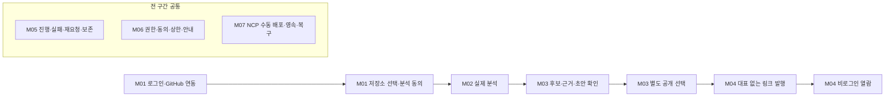
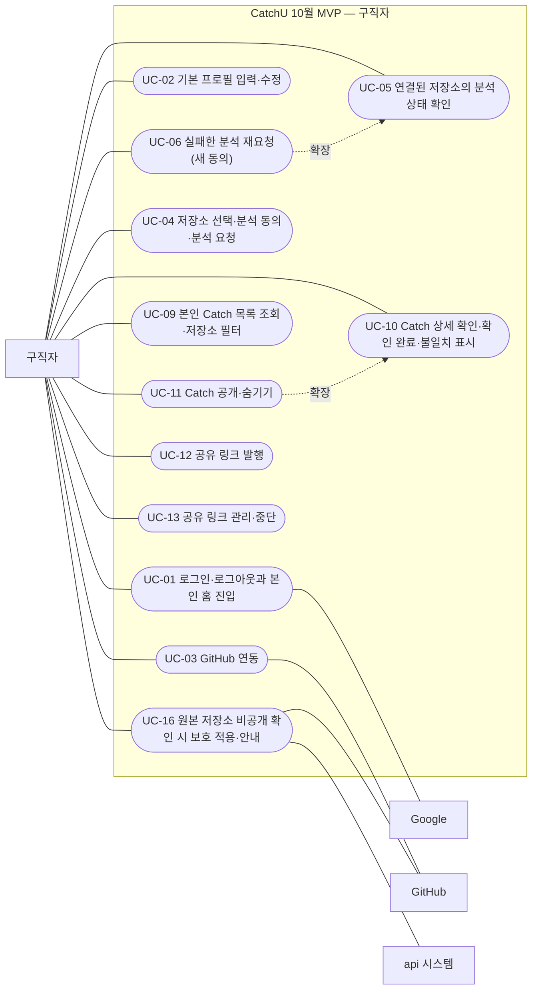
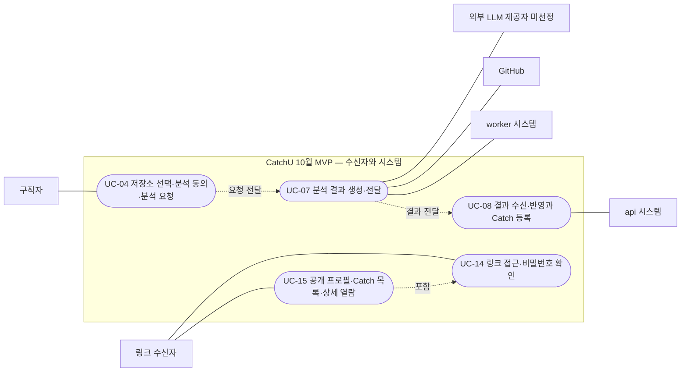
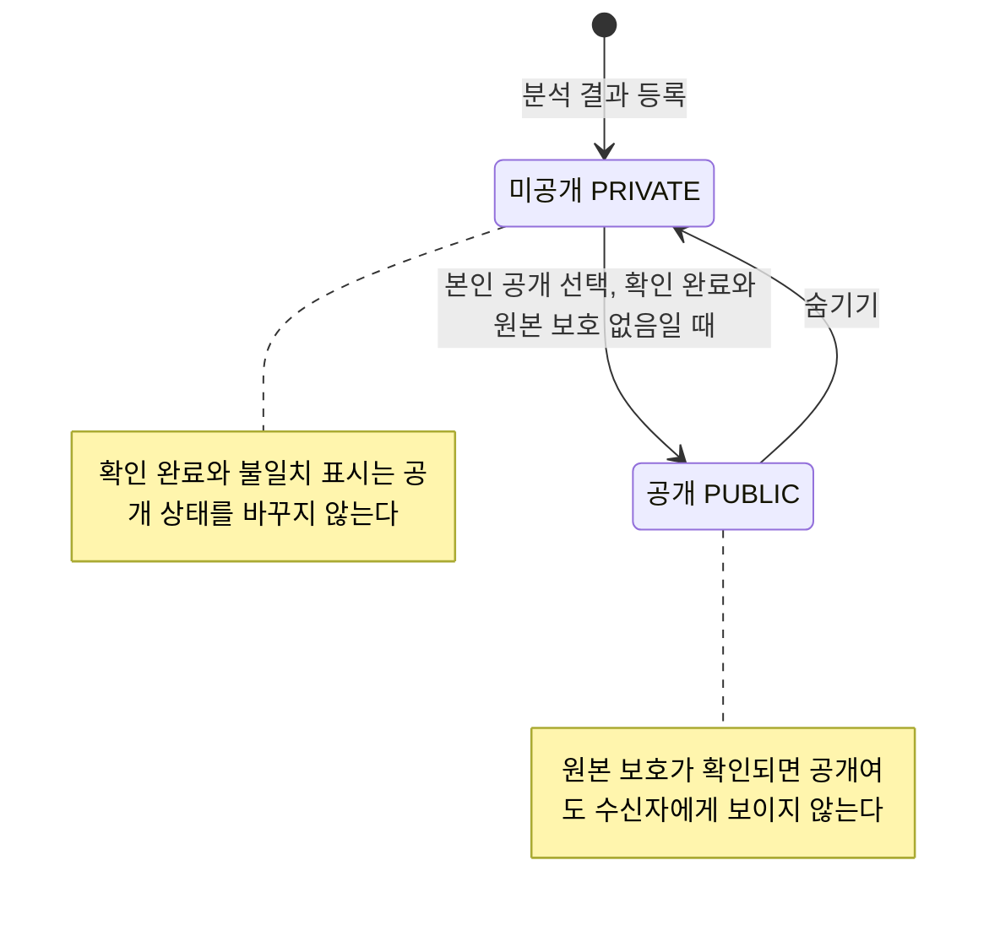
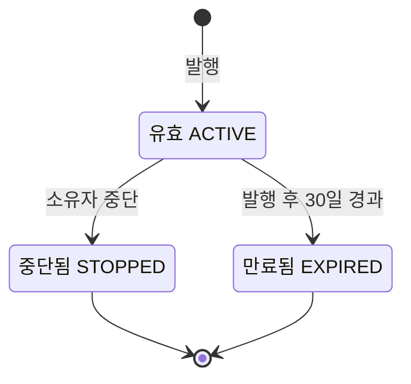

# CatchU 요구사항 정의서 (10월 MVP)

| 항목 | 내용 |
|---|---|
| 팀명 | Jaemin_AI |
| 과제명 | 이력서-채용공고 텍스트 매칭 시스템 |
| 서비스명 | CatchU(캐치유) |
| 문서 버전 | v1.0 |
| 작성일 | 2026-09-28 |
| 기준 | `origin/dev` 9093d2e |
| 문서 지위 | 제출용 파생본. 승인 산출물(10월 intent 요구사항 2026-09-22, 기능 설계·API 명세·ERD 2026-09-23)을 기준으로 하고 2026-09-24 팀장 결정을 출처와 함께 반영했다. 원본과 어긋나면 원본이 우선한다. ID 체계는 `id-registry.md`의 **제안안**이다 |

## 변경 이력

| 버전 | 일자 | 내용 | 작성 |
|---|---|---|---|
| v1.0 | 2026-09-28 | 최초 작성. 10월 MVP의 범위 경계, 액터, 유스케이스 16개, 기능 요구사항 19개, 업무규칙 24개, 비기능 요구사항 8개, 제약·미결, 9/24 팀장 결정 반영 내역, 원본 ID 대응표 정리. 같은 날 원천 대조 검토로 중간 발표와 10월 목표의 관계, 헤더 준비 중 안내의 출처, 9/24 반영 상태(R-01 해결), 링크 다운로드 옵션 지위, 코딩 운영의 CI 기준 출처를 바로잡음. 문서 간 정합성 점검으로 부록 B 정합성 추적표(FR 19행과 역방향 점검)를 채우고, FR-GEN-03의 관련 유스케이스에 UC-09·UC-10·UC-15를 더함 | 팀장(AI 작성 보조) |

## 1. 개요

### 1.1 목적

이 문서는 CatchU 10월 MVP가 **무엇을 하고 무엇을 하지 않는지**, 각 기능이 어떤 업무규칙과 품질 조건을 지켜야 하는지를 한곳에 모은 요구사항 정의서다. 팀은 요구사항을 AI-DLC 절차로 승인했다. 이 문서는 그 승인 원본을 평가 양식에 맞춰 다시 엮은 파생본이며, 새 요구사항을 만들지 않는다.

- 기능 요구사항의 원본은 첫 intent 승인 요구사항(2026-09-11, FR 45개·NFR 8개)과 10월 intent 승인 요구사항(2026-09-22, FR11.1~FR11.3 추가와 10월 적용·변경)이다.
- 업무규칙의 원본은 api·worker 기능 설계(2026-09-23 승인)의 규칙 BR2.1~BR2.15·BR3.1~BR3.5(20개)와 팀장 결정 4건(9/15·9/20·9/24)이다.
- 승인 뒤인 2026-09-24 팀장 결정(PR #89·#97, 이슈 #64)은 반영하되 **팀장 결정**으로 표시하고 9장에 따로 정리했다.
- 표의 수용 기준은 구현을 확인할 기준이다. 현재 시험을 통과했다는 보고가 아니다.

### 1.2 범위

10월 MVP는 10월 초를 목표로 하는 CatchU의 첫 번째 실제 서비스다. 중간 발표(2026-10-01~02)와 같은 시기지만, 2026-09-17 목표 변경으로 발표 준비와 기존 기능 전체의 동시 완성은 일정의 필수 조건에서 뺐고 아래 핵심 흐름을 우선한다(scope-definition-questions 「목표 변경 확정」). 구직자가 동의한 선정 공개 저장소의 실제 GitHub 기록에서 Catch(작업 후보·근거·짧은 설명 초안·최소 생각해볼 질문)를 확인하고, 본인이 고른 Catch만 공개해 링크로 전달하며, 비로그인 수신자가 현재 허용된 자료를 읽는 흐름이다. 실제 NCP 수동 배포와 자료 보존·복구 증거까지가 완료 조건이다(scope-document 「목표와 가치 흐름」).

그림 1. 10월 MVP 가치 흐름과 범위 항목 M01~M07

첫 MVP 완료는 M01~M07 전체의 실제 정상·거부·실패·권한·영속/복구 증거를 요구한다. 기능 일부 성공, 최소 연결 첫 결과 승인, PR 승인, Project 완료 중 어느 하나만으로 전체 완료를 선언하지 않는다(10월 요구사항 「추적성과 첫 MVP 완료 판정」). 12월 범위는 별도 문서 「요구사항 정의서 (12월 계획)」에서 다룬다.

### 1.3 대상 독자

| 독자 | 이 문서에서 볼 곳 |
|---|---|
| 평가자(상주멘토·외부멘토) | 2장 범위 경계, 4장 유스케이스, 5장 기능 요구사항, 6장 업무규칙 |
| 팀원(기능 담당 개발자) | 4장 예외 흐름, 5장 수용 기준, 6장 업무규칙, 8장 미결 사항 |
| 설계 문서 작성자(ERD·화면·분석) | 부록 A 원본 ID 대응표, 부록 B 정합성 추적표 |
| 12월 intent 요구사항 분석 담당 | 2.2 하지 않는 것, 8.4 미결 사항, 9장 승인 이후 변경 |

### 1.4 지위 표기

| 표기 | 뜻 |
|---|---|
| 승인 | 팀이 쓰는 AI 개발 절차(AI-DLC)의 단계별 승인 절차를 통과한 산출물의 내용 |
| 팀장 결정 | 입력 문서에 기록된 팀장 결정. 승인 요구사항보다 뒤의 결정은 출처를 함께 적는다 |
| 검토초안 | 담당자 초안·팀 검토용 자료. 채택 확정 아님 |
| 제안안 | 이 산출물에서 새로 제안하는 것(이 문서에서는 ID 체계와 유스케이스 구성) |
| 미정 | 아직 정해지지 않음. 정할 주체·이슈·OQ를 함께 적는다 |

### 1.5 용어

| 용어 | 정의 |
|---|---|
| Catch | 구직자의 GitHub 기록에서 확인한 작업 하나를 제목·작업 사실·본인 기여·근거·설명 초안으로 정리한 자산. 옛 용어 '증거카드'는 쓰지 않는다 |
| Catch 제목(title) | worker가 '무엇을 했나'를 짧은 명사구로 생성한 Catch 이름. 구직자는 고칠 수 없다(9/24) |
| 작업 사실(workFacts) | 근거에서 관측한 작업 내용 목록. 관측하지 않은 동기·성과를 넣지 않는다 |
| 본인 기여(subjectContribution) | 해당 작업에서 구직자 본인에게 귀속되는 기여. 타인 기여를 본인에게 귀속하지 않는다 |
| 근거 | Catch의 사실을 뒷받침하는 GitHub 출처(URL·리비전)와 표현 사실·기여 범위·누락/잘림 한계 |
| 후보(작업 후보) | worker가 근거와 본인 기여를 확인해 등록 기준을 충족한다고 제공한 작업 단위. 등록되면 Catch가 된다 |
| 미제공 사유(notProvided) | 근거 부족·기준 미달로 후보를 제공하지 않은 이유. 수집·생성 오류(failures)와 구분한다 |
| 설명 초안(draft) | 근거에 연결된 짧은 Catch 설명. 생성됨·실패·미생성 상태를 가지며 생성만으로 공개되지 않는다 |
| 최소 생각해볼 질문 | 구직자가 경험을 고르도록 돕는 질문. 본인만 보고 답변은 저장하지 않는다 |
| 확인 | 구직자가 작업 사실·본인 기여를 확인했다는 표시. 공개와 별개다 |
| 불일치 표시 | 구직자가 Catch 내용이 기록과 맞지 않는다고 표시한 것. 공개를 막지 않는다(9/24) |
| 공개·미공개 | Catch의 공개 상태 두 가지(`PUBLIC`·`PRIVATE`). 최초는 미공개. 숨김을 따로 구분하지 않는다(9/24) |
| 숨기기 | 공개 Catch를 미공개로 바꾸는 행동. 기존 링크에도 다음 요청부터 반영된다 |
| 원본 보호 | 원본 저장소의 비공개 전환이 확인되어 관련 Catch를 수신자에게 보이지 않게 한 상태(`SOURCE_PRIVATE`). 일시 조회 실패와 구분한다 |
| 공유 링크 | 구직자가 발행해 전달하는 URL. 소유자의 현재 공개 Catch 전체와 기본 프로필을 연다. 특정 Catch와 연결하지 않는다 |
| 링크 제목 | 발행자가 링크를 구분하는 필수 이름. 수신자에게 보이지 않는다 |
| 발행·중단·만료 | 링크를 만드는 행동 / 소유자가 링크를 끄는 행동 / 발행 30일 뒤 자동으로 열람 불가가 되는 것. 중단·만료 링크는 되살리지 않는다 |
| 구직자 | 로그인한 회원. 10월의 주 사용자. 기업 계정은 12월 |
| 링크 수신자 | 링크를 받아 로그인 없이 열람하는 사람. 10월의 두 번째 사용자 |
| 선정 저장소 | 팀이 사전 선정한 지원 공개 저장소 목록. 10월 분석 대상은 이 안에서만 고른다 |
| 연결된 저장소 | 분석 요청이 접수된 저장소(진행·실패 여부와 무관) |
| 저장소 연결 관리 | 내 자산 Catch 탭 위쪽 영역과 모달. 연결된 저장소의 상태 확인과 새 저장소의 선택·동의·요청을 한다(9/24) |
| 분석 동의 | 해당 요청 한 건에 묶이는 새 동의. GitHub 연동이나 저장소 공개로 대신하지 않고 재사용하지 않는다 |
| 처리 상태·반영 상태 | worker 처리 의미(processing)와 서비스 DB 반영 진행(application)의 두 상태. 섞지 않는다 |
| 재요청 | 확정 실패 후 사용자가 새 동의로 만드는 새 요청. 자동 재시도는 없다 |
| 멱등 키(Idempotency-Key) | 같은 생성 요청을 다시 보내도 결과가 하나만 생기게 하는 키 |
| MOCK·LIVE | 합성 fixture 연결과 실제 분석을 구분하는 값. MOCK을 실제 분석 성공으로 표시하지 않는다 |
| 내 자산 | 구직자의 자료 페이지. 10월은 Catch 탭 하나와 준비 중 탭(9/24) |
| 대표 구성 | 대표 주장 1개와 Catch 2~3장. 10월은 대표 없이 링크를 발행하며 12월 1순위 |
| M01~M07 | 10월 MVP 범위 항목(2.1절) |
| OQ | 승인 요구사항의 후속 결정 사항 번호(OQ1~OQ16). OQ-A1 등은 API 명세 v1의 미결 |
| C01~C12 | 10월 실행 가능성 검토(feasibility)에서 정한 제약·착수 조건 목록(9/22 승인). 첫 intent의 C1~C7과 다르다 |
| 첫 intent·10월 intent | AI-DLC가 작업 묶음을 부르는 단위(intent). 첫 intent(2026-09-09 시작)는 서비스 정의와 전체 요구사항, 10월 intent(2026-09-14 시작)는 10월 MVP의 범위·설계를 다룬다 |
| 출처 이름 | 본문의 scope-document(범위 문서), rough-mockups(거친 화면 설계), feasibility(실행 가능성 검토), delivery-planning(개발 계획) 등은 AI-DLC 산출물 이름이다. 전체 경로는 끝의 「원본과 근거」에 있다 |
| 단독 실행 | AI-DLC에서 이미 끝난 단계 하나만 따로 다시 열어 고치는 방식. 9/24 팀장 결정을 설계 문서에 반영할 때 썼다(9장) |
| A~I 영역 | 9/17 재배분의 담당 영역. A 회원·연동, B Catch, C 링크·수신자, D 홈·저장소 연결 관리, E 분석 요청·반영, F 생성(worker), G 내부 품질·운영(10월 제외), H NCP 배포·복구, I 통합 |

## 2. 범위 경계

### 2.1 10월에 하는 것

출처: scope-document 「첫 MVP 포함」(2026-09-22 승인). 순서는 구현 순서가 아니며 모두 첫 MVP 완료 전 필수다.

| ID | 범위 | 완료 기준 요지 | 관련 요구사항 |
|---|---|---|---|
| M01 | 기본 로그인·프로필·GitHub 연동, 선정 공개 저장소 선택·별도 동의 | 미연동 홈 진입은 허용하되 분석 전 연동·동의 확인. 미동의·허용 밖 대상 요청 거부 | FR-MEM-01, FR-MEM-02, FR-MEM-03, FR-ANL-01 NFR-SEC-01, NFR-PRV-01 |
| M02 | 실제 분석·후보·근거·인용하는 짧은 초안·최소 생각해볼 질문 | 실제 자료로 생성. 누락/잘림·발췌 범위 제한. 근거가 충분하면 실제 변경·기여 설명, 근거 부족은 설명 제한·후보 보류로 표시 | FR-ANL-01, FR-GEN-01, FR-GEN-02, FR-GEN-03 NFR-PRV-01 |
| M03 | 최소 B: 본인 목록·상세·근거/초안 확인·개별 공개/숨김·불일치 표시·미공개 유지 | 타인 비공개 조회·변경 거부, 명시적 공개만 반영, 숨김이 기존 링크에도 적용. 직접 문구 편집·재생성 미제공 | FR-GEN-03, FR-CAT-01, FR-CAT-02, FR-CAT-03, FR-LNK-02, FR-LNK-03 NFR-SEC-01, NFR-ACC-01, NFR-PRV-02 |
| M04 | 대표 없는 기본 링크 발행·기본 프로필·공개 자산/근거 비로그인 열람 | 링크 제목 필수·유효 제목 중복 금지·유효 링크 5개, 중단·30일 고정 만료·선택 비밀번호를 정상·거부·경계 사례로 확인 | FR-MEM-03, FR-CAT-02, FR-LNK-01~FR-LNK-07 NFR-SEC-01, NFR-ACC-01 |
| M05 | 진행/실패·명시적 재요청·중복 방지·기존 자료/링크 보존, 원본 비공개 확인 대응 | 재방문이 새 분석을 만들지 않음. 재전달·재요청으로 Catch 중복·자료 손실 없음. 일시 조회 실패를 비공개 전환으로 단정하지 않음 | FR-ANL-02, FR-ANL-03 NFR-SEC-01, NFR-REL-01 |
| M06 | 권한·동의·자료 최소화·비밀값·삭제·호출/시간/출력 상한, 기본 빈/로딩/실패/권한 안내·접근성 | 서비스 경계의 정상·거부·실패 시험과 외부 자료 처리 전 안전 통제 확인. 상세 수치는 후속 설계 | NFR-SEC-01, NFR-PRV-01, NFR-REL-01, NFR-COS-01, NFR-ACC-01, NFR-PRV-02, NFR-PER-01 |
| M07 | 실제 NCP 수동 배포·외부 URL·자료 영속/복구·통합/재시험·PR 빌드/시험 | 실제 환경에서 전체 흐름 확인, 재시작·재배포 시 자료·공개·링크 상태 보존, 합의한 복구 시나리오 실행 증거 | NFR-REL-01, NFR-ACC-01, NFR-OBS-01, NFR-PER-01 |

- 링크의 중단·만료·비밀번호(FR-LNK-05~07)는 기본 발행 뒤에 구현해도 되지만 첫 MVP 완료 전 필수다(scope-document 「기본 링크의 열람·접근 기준」).
- 9/24 팀장 결정으로 저장소 필터(FR-CAT-03)와 Catch 제목(FR-GEN-03)이 10월 범위에 더해졌다(9장).
- 헤더의 채용공고·알림 메뉴는 12월 기능이다(9/16 회의 결정 §1). 10월 헤더에는 비활성으로 표시하고 누르면 준비 중 안내창(SCR_COMMON_02)이 뜬다(#55 헤더 합의, #106 완료 기준). 내 자산의 포트폴리오·자기소개서·이력서 탭도 준비 중 안내만 보인다(9/24 팀장 결정). 둘 다 기능 제공이 아니다.
- 일정이 늦어지면 로컬 시연을 대안으로 검토한다는 9/20 팀장 방향이 있다. 이 경우에도 로컬 시연 성공을 NCP 배포·복구(M07) 통과로 기록하지 않으며, 로컬 시연을 택했을 때의 MVP 완료 판정은 범위의 후속 결정으로 남는다(작업관리 §7).

### 2.2 10월에 하지 않는 것

"12월판 ID"는 「요구사항 정의서 (12월 계획)」의 가칭 ID이며, 12월 항목은 **미승인 계획**이다. 10월에서 제외한 것을 12월 완성 약속으로 해석하지 않는다(10월 요구사항 「FR5~FR10」).

| 구분 | 항목 | 10월 처리와 경계 | 12월판 ID | 근거 |
|---|---|---|---|---|
| 첫 MVP 완료 후 개발(확정, 날짜 미정) | 대표 주장 작성·수정, Catch 2~3장 선택·교체, 대표 미리보기, 발행 시점 대표 보존 | 대표 없이 기본 링크 발행, 현재 공개 권한·숨김 반영은 10월 유지 | FR-REP-101, FR-REP-102, FR-REP-103(12월 1순위) | scope-document 「첫 MVP 완료 후 개발」, 10월 요구사항 FR3.1·FR3.4 |
| 후속 검토 후보(개발 약속 아님) | 목록 키워드 검색, 저장소·기간·기술 복합 필터, 사용자 정렬, 일괄 공개/숨김, 보기 전환, 장식 애니메이션 | 10월 우선순위를 매기지 않음. 기본 목록·상세·개별 공개/숨김·필수 오류 안내·기본 접근성은 후보로 낮추지 않음. 저장소 필터 하나는 9/24 결정으로 10월 포함(FR-CAT-03) | FR-CAT-102, DEF-07 | scope-document 「후속 검토 후보」 |
| 10월 제외(G 내부 품질·운영) | 품질 신호, 내부 선택 공유, 운영 기록 조회, 신규 분석·AI 호출 전체 중단·재개, 조건별 운영 경고 | B의 불일치 표시나 H/I의 배포·복구 보호를 G 구현 완료로 세지 않음. 다른 담당에게 숨겨 재배정하지 않음 | FR-OPS-101, FR-OPS-102, FR-OPS-103(12월 후순위) FR-OPS-105, FR-OPS-106(보류) | 10월 요구사항 「FR5~FR10」, scope-document 「10월 제외」 |
| 기존 12월 계획 | 목록 밖 공개 저장소 분석, 미지원 저장소 사전 안내 | 10월은 선정 목록 안 검사와 실패 안내만 | FR-ANL-101, FR-ANL-102 | 10월 요구사항 FR1 |
| 기존 12월 계획 | 복수 대표 프리셋, 서술 오류 Catch 제한 재생성 | 10월에 편집·재생성 기능을 추가하지 않음 | FR-REP-104, FR-CAT-101 | 10월 요구사항 FR3 |
| 기존 12월 계획 | 자기소개서·포트폴리오·이력서 등록, 링크별 서류 선택, 발행본 보존 | 내 자산 준비 중 탭만 표시 | FR-DOC-101~FR-DOC-106 | 10월 요구사항 FR5, 12월 범위 보완 §2 |
| 기존 12월 계획 | JD 한 장 요약·사이드 패널·질의응답, 기업 JD 프리셋 | 매칭 % 미제공 원칙은 12월에도 유지 | FR-JDF-101~FR-JDF-106 | 10월 요구사항 FR6 |
| 기존 12월 계획 | 검색 참여·기업 조건 검색, 채용 제안·수신 통제·차단, 수락 후 DM·연락 공유 | 10월에는 기업 계정이 없음 | FR-SRC-101~104, FR-OFR-101~104, FR-MSG-101, FR-MSG-102 | 10월 요구사항 FR7~FR9 |
| 12월 범위 보완 포함(10월 미구현) | 팔로우·포스팅·피드·구직자 간 DM, 알림, MCP, 기업 등록·회사 프로필·채용공고, 고객센터, 온보딩, 프로필 상세 항목, 관리자 처리, 마일리지, 관리자 지표 | 헤더 채용공고·알림은 준비 중 안내. 10월 링크 발행은 무료이며 잔액·차감이 없음. 로그인 홈에 분석 결과 상자를 두지 않음 | FR-SOC-101~104, FR-MSG-103, FR-NTF-101, FR-MCP-101, FR-MCP-102, FR-ENT-101~104, FR-JOB-101, FR-SUP-101, FR-MEM-101, FR-MEM-102, FR-ADM-101~105, FR-MIL-101, FR-MIL-102, FR-OPS-104 | 12월 범위 보완 §2·§4 |
| 12월 품질 목표 | 근거 링크 유효율 100%·타인 기여 오귀속 0건의 전체 품질 판정 | 10월은 실제 결과 검수(C11)만. C01/C02 제한 결과를 이 목표 통과로 확대하지 않음 | NFR-QUA-101 | 10월 요구사항 NFR3 |
| 정책 보류 | 발행 후 Catch 구성·본문 변화가 기존 링크에 미치는 영향, 실패 후 보완·재분석·동의 재사용, 자동 재시도, 원본 재공개·연결 해제·보관 | 해당 분기의 기대 결과를 임의로 정하지 않음. 그 밖의 분석·설계는 계속 | DEF-08(기존 링크 영향), DEF-11(자동 재시도), DEF-12·DEF-06(원본 재공개·연결 해제). 실패 후 보완·재분석은 12월판 ID 없음(OQ-B2) | 10월 요구사항 「범위 밖과 보류」·OQ1~OQ3, API 명세 OQ-B2·OQ-B3 |
| 10월 미결(개발 중 결정) | 발행 후 비밀번호 변경·해제와 기존 세션, 만료 기간 선택·연장 | 10월은 30일 고정 만료 | DEF-09, DEF-10 | 10월 요구사항 OQ4 |
| 이번 실행 밖 | 발표 준비, 자동 배포(CD), 표현 풍부함 반복 튜닝, 모든 diff 전량 복구 | NCP 수동 배포·PR 빌드/시험·누락/잘림 탐지는 유지 | DEF-13, DEF-14 | scope-document 「10월 제외 및 기존 후속 계획」 |
| 보류·재검토 | 링크 열람 기록(보류), 카드 탐색 3층(커밋·diff로 내려가는 서비스 안 탐색, 보류), 링크 다운로드 옵션(재검토 중, #56. 허용 확정 아님) | 카드 탐색 3층은 근거 링크로 GitHub 커밋에 연결하는 것과는 별개 | DEF-01, DEF-02, DEF-03 | 12월 범위 보완 §3-1 |
| 시점 미정 | 탈퇴, Google 외 로그인 수단 추가 | 10월 로그인은 Google로 시작하며 영구 고정이 아님 | DEF-04, DEF-05 | 12월 범위 보완 §3-1·§6 |
| 범위 밖(10월·12월 공통) | Catch 설명 직접 문구 수정, 링크 재발행 별도 기능, 링크별 GitHub 자산 공개 제한, 대표 주장·자기소개서 자동 작성·첨삭, 매칭 %, ATS 지원 접수·전형 관리, MFA·신원 인증 | 중단·만료 뒤에는 새 링크를 발행한다 | EXC-06, EXC-03, EXC-09, EXC-07, EXC-05, EXC-04, EXC-01 | 첫 intent 요구사항 「범위 밖과 미채택 후보」, 12월 범위 보완 §3-1 |
| 10월 화면·동작에 두지 않는 것 | GitHub 연결 해제 버튼, Catch 제목·링크 제목 수정, 결과 단위 검토 현황 집계, 로그인 홈의 분석 결과 상자, 이미 열린 수신자 화면의 실시간 회수, 중단·만료 링크 재개 | 각 결정의 세부는 담당 개발 이슈 | 해당 없음 | 후속 입력 9/15·9/24 팀장 결정, API 명세 「P — 수신자 API」 |

## 3. 액터 정의

| 액터 | 구분 | 설명 | 관련 UC |
|---|---|---|---|
| 구직자 | 주 액터(사람) | 로그인한 회원. 10월의 주 사용자. 로그인 전에는 비로그인 방문자로 비로그인 홈(SCR_HOME_01)을 본다 | UC-01~UC-06, UC-09~UC-13, UC-16 |
| 링크 수신자 | 주 액터(사람) | 구직자에게 링크를 받아 로그인 없이 열람하는 사람(예: 채용 담당자). 10월에는 기업 계정·검색·JD 기능이 없다(intent-statement 「비로그인 링크 수신자」) | UC-14, UC-15 |
| api 시스템 | 시스템 액터 | 분석 요청 접수·결과 수신·반영(E), Catch 등록·공개 판정(B), 회원·권한(A), 링크 판정(C)을 맡는 서버(NestJS) | UC-08, UC-16 |
| worker 시스템 | 시스템 액터 | 허용 범위의 GitHub 자료 수집, 근거·후보·제목·초안·최소 질문 생성(F)을 맡는 분석 서버(FastAPI) | UC-07 |
| Google | 외부 시스템(보조) | 기본 로그인 제공자. 실제 OAuth 경로는 미정(OQ-A1) | UC-01 |
| GitHub | 외부 시스템(보조) | 구직자의 연동 계정과 분석 대상 공개 저장소 | UC-03, UC-07, UC-16 |
| 외부 LLM 제공자 | 외부 시스템(보조, 미선정) | 설명 초안 생성에 쓸 서비스 모델. 제공자·모델·등급 미선정(C06·OQ-L) | UC-07 |
| 운영자 | 10월 없음 | 운영 기능(G)은 10월 제외. 12월 계획판의 액터 | 해당 없음 |

## 4. 유스케이스

원천 산출물에는 유스케이스 목록이 없다. 아래 16개는 10월 요구사항 「의도 분석」의 핵심 흐름, rough-mockups 사용자 흐름, 9/24 내 자산 구조에서 유도한 **제안안**이며(`id-registry.md` §7.1), 각 흐름의 동작은 승인 문서와 팀장 결정에서 가져왔다.

### 4.1 유스케이스 다이어그램

다이어그램은 읽기 쉽도록 둘로 나눴다. 그림 2는 구직자가 직접 하는 유스케이스, 그림 3은 링크 수신자와 시스템 액터의 유스케이스다. 실선은 액터와 유스케이스의 연관, 점선은 유스케이스 사이의 흐름·포함·확장이다.

그림 2. 10월 MVP 유스케이스 다이어그램 — 구직자(UC-06은 UC-05의 실패 상태에서, UC-11은 UC-10의 확인 완료 뒤에 이어지는 확장)

그림 3. 10월 MVP 유스케이스 다이어그램 — 링크 수신자와 시스템(UC-04의 요청이 worker의 UC-07, api의 UC-08로 이어진다)

### 4.2 유스케이스 명세

- 우선순위는 관련 기능 요구사항 가운데 가장 높은 우선순위를 따른다. 10월 FR은 모두 **상**이므로 유스케이스도 모두 상이다(`id-registry.md` §12).
- 관련 요구사항에는 그 유스케이스에서 생성·변경하는 FR과 화면에 표시하는 FR을 함께 적는다(예: Catch 제목 FR-GEN-03은 UC-07에서 생성하고 UC-09·UC-10·UC-15에서 표시).
- 관련 화면은 `id-registry.md` §8.1의 화면 ID다. 화면 주소는 미정(#106)이며 화면 배치·문구의 세부는 화면 설계서와 담당 개발 이슈를 따른다.
- 오류 코드는 API 명세 v1 공통 오류표(`contract-summary.md`)의 값이다.

#### 4.2.1 UC-01 로그인·로그아웃과 본인 홈 진입

| 항목 | 내용 |
|---|---|
| 유스케이스 이름 | 로그인·로그아웃과 본인 홈 진입 |
| ID | UC-01 |
| 관련 요구사항 | FR-MEM-01 |
| 우선순위 | 상 |
| 선행조건 | 서비스에 접속할 수 있다. 로그인 전에는 비로그인 홈(SCR_HOME_01)을 본다 |
| 관련 액터 | 구직자(주), Google(보조) |
| 이벤트 흐름(기본) | 1. 비로그인 홈에서 Google로 시작을 누른다. 2. 로그인 화면(SCR_AUTH_01)에서 Google 로그인을 마친다. 3. 시스템이 회원 계정을 확인하고 표시 이름 확인 화면(SCR_AUTH_02)을 보여 준다. 4. 로그인 홈(SCR_HOME_02)에 들어간다. GitHub 미연동이어도 진입한다. 5. 홈은 GitHub 연동 여부와 연결된 저장소 유무만 확인해 다음 행동을 안내한다. 미연동이면 GitHub 연결(SCR_PROF_04)로, 연결된 저장소가 없으면 내 자산 Catch 탭의 저장소 연결 관리(SCR_ASSET_01)로 보낸다. 6. 로그아웃은 헤더의 프로필 메뉴 모달(SCR_PROF_02)에서 한다 |
| 이벤트 흐름(대안·예외) | - 로그인 취소·실패: 로그인 화면의 취소·실패 상태를 안내하고 다시 시도하게 한다. - 세션 만료·토큰 무효: 회원 API는 401 `AUTH_REQUIRED`·`AUTH_INVALID`를 반환하고 화면은 세션 만료 안내 후 재로그인으로 보낸다. - 표시 이름 조회 실패: 이름 없음으로 처리하지 않고 조회 실패로 안내한다. 이름을 저장하지 않은 회원의 이동 규칙은 미정(#106). - 개발 환경: 실제 OAuth 연결(OQ-A1) 전에는 명시 설정에서만 켜는 개발용 로그인(#87·#106)을 쓰며 production에서는 거부한다 |
| 종료조건 | 본인 홈에 진입하고 헤더에 로그인 상태가 보인다. 홈 진입은 분석 허용·분석 동의로 기록되지 않는다. 로그아웃의 세션·쿠키 처리 세부는 OQ-A1 |
| 관련 업무규칙·화면 | BR-01, BR-24 / SCR_COMMON_01, SCR_HOME_01, SCR_AUTH_01, SCR_AUTH_02, SCR_HOME_02, SCR_PROF_02 |

#### 4.2.2 UC-02 기본 프로필 입력·수정

| 항목 | 내용 |
|---|---|
| 유스케이스 이름 | 기본 프로필 입력·수정 |
| ID | UC-02 |
| 관련 요구사항 | FR-MEM-03 |
| 우선순위 | 상 |
| 선행조건 | 구직자가 로그인했다 |
| 관련 액터 | 구직자 |
| 이벤트 흐름(기본) | 1. 프로필 메뉴 모달(SCR_PROF_02)에서 프로필 보기를 눌러 프로필 상세(SCR_PROF_03)로 간다. 2. 수정을 눌러 입력·수정 화면(SCR_PROF_01)을 연다. 3. 표시 이름·한 줄 소개·직무·기술 스택을 입력한다. 직무·기술 스택은 직접 입력한 정보라는 표시가 붙는다. 4. 저장하면 시스템이 본인 여부를 확인하고 자가 입력(`SELF_REPORTED`) 허용 필드만 저장한다. 5. 저장된 값이 프로필 상세에 보인다. 공개 프로필에는 표시 이름·한 줄 소개·직무·기술 스택·GitHub 계정만 나가며, 수정 내용은 기존 링크의 다음 조회에도 반영된다는 안내를 보여 준다 |
| 이벤트 흐름(대안·예외) | - 입력 오류: 400 `VALIDATION_FAILED`와 필드별 사유를 안내한다. 필드 길이 제한·기본값은 A 기능 설계에서 정한다(미정). - 저장 실패: 실패로 안내하고 성공으로 표시하지 않는다. - 조회 중·조회 실패: 로딩과 조회 실패를 구분해 보여 준다(SCR_PROF_03 상태). - 다른 회원의 프로필 수정 시도: 소유자가 아니면 수행하지 않는다 |
| 종료조건 | 저장된 프로필이 본인 화면에 보이고, 공개 허용 항목이 링크의 다음 조회부터 수신자에게 반영된다. 자가 입력 값은 GitHub 검증 사실로 표시되지 않는다 |
| 관련 업무규칙·화면 | BR-01, BR-23 / SCR_PROF_01, SCR_PROF_02, SCR_PROF_03 |

#### 4.2.3 UC-03 GitHub 연동

| 항목 | 내용 |
|---|---|
| 유스케이스 이름 | GitHub 연동 |
| ID | UC-03 |
| 관련 요구사항 | FR-MEM-02 |
| 우선순위 | 상 |
| 선행조건 | 구직자가 로그인했고 GitHub가 미연동(`DISCONNECTED`)이거나 재인증 필요(`REAUTH_REQUIRED`) 상태다 |
| 관련 액터 | 구직자(주), GitHub(보조) |
| 이벤트 흐름(기본) | 1. 로그인 홈의 안내, 프로필 상세, 내 자산 Catch 탭의 저장소 연결 관리 영역 중 한 곳에서 GitHub 연결 화면(SCR_PROF_04)으로 간다. 2. GitHub 연결을 진행한다. 3. 시스템이 연동 상태를 `CONNECTED`로 저장한다. 토큰 원문은 저장하지 않고 자격정보 참조만 둔다. 4. 연동에 성공하면 내 자산 Catch 탭의 저장소 연결 관리 영역(SCR_ASSET_01)으로 돌아온다(9/24 팀장 결정) |
| 이벤트 흐름(대안·예외) | - 연동 취소·실패·만료: 원인을 안내하고 연결 화면으로 되돌린다. 안내·복귀의 세부는 담당 간 검토. - 재인증 필요: 연동 상태를 재인증 필요로 표시한다. 재인증 세부는 OQ2·OQ-A1(DEF-06). - 복귀 시 저장소 연결 관리 모달을 자동으로 열지 여부는 미정(담당 개발 이슈). - 연결 해제: 10월에는 해제 버튼을 두지 않는다. 해제 뒤 자료 처리는 OQ2 |
| 종료조건 | 연동 상태가 연결됨으로 표시된다. 연동만으로 저장소 소유·커밋 관계가 검증되거나 분석 동의가 성립하지 않는다 |
| 관련 업무규칙·화면 | BR-01, BR-24 / SCR_PROF_03, SCR_PROF_04, SCR_HOME_02, SCR_ASSET_01 |

#### 4.2.4 UC-04 저장소 선택·분석 동의·분석 요청

| 항목 | 내용 |
|---|---|
| 유스케이스 이름 | 저장소 선택·분석 동의·분석 요청 |
| ID | UC-04 |
| 관련 요구사항 | FR-ANL-01, FR-MEM-02 |
| 우선순위 | 상 |
| 선행조건 | 구직자가 로그인했고 GitHub가 연동돼 있다 |
| 관련 액터 | 구직자 |
| 이벤트 흐름(기본) | 1. 내 자산 Catch 탭에서 [연결 관리]를 눌러 저장소 연결 관리 모달(SCR_ASSET_03)을 연다. 2. 모달 아래쪽 '연결할 수 있는 저장소'에서 선정 목록 중 저장소 하나를 고른다. 3. 화면은 현재 분석 고지와 허용 범위를 버튼 앞에 보여 준다. 4. 동의가 담긴 버튼 하나로 동의와 요청을 함께 보낸다(멱등 키 포함). 5. 시스템이 연동·선정 대상·고지 판본·범위 판본·동의 값을 확인하고 요청·새 동의·첫 시도·멱등 연결을 한 번에 저장한 뒤 202로 접수한다. 6. 요청을 worker에 전달하고(UC-07), 모달 위쪽 '연결된 저장소' 목록에 분석 중으로 표시한다 |
| 이벤트 흐름(대안·예외) | - 미연동: 403 `GITHUB_CONNECTION_REQUIRED`, GitHub 연결 화면으로 안내한다. - 선정 목록 밖 저장소: 403 `REPOSITORY_NOT_ALLOWED`. - 동의 없음: 403 `CONSENT_REQUIRED`. - 같은 저장소가 진행 중: 새 요청을 만들지 않고 기존 작업을 200으로 돌려준다. - 다른 저장소가 진행 중: 409 `ANALYSIS_IN_PROGRESS`와 기존 요청 ID(본인에게만). - 정상 완료한 저장소의 재분석이나 부분 실패 보완 시도: 409 `REANALYSIS_DEFERRED` 또는 `RETRY_NOT_ALLOWED`. - 같은 멱등 키에 다른 본문: 409 `IDEMPOTENCY_CONFLICT`. - 응답 불명: 같은 키로 다시 확인한다. 새 키로 자동 재전송하지 않고 미접수·실패로 단정하지 않는다. - 영속 저장 실패: 접수 성공(202)을 반환하지 않는다 |
| 종료조건 | 요청이 접수(`ACCEPTED`)·진행 중(`ACTIVE`)으로 저장되고 처리 상태는 대기(`QUEUED`)다. 접수는 분석 완료가 아니다 |
| 관련 업무규칙·화면 | BR-02, BR-03, BR-14, BR-16 / SCR_HOME_02, SCR_ASSET_03 |

#### 4.2.5 UC-05 연결된 저장소의 분석 상태 확인

| 항목 | 내용 |
|---|---|
| 유스케이스 이름 | 연결된 저장소의 분석 상태 확인 |
| ID | UC-05 |
| 관련 요구사항 | FR-ANL-02 |
| 우선순위 | 상 |
| 선행조건 | 분석 요청이 1건 이상 접수됐다 |
| 관련 액터 | 구직자 |
| 이벤트 흐름(기본) | 1. 저장소 연결 관리 모달(SCR_ASSET_03) 위쪽 '연결된 저장소' 목록에서 저장소별 상태 아이콘을 본다. 저장소 이름은 화면이 선정 목록과 합쳐 표시한다. 2. 아이콘은 네 가지다. 분석 중(대기·실행 중·실행 불명과 반영 중·반영 실패·복구 중을 묶음), 성공(오류 없는 정상 완료), 부분 실패, 실패. 3. 아이콘을 누르면 아코디언으로 상태를 간단히 보여 준다. 실행 불명·반영 실패·복구 중은 각각의 문구로 구분한다. 4. 성공·부분 실패에서는 [이 저장소 Catch 보기]로 Catch 목록에 저장소 필터를 건다(UC-09). 결과 진입은 시스템이 본인 열람 준비를 확인한 Catch만 가능하다. 5. 모달을 닫으면 Catch 목록을 다시 불러온다 |
| 이벤트 흐름(대안·예외) | - 조회 실패: 조회 실패를 안내하고 재조회를 제공한다. 작업 실패나 0건으로 표시하지 않고 새 분석을 자동으로 요청하지 않는다. - 실행 불명(`UNCERTAIN`): 실행 확인이 아직 안 됐다고 표시한다. 시간이 지났다는 이유로 실패로 확정하지 않는다. - 반영 실패·복구 중: 처리 결과와 서비스 반영 문제를 구분해 표시하고 분석 재요청으로 바꾸지 않는다. - 정상 완료에 Catch 0건: 성공으로 보이고 '검토할 Catch가 없습니다'를 덧붙인다. - 부분 실패: 제공된 결과와 실패 영향을 구분하고 준비된 Catch만 열람하게 한다. 10월 재요청 대상이 아니다. - 근거 없는 진행률·완료 예상 시간은 표시하지 않는다 |
| 종료조건 | 구직자가 현재 서버 상태를 확인한다. 조회·재방문은 새 분석을 만들지 않는다 |
| 관련 업무규칙·화면 | BR-03, BR-06, BR-18 / SCR_ASSET_01, SCR_ASSET_03 |

#### 4.2.6 UC-06 실패한 분석 재요청(새 동의)

| 항목 | 내용 |
|---|---|
| 유스케이스 이름 | 실패한 분석 재요청(새 동의) |
| ID | UC-06 |
| 관련 요구사항 | FR-ANL-02 |
| 우선순위 | 상 |
| 선행조건 | 해당 요청의 처리 결과가 실패(`FAILED`)로 확정·반영(`APPLIED`)되고 요청이 종료(`CLOSED`)됐으며, 적합 후보 0·등록 0·진행이나 복구 없음·실패 확정 근거가 모두 있어 서버의 재요청 가능 판정(`retry.allowed`)이 참이다 |
| 관련 액터 | 구직자 |
| 이벤트 흐름(기본) | 1. 실패 아이콘의 아코디언에서 실패 안내를 본다. 2. 재요청 가능 판정이 참일 때만 고지 요약과 [동의하고 다시 요청] 버튼이 보인다. 3. 버튼을 누르면 새 동의와 새 요청을 보낸다. 새 요청은 원 요청을 재요청 대상으로 연결한다. 4. 시스템이 원 요청 이력과 새 동의의 대상·범위·고지 판본을 다시 검사하고 새 요청·동의·시도를 만들어 202로 접수한다. 5. 새 요청이 분석 중으로 표시된다. 기존 Catch·링크는 바뀌지 않는다 |
| 이벤트 흐름(대안·예외) | - 조건 미충족: 409 `RETRY_NOT_ALLOWED`. - 정상 완료(0건 포함)·부분 실패: 재요청 대상이 아니므로 버튼이 없고, 요청하면 409 `REANALYSIS_DEFERRED` 또는 `RETRY_NOT_ALLOWED`. - 요청 ID를 빼고 새 요청으로 보내는 우회: 서버가 본인·저장소의 이전 이력을 검사해 거부한다. - 시간 초과·조회 실패: 실패 확정의 근거가 아니다. - 이전 동의 재사용·자동 재시도: 제공하지 않는다(DEF-11) |
| 종료조건 | 새 요청이 접수되거나 거부 사유가 안내된다 |
| 관련 업무규칙·화면 | BR-02, BR-04, BR-14 / SCR_ASSET_03 |

#### 4.2.7 UC-07 분석 결과 생성·전달

| 항목 | 내용 |
|---|---|
| 유스케이스 이름 | 분석 결과 생성·전달 |
| ID | UC-07 |
| 관련 요구사항 | FR-GEN-01, FR-GEN-02, FR-GEN-03, FR-ANL-02 |
| 우선순위 | 상 |
| 선행조건 | api가 영속 접수한 요청(요청·시도·회원·저장소·동의 식별자와 허용 범위)을 worker가 받았다 |
| 관련 액터 | worker 시스템(주), GitHub·외부 LLM 제공자(보조) |
| 이벤트 흐름(기본) | 1. 요청·시도, 본인·저장소, 동의·허용 범위가 맞는지 검사한다. 자격정보 맥락 식별자를 권한으로 신뢰하지 않는다. 2. 수신(`RECEIVED`)·실행 중(`RUNNING`) 진행 알림을 api에 보낸다. 3. 허용 범위의 GitHub 자료를 수집한다(BDA-01). 4. 근거를 정규화하고 작업을 묶고 본인 기여와 작업 동일성을 판별한다(BDA-02~BDA-05). 5. 적합 후보를 판정한다(BDA-06). 근거 부족·기준 미달은 미제공 사유, 수집·생성 오류는 실패 목록에 담는다. 6. 후보마다 제목(BDA-07), 설명 초안(BDA-08), 최소 생각해볼 질문(BDA-09)을 만들고 각각 생성됨·실패·미생성 상태를 기록한다. 7. 후보 수와 실패 수로 결과를 성공·0건·부분 실패·실패 중 하나로 종결한다. 8. 결과를 api에 전달하고 수신 확인을 받는다 |
| 이벤트 흐름(대안·예외) | - 요청 맥락 불일치: 처리하지 않는다. worker가 새 동의나 추가 범위를 만들지 않는다. - 실행 확인 불가: 실행 불명(`UNCERTAIN`)으로 알린다. - 초안 생성 실패: 적합 후보는 그대로 제공하고 초안 본문은 비운다. - 제목 생성 실패: 작업 사실 첫 항목으로 제목을 채운다. - 모의 연결: 합성 fixture와 가짜 생성기로 같은 계약을 쓰고 `MOCK`을 유지하며 실제 분석 성공으로 표시하지 않는다. - 수신 확인 지연·유실: 재분석 허가가 아니다. worker는 DB 저장·공개·자동 재분석을 하지 않는다. - 서비스 LLM 미선정: 선정 전에는 제공자 SDK·API 키 없이 제공자 비종속 인터페이스와 가짜 생성기로 개발한다(C06·OQ-L) |
| 종료조건 | api가 결과를 수신(수락·중복·거부)한다. 수신은 Catch 등록 완료가 아니다 |
| 관련 업무규칙·화면 | BR-15, BR-16, BR-17, BR-18, BR-19, BR-20 / 화면 없음(내부) |

#### 4.2.8 UC-08 결과 수신·반영과 Catch 등록

| 항목 | 내용 |
|---|---|
| 유스케이스 이름 | 결과 수신·반영과 Catch 등록 |
| ID | UC-08 |
| 관련 요구사항 | FR-ANL-02, FR-CAT-01 |
| 우선순위 | 상 |
| 선행조건 | worker가 분석 결과를 전달했다 |
| 관련 액터 | api 시스템 |
| 이벤트 흐름(기본) | 1. E가 결과·요청·시도 식별자 세 개가 모두 비어 있지 않은 문자열인지 확인한다. 2. 스키마와 요청·시도·본인·저장소·동의·범위를 대조한다. 3. 수신 키와 결과 내용을 판정해 수신 기록을 저장하고 수신 확인(수락)을 보낸다. 반영 상태는 대기(`PENDING`)다. 4. E가 허용 후보를 B에 넘긴다(반영 중 `APPLYING`). 5. B가 등록 기준과 같은 작업 여부를 검사해 Catch·근거·등록 연결을 미공개로 저장하거나 기존 같은 작업의 Catch를 참조한다. 6. B가 Catch 식별자와 본인 열람 준비를 돌려주고 E가 반영 완료(`APPLIED`)와 본인 결과 준비를 기록한다. 5~6단계는 한 트랜잭션이다. 7. 더 처리할 것이 없으면 요청을 종료(`CLOSED`)한다 |
| 이벤트 흐름(대안·예외) | - 식별자 하나라도 식별 불가: 수신 확인 없이 원문 없는 거부 기록만 남긴다. - 식별 가능한 형식 오류: 거부(`REJECTED`) 수신 확인. - 같은 결과 재전달: 중복(`DUPLICATE`)으로 수렴하고 기존 등록을 참조한다. - 같은 식별자의 다른 내용·늦은 시도: 기존 값을 보존하고 격리한다. - 반영 트랜잭션 실패: 변경을 모두 되돌리고 반영 실패(`APPLY_FAILED`)로 기록한다. 복구(`RECOVERING`)는 같은 결과로 처음부터 다시 반영하며 worker를 재실행하지 않는다. - 커밋 뒤 응답 유실: 다시 처리해도 같은 Catch 식별자를 돌려준다. - 두 후보가 같은 작업: Catch 하나로 수렴한다. - 일부 후보만 처리됨: 나머지가 해결되기 전에는 반영 완료·종료로 만들지 않는다. - 0건·실패 결과: 그 의미를 반영한 뒤 반영 완료가 된다. - 미등록 결과의 보존·재전달 방식은 미정(OQ-F1)이므로 영속 재전달 보장을 주장하지 않는다 |
| 종료조건 | 등록된 Catch가 본인 목록에 미공개로 나타나고, 요청이 반영 완료 또는 종료 상태가 된다 |
| 관련 업무규칙·화면 | BR-05, BR-06, BR-07, BR-08, BR-21 / 화면 없음(내부) |

#### 4.2.9 UC-09 본인 Catch 목록 조회·저장소 필터

| 항목 | 내용 |
|---|---|
| 유스케이스 이름 | 본인 Catch 목록 조회·저장소 필터 |
| ID | UC-09 |
| 관련 요구사항 | FR-CAT-01, FR-CAT-03, FR-GEN-03 |
| 우선순위 | 상 |
| 선행조건 | 구직자가 로그인했다 |
| 관련 액터 | 구직자 |
| 이벤트 흐름(기본) | 1. 헤더의 내 자산에서 Catch 탭(SCR_ASSET_01)을 연다. 2. 위쪽에 저장소 연결 관리 영역, 아래쪽에 Catch 목록이 보인다. 목록은 Catch마다 제목과 확인 완료·불일치 표시·공개 상태를 보여 준다. 3. 저장소 필터를 고르면 해당 저장소 Catch만 보인다. 필터는 주소 파라미터에 담겨 새로고침·뒤로 가기·재로그인 뒤에도 유지된다. 4. 다음 페이지를 불러온다(기본 20개, 최대 100개). 5. Catch를 고르면 상세 모달을 연다(UC-10) |
| 이벤트 흐름(대안·예외) | - Catch 0건: 정상 빈 자료로 안내한다. - 조회 실패: 조회 실패로 안내하고 재조회를 제공한다. 0건으로 표시하지 않는다. - 포트폴리오·자기소개서·이력서 탭(SCR_ASSET_02): 준비 중 안내만 보인다. - 다른 회원의 Catch: 404 `RESOURCE_UNAVAILABLE`. - 결과 단위 검토 현황 집계는 두지 않는다 |
| 종료조건 | 현재 본인 Catch 목록이 필터를 적용해 보인다 |
| 관련 업무규칙·화면 | BR-08, BR-22 / SCR_ASSET_01, SCR_ASSET_02 |

#### 4.2.10 UC-10 Catch 상세 확인·확인 완료·불일치 표시

| 항목 | 내용 |
|---|---|
| 유스케이스 이름 | Catch 상세 확인(근거·초안·질문)·확인 완료·불일치 표시 |
| ID | UC-10 |
| 관련 요구사항 | FR-CAT-01, FR-GEN-01, FR-GEN-02, FR-GEN-03 |
| 우선순위 | 상 |
| 선행조건 | 본인 Catch가 있다 |
| 관련 액터 | 구직자 |
| 이벤트 흐름(기본) | 1. 목록에서 Catch를 골라 상세 모달(SCR_ASSET_04)을 연다. 상세 식별자는 주소 파라미터에 담긴다. 2. 제목(편집 불가), 작업 사실, 본인 기여, 근거(출처 URL·리비전·표현 사실·기여 범위·누락/잘림 한계), 설명 초안 또는 생성 실패·미생성 상태, 최소 생각해볼 질문(본인만)을 확인한다. 3. 작업 사실과 본인 기여를 확인 완료로 표시한다. 확인은 공개 상태를 바꾸지 않는다. 4. 내용이 기록과 맞지 않으면 불일치를 표시한다. 5. 확인을 마치면 '지금 공개' 제안으로 이어진다(UC-11) |
| 이벤트 흐름(대안·예외) | - 초안 없음: 생성된 설명처럼 보이지 않게 생성 실패·미생성 상태로 보여 준다. - 최소 질문: 답변을 저장하지 않고 자동으로 다시 생성하지 않는다. - 저장 실패: 실패로 표시하고 성공으로 처리하지 않는다. 화면은 서버 값을 기준으로 한다. - 원본 보호 중인 Catch: 보호 사유를 안내한다(UC-16). - 다른 회원·없는 Catch: 404 `RESOURCE_UNAVAILABLE`. - 직접 문구 수정·재생성: 제공하지 않는다 |
| 종료조건 | 확인 완료·불일치 상태가 서버에 저장되고 화면에 보인다. 열람만으로 확인·공개되지 않는다 |
| 관련 업무규칙·화면 | BR-08, BR-09, BR-17 / SCR_ASSET_04 |

#### 4.2.11 UC-11 Catch 공개·숨기기

| 항목 | 내용 |
|---|---|
| 유스케이스 이름 | Catch 공개·숨기기 |
| ID | UC-11 |
| 관련 요구사항 | FR-CAT-02, FR-LNK-03 |
| 우선순위 | 상 |
| 선행조건 | 본인 Catch가 있다. 공개하려면 작업 사실·본인 기여 확인이 끝났고 원본 보호 제한이 없어야 한다 |
| 관련 액터 | 구직자 |
| 이벤트 흐름(기본) | 1. 확인 완료 화면의 '지금 공개' 제안이나 상세의 공개 버튼을 누른다. 2. 시스템이 현재 확인 상태와 원본 보호를 다시 검사한 뒤 공개로 저장한다. 3. 공개된 Catch는 유효 링크의 다음 요청부터 수신자에게 보인다. 4. 숨기기를 누르면 미공개로 바뀌고, 기존 링크에서도 다음 요청부터 빠진다. 5. 숨긴 Catch는 확인 완료·원본 보호 제한 없음이면 다시 공개할 수 있다 |
| 이벤트 흐름(대안·예외) | - 확인 미완료: 409 `CONFIRMATION_REQUIRED`. - 원본 보호 중: 409 `SOURCE_RESTRICTED`. - 불일치 표시가 있는 Catch 공개: 공개는 허용하되 화면에서 알린다. 알림 표현은 미정(B 개발 이슈). - 저장 실패: 성공으로 표시하지 않는다. - 이미 열려 있는 수신자 화면: 실시간으로 회수하지 않고 다음 이동·새로고침부터 반영한다 |
| 종료조건 | 공개 상태가 서버 값으로 표시되고 링크 조회에 반영된다 |
| 관련 업무규칙·화면 | BR-09, BR-10, BR-11, BR-22 / SCR_ASSET_04 |

#### 4.2.12 UC-12 공유 링크 발행

| 항목 | 내용 |
|---|---|
| 유스케이스 이름 | 공유 링크 발행 |
| ID | UC-12 |
| 관련 요구사항 | FR-LNK-01, FR-LNK-04, FR-LNK-06, FR-LNK-07 |
| 우선순위 | 상 |
| 선행조건 | 구직자가 로그인했다. 대표 구성이나 공개 Catch는 필요 없다 |
| 관련 액터 | 구직자 |
| 이벤트 흐름(기본) | 1. 헤더의 공유 링크에서 링크 발행 화면(SCR_LINK_01)을 연다. 2. 공개 Catch가 없으면 없다는 안내를 보여 주되 발행은 막지 않는다. 3. 링크 제목(필수, 수신자에게 보이지 않음)과 선택 비밀번호를 입력한다. 4. [링크 발행]을 누르면 버튼이 발행 중 상태가 되어 재클릭을 막고, 멱등 키와 함께 요청한다. 5. 시스템이 사용자 단위로 유효 링크의 제목 중복 확인·5개 미만 확인·생성을 한 번에 처리한다. 만료 시각은 발행 시각 더하기 30일이다. 6. 발행 완료 화면(SCR_LINK_02)에 URL·발행 시각·만료 시각·비밀번호 설정 여부가 보이고 URL을 복사할 수 있다 |
| 이벤트 흐름(대안·예외) | - 유효 링크 제목 중복: 409 `LINK_TITLE_CONFLICT`, "같은 제목의 유효한 링크가 이미 있습니다"와 공유 링크 관리로 가는 경로를 보여 준다. - 유효 링크 5개 도달: 409 `LINK_LIMIT_REACHED`, 쓰지 않는 링크를 중단한 뒤 발행하도록 안내한다. - 빈 제목: 입력 오류(400)로 거부한다. 제목 길이 제한은 미정. - 응답 유실: "발행 여부를 확인하지 못했습니다"와 다시 발행을 제공한다. 같은 제목의 재요청은 새로 만들거나 이미 있음을 돌려주므로 안전하며, "발행 실패"로 안내하지 않는다. - 같은 멱등 키에 다른 본문: 409 `IDEMPOTENCY_CONFLICT` |
| 종료조건 | 유효 링크가 만들어져 목록에 유효로 표시되거나 거부 사유가 안내된다 |
| 관련 업무규칙·화면 | BR-11, BR-12, BR-14 / SCR_LINK_01, SCR_LINK_02 |

#### 4.2.13 UC-13 공유 링크 관리·중단

| 항목 | 내용 |
|---|---|
| 유스케이스 이름 | 공유 링크 관리·중단 |
| ID | UC-13 |
| 관련 요구사항 | FR-LNK-05, FR-LNK-07 |
| 우선순위 | 상 |
| 선행조건 | 구직자가 발행한 링크가 있다 |
| 관련 액터 | 구직자 |
| 이벤트 흐름(기본) | 1. 공유 링크 관리(SCR_LINK_03)에서 링크별 제목과 상태를 본다. 상태는 아이콘만이 아니라 유효·중단됨·만료됨 글자로 표시하고 URL을 다시 복사할 수 있다. 2. 링크 중단을 누르면 확인 모달(SCR_LINK_04)이 이미 열려 있는 수신자 화면에는 다음 이동이나 새로고침부터 반영된다고 알린다. 3. 확인하면 중단 시각이 기록되고 상태가 중단됨이 된다 |
| 이벤트 흐름(대안·예외) | - 중단을 반복 요청: 같은 상태로 남고 추가 변경이 없다. - 중단·만료 링크 재개: 제공하지 않는다. 같은 수신처에 다시 보내려면 새 링크를 발행한다(EXC-03). - 중단의 범위: Catch를 숨기거나 지우지 않는다. - 제목 수정: 10월에 제공하지 않는다. - 목록 조회 실패: 조회 실패로 안내하고 빈 목록으로 표시하지 않는다 |
| 종료조건 | 링크가 중단됨 또는 만료됨으로 표시되고 그 URL의 수신 접근이 거부된다 |
| 관련 업무규칙·화면 | BR-12, BR-13 / SCR_LINK_03, SCR_LINK_04 |

#### 4.2.14 UC-14 링크 접근·비밀번호 확인

| 항목 | 내용 |
|---|---|
| 유스케이스 이름 | 링크 접근·비밀번호 확인 |
| ID | UC-14 |
| 관련 요구사항 | FR-LNK-04, FR-LNK-05, FR-LNK-06, FR-LNK-07 |
| 우선순위 | 상 |
| 선행조건 | 수신자가 링크 URL을 받았다. 로그인은 필요 없다 |
| 관련 액터 | 링크 수신자 |
| 이벤트 흐름(기본) | 1. URL로 접속한다. 수신자 화면은 이동 메뉴 없는 수신자 전용 헤더를 쓴다. 2. 시스템이 링크의 존재·중단·만료를 먼저 판정한다. 3. 비밀번호가 설정된 링크면 비밀번호 입력 화면(SCR_VIEW_01)에서 확인하고, 성공하면 그 링크에만 쓰이는 확인 증표(grant)를 받는다. 4. 공개 프로필·Catch 목록(SCR_VIEW_02)으로 넘어간다(UC-15) |
| 이벤트 흐름(대안·예외) | - 없는 URL·중단·만료: 비밀번호 입력보다 먼저 사유를 구분하지 않는 같은 문구 "이 링크는 열람할 수 없습니다."를 보여 준다(404 `LINK_UNAVAILABLE`). - 비밀번호 미확인: 401 `LINK_PASSWORD_REQUIRED`. - 비밀번호 틀림: 401 `LINK_PASSWORD_INVALID`. - 확인 증표만으로 중단·만료를 우회할 수 없다. 매 요청 현재 링크 상태를 다시 검사한다. - 비밀번호 미설정 링크의 불필요한 확인 요청: 400 `INVALID_REQUEST`. - 판정 요청이 통신 문제로 실패: 다시 시도를 안내하고 중단·만료·비공개로 단정하지 않는다. - 비밀번호 시도 제한·증표 수명·응답 시간 은닉은 미정(OQ-C1) |
| 종료조건 | 열람이 허용되거나 공통 접근 불가 안내가 보인다 |
| 관련 업무규칙·화면 | BR-13, BR-14 / SCR_COMMON_01, SCR_VIEW_01, SCR_VIEW_02 |

#### 4.2.15 UC-15 공개 프로필·Catch 목록·상세 열람

| 항목 | 내용 |
|---|---|
| 유스케이스 이름 | 공개 프로필·Catch 목록·상세 열람 |
| ID | UC-15 |
| 관련 요구사항 | FR-LNK-02, FR-LNK-03, FR-LNK-04, FR-MEM-03, FR-GEN-03 |
| 우선순위 | 상 |
| 선행조건 | UC-14의 링크 판정과 필요한 비밀번호 확인을 통과했다 |
| 관련 액터 | 링크 수신자 |
| 이벤트 흐름(기본) | 1. 공개 프로필(표시 이름·한 줄 소개·직무·기술 스택·GitHub 계정, 직무·기술 스택은 직접 입력 표시)과 소유자의 현재 공개 Catch 목록(SCR_VIEW_02)을 본다. 2. Catch를 골라 Catch·근거 상세(SCR_VIEW_03)에서 제목·작업 사실·본인 기여·근거·설명 초안(또는 초안 없음 상태)을 본다. 3. 목록으로 돌아간다. 목록·상세·새로고침마다 시스템이 현재 권한을 다시 판정하고 응답은 저장되지 않게(no-store) 한다 |
| 이벤트 흐름(대안·예외) | - 공개 Catch 0개: 정상 응답의 빈 목록이며 자료 없음을 안내한다. - 자료 조회 실패: 500 조회 실패로 안내하고 빈 자료로 대체하지 않는다. - 숨긴·없는·다른 소유자의 Catch를 직접 열기: 같은 문구 "현재 열람할 수 없는 자료입니다."(404 `RESOURCE_UNAVAILABLE`). - 원본 보호 Catch: 목록에서 빠지고 상세를 열 수 없다. 일시 실패와 구분한다. - 수신자에게 내보내지 않는 것: 링크 제목, 최소 질문, 확인·불일치 표시, 요청·결과·후보 식별자 |
| 종료조건 | 수신자가 현재 허용된 자료만 열람한다 |
| 관련 업무규칙·화면 | BR-08, BR-10, BR-11, BR-13, BR-23 / SCR_VIEW_02, SCR_VIEW_03 |

#### 4.2.16 UC-16 원본 저장소 비공개 확인 시 보호 적용·안내

| 항목 | 내용 |
|---|---|
| 유스케이스 이름 | 원본 저장소 비공개 확인 시 보호 적용·안내 |
| ID | UC-16 |
| 관련 요구사항 | FR-ANL-03 |
| 우선순위 | 상 |
| 선행조건 | 해당 저장소 분석으로 등록된 Catch가 있다 |
| 관련 액터 | api 시스템(주), 구직자, GitHub(보조) |
| 이벤트 흐름(기본) | 1. 시스템이 원본 저장소의 상태를 관측한다(BDA-10). 관측 경로·주기는 미정(OQ-B3). 2. 비공개 전환이 확인되면 저장소 보호 기록에 원본 보호(`SOURCE_PRIVATE`)와 확인 근거를 남긴다. 3. 관련 Catch를 수신자 허용 집합에서 빼 목록·상세 모두 보이지 않게 한다. 4. 소유자에게 원인과 대응을 알린다. 안내 위치·문구는 미정(담당 개발 이슈) |
| 이벤트 흐름(대안·예외) | - 원본 상태 일시 조회 실패: 비공개 확정이 아니다. 조회 실패만 기록하고 기존 보호도 해제하지 않는다. - 관계없는 Catch·링크: 계속 열람된다. 링크 전체를 중단하지 않는다. - 원본 재공개: 자동 복원과 연동 해제 처리는 보류(OQ2·OQ-B3, DEF-12). - 보호 중 공개 시도: 409 `SOURCE_RESTRICTED` |
| 종료조건 | 관련 Catch가 수신자에게 보이지 않고 소유자가 사유를 확인할 수 있다 |
| 관련 업무규칙·화면 | BR-10 / SCR_ASSET_04, SCR_VIEW_03 |

## 5. 기능 요구사항

- 10월 FR은 19개다. 승인 원본 17개와 1:1로 대응하고(FR3.1·FR3.4는 10월 적용분만), 9/24 팀장 결정으로 2개(FR-GEN-03, FR-CAT-03)를 더했다.
- 우선순위: M01~M07 전체가 첫 MVP 완료 조건이므로 M01~M07에 연결된 FR은 모두 **상**이다. 구현 순서는 우선순위와 별개이며 delivery-planning의 첫 연결 순서와 개발 이슈를 따른다(`id-registry.md` §12).
- 수용 기준은 승인 문서의 통과·확인 기준 요지다. 시험 결과가 아니다.

### 5.1 회원·연동(MEM)

| ID | 요구사항명 | 설명(요구 행동) | 수용 기준 | 우선순위 | 관련 UC | 원본 ID |
|---|---|---|---|---|---|---|
| FR-MEM-01 | 기본 로그인(Google)과 본인 홈 진입 | 구직자가 기본 로그인(Google)으로 로그인하고 본인 홈에 들어간다. GitHub 미연동이어도 홈 진입을 허용한다 | - GitHub 미연동 상태에서도 홈에 들어간다. - 홈 진입과 분석 허용을 분리한다. - 로그인 수단을 Google 하나로 영구 고정하는 결정이 아니다. - 실제 OAuth 경로는 OQ-A1 | 상 | UC-01 | FR11.1 |
| FR-MEM-02 | GitHub 연동 상태 확인과 분석 전 연동 확인 | GitHub 연동 상태를 보여 주고, 분석 요청 전에 연동·선정 대상·동의를 확인한다 | - 로그인 계정·GitHub 연결·분석 동의·Catch 공개 선택을 서로 대체하지 않는다. - 미연동이면 분석 요청을 거부하고 연동으로 안내한다. - OAuth·토큰·재인증·연결 해제 세부는 OQ2·OQ11·C07·OQ-A1 | 상 | UC-03, UC-04 | FR11.2 |
| FR-MEM-03 | 기본 프로필 본인 관리와 공개 프로필 투영(자가 입력 구분) | 구직자가 기본 프로필을 입력·수정하고, 링크 수신자에게는 현재 공개 허용 항목을 보여 준다 | - 직무·기술 스택은 자가 입력 출처로 구분하고 GitHub 검증 사실로 표시하지 않는다. - 공개 항목은 표시 이름·한 줄 소개·직무·기술 스택·GitHub 계정(9/20 팀장 결정). - 수정은 기존 링크의 다음 조회에 반영된다. - GitHub 공개 정보 추가 여부는 OQ-A2 | 상 | UC-02, UC-15 | FR11.3 |

### 5.2 분석 요청·상태(ANL)

| ID | 요구사항명 | 설명(요구 행동) | 수용 기준 | 우선순위 | 관련 UC | 원본 ID |
|---|---|---|---|---|---|---|
| FR-ANL-01 | 선정 공개 저장소 선택·분석 동의·분석 요청 | 연동한 구직자가 선정 지원 공개 저장소를 고르고, 그 분석에만 묶이는 별도 동의를 한 뒤 실제 분석을 요청한다 | - 미연동·미동의·허용 밖 대상 요청을 거부한다. - OAuth 연결과 저장소 공개만으로 분석 동의가 성립하지 않는다. - 실제 분석 결과가 확인·공개·링크 열람까지 이어져야 하며 과거 수동 저장분은 대체 증거가 아니다. - 선정 목록·크기/관계 검사는 OQ1, 동의 수집 세부는 OQ11 | 상 | UC-04 | FR1.1 |
| FR-ANL-02 | 진행·실패 상태, 명시 재요청, 중복 방지, 기존 자료·링크 보존 | 분석의 진행·실패 상태를 보여 주고, 사용자의 명시적 재요청을 지원하며, 중복 실행과 Catch 중복을 막고 실패해도 기존 자료·링크를 보존한다 | - 재방문·조회가 새 분석을 만들지 않는다. - 접수 성공은 완료가 아니고 조회 실패는 작업 실패가 아니다. - 진행 중 중복 실행, 재전달·재요청에 따른 Catch 중복이 없다. - 실패해도 기존 자료·링크가 남는다. - 근거 없는 진행률·완료 예상 시간을 표시하지 않는다. - 자동 재시도 정책은 미정(OQ1) | 상 | UC-05, UC-06, UC-07, UC-08 | FR1.4 |
| FR-ANL-03 | 원본 저장소 비공개 확인 시 관련 Catch 보호와 소유자 안내 | 원본 저장소의 비공개 전환이 확인되면 관련 Catch에 비공개와 같은 보호를 적용하고 소유자에게 원인·대응을 알린다 | - 관련 Catch의 수신자 열람이 차단된다. - 일시 조회 실패를 비공개 전환으로 단정하지 않는다. - 관계없는 자료·링크 전체를 중단하지 않는다. - 감지 주기·복구·본인 보관·삭제는 OQ2 | 상 | UC-16 | FR1.5 |

### 5.3 결과 생성(GEN)

| ID | 요구사항명 | 설명(요구 행동) | 수용 기준 | 우선순위 | 관련 UC | 원본 ID |
|---|---|---|---|---|---|---|
| FR-GEN-01 | 실제 기록 기반 경험 후보·근거·최소 생각해볼 질문 | 동의 범위의 실제 GitHub 기록에서 경험(작업) 후보와 근거, 최소 생각해볼 질문을 제공한다 | - 후보와 근거를 확인하고 경험 선택에 쓸 수 있다. - 근거 없는 경험을 확정 사실로 제시하지 않는다. - 누락·잘림·발췌 한계와 기여자 범위를 드러낸다. - 조회 실패를 후보 0건으로 바꾸지 않는다. - 0건·부분·근거 부족의 표시는 OQ3 | 상 | UC-07, UC-10 | FR2.1 |
| FR-GEN-02 | 근거에 연결된 짧은 Catch 설명 초안 생성 | 근거에 연결된 짧은 Catch 설명 초안을 자동 생성하고 본인 확인·별도 공개 선택으로 연결한다 | - 근거가 충분하면 실제 변경·기여를 설명하고, 관측하지 않은 사실은 제공된 발췌에서 확인할 수 없다고 제한한다. - 생성·확인만으로 공개되지 않는다. - 규칙 기반 PoC를 LLM 초안 검증으로 계산하지 않고 실험 모델을 서비스 모델로 채택하지 않는다. - C01/C02·C06·C11 조건은 별도로 남는다 | 상 | UC-07, UC-10 | FR2.2 |
| FR-GEN-03 | Catch 제목 생성 | worker가 Catch마다 '무엇을 했나'를 짧은 명사구로 제목을 생성한다 | - 평가하는 말과 작업 사실에 없는 사실을 넣지 않는다. - 생성 실패 시 작업 사실 첫 항목으로 채워 항상 값이 있다. - 구직자는 고칠 수 없고, 본인 화면과 수신자 화면이 같은 제목을 쓴다 | 상 | UC-07, UC-09, UC-10, UC-15 | 원본 없음(9/24 팀장 결정, FR2.1·FR3.5 연관) |

### 5.4 Catch 확인·공개(CAT)

| ID | 요구사항명 | 설명(요구 행동) | 수용 기준 | 우선순위 | 관련 UC | 원본 ID |
|---|---|---|---|---|---|---|
| FR-CAT-01 | 본인 Catch 목록·상세·근거/초안 확인, 확인 완료, 불일치 표시, 미공개 유지(직접 수정 미제공) | 구직자가 본인 Catch의 목록·상세에서 근거·초안을 확인하고, 확인 완료·불일치 표시를 하며, 미공개로 유지할 수 있다. 직접 문구 수정은 제공하지 않는다 | - 다른 사용자의 비공개 Catch 조회·변경을 거부한다. - 불일치 표시가 공개·재생성·수정 완료를 뜻하지 않는다. - 대표 주장 보완은 12월 대표 범위, 내부 신호 이용은 10월 제외 | 상 | UC-08, UC-09, UC-10 | FR3.5 |
| FR-CAT-02 | 확인과 공개 선택 분리, '지금 공개' 제안, 개별 공개·숨기기 | 확인과 공개 선택을 분리하고 확인 완료 화면에 '지금 공개'를 기본 제안하며, Catch마다 전역 공개·숨기기를 적용한다 | - 각 Catch는 사용자의 별도 공개 선택으로만 공개되고 생성·확인 완료만으로 자동 공개되지 않는다. - 미공개 자료는 본인만 본다. - 숨김은 기존 링크에도 적용되고 매 요청 현재 권한을 검사한다. - 공개 상태는 공개·미공개 두 가지다(9/24). - 내부 선택 공유 예외를 열지 않는다 | 상 | UC-11 | FR4.1 |
| FR-CAT-03 | 본인 Catch 목록의 저장소 필터(응답에 repositoryId) | 본인 Catch 응답에 저장소 식별자를 넣고 목록을 저장소로 거를 수 있게 한다 | - 저장소 식별자는 원 분석 요청에서 유도하며 DB 구조를 바꾸지 않는다. - 저장소 식별자와 원 요청 식별자를 함께 주면 둘 다 만족하는 Catch만 돌려준다. - 필터는 주소 파라미터로 유지된다 | 상 | UC-09 | 원본 없음(9/24 팀장 결정, FR3.5 연관) |

### 5.5 공유 링크(LNK)

| ID | 요구사항명 | 설명(요구 행동) | 수용 기준 | 우선순위 | 관련 UC | 원본 ID |
|---|---|---|---|---|---|---|
| FR-LNK-01 | 대표 구성 없이 기본 링크 발행 | 대표 구성 없이 기본 링크를 발행하는 경로를 제공한다 | - 대표 완성을 발행 조건으로 요구하지 않는다. - 공개 Catch가 0개여도 발행할 수 있다(9/14 팀장 확인). - 대표 작성·구성·미리보기는 첫 MVP 이후이며 날짜 미정 | 상 | UC-12 | FR3.1(10월 적용분) |
| FR-LNK-02 | 링크에서 기본 프로필·전역 공개 자산/근거 열람 | 링크에서 기본 프로필과 사용자가 공개로 고른 전역 공개 GitHub 자산(Catch)·근거를 열람한다 | - 대표에 연결되지 않아도 공개 Catch는 열람되고 숨긴 Catch는 제외된다. - GitHub 저장소 공개를 CatchU 공개 동의로 취급하지 않는다. - 링크별 전체 자산 선택 제한을 새로 두지 않는다 | 상 | UC-15 | FR3.2 |
| FR-LNK-03 | 기존 링크에 현재 공개 권한·숨김 반영 | 기존 링크의 모든 조회에 현재 공개 권한과 숨김을 적용한다 | - 현재 공개 프로필과 생성 본문 유지 기준을 쓴다. - 발행 시점 대표 보존은 첫 MVP 이후다. - 발행 후 Catch 구성·본문 변화가 기존 링크에 미치는 영향은 보류(OQ3). 자동 포함·제외·동결 규칙을 추정하지 않는다 | 상 | UC-11, UC-15 | FR3.4(10월 적용분) |
| FR-LNK-04 | 비로그인 수신자 열람과 링크 제목·유효 제목 중복 금지·유효 링크 5개 제한 | 유효 링크 조건을 충족하는 비로그인 수신자가 현재 허용된 프로필·Catch·근거를 읽는다. 대표나 공개 자산 없이도 발행할 수 있다 | - 기업 로그인·구독을 열람 조건으로 요구하지 않는다. - 공개 자료 0개와 조회 실패를 구분한다. - 제목은 필수이고 수신자에게 보이지 않으며, 공백 제거 후 유효 링크 사이에서 중복을 금지한다. - 유효 링크는 사용자당 최대 5개다(10월 시작값, 사용 기록을 보고 조정. 9/15 팀장 확인). - 사용자 단위 원자적 검사·생성으로 동시 발행에서도 제한을 넘지 않는다 | 상 | UC-12, UC-14, UC-15 | FR4.2 |
| FR-LNK-05 | 소유자의 링크 중단 | 소유자가 발행한 링크를 중단한다 | - 중단한 URL을 다시 전달·접근해도 열람되지 않는다. - 중단은 Catch 삭제·전역 숨김이 아니다. - 재발행·복구 세부는 OQ4 | 상 | UC-13, UC-14 | FR4.3 |
| FR-LNK-06 | 링크 선택 비밀번호 | 링크 비밀번호를 선택적으로 설정한다 | - 설정한 링크는 올바른 비밀번호를 확인해야 열람된다. - 미설정 링크에는 비밀번호를 요구하지 않는다. - 발행 후 변경·해제와 기존 세션 영향은 OQ4 | 상 | UC-12, UC-14 | FR4.4 |
| FR-LNK-07 | 발행 시점부터 30일 고정 만료 | 모든 링크에 발행 시점부터 30일 고정 만료를 적용한다 | - 만료 뒤 같은 URL 재접근을 거부한다. - 기간 선택·연장을 제공하지 않는다. - 시간을 제어한 시험으로 만료를 확인할 수 있다. - 중단·만료·비밀번호는 기본 발행 뒤 구현해도 첫 MVP 완료 전 필수 | 상 | UC-12, UC-13, UC-14 | FR4.5 |

### 5.6 기능 요구사항별 범위·담당·지위

담당은 9/17 재배분(`delivery-planning/team-allocation.md`, 승인) 기준이다.

| ID | 관련 M | 담당(영역·팀원) | 지위 |
|---|---|---|---|
| FR-MEM-01 | M01 | A 이영연(홈 화면 D 최수영) | 승인 |
| FR-MEM-02 | M01 | A 이영연 | 승인 |
| FR-MEM-03 | M01·M04 | A 이영연(공개 투영 C 최수영) | 승인 |
| FR-ANL-01 | M01·M02 | E 이영연(화면 D 최수영, 수집 F 이재민) | 승인 |
| FR-ANL-02 | M05 | E 이영연(F 이재민, 상태 화면 D 최수영) | 승인 |
| FR-ANL-03 | M05 | B 이채아(보호 판단 정본)·F 이재민·A 이영연·C 최수영 | 승인 |
| FR-GEN-01 | M02 | F 이재민(저장 B 이채아) | 승인 |
| FR-GEN-02 | M02 | F 이재민(저장 B 이채아) | 승인 |
| FR-GEN-03 | M02·M03 | F 이재민(저장 B 이채아) | 팀장 결정(9/24) |
| FR-CAT-01 | M03 | B 이채아 | 승인 |
| FR-CAT-02 | M03·M04 | B 이채아 | 승인 |
| FR-CAT-03 | M03 | B 이채아(저장소 API E 이영연) | 팀장 결정(9/24) |
| FR-LNK-01 | M04 | C 최수영 | 승인 |
| FR-LNK-02 | M03·M04 | C 최수영(자료 A 이영연·B 이채아) | 승인 |
| FR-LNK-03 | M03·M04 | C 최수영·B 이채아 | 승인 |
| FR-LNK-04 | M04 | C 최수영 | 승인 |
| FR-LNK-05 | M04 | C 최수영 | 승인 |
| FR-LNK-06 | M04 | C 최수영 | 승인 |
| FR-LNK-07 | M04 | C 최수영 | 승인 |

## 6. 업무규칙

10월 업무규칙은 24개다. 20개는 api 기능 설계 `rules.md`(BR2.1~BR2.15)와 worker 기능 설계 `rules.md`(BR3.1~BR3.5)의 승인 규칙이고, 4개는 팀장 결정이다. 각 규칙의 "위반 시"는 원 규칙의 violation 항목이다.

### 6.1 회원·홈

| BR ID | 규칙 | 적용 FR | 원 규칙 출처 | 지위 |
|---|---|---|---|---|
| BR-01 | 본인 소유권과 자가 입력 출처를 지킨다. 회원 API는 Access JWT의 현재 회원이 대상 소유자일 때만 수행하고, 요청 본문의 회원 식별자를 소유권으로 쓰지 않는다. 프로필은 자가 입력 허용 필드만 저장·공개한다. 위반 시: 인증 실패 401, 타인·없는 자료 404 `RESOURCE_UNAVAILABLE`. 비밀값과 검증되지 않은 공개 필드는 제외 | FR-MEM-01, FR-MEM-02, FR-MEM-03 | api BR2.1 | 승인 |
| BR-23 | 기본 프로필은 열람 시점의 현재 공개 허용 내용을 보여 주고, 수정 내용은 기존 링크의 다음 조회에 반영하며 이를 발행자에게 안내한다. Catch 본문은 생성 결과를 유지한다(직접 편집·재생성·링크별 사본 없음). 공개 프로필 항목은 표시 이름·한 줄 소개·직무·기술 스택·GitHub 계정이고, 직무·기술 스택은 직접 입력 정보임을 표시한다 | FR-MEM-03, FR-LNK-02 | 후속 입력 9/20 「기본 프로필·Catch 본문의 기준 시점」 | 팀장 결정(9/20) |
| BR-24 | 로그인 홈은 GitHub 연동 여부와 연결된 저장소(분석 요청이 접수된 저장소) 유무 두 사실만 확인하고 분석 상태·결과를 조회하지 않는다. 미연동이면 GitHub 연결로, 연결된 저장소가 없으면 내 자산 Catch 탭의 저장소 연결 관리로 안내한다. 홈에 분석 결과 상자를 두지 않는다 | FR-MEM-01, FR-MEM-02 | 후속 입력 9/15 「GitHub 연동·자산 탭 분석 경로」「홈 분석 결과 안내를 알림으로 이동」, 9/24 「내 자산 화면 구조」 | 팀장 결정 |

### 6.2 분석 요청·상태·반영

| BR ID | 규칙 | 적용 FR | 원 규칙 출처 | 지위 |
|---|---|---|---|---|
| BR-02 | 새 동의·지원 저장소·허용 범위를 요청에 묶는다. 현재 연동·선정 대상·고지 판본·범위 판본과 동의 값이 유효할 때만 새 요청·동의·첫 시도를 함께 저장한다. 동의는 그 요청에만 연결되고 재사용하지 않는다. 위반 시: 403 `GITHUB_CONNECTION_REQUIRED`·`REPOSITORY_NOT_ALLOWED`·`CONSENT_REQUIRED`. 저장 실패는 접수 성공이 아니다 | FR-ANL-01 | api BR2.2 | 승인 |
| BR-03 | 사용자당 진행 중 요청은 하나다. 같은 저장소가 진행 중이면 새 행 없이 기존 작업을 200으로, 다른 저장소가 진행 중이면 거부하고, 그 밖에는 허용된 이력일 때만 원자적으로 생성(202)한다. 위반 시: 409 `ANALYSIS_IN_PROGRESS`. 자동 대기열·새 시도·동의 재사용 없음 | FR-ANL-01, FR-ANL-02 | api BR2.3 | 승인 |
| BR-04 | 유효 결과 없는 확정 실패만 새 동의 재요청을 허용한다. 실패·반영 완료·종료 상태이고 적합 후보 0·등록 0·진행/복구 없음·실패 확정 근거가 모두 있을 때 새 요청을 만들어 원 요청과 연결한다. 위반 시: 409 `RETRY_NOT_ALLOWED`·`REANALYSIS_DEFERRED`. 요청 식별자 생략으로 우회하지 못하고, 시간 초과·조회 실패는 근거가 아니다 | FR-ANL-02 | api BR2.4 | 승인 |
| BR-05 | 결과 수신의 식별·맥락·중복 검사와 반영 완료를 분리한다. 결과·요청·시도 식별자가 비어 있지 않은 문자열이고 스키마·요청·시도·본인·저장소·동의·범위가 맞으면 수락하며, 같은 식별자·같은 의미는 중복으로 수렴한다. 위반 시: 식별 불가면 수신 확인 없이 원문 없는 거부 기록만, 식별 가능한 오류는 거부, 충돌·늦은 시도는 보존·격리. 수락은 등록 완료가 아니다 | FR-ANL-02 | api BR2.5 | 승인 |
| BR-06 | 처리·반영·본인 열람 준비와 조회 실패를 구분한다. 결과가 검증되면 적합 후보 수와 실패로 성공·0건·부분 실패·실패를 정하고 반영 상태는 따로 둔다. B가 준비를 확인했을 때만 본인 결과 준비로 표시한다. 위반 시: 조회 오류는 500 또는 화면의 조회 실패. 반영 실패·복구 중은 진행 중으로 두며 0건이나 확정 실패로 바꾸지 않는다 | FR-ANL-02 | api BR2.6 | 승인 |
| BR-15 | worker의 진행 알림은 자체 필드(스키마 판본 1, 메시지·요청·시도 식별자, 수신·실행 중·실행 불명 상태, 관측 시각)와 요청·현재 시도 맥락으로 검사해 진행 관측으로 반영한다. 순서가 뒤바뀌어도 종결 상태를 되돌리지 않는다. 위반 시: 스키마·맥락 오류는 진행 상태에 반영하지 않고 결과 수신 확인을 만들지 않는다 | FR-ANL-02 | api BR2.15 | 승인 |
| BR-21 | 분석 결과의 Catch 등록(B: Catch·근거·등록 연결)과 반영 완료 기록(E)을 한 트랜잭션으로 저장한다. 수신 기록은 그 전에 E가 저장한다. 트랜잭션이 실패하면 변경을 모두 되돌리고 반영 실패로 기록하며, 복구는 같은 결과로 처음부터 다시 반영하고 worker를 재실행하지 않는다. 커밋 뒤 응답이 유실돼도 같은 Catch 식별자를 돌려준다. 등록 함수의 입출력과 테이블 생성 순서는 #105에서 정한다 | FR-ANL-02, FR-CAT-01 | OQ-B1 결정(api 기능 설계 F4) | 팀장 결정(9/24) |

### 6.3 결과 생성

| BR ID | 규칙 | 적용 FR | 원 규칙 출처 | 지위 |
|---|---|---|---|---|
| BR-16 | 요청에 연결된 허용 범위 안에서만 결과를 생성한다. 요청·시도, 본인·저장소, 동의·범위가 유효하면 그 범위만 처리하고, 자격정보 맥락 식별자 자체를 권한으로 신뢰하지 않는다. 위반 시: 처리·반영 거부. worker가 새 동의나 추가 범위를 만들어 진행하지 않는다 | FR-GEN-01, FR-ANL-01 | worker BR3.1 | 승인 |
| BR-17 | 확인 가능한 작업 사실과 본인 기여가 있는 후보만 제공한다. 이유·성과가 없다거나 작은 변경·단일 커밋이라는 이유만으로 제외하지 않는다. 제목은 '무엇을 했나'를 짧은 명사구로 만들고 평가하는 말과 작업 사실에 없는 사실을 넣지 않으며, 생성 실패 시 작업 사실 첫 항목으로 채운다. 위반 시: 근거 부족·기준 미달은 미제공 사유, 수집·생성 오류는 실패 목록으로 구분한다. 없는 사실을 추정하지 않는다 | FR-GEN-01, FR-GEN-03 | worker BR3.2 | 승인(제목 부분은 9/24 팀장 결정 반영) |
| BR-18 | 정상 0건과 부분·전체 실패를 구분한다. 후보 1 이상·실패 0은 성공(`SUCCEEDED`), 후보 0·실패 0은 0건(`EMPTY`), 후보 1 이상·실패 1 이상은 부분 실패(`PARTIAL_FAILED`), 후보 0·실패 1 이상은 실패(`FAILED`)다. 위반 시: 조회 실패·실행 불명을 0건이나 확정 실패로 바꾸지 않는다 | FR-GEN-01, FR-ANL-02 | worker BR3.3 | 승인 |
| BR-19 | 초안·최소 질문 생성 상태를 후보 적합성과 분리한다. 초안이 실패해도 적합 후보는 제공하고, 생성됨일 때만 초안 본문을 제공한다. 최소 질문은 worker가 만들어 E를 거쳐 B로 전달한다. 위반 시: 실패 상태를 보존하고 없는 본문을 만들지 않는다. 답변 저장·수신자 공개·자동 재호출 없음 | FR-GEN-01, FR-GEN-02 | worker BR3.4 | 승인 |
| BR-20 | 결과 전달과 Catch 등록·공개를 분리한다. 수신 확인은 세 식별자가 식별될 때만 쓰고, 같은 결과 재전달은 기존 결과를 참조한다. 위반 시: 식별 불가 메시지의 식별자를 추정하지 않는다. worker가 DB 저장·공개·새 분석 재시도를 하지 않는다 | FR-GEN-01, FR-GEN-02, FR-ANL-02 | worker BR3.5 | 승인 |

### 6.4 Catch 등록·확인·공개·보호

| BR ID | 규칙 | 적용 FR | 원 규칙 출처 | 지위 |
|---|---|---|---|---|
| BR-07 | 근거·본인 기여 등 등록 기준을 실패 영향과 분리해 확인한 후보만 미공개로 등록한다. 같은 작업(소유자와 작업 동일성 키가 같음)이면 기존 Catch를 참조하고, 서로 다른 작업의 일부 근거 중첩은 허용한다. 위반 시: 근거 부족·기준 미달을 수집·생성 오류와 구분한다. 없는 이유·성과 추정, 제목만 바꾼 중복 등록, 커밋마다 생성을 금지한다 | FR-CAT-01, FR-GEN-01, FR-ANL-02 | api BR2.7 | 승인 |
| BR-08 | 초안·최소 질문 상태와 공개 조건은 독립적이다. 초안이 실패해도 다른 등록 조건을 충족하면 등록한다. 생성 본문과 질문은 B가 정본으로 보유하고 최소 질문은 본인에게만 제공한다. 위반 시: 없는 초안은 비운 상태로 유지한다. 질문의 수신자 공개·답변 저장·자동 재호출 없음 | FR-GEN-01, FR-GEN-02, FR-CAT-01 | api BR2.8 | 승인 |
| BR-09 | 확인과 별도 공개 선택을 구분한다. 작업 사실·본인 기여 확인과 보호 조건을 충족한 뒤 별도의 공개 요청이 있을 때만 공개한다. 확인 완료 화면은 '지금 공개'를 제안한다. 미공개 요청은 다음 조회부터 반영한다. 위반 시: 409 `CONFIRMATION_REQUIRED`·`SOURCE_RESTRICTED`. 생성·확인만으로 자동 공개 금지. 불일치는 별도의 본인 표시 | FR-CAT-02 | api BR2.9 | 승인 |
| BR-10 | 확인된 원본 비공개는 관련 Catch를 현재 수신자 허용 집합에서 제외한다. 단순 원본 조회 실패는 비공개 확정이 아니다. 위반 시: 기존 보호를 조회 오류로 해제하지 않는다. 원본 재공개에 따른 자동 복원·연동 해제 처리는 보류 | FR-ANL-03, FR-LNK-03 | api BR2.10 | 승인 |
| BR-22 | 공개 상태는 공개·미공개 두 가지이고 숨기기는 미공개로 바꾸는 행동이다. 확인 완료·원본 보호 제한 없음이면 다시 공개할 수 있다. 불일치 표시는 공개를 막지 않되 공개할 때 화면에서 알린다 | FR-CAT-02 | 후속 입력 9/24 「B 계약 확인」 | 팀장 결정(9/24) |

그림 4. Catch 공개 상태 전이(BR-07·BR-09·BR-10·BR-22)

### 6.5 공유 링크·응답 경계

| BR ID | 규칙 | 적용 FR | 원 규칙 출처 | 지위 |
|---|---|---|---|---|
| BR-11 | 링크는 소유자의 현재 공개 Catch 전체를 대상으로 한다. 유효 링크 접근이면 소유자의 현재 공개·보호 제한 없는 Catch만 페이지로 제공한다. 대표나 공개 Catch 없이도 발행할 수 있다. 위반 시: 링크와 Catch의 연결·스냅샷·수신자 선택 목록을 만들지 않는다. 숨김·타인·없는 Catch는 404 `RESOURCE_UNAVAILABLE` | FR-LNK-01, FR-LNK-02, FR-LNK-03, FR-LNK-04 | api BR2.11 | 승인 |
| BR-12 | 유효 링크(중단되지 않고 만료 전)가 5개 미만이고 공백을 뺀 제목이 유효 링크 사이에서 유일할 때만 원자적으로 발행한다. 만료 시각은 발행 시각 더하기 30×24시간이다. 중단·만료 링크는 검사 대상에서 뺀다. 위반 시: 409 `LINK_LIMIT_REACHED`·`LINK_TITLE_CONFLICT` | FR-LNK-04, FR-LNK-07 | api BR2.12 | 승인 |
| BR-13 | 없는 링크·중단·만료는 비밀번호보다 먼저 같은 문구로 안내하고, 유효 링크에서만 비밀번호 분기를 적용한다. 중단은 Catch 상태를 바꾸지 않는다. 위반 시: 404 `LINK_UNAVAILABLE`("이 링크는 열람할 수 없습니다."), 401 `LINK_PASSWORD_REQUIRED`·`LINK_PASSWORD_INVALID`. 확인 증표만으로 중단·만료를 우회하지 못한다 | FR-LNK-04, FR-LNK-05, FR-LNK-06, FR-LNK-07 | api BR2.13 | 승인 |
| BR-14 | 재전송 안전성과 응답 경계를 지킨다. 생성 요청(분석 요청·링크 발행)은 멱등 키를 본인·작업 종류에 묶어, 같은 키·같은 본문이면 기존 응답·자원을, 다른 본문이면 거부한다. 회원 목록은 `items`·`page`, 수신자 목록은 `profile`·`catches`·`page` 형식이며 모든 응답은 저장 금지(no-store)다. 위반 시: 409 `IDEMPOTENCY_CONFLICT`. 원문·토큰·비밀번호·내부 스택을 응답에 넣지 않는다. 0건과 오류를 구분하고, 응답 불명 시 새 키로 자동 재전송하지 않는다 | FR-ANL-01, FR-LNK-04 | api BR2.14 | 승인 |

그림 5. 공유 링크 상태 전이(BR-12·BR-13). 중단·만료 뒤 재개는 없다

## 7. 비기능 요구사항

10월 NFR은 8개다. 7개는 승인 NFR의 10월 적용분이고, NFR-PER-01은 정량 목표를 "미정"으로 모아 두는 자리다. 응답 시간·가용률·처리량 수치는 어떤 항목에도 지어 넣지 않는다(10월 요구사항 「비기능 요구사항」, OQ14).

| ID | 명칭 | 설명 | 적용 시점 | 원본 ID |
|---|---|---|---|---|
| NFR-SEC-01 | 접근 통제 | 본인 소유, 명시적 공개, 매 요청 현재 권한, 유효 링크(존재·중단·만료·비밀번호) 조건을 각각 확인한다. 타인의 비공개 자료 조회·변경과 숨긴 자료의 기존 링크 열람을 거부한다. 수신 응답을 캐시하지 않는다. 내부 공유 예외는 없다 | 공통 — 모든 회원·수신자 요청. 첫 MVP 완료 전 정상·거부 시험(M01·M03~M06) | NFR1 |
| NFR-PRV-01 | 외부 AI 이용 조건 | 실제 제공자·모델·유료 API 등급에서 자체 학습·제품 개선 미사용이 약관으로 보장되는지 근거로 확인하고, 동의·최소 전송·비밀값 보호·보관/삭제·처리 위치를 확인한다. 유료 계정 보유·개발 구독·실험 설정만으로 충족하지 않으며 학습 미사용은 무보관·국내 처리와 다르다. 서비스 모델은 미선정이다(C06·OQ11) | 외부 AI 사용 전 — 제공자 종속 설계 확정 전에 근거를 갖추고, 늦어도 생성 구현·실사용자 자료 외부 전송 전 확인 | NFR2 |
| NFR-REL-01 | 실패 격리·중복 방지·자료 보존 | 분석 실패·재전달·재요청·동시 요청에서 기존 자료와 공개·링크 상태를 보존하고 중복 실행·중복 Catch를 막는다. 업무상 실패·상태 조회 실패·저장/반영 실패를 분리한다. NCP 재시작·재배포와 합의한 복구 시나리오에서 필요한 자료가 유지됨을 검증한다. 자동 재시도 정책·정확한 복구 계약은 미정 | 분석·반영·링크 기능 구현 시(M05), NCP 배포·복구 검증 시(M07) | NFR4 |
| NFR-COS-01 | 요청별 호출·자원 상한 | 필요한 요청별 호출·시간·출력·자원 상한을 후속 설계에서 정하고 실제 보호를 확인한다. 월 약 160만 원은 계획 기준이며 자동 차단액이 아니다. 운영 호출량·비용 조회와 전체 중단은 10월 제외이므로 원 NFR5 전체 충족을 주장하지 않는다 | 후속 설계에서 수치 결정, 실제 외부 자료 처리 전 보호 확인(M06). 수치 미정 | NFR5(10월 적용분) |
| NFR-ACC-01 | 상태 안내 일치와 기본 접근성 | 제공 기능의 빈·로딩·실패·권한·비공개·중단·만료·한도 안내와 실제 동작을 일치시키고 기본 접근성을 제공한다. 실패를 0건·완료로 숨기지 않는다. 링크 상태는 아이콘만이 아니라 글자로 표시한다. 정량 사용성·접근성 기준은 OQ14 | 각 화면 기능 도입 시(M03·M04·M06·M07) | NFR6 |
| NFR-PRV-02 | 미공개 자료 최소 접근 | 미공개 자료를 본인 외에는 열람하지 못하게 하고 자료 최소화·비밀값 보호를 적용한다. 다른 동의나 관리자 지위를 근거로 내용 열람 예외를 만들지 않는다. 최소 질문·확인·불일치 표시·내부 식별자는 수신자에게 내보내지 않는다. 내부 선택 공유 기능은 제공하지 않는다 | 공통(10월 전 기간) — M03·M06 | NFR7(10월 적용분) |
| NFR-OBS-01 | 배포·복구·통합 증거와 진단 기록 | H의 실제 NCP 수동 배포·영속/복구, I의 통합·재시험 증거와 각 영역의 필요한 오류 처리를 유지한다. 민감 원문·토큰·비밀번호를 진단 기록과 오류 응답에 넣지 않는다. 운영 조회·중단·경고와 다르며 대응 시간·도구·자동 제어 성능을 약속하지 않는다 | 통합·배포 검증 시(M07) | NFR8(10월 적용분) |
| NFR-PER-01 | 성능·가용성·수용량·복구 목표 | 응답 시간·가용률·처리량·동시 이용 규모·복구 시간·손실 허용량·저장량의 수치와 측정 방법. 승인 NFR이 아니라 미정 자리이며 근거 없이 수치를 정하지 않는다 | 미정(OQ14) — 관련 환경 설계·검증 계획 전 결정 | 원본 없음(OQ14) |

## 8. 제약·가정·미결 사항

### 8.1 기술·조직 제약

| 구분 | 제약 | 근거 |
|---|---|---|
| 스택·배포 | web Next.js, api NestJS, worker FastAPI. NCP 수동 배포, 자동 배포(CD)는 10월 필수가 아니다. 9/20 팀장 방향은 핵심 기능 우선, 진행에 따라 자동 배포 선택, 일정이 늦어지면 로컬 시연을 대안으로 검토하는 것이다. 로컬 시연 성공을 NCP 배포·복구 통과로 기록하지 않는다 | 10월 요구사항 「기술·사업·조직 제약」, 작업관리 §7 |
| 데이터·큐 | PostgreSQL·TypeORM·Redis를 쓴다. 큐(BullMQ)는 #77 검증까지 연결하지 않는다. Redis만의 유실 가능한 락·키를 영속 중복 방지 정본으로 삼지 않는다 | 작업관리 §7 코딩 운영(팀장 결정 9/23), ERD v1 「물리 스키마 전환 제약」 |
| 서비스 LLM | 제공자·모델·등급 미선정. 선정 전에는 제공자 SDK·API 키 없이 제공자 비종속 인터페이스와 가짜 생성기로 개발하고, 실제 제공자 연결 전 이재민이 선정한다 | 10월 요구사항 「서비스 LLM 선정 기준」, API 명세 OQ-L, 작업관리 §7 |
| 과거 실험 자료 | 과거 실험(C01/C02)의 원문·발췌·생성 응답·저장 결과를 접근·복사·전송·시험 자료로 쓰지 않는다. 승인 문서·비원문 결론·합성 자료에 기반한 새 구현은 막지 않는다 | 10월 요구사항 첫 절 「과거 실험 자료 사용」 |
| 수집 안전 | 수집 방식별 권한·URL·외부 실행·자원·실패 정리 통제(C04)를 설계하고 실제 검증(C05)하기 전에는 실자료를 처리하지 않는다 | constraint-register C04·C05 |
| 작업량·비용 | 4인, 평일 09~18시(학습·회의·검토 포함). 서버·LLM 월 약 160만 원은 계획 기준이며 자동 차단액이 아니다 | 첫 intent 요구사항 C2·C3, 10월 요구사항 「작업량·비용」 |
| 코딩 운영 | 이슈 → `영역/작업내용` 브랜치 → `dev` PR → 작성자 외 승인 1건 → merge commit. 80% 라인 커버리지·머지 전 CI는 CI 도입을 별도 이슈에서 정할 때까지 머지 조건이 아니다. 10월 요구사항(9/22)의 "80% 커버리지·머지 전 CI 유지" 기준을 9/23 팀장 결정이 코딩 PR에 한해 대체했다 | 작업관리 §7 코딩 운영(9/23 팀장 결정, 9/24 보완) |
| 12월 확장 대비 | 화면·링크·향후 MCP가 같은 권한 규칙을 재사용할 수 있게 하고, 공개 상태 모델·계정 유형·링크 발행 조건(마일리지)을 나중에 더할 여지를 둔다. 해당 기능을 10월에 구현하지 않는다 | 12월 범위 보완 §4 |

### 8.2 착수 조건(C01~C12) 요약

출처: 10월 요구사항 「C01~C12의 현재 상태와 착수 조건」, `ideation/feasibility/constraint-register.md`(9/22 승인).

| 조건 | 내용 요지 | 현재 상태 |
|---|---|---|
| C01·C02 | 과거 LLM 설명 재검증(C01)과 근거 확보(C02) | C01 기준 미달 유지(R1 문맥 줄 오귀속 1건은 추가 튜닝·재호출 의무에서만 예외), C02는 제출된 후보 확보·설명 제한 결과만 제한 수용. 독립 원문 대조·시간·청구·자료 보호 전체 통과는 미확인 |
| C03 | PoC 규칙·함수의 유지·수정·제외 검토 | 규칙 기반 PoC를 서비스 생성 검증이나 그대로 이식 가능으로 계산하지 않음 |
| C04·C05 | 수집 안전 통제 설계와 실제 검증 | 관련 착수 전 설계, 외부 자료 처리 전 검증 |
| C06 | 서비스 LLM 선정·약관 확인 | 미선정 |
| C07 | OAuth·동의·귀속·동시성 연결 계약 | 관련 설계·구현 전 |
| C08·C09 | 실제 NCP 환경·배포·영속/복구·권한/실패 시험 | 실제 제공 전 검증 필요 |
| C10 | 가용량·지원·재시험 여유 | 미확정 |
| C11 | 실제 서비스 결과의 근거·귀속·공개·활용성 검수 | 실제 자료 제공 전. 제한 실험 성공으로 대체 불가 |
| C12 | 이력서 PDF 상세·12월 품질 계획 | 12월 설계 전. 첫 MVP 조건으로 앞당기지 않음 |

### 8.3 가정

- 첫 MVP의 실행 가능성은 미해결 C 조건과 각 담당의 가용량·지원·학습·재시험 시간에 달려 있다. 계정·초안·제한 실험이 있다는 것만으로 준비 완료를 가정하지 않는다.
- 대한민국 우선 제공 구상과 국내 처리 보장은 다르다. 제공 지역·처리 위치는 OQ11에 남는다.
- 실제 사용자에게 유용한 경험 설명·근거 전달이 목표이지만 조사 효과·참여자 확보·전체 품질은 검증하지 않았다. 기존 인터뷰는 배경 자료다.
- 새 성능 수치·새 역할·새 외부 호출 권한을 가정하지 않는다.

출처: 10월 요구사항 「가정」.

### 8.4 미결 사항

| 항목 | 영향 요구사항·유스케이스 | 정할 곳 | 상태 |
|---|---|---|---|
| 화면 주소(로그인 홈·내 자산·공유 링크·프로필·수신자 링크, 홈 안내·연동 복귀 주소) | UC-01, UC-03, UC-09, UC-10, UC-14 | #106(최수영, 검토 이영연·이채아) | 미정 |
| 내 자산 필터·상세 모달 주소 파라미터 이름 | FR-CAT-03, UC-09, UC-10 | 이채아(#106) | 미정 |
| 연동 복귀 시 저장소 연결 관리 모달 자동 열기 | UC-03 | 담당 개발 이슈 | 미정 |
| 이름을 저장하지 않은 회원의 이동 규칙, 표시 이름 필수 여부 | UC-01, UC-02 | #106·A 담당 | 미정 |
| 프로필 필드 길이 제한·기본값 | FR-MEM-03, UC-02 | A 기능 설계 | 미정 |
| 레포 연결 후 로그인 홈 구성 | FR-MEM-01, UC-01 | #22 | 미채택 비교안만 있음 |
| 물리 스키마·DDL·컬럼 타입·ID 형식·삭제/보관 | 전 FR | #86, #104, #105 | 미정(ERD v1은 논리 모델) |
| 등록 함수 입출력·테이블 생성 순서 | BR-21, UC-08 | #105(E↔B) | 미정 |
| 서비스 LLM 제공자·모델·API 등급·약관 충족 | FR-GEN-02, NFR-PRV-01 | OQ-L, C06, OQ11, #119(이재민) | 미선정 |
| 정량 NFR(응답 시간·가용률·동시 이용·처리량·복구 목표·저장량) | NFR-PER-01 | OQ14 | 미정 |
| 요청별 호출·시간·출력·자원 상한 수치 | NFR-COS-01 | M06 후속 설계 | 미정 |
| 선정 저장소 목록·규모·지원 크기·관계 검사·한도 | FR-ANL-01, UC-04 | OQ1 | 미정 |
| 분석 동의 수집 방식 세부·고지 문구·전송 자료·보관·처리 위치 | FR-ANL-01, NFR-PRV-01 | OQ11 | 미정(동의 선행은 확정) |
| 실제 Google·GitHub OAuth, refresh·logout·쿠키·CORS·CSRF | FR-MEM-01, FR-MEM-02, UC-01, UC-03 | OQ-A1 | 미정(개발용 로그인 #87) |
| 공개 프로필에 GitHub 공개 정보를 더할지 | FR-MEM-03, UC-15 | OQ-A2 | 미정 |
| worker 임시 결과 보존 위치·수명, 자격정보 인계, api↔worker 전송 | UC-07, UC-08 | OQ-F1, #77, #103, #116 | 미정 |
| 작업 동일성(workIdentity) 판별 함수·충돌 | BR-07, UC-08 | OQ-F2, #111 | 미정 |
| 원본 상태 관측 경로·주기·재공개·연결 해제·보관 | FR-ANL-03, UC-16 | OQ-B3, OQ2 | 미정(확인된 비공개 차단은 확정) |
| 실패 후 보완·재분석·동의 재사용·기존 Catch/링크 변경 | FR-ANL-02, UC-06 | OQ-B2 | 보류 |
| 발행 후 Catch 구성·본문 변화의 기존 링크 영향 | FR-LNK-03 | OQ3 | 보류 |
| 0건·부분 결과·근거 부족의 세부 표시 문구 | FR-GEN-01, UC-05 | OQ3, 담당 개발 이슈 | 미정(상태 아이콘 네 가지는 9/24 결정) |
| 확인 증표(grant) 수명·저장, 비밀번호 시도 제한, 응답 시간 은닉 | FR-LNK-06, UC-14 | OQ-C1 | 미정 |
| 발행 후 비밀번호 변경·해제·기존 세션 | FR-LNK-06 | OQ4 | 미정 |
| 링크 제목 길이 제한 | FR-LNK-04, UC-12 | 링크 담당 화면 제안 | 미정 |
| 불일치 표시 Catch 공개 시 알림 표현 | BR-22, UC-11 | B 담당 개발 이슈 | 미정 |
| 원본 보호 시 소유자 안내 위치·문구 | FR-ANL-03, UC-16 | 담당 개발 이슈 | 미정 |

## 9. 9/24 팀장 결정 반영 내역

10월 intent의 요구사항(9/22)과 기능 설계·API 명세·ERD(9/23)가 승인된 뒤, 팀장이 9/28 개발 시작 전에 PR #89(API 명세 v1·ERD v1)의 B 확인과 이슈 #64(분석 화면 배치)를 2026-09-24에 정했다. 결정은 후속 입력 「팀장 확인 (2026-09-24): B 계약 확인·내 자산 화면 구조」에 기록됐고 PR #97로 병합됐다(9/24). 승인 요구사항 원문은 소급 수정하지 않았다.

- 반영 경로: 계약·ERD·기능 설계에 AI-DLC 단독 실행으로 반영했고 PR #89가 병합됐다(9/24).
- 반영 상태(설계 문서의 기록 절차): 기능 설계 정정은 단독 실행으로 독립 검토(READY)와 완료 기록까지 마쳤다. 이때 나온 검토 의견 R-01(한 트랜잭션 결정과 기존 장애 설명의 불일치)은 같은 날 별도 단독 실행으로 고쳐 해결됐다(`u2-api/functional-design/single-2026-09-24-r01-verification.md`). 계약(API 명세)·개발 계획 정정은 자체 검증까지 마쳤으나 AI-DLC 도구 결함으로 공식 완료 기록을 남기지 못해, 변경 내용을 별도 문서로 구분하고 PR #89 팀장 확인으로 대신했다(`single-2026-09-24-verification.md`). 이것은 문서 기록 절차의 상태이며 결정 내용의 효력과는 별개다.

| 번호 | 결정 | 승인 원본의 상태 | 이 문서의 반영 |
|---|---|---|---|
| 1 | Catch마다 제목(title). worker가 짧은 명사구로 생성, 실패 시 작업 사실 첫 항목, 구직자 수정 불가 | 승인 요구사항·9/23 계약에 제목 필드 없음 | FR-GEN-03 추가, BR-17 제목 부분, UC-07·UC-09·UC-10·UC-15 |
| 2 | 공개 상태는 공개·미공개 두 가지. 숨기기는 미공개로 바꾸는 행동, 조건 충족 시 재공개 가능, 불일치 표시는 공개를 막지 않고 공개 시 알림 | 9/23 계약은 `PRIVATE`·`PUBLIC` 두 값. 화면 초안(v2.2)에는 '공개 후 숨김' 상태가 따로 있었음 | BR-22, FR-CAT-02 해석(새 FR 없음), UC-11, 그림 4 |
| 3 | 분석 결과의 Catch 등록(B)과 반영 완료 기록(E)을 한 트랜잭션으로 저장, 수신 기록은 그 전에 E가 저장(OQ-B1) | 9/23 기능 설계에서 OQ-B1 미결 | BR-21, UC-08. 함수 입출력·테이블 순서는 #105 |
| 4 | Catch 응답에 저장소 식별자(repositoryId), 본인 목록 저장소 필터. DB 구조는 바꾸지 않음 | 없음 | FR-CAT-03 추가, UC-09 |
| 5 | 내 자산은 Catch 탭 하나. GitHub 탭 없음, 서류 탭은 준비 중 | 승인 요구사항 핵심 흐름은 '자산 GitHub 탭의 대상 선택·분석 동의', rough-mockups는 GitHub 탭·분석별 결과 목록(W03-R) | UC-03~UC-06·UC-09 흐름, 2.1 준비 중 탭 |
| 6 | Catch 탭 위쪽 저장소 연결 관리 영역과 모달. 연결된 저장소 목록(상태 아이콘 네 가지·아코디언)과 연결할 수 있는 저장소의 선택·동의·요청(버튼 하나) | 분석 진행·실패를 별도 화면(A-02·A-03)으로 두는 초안 | UC-04, UC-05 |
| 7 | 실패 재요청은 고지 요약과 [동의하고 다시 요청] 버튼 하나로 새 동의·새 요청 | 새 동의 재요청 규칙(9/23 계약 Q1)은 있었고 화면 표현은 없음 | UC-06 |
| 8 | 연결 해제 버튼은 10월에 두지 않음 | OQ2 미결 | 2.2 하지 않는 것, UC-03 |
| 9 | 로그인 홈의 '연결 저장소 없음' 안내 목적지를 Catch 탭의 저장소 연결 관리로 변경 | 9/15 결정은 '자산 GitHub 탭' | BR-24, UC-01 |
| 10 | Catch 상세는 모달, 필터와 상세 식별자는 주소 파라미터 | 상세는 별도 화면(W04) | UC-09, UC-10 |
| 11 | 연동 성공 뒤 Catch 탭의 저장소 연결 관리로 복귀 | 9/15 결정은 '자산 GitHub 탭'으로 복귀 | UC-03 |

승인 요구사항보다 앞서거나 같은 시기의 팀장 결정은 승인 문서나 기능 설계에 이미 들어가 있다. 링크 용어 '발행'과 수신자 접근 불가 공통 문구(9/14), 링크 제목 필수·유효 링크 5개·수신 응답 캐시 금지(9/15), 홈 분석 결과 상자 없음(9/15), 기본 프로필·Catch 본문의 기준 시점(9/20)이 그렇다. 이 문서는 이 결정들을 BR-13·BR-12·BR-14·BR-24·BR-23으로 추적한다.

## 부록 A. 원본 ID 대응표

출처: `id-registry.md` §2~§6. 새 ID는 제안안이고, 원본 ID는 승인 문서의 고정 ID다.

### A.1 기능 요구사항

| 새 ID | 요구사항명 | 원본 ID | 원본 문서 | 지위 |
|---|---|---|---|---|
| FR-MEM-01 | 기본 로그인(Google)과 본인 홈 진입 | FR11.1 | 10월 intent 요구사항(9/22) | 승인 |
| FR-MEM-02 | GitHub 연동 상태 확인과 분석 전 연동 확인 | FR11.2 | 10월 intent 요구사항(9/22) | 승인 |
| FR-MEM-03 | 기본 프로필 본인 관리와 공개 프로필 투영 | FR11.3 | 10월 intent 요구사항(9/22) | 승인 |
| FR-ANL-01 | 선정 공개 저장소 선택·분석 동의·분석 요청 | FR1.1 | 첫 intent 요구사항(9/11), 10월 적용 | 승인 |
| FR-ANL-02 | 진행·실패 상태, 명시 재요청, 중복 방지, 기존 자료·링크 보존 | FR1.4 | 첫 intent 요구사항, 10월 적용 | 승인 |
| FR-ANL-03 | 원본 저장소 비공개 확인 시 보호와 안내 | FR1.5 | 첫 intent 요구사항, 10월 적용 | 승인 |
| FR-GEN-01 | 실제 기록 기반 경험 후보·근거·최소 생각해볼 질문 | FR2.1 | 첫 intent 요구사항, 10월 적용 | 승인 |
| FR-GEN-02 | 근거에 연결된 짧은 Catch 설명 초안 생성 | FR2.2 | 첫 intent 요구사항, 10월 적용 | 승인 |
| FR-GEN-03 | Catch 제목 생성 | 원본 없음 | 후속 입력 9/24(FR2.1·FR3.5 연관) | 팀장 결정 |
| FR-CAT-01 | 본인 Catch 목록·상세·확인·불일치·미공개 유지 | FR3.5 | 첫 intent 요구사항, 10월 적용 | 승인 |
| FR-CAT-02 | 확인과 공개 선택 분리, 개별 공개·숨기기 | FR4.1 | 첫 intent 요구사항, 10월 적용 | 승인 |
| FR-CAT-03 | 본인 Catch 목록의 저장소 필터 | 원본 없음 | 후속 입력 9/24(FR3.5 연관) | 팀장 결정 |
| FR-LNK-01 | 대표 구성 없이 기본 링크 발행 | FR3.1(10월 적용분) | 10월 intent 요구사항 FR3 표 | 승인 |
| FR-LNK-02 | 링크에서 기본 프로필·전역 공개 자산/근거 열람 | FR3.2 | 첫 intent 요구사항, 10월 적용 | 승인 |
| FR-LNK-03 | 기존 링크에 현재 공개 권한·숨김 반영 | FR3.4(10월 적용분) | 10월 intent 요구사항 FR3 표 | 승인 |
| FR-LNK-04 | 비로그인 수신자 열람과 링크 제목·5개 제한 | FR4.2 | 첫 intent 요구사항, 10월 적용(제목·5개 추가) | 승인 |
| FR-LNK-05 | 소유자의 링크 중단 | FR4.3 | 첫 intent 요구사항, 10월 적용 | 승인 |
| FR-LNK-06 | 링크 선택 비밀번호 | FR4.4 | 첫 intent 요구사항, 10월 적용 | 승인 |
| FR-LNK-07 | 발행 시점부터 30일 고정 만료 | FR4.5 | 첫 intent 요구사항, 10월 적용 | 승인 |

### A.2 비기능 요구사항

| 새 ID | 명칭 | 원본 ID | 판 | 지위 |
|---|---|---|---|---|
| NFR-SEC-01 | 접근 통제 | NFR1 | 10월 | 승인 |
| NFR-PRV-01 | 외부 AI 이용 조건 | NFR2 | 10월 | 승인(모델 미정) |
| NFR-REL-01 | 실패 격리·중복 방지·자료 보존 | NFR4 | 10월 | 승인 |
| NFR-COS-01 | 요청별 호출·자원 상한 | NFR5(10월 적용분) | 10월 | 승인(수치 미정) |
| NFR-ACC-01 | 상태 안내 일치와 기본 접근성 | NFR6 | 10월 | 승인 |
| NFR-PRV-02 | 미공개 자료 최소 접근 | NFR7(10월 적용분) | 10월 | 승인 |
| NFR-OBS-01 | 배포·복구·통합 증거와 진단 기록 | NFR8(10월 적용분) | 10월 | 승인 |
| NFR-PER-01 | 성능·가용성·수용량·복구 목표 | 원본 없음(OQ14) | 10월 | 미정(OQ14) |
| NFR-QUA-101 | 근거·귀속 전체 품질 | NFR3 | 12월 | 승인(12월 목표) |
| NFR-COS-101 | JD 한도·요약 재사용·재생성 한도 | NFR5(12월분) | 12월 | 승인(12월 계획) |

NFR7·NFR8에서 10월에 빠진 운영(G) 부분은 새 NFR로 나누지 않고 FR-OPS-101~106(12월 후순위·보류)으로 추적한다.

### A.3 업무규칙

| 새 ID | 원 규칙 ID | 원본 문서 | 지위 |
|---|---|---|---|
| BR-01 | BR2.1 | `construction/u2-api/functional-design/rules.md` | 승인 |
| BR-02 | BR2.2 | 같음 | 승인 |
| BR-03 | BR2.3 | 같음 | 승인 |
| BR-04 | BR2.4 | 같음 | 승인 |
| BR-05 | BR2.5 | 같음 | 승인 |
| BR-06 | BR2.6 | 같음 | 승인 |
| BR-07 | BR2.7 | 같음 | 승인 |
| BR-08 | BR2.8 | 같음 | 승인 |
| BR-09 | BR2.9 | 같음 | 승인 |
| BR-10 | BR2.10 | 같음 | 승인 |
| BR-11 | BR2.11 | 같음 | 승인 |
| BR-12 | BR2.12 | 같음 | 승인 |
| BR-13 | BR2.13 | 같음 | 승인 |
| BR-14 | BR2.14 | 같음 | 승인 |
| BR-15 | BR2.15 | 같음 | 승인 |
| BR-16 | BR3.1 | `construction/u3-worker/functional-design/rules.md` | 승인 |
| BR-17 | BR3.2 | 같음 | 승인(제목 부분 9/24 팀장 결정) |
| BR-18 | BR3.3 | 같음 | 승인 |
| BR-19 | BR3.4 | 같음 | 승인 |
| BR-20 | BR3.5 | 같음 | 승인 |
| BR-21 | OQ-B1 결정 | `construction/u2-api/functional-design/functional-spec.md` F4 | 팀장 결정(9/24) |
| BR-22 | 원 규칙 없음 | 후속 입력 9/24 「B 계약 확인」 | 팀장 결정(9/24) |
| BR-23 | 원 규칙 없음 | 후속 입력 9/20 「기본 프로필·Catch 본문의 기준 시점」 | 팀장 결정(9/20) |
| BR-24 | 원 규칙 없음 | 후속 입력 9/15·9/24 | 팀장 결정 |

### A.4 승인 FR 48개의 10월 처리

첫 intent FR 45개와 10월 intent FR11.1~FR11.3을 합친 48개가 모두 어디로 갔는지 보인다. 12월 ID는 가칭이다.

| 원본 ID | 요구사항(짧게) | 10월 처리 | 대응 ID |
|---|---|---|---|
| FR1.1 | 동의한 선정 공개 저장소 분석 | 10월 적용 | FR-ANL-01 |
| FR1.2 | 목록 밖 공개 저장소 분석 | 12월 유지 | FR-ANL-101 |
| FR1.3 | 미지원 저장소 사전 안내 | 12월 유지 | FR-ANL-102 |
| FR1.4 | 진행·실패, 재요청, 중복 방지, 보존 | 10월 적용(접수와 완료, 조회 실패와 작업 실패 구분 추가) | FR-ANL-02 |
| FR1.5 | 원본 비공개 확인 시 보호·안내 | 10월 적용(검색·JD 부분은 구현하지 않음) | FR-ANL-03 |
| FR2.1 | 경험 후보·근거·생각해볼 질문 | 10월 적용(최소 질문) | FR-GEN-01 |
| FR2.2 | 근거 기반 설명 초안 자동 생성 | 10월 적용 | FR-GEN-02 |
| FR3.1 | 대표 한 벌, 대표 없이 발행 가능 | 대표 없는 발행만 10월, 대표 작성·구성·미리보기는 이후 | FR-LNK-01(10월) FR-REP-101, FR-REP-102(12월) |
| FR3.2 | 전역 공개 GitHub 자산의 링크 열람 | 10월 적용 | FR-LNK-02 |
| FR3.3 | 복수 대표 프리셋 | 12월 유지 | FR-REP-104 |
| FR3.4 | 발행 당시 대표 유지, 비공개 Catch 제외 | 현재 권한·숨김 반영만 10월, 대표 보존은 이후 | FR-LNK-03(10월) FR-REP-103(12월) |
| FR3.5 | 직접 수정 미제공, 불일치 표시·미공개 유지 | 10월 적용(최소 B) | FR-CAT-01 |
| FR3.6 | 서술 오류 카드 제한 재생성 | 12월 유지 | FR-CAT-101 |
| FR4.1 | 확인과 공개 분리, '지금 공개' 제안, 공개·숨김 | 10월 적용 | FR-CAT-02 |
| FR4.2 | 비로그인 수신자 링크 열람 | 10월 적용(링크 제목 필수·중복 금지·5개 추가) | FR-LNK-04 |
| FR4.3 | 링크 중단 | 10월 적용 | FR-LNK-05 |
| FR4.4 | 선택 비밀번호 | 10월 적용 | FR-LNK-06 |
| FR4.5 | 30일 고정 만료 | 10월 적용 | FR-LNK-07 |
| FR5.1 | 자기소개서·포트폴리오 등록 | 첫 MVP 제외 | FR-DOC-101 |
| FR5.2 | 링크 발행 때 서류 선택 | 첫 MVP 제외 | FR-DOC-102 |
| FR5.3 | 발행 당시 서류 보존 | 첫 MVP 제외 | FR-DOC-103 |
| FR5.4 | 원본 서류 변경 시 기존 링크 안내 | 첫 MVP 제외 | FR-DOC-104 |
| FR5.5 | 텍스트 PDF·자기소개서의 JD 기능 사용 | 첫 MVP 제외 | FR-DOC-105 |
| FR6.1 | JD 한 장 요약·근거 확인·질의응답 | 첫 MVP 제외 | FR-JDF-101 |
| FR6.2 | 사이드 패널 JD 관련 대목 | 첫 MVP 제외 | FR-JDF-102 |
| FR6.3 | 비로그인 수신자 JD 이용·링크 한도 | 첫 MVP 제외 | FR-JDF-103 |
| FR6.4 | 한도 소진 시 새 호출 제한 | 첫 MVP 제외 | FR-JDF-104 |
| FR6.5 | 공개 상태 변경 시 요약 재생성 대상 | 첫 MVP 제외 | FR-JDF-105 |
| FR6.6 | 기업 계정 JD 프리셋 | 첫 MVP 제외 | FR-JDF-106 |
| FR7.1 | 검색 참여 별도 선택 | 첫 MVP 제외 | FR-SRC-101 |
| FR7.2 | 프로필 자가 입력과 Catch 사실 속성 검색 | 첫 MVP 제외 | FR-SRC-102 |
| FR7.3 | 기술 표기 정규화·UI 필터 | 첫 MVP 제외 | FR-SRC-103 |
| FR7.4 | 유사도 순위 없음·무결과 안내 | 첫 MVP 제외 | FR-SRC-104 |
| FR8.1 | 채용 제안 발송·응답·수신 설정 | 첫 MVP 제외 | FR-OFR-101 |
| FR8.2 | 검색 노출 해제는 새 발견만 중단 | 첫 MVP 제외 | FR-OFR-102 |
| FR8.3 | 제안 수신 해제는 새 제안만 중단 | 첫 MVP 제외 | FR-OFR-103 |
| FR8.4 | 기업 계정 개별 차단 | 첫 MVP 제외 | FR-OFR-104 |
| FR9.1 | 제안 수락 후 텍스트 DM | 첫 MVP 제외 | FR-MSG-101 |
| FR9.2 | DM에서 연락 정보 별도 공유 | 첫 MVP 제외 | FR-MSG-102 |
| FR10.1 | 품질 신호의 내부 품질 확인 | 10월 미제공으로 변경(12월 후순위) | FR-OPS-101 |
| FR10.2 | 선택 공유한 Catch의 내부 품질 검토 | 10월 미제공으로 변경(12월 포함 여부 보류) | FR-OPS-105 |
| FR10.3 | 오류·권한 위반 징후·호출량·비용 기록 | 10월 미제공으로 변경(12월 후순위) | FR-OPS-102 |
| FR10.4 | 신규 분석·AI 호출 전체 중단·재개 | 10월 미제공으로 변경(12월 후순위) | FR-OPS-103 |
| FR10.5 | 조건별 운영 경고 | 후속 재검토(보류) | FR-OPS-106 |
| FR10.6 | 사용자 조사와 내부 품질 확인 분리 | 조사 구상·OQ15 보존(보류) | FR-OPS-107 |
| FR11.1 | 기본 로그인·본인 홈 진입 | 10월 신규 | FR-MEM-01 |
| FR11.2 | GitHub 연동 상태·분석 전 확인 | 10월 신규 | FR-MEM-02 |
| FR11.3 | 기본 프로필 관리·공개 프로필 열람 | 10월 신규 | FR-MEM-03 |

합계: 10월 적용 15개, 10월 일부와 12월로 나눈 2개(FR3.1·FR3.4), 12월 25개, 12월 후순위 3개(FR10.1·FR10.3·FR10.4), 보류 3개(FR10.2·FR10.5·FR10.6). 첫 intent 원문의 '10월' 표기(FR3.1 대표 작성, FR3.4 대표 보존, FR10.1~FR10.4)는 10월 intent에서 바뀌었으며, 첫 intent 원문은 소급 수정하지 않는다.

## 부록 B. 정합성 추적표

10월 기능 요구사항 19개마다 유스케이스·화면·테이블·분석 기능의 대응을 한 행으로 보인다. 관련 UC는 이 문서 4장과 `id-registry.md` 7.1절, 관련 화면은 07 화면 설계서 2.3절, 관련 테이블은 05 DB 요구사항 분석서 2.2절(생성·조회·변경 테이블)과 2.1절(데이터 요구사항의 대응 테이블), 관련 분석 기능은 09 빅데이터 분석 정의서 1.4절(분석 기능별 관련 FR)과 1.6절(요구사항별 대응)에서 가져왔다. 세 문서에 실제로 있는 ID만 적었다. 테이블명은 05 문서의 제안안이며 대응하는 엔티티는 ERD v1(승인)이다.

### B.1 기능 요구사항 → 유스케이스·화면·테이블·분석 기능

| FR ID | 요구사항명 | 관련 UC | 관련 화면(07) | 관련 테이블(05) | 관련 분석 기능(09) | 비고 |
|---|---|---|---|---|---|---|
| FR-MEM-01 | 기본 로그인(Google)과 본인 홈 진입 | UC-01 | SCR_COMMON_01, SCR_AUTH_01, SCR_AUTH_02, SCR_PROF_02, SCR_HOME_01, SCR_HOME_02 | member_accounts, member_profiles, github_connections, analysis_requests | 해당 없음 | 분석 기능 해당 없음: 로그인·홈 진입은 분석 범위 밖(09 1.6). 홈은 github_connections·analysis_requests에서 연동 여부와 연결된 저장소 유무만 읽는다(BR-24) |
| FR-MEM-02 | GitHub 연동 상태 확인과 분석 전 연동 확인 | UC-03, UC-04 | SCR_PROF_04, SCR_HOME_02, SCR_ASSET_01, SCR_ASSET_03 | github_connections | BDA-04(입력으로만) | 연동 계정은 본인 기여 판별의 본인 식별 입력이다(09 1.6). 연동만으로 소유·커밋 관계를 검증하지 않는다 |
| FR-MEM-03 | 기본 프로필 본인 관리와 공개 프로필 투영(자가 입력 구분) | UC-02, UC-15 | SCR_AUTH_02, SCR_PROF_01, SCR_PROF_02, SCR_PROF_03, SCR_VIEW_02 | member_profiles, github_connections | 해당 없음 | 분석 기능 해당 없음: 프로필은 외부 AI로 보내지 않는다(09 2.2). 공개 항목의 GitHub 계정 노출은 OQ-A2(05 2.2) |
| FR-ANL-01 | 선정 공개 저장소 선택·분석 동의·분석 요청 | UC-04 | SCR_ASSET_03 | analysis_requests, analysis_consents, analysis_attempts, idempotency_records, github_connections | BDA-01 | 선정 저장소 목록의 저장 위치는 ERD v1 밖(미정, OQ1) |
| FR-ANL-02 | 진행·실패 상태, 명시 재요청, 중복 방지, 기존 자료·링크 보존 | UC-05, UC-06, UC-07, UC-08 | SCR_ASSET_03 | analysis_requests, analysis_attempts, result_application_records, candidate_registrations, catch_assets, catch_evidences | BDA-05, BDA-06 | catch_assets·catch_evidences는 등록·반영 한 트랜잭션(BR-21, 05 DR-20)과 같은 작업 중복 방지(DR-13)로 연결 |
| FR-ANL-03 | 원본 저장소 비공개 확인 시 관련 Catch 보호와 소유자 안내 | UC-16 | SCR_ASSET_04, SCR_VIEW_03 | repository_protections, catch_assets, analysis_requests | BDA-10 | BDA-10의 관측 경로·주기·담당은 미정(OQ-B3). 소유자 안내 위치·문구 미정(8.4) |
| FR-GEN-01 | 실제 기록 기반 경험 후보·근거·최소 생각해볼 질문 | UC-07, UC-10 | SCR_ASSET_04, SCR_VIEW_03 | catch_assets, catch_evidences | BDA-01, BDA-02, BDA-03, BDA-04, BDA-06, BDA-09, BDA-11 | SCR_VIEW_03은 근거만 보이고 최소 질문은 본인 화면(SCR_ASSET_04)에만 보인다 |
| FR-GEN-02 | 근거에 연결된 짧은 Catch 설명 초안 생성 | UC-07, UC-10 | SCR_ASSET_04, SCR_VIEW_03 | catch_assets | BDA-08, BDA-11 | 서비스 LLM 미선정(C06·OQ-L) |
| FR-GEN-03 | Catch 제목 생성 | UC-07, UC-09, UC-10, UC-15 | SCR_ASSET_01, SCR_ASSET_04, SCR_VIEW_02, SCR_VIEW_03 | catch_assets | BDA-07 | 9/24 팀장 결정. UC-07에서 생성하고 UC-09·UC-10·UC-15에서 표시한다 |
| FR-CAT-01 | 본인 Catch 목록·상세·근거/초안 확인, 확인 완료, 불일치 표시, 미공개 유지(직접 수정 미제공) | UC-08, UC-09, UC-10 | SCR_ASSET_01, SCR_ASSET_04 | catch_assets, catch_evidences, candidate_registrations | BDA-05 | BDA-05는 같은 작업의 Catch를 하나로 등록하는 데 쓰인다(09 1.6) |
| FR-CAT-02 | 확인과 공개 선택 분리, '지금 공개' 제안, 개별 공개·숨기기 | UC-11 | SCR_ASSET_04 | catch_assets, repository_protections | 해당 없음 | 분석 기능 해당 없음: 공개는 구직자의 별도 선택이며 분석이 공개를 정하지 않는다(BR-09·BR-22) |
| FR-CAT-03 | 본인 Catch 목록의 저장소 필터(응답에 repositoryId) | UC-09 | SCR_ASSET_01, SCR_ASSET_03 | catch_assets, analysis_requests | 해당 없음 | 분석 기능 해당 없음: 저장소는 원 분석 요청에서 유도한다(칼럼 없음, 05 DR-14). 별도 업무규칙 없이 FR 수용 기준으로 관리한다 |
| FR-LNK-01 | 대표 구성 없이 기본 링크 발행 | UC-12 | SCR_LINK_01 | share_links, idempotency_records | 해당 없음 | 분석 기능 해당 없음: 링크 발행은 분석을 쓰지 않는다 |
| FR-LNK-02 | 링크에서 기본 프로필·전역 공개 자산/근거 열람 | UC-15 | SCR_VIEW_02, SCR_VIEW_03 | share_links, member_profiles, catch_assets, catch_evidences | 해당 없음 | 분석 기능 해당 없음: 수신자 화면은 BDA-02·BDA-04·BDA-07·BDA-08의 등록된 결과를 표시만 한다(09 7절) |
| FR-LNK-03 | 기존 링크에 현재 공개 권한·숨김 반영 | UC-11, UC-15 | SCR_ASSET_04, SCR_VIEW_02, SCR_VIEW_03 | catch_assets, repository_protections | BDA-10 | 원본 보호가 수신자 허용 집합에서 빠지는 경로(BR-10, 09 1.6) |
| FR-LNK-04 | 비로그인 수신자 열람과 링크 제목·유효 제목 중복 금지·유효 링크 5개 제한 | UC-12, UC-14, UC-15 | SCR_LINK_01, SCR_LINK_02, SCR_VIEW_01, SCR_VIEW_02, SCR_VIEW_03 | share_links, idempotency_records | 해당 없음 | 분석 기능 해당 없음: 링크 판정 규칙(BR-12·BR-13) |
| FR-LNK-05 | 소유자의 링크 중단 | UC-13, UC-14 | SCR_LINK_03, SCR_LINK_04, SCR_VIEW_01 | share_links | 해당 없음 | 분석 기능 해당 없음: 링크 상태 규칙 |
| FR-LNK-06 | 링크 선택 비밀번호 | UC-12, UC-14 | SCR_LINK_01, SCR_VIEW_01 | share_links | 해당 없음 | 분석 기능 해당 없음. 확인 증표(grant) 저장은 ERD v1 밖(미정, OQ-C1) |
| FR-LNK-07 | 발행 시점부터 30일 고정 만료 | UC-12, UC-13, UC-14 | SCR_LINK_01, SCR_LINK_02, SCR_LINK_03, SCR_VIEW_01 | share_links | 해당 없음 | 분석 기능 해당 없음: 만료는 발행 시각으로 계산한다(05 DR-16·DR-21) |

### B.2 역방향 점검

| 점검 대상 | 기능 요구사항에 연결되지 않은 항목 | 이유·처리 |
|---|---|---|
| 07의 화면 21개 | SCR_COMMON_02 준비 중 안내창, SCR_ASSET_02 내 자산 준비 중 탭 | 둘 다 12월 기능(채용공고·알림, 서류)의 자리를 안내만 하는 화면이라 10월 FR이 없다(9/16 회의 결정, 9/24 팀장 결정). 12월판에서 SCR_NTF_51·SCR_JOB_51과 SCR_ASSET_54~56으로 대체한다. 나머지 19개 화면은 모두 한 개 이상의 FR에 연결된다 |
| 05의 테이블 13개 | 없음 | 13개 테이블이 모두 한 개 이상의 FR에 쓰인다(05 2.2) |
| 09의 분석 기능 11개 | 없음 | BDA-01~BDA-11이 모두 한 개 이상의 FR에 연결된다(09 1.4). BDA-11은 화면이 없는 내부 검수다 |

- FR 19개 가운데 화면이 없는 FR, 테이블이 없는 FR은 없다. 분석 기능이 없는 FR은 10개이며 이유를 비고에 적었다.
- 추적에 쓴 ID는 모두 `id-registry.md`에 있다. 이 부록을 만들면서 FR-GEN-03의 표시 유스케이스(UC-09·UC-10·UC-15)와 표시 화면(SCR_ASSET_01·SCR_VIEW_02), FR-GEN-01·FR-GEN-02·FR-LNK-04의 SCR_VIEW_03, FR-CAT-03의 SCR_ASSET_03을 07 문서와 `id-registry.md`에 함께 반영했다.

## 원본과 근거

| 경로(레포 기준) | 사용한 내용 | 지위 |
|---|---|---|
| `aidlc/spaces/default/intents/260909-catchu-definition-review/inception/requirements-analysis/requirements.md` | FR1.1~FR10.6 원문과 통과 기준, NFR1~NFR8, OQ1~OQ16, 범위 밖과 미채택 후보, 제약 C1~C7 | 승인(2026-09-11) |
| `aidlc/spaces/default/intents/260914-catchu-october-mvp/inception/requirements-analysis/requirements.md` | 10월 적용·변경, FR11.1~FR11.3, NFR 10월 적용 기준, 주요 시나리오, 가정, 범위 밖과 보류, C01~C12 상태, 추적성과 완료 판정 | 승인(2026-09-22) |
| `aidlc/spaces/default/intents/260914-catchu-october-mvp/ideation/scope-definition/scope-document.md` | M01~M07, 기본 링크 기준, 첫 MVP 완료 후 개발, 후속 검토 후보, 10월 제외 | 승인(2026-09-22) |
| `aidlc/spaces/default/intents/260914-catchu-october-mvp/ideation/feasibility/constraint-register.md` | C01~C12 | 승인(2026-09-22) |
| `aidlc/spaces/default/intents/260914-catchu-october-mvp/ideation/rough-mockups/user-flow.md` | 주 흐름, 접수·진행·결과 흐름, 실패·재요청, 링크 경계 | 승인(9/24 결정으로 화면 배치 일부 대체) |
| `aidlc/spaces/default/intents/260914-catchu-october-mvp/inception/contract-design/contract-summary.md` | 경로 묶음, 상태 enum, 공통 오류 코드, 수신자 판정 순서, OQ-A1~OQ-L | 승인(2026-09-23) + 9/24 정정(공식 단독 완료 미완료) |
| `aidlc/spaces/default/intents/260914-catchu-october-mvp/construction/u2-api/functional-design/rules.md` | BR2.1~BR2.15 | 승인(2026-09-23) |
| `aidlc/spaces/default/intents/260914-catchu-october-mvp/construction/u2-api/functional-design/functional-spec.md` | 업무 흐름 F1~F8, 상태 전이 정본, 동시성, OQ-B1 결정 | 승인(2026-09-23) + 9/24 팀장 결정 반영 |
| `aidlc/spaces/default/intents/260914-catchu-october-mvp/construction/u2-api/functional-design/entities.md` | Catch 필드(title·확인 두 값·visibility), 링크 유효 조건, repositoryId 유도 | 승인(2026-09-23) + 9/24 팀장 결정 반영 |
| `aidlc/spaces/default/intents/260914-catchu-october-mvp/construction/u3-worker/functional-design/rules.md`, `functional-spec.md` | BR3.1~BR3.5, worker 처리 순서, 모의 연결 | 승인(2026-09-23) + 9/24 제목 규칙 |
| `aidlc/spaces/default/intents/260914-catchu-october-mvp/construction/u1-web/functional-design/functional-spec.md` | 화면 흐름 W1~W8, 내 자산 화면 구조, 상태 아이콘, 화면 상태 전이 | 승인(2026-09-23) + 9/24 팀장 결정 반영 |
| `aidlc/spaces/default/intents/260914-catchu-october-mvp/construction/u1-web/functional-design/single-2026-09-24-verification.md`, `construction/u2-api/functional-design/single-2026-09-24-r01-verification.md`, `inception/contract-design/single-2026-09-24-verification.md`, `inception/delivery-planning/single-2026-09-24-verification.md` | 9/24 정정의 반영 항목과 단독 실행 상태(기능 설계 완료·R-01 해결, 계약·개발 계획 공식 완료 기록 없음) | 실행 기록 |
| `aidlc/spaces/default/intents/260914-catchu-october-mvp/ideation/intent-capture/intent-statement.md` | 10월 사용자(구직자·비로그인 링크 수신자) 정의 | 승인 |
| `aidlc/spaces/default/intents/260914-catchu-october-mvp/ideation/scope-definition/scope-definition-questions.md` | 9/17 목표 변경(발표 준비·기존 기능 전체 완성 전제 제외, 10월 초 MVP 목표 유지) | 승인 단계의 질문·확인 기록 |
| `aidlc/spaces/default/intents/260914-catchu-october-mvp/inception/delivery-planning/team-allocation.md` | 영역별 담당(9/17 재배분) | 승인 |
| `aidlc/spaces/default/intents/260914-catchu-october-mvp/aidlc-state.md` | 단계 진행 상태(functional-design 완료, 2026-09-23) | 상태 기록 |
| `docs/ai-dlc-input-mvp/2026-09-14_followup.md` | 9/14~9/24 팀장 확인(인증·홈, 링크 용어·접근 불가 문구, 링크 제목·5개·캐시 금지, 홈 결과 상자 없음, 프로필 기준 시점, B 계약 확인·내 자산 구조) | 팀장 결정 |
| `docs/ai-dlc-input-mvp/2026-09-16_meeting-decisions.md` | 상단 메뉴 구성, 채용공고·알림 12월 | 팀장 결정 |
| `docs/ai-dlc-input-december/CatchU_12월_범위_보완.md` | 12월 포함·보류·제외, §4 10월 설계 제약, §6 파트별 대조 | 팀장 결정 입력(미승인 계획) |
| `docs/CatchU_작업관리.md` §7 | 코딩 운영, PostgreSQL·TypeORM·Redis, BullMQ 보류, 서비스 LLM 선정 시점 | 팀장 결정 |
| `docs/deliverables/id-registry.md` | 유스케이스·요구사항·업무규칙·화면·분석 기능 ID와 우선순위 규칙 | 제안안(ID 체계) |
| `docs/deliverables/05_DB요구사항분석서_10월MVP.md` 2.2절, `07_화면설계서_10월MVP.md` 2.3절, `09_빅데이터분석정의서_10월MVP.md` 1.4·1.6절 | 부록 B의 테이블·화면·분석 기능 대응 | 산출물(같은 기준 커밋, 테이블명·일부 표시는 제안안) |
| GitHub PR #89·#97(2026-09-24 병합), 이슈 #22·#55·#56·#64·#77·#86·#87·#103~#106·#111·#116·#119 | 9/24 결정 병합 여부, 10월 헤더(채용공고·알림 비활성 표시와 안내창), 미정 항목의 결정 위치 | 이슈 기록(조회만) |

레포 밖 원본(`docs/deliverables/원본/`)은 이 문서에서 사용하지 않았다.
