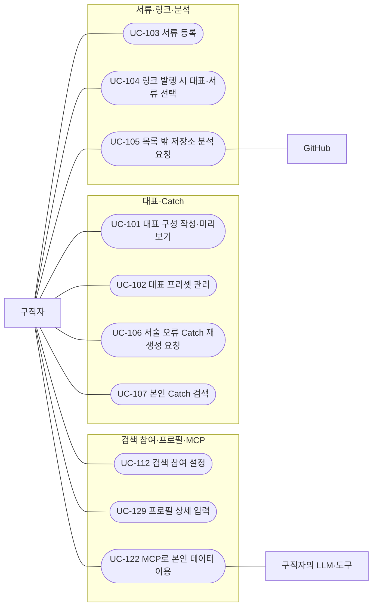
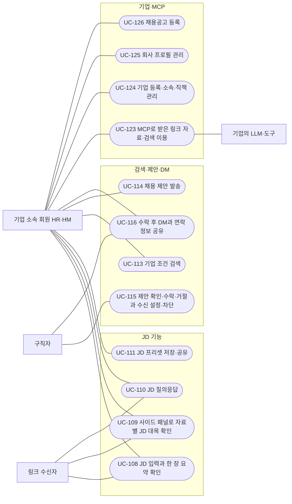
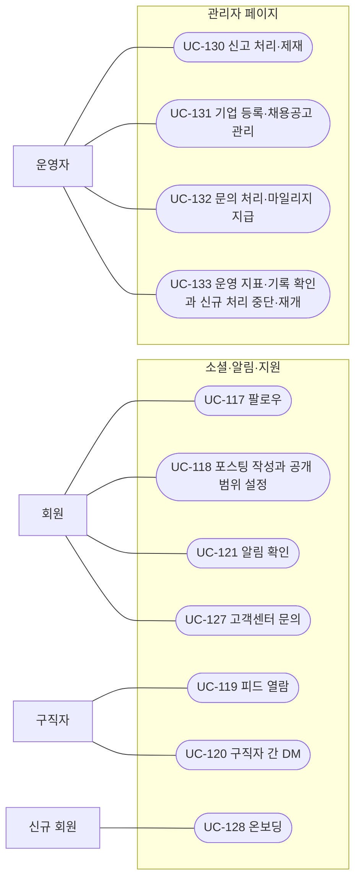
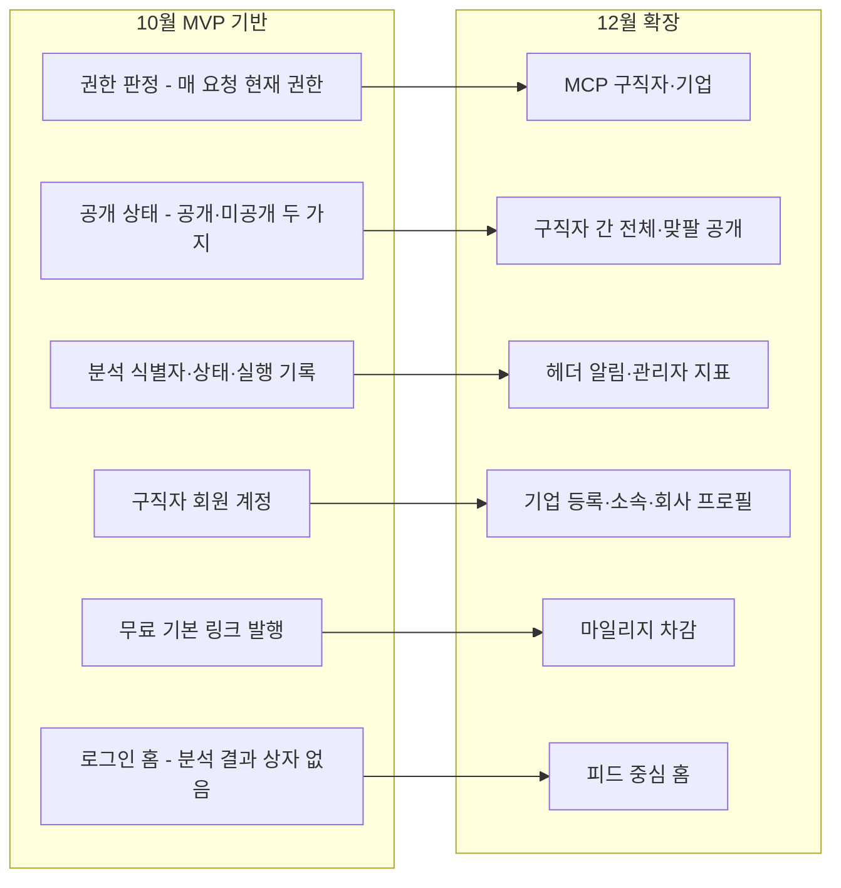

# 요구사항 정의서 — 12월 계획

| 항목 | 내용 |
|---|---|
| 팀명 | Jaemin_AI |
| 과제명 | 이력서-채용공고 텍스트 매칭 시스템 |
| 서비스명 | CatchU(캐치유) |
| 문서 버전 | v1.0 |
| 작성일 | 2026-09-28 |
| 기준 | origin/dev 9093d2e |
| 문서 지위 | **미승인 계획 — 12월 intent 요구사항 분석 전, 팀장 결정 입력 기준.** 중간 평가 제출 산출물. 기준 원천은 12월 범위 보완(팀장 결정 입력)과 첫 intent 승인 요구사항(2026-09-11)의 12월 항목이다. ID는 `id-registry.md`의 가칭 ID(ID 체계는 제안안)이며, 정식 요구사항 ID와 세부 동작은 12월 intent의 요구사항 분석에서 정한다. 이 문서는 AI-DLC 승인 기록이 아니다 |

## 변경 이력

| 버전 | 일자 | 내용 | 작성 |
|---|---|---|---|
| v1.0 | 2026-09-28 | 최초 작성. 12월 포함·보류·제외·미결 범위, 액터, 유스케이스 33개와 명세(상세 18·간이 15), 가칭 기능 요구사항 57개와 보류 3개, 업무규칙, 비기능, 미결 사항, 10월 설계와의 연결, 원본 대응 정리. 같은 날 문서 간 정합성 점검으로 부록 B 정합성 추적표(가칭 FR 60행과 역방향 점검)를 채우고, 우선순위 표기를 08·10 문서와 같은 '중(미정)'으로 맞추고, 승인 요구사항의 '12월 중순'에 현행 확정일(12/10)을 덧붙이고, 작성 메모(부록 C)를 본문으로 옮김 | 팀장(AI 작성 보조) |

**미승인 계획 — 12월 intent 요구사항 분석 전, 팀장 결정 입력 기준.** 12월 intent는 아직 시작하지 않았다. 이 문서의 모든 항목은 12월 요구사항 분석을 거치며 바뀔 수 있고, 12월 완성을 약속하지 않는다.

## 1. 개요

### 1.1 목적 — 10월 MVP 이후 확장

10월 MVP는 구직자가 동의한 선정 공개 저장소를 실제로 분석해 Catch(작업 사실·본인 기여·근거·설명 초안)를 확인하고, 따로 공개를 선택한 뒤 링크를 발행하면 비로그인 수신자가 현재 허용된 자료를 읽는 흐름까지다. 첫 intent 승인 요구사항은 12월을 "12월 중순 실제 사용 가능한 서비스의 현재 최소 범위"로 두었다(현행 확정: 12/10 최종 발표·프로젝트 종료, 9/28 팀장 확정).

12월 확장의 목적은 두 갈래다.

- **채용 쪽이 자기 JD로 자료를 확인하게 한다.** 첫 intent의 목적은 구직자가 GitHub 기록에서 경험과 근거를 정리해 전달하고, HR·HM이 자신의 JD에 따라 지원 자료를 확인하도록 돕는 것이다. 12월에는 서류(자기소개서·포트폴리오·이력서), JD 기준 한 장 요약·근거 확인·질의응답, 로그인 기업의 조건 검색 → 채용 제안 → 구직자 응답 → 수락 후 텍스트 DM 경로를 더한다. 지원 접수·전형은 기존 ATS와 역할을 나누며, 기존 ATS가 MCP 제공으로 바뀌는 흐름에 맞춰 CatchU도 MCP를 제공한다.
- **구직자가 자료를 스스로 구성하고 서비스 안에서 활동하게 한다.** 대표 구성(대표 주장 1개와 Catch 2~3장)을 12월 1순위로 두고, 팔로우·포스팅·피드·구직자 간 DM·알림·온보딩을 더한다. 운영자 한 명이 짧은 시간에 처리할 수 있는 관리자 기능과 운영 지표를 후순위로 넣는다.

HR의 인재 탐색·기술 확인 어려움과 HM의 GitHub 확인 어려움은 팀이 전달한 인터뷰상의 불편이며, 모든 채용 담당자의 특성이나 검증된 개선 효과로 일반화하지 않는다(첫 intent 「의도 분석」).

### 1.2 문서 지위와 지위 표기

팀은 AI-DLC(AI 주도 개발 절차)로 요구사항과 설계를 관리한다. AI-DLC는 작업 한 덩어리를 **intent**라 부르고, 단계마다 팀장이 승인해야 다음 단계로 넘어간다(이 승인 지점을 **게이트**라 한다). 이 문서에서 "첫 intent"는 2026-09-09에 시작해 요구사항을 2026-09-11에 승인한 서비스 정의 검토, "10월 intent"는 10월 MVP를 다루는 두 번째 작업, "12월 intent"는 아직 시작하지 않은 12월 범위 작업을 가리킨다.

이 문서는 12월 intent를 시작하기 전의 계획이다. 12월 범위 보완은 12월 intent의 입력이며, 그 intent는 **요구사항 분석 승인까지만** 진행하고 도메인 설계·계약·ERD는 10월 MVP 개발 뒤에 한다(12월 범위 보완 §5).

| 표기 | 이 문서에서의 뜻 |
|---|---|
| 승인 | AI-DLC 단계 승인(게이트)을 통과한 산출물의 내용. 여기서는 주로 첫 intent 요구사항(2026-09-11)의 12월 항목과 10월 intent 요구사항(2026-09-22)의 적용·변경 |
| 승인(12월 계획) | 첫 intent가 12월로 승인했으나 12월 intent에서 다시 확인할 항목 |
| 팀장 결정 | 12월 범위 보완 등 입력 문서에 적힌 팀장 결정. 이 문서에서는 "미승인 계획"과 같은 지위다 |
| 제안안 | 이 문서에서 새로 제안한 것. 가칭 ID 체계, 유스케이스 목록과 흐름 순서 |
| 미정 | 아직 정하지 않음. 정할 곳(12월 요구사항 분석, OQ, 이슈)을 함께 적는다 |

### 1.3 기준 원천과 적용 순서

| 약칭 | 원천 | 지위 |
|---|---|---|
| 12월 보완 | `docs/ai-dlc-input-december/CatchU_12월_범위_보완.md`(2026-09-15 기록, 9/24·25 보완). 절 번호(§2, §3-1, §3-2, §4, §5, §6)와 출처 표기([8월]·[9/15]·[9/16]·[9/24]·[9/25])를 그대로 인용한다 | 팀장 결정 입력 |
| 첫 intent | `aidlc/spaces/default/intents/260909-catchu-definition-review/inception/requirements-analysis/requirements.md` | 승인(2026-09-11) |
| 10월 요구사항 | `aidlc/spaces/default/intents/260914-catchu-october-mvp/inception/requirements-analysis/requirements.md` | 승인(2026-09-22) |
| 9/16 회의 | `docs/ai-dlc-input-mvp/2026-09-16_meeting-decisions.md` | 팀장 결정 입력(후속 입력) |
| 후속 입력 | `docs/ai-dlc-input-mvp/2026-09-14_followup.md` | 팀장 확인·팀장 결정 |
| P4 | `docs/페르소나_P4_운영자_v2_0.md`, `docs/P4_설계노트_v2_0.md` | 페르소나(2026-09-01 팀 논의 반영). 설계 노트의 권한 모델은 초안·미확정 |

12월 보완은 승인 요구사항과 10월 intent 기록을 소급 수정하지 않는다. 두 원천이 다르게 말하는 곳에서는 뒤의 결정인 12월 보완을 12월 계획으로 적고, 첫 intent 원문을 함께 밝힌다.

### 1.4 첫 intent 대비 달라진 점

| 항목 | 첫 intent(2026-09-11) | 12월 보완 | 출처 |
|---|---|---|---|
| 소셜 기능 | 「제품 범위 밖·자동 확대 금지」에 "소셜 기능 전체" | 팔로우·포스팅·피드·구직자 간 DM을 12월 포함 | §1 누락 경위, §2 [9/15] |
| 알림·MCP·채용공고 등 | 다루지 않음(입력 문서가 "생략만으로 폐기하지 않는다"고 넘김) | 12월 포함 | §1, §2 |
| 대표 구성 | 10월(FR3.1 대표 한 벌) | 10월 요구사항이 첫 MVP 이후로 미룬 것을 12월 1순위로 포함 | §2 [9/24] |
| 회사 안 JD 공유 | 후속 검토 후보(Q24) | 직책 권한에 따른 소속 회원 공유를 포함 | §2 기업 JD 프리셋 [9/24] |
| 기업 MCP | 없음. 참고 원문인 v10 기획 문서는 받은 링크 범위의 읽기 전용으로 두었다 | 검색 노출 동의 구직자 탐색까지 포함 | §2 MCP [9/24] |
| 이력서 | 서류 종류에 없음 | PDF 업로드로 12월 포함, 여러 벌 | §2 이력서 [9/16]·서류와 프리셋 [9/24] |
| 운영 기능(FR10.1·10.3·10.4) | 10월 | 10월 요구사항이 10월 미제공으로 변경 → 12월 후순위 포함 | §2 운영 기능 [9/24] |
| 기업 등록·관리자 처리·마일리지 | 기업 계정은 12월 기능의 전제로만 있고 회사 소속 확인 방법은 OQ7 미결. 관리자 처리·마일리지는 없음 | 기업 등록·소속·직책, 관리자 처리 기능, 마일리지를 12월 포함 | §2 [8월]·[9/15]·[9/25] |

누락 경위: 첫 intent의 참고 원문(v10 기획 문서) 4절에서 "포함"이던 기능 일부가 승인 요구사항의 12월 항목에 오르지 않았고, 팀장이 2026-09-15에 이 기능들이 12월 목표였다고 확인했다. 키워드 대조로 찾았으므로 다른 표현으로 들어간 항목은 빠졌을 수 있다(12월 보완 §1).

## 2. 범위

### 2.1 범위 요약

| 구분 | 개수 | ID | 기준 |
|---|---|---|---|
| 12월 포함 — 12월 보완 §2의 팀장 결정 | 가칭 FR 42개 | 5절 | §2 |
| 12월 포함 — 첫 intent 12월 계획 유지, 포함 여부·순서를 요구사항 분석에서 재확인 | 가칭 FR 15개 | 5절 | 첫 intent, §6 "요구사항 분석" |
| 보류(첫 intent 원본 있음) | 3개 | FR-OPS-105~107 | §3-2, §6 |
| 보류·재검토·시점 미정 | 16개 | DEF-01~16 | §3-1, §6 |
| 제외·범위 밖 | 12개 | EXC-01~12 | §3-1, 첫 intent 「범위 밖과 미채택 후보」 |
| 미결(§3-2) | 12개 항목 | 항목명으로 식별 | §3-2 |

우선순위: 상 3개(대표 구성), 하 4개(운영 기능), 중(미정) 50개. 규칙은 5.1절.

### 2.2 12월 포함 — 12월 보완 §2

| 기능 묶음 | 포함 내용 | 가칭 FR | 출처 | 우선순위 |
|---|---|---|---|---|
| 대표 구성 | 대표 주장 작성·수정, Catch 2~3장 선택·교체, 대표 미리보기, 발행 시점 대표 주장·연결 구성 보존 | FR-REP-101~103 | §2 [9/24] | 상(1순위) |
| 서류와 프리셋 | 자기소개서·포트폴리오·이력서를 각각 여러 벌 등록. 내 자산의 서류별 탭에서 등록하고 링크 발행 때 고른다. 발행본 보존·원본 변경 안내 | FR-DOC-101~104, FR-DOC-106 | §2 자기소개서·포트폴리오 [8월], 이력서 여러 벌 [9/24] | 중(미정) |
| 이력서 | PDF 파일 업로드. 자기소개서·포트폴리오와 같은 시점 제공 | FR-DOC-106 | §2 [9/16] | 중(미정) |
| 프로필 상세 항목 | 다른 사람 프로필을 볼 때 보이는 정보를 학력·경력 등으로 확대 | FR-MEM-101 | §2 [8월] | 중(미정) |
| 공개 범위 전체·맞팔 2단 | 구직자끼리 프로필·포스팅·Catch를 볼 때만 적용 | FR-SOC-104 | §2 [9/15], 글마다 설정 [8월] | 중(미정) |
| 팔로우·포스팅·피드 | 팔로우, 글별 읽기 권한이 있는 포스팅, 로그인 홈 피드 | FR-SOC-101~103 | §2 [9/15], 글 읽기 권한 [8월] | 중(미정) |
| 구직자 간 DM | 기업–구직자 수락 후 DM과 별개 경로 | FR-MSG-103 | §2 [9/15] | 중(미정) |
| 알림 | 헤더 알림, 분석 완료·실패 안내 포함 | FR-NTF-101 | §2 [9/15], 헤더·설정 [9/16] | 중(미정) |
| MCP 구직자·기업 | 자기 LLM·도구에서 서비스 데이터 이용. 기업은 검색 노출 동의 구직자 탐색까지 | FR-MCP-101, FR-MCP-102 | §2 [9/15], 목적·기업 검색 [9/24] | 중(미정) |
| 기업 등록·소속·권한 | 기업 등록, 회원의 기업 소속, 기업 안 직책·권한 | FR-ENT-101, FR-ENT-102 | §2 [8월] | 중(미정) |
| 회사 프로필 | 구직자 프로필과 같은 구조로 처리 | FR-ENT-103 | §2 [9/15] | 중(미정) |
| 기업 JD 프리셋 | 기업 자산인 JD 프리셋의 저장·재사용과 소속 회원 공유 | FR-JDF-106, FR-ENT-104 | §2 [8월], 기업 안 공유 [9/24] | 중(미정) |
| JD 기능의 수신자 입력 | 링크 수신자도 JD를 입력해 한 장 요약·사이드 패널·질의응답에 반영(재확인) | FR-JDF-101~105 | §2 [8월] | 중(미정) |
| 채용공고 | 기업 계정이 직접 등록하는 간단한 형태. 지원은 외부 링크 | FR-JOB-101 | §2 [9/15] | 중(미정) |
| 본인 카드 검색 | 본인 Catch 검색 | FR-CAT-102 | §2 [9/15] | 중(미정) |
| 고객센터 | 문의 접수와 관리자 페이지 처리 | FR-SUP-101, FR-ADM-104 | §2 [9/15] | 중(미정) |
| 온보딩 | 신규 회원 온보딩 | FR-MEM-102 | §2 [9/15] | 중(미정) |
| 운영 기능 | 품질 신호, 운영 기록 조회, 신규 분석·AI 호출 전체 중단·재개, 관리자 지표 화면 | FR-OPS-101~104 | §2 [9/24], 지표 화면 [9/25] | 하(후순위, 가능하면 포함) |
| 관리자 처리 기능 | 신고 처리·제재, 기업 등록 관리, 채용공고 관리(고객센터 문의 처리·마일리지 지급과 같은 관리자 페이지) | FR-ADM-101~103 | §2 [9/25] | 중(미정) |
| 마일리지 | 운영진 지급. 링크 발행·제안 발송·응답 페이백·탐색 중 정보 열람에 우선 적용 | FR-MIL-101, FR-MIL-102, FR-ADM-105 | §2 [9/15] | 중(미정) |

12월 보완 §2의 "MCP를 검증에도 쓴다"는 제품 기능이 아니라 개발·검증 방식이므로 기능 요구사항을 두지 않고 7.3절에 적는다.

### 2.3 12월 포함 — 첫 intent 12월 계획 유지(요구사항 분석에서 재확인)

첫 intent 승인 요구사항은 12월 항목을 "현재 모두 포함"으로 두고 "검색·소싱의 완성도는 담당·실제 가용량 확인 시 우선 축소 검토. 지금 제외하거나 다른 기능을 임의로 앞당기지 않음"이라고 했다. 12월 보완 §6은 아래 항목을 "요구사항 분석"으로 표시했다. 이는 기록상 지위(첫 intent 12월 계획)를 유지한 채 12월 요구사항 분석에서 포함 여부와 순서를 정한다는 뜻이다.

| 항목 | 가칭 FR | 첫 intent 원본 | §6 파트(10월 작업 구분) |
|---|---|---|---|
| 여러 벌의 대표 프리셋·링크별 선택 | FR-REP-104 | FR3.3 | B, C |
| 서술 오류 Catch의 제한 재생성 | FR-CAT-101 | FR3.6 | B(F와 함께) |
| 목록 밖 공개 저장소 분석, 미지원 저장소 사전 안내 | FR-ANL-101, FR-ANL-102 | FR1.2, FR1.3 | D(A·F와 함께), F |
| 서류 텍스트·PDF를 JD 기능에 쓰기 | FR-DOC-105 | FR5.5 | F |
| 검색 참여와 기업 조건 검색 | FR-SRC-101, FR-SRC-102, FR-SRC-104 | FR7.1, FR7.2, FR7.4 | 10월 파트 밖 |
| 검색용 기술 표기 정규화 | FR-SRC-103 | FR7.3 | F |
| 채용 제안·수신 통제·차단 | FR-OFR-101~104 | FR8.1~FR8.4 | 10월 파트 밖 |
| 수락 후 기업–구직자 텍스트 DM·연락처 공유 | FR-MSG-101, FR-MSG-102 | FR9.1, FR9.2 | 10월 파트 밖 |

§6의 파트는 10월의 작업 구분이며 12월 담당을 뜻하지 않는다. 12월 담당은 미정이다.

### 2.4 보류·재검토·시점 미정

| ID | 항목 | 원본 | 처리 | 근거 |
|---|---|---|---|---|
| FR-OPS-105 | 내부 선택 공유(선택 공유한 Catch의 내부 품질 검토) | FR10.2 | 12월 포함 여부 미결 | §3-2 운영 기능의 나머지 |
| FR-OPS-106 | 조건별 운영 경고 | FR10.5 | 12월 포함 여부 미결 | §3-2 |
| FR-OPS-107 | 사용자 조사(체험 유형 구분·품질 검사와 분리) | FR10.6 | 요구사항 분석에서 결정, 수행하면 OQ15 | §6 |
| DEF-01 | 링크 열람 기록(알림 '링크 열람 발생'·기업 MCP 열람 기록 포함) | 없음 | 보류 | §3-1 |
| DEF-02 | 카드 탐색 3층(커밋 메시지 원문·diff로 내려가는 서비스 안 탐색) | 없음 | 보류. 근거 링크로 GitHub 커밋에 연결하는 것과는 별개 | §3-1 |
| DEF-03 | 링크 다운로드 옵션 | 없음 | 재검토 중(기존 제외). 다운로드 허용이 확정된 것은 아니다(#56) | §3-1 |
| DEF-04 | 탈퇴 | 없음 | 시점 미정. 권고는 실사용자를 받는 12월 | §3-1 |
| DEF-05 | 로그인 수단 추가(Google 외) | 없음 | 요구사항 분석 | §6 A |
| DEF-06 | GitHub 재인증·연결 해제 세부 | OQ2·OQ-A1 | 10월 결정 이어받음 | §6 A |
| DEF-07 | 복합 필터·정렬·일괄 공개/숨김·보기 전환·장식 애니메이션 | 없음(10월 후보) | 요구사항 분석 | §6 B |
| DEF-08 | 발행 뒤 Catch 구성·본문 변화가 기존 링크에 미치는 영향 | OQ3 | 10월 정책 보류 → 요구사항 분석 | §6 C |
| DEF-09 | 비밀번호 변경·해제, 기존 세션 처리 | OQ4 | 10월 결정 이어받음 | §6 C |
| DEF-10 | 링크 만료 기간 선택·연장 | FR4.5 후보, OQ4 | 요구사항 분석 | §6 C |
| DEF-11 | 자동 재시도 정책(10월은 사용자 재요청) | OQ1 | 10월 결정 이어받음 | §6 E |
| DEF-12 | 원본 비공개 확인 주기·재공개 처리 | OQ2·OQ-B3 | 10월 결정 이어받음 | §6 E |
| DEF-13 | 모든 diff 전량 복구, 표현 반복 튜닝 | 없음 | 요구사항 분석 | §6 F |
| DEF-14 | 자동 배포(CD) | 없음 | 요구사항 분석 | §6 H |
| DEF-15 | 성능·가용성·복구 수치와 측정 방법 | OQ14 | 10월 결정 이어받음 | §6 H |
| DEF-16 | 결제·과금, 구독·가격 | OQ7 | 미결(마일리지 조건 적용) | §2 마일리지, §3-1 기업 인증 |

"10월 결정 이어받음"은 10월 개발 중에 정해질 수 있는 미결이므로 12월 요구사항 분석 때 그 결과를 확인한다는 뜻이다(12월 보완 §6). 원본 칸의 OQ1~OQ16은 첫 intent의 후속 결정 사항, OQ-A1·OQ-B3은 10월 API 명세 v1(`contract-summary.md`)의 미결 번호다.

### 2.5 제외·범위 밖

| ID | 항목 | 근거 |
|---|---|---|
| EXC-01 | MFA 등 계정 설정, 구직자 신원 인증 | 12월 보완 §3-1(프로젝트 구현 범위 밖) |
| EXC-02 | 기업 인증 | §3-1(우선순위상 사실상 범위 밖) |
| EXC-03 | 링크 재발행 별도 기능(중단·만료 뒤 새 링크 발행으로 대체) | §3-1 |
| EXC-04 | 기존 ATS의 지원 접수·전형 관리, 직접 ATS 연동 | 첫 intent 「범위 밖과 미채택 후보」, §2 채용공고 |
| EXC-05 | JD 매칭 % 제공, 유사도·일치 개수 순위, 검색 무결과의 역량 부재 판정 | 첫 intent 「금지된 파생 행동」 |
| EXC-06 | Catch 설명 직접 문구 수정 | 첫 intent FR3.5(12월에도 채택하지 않는 방향) |
| EXC-07 | 대표 주장·자기소개서 자동 작성·첨삭, 고급 서류 편집 | 첫 intent 「현재 미채택」 |
| EXC-08 | 외부 URL 본문 자동 수집, 이미지 전용 PDF 내용 분석 | 첫 intent FR5.5·「현재 미채택」 |
| EXC-09 | 계정 전체 서류 공개 설정, 링크별 전체 GitHub 자산 공개 제한 | 첫 intent 「현재 미채택」 |
| EXC-10 | 자동 제안 발송, DM 첨부·읽음 표시, 수락 시 자동 연락 공유, 회사 전체 일괄 차단 | 첫 intent 「범위 밖」·「금지된 파생 행동」 |
| EXC-11 | 검색 자연어 조건 변환·동의어 사전·의미 검색·JD 렌즈 표기 | 첫 intent 「검색 후속 후보」 |
| EXC-12 | 마일리지 현금 구매·현금/재화 환전 | §2 마일리지 조건 |

### 2.6 미결(12월 보완 §3-2)

12월 보완 §3-2는 9/24 결정을 기존 기록과 대조하며 드러난 미결을 12개 항목으로 적었다. 결정이 아니며 12월 요구사항 분석에서 질문으로 다룬다. 항목은 프로필 상세, 기업 등록, 기업 안 공유, 채용공고와 JD 프리셋, 기업 소속 회원의 소셜 이용, MCP 인증·권한, MCP 쓰기 범위, 검사용 MCP, 관리자 처리 세부, 지표 정의, 운영 기능의 나머지, §6 "요구사항 분석" 항목의 포함 여부와 순서다. 내용 전체는 8.1절에 있다.

## 3. 액터

### 3.1 액터 목록

| 액터 | 유형 | 설명 | 10월 대비 | 관련 유스케이스 |
|---|---|---|---|---|
| 구직자 | 사람(로그인 회원) | GitHub 기록으로 만든 Catch를 확인·공개하고, 대표 구성과 서류를 골라 링크를 발행한다. 12월에는 검색 참여·제안 응답·DM·소셜·MCP를 더한다 | 10월 주 사용자, 기능 확대 | UC-101~107, UC-112, UC-115~122, UC-129 |
| 링크 수신자 | 사람(비로그인 가능) | 유효 링크로 기본 프로필·공개 GitHub 근거·링크에 담긴 서류를 열람하고, JD를 입력해 한 장 요약·사이드 패널·질의응답을 쓴다. 기업 로그인·구독 없이 이용한다 | 10월 열람에 서류·JD 기능 추가 | UC-108~110 |
| 기업 소속 회원(HR·HM) | 사람(로그인 기업 회원) | 기업에 소속된 회원. HR·HM이 여기에 속한다. 기업 로그인이 필요한 JD 프리셋·조건 검색·채용 제안·수락 후 DM과 회사 프로필·채용공고·기업 MCP를 쓴다. 유스케이스 표에서는 "기업 회원"으로 줄여 쓴다 | 12월 신규 | UC-108~111, UC-113, UC-114, UC-116, UC-123~126 |
| 회원 | 구직자·기업 회원을 묶은 표기 | 팔로우·포스팅·알림·고객센터 문의. 기업 소속 회원이 팔로우·포스팅·피드를 쓰는지는 미결(§3-2) | 12월 신규 표기 | UC-117, UC-118, UC-121, UC-127 |
| 신규 회원 | 사람 | 온보딩 대상 | 12월 신규 | UC-128 |
| 운영자 | 사람(관리자) | 개발을 겸하는 1명. 한 건에 몇 분만 쓴다는 전제다. 신고 처리·제재, 기업 등록·채용공고 관리, 문의 처리, 마일리지 지급, 운영 지표·기록 확인과 신규 처리 중단·재개를 한다 | 12월 신규(10월에는 G 영역 담당 없음) | UC-130~133 |
| GitHub | 외부 시스템 | 목록 밖 저장소의 소유·커밋 관계 확인과 분석 자료의 출처 | 10월과 같음, 확인 범위 확대 | UC-105 |
| 외부 LLM·도구(MCP 클라이언트) | 외부 시스템 | 구직자의 LLM·도구, 기업의 LLM·도구가 MCP로 CatchU 데이터를 쓴다 | 12월 신규 | UC-122, UC-123 |
| 서비스 LLM 제공자 | 외부 시스템 | JD 요약·질의응답·재생성 같은 생성 호출의 제공자. 제공자·모델은 미선정(OQ11, #119) | 10월과 같은 미선정 상태 | UC-106, UC-108~110 |

### 3.2 액터 간 경계

- 구직자 간 공개 범위(전체·맞팔)는 구직자끼리 볼 때만 적용한다. 기업 회원과 링크 수신자는 10월의 전역 공개·숨김을 따른다(BR-104). 팔로우 관계가 비로그인 링크 열람을 좌우하지 않는다.
- 기업 소속 회원은 기업 로그인이 필요한 12월 기능(FR6.6·FR7·FR8 계열)의 계정 전제다. 링크 수신자의 직접 열람에는 기업 로그인·구독을 요구하지 않는다(첫 intent FR4.2·C7).
- 기업 인증은 범위 밖이다(EXC-02). 인증 없는 기업 계정의 제안·DM은 반복 발송 제한과 개별 차단으로만 대응하며 사기 채용 위험은 남는다(12월 보완 §3-1).
- P4 페르소나는 운영자를 자동 처리로 끝나지 않은 예외 건만 보는 사람으로 정의한다. 12월 보완이 채택한 자동 처리는 인젝션·시스템 이상뿐이며, 이 둘은 사람이 여는 대응 화면을 두지 않는다(P4 팀 결정, 12월 보완 §2 운영 기능). 그 밖의 자동 처리(아래)는 채택 기록이 없다.
- P4 페르소나의 "기업 인증 이상 국면"은 기업 인증이 범위 밖이므로 12월 계획에 적용하지 않는다. 12월 보완은 기업 등록 관리를 사칭 대응 목적으로 둔다. P4의 고객센터 AI 1차 응답과 DM·포스팅 자동 필터 차단은 12월 보완에 채택 기록이 없어 미정이다.
- 운영자 계정과 일반 계정의 분리, 관리자 권한은 미정이다(§3-2 관리자 처리 세부, P4 설계 노트 7장 초안).

## 4. 유스케이스

### 4.1 유스케이스 목록

원천 산출물에 12월 유스케이스 목록은 없다. 아래는 `id-registry.md` 7.2절의 **제안안**이며, 관련 FR로 추적한다.

| ID | 이름 | 액터 | 관련 FR |
|---|---|---|---|
| UC-101 | 대표 구성 작성·미리보기 | 구직자 | FR-REP-101, FR-REP-102 |
| UC-102 | 대표 프리셋 관리 | 구직자 | FR-REP-104 |
| UC-103 | 서류 등록(자기소개서·포트폴리오·이력서) | 구직자 | FR-DOC-101, FR-DOC-106, FR-DOC-104 |
| UC-104 | 링크 발행 시 대표·서류 선택 | 구직자 | FR-REP-103, FR-REP-104, FR-DOC-102, FR-DOC-103, FR-MIL-101 |
| UC-105 | 목록 밖 저장소 분석 요청 | 구직자 | FR-ANL-101, FR-ANL-102 |
| UC-106 | 서술 오류 Catch 재생성 요청 | 구직자 | FR-CAT-101 |
| UC-107 | 본인 Catch 검색 | 구직자 | FR-CAT-102 |
| UC-108 | JD 입력과 한 장 요약 확인 | 링크 수신자, 기업 회원 | FR-JDF-101, FR-JDF-103, FR-JDF-104, FR-JDF-105, FR-DOC-105 |
| UC-109 | 사이드 패널로 자료별 JD 대목 확인 | 링크 수신자, 기업 회원 | FR-JDF-102 |
| UC-110 | JD 질의응답 | 링크 수신자, 기업 회원 | FR-JDF-101, FR-JDF-104 |
| UC-111 | JD 프리셋 저장·공유 | 기업 회원 | FR-JDF-106, FR-ENT-104 |
| UC-112 | 검색 참여 설정 | 구직자 | FR-SRC-101, FR-OFR-102 |
| UC-113 | 기업 조건 검색 | 기업 회원 | FR-SRC-102, FR-SRC-103, FR-SRC-104, FR-MIL-101 |
| UC-114 | 채용 제안 발송 | 기업 회원 | FR-OFR-101, FR-MIL-101 |
| UC-115 | 제안 확인·수락·거절과 수신 설정·차단 | 구직자 | FR-OFR-101, FR-OFR-103, FR-OFR-104, FR-MIL-102 |
| UC-116 | 수락 후 DM과 연락 정보 공유 | 구직자, 기업 회원 | FR-MSG-101, FR-MSG-102 |
| UC-117 | 팔로우 | 회원 | FR-SOC-101 |
| UC-118 | 포스팅 작성과 공개 범위 설정 | 회원 | FR-SOC-102, FR-SOC-104 |
| UC-119 | 피드 열람 | 구직자 | FR-SOC-103 |
| UC-120 | 구직자 간 DM | 구직자 | FR-MSG-103 |
| UC-121 | 알림 확인 | 회원 | FR-NTF-101 |
| UC-122 | MCP로 본인 데이터 이용 | 구직자 | FR-MCP-101 |
| UC-123 | MCP로 받은 링크 자료·검색 이용 | 기업 회원 | FR-MCP-102 |
| UC-124 | 기업 등록·소속·직책 관리 | 기업 회원 | FR-ENT-101, FR-ENT-102 |
| UC-125 | 회사 프로필 관리 | 기업 회원 | FR-ENT-103 |
| UC-126 | 채용공고 등록 | 기업 회원 | FR-JOB-101 |
| UC-127 | 고객센터 문의 | 회원 | FR-SUP-101 |
| UC-128 | 온보딩 | 신규 회원 | FR-MEM-102 |
| UC-129 | 프로필 상세 입력 | 구직자 | FR-MEM-101 |
| UC-130 | 신고 처리·제재 | 운영자 | FR-ADM-101 |
| UC-131 | 기업 등록·채용공고 관리 | 운영자 | FR-ADM-102, FR-ADM-103 |
| UC-132 | 문의 처리·마일리지 지급 | 운영자 | FR-ADM-104, FR-ADM-105 |
| UC-133 | 운영 지표·기록 확인과 신규 처리 중단·재개 | 운영자 | FR-OPS-101, FR-OPS-102, FR-OPS-103, FR-OPS-104 |

### 4.2 유스케이스 다이어그램

mermaid에는 유스케이스 다이어그램 형식이 없어 flowchart로 그렸다. 사각형은 액터, 둥근 막대는 유스케이스다. 영역이 넓어 세 장으로 나눴다.

그림 1. 12월 유스케이스 — 구직자의 자산·링크·분석

그림 2. 12월 유스케이스 — 링크 수신자·기업 소속 회원

그림 3. 12월 유스케이스 — 소셜·알림·지원과 운영자

### 4.3 핵심 유스케이스 명세

2.2·2.3절의 기능 묶음마다 하나 이상을 상세 명세로 적고, 나머지 유스케이스 15개는 이 절 끝의 간이 명세 표에 적었다. 기본 흐름은 FR 문장을 순서로 풀어 쓴 **제안안**이며, 화면 단위·순서·문구는 12월 설계에서 정한다. 관련 화면은 `id-registry.md` 8.3절의 가칭 화면 ID다.

#### UC-101 대표 구성 작성·미리보기

| 항목 | 내용 |
|---|---|
| 액터 | 구직자 |
| 관련 FR·우선순위 | FR-REP-101, FR-REP-102 · 상 |
| 관련 화면(가칭) | SCR_ASSET_51 대표 구성 편집, SCR_ASSET_52 대표 미리보기 |
| 사전 조건 | 로그인했고 본인 Catch가 있다. 대표에 넣을 수 있는 Catch의 조건(확인·공개 여부)은 미정 |
| 기본 흐름 | 1. 내 자산에서 대표 구성으로 들어간다(대표 구성은 내 자산 안에 둔다). 2. 대표 주장 1개를 쓴다. 3. 연결할 Catch 2~3장을 고른다. 4. 대표 미리보기로 확인한다. 5. 저장한다. |
| 대안·예외 | 대표 주장을 고치거나 Catch를 바꾼다. 대표를 만들지 않아도 링크 발행은 막히지 않는다 |
| 사후 조건 | 링크 발행 때 대표 구성을 고를 수 있다(UC-104). 대표를 구성한 링크는 선택한 주장·Catch를 먼저 보여 준다 |
| 적용 규칙 | 대표 구성 완성은 발행 필수 조건이 아니다(첫 intent FR3.1). Catch 설명은 직접 고치지 않고 해석·보완은 대표 주장에 둔다(FR3.5). 대표 주장 자동 작성·첨삭은 없다(EXC-07) |
| 미정 | 12월 Catch·주장 상한(OQ3). 2~3장을 12월 상한으로 고정하지 않는다(첫 intent FR3.1) |

#### UC-103 서류 등록(자기소개서·포트폴리오·이력서)

| 항목 | 내용 |
|---|---|
| 액터 | 구직자 |
| 관련 FR·우선순위 | FR-DOC-101, FR-DOC-106, FR-DOC-104 · 중(미정) |
| 관련 화면(가칭) | SCR_ASSET_54 자기소개서 탭, SCR_ASSET_55 포트폴리오 탭, SCR_ASSET_56 이력서 탭, SCR_ASSET_57 서류 원본 수정·삭제 안내 |
| 사전 조건 | 로그인. 10월의 준비 중 탭(SCR_ASSET_02)이 서류별 탭으로 바뀐다 |
| 기본 흐름 | 1. 내 자산의 서류별 탭을 연다. 2. 자기소개서는 텍스트로 입력하고, 포트폴리오는 PDF를 올리거나 외부 URL을 등록하고, 이력서는 PDF를 올린다. 3. 종류마다 여러 벌을 등록한다. 4. 등록한 텍스트·PDF는 CatchU 안에서 열람하고 외부 URL은 외부 원문으로 이동한다. |
| 대안·예외 | 원본을 고치거나 지우려 하면 그 서류가 들어간 기존 링크 목록, 발행 당시 내용 유지, 링크 중단 수단을 먼저 안내한다. 이미지 전용 PDF는 원문 열람만 하고 JD 근거로 쓰지 않는다 |
| 사후 조건 | 등록 서류는 링크에 담기 전까지 본인 관리 화면 밖에 노출되지 않고 검색 프로필에도 나오지 않는다 |
| 적용 규칙 | 자기소개서·포트폴리오·이력서 모두 링크별 선택·발행본 보존·원본 변경 안내를 똑같이 적용한다(9/16 회의 §4). 원본 수정·삭제가 기존 링크를 자동 중단하거나 발행본을 지우지 않는다 |
| 미정 | 파일 용량·열람·다운로드·보관 기준(#56), 자기소개서 문항·글자 수, PDF 지원 형식·실패 안내, 수량(OQ5), 다운로드 허용(DEF-03) |

#### UC-104 링크 발행 시 대표·서류 선택

| 항목 | 내용 |
|---|---|
| 액터 | 구직자 |
| 관련 FR·우선순위 | FR-REP-103(상), FR-REP-104·FR-DOC-102·FR-DOC-103·FR-MIL-101(중(미정)) |
| 관련 화면(가칭) | SCR_LINK_51 링크 발행 — 대표·서류 선택(10월 SCR_LINK_01 확장), SCR_MIL_51 마일리지 잔액·내역 |
| 사전 조건 | 로그인. 10월 링크 발행 조건(제목 필수·유효 제목 중복 금지·유효 링크 5개·선택 비밀번호·30일 고정 만료)은 12월에 바꾼다는 결정이 없다 |
| 기본 흐름 | 1. 링크 발행을 시작한다. 2. 대표 구성(여러 벌이면 그중 하나)을 고른다. 3. 등록 서류 중 링크에 넣을 것을 고른다. 4. 발행한다. 이때 대표 주장·연결 구성과 서류 발행본을 보존한다. 5. 마일리지를 차감한다(적용 방식 미정). |
| 대안·예외 | 대표·서류 없이도 발행한다. 마일리지 잔액이 모자랄 때의 동작은 미정 |
| 사후 조건 | 기존 링크는 발행 당시 대표 문구·연결 구성과 서류를 유지하되, 현재 비공개 Catch는 열람되지 않고 현재 링크 접근 조건이 계속 적용된다. 대표 영역 밖의 전역 공개 자산도 계속 열람된다 |
| 적용 규칙 | 계정 전체 서류 공개 설정은 없다(EXC-09). 외부 URL은 주소만 보존한다. 보존도 현재 권한 규칙을 우회하지 않는다(NFR-SEC-01). 10월 발행은 무료다(12월 보완 §4) |
| 미정 | 차감 수량·시점, 프리셋 삭제·변경 반영(OQ3), 발행 뒤 Catch 구성 변화의 기존 링크 영향(DEF-08) |

#### UC-105 목록 밖 저장소 분석 요청

| 항목 | 내용 |
|---|---|
| 액터 | 구직자, GitHub |
| 관련 FR·우선순위 | FR-ANL-101, FR-ANL-102 · 중(미정). 요구사항 분석에서 재확인 |
| 관련 화면(가칭) | SCR_ANL_51 목록 밖 저장소 선택(10월 SCR_ASSET_03 확장) |
| 사전 조건 | GitHub 연동. 해당 저장소 분석 동의가 선행 조건이다 |
| 기본 흐름 | 1. 저장소 연결 관리에서 선정 목록 밖 공개 저장소를 고른다. 2. 연결한 GitHub 계정이 그 저장소를 소유하거나 커밋했는지 확인한다. 3. 지원 조건과 개수·크기 한도를 확인한다. 4. 동의하고 요청한다. 이후는 10월 분석 흐름과 같다. |
| 대안·예외 | 관계 미충족·비공개·한도 초과를 구분해 안내한다. 지원하지 않는 저장소는 실행 전에 사유를 안내하고 실행 중 실패로 표시하지 않는다 |
| 사후 조건 | 동의 없는 분석은 실행되지 않는다. 사전 선정 목록은 내부 품질 검증 표본으로 남는다 |
| 적용 규칙 | 소유 사실을 공동 기여 전체의 본인 귀속으로 쓰지 않는다(첫 intent FR1.2) |
| 미정 | 관계 확인 방식·한도 수치(OQ1), 동의 수집 방식(OQ11) |

#### UC-106 서술 오류 Catch 재생성 요청

| 항목 | 내용 |
|---|---|
| 액터 | 구직자, 서비스 LLM 제공자 |
| 관련 FR·우선순위 | FR-CAT-101 · 중(미정). 요구사항 분석에서 재확인 |
| 관련 화면(가칭) | SCR_ASSET_58 Catch 재생성 요청(10월 SCR_ASSET_04에서 진입) |
| 사전 조건 | 서술 오류가 있는 본인 Catch |
| 기본 흐름 | 1. Catch 상세에서 재생성을 요청한다. 2. 호출 한도 안에서 설명을 다시 만든다. 3. 결과를 확인한다. 4. 따로 공개를 선택한다. |
| 대안·예외 | 묶음·귀속 오류는 문구 재생성이 아니라 저장소 재분석이나 미공개 유지로 처리한다. 한도를 넘으면 새 재생성은 제한된다 |
| 사후 조건 | 기존 공개 Catch는 자동으로 바뀌지 않는다 |
| 적용 규칙 | 불일치 표시를 신고로 쓰며 별도 신고 창구와 사람이 갱신하는 처리 상태는 두지 않는다(첫 intent FR3.6) |
| 미정 | 재생성 방식과 호출 한도(OQ3) |

#### UC-108 JD 입력과 한 장 요약 확인

| 항목 | 내용 |
|---|---|
| 액터 | 링크 수신자, 기업 회원, 서비스 LLM 제공자 |
| 관련 FR·우선순위 | FR-JDF-101, FR-JDF-103, FR-JDF-104, FR-JDF-105, FR-DOC-105 · 중(미정) |
| 관련 화면(가칭) | SCR_VIEW_52 JD 선택·직접 입력, SCR_VIEW_53 JD 한 장 요약 |
| 사전 조건 | 유효 링크 조건(없음·중단·만료가 아니고, 설정된 경우 비밀번호 확인)을 충족한다. 로그인은 필요 없다 |
| 기본 흐름 | 1. 수신자 화면에서 JD를 직접 입력한다(기업 회원은 JD 프리셋을 고를 수 있다). 2. 링크 단위 사용 한도를 확인한다. 3. 같은 JD에 대해 현재 자료·접근 조건을 만족하는 요약이 있으면 재사용하고, 없으면 새로 만든다. 4. 현재 허용된 프로필·GitHub 근거·링크에 담긴 서류를 JD 기준으로 정리한 한 장 요약과 근거를 본다. |
| 대안·예외 | 한도를 다 쓰면 새 LLM 호출을 막고 안내하되 재사용 가능한 요약과 원자료 열람은 유지한다. 요약에 쓴 Catch·서류의 공개 상태가 바뀌면 그 요약은 재생성 대상이 되고, 재생성 한도가 없으면 현재 허용된 원자료만 보인다. 매칭 %를 묻는 질문에도 매칭 %를 내지 않는다 |
| 사후 조건 | 비공개·미포함 서류와 이미지 전용 PDF 내용은 근거로 쓰이지 않는다 |
| 적용 규칙 | BR-101(매칭 % 미제공). 다른 수신자의 JD·질의 기록을 요약 재사용만으로 공유하지 않는다(NFR-SEC-01) |
| 미정 | 한도 수치·집계·초기화, 같은 JD 판정, 질의 기록 보관, 응답 품질 판정(OQ6), 서비스 LLM 제공자(OQ11) |

#### UC-111 JD 프리셋 저장·공유

| 항목 | 내용 |
|---|---|
| 액터 | 기업 회원 |
| 관련 FR·우선순위 | FR-JDF-106, FR-ENT-104 · 중(미정) |
| 관련 화면(가칭) | SCR_ENT_54 JD 프리셋 관리 |
| 사전 조건 | 로그인한 기업 계정이며 기업에 소속돼 있다 |
| 기본 흐름 | 1. JD를 프리셋으로 저장한다. 2. 같은 기업 소속 회원이 직책 권한에 따라 그 프리셋을 고른다. 3. JD 요약·패널·질의응답에서 다시 쓴다. |
| 대안·예외 | 직책 권한이 없는 소속 회원의 이용은 권한 정의에 따른다(미정) |
| 사후 조건 | JD 프리셋은 기업 자산으로 남는다. 채용공고 하나에 JD 하나를 두고 HR·HM이 같은 것을 쓰는 실무를 따른다 |
| 적용 규칙 | 회사 안 공유로 지원자 자료의 열람 권한이 자동으로 넓어지지 않는다(첫 intent, 12월 보완 §3-2 인용) |
| 미정 | 직책별 권한(§3-2 기업 등록), 후보자 메모·질의 기록 공유(§3-2 기업 안 공유), 공고–JD 연결(§3-2), 관리·회원 한도·구독(OQ6·OQ7) |

#### UC-113 기업 조건 검색

| 항목 | 내용 |
|---|---|
| 액터 | 기업 회원 |
| 관련 FR·우선순위 | FR-SRC-102, FR-SRC-103, FR-SRC-104, FR-MIL-101 · 중(미정). 요구사항 분석에서 재확인 |
| 관련 화면(가칭) | SCR_SRC_52 기업 조건 검색, SCR_SRC_53 검색 결과 구직자 프로필 |
| 사전 조건 | 로그인한 기업 계정. 검색 대상은 검색 참여를 따로 선택한 구직자뿐이다(기본 미노출, UC-112) |
| 기본 흐름 | 1. UI 필터로 직무·기술 스택(구직자 자가 입력값)과 Catch 사실 속성 조건을 고른다. 2. 결과 목록을 본다. 순서는 유사도·일치 개수 순위가 아니다. 3. 구직자 프로필을 연다. 탐색 중 정보 열람은 마일리지 적용 대상이다. |
| 대안·예외 | 결과가 없으면 해당하는 Catch가 없다고 안내하고, 역량 부재 판정이나 대체 추천으로 넓히지 않는다 |
| 사후 조건 | 숨긴 Catch·서류와 '판단의 흐름'·'기록에 없는 것'은 검색되지 않는다 |
| 적용 규칙 | BR-102(순위 없음), BR-103(자가 입력값을 GitHub 검증 사실로 표시하지 않음). 기업 MCP 검색도 같은 조건이다 |
| 미정 | 사실 속성 목록·추출 규칙·표준 표기·정렬(OQ8), 무료 열람 범위(12월 보완 §2 마일리지 조건, DEF-16) |

#### UC-114 채용 제안 발송

| 항목 | 내용 |
|---|---|
| 액터 | 기업 회원 |
| 관련 FR·우선순위 | FR-OFR-101, FR-MIL-101 · 중(미정). 요구사항 분석에서 재확인 |
| 관련 화면(가칭) | SCR_OFR_51 채용 제안 작성 |
| 사전 조건 | 로그인한 기업 계정. 받는 구직자가 제안 수신을 끄지 않았고 그 기업 계정을 차단하지 않았다 |
| 기본 흐름 | 1. 포지션/JD와 관심 이유를 적는다. 2. 제안을 보낸다. 제안 발송은 마일리지 적용 대상이다. |
| 대안·예외 | 반복 발송 제한 조건을 넘긴 새 제안은 제한된다. 비로그인 발송은 허용하지 않는다 |
| 사후 조건 | 구직자가 제안을 확인하고 응답할 수 있다(UC-115) |
| 적용 규칙 | 자동 제안 발송은 없다(EXC-10). 지원 접수·전형 관리를 추가하지 않는다 |
| 미정 | 반복 제한 조건·수치, 미응답 제안의 상태·만료·철회(OQ9), 차감 수량 |

#### UC-115 제안 확인·수락·거절과 수신 설정·차단

| 항목 | 내용 |
|---|---|
| 액터 | 구직자 |
| 관련 FR·우선순위 | FR-OFR-101, FR-OFR-103, FR-OFR-104, FR-MIL-102 · 중(미정) |
| 관련 화면(가칭) | SCR_OFR_52 받은 제안 목록·응답, SCR_OFR_53 제안 수신 설정·차단 관리 |
| 사전 조건 | 로그인한 구직자에게 제안이 도착했다 |
| 기본 흐름 | 1. 받은 제안의 포지션/JD·관심 이유를 확인한다. 2. 수락하거나 거절한다. 3. 수락하면 그 기업 계정과 DM을 쓸 수 있고, 수락 화면에서 연락 정보가 공유되지 않았다는 사실과 이후 공유 방법을 본다. 4. 응답하면 마일리지 페이백이 적용된다(대상·수량 미정). |
| 대안·예외 | 제안 수신을 끄면 새 제안만 멈추고 기존 수락 기업과의 DM은 유지된다고 안내한다. 개별 차단은 그 기업 계정 하나와의 새 제안과 DM 새 메시지만 멈춘다 |
| 사후 조건 | 설정을 꺼도 기존 제안이 자동 거절·삭제되지 않는다 |
| 적용 규칙 | 같은 회사의 다른 계정에는 차단이 자동 적용되지 않고 회사 전체 일괄 차단은 없다(EXC-10) |
| 미정 | 차단 해제와 기존 기록의 표시·보관(OQ9), 페이백 대상·수량 |

#### UC-116 수락 후 DM과 연락 정보 공유

| 항목 | 내용 |
|---|---|
| 액터 | 구직자, 기업 회원 |
| 관련 FR·우선순위 | FR-MSG-101, FR-MSG-102 · 중(미정). 요구사항 분석에서 재확인 |
| 관련 화면(가칭) | SCR_MSG_51 DM 목록, SCR_MSG_52 DM 대화·연락 정보 공유 |
| 사전 조건 | 구직자가 제안을 수락했고 기업 회원이 로그인했다 |
| 기본 흐름 | 1. 텍스트 DM을 주고받는다. 2. 구직자가 공유할 연락 정보 항목을 고르고 동의한다. 3. 동의한 항목만 해당 기업 계정에 공유된다. |
| 대안·예외 | 수락 전이거나 기업이 로그인하지 않았으면 DM을 쓸 수 없다. 개별 차단하면 새 송수신이 멈춘다. 검색 노출·제안 수신을 꺼도 기존 대화는 끊기지 않는다 |
| 사후 조건 | 공유 동의 전에는 연락 정보가 전달되지 않는다 |
| 적용 규칙 | 수락이 연락 정보 공유를 뜻하지 않는다. DM 첨부·읽음 표시는 없다(EXC-10) |
| 미정 | DM 상세 동작(OQ9), 연락 수단 종류·공유 후 변경·철회(OQ10) |

#### UC-118 포스팅 작성과 공개 범위 설정

| 항목 | 내용 |
|---|---|
| 액터 | 회원(기업 소속 회원의 이용 여부는 미결) |
| 관련 FR·우선순위 | FR-SOC-102, FR-SOC-104 · 중(미정) |
| 관련 화면(가칭) | SCR_SOC_51 포스팅 작성, SCR_SOC_52 포스팅 상세 |
| 사전 조건 | 로그인 |
| 기본 흐름 | 1. 포스팅을 쓴다. 2. 글마다 읽기 권한을 전체 또는 맞팔로 정한다. 3. 올린다. |
| 대안·예외 | 맞팔로 제한한 글은 맞팔 관계인 구직자만 읽는다 |
| 사후 조건 | 팔로우한 사람의 피드(UC-119)에 나타난다. 팔로우한 사람이 없는 구직자의 피드에는 팔로우가 많은 사람의 공개 포스팅이 나온다 |
| 적용 규칙 | BR-104. 공개 범위는 구직자끼리 볼 때만 적용하고 기업·직접 링크 열람은 전역 공개·숨김을 따른다 |
| 미정 | 팔로우 방식·반응 기능(12월 요구사항 분석), 신고 접수 경로(8.4절) |

#### UC-121 알림 확인

| 항목 | 내용 |
|---|---|
| 액터 | 회원 |
| 관련 FR·우선순위 | FR-NTF-101 · 중(미정) |
| 관련 화면(가칭) | SCR_NTF_51 알림 목록(10월 SCR_COMMON_02 대체) |
| 사전 조건 | 로그인 |
| 기본 흐름 | 1. 헤더의 종 아이콘에 새 알림 수가 숫자로 보인다(꺼 둔 알림은 세지 않는다). 2. 알림 목록을 연다. 안 읽음은 검정, 읽음은 회색이다. 3. 분석 완료·실패 안내를 확인한다. |
| 대안·예외 | 프로필 모달이나 알림 목록의 톱니바퀴에서 같은 알림 설정 화면으로 간다 |
| 사후 조건 | 10월 홈에 없던 분석 결과 안내가 헤더 알림에서 제공된다 |
| 적용 규칙 | 빨강은 전체 시스템 공지에만 쓰고 색 변경·움직이는 효과는 쓰지 않는다(9/16 회의 §1). '링크 열람 발생' 알림은 보류(DEF-01) |
| 미정 | 그 밖의 알림 종류(요구사항 분석), 숫자 형식, 알림 필터(개발 후순위) |

#### UC-123 MCP로 받은 링크 자료·검색 이용

| 항목 | 내용 |
|---|---|
| 액터 | 기업 회원, 기업의 LLM·도구 |
| 관련 FR·우선순위 | FR-MCP-102 · 중(미정) |
| 관련 화면(가칭) | SCR_PROF_52 MCP 연결 관리 |
| 사전 조건 | 로그인한 기업 계정의 MCP 연결(토큰 발급 방식 미정) |
| 기본 흐름 | 1. 기업의 LLM·도구가 MCP로 받은 링크 범위의 자료를 읽는다. 2. 검색 노출에 동의한 구직자를 화면 검색과 같은 조건으로 찾는다. |
| 대안·예외 | 링크 비밀번호·만료·중단과 검색 노출 해제가 MCP 접근에 어떻게 반영되는지는 미결이다 |
| 사후 조건 | 화면에서 볼 수 없는 자료는 MCP로도 볼 수 없어야 한다(같은 권한 판정) |
| 적용 규칙 | NFR-SEC-101. 검색 참여 동의·로그인 기업·순위 없음(FR7 조건) |
| 미정 | MCP 인증·권한, 쓰기 범위(§3-2), MCP 열람 기록(DEF-01). 구직자 MCP(UC-122)는 구직자의 LLM이 이미 아는 맥락으로 필요한 Catch와 주장을 고민하도록 데이터를 제공하며 구직자 LLM의 정보를 가져오지 않는다 |

#### UC-124 기업 등록·소속·직책 관리

| 항목 | 내용 |
|---|---|
| 액터 | 기업 회원(운영자는 기업 등록 관리, UC-131) |
| 관련 FR·우선순위 | FR-ENT-101, FR-ENT-102 · 중(미정) |
| 관련 화면(가칭) | SCR_ENT_51 기업 등록·소속 신청, SCR_ENT_52 기업 구성원·직책 권한 관리 |
| 사전 조건 | 로그인 |
| 기본 흐름 | 1. 기업을 등록하거나 등록된 기업에 소속된다. 2. 기업 안에서 직책과 권한을 정한다(네이버 카페의 등급·권한과 비슷한 형태). |
| 대안·예외 | 기업 인증은 없다. 사칭 대응은 운영자의 기업 등록 관리로 한다 |
| 사후 조건 | 소속 회원이 기업 로그인이 필요한 기능(JD 프리셋·검색·제안)을 쓸 수 있는 계정 전제가 갖춰진다 |
| 적용 규칙 | 기업 인증 범위 밖(EXC-02). 제안·DM 위험은 반복 발송 제한과 개별 차단으로 대응 |
| 미정 | 누가 기업을 등록하고 소속을 승인하는지, 직책 종류와 직책별 권한, 사칭 저감 방법(§3-2 기업 등록) |

#### UC-126 채용공고 등록

| 항목 | 내용 |
|---|---|
| 액터 | 기업 회원 |
| 관련 FR·우선순위 | FR-JOB-101 · 중(미정) |
| 관련 화면(가칭) | SCR_JOB_51 채용공고 목록, SCR_JOB_52 채용공고 등록·수정, SCR_JOB_53 채용공고 상세 |
| 사전 조건 | 로그인한 기업 계정 |
| 기본 흐름 | 1. 간단한 채용공고를 등록한다. 2. 회원은 헤더의 채용공고 메뉴에서 공고를 본다. 3. 지원은 기업 ATS 등 외부 링크로 넘어간다. |
| 대안·예외 | 없음(세부는 요구사항 분석) |
| 사후 조건 | 서비스 안에서 지원 접수·전형 관리를 하지 않는다 |
| 적용 규칙 | EXC-04. 운영자가 채용공고를 관리한다(FR-ADM-103) |
| 미정 | 공고에 JD 프리셋을 연결할지(§3-2 채용공고와 JD 프리셋) |

#### UC-130 신고 처리·제재

| 항목 | 내용 |
|---|---|
| 액터 | 운영자 |
| 관련 FR·우선순위 | FR-ADM-101 · 중(미정) |
| 관련 화면(가칭) | SCR_ADM_53 신고 처리·제재 |
| 사전 조건 | DM·포스팅에 대한 신고가 들어왔다(신고 접수 경로는 미정) |
| 기본 흐름 | 1. 신고 알림을 보고 관리자 페이지로 들어간다. 2. 신고 내용·전후 맥락·양측 이력·유사 건의 과거 처리 결과를 한 화면에서 본다. 3. 경고·이용 제한·정지 중 하나를 고른다. 4. 사유를 기록하고 마친다. |
| 대안·예외 | 정해지지 않음. P4 설계 노트는 결정을 미루지 않도록 가벼운 조치(경고) 단계를 두는 안을 냈다(초안, 채택 미정). 한 건의 처리가 한 화면에서 끝나야 한다는 것은 P4 설계 제약이다 |
| 사후 조건 | 제재와 사유가 처리 이력으로 남아 다음 판단의 참고가 된다 |
| 적용 규칙 | 이 흐름은 P4 주 시나리오를 출발 입력으로 삼은 것이다(12월 보완 §2 관리자 처리 기능). 운영자는 개발을 겸하는 1명이고 한 건에 몇 분만 쓴다 |
| 미정 | 제재 단계·해제, 처리 이력 조회, 관리자 권한(§3-2 관리자 처리 세부). P4 설계 노트의 4단계 제재안(경고·이용 제한·계정 정지·강제 탈퇴)과 권한 모델은 초안이다 |

#### UC-133 운영 지표·기록 확인과 신규 처리 중단·재개

| 항목 | 내용 |
|---|---|
| 액터 | 운영자 |
| 관련 FR·우선순위 | FR-OPS-101, FR-OPS-102, FR-OPS-103, FR-OPS-104 · 하(후순위, 가능하면 포함) |
| 관련 화면(가칭) | SCR_ADM_51 관리자 지표, SCR_ADM_52 운영 기록·신규 처리 중단·재개 |
| 사전 조건 | 운영자 권한(권한 정의는 미정) |
| 기본 흐름 | 1. 관리자 지표에서 분석 처리·LLM 비용·결과 품질 숫자를 본다. 2. 운영 기록에서 오류·권한 위반 징후·AI 호출량·추정 비용을 확인한다. 3. 필요하면 신규 저장소 분석과 신규 AI 호출을 스위치로 멈추고, 나중에 다시 연다. |
| 대안·예외 | 중단 중에도 기존 자료는 현재 링크·공개 권한과 요약 재사용 규칙을 충족하는 범위에서 계속 열람된다. 비공개 전환 자료와 무효 요약은 예외로 다시 제공하지 않는다 |
| 사후 조건 | 재개 뒤 새 분석·AI 호출이 허용된다 |
| 적용 규칙 | 품질 신호만으로 Catch 설명·근거 전체를 열람하지 못한다. 지표는 10월 분석 상태·실행 기록을 모아 보이며 별도 수집 플랫폼을 조건으로 삼지 않는다 |
| 미정 | 지표별 집계 주기·보관 기간, 실시간 여부(§3-2 지표 정의), 운영 기록 정보·보관, 진행 중 작업 처리(OQ13) |

#### 그 밖의 유스케이스 — 간이 명세

위 상세 명세에 넣지 않은 15개다. 기본 흐름은 **제안안**이고, "확정된 조건"은 원천에 적힌 조건만 옮겼다. 원천에 흐름이 없는 것은 그렇다고 적었다.

| ID | 액터 | 사전 조건 | 기본 흐름(제안안) | 확정된 조건(근거) | 미정 |
|---|---|---|---|---|---|
| UC-102 대표 프리셋 관리 | 구직자 | 로그인. 대표 구성(UC-101) 기능 | 대표 프리셋을 여러 벌 만들고 고친다 → 직접 링크마다 프리셋을 고른다(UC-104) → 검색에 쓸 공통 대표 하나를 지정한다 | 서류는 따로 고르고 검색에 넣지 않는다(첫 intent FR3.3). 12월 1순위에 넣지 않았다(12월 보완 §2) | 프리셋 삭제·변경 반영·상한(OQ3), 우선순위 |
| UC-107 본인 Catch 검색 | 구직자 | 로그인. 본인 Catch가 있다 | 내 자산 Catch 탭에서 검색어를 넣는다 → 본인 Catch 목록이 좁혀진다 | 10월에 필요성 재검토 후보로 둔 목록 키워드 검색과 겹친다(12월 보완 §2·§6 B) | 검색 방식·대상 항목(12월 요구사항 분석) |
| UC-109 사이드 패널로 자료별 JD 대목 확인 | 링크 수신자, 기업 회원 | UC-108과 같은 유효 링크 조건. JD를 입력했다 | 자료를 열람하는 중 사이드 패널을 연다 → 지금 자료 안의 JD 관련 대목을 JD 순서대로 본다 → 대목이 없으면 미발견 안내와 한 장 요약의 해당 JD 항목 이동을 본다 | 다른 자료의 문장을 끌어오지 않고, 대응 여부를 개수·비율·색으로 세지 않는다(첫 intent FR6.2, BR-101) | 패널 표시 단위(12월 설계) |
| UC-110 JD 질의응답 | 링크 수신자, 기업 회원 | UC-108과 같음 | 입력한 JD를 기준으로 질문한다 → 현재 허용된 자료를 근거로 한 응답과 근거를 본다 | 매칭 %를 묻는 질문에도 매칭 %를 내지 않는다(FR6.1). 한도 소진 시 새 호출을 막는다(FR6.4) | 질의 기록의 구직자 공개·보관, 응답 품질 판정(OQ6) |
| UC-112 검색 참여 설정 | 구직자 | 로그인 | 검색 참여를 켠다(기본은 미노출) → 참여 안내에서 로그인한 기업 계정만 검색한다는 노출 대상을 확인한다 → 끌 때는 해제 화면에서 유지되는 관계와 끊는 방법을 본다 | 링크 발행과 별개다(FR7.1). 해제는 새 발견만 멈춘다(FR8.2) | 검색 미노출 뒤 새 제안 접근 경로(OQ9) |
| UC-117 팔로우 | 회원 | 로그인 | 다른 회원 프로필에서 팔로우한다 → 팔로우 목록에 더해진다 → 서로 팔로우하면 맞팔로 제한한 글도 읽는다 | 팔로우 관계가 비로그인 링크 열람을 좌우하지 않는다(BR-104) | 팔로우 방식·반응 기능(12월 요구사항 분석), 기업 소속 회원의 이용 여부(§3-2) |
| UC-119 피드 열람 | 구직자 | 로그인 | 로그인 홈을 연다 → 팔로우한 사람의 글을 피드로 본다 → 팔로우한 사람이 없으면 팔로우가 많은 사람의 공개 포스팅을 본다 | 12월에는 피드가 로그인 홈의 중심이다(12월 보완 §4). GitHub 연결·저장소 연결 안내 아래에도 피드를 둔다(9/16 회의 §2) | 피드 세부(12월 요구사항 분석) |
| UC-120 구직자 간 DM | 구직자 | 로그인 | 화면 우측 하단의 DM을 연다 → 대화 상대를 골라 메시지를 주고받는다 | 기업–구직자 수락 후 DM과 별개 경로다(12월 보완 §2). DM은 상단 메뉴·알림과 분리해 우측 하단에 둔다(9/16 회의 §1) | DM 아이콘 모양, 상세 동작, 신고 접수 경로(8.3절) |
| UC-122 MCP로 본인 데이터 이용 | 구직자, 구직자의 LLM·도구 | 로그인. MCP 연결(토큰 발급 방식 미정) | 구직자의 LLM·도구가 MCP로 본인 CatchU 데이터를 읽는다 → 그 LLM이 이미 아는 맥락으로 필요한 Catch와 주장을 고민한다 | 구직자 LLM의 정보를 가져오지 않는다(12월 보완 §2). 화면과 같은 권한 판정(NFR-SEC-101) | 읽을 수 있는 항목, 인증·권한, 쓰기 범위(§3-2) |
| UC-125 회사 프로필 관리 | 기업 회원 | 로그인. 기업에 소속돼 있다 | 회사 프로필을 만들고 고친다 | 구직자 프로필과 같은 구조로 처리하고 차별점이 필요하면 따로 만든다(12월 보완 §2). 같은 데이터 구조 강제와는 구분한다(§4) | 회사와 로그인 계정의 관계, 프로필 소유·편집 권한(12월 설계) |
| UC-127 고객센터 문의 | 회원 | 비로그인 문의 가능 여부는 미정 | 고객센터에 문의를 남긴다 → 운영자가 관리자 페이지에서 처리한다(UC-132) | 문의는 관리자 페이지에서 처리한다(12월 보완 §2) | 문의 유형, 답변 전달 방식, AI 1차 응답 채택 여부(P4 입력, 채택 기록 없음) |
| UC-128 온보딩 | 신규 회원 | 시점 미정 | 원천에 흐름이 없다 | 12월 포함(12월 보완 §2 [9/15]) | 온보딩 내용·단계 전체(12월 요구사항 분석) |
| UC-129 프로필 상세 입력 | 구직자 | 로그인 | 학력·경력 등 상세 항목을 입력한다 → 다른 사람이 프로필을 볼 때 허용된 항목이 보인다 | 자가 입력 항목은 GitHub에서 확인한 사실과 구분한다(BR-103). 구직자끼리 볼 때는 전체·맞팔 공개 범위를 적용한다(§3-2) | 항목 전체 목록, 보는 사람별 표시 항목(§3-2 프로필 상세) |
| UC-131 기업 등록·채용공고 관리 | 운영자 | 운영자 권한(정의 미정) | 관리자 페이지에서 등록된 기업과 채용공고를 확인하고 관리한다 | 기업 인증은 없으며 기업 등록 관리는 사칭 대응이 목적이다(12월 보완 §2·§3-1) | 관리 조치의 종류, 관리자 권한(§3-2 기업 등록·관리자 처리 세부) |
| UC-132 문의 처리·마일리지 지급 | 운영자 | 운영자 권한(정의 미정) | 관리자 페이지에서 고객센터 문의를 처리한다 → 같은 관리자 페이지에서 마일리지를 지급한다 | 마일리지는 운영진이 지급하고 현금 구매·환전이 없다(BR-105) | 지급 기준·수량, 문의 처리 세부 |

### 4.4 경계 확인 상황

첫 intent 승인 요구사항 「이용 상황과 경계 확인」 가운데 12월 기능이 걸린 상황이다. 새 기능이나 정책을 더하지 않으며, 12월 요구사항 분석과 시험 설계의 확인 기준으로 쓴다.

| 상황 | 기대 결과 | 가칭 ID |
|---|---|---|
| 대표·서류 없이 링크 발행 | 기본 프로필·전역 공개 GitHub 자산으로 발행·열람할 수 있다. 12월에도 서류 필수 제출로 바뀌지 않는다 | FR-REP-101, FR-DOC-102 |
| 대표 변경 뒤 기존 연결 Catch 숨김 | 기존 링크의 주장·구성은 발행 당시대로이고 숨긴 Catch만 빠진다. 그 Catch를 쓴 기존 JD 요약은 재사용하지 않는다 | FR-REP-103, FR-JDF-105 |
| 자기소개서 원본 삭제 | 기존 발행본은 유지되고 변경 전에 관련 링크·중단 안내가 나온다. 발행본의 공개 상태가 그대로면 삭제만으로 요약을 무효화하지 않는다 | FR-DOC-103, FR-DOC-104, FR-JDF-105 |
| JD 한도 소진 뒤 원본 저장소 비공개 확인 | 관련 Catch·요약 제공이 멈춘다. 새 호출은 제한된 상태이고 현재 허용된 다른 원자료만 열람된다 | FR-JDF-104, FR-JDF-105, NFR-SEC-01 |
| 운영 중단 중 유효 링크 접속 | 기존 허용 자료는 열람된다. 비공개 전환 자료·무효 요약을 중단 예외로 다시 제공하지 않는다 | FR-OPS-103, FR-JDF-105 |
| 검색 노출 해제 → 제안 수신 해제 → 계정 차단 | 새 발견이 멈추고 이어서 새 제안이 멈춘다. 기존 수락 DM은 두 설정에서 유지되다가 해당 계정을 차단하면 새 송수신이 멈춘다 | FR-SRC-101, FR-OFR-102~104, FR-MSG-101 |
| 제안 수락 후 연락 미공유 | 연락 정보를 공유하지 않은 채 DM을 쓴다. 이후 고르고 동의한 항목만 공유된다 | FR-MSG-101, FR-MSG-102 |
| 목록 밖 공동 저장소 분석 | 연결 계정이 소유하거나 커밋했고 지원·한도 조건을 충족하면 요청할 수 있다. 다른 저자의 기여를 본인에게 귀속하지 않는다 | FR-ANL-101, FR-ANL-102, NFR-QUA-101 |
| 사이드 패널·검색에서 근거 없음 | 패널은 현재 자료 미발견과 해당 JD 요약 이동을 안내하고, 검색은 해당 Catch 없음을 안내한다. 다른 자료 끌어오기·역량 부재 판정·점수 순위를 만들지 않는다 | FR-JDF-102, FR-SRC-104 |

## 5. 기능 요구사항

### 5.1 표 읽는 법과 우선순위 규칙

- **가칭 ID:** `id-registry.md` 5절의 12월 가칭 ID다. 정식 ID는 12월 요구사항 분석에서 정한다.
- **원본 ID:** 첫 intent 승인 요구사항의 ID다. 원본 ID가 있는 행은 첫 intent의 12월 계획이 근거이고, "없음" 행은 12월 보완(팀장 결정 입력)만 근거다. 57개 가운데 원본 병기 32개, 원본 없음 25개다.
- **출처:** "§2"는 12월 보완 §2의 포함 결정, "§6 요구사항 분석"은 첫 intent 12월 계획을 유지한 채 포함 여부·순서를 재확인할 항목(2.3절)이다.
- **우선순위:** 팀장이 밝힌 순서만 따른다. 대표 구성(FR-REP-101~103)은 12월 1순위이므로 **상**, 운영 기능(FR-OPS-101~104)은 "후순위이지만 가능하면 넣는다"이므로 **하**, 순서를 밝히지 않은 나머지는 **중(미정)**이다(`id-registry.md` 12절, 08·10 문서와 같은 표기). '중'은 등급을 새로 매긴 것이 아니라 상·하 사이에 두고 순서를 12월 요구사항 분석에서 정한다는 뜻이다. 12월 보완은 "순서를 밝히지 않은 항목을 후순위로 해석하지 않는다"고 했으므로 하로 낮추지 않는다. 보류 항목에는 우선순위를 매기지 않는다.
- 첫 intent는 가용량이 부족하면 검색·소싱의 완성도를 먼저 줄여 검토한다고 했다. 이 방침은 우선순위 표기를 바꾸지 않는다.

### 5.2 대표 구성·Catch

| 가칭 ID | 요구사항명 | 설명 | 우선순위 | 출처 | 원본 ID |
|---|---|---|---|---|---|
| FR-REP-101 | 대표 주장 작성·수정과 Catch 2~3장 선택·교체 | 구직자가 대표 주장 1개를 쓰고 고치며, 연결할 Catch 2~3장을 고르고 바꾼다. 대표 구성은 내 자산 안에 둔다. 대표 구성 완성은 링크 발행의 필수 조건이 아니다. 2~3장을 12월 상한으로 고정하지 않으며 상한은 OQ3에서 정한다 | 상 | §2 대표 구성 [9/24], 9/16 회의 §1, 10월 요구사항 FR3.1 | FR3.1(이후 개발분) |
| FR-REP-102 | 대표 미리보기 | 구직자가 대표 구성을 미리 본다. 대표를 구성한 링크는 선택한 주장·Catch를 먼저 보여 준다. 표시 단위는 12월 설계 | 상 | §2 대표 구성 [9/24] | FR3.1(이후 개발분) |
| FR-REP-103 | 발행 시점 대표 주장·연결 구성 보존 | 기존 링크의 대표 주장 문구와 연결 Catch 구성은 발행 당시 상태를 유지한다. 그중 현재 비공개인 Catch는 열람되지 않는다. 이 보존 규칙에서 Catch 본문·기본 프로필의 버전 정책을 추정하지 않는다 | 상 | §2 대표 구성 [9/24], 10월 요구사항 FR3.4 | FR3.4(이후 개발분) |
| FR-REP-104 | 복수 대표 프리셋·링크별 선택·검색 공통 대표 | 대표 프리셋을 여러 벌 관리하고 직접 링크마다 프리셋을 고르며, 검색에는 공통 대표 하나를 지정한다. 서류는 따로 고르고 검색에 넣지 않는다. 삭제·변경 반영·상한은 OQ3. 12월 보완은 이 항목을 대표 구성 1순위에 넣지 않았다 | 중(미정) | 첫 intent FR3.3, §6 B·C 요구사항 분석 | FR3.3 |
| FR-CAT-101 | 서술 오류 Catch 제한 재생성 | 서술 오류가 있는 Catch에 한도 있는 자동 재생성을 요청한다. 결과는 확인 뒤 따로 공개하며 기존 공개 Catch를 자동으로 바꾸지 않는다. 묶음·귀속 오류는 재분석이나 미공개 유지로 처리하고 문구 재생성으로 해결됐다고 표시하지 않는다. 불일치 표시를 신고로 쓰고 별도 신고 창구는 두지 않는다 | 중(미정) | 첫 intent FR3.6, §6 B 요구사항 분석 | FR3.6 |
| FR-CAT-102 | 본인 Catch 검색 | 구직자가 자기 Catch를 검색한다. 10월에 필요성 재검토 후보로 둔 목록 키워드 검색과 겹친다. 검색 방식은 12월 요구사항 분석 | 중(미정) | §2 본인 카드 검색 [9/15], §6 B | 없음 |

### 5.3 저장소 분석

| 가칭 ID | 요구사항명 | 설명 | 우선순위 | 출처 | 원본 ID |
|---|---|---|---|---|---|
| FR-ANL-101 | 목록 밖 공개 저장소 선택·분석 | 해당 저장소 분석 동의를 선행 조건으로, GitHub OAuth로 연결한 계정이 소유하거나 커밋한 공개 저장소를 선정 목록 밖에서도 고르고 분석을 요청한다. 개수·크기 한도를 두고 초과를 안내하며 관계 미충족·비공개·한도 초과를 구분한다. 소유 사실을 공동 기여 전체의 본인 귀속으로 쓰지 않는다. 확인 방식·한도는 OQ1, 동의 방식은 OQ11 | 중(미정) | 첫 intent FR1.2, §6 D·F 요구사항 분석 | FR1.2 |
| FR-ANL-102 | 미지원 저장소 분석 전 사유 안내 | 지원하지 않는 저장소는 분석 실행 전에 사유를 안내하고 실행 중 실패로 표시하지 않는다. 사전 선정 목록은 내부 품질 검증 표본으로 유지한다 | 중(미정) | 첫 intent FR1.3, §6 D 요구사항 분석 | FR1.3 |

### 5.4 서류

| 가칭 ID | 요구사항명 | 설명 | 우선순위 | 출처 | 원본 ID |
|---|---|---|---|---|---|
| FR-DOC-101 | 자기소개서·포트폴리오 여러 벌 등록 | 자기소개서는 직접 텍스트 입력만, 포트폴리오는 PDF 업로드 또는 외부 URL 등록으로 각각 여러 벌 등록한다. 위치는 내 자산의 서류별 탭(10월에는 준비 중 탭)이다. 등록 텍스트·PDF는 CatchU 안에서 열람하고 외부 URL은 외부 원문으로 이동한다. 고급 편집·자동 작성·첨삭과 필수 제출은 없다 | 중(미정) | §2 서류와 프리셋 [8월]·[9/24], 첫 intent FR5.1 | FR5.1 |
| FR-DOC-102 | 링크 발행 때 서류 선택 | 계정 전체 서류 공개 설정 없이 링크를 발행할 때 등록 서류 중 넣을 것을 고른다. 서류 없이도 발행한다. 링크에 담기 전 서류는 본인 관리 화면 밖에 노출되지 않고 검색 프로필에도 나오지 않는다. 수량·관리 상세는 OQ5 | 중(미정) | §2 서류와 프리셋, 첫 intent FR5.2 | FR5.2 |
| FR-DOC-103 | 발행 당시 서류 보존 | 발행 당시 자기소개서 텍스트와 업로드 파일을 보존하고 외부 URL은 주소만 보존한다. 원본을 고치거나 지워도 기존 링크에는 발행 당시 내용이 남는다. 외부 서비스의 본문·권한까지 고정됐다고 표시하지 않으며 현재 링크 접근 조건은 계속 적용한다 | 중(미정) | §2 서류와 프리셋·이력서, 9/16 회의 §4, 첫 intent FR5.3 | FR5.3 |
| FR-DOC-104 | 원본 서류 변경 시 기존 링크 안내 | 원본 서류 수정·삭제 화면에서 그 서류가 들어간 기존 링크 목록, 발행 당시 내용 유지, 링크 중단 수단을 안내한다. 원본 수정·삭제로 기존 링크를 자동 중단하거나 발행본을 지우지 않는다 | 중(미정) | §2 서류와 프리셋, 첫 intent FR5.4 | FR5.4 |
| FR-DOC-105 | 서류의 JD 기능 사용 | 허용된 자기소개서 텍스트와 글자를 선택·복사할 수 있는 PDF를 JD 요약·패널·질의응답에 쓴다. 이미지 전용 PDF는 원문 열람만 제공한다. 외부 URL 본문은 자동 수집하지 않는다. PDF 지원·실패 상세는 OQ5. 이력서 PDF에 이 규칙을 적용할지는 원천에 적혀 있지 않다(미정) | 중(미정) | 첫 intent FR5.5, §6 F 요구사항 분석 | FR5.5 |
| FR-DOC-106 | 이력서 PDF 업로드 | 이력서를 PDF 파일로 여러 벌 올린다. 위치는 내 자산의 이력서 탭이고 자기소개서·포트폴리오와 같은 시점에 제공한다. 링크별 선택·발행본 보존·원본 변경 안내를 똑같이 적용한다. 외부 링크는 이력서 제공 방식에 넣지 않는다. 파일 용량·열람·다운로드·보관 기준은 #56에서 정한다 | 중(미정) | §2 이력서 [9/16]·서류와 프리셋 [9/24], 9/16 회의 §4 | 없음(FR5.2~FR5.4 적용) |

### 5.5 JD 기능

| 가칭 ID | 요구사항명 | 설명 | 우선순위 | 출처 | 원본 ID |
|---|---|---|---|---|---|
| FR-JDF-101 | JD 기준 한 장 요약·근거 확인·질의응답 | 링크 수신자가 JD를 직접 입력하면 현재 접근이 허용된 프로필·GitHub 근거·선택 서류를 JD 기준으로 한 장 요약하고 근거 확인과 질의응답을 제공한다. 비공개·미포함 서류와 FR-DOC-105의 제외 자료는 근거로 쓰지 않는다. JD 적합도를 매칭 %로 제공하지 않는다(BR-101) | 중(미정) | §2 JD 기능의 수신자 입력 [8월], 첫 intent FR6.1 | FR6.1 |
| FR-JDF-102 | 사이드 패널의 JD 관련 대목 | 사이드 패널은 지금 열람 중인 자료 안의 JD 관련 대목만 정리한다. 대목이 없으면 미발견 안내와 한 장 요약의 해당 JD 항목 이동을 제공하고 다른 자료의 문장을 끌어오지 않는다. JD 순서를 유지하며 대응 여부를 개수·비율·색으로 세지 않는다 | 중(미정) | §2 JD 기능의 수신자 입력, 첫 intent FR6.2 | FR6.2 |
| FR-JDF-103 | 비로그인 수신자 이용·링크 한도·요약 재사용 | 유효 링크 조건을 충족한 비로그인 수신자도 JD 기능을 쓴다. 링크 단위 기본 사용 한도를 집계·적용하고, 같은 JD라도 현재 자료·접근 조건을 만족하는 요약만 재사용한다. 수치·집계·추가 재사용 조건은 OQ6 | 중(미정) | §2 JD 기능의 수신자 입력, 첫 intent FR6.3 | FR6.3 |
| FR-JDF-104 | 한도 소진 시 새 호출 제한 | 한도를 다 쓰면 새 LLM 호출을 막고 안내한다. 재사용이 허용된 기존 요약과 현재 허용된 원자료 열람은 유지한다 | 중(미정) | §2 JD 기능의 수신자 입력, 첫 intent FR6.4 | FR6.4 |
| FR-JDF-105 | 재료 공개 상태 변경 시 재생성 대상 처리 | 요약에 쓴 Catch·서류의 공개 상태가 바뀌면 그 요약 전체를 재사용하지 않고 재생성 대상으로 둔다. 재생성 한도가 없으면 현재 허용된 원자료만 제공한다. 원본 서류 수정·삭제만으로 발행본 공개 상태가 바뀌었다고 처리하지 않는다. 자동 즉시 재생성은 확정하지 않았다 | 중(미정) | §2 JD 기능의 수신자 입력, 첫 intent FR6.5 | FR6.5 |
| FR-JDF-106 | 기업 계정 JD 프리셋 저장·재사용 | 로그인한 기업 계정이 JD 프리셋을 저장하고 다시 고른다. 관리·회원 한도·구독 관계는 OQ6·OQ7. 소속 회원 공유는 FR-ENT-104 | 중(미정) | §2 기업 JD 프리셋 [8월], 첫 intent FR6.6 | FR6.6 |

### 5.6 검색

| 가칭 ID | 요구사항명 | 설명 | 우선순위 | 출처 | 원본 ID |
|---|---|---|---|---|---|
| FR-SRC-101 | 검색 참여 별도 선택 | 검색 참여를 링크 발행과 따로 고르게 하고 기본값은 미노출이다. 로그인한 기업 계정만 검색하며 참여 안내에 노출 대상을 밝힌다. 참여를 끄면 새 검색 발견에서 빠지고 직접 링크의 비로그인 열람은 유지된다 | 중(미정) | 첫 intent FR7.1, §6 10월 파트 밖 요구사항 분석 | FR7.1 |
| FR-SRC-102 | 프로필 자가 입력값과 Catch 사실 속성 조건 검색 | 직무·기술 스택 조건은 구직자가 프로필에 입력한 값을 쓴다. 여기에 검색 프로필의 공통 대표 주장·연결 공개 Catch 검색을 더한다. Catch 검색은 규칙으로 추출한 사실 속성이 주 대상이고 대표 주장 문장·Catch 제목·'무엇을 했나' 문자열 일치가 보조다. 숨긴 Catch·서류와 '판단의 흐름'·'기록에 없는 것'은 대상이 아니다. 속성 목록·저장 구조는 OQ8 | 중(미정) | 첫 intent FR7.2, §6 요구사항 분석 | FR7.2 |
| FR-SRC-103 | 기술 표기 정규화와 UI 필터 | 기술 명칭의 표기 차이를 Catch 생성 때 표준 표기로 정규화하고 HR이 UI 필터로 조건을 고른다. 자연어 조건 변환·동의어 사전·의미 검색·JD 렌즈 표기는 넣지 않는다 | 중(미정) | 첫 intent FR7.3, §6 F 요구사항 분석 | FR7.3 |
| FR-SRC-104 | 순위 없음·무결과 안내 | 유사도 점수·일치 개수로 순위를 만들지 않는다. 결과가 없으면 해당하는 Catch가 없다고 안내한다(BR-102). 정렬·필터 조합·일치 규칙은 OQ8 | 중(미정) | 첫 intent FR7.4, §6 요구사항 분석 | FR7.4 |

### 5.7 제안·DM

| 가칭 ID | 요구사항명 | 설명 | 우선순위 | 출처 | 원본 ID |
|---|---|---|---|---|---|
| FR-OFR-101 | 채용 제안 발송·응답·수신 설정·반복 제한 | 로그인한 기업 계정이 포지션/JD·관심 이유를 담은 채용 제안을 보내고 구직자가 확인·수락·거절한다. 수신 설정과 반복 발송 제한을 둔다. 비로그인 발송은 허용하지 않고 지원 접수·전형 관리는 넣지 않는다. 반복 제한 조건은 OQ9 | 중(미정) | 첫 intent FR8.1, §6 10월 파트 밖 요구사항 분석 | FR8.1 |
| FR-OFR-102 | 검색 노출 해제 시 기존 관계 유지 | 검색 노출 해제는 새 발견만 멈춘다. 기존 제안의 수락·거절과 수락한 기업과의 DM은 유지하고, 해제 화면에서 유지되는 관계와 끊는 방법(제안 수신 해제·개별 차단)을 안내한다 | 중(미정) | 첫 intent FR8.2, §6 요구사항 분석 | FR8.2 |
| FR-OFR-103 | 제안 수신 해제 | 제안 수신 해제는 새 제안만 멈추며 기존 수락 기업과의 DM은 유지된다고 안내한다. 기존 제안을 자동 거절·삭제하지 않는다 | 중(미정) | 첫 intent FR8.3, §6 요구사항 분석 | FR8.3 |
| FR-OFR-104 | 기업 계정 개별 차단 | 개별 차단은 해당 기업 계정 하나와의 새 제안과 DM 새 메시지 송수신을 멈춘다. 같은 회사의 다른 계정에 자동 적용하지 않는다. 기존 기록·차단 해제 영향은 OQ9 | 중(미정) | 첫 intent FR8.4, §6 요구사항 분석 | FR8.4 |
| FR-MSG-101 | 제안 수락 후 텍스트 DM | 제안을 수락한 뒤 구직자와 해당 기업 계정이 텍스트 DM을 주고받는다. 기업 로그인과 수락 상태가 필요하고 FR-OFR-102~104의 통제를 적용한다. DM 상세 동작은 OQ9 | 중(미정) | 첫 intent FR9.1, §6 요구사항 분석 | FR9.1 |
| FR-MSG-102 | DM에서 연락 정보 선택 공유 | 수락만으로 연락 정보를 공유하지 않는다. DM에서 항목을 골라 동의한 것만 해당 기업 계정에 공유한다. 수락 화면에 비공유 사실과 이후 공유 방법을 보인다. 연락 수단 종류·변경·철회는 OQ10 | 중(미정) | 첫 intent FR9.2, §6 요구사항 분석 | FR9.2 |
| FR-MSG-103 | 구직자 간 DM | 구직자끼리 DM을 주고받는다. 기업–구직자 수락 후 DM(FR-MSG-101)과 별개 경로다. DM은 상단 메뉴·알림과 분리해 화면 우측 하단에 둔다. 아이콘 모양은 미정 | 중(미정) | §2 구직자 간 DM [9/15], 9/16 회의 §1 | 없음 |

### 5.8 소셜

| 가칭 ID | 요구사항명 | 설명 | 우선순위 | 출처 | 원본 ID |
|---|---|---|---|---|---|
| FR-SOC-101 | 회원 간 팔로우 | 회원끼리 팔로우한다. 팔로우 방식·반응 기능 등 세부는 12월 요구사항 분석에서 확인한다. 기업 소속 회원의 이용 여부는 미결 | 중(미정) | §2 팔로우·포스팅·피드 [9/15] | 없음 |
| FR-SOC-102 | 포스팅 작성과 글별 읽기 권한 | 회원이 포스팅으로 글을 쓰고 글마다 읽기 권한을 전체 또는 맞팔로 정한다 | 중(미정) | §2 팔로우·포스팅·피드 [9/15], 글 읽기 권한 [8월] | 없음 |
| FR-SOC-103 | 로그인 홈 피드 | 로그인한 구직자의 홈에 팔로우한 사람의 글을 피드로 보여 주고, 팔로우한 사람이 없으면 팔로우가 많은 사람의 공개 포스팅을 보여 준다. 12월에는 피드가 로그인 홈의 중심이 된다. GitHub 연결·저장소 연결 안내 화면 아래에도 피드를 둔다 | 중(미정) | §2 팔로우·포스팅·피드, §4 홈·헤더, 9/16 회의 §2 | 없음 |
| FR-SOC-104 | 구직자 간 공개 범위 전체·맞팔 | 구직자끼리 서로의 프로필·포스팅·Catch를 볼 때만 전체·맞팔 두 단계 공개 범위를 적용한다. 포스팅은 글마다 정한다. 기업 열람과 직접 링크 열람은 10월의 전역 공개·숨김을 그대로 따른다(BR-104) | 중(미정) | §2 공개 범위 전체·맞팔 2단 [9/15], 글마다 설정 [8월] | 없음 |

### 5.9 회원·온보딩·알림

| 가칭 ID | 요구사항명 | 설명 | 우선순위 | 출처 | 원본 ID |
|---|---|---|---|---|---|
| FR-MEM-101 | 프로필 상세 항목 | 다른 사람의 프로필을 볼 때 보여 줄 정보를 학력·경력 등으로 넓힌다. 자가 입력 항목은 GitHub에서 확인한 사실과 구분한다(BR-103). 항목 목록과 보는 사람별 표시는 미결 | 중(미정) | §2 프로필 상세 항목 [8월] | 없음(10월은 FR11.3까지) |
| FR-MEM-102 | 온보딩 | 신규 회원에게 온보딩을 제공한다. 세부는 12월 요구사항 분석 | 중(미정) | §2 온보딩 [9/15], §6 D | 없음 |
| FR-NTF-101 | 헤더 알림 | 헤더에 알림 아이콘을 두고 분석 완료·실패 안내를 포함한다. 새 알림은 숫자로 보이고 꺼 둔 알림은 세지 않는다. 안 읽음은 검정, 읽음은 회색, 빨강은 전체 시스템 공지에만 쓰며 색 변경·움직이는 효과는 쓰지 않는다. 알림 설정은 프로필 모달과 알림 목록 톱니바퀴에서 같은 설정 화면으로 간다. 알림 필터는 개발 후순위다. 그 밖의 알림 종류는 요구사항 분석 | 중(미정) | §2 알림 [9/15]·[9/16], 9/16 회의 §1, 후속 입력 「홈 분석 결과 안내를 알림으로 이동」 | 없음 |

### 5.10 MCP

| 가칭 ID | 요구사항명 | 설명 | 우선순위 | 출처 | 원본 ID |
|---|---|---|---|---|---|
| FR-MCP-101 | 구직자 MCP | 구직자의 LLM·도구가 이미 아는 맥락으로 어떤 Catch가 필요한지, 어떤 주장을 할지 고민하도록 CatchU 데이터를 제공한다. 구직자 LLM의 정보를 가져오지 않는다. 읽을 수 있는 항목·인증·권한은 미결 | 중(미정) | §2 MCP 구직자·기업 [9/15], 목적 [9/24] | 없음 |
| FR-MCP-102 | 기업 MCP | 기업의 LLM·도구에서 받은 링크 범위의 자료를 쓰고, 검색 노출에 동의한 구직자를 찾는 헤드헌팅까지 한다. 기업 검색은 화면 검색과 같은 조건(검색 참여 동의·로그인 기업·순위 없음)을 따른다. v10의 링크 범위 읽기 전용 안을 검색 포함으로 바꿨다 | 중(미정) | §2 MCP 구직자·기업 [9/24] | 없음 |

### 5.11 기업·채용공고

| 가칭 ID | 요구사항명 | 설명 | 우선순위 | 출처 | 원본 ID |
|---|---|---|---|---|---|
| FR-ENT-101 | 기업 등록과 기업 소속 | 기업을 등록하고 회원이 그 기업에 소속된다. HR·HM은 기업 소속 회원이다. 기업 로그인이 필요한 12월 기능(FR6.6·FR7·FR8 계열)의 계정 전제다. 기업 인증은 범위 밖이며 등록 자격·소속 승인은 미결 | 중(미정) | §2 기업 등록·소속·권한 [8월], §6 A | 없음 |
| FR-ENT-102 | 기업 안 직책과 권한 | 기업 안에 직책과 권한을 둔다(네이버 카페의 등급·권한과 비슷한 형태). 직책 종류와 직책별 권한은 미결 | 중(미정) | §2 기업 등록·소속·권한 [8월] | 없음 |
| FR-ENT-103 | 회사 프로필 | 회사 프로필을 구직자 프로필과 같은 구조로 처리하고, 차별점이 필요하면 따로 만든다. 같은 데이터 구조를 강제하는 것과는 구분하며, 회사와 로그인 계정의 관계·프로필 소유·편집 권한은 12월 설계에서 정한다 | 중(미정) | §2 회사 프로필 [9/15], §4 계정 유형 | 없음 |
| FR-ENT-104 | 기업 JD 프리셋의 소속 회원 공유 | JD 프리셋은 기업 자산이며 같은 기업 소속 회원이 직책 권한에 따라 함께 쓴다. 채용공고 하나에 JD 하나를 두고 HR·HM이 같은 것을 쓰는 실무를 따른다. 첫 intent가 후속 검토 후보로 둔 회사 안 JD 공유를 포함으로 올렸다. 후보자 메모·질의 기록 공유는 미결 | 중(미정) | §2 기업 JD 프리셋 [9/24] | FR6.6 확장(첫 intent Q24 후속 후보) |
| FR-JOB-101 | 기업 채용공고 등록 | 기업 계정이 간단한 채용공고를 직접 등록한다. 실제 지원은 기업 ATS 등 외부 링크로 처리하며 서비스 안에 지원 접수·전형 관리를 두지 않는다. 헤더의 채용공고 메뉴로 들어간다. JD 프리셋 연결은 미결 | 중(미정) | §2 채용공고 [9/15], 9/16 회의 §1 | 없음 |

### 5.12 고객센터·마일리지

| 가칭 ID | 요구사항명 | 설명 | 우선순위 | 출처 | 원본 ID |
|---|---|---|---|---|---|
| FR-SUP-101 | 고객센터 문의 접수 | 회원이 고객센터에 문의한다. 처리는 관리자 페이지에서 한다(FR-ADM-104). AI 1차 응답은 P4 페르소나의 입력이며 채택 여부는 미정 | 중(미정) | §2 고객센터 [9/15] | 없음 |
| FR-MIL-101 | 마일리지 잔액과 차감 | 운영진이 지급한 마일리지를 구직자의 링크 발행, 기업의 제안 발송, 기업의 구직자 탐색 중 정보 열람에 우선 적용한다. 직접 링크 열람은 차감하지 않고 현금 구매·환전은 없다(BR-105). 10월 링크 발행은 무료다. 탐색 중 무엇을 무료로 둘지는 첫 intent 범위 정의의 비교 방향(C02)과 함께 정한다. 차감 수량·잔액 부족 시 동작은 미정 | 중(미정) | §2 마일리지 [9/15]·마일리지 조건, §4 링크 발행 | 없음 |
| FR-MIL-102 | 응답 시 마일리지 페이백 | 구직자가 응답하면 마일리지를 페이백한다. 12월 보완은 이를 제안 발송과 나란히 적었으나 무엇에 대한 응답인지, 받는 쪽(기업 또는 구직자)과 수량은 적지 않았다(미정) | 중(미정) | §2 마일리지 [9/15] | 없음 |

### 5.13 운영·관리자

| 가칭 ID | 요구사항명 | 설명 | 우선순위 | 출처 | 원본 ID |
|---|---|---|---|---|---|
| FR-OPS-101 | 품질 신호 집계·확인 | 불일치 유형·건수 같은 품질 신호를 내부 품질 확인·생성 개선에 쓴다. 신호만으로 Catch 설명·근거 전체를 열람하지 못한다 | 하 | §2 운영 기능 [9/24], 첫 intent FR10.1 | FR10.1 |
| FR-OPS-102 | 운영 기록 조회 | 오류·접근 권한 위반 징후·AI 호출량·추정 비용을 기록하고 운영자가 확인한다. 코드·서류·JD·질의 원문 전체를 자동 기록하지 않는다. 기록 정보·보관은 OQ13 | 하 | §2 운영 기능 [9/24], 첫 intent FR10.3 | FR10.3 |
| FR-OPS-103 | 신규 분석·AI 호출 전체 중단·재개 | 운영자가 설정 스위치 수준으로 신규 저장소 분석과 신규 AI 호출을 멈추고 다시 연다. 기존 자료는 현재 링크·공개 권한과 요약 재사용 규칙을 충족하는 범위에서 계속 열람된다. 진행 중 작업 처리·자동 중단은 별도 | 하 | §2 운영 기능 [9/24], 첫 intent FR10.4 | FR10.4 |
| FR-OPS-104 | 관리자 지표 화면 | 보고 나서 할 행동이 있는 숫자만 둔다. 분석 처리(요청 수, 성공·부분 실패·실패 비율, 실패 사유 분포, 처리 시간, 대기 작업 수), LLM 비용(호출 수, 토큰, 추정 비용 대 예산 상한, 한도 도달 건수), 결과 품질(구직자가 표시한 불일치 건수·유형, 근거 링크 자동 검사 실패 수). 사용 흐름(가입 → 연동 → 분석 → 공개 → 링크 발행 → 열람 단계별 인원)은 선택. 10월에 남긴 분석 상태·실행 기록을 모아 보이며 별도 수집 플랫폼을 조건으로 삼지 않는다 | 하 | §2 운영 기능 지표 화면 [9/25] | 없음 |
| FR-ADM-101 | 신고 처리·제재 | 관리자 페이지에서 DM·포스팅 신고를 처리하고 제재한다. 신고 내용·전후 맥락·양측 이력·유사 건 처리 결과를 한 화면에서 보고 경고·제한·정지 중 하나와 사유를 기록하는 P4 주 시나리오가 출발 입력이다. 운영자는 개발을 겸하는 1명이고 한 건에 몇 분만 쓴다는 전제다. 제재 단계·해제·관리자 권한은 미결 | 중(미정) | §2 관리자 처리 기능 [9/25], P4 페르소나 | 없음 |
| FR-ADM-102 | 기업 등록 관리 | 관리자 페이지에서 기업 등록을 관리한다. 기업 인증이 범위 밖이므로 목적은 사칭 대응이다 | 중(미정) | §2 관리자 처리 기능 [9/25] | 없음 |
| FR-ADM-103 | 채용공고 관리 | 관리자 페이지에서 채용공고를 관리한다. 세부는 요구사항 분석 | 중(미정) | §2 관리자 처리 기능 [9/25] | 없음 |
| FR-ADM-104 | 고객센터 문의 처리 | 관리자 페이지에서 고객센터 문의를 처리한다 | 중(미정) | §2 고객센터 [9/15]·관리자 처리 기능 [9/25] | 없음 |
| FR-ADM-105 | 마일리지 지급 | 운영진이 같은 관리자 페이지에서 마일리지를 지급한다. 지급 기준은 미정 | 중(미정) | §2 마일리지 [9/15]·관리자 처리 기능 [9/25] | 없음 |

### 5.14 보류 기능 요구사항

| 가칭 ID | 요구사항명 | 설명 | 우선순위 | 출처 | 원본 ID |
|---|---|---|---|---|---|
| FR-OPS-105 | 내부 선택 공유 | 구직자가 따로 선택 공유한 Catch 설명·근거만 팀의 내부 품질 검토에 쓴다. 다른 미공개 자료나 기업 접근 권한은 늘지 않는다. 12월 포함 여부 미결 | 해당 없음(보류) | §3-2 운영 기능의 나머지, 첫 intent FR10.2 | FR10.2 |
| FR-OPS-106 | 조건별 운영 경고 | 10월 사용량 기록을 근거로 경고 기준을 정하고 조건에 따라 운영자에게 경고한다. 10월 요구사항은 10월 운영 기록 기능이 제외된 영향을 유지하도록 했다. 기준·도구·자동 중단은 OQ13. 12월 포함 여부 미결 | 해당 없음(보류) | §3-2, 첫 intent FR10.5 | FR10.5 |
| FR-OPS-107 | 사용자 조사 | 만족도·체감 유용성·개선 의견 조사와 팀 내부 품질 확인을 분리하고 직접 사용과 시연만 본 응답을 구분한다. 수행하면 OQ15를 정한다 | 해당 없음(요구사항 분석에서 결정) | §6 10월 파트 밖, 첫 intent FR10.6 | FR10.6 |

## 6. 업무규칙

### 6.1 12월 가칭 업무규칙

| ID | 규칙 | 적용 대상(엔티티) | 관련 FR | 근거 | 지위 |
|---|---|---|---|---|---|
| BR-101 | JD 한 장 요약·사이드 패널·질의응답은 JD 적합도를 매칭 %로 제공하지 않는다. 매칭 %를 요청하는 질문에도 제공하지 않으며, 사이드 패널은 대응 여부를 개수·비율·색으로 세어 표시하지 않는다 | JdSummary(가칭) | FR-JDF-101, FR-JDF-102 | 첫 intent FR6 공통 원칙·FR6.1·FR6.2 | 승인(12월 계획) |
| BR-102 | 검색 결과는 유사도 점수·일치 개수로 순위를 만들지 않고, 무결과를 역량 부재 판정이나 대체 추천으로 넓히지 않는다 | CatchSearchAttribute(가칭) | FR-SRC-104 | 첫 intent FR7.4 | 승인(12월 계획) |
| BR-103 | 프로필 자가 입력값(직무·기술 스택·상세 항목)을 GitHub 검증 사실로 표시하지 않고 출처를 구분한다 | MemberProfile | FR-SRC-102, FR-MEM-101 | 첫 intent FR7.2, 12월 보완 §2 프로필 상세 항목 | 승인(12월 계획) |
| BR-104 | 구직자 간 공개 범위(전체·맞팔)는 구직자끼리 볼 때만 적용한다. 기업 열람과 직접 링크 열람은 전역 공개·숨김을 따른다. 팔로우 관계가 비로그인 링크 열람을 좌우하지 않는다 | Post(가칭), Follow(가칭) | FR-SOC-104 | 12월 보완 §2 공개 범위 전체·맞팔 2단 | 팀장 결정(미승인 계획) |
| BR-105 | 마일리지는 현금으로 사거나 현금·재화로 바꾸지 않는다. 직접 링크 열람은 차감하지 않는다 | MileageTransaction(가칭) | FR-MIL-101 | 12월 보완 §2 마일리지 조건 | 팀장 결정(미승인 계획) |

### 6.2 기능 요구사항에 딸린 조건

아래 조건은 원천에 있으나 `id-registry.md`에 업무규칙 ID가 없어 ID 없이 적는다. 정식 규칙 ID는 12월 요구사항 분석 또는 `id-registry.md` 보완에서 정한다.

| 영역 | 조건 | 관련 가칭 FR | 근거 | 지위 |
|---|---|---|---|---|
| 대표 | 대표 구성 없이도 링크를 발행하고 기본 프로필·전역 공개 자산을 열람한다. 대표 선택만으로 링크별 전체 GitHub 자산 공개 범위가 바뀌지 않는다 | FR-REP-101, FR-REP-104 | 첫 intent FR3.1·FR3.2 | 승인 |
| 대표·서류 | 대표 문구·서류 발행본 보존도 현재 권한 규칙을 우회하지 않는다. 보존된 대표에 연결된 Catch라도 지금 비공개면 열람되지 않는다 | FR-REP-103, FR-DOC-103 | 첫 intent FR3.4·NFR1 | 승인 |
| Catch | Catch 설명의 직접 문구 수정은 12월에도 채택하지 않는 방향이며 구직자의 해석·보완은 대표 주장에 둔다 | FR-REP-101, FR-CAT-101 | 첫 intent FR3.5 | 승인(방향) |
| 서류 | 자기소개서·포트폴리오·이력서 모두 링크별 선택·발행본 보존·원본 변경 안내를 똑같이 적용한다 | FR-DOC-102~104, FR-DOC-106 | 9/16 회의 §4, 12월 보완 §2 이력서 | 팀장 결정 |
| 서류 | 링크에 담기 전 서류는 본인 관리 화면 밖에 노출하지 않고 검색 프로필에 넣지 않는다 | FR-DOC-102, FR-SRC-102 | 첫 intent FR5.2 | 승인 |
| JD | JD 요약·패널·질의응답의 근거는 현재 접근이 허용된 자료로 한정한다. 비공개·미포함 서류와 이미지 전용 PDF 내용은 쓰지 않는다 | FR-JDF-101, FR-JDF-102, FR-DOC-105 | 첫 intent FR6.1·FR5.5 | 승인 |
| JD | 다른 수신자의 JD·질의 기록을 요약 재사용만으로 공유하지 않는다 | FR-JDF-103 | 첫 intent NFR1 | 승인 |
| JD·운영 | 한도 소진이나 운영 중단을 이유로 현재 허용된 기존 열람을 멈추지 않지만, 비공개 전환 자료와 무효 요약을 예외로 다시 제공하지도 않는다 | FR-JDF-104, FR-JDF-105, FR-OPS-103 | 첫 intent FR6.4·FR10.4, 「이용 상황과 경계 확인」 | 승인 |
| 기업 JD 공유 | JD 프리셋은 기업 자산이며 같은 기업 소속 회원이 직책 권한에 따라 함께 쓴다. 회사 안 공유로 지원자 자료의 열람 권한이 자동으로 넓어지지 않는다 | FR-ENT-104, FR-JDF-106 | 12월 보완 §2 기업 JD 프리셋·§3-2 기업 안 공유(첫 intent 인용) | 팀장 결정·승인 |
| 검색 | 검색 참여는 링크 발행과 별개이고 기본은 미노출이다. 로그인한 기업 계정만 검색하며, 기업 MCP 검색도 같은 조건을 따른다 | FR-SRC-101, FR-MCP-102 | 첫 intent FR7.1, 12월 보완 §2 MCP | 승인·팀장 결정 |
| 권한 | 기업 구독·제안 수락·내부 검토 동의·연락 공유 동의는 서로를 대신하지 않는다. 구독·수락만으로 자료 접근이 넓어지지 않으며 직접 GitHub 근거 열람에 구독 제한을 두지 않는다 | FR-OFR-101, FR-MSG-102, FR-OPS-105 | 첫 intent C7·NFR1·FR4.2 | 승인 |
| 설정 해제 | 검색 노출 해제는 새 발견만, 제안 수신 해제는 새 제안만, 개별 차단은 그 계정 하나의 새 제안·DM만 멈춘다. 설정 해제로 기존 관계를 자동으로 끊지 않고 회사 전체를 일괄 차단하지 않는다 | FR-OFR-102~104, FR-MSG-101 | 첫 intent FR8.2~FR8.4·「금지된 파생 행동」 | 승인 |
| 제안 | 기업 인증이 없으므로 인증 없는 기업 계정의 제안·DM은 반복 발송 제한과 개별 차단으로만 대응한다. 사기 채용 위험은 남는다 | FR-OFR-101, FR-OFR-104 | 12월 보완 §3-1 | 팀장 결정 |
| DM | 기업–구직자 DM은 수락 뒤 기업 로그인 상태에서만 쓴다. 수락이 연락 정보 공유를 뜻하지 않는다 | FR-MSG-101, FR-MSG-102 | 첫 intent FR9.1·FR9.2 | 승인 |
| MCP | 화면·링크·MCP는 같은 권한 판정을 따른다(NFR-SEC-101). 구직자 MCP는 구직자 LLM의 정보를 가져오지 않는다 | FR-MCP-101, FR-MCP-102 | 12월 보완 §2 MCP·§4 | 팀장 결정 |
| 마일리지 | 탐색 중 정보 열람에서 무엇을 무료로 둘지는, 비구독 기업도 기본 프로필·대표 주장·근거를 확인하고 그 밖의 정보에서 차등을 두는 첫 intent 범위 정의의 비교 방향(C02)과 함께 정한다 | FR-MIL-101, FR-SRC-102 | 12월 보완 §2 마일리지 조건 | 팀장 결정(방향) |
| 채용공고 | 실제 지원은 외부 링크로 처리하고 서비스 안에 지원 접수·전형 관리를 두지 않는다 | FR-JOB-101 | 12월 보완 §2 채용공고, 첫 intent 「범위 밖」 | 팀장 결정·승인 |
| 운영 | 품질 신호만으로 Catch 설명·근거 전체를 열람하지 못한다. 기본 품질 신호 접근과 선택 공유 자료 접근을 분리한다 | FR-OPS-101, FR-OPS-105 | 첫 intent FR10.1·NFR7 | 승인 |
| 관리자 | 인젝션·시스템 이상은 자동 처리하고 사람이 여는 대응 화면을 두지 않는다 | FR-OPS-104, FR-ADM-101 | 12월 보완 §2 운영 기능, P4 팀 결정 | 팀장 결정 |
| 관리자 | 기업 인증을 두지 않으며 기업 등록 관리는 사칭 대응이 목적이다 | FR-ADM-102 | 12월 보완 §2 관리자 처리 기능·§3-1 | 팀장 결정 |
| 관리자 | 신고 처리 때 제재와 그 사유를 함께 기록한다. 제재 단계는 미결이다 | FR-ADM-101 | 12월 보완 §2 관리자 처리 기능(P4 주 시나리오 출발 입력) | 출발 입력 |
| 원본 보호 | 원본 저장소의 비공개 전환이 확인되면 해당 Catch의 기업 열람·검색·JD 이용과 이를 재료로 쓴 기존 요약 제공도 멈춘다. 관계없는 자료·링크 전체를 자동으로 멈추지 않는다 | FR-SRC-102, FR-JDF-105 | 첫 intent FR1.5(10월은 검색·JD 부분을 구현하지 않음) | 승인 |

### 6.3 12월에도 이어지는 10월 업무규칙

10월 업무규칙(`id-registry.md` 6절, BR-01~24)은 12월에 바꾼다는 결정이 없는 한 유지된다. 12월 기능과 맞물리는 규칙만 적는다.

| 10월 ID | 10월 규칙 요약 | 12월 기능과의 관계 |
|---|---|---|
| BR-09 | 확인과 별도 공개 선택을 구분한다 | 재생성 결과도 확인 뒤 따로 공개하며 기존 공개 Catch를 자동으로 바꾸지 않는다(FR-CAT-101) |
| BR-10 | 확인된 원본 비공개는 수신 접근을 막는다 | 12월에는 기업 열람·검색·JD 이용과 기존 요약 제공까지 멈춘다(6.2절 원본 보호) |
| BR-11 | 링크는 소유자의 현재 공개 Catch 전체를 대상으로 하고 링크–Catch 연결을 두지 않는다 | 대표 영역 밖 공개 자산도 계속 열람된다. 12월에는 발행 당시 대표 구성·서류의 보존이 링크 단위로 더해지며(FR-REP-103, FR-DOC-103) 보존 구조는 12월 설계에서 정한다. 10월 ADR-005는 대표 구성·스냅샷을 첫 MVP에 도입하지 않았다 |
| BR-12 | 유효 링크 5개·제목 유일을 원자적으로 제한한다 | 12월에 바꾼다는 결정이 없다. 마일리지 차감(FR-MIL-101)과의 순서는 미정 |
| BR-13 | 없는 링크·중단·만료는 공통 안내하고 비밀번호 분기는 유지한다 | 재발행 별도 기능 없이 새 링크를 발행한다(EXC-03). 비밀번호 변경·해제는 DEF-09 |
| BR-22 | 공개 상태는 공개·미공개 두 가지이고 숨기기는 미공개로 바꾸는 행동이다(9/24) | 구직자 간 전체·맞팔 공개를 더할 때 이 규칙과 적용 대상·우선순위를 구분해 설계한다(12월 보완 §4 공개 상태 모델) |
| BR-23 | 기본 프로필은 열람 시점의 현재 공개 허용 내용, Catch 본문은 생성 결과를 유지한다(9/20) | 12월 대표 문구는 발행 시점을 보존하지만 첫 intent는 이 보존에서 Catch 본문·기본 프로필의 버전 정책을 추정하지 않는다고 했다. 프로필 상세 항목의 적용 방식은 미정 |
| BR-24 | 로그인 홈은 GitHub 연동 여부와 연결 저장소 유무만 확인하고 분석 결과를 조회하지 않는다 | 12월에는 피드가 로그인 홈의 중심이 되고 분석 완료·실패 안내는 헤더 알림으로 간다(FR-SOC-103, FR-NTF-101) |

## 7. 비기능 요구사항

### 7.1 12월 가칭 비기능 요구사항

| 가칭 ID | 품질 속성 | 요구사항과 확인 기준 | 원본 | 지위 |
|---|---|---|---|---|
| NFR-QUA-101 | 근거·귀속 정확성 | 동의한 검증 표본·검사 대상 결과에서 근거 링크 유효율 100%, 타인 기여 오귀속 0건을 각각 필수 조건으로 둔다. 자료·결과 버전과 검사 범위를 기록하고 최초 생성과 재생성을 구분한다. 링크 유효성·설명의 근거 일치·귀속·묶음 오류를 따로 검사한다. 두 수치만으로 전체 통과나 실사용 무오류를 주장하지 않는다. 표본·판정 상세는 OQ12. 12월 보완은 포함 여부를 요구사항 분석에서 정한다(§6 F) | NFR3 | 승인(12월 목표) |
| NFR-COS-101 | 비용 통제 | JD 링크 한도·허용된 요약 재사용·재생성 한도를 적용한다. 한도 소진·운영 중단 뒤 새 호출이 제한되는지와 현재 허용된 기존 열람이 유지되는지를 함께 확인한다. 월 약 160만 원은 계획 기준이며 자동 차단 기준이 아니다 | NFR5(12월분) | 승인(12월 계획) |
| NFR-SEC-101 | 접근 통제(MCP 포함) | 화면·링크·MCP가 같은 권한 판정을 따른다. 권한 규칙을 재사용하되 API 한 곳이라는 물리 위치를 미리 강제하지 않는다. MCP 허용 범위·토큰·링크 조건 반영은 미결 | 원본 없음(12월 보완 §2 MCP·§4) | 팀장 결정(미승인 계획) |

### 7.2 10월 비기능 요구사항의 12월 적용분

첫 intent는 10월 항목을 "별도 변경이 없는 한 12월에도 유지"한다고 했다. 10월 NFR ID를 그대로 쓰고 12월에 더해지는 적용만 적는다.

| 10월 ID | 원본 | 12월에 더해지는 적용 | 관련 12월 FR | 미정 |
|---|---|---|---|---|
| NFR-SEC-01 | NFR1 | 링크별 선택 서류, 기업 로그인·수락 상태·계정 차단을 각 경로에 적용한다. 비공개·미포함 자료의 기업 열람·검색·JD 이용을 거부하고, 구독·제안 수락만으로 접근을 넓히지 않으며, 다른 수신자의 JD·질의 기록을 요약 재사용만으로 공유하지 않는다. 대표 문구·서류 발행본 보존도 현재 권한을 우회하지 않는다 | FR-REP-103, FR-DOC-102~104, FR-JDF-101~106, FR-SRC-101~104, FR-OFR-101~104, FR-MSG-101 | — |
| NFR-PRV-01 | NFR2 | 학습 미사용이 약관으로 보장된 유료 API 등급 조건을 구직자 자료·가명 공동 기여자 기록에 더해 기업 JD와 내부 품질 검토 자료에도 적용한다 | FR-JDF-101~106, FR-OPS-105 | 서비스 LLM 미선정, 전송 자료·처리 위치(OQ11) |
| NFR-REL-01 | NFR4 | 12월에 새로 더한 내용은 없다 | FR-ANL-101 | 자동 재시도 정책(DEF-11) |
| NFR-COS-01 | NFR5(10월분) | 요청별 호출·시간·출력·자원 상한은 계속 적용한다. 12월 한도는 NFR-COS-101 | FR-CAT-101, FR-JDF-104 | 상한 수치 |
| NFR-ACC-01 | NFR6 | 미지원·실패·한도 초과, 검색 해제·수신 해제, 수락 시 연락 비공유, 서류 원본 변경 후 발행본 유지에 대해 각 FR에서 정한 안내를 제공하고 실제 동작과 일치시킨다 | FR-ANL-102, FR-JDF-104, FR-OFR-102, FR-OFR-103, FR-MSG-102, FR-DOC-104 | 정량 사용성·접근성 기준(OQ14) |
| NFR-PRV-02 | NFR7 | 내부 검토에서 기본 품질 신호 접근과 선택한 설명·근거 접근을 분리하고, 선택 공유가 없는 자료 내용에 접근하지 못하게 한다. 내부 공유를 기업 공개·외부 학습 동의로 전용하지 않는다 | FR-OPS-101, FR-OPS-105 | 내부 권한·철회·보관(OQ10) |
| NFR-OBS-01 | NFR8 | 첫 intent는 12월에 10월 기록에 근거한 조건 경고(FR10.5)를 확인하도록 했으나 10월 운영 기록 기능이 제외돼 보류 상태다(FR-OPS-106). 운영 기록 조회·중단 재개는 FR-OPS-102·103(후순위) | FR-OPS-102, FR-OPS-103, FR-OPS-106 | 경고 기준·도구·대응 시간(OQ13) |
| NFR-PER-01 | 원본 없음(OQ14) | 12월에도 성능·가용성·수용량·복구 수치가 정해지지 않았다. 응답 시간·가용률·처리량 수치를 이 문서에 넣지 않는다 | — | OQ14, DEF-15 |

### 7.3 운영·검증 조건과 제약

| 구분 | 조건 | 근거 | 지위 |
|---|---|---|---|
| 지표 수집 | 관리자 지표는 10월에 남기기로 한 분석 상태·실행 기록을 모아 보여 주며 별도 수집 플랫폼을 조건으로 삼지 않는다. 보고 나서 할 행동이 있는 숫자만 둔다 | 12월 보완 §2 운영 기능 | 팀장 결정 |
| 자동 처리 | 인젝션·시스템 이상은 자동 처리하고 사람이 여는 대응 화면을 두지 않는다 | 12월 보완 §2 운영 기능, P4 | 팀장 결정 |
| 운영 부담 | 운영자는 개발을 겸하는 1명이고 한 건에 몇 분만 쓴다. 관리자 화면은 한 건의 처리가 한 화면에서 끝나도록 한다 | 12월 보완 §2 관리자 처리 기능, P4 설계 노트 8장 | 팀장 결정(전제)·페르소나 제약 |
| 검증 방식 | 화면 흐름은 코딩 에이전트가 브라우저 자동화 MCP(예: Playwright MCP)로 조작해 E2E로 검사하고, 기능은 CatchU MCP 서버를 검사 통로로도 써서 끝까지 검사한다. 제품 기능이 아니며 요구사항 분석에서 검증 방식으로 다룬다 | 12월 보완 §2 [9/24] | 팀장 결정 |
| 예산 | 서버·LLM/API 월 합산 약 160만 원은 계획 기준이며 자동 차단액이나 사용자 요금이 아니다 | 첫 intent C3 | 승인 |
| 인력·일정 | 4인, 평일 09:00~18:00, 12월 중순 목표(현행 확정: 12/10). 학습·회의·검토 시간을 포함한다 | 첫 intent C2 | 승인 |
| 마일리지 법적 성격 | 운영진이 무상 지급하고 이 서비스 안에서만 쓰며 현금 구매·환전이 없는 마일리지는 선불전자지급수단 등록 예외 유형에 해당할 가능성이 있다는 조사 메모가 있다. 법 해석이므로 12월 적용 전에 소속 기관이나 전문가에게 확인한다 | 12월 보완 §2 마일리지 조건 | 미확인 |
| 기업 인증 부재 | 인증 없는 기업 계정의 사기 채용 위험이 남는다 | 12월 보완 §3-1 | 팀장 결정(위험 남음) |
| 자동 배포 | 자동 배포(CD)는 요구사항 분석에서 다룬다 | 12월 보완 §6 H | 미정(DEF-14) |
| 탈퇴·자료 초기화 | 탈퇴 시점은 미정이며 권고는 12월이다. 11월 v1.0 배포 때 테스트 자료 전체를 초기화하는 구상이 있다(MVP 입력 OQ10) | 12월 보완 §3-1 | 미정(DEF-04) |

## 8. 미결 사항

### 8.1 12월 보완 §3-2 미결 — 전부

| 미결 항목 | 정해야 할 내용 | 관련 가칭 ID | 출발 입력·참고 |
|---|---|---|---|
| 프로필 상세 | 보여 줄 항목 전체 목록, 보는 사람(구직자끼리·기업·링크 수신자)별로 보일 항목. 구직자끼리는 공개 범위(전체·맞팔)를 적용한다 | FR-MEM-101, FR-SOC-104 | 12월 보완 §2 프로필 상세 항목 |
| 기업 등록 | 누가 기업을 등록하고 소속을 승인하는지, 직책 종류와 직책별 권한(v10은 DM 권한을 예로 들었다). 기업 인증이 범위 밖이므로 사칭을 어떻게 줄일지 | FR-ENT-101, FR-ENT-102, FR-ADM-102 | v10 기획 문서(12월 보완 인용) |
| 기업 안 공유 | 후보자 메모와 질의 기록을 같은 기업 회원에게 공유할지. 첫 intent는 회사 안 공유로 지원자 자료의 열람 권한이 자동으로 넓어지지 않는다는 원칙을 따로 두었다 | FR-ENT-104, FR-JDF-101 | 첫 intent FR6.6·Q24 |
| 채용공고와 JD 프리셋 | 공고에 JD 프리셋을 연결할지. v10은 공고가 이미지 형식이거나 자사 채용 시스템으로 넘기는 경우가 많아 대조용 JD를 따로 입력하게 했다 | FR-JOB-101, FR-JDF-106, FR-ENT-104 | v10 기획 문서(12월 보완 인용) |
| 기업 소속 회원의 소셜 이용 | 팔로우·포스팅·피드를 기업 소속 회원도 쓰는지. 공개 범위와 피드는 지금 구직자 기준으로 적혀 있다 | FR-SOC-101~104 | 12월 보완 §2 |
| MCP 인증·권한 | 토큰을 누가 어떻게 발급하는지, 링크 비밀번호·만료·중단과 검색 노출 해제가 MCP 접근에 어떻게 반영되는지. 8/26 기록은 "MCP 서버는 쉽고 실제 비용은 인증·권한 모델"로 봤다. v10은 MCP 접근도 열람 기록에 남기고 호출 한도를 두었다 | FR-MCP-101, FR-MCP-102, NFR-SEC-101, DEF-01 | 12월 보완 §2 MCP |
| MCP 쓰기 범위 | v10은 MCP를 읽기 전용으로 두었다. 헤드헌팅 제안 발송이나 구직자 주장 저장 같은 쓰기를 MCP로 허용할지 | FR-MCP-101, FR-MCP-102, FR-OFR-101 | v10 기획 문서(12월 보완 인용) |
| 검사용 MCP | 기능 검사 통로로 쓸 MCP가 사용자용 MCP와 같은 서버·권한인지, 개발 환경 전용 도구를 따로 두는지 | 7.3절 검증 방식(FR 없음) | 12월 보완 §2 MCP를 검증에도 쓴다 |
| 관리자 처리 세부 | 제재 단계(경고·제한·정지)와 해제, 처리 이력 조회, 관리자 권한 | FR-ADM-101~105 | P4 설계 노트 「6. 제재 단계 설계」「7. 권한 모델(초안 — 미확정)」 |
| 지표 정의 | 지표별 집계 주기·보관 기간, 품질 지표를 실시간으로 보일지. KPI 문서(초안)의 사실 일치율·귀속 정확도는 표본을 판정하는 방식이라 지표 화면의 숫자와 구분한다 | FR-OPS-101, FR-OPS-104, NFR-QUA-101 | 12월 보완 §2 운영 기능 지표 화면 |
| 운영 기능의 나머지 | 내부 선택 공유(FR10.2)와 조건별 경고(FR10.5)의 포함 여부 | FR-OPS-105, FR-OPS-106 | 첫 intent FR10.2·FR10.5 |
| §6 "요구사항 분석" 항목 | 포함 여부와 순서 | FR-REP-104, FR-CAT-101, FR-ANL-101, FR-ANL-102, FR-DOC-105, FR-SRC-101~104, FR-OFR-101~104, FR-MSG-101, FR-MSG-102, FR-OPS-107, NFR-QUA-101, DEF-05, DEF-07, DEF-08, DEF-10, DEF-13, DEF-14 | 12월 보완 §6 |

### 8.2 첫 intent 후속 결정 사항 중 12월 기능에 걸린 것

첫 intent의 OQ는 원문대로 유지한다. 12월 기능과 관련된 부분만 적는다.

| OQ | 12월 관련 미결 | 관련 가칭 ID |
|---|---|---|
| OQ1 | 소유/커밋 관계 확인, 지원/미지원 조건, 개수·크기 한도와 집계 단위 | FR-ANL-101, FR-ANL-102 |
| OQ3 | 기본 프로필 항목 구조, 12월 Catch·주장·프리셋 상한, 프리셋 삭제·검색 대표 변경 반영, 초안·재생성 방식과 호출 한도 | FR-REP-101~104, FR-CAT-101, FR-MEM-101 |
| OQ4 | 발행 후 비밀번호 변경·해제·기존 세션 영향, 12월 기간 선택·연장 후보 | DEF-09, DEF-10 |
| OQ5 | 자기소개서 문항·글자 수, PDF 크기·지원 형식·처리 실패 안내, 여러 서류 수량·관리, 발행본 보관·파기, 외부 URL 취급 | FR-DOC-101~106 |
| OQ6 | JD 기본·회원 한도 수치·대상·집계·기간·초기화·충전, 같은 JD 판정·추가 재사용 조건, JD 프리셋 관리, 질의 기록의 구직자 공개·보관, JD 응답 품질 판정 | FR-JDF-101~106, NFR-COS-101 |
| OQ7 | 기업 회사 소속 확인 방법, 로그인·구독 차등, 검색·소싱 구독별 범위, 한도·가격·결제 포함 여부. 12월 보완은 기업 인증을 범위 밖으로, 결제를 미결로 두고 마일리지 조건을 붙였다 | FR-ENT-101, FR-JDF-106, FR-SRC-101~104, FR-OFR-101, DEF-16 |
| OQ8 | Catch 검색 사실 속성 목록·추출 규칙·표준 기술 표기, 프로필 직무·기술 스택 목록, 검색용 저장 구조, 필터 조합·일치 규칙·정렬 | FR-SRC-102~104 |
| OQ9 | 반복 제안 제한 조건·수치, 미응답 제안 상태·만료·철회, 검색 미노출 뒤 새 제안 접근 경로, 차단 해제·기존 기록, DM 상세 동작 | FR-OFR-101~104, FR-MSG-101 |
| OQ10 | 연락 수단 종류·공유 후 변경·철회·보관·차단 시 영향, 내부 선택 공유 자료의 검토자 권한·철회·보관 | FR-MSG-102, FR-OPS-105 |
| OQ11 | 목록 밖 저장소 분석 동의 방식, 외부 AI로 보낼 자료, 제공자·등급의 약관 충족, 처리 위치·제공 지역 | FR-ANL-101, NFR-PRV-01 |
| OQ12 | 품질 표본 규모·구성, 판정 상세, 전체 품질 판정 | NFR-QUA-101 |
| OQ13 | 운영 기록 정보·보관·도구·담당·대응 시간, 경고 기준, 자동 중단·진행 중 작업 처리 | FR-OPS-102~104, FR-OPS-106 |
| OQ14 | 초기 이용량·동시 이용 규모, 성능·가용성·확장성·접근성·복구 목표 | NFR-PER-01, DEF-15 |
| OQ15 | 조사 참여자·인원·체험 방식·문항·판정 기준, HM 참여 가능성 | FR-OPS-107 |
| OQ16 | 역할·실제 가용량, 범위·순서·운영비 수용 가능성. 검색·소싱을 우선 축소 후보로 검토하되 자동 삭제하지 않는다 | 12월 담당·우선순위 |

### 8.3 그 밖의 미정

| 항목 | 내용 | 정할 곳 |
|---|---|---|
| 12월 우선순위 | 대표 구성 1순위·운영 기능 후순위 외 나머지 순서 | 12월 요구사항 분석 |
| 12월 담당 | 12월 보완 §6의 파트는 10월 작업 구분이며 12월 담당이 아니다 | 12월 계획 |
| 이력서 남은 결정 | 파일 용량, 열람·다운로드, 보관 기준. 다운로드는 재검토 중(DEF-03) | #56 |
| 이력서 PDF의 JD 기능 사용 | 첫 intent FR5.5는 자기소개서 텍스트와 PDF를 대상으로 했고, 12월 보완은 이력서에 FR5.2~FR5.4를 적용한다고만 적었다. 이력서 PDF를 JD 근거로 쓸지는 적혀 있지 않다 | 12월 요구사항 분석 |
| 마일리지 세부 | 차감 수량·시점, 잔액 부족 시 동작, 페이백의 받는 쪽·수량·대상 행동, 지급 기준, 탐색 중 무료 범위, 법적 성격 확인 | 12월 요구사항 분석, 소속 기관·전문가 |
| 신고 접수 경로 | 신고 처리(FR-ADM-101)는 포함됐으나 회원이 DM·포스팅을 신고하는 접수 기능은 가칭 FR이 없다 | 12월 요구사항 분석 |
| P4 입력의 자동 처리 | 고객센터 AI 1차 응답, DM·포스팅 필터 자동 차단은 P4 페르소나에 있으나 12월 보완에 채택 기록이 없다 | 12월 요구사항 분석 |
| 알림 세부 | 분석 완료·실패 외 알림 종류, DM 아이콘(말풍선/새), 숫자 형식(99+ 등), 전체 색상 체계 | 12월 요구사항 분석, 9/16 회의 §1 미정 |
| 팔로우·반응 | 팔로우 방식, 반응 기능 | 12월 요구사항 분석 |
| 계정·프로필 구조 | 회사 프로필과 구직자 프로필 구조 재사용 여부, 회사와 로그인 계정의 관계, 프로필 소유·편집 권한 | 12월 설계(12월 보완 §4) |
| 공개 범위 저장 방식 | 구직자 간 공개 범위의 저장값 개수, 기존 공개 필드와 같이 쓸지 | 12월 설계(12월 보완 §4) |
| 서비스 LLM | JD 기능·재생성에 쓸 제공자·모델·등급 | OQ11, #119 |

## 9. 10월 설계와의 연결

### 9.1 12월 보완 §4의 제약과 10월 설계의 현재 상태

10월 MVP intent는 12월 기능을 구현하지 않고 12월 보완 §4의 설계 제약만 참조한다. 물리적 배치·저장 구조·프레임워크는 해당 설계 단계에서 정한다.

| §4 제약 | 내용 | 10월 설계의 현재 상태 | 12월에서 정할 것 | 관련 12월 ID |
|---|---|---|---|---|
| 권한 판정 재사용 | 화면·링크·향후 MCP에서 일관된 권한 규칙을 재사용한다. API 한 곳이라는 물리 위치를 미리 강제하지 않는다 | ADR-005: 링크 접근 구성요소가 요청마다 현재 공개 프로필과 허용 자산을 조합하고 수신 응답을 캐시하지 않는다. NFR-SEC-01(매 요청 현재 권한) | MCP의 구체 허용 범위, 토큰·인증(§3-2) | NFR-SEC-101, FR-MCP-101, FR-MCP-102 |
| 공개 상태 모델 | 10월 공개·숨김과 기업·링크 열람 규칙을 유지하고, 구직자 간 전체·맞팔 공개를 더할 때 적용 대상·우선순위를 구분할 수 있게 한다. 저장값 개수나 같은 필드 사용 여부는 지금 지정하지 않는다 | ERD v1 CatchAsset.visibility(PRIVATE·PUBLIC, 기본 PRIVATE). BR-22(9/24, 공개·미공개 두 가지) | 구직자 간 공개 범위의 저장 방식과 기존 규칙과의 우선순위 | FR-SOC-104, BR-104 |
| 분석 상태·기록 | 10월에 필요한 분석 식별자·상태와 완료·실패·운영 기록을 확보한다. 12월 알림에 활용할 수 있게 검토하되 10월에 알림 발송·이벤트 전달 시스템을 만들지 않는다. 상세 기록·보관은 OQ13 | ERD v1 AnalysisRequest·AnalysisAttempt·ResultApplicationRecord. 상태 아이콘 네 가지(분석 중·성공·부분 실패·실패, 9/24) | 알림 이벤트 전달, 지표 집계 주기·보관(§3-2 지표 정의) | FR-NTF-101, FR-OPS-101~104 |
| 계정 유형 | 구직자·기업 계정의 역할을 구분할 여지를 둔다. 회사 프로필 구성 재사용과 동일 데이터 구조 강제는 구분한다. 회사와 로그인 계정의 관계, 프로필 소유·편집 권한은 12월 설계에서 정한다 | ERD v1 MemberAccount·MemberProfile. 10월 로그인 회원은 구직자이고 기업 계정은 12월 | 기업·소속·직책 구조 | FR-ENT-101~103 |
| 링크 발행 | 10월 발행은 무료다. 마일리지 등 발행 조건을 더할 경계를 검토하되 10월에 잔액·차감을 구현하지 않는다 | ERD v1 ShareLink. BR-11~13 | 차감 시점·수량·잔액 부족 처리 | FR-MIL-101, BR-105 |
| 홈·헤더 | 10월 로그인 홈에는 분석 결과 상자를 두지 않는다. 12월에는 피드가 로그인 홈의 중심이 되고 분석 완료·실패 안내는 헤더 알림으로 간다(#51). 10월 분석 진입은 내 자산 Catch 탭의 저장소 연결 관리다 | SCR_HOME_02(BR-24), SCR_COMMON_01(채용공고·알림 비활성 표시), SCR_COMMON_02(준비 중 안내창) | 피드 중심 로그인 홈 구성 | FR-SOC-103, FR-NTF-101 |

### 9.2 12월 설계 순서

- 12월 intent는 12월 보완을 입력으로 시작하고 요구사항 분석 승인까지만 진행한다. 도메인 설계·계약·ERD는 10월 MVP 개발 뒤에 한다.
- 12월 설계는 10월 계약 v1·ERD v1 위에 쌓인다. 이 둘은 9/28 개발 시작 뒤 이슈로 바뀌므로 지금 설계하면 되돌리는 비용이 크다.
- 요구사항 분석이 진행되는 동안에는 12월 보완을 고치지 않고 새 결정은 그 단계의 질문 답변으로 남긴다.
- 보류 항목, 탈퇴 시점, §3-2 미결, §6 "요구사항 분석" 항목은 요구사항 분석의 질문으로 다룬다(12월 보완 §5).

### 9.3 10월 화면과 12월 가칭 화면

| 10월 화면 | 10월 표시 | 12월 가칭 화면 | 관련 12월 FR |
|---|---|---|---|
| SCR_COMMON_01 공통 헤더 | 채용공고·알림 비활성 표시 | SCR_JOB_51 채용공고 목록, SCR_NTF_51 알림 목록 | FR-JOB-101, FR-NTF-101 |
| SCR_COMMON_02 준비 중 안내창 | 채용공고·알림을 누르면 준비 중 안내 | SCR_NTF_51이 대체 | FR-NTF-101 |
| SCR_ASSET_02 내 자산 준비 중 탭 | 포트폴리오·자기소개서·이력서 준비 중 | SCR_ASSET_54~56 서류별 탭 | FR-DOC-101, FR-DOC-106 |
| SCR_HOME_02 로그인 홈 | 분석 결과 상자 없음 | SCR_HOME_51 로그인 홈 — 피드 | FR-SOC-103 |
| SCR_ASSET_01 내 자산 — Catch 탭 | 저장소 필터가 있는 Catch 목록 | SCR_ASSET_59 본인 Catch 검색(확장) | FR-CAT-102 |
| SCR_ASSET_03 저장소 연결 관리 모달 | 선정 목록 안에서 선택·동의·요청 | SCR_ANL_51 목록 밖 저장소 선택(확장) | FR-ANL-101, FR-ANL-102 |
| SCR_ASSET_04 Catch 상세 모달 | 확인·공개·숨기기 | SCR_ASSET_58 Catch 재생성 요청 | FR-CAT-101 |
| SCR_LINK_01 링크 발행 | 제목·선택 비밀번호, 무료 발행 | SCR_LINK_51 대표·서류 선택(확장) | FR-REP-103, FR-REP-104, FR-DOC-102, FR-MIL-101 |
| SCR_VIEW_02 공개 프로필·Catch 목록 | 서류·JD 탭 없음 | SCR_VIEW_51~55(서류 탭·JD 입력·한 장 요약·사이드 패널·질의응답) | FR-DOC-102, FR-JDF-101~105 |

그림 4. 12월 보완 §4 제약 — 10월 기반과 12월 확장의 연결

## 부록 A. 원본 대응

### A.1 첫 intent 기능 요구사항 → 가칭 ID

첫 intent FR 가운데 12월 계획판에 들어오는 33개다. 10월 적용분(FR3.1·FR3.4의 10월 부분 등)은 10월 요구사항 정의서가 다룬다.

| 원본 ID | 첫 intent 시점 | 10월 intent 처리 | 12월 보완 처리 | 가칭 ID |
|---|---|---|---|---|
| FR1.2 | 12월 | 기존 12월 지위 유지 | §6 요구사항 분석 | FR-ANL-101 |
| FR1.3 | 12월 | 기존 12월 지위 유지 | §6 요구사항 분석 | FR-ANL-102 |
| FR3.1(이후 개발분) | 10월 | 대표 작성·구성·교체·미리보기는 첫 MVP 이후 | §2 대표 구성(1순위) | FR-REP-101, FR-REP-102 |
| FR3.3 | 12월 | 후속 지위 유지 | §6 요구사항 분석(1순위에 넣지 않음) | FR-REP-104 |
| FR3.4(이후 개발분) | 공통 | 발행 시점 대표 보존은 첫 MVP 이후 | §2 대표 구성(1순위) | FR-REP-103 |
| FR3.6 | 12월 | 후속 지위 유지 | §6 요구사항 분석 | FR-CAT-101 |
| FR5.1 | 12월 | 첫 MVP 제외 | §2 서류와 프리셋 | FR-DOC-101 |
| FR5.2 | 12월 | 첫 MVP 제외 | §2 서류와 프리셋·이력서 | FR-DOC-102 |
| FR5.3 | 12월 | 첫 MVP 제외 | §2 서류와 프리셋·이력서 | FR-DOC-103 |
| FR5.4 | 12월 | 첫 MVP 제외 | §2 서류와 프리셋·이력서 | FR-DOC-104 |
| FR5.5 | 12월 | 첫 MVP 제외 | §6 요구사항 분석 | FR-DOC-105 |
| FR6.1 | 12월 | 첫 MVP 제외 | §2 JD 기능의 수신자 입력 | FR-JDF-101 |
| FR6.2 | 12월 | 첫 MVP 제외 | §2 JD 기능의 수신자 입력 | FR-JDF-102 |
| FR6.3 | 12월 | 첫 MVP 제외 | §2 JD 기능의 수신자 입력 | FR-JDF-103 |
| FR6.4 | 12월 | 첫 MVP 제외 | §2 JD 기능의 수신자 입력 | FR-JDF-104 |
| FR6.5 | 12월 | 첫 MVP 제외 | §2 JD 기능의 수신자 입력 | FR-JDF-105 |
| FR6.6 | 12월 | 첫 MVP 제외 | §2 기업 JD 프리셋(기업 안 공유 포함) | FR-JDF-106, FR-ENT-104(확장) |
| FR7.1 | 12월 | 첫 MVP 제외 | §6 요구사항 분석 | FR-SRC-101 |
| FR7.2 | 12월 | 첫 MVP 제외 | §6 요구사항 분석 | FR-SRC-102 |
| FR7.3 | 12월 | 첫 MVP 제외 | §6 요구사항 분석 | FR-SRC-103 |
| FR7.4 | 12월 | 첫 MVP 제외 | §6 요구사항 분석 | FR-SRC-104 |
| FR8.1 | 12월 | 첫 MVP 제외 | §6 요구사항 분석 | FR-OFR-101 |
| FR8.2 | 12월 | 첫 MVP 제외 | §6 요구사항 분석 | FR-OFR-102 |
| FR8.3 | 12월 | 첫 MVP 제외 | §6 요구사항 분석 | FR-OFR-103 |
| FR8.4 | 12월 | 첫 MVP 제외 | §6 요구사항 분석 | FR-OFR-104 |
| FR9.1 | 12월 | 첫 MVP 제외 | §6 요구사항 분석 | FR-MSG-101 |
| FR9.2 | 12월 | 첫 MVP 제외 | §6 요구사항 분석 | FR-MSG-102 |
| FR10.1 | 10월 | 10월 미제공으로 변경 | §2 운영 기능(후순위) | FR-OPS-101 |
| FR10.2 | 10월 | 10월 미제공으로 변경 | §3-2 운영 기능의 나머지 | FR-OPS-105(보류) |
| FR10.3 | 10월 | 10월 미제공으로 변경 | §2 운영 기능(후순위) | FR-OPS-102 |
| FR10.4 | 10월 | 10월 미제공으로 변경 | §2 운영 기능(후순위) | FR-OPS-103 |
| FR10.5 | 12월 | 후속 재검토 | §3-2 운영 기능의 나머지 | FR-OPS-106(보류) |
| FR10.6 | 기능 검증 시 | 조사 구상·OQ15 보존 | §6 요구사항 분석 | FR-OPS-107(보류) |

12월 보완 §2의 행별 대응은 2.2절, §3-1의 행별 대응은 2.4·2.5절 표에 있다.

### A.2 12월 보완 §6 파트별 대조 → 가칭 ID

| 파트(10월 작업 구분) | 뒤로 민 기능 | 12월 보완 처리 | 이 문서 ID |
|---|---|---|---|
| A | 기업 계정 로그인 | §2 기업 등록·소속·권한 | FR-ENT-101 |
| A | 로그인 수단 추가 | 요구사항 분석 | DEF-05 |
| A | GitHub 재인증·연결 해제 세부 | 10월 결정 이어받음 | DEF-06 |
| A | 탈퇴 | §3 시점 미정 | DEF-04 |
| B | 대표 주장 작성·수정, Catch 선택·교체, 대표 미리보기 | §2 대표 구성(1순위) | FR-REP-101, FR-REP-102 |
| B | 여러 벌의 대표 프리셋 | 요구사항 분석 | FR-REP-104 |
| B | 오류 카드의 제한된 재생성(F와 함께) | 요구사항 분석 | FR-CAT-101 |
| B | 서류 등록 | §2 서류와 프리셋 | FR-DOC-101, FR-DOC-106 |
| B | 목록 키워드 검색 | §2 본인 카드 검색 | FR-CAT-102 |
| B | 복합 필터·정렬·일괄 공개/숨김·보기 전환·장식 애니메이션 | 요구사항 분석 | DEF-07 |
| B | 카드 탐색 3층 | §3 보류 | DEF-02 |
| C | 발행 시점 대표 주장·연결 구성 보존 | §2 대표 구성(1순위) | FR-REP-103 |
| C | 발행 뒤 Catch 구성·본문 변화가 기존 링크에 미치는 영향 | 요구사항 분석 | DEF-08 |
| C | 링크에 넣을 서류 선택·발행본 보존·원본 변경 안내 | §2 서류와 프리셋 | FR-DOC-102, FR-DOC-103, FR-DOC-104 |
| C | 링크별 대표 프리셋 선택 | 요구사항 분석 | FR-REP-104 |
| C | 수신자 화면의 JD 한 장 요약·사이드 패널·질의응답 | §2 JD 기능의 수신자 입력 | FR-JDF-101~105 |
| C | 비밀번호 변경·해제, 기존 세션 처리 | 10월 결정 이어받음 | DEF-09 |
| C | 만료 기간 선택·연장 | 요구사항 분석 | DEF-10 |
| C | 링크 열람 기록 | §3 보류 | DEF-01 |
| C | 링크 다운로드 옵션 | §3 재검토 | DEF-03 |
| C | 링크 발행 조건(마일리지) | §2 마일리지 | FR-MIL-101 |
| D | 로그인 홈의 팔로우 기반 피드 | §2 팔로우·포스팅·피드 | FR-SOC-103 |
| D | 분석 완료·실패 안내의 헤더 알림 | §2 알림 | FR-NTF-101 |
| D | 목록 밖 공개 저장소 분석, 미지원 저장소 사전 안내(A·F와 함께) | 요구사항 분석 | FR-ANL-101, FR-ANL-102 |
| D | 온보딩 | §2 온보딩 | FR-MEM-102 |
| E | 자동 재시도 정책 | 10월 결정 이어받음 | DEF-11 |
| E | 원본 비공개 확인 주기·재공개 처리 | 10월 결정 이어받음 | DEF-12 |
| E | 알림에 쓸 이벤트 전달 | §2 알림 | FR-NTF-101 |
| F | 목록 밖 저장소까지 분석 대상 확대 | 요구사항 분석 | FR-ANL-101 |
| F | 전체 품질 판정(근거 링크 유효율 100%, 오귀속 0건, 표본 판정) | 요구사항 분석 | NFR-QUA-101 |
| F | 서류 텍스트·PDF를 JD 기능에 쓰기 | 요구사항 분석 | FR-DOC-105 |
| F | 검색용 기술 표기 정규화 | 요구사항 분석 | FR-SRC-103 |
| F | 모든 diff 전량 복구, 표현 반복 튜닝 | 요구사항 분석 | DEF-13 |
| G | 품질 신호, 운영 기록 조회, 신규 분석·AI 호출 전체 중단·재개 | §2 운영 기능(후순위) | FR-OPS-101, FR-OPS-102, FR-OPS-103 |
| G | 내부 선택 공유 | §3-2 | FR-OPS-105 |
| G | 조건별 운영 경고 | §3-2 | FR-OPS-106 |
| H | 자동 배포(CD) | 요구사항 분석 | DEF-14 |
| H | 성능·가용성·복구 수치와 측정 방법 | 10월 결정 이어받음 | DEF-15 |
| I | 발표 준비 | 요구사항 분석 | ID 없음(제품 기능이 아닌 팀 작업이라 FR·DEF·EXC를 주지 않음) |
| 10월 파트 밖 | 검색 참여와 기업 조건 검색 | 요구사항 분석 | FR-SRC-101, FR-SRC-102, FR-SRC-104 |
| 10월 파트 밖 | 채용 제안·수신 통제·차단 | 요구사항 분석 | FR-OFR-101~104 |
| 10월 파트 밖 | 수락 후 기업↔구직자 텍스트 DM·연락처 공유 | 요구사항 분석 | FR-MSG-101, FR-MSG-102 |
| 10월 파트 밖 | 기업 JD 프리셋 저장·재사용 | §2 기업 JD 프리셋 | FR-JDF-106 |
| 10월 파트 밖 | 기업 확인·구독·가격 | §3 기업 인증, §2 마일리지 | EXC-02, DEF-16 |
| 10월 파트 밖 | 사용자 조사 | 요구사항 분석 | FR-OPS-107 |

### A.3 비기능 요구사항 원본 대응

| 원본 | 12월 부분 | 이 문서 ID |
|---|---|---|
| NFR1 | 서류·기업 로그인·수락·차단·JD 기록·발행본 보존의 권한 경계, MCP 동일 권한 | NFR-SEC-01(12월 적용분), NFR-SEC-101 |
| NFR2 | 기업 JD·내부 품질 검토 자료의 외부 AI 이용 조건 | NFR-PRV-01 |
| NFR3 | 근거·귀속 전체 품질(12월 목표) | NFR-QUA-101 |
| NFR4 | 12월 추가 없음 | NFR-REL-01 |
| NFR5 | JD 링크 한도·요약 재사용·재생성 한도 | NFR-COS-101 |
| NFR6 | 12월 기능의 상태 안내 | NFR-ACC-01 |
| NFR7 | 내부 선택 공유의 자료 최소 접근 | NFR-PRV-02 |
| NFR8 | 조건별 운영 경고 | NFR-OBS-01 |
| 원본 없음(OQ14) | 성능·가용성·복구 수치 | NFR-PER-01 |

## 부록 B. 정합성 추적표

12월 가칭 기능 요구사항 60개(포함 57개와 보류 3개)마다 유스케이스·화면·엔티티·분석 기능의 대응을 한 행으로 보인다. **미승인 계획**의 대응이며 12월 요구사항 분석·설계에서 바뀔 수 있다. 관련 UC는 이 문서 4.1절, 관련 화면은 08 화면 설계서(12월 계획) 2.1~2.6절의 관련 FR 칸, 관련 엔티티는 06 DB 요구사항 분석서(12월 계획) 2장의 데이터 요구사항(DR-101~DR-148)이 가리키는 엔티티, 관련 분석 기능은 10 빅데이터 분석 정의서(12월 계획) 1.3절에서 가져왔다. 세 문서에 실제로 있는 ID만 적었다. "(가칭)"이 붙은 엔티티는 12월 가칭 엔티티, 붙지 않은 것은 10월 ERD v1(승인) 엔티티다. 걸리는 업무규칙은 비고에 적었다.

### B.1 가칭 기능 요구사항 → 유스케이스·화면·엔티티·분석 기능

| 가칭 FR | 요구사항명 | 관련 UC | 관련 화면(08) | 관련 엔티티(06) | 관련 분석 기능(10) | 비고 |
|---|---|---|---|---|---|---|
| FR-REP-101 | 대표 주장 작성·수정과 Catch 2~3장 선택·교체 | UC-101 | SCR_ASSET_51 | RepresentativePreset (가칭), RepresentativePresetCatch (가칭), CatchAsset | 해당 없음 | 12월 1순위(상). 분석 기능 해당 없음: 대표 주장은 구직자가 직접 쓰고 자동 작성하지 않는다(EXC-07) |
| FR-REP-102 | 대표 미리보기 | UC-101 | SCR_ASSET_52 | RepresentativePreset (가칭), RepresentativePresetCatch (가칭), CatchAsset | 해당 없음 | 분석 기능 해당 없음: 미리보기는 저장된 대표 구성을 읽기만 한다(06 DR-101) |
| FR-REP-103 | 발행 시점 대표 주장·연결 구성 보존 | UC-104 | SCR_LINK_51 | LinkRepresentativeSnapshot (가칭), ShareLink, CatchAsset, RepositoryProtection | 해당 없음 | 분석 기능 해당 없음: 발행 시점 사본 보존이며 열람 때 현재 미공개·원본 보호 Catch를 거른다 |
| FR-REP-104 | 복수 대표 프리셋·링크별 선택·검색 공통 대표 | UC-102, UC-104 | SCR_ASSET_53, SCR_LINK_51 | RepresentativePreset (가칭), LinkRepresentativeSnapshot (가칭), SearchParticipation (가칭) | 해당 없음 | 분석 기능 해당 없음. 1순위 밖(12월 보완 §6 요구사항 분석) |
| FR-CAT-101 | 서술 오류 Catch 제한 재생성 | UC-106 | SCR_ASSET_58 | CatchRegenerationRequest (가칭), CatchAsset | BDA-108 | 재생성 호출 한도는 NFR-COS-101. 재생성 결과로 새 CatchAsset을 만들지 않는다(06 3.1) |
| FR-CAT-102 | 본인 Catch 검색 | UC-107 | SCR_ASSET_59 | CatchAsset | 해당 없음 | 분석 기능 해당 없음: 대응표 BDA 목록에 없다. 분석 기능으로 둘지는 미정(10 N-26) |
| FR-ANL-101 | 목록 밖 공개 저장소 선택·분석 | UC-105 | SCR_ANL_51 | AnalysisRequest, AnalysisConsent, GitHubConnection | BDA-109 | 10월 엔티티(AnalysisRequest 등)를 확장해 쓴다. 확인 방식·한도 OQ1 |
| FR-ANL-102 | 미지원 저장소 분석 전 사유 안내 | UC-105 | SCR_ANL_51 | AnalysisRequest, AnalysisConsent, GitHubConnection | BDA-109 | BDA-109가 미지원 사유를 분석 전에 판정한다(10 4.4절) |
| FR-DOC-101 | 자기소개서·포트폴리오 여러 벌 등록 | UC-103 | SCR_ASSET_54, SCR_ASSET_55 | Document (가칭), MemberAccount | 해당 없음 | 분석 기능 해당 없음: 등록 자체는 분석이 아니다. PDF 판별은 FR-DOC-105(BDA-105) |
| FR-DOC-102 | 링크 발행 때 서류 선택 | UC-104 | SCR_LINK_51, SCR_VIEW_51 | LinkDocumentRelease (가칭), ShareLink, Document (가칭) | 해당 없음 | 분석 기능 해당 없음: 링크별 선택 |
| FR-DOC-103 | 발행 당시 서류 보존 | UC-104 | SCR_LINK_51, SCR_VIEW_51 | LinkDocumentRelease (가칭), ShareLink, Document (가칭) | 해당 없음 | 분석 기능 해당 없음: 발행 당시 사본 보존 |
| FR-DOC-104 | 원본 서류 변경 시 기존 링크 안내 | UC-103 | SCR_ASSET_57 | LinkDocumentRelease (가칭) | 해당 없음 | 분석 기능 해당 없음: 기존 링크 목록 조회 |
| FR-DOC-105 | 서류의 JD 기능 사용 | UC-108 | SCR_ASSET_55, SCR_VIEW_53 | Document (가칭) | BDA-105 | 이력서 PDF를 JD 근거로 쓸지는 원천에 없어 미정(06 DR-110, 10 N-24). 판별 결과는 SCR_ASSET_54~56 표시 후보(10 7절) |
| FR-DOC-106 | 이력서 PDF 업로드 | UC-103 | SCR_ASSET_56 | Document (가칭), MemberAccount | 해당 없음 | 분석 기능 해당 없음: 업로드 자체. JD 기능 적용 여부는 FR-DOC-105의 미정 |
| FR-JDF-101 | JD 기준 한 장 요약·근거 확인·질의응답 | UC-108, UC-110 | SCR_VIEW_52, SCR_VIEW_53, SCR_VIEW_55 | JdSummary (가칭), ShareLink, CatchAsset, LinkDocumentRelease (가칭), JdQuestionLog (가칭), CatchEvidence | BDA-101, BDA-103 | 매칭 % 미제공(BR-101). 서비스 LLM 미선정(OQ-L·C06) |
| FR-JDF-102 | 사이드 패널의 JD 관련 대목 | UC-109 | SCR_VIEW_54 | JdSummary (가칭) | BDA-102 | 사이드 패널 결과의 저장 여부는 미정(06 DR-116) |
| FR-JDF-103 | 비로그인 수신자 이용·링크 한도·요약 재사용 | UC-108 | SCR_VIEW_52, SCR_VIEW_53 | JdSummary (가칭), LinkUsageQuota (가칭), ShareLink | BDA-104 | 한도 수치·동일 JD 판정은 OQ6 |
| FR-JDF-104 | 한도 소진 시 새 호출 제한 | UC-108, UC-110 | SCR_VIEW_53, SCR_VIEW_55 | LinkUsageQuota (가칭), ShareLink | 해당 없음 | 분석 기능 해당 없음: 한도 소진 판정은 집계값 비교이며 BDA-104의 재사용 판정과 함께 쓴다 |
| FR-JDF-105 | 재료 공개 상태 변경 시 재생성 대상 처리 | UC-108 | SCR_VIEW_53 | JdSummary (가칭), CatchAsset, RepositoryProtection | BDA-104 | 원본 서류 수정·삭제만으로는 재생성 대상으로 표시하지 않는다(06 DR-113) |
| FR-JDF-106 | 기업 계정 JD 프리셋 저장·재사용 | UC-111 | SCR_VIEW_52, SCR_ENT_54 | JdPreset (가칭), Company (가칭), CompanyRole (가칭) | 해당 없음 | 분석 기능 해당 없음: 프리셋 저장·재사용 |
| FR-SRC-101 | 검색 참여 별도 선택 | UC-112 | SCR_SRC_51 | SearchParticipation (가칭), MemberAccount | 해당 없음 | 분석 기능 해당 없음: 참여 설정 |
| FR-SRC-102 | 프로필 자가 입력값과 Catch 사실 속성 조건 검색 | UC-113 | SCR_SRC_52, SCR_SRC_53 | CatchSearchAttribute (가칭), CatchAsset, MemberProfile | BDA-106 | 프로필 자가 입력값을 GitHub 검증 사실로 표시하지 않는다(BR-103). 속성 목록 OQ8 |
| FR-SRC-103 | 기술 표기 정규화와 UI 필터 | UC-113 | SCR_SRC_52 | TechnologyTerm (가칭), CatchSearchAttribute (가칭) | BDA-107 | 정규화 방식 미정(10 1.3) |
| FR-SRC-104 | 순위 없음·무결과 안내 | UC-113 | SCR_SRC_52 | 해당 없음 | 해당 없음 | 엔티티 해당 없음: 점수·순위를 저장하지 않아야 하는 금지 요구(06 DR-121, BR-102). 분석 기능 해당 없음 |
| FR-OFR-101 | 채용 제안 발송·응답·수신 설정·반복 제한 | UC-114, UC-115 | SCR_OFR_51, SCR_OFR_52 | Offer (가칭), MemberAccount, Company (가칭), JdPreset (가칭) | 해당 없음 | 분석 기능 해당 없음. 반복 제한 조건 OQ9 |
| FR-OFR-102 | 검색 노출 해제 시 기존 관계 유지 | UC-112 | SCR_SRC_51 | SearchParticipation (가칭), MemberAccount | 해당 없음 | 분석 기능 해당 없음 |
| FR-OFR-103 | 제안 수신 해제 | UC-115 | SCR_OFR_53 | OfferReceivingSetting (가칭), MemberAccount | 해당 없음 | 분석 기능 해당 없음 |
| FR-OFR-104 | 기업 계정 개별 차단 | UC-115 | SCR_OFR_53 | Block (가칭), MemberAccount | 해당 없음 | 분석 기능 해당 없음. 회사 전체 일괄 차단은 범위 밖(EXC-10) |
| FR-MSG-101 | 제안 수락 후 텍스트 DM | UC-116 | SCR_MSG_51, SCR_MSG_52 | DirectMessageThread (가칭), DirectMessage (가칭), MemberAccount, Offer (가칭), Block (가칭) | 해당 없음 | 분석 기능 해당 없음 |
| FR-MSG-102 | DM에서 연락 정보 선택 공유 | UC-116 | SCR_MSG_52 | ContactShare (가칭), DirectMessageThread (가칭) | 해당 없음 | 분석 기능 해당 없음. 연락 수단 종류 OQ10 |
| FR-MSG-103 | 구직자 간 DM | UC-120 | SCR_MSG_51, SCR_MSG_52 | DirectMessageThread (가칭), DirectMessage (가칭), MemberAccount | 해당 없음 | 분석 기능 해당 없음. 구직자 간 DM의 허용·차단 조건 미정(06 9.2) |
| FR-SOC-101 | 회원 간 팔로우 | UC-117 | SCR_SOC_53, SCR_SOC_54 | Follow (가칭), MemberAccount | 해당 없음 | 분석 기능 해당 없음. 기업 소속 회원의 이용 여부 미결(§3-2) |
| FR-SOC-102 | 포스팅 작성과 글별 읽기 권한 | UC-118 | SCR_SOC_51, SCR_SOC_52 | Post (가칭), MemberAccount | 해당 없음 | 분석 기능 해당 없음 |
| FR-SOC-103 | 로그인 홈 피드 | UC-119 | SCR_HOME_51 | Follow (가칭), Post (가칭) | BDA-116 | 피드 정렬·기간 기준 미정(10 N-20) |
| FR-SOC-104 | 구직자 간 공개 범위 전체·맞팔 | UC-118 | SCR_SOC_51, SCR_SOC_53 | MemberProfile, CatchAsset, Post (가칭) | 해당 없음 | 분석 기능 해당 없음. 구직자끼리 볼 때만 적용(BR-104) |
| FR-MEM-101 | 프로필 상세 항목 | UC-129 | SCR_SOC_53, SCR_PROF_51 | ProfileDetailItem (가칭), MemberAccount | 해당 없음 | 분석 기능 해당 없음. 항목 목록·보는 사람별 표시 미결(§3-2) |
| FR-MEM-102 | 온보딩 | UC-128 | SCR_ONB_51 | 해당 없음 | 해당 없음 | 엔티티 미정: 온보딩 진행 상태를 저장할지 정하지 않았다(06 DR-132). 분석 기능 해당 없음 |
| FR-NTF-101 | 헤더 알림 | UC-121 | SCR_NTF_51 | Notification (가칭), MemberAccount, AnalysisRequest | 해당 없음 | 분석 기능 해당 없음: 10월 분석 요청·시도 기록을 알림 원천으로 쓴다(06 DR-133, 제안안) |
| FR-MCP-101 | 구직자 MCP | UC-122 | SCR_PROF_52 | McpToken (가칭), MemberAccount | BDA-114 | MCP 인증·권한 미결(§3-2). 화면·링크와 같은 권한 판정(NFR-SEC-101). 제공 데이터는 CatchAsset·CatchEvidence·MemberProfile(10 7.1절) |
| FR-MCP-102 | 기업 MCP | UC-123 | SCR_PROF_52 | McpToken (가칭), MemberAccount, Company (가칭), ShareLink, SearchParticipation (가칭) | BDA-115 | MCP 인증·쓰기 범위 미결(§3-2). 검색은 화면 검색과 같은 조건 |
| FR-ENT-101 | 기업 등록과 기업 소속 | UC-124 | SCR_ENT_51 | Company (가칭), MemberAccount, CompanyMembership (가칭), CompanyRole (가칭) | 해당 없음 | 분석 기능 해당 없음. 기업 인증은 범위 밖(EXC-02) |
| FR-ENT-102 | 기업 안 직책과 권한 | UC-124 | SCR_ENT_52 | CompanyRole (가칭), Company (가칭) | 해당 없음 | 분석 기능 해당 없음. 직책 종류·권한 목록 미결(§3-2) |
| FR-ENT-103 | 회사 프로필 | UC-125 | SCR_ENT_53 | CompanyProfile (가칭), Company (가칭) | 해당 없음 | 분석 기능 해당 없음 |
| FR-ENT-104 | 기업 JD 프리셋의 소속 회원 공유 | UC-111 | SCR_ENT_54 | JdPreset (가칭), Company (가칭), CompanyRole (가칭) | 해당 없음 | 분석 기능 해당 없음. 후보자 메모·질의 기록 공유는 미결(§3-2) |
| FR-JOB-101 | 기업 채용공고 등록 | UC-126 | SCR_JOB_51, SCR_JOB_52, SCR_JOB_53 | JobPosting (가칭), Company (가칭), MemberAccount | 해당 없음 | 분석 기능 해당 없음. 지원은 외부 링크(EXC-04) |
| FR-SUP-101 | 고객센터 문의 접수 | UC-127 | SCR_SUP_51 | Inquiry (가칭), MemberAccount | 해당 없음 | 분석 기능 해당 없음. AI 1차 응답은 채택 기록 없음 |
| FR-MIL-101 | 마일리지 잔액과 차감 | UC-104, UC-113, UC-114 | SCR_LINK_51, SCR_SRC_53, SCR_MIL_51 | MileageTransaction (가칭), MemberAccount, ShareLink, Offer (가칭) | 해당 없음 | 분석 기능 해당 없음. 현금 구매·환전 없음, 직접 링크 열람 무차감(BR-105) |
| FR-MIL-102 | 응답 시 마일리지 페이백 | UC-115 | SCR_OFR_52, SCR_MIL_51 | MileageTransaction (가칭), MemberAccount, Offer (가칭) | 해당 없음 | 분석 기능 해당 없음. 페이백 받는 쪽·수량 미정 |
| FR-OPS-101 | 품질 신호 집계·확인 | UC-133 | SCR_ADM_51 | QualitySignal (가칭), CatchAsset, CatchEvidence | BDA-111 | 후순위(하). 신호만으로 Catch 전체를 열람하지 못한다 |
| FR-OPS-102 | 운영 기록 조회 | UC-133 | SCR_ADM_52 | OperationLog (가칭), LlmUsageRecord (가칭), AnalysisAttempt, ShareLink | BDA-113 | 후순위(하). 원문·토큰을 기록하지 않는다(06 DR-143) |
| FR-OPS-103 | 신규 분석·AI 호출 전체 중단·재개 | UC-133 | SCR_ADM_52 | ServiceSwitch (가칭) | 해당 없음 | 후순위(하). 분석 기능 해당 없음: 스위치 조작 |
| FR-OPS-104 | 관리자 지표 화면 | UC-133 | SCR_ADM_51 | LlmUsageRecord (가칭), AnalysisAttempt, ShareLink, AnalysisRequest, QualitySignal (가칭) | BDA-112 | 후순위(하). 처리 시간 계산에 필요한 시도 시각은 10월 ERD v1에 없음(#86, 10 N-12) |
| FR-ADM-101 | 신고 처리·제재 | UC-130 | SCR_ADM_53 | Report (가칭), Sanction (가칭), MemberAccount, DirectMessage (가칭), Post (가칭) | BDA-117 | 유사 건 선택 방법·제재 단계 미결(§3-2, P4 설계 노트) |
| FR-ADM-102 | 기업 등록 관리 | UC-131 | SCR_ADM_54 | Company (가칭), MemberAccount | 해당 없음 | 분석 기능 해당 없음. 목적은 사칭 대응 |
| FR-ADM-103 | 채용공고 관리 | UC-131 | SCR_ADM_55 | JobPosting (가칭), Company (가칭), MemberAccount | 해당 없음 | 분석 기능 해당 없음 |
| FR-ADM-104 | 고객센터 문의 처리 | UC-132 | SCR_ADM_56 | Inquiry (가칭), MemberAccount | 해당 없음 | 분석 기능 해당 없음 |
| FR-ADM-105 | 마일리지 지급 | UC-132 | SCR_ADM_57 | MileageTransaction (가칭), MemberAccount | 해당 없음 | 분석 기능 해당 없음. 지급 기준 미정 |
| FR-OPS-105 | 내부 선택 공유 | 해당 없음 | 해당 없음 | 해당 없음 | 해당 없음 | 보류(§3-2). 12월 포함 여부가 정해지지 않아 화면·데이터·분석 설계 대상이 아니다(06 1.2). 08 7.1절 11번이 SCR_ADM_51·52를 영향 화면으로 적었다 |
| FR-OPS-106 | 조건별 운영 경고 | 해당 없음 | 해당 없음 | 해당 없음 | 해당 없음 | 보류(§3-2). 위와 같은 이유로 설계 대상이 아니다 |
| FR-OPS-107 | 사용자 조사 | 해당 없음 | 해당 없음 | 해당 없음 | 해당 없음 | 보류(요구사항 분석에서 결정). 사용자 조사는 제품 화면·데이터가 아니다. 수행하면 OQ15 |

### B.2 역방향 점검

| 점검 대상 | 기능 요구사항에 연결되지 않은 항목 | 이유·처리 |
|---|---|---|
| 08의 12월 가칭 화면 49개 | 없음 | 49개 화면이 모두 한 개 이상의 가칭 FR에 연결된다(08 2.1~2.6절) |
| 06의 12월 가칭 엔티티 37개 | 없음 | 37개 엔티티가 모두 한 개 이상의 데이터 요구사항을 거쳐 가칭 FR에 연결된다(06 2장) |
| 10의 12월 분석 기능 17개 | BDA-110 전체 품질 표본 판정 | 기능 요구사항이 아니라 12월 품질 목표인 비기능 요구사항 NFR-QUA-101(원본 NFR3)에 연결된다. 내부 판정이라 화면이 없고, 판정 기록의 저장 구조는 미정이다(06 DR-148, 10 N-10) |

- 가칭 FR 가운데 화면이 없는 것은 보류 3개(FR-OPS-105~107)뿐이다. 엔티티가 없는 것은 보류 3개와 FR-SRC-104(저장하지 않아야 하는 금지 요구), FR-MEM-102(저장 여부 미정)다.
- 이 부록을 만들면서 08 문서와 `id-registry.md` 8.3절의 SCR_ASSET_55·SCR_VIEW_53(FR-DOC-105), SCR_LINK_51(FR-DOC-103), SCR_VIEW_53(FR-JDF-103) 관련 FR과, 10 문서와 `id-registry.md` 10.2절의 BDA-109 관련 FR(FR-ANL-102)을 보완했다.

## 원본과 근거

| 경로(레포 기준) | 사용한 내용 | 지위 |
|---|---|---|
| `docs/ai-dlc-input-december/CatchU_12월_범위_보완.md` | §1 누락 경위, §2 포함 결정과 출처 표기, 마일리지 조건, §3-1 보류·제외, §3-2 미결, §4 10월 설계 제약, §5 다음 절차, §6 파트별 대조 | 팀장 결정 입력(미승인 계획). 기록 2026-09-15, 9/24·25 보완 |
| `docs/ai-dlc-input-december/README.md` | 폴더 지위(현행 기준 아님, 12월 intent 미시작) | 안내 문서 |
| `aidlc/spaces/default/intents/260909-catchu-definition-review/inception/requirements-analysis/requirements.md` | 의도 분석, 시점별 최소 범위, FR1.2~FR10.6의 12월 항목, NFR1~NFR8, 이용 상황과 경계 확인, 제약 C2·C3·C7, 범위 밖과 미채택 후보, OQ1~OQ16 | 승인(2026-09-11) |
| `aidlc/spaces/default/intents/260914-catchu-october-mvp/inception/requirements-analysis/requirements.md` | FR3.1·FR3.4의 이후 개발분, FR5~FR10 지위 보존, FR10.1~FR10.4 10월 미제공, 범위 밖과 보류 | 승인(2026-09-22) |
| `docs/ai-dlc-input-mvp/2026-09-16_meeting-decisions.md` | 헤더·알림·DM 표시 기준(§1), 홈 안내 아래 피드(§2), 이력서 12월 포함·PDF 업로드·FR5.2~FR5.4 동일 적용(§4) | 팀장 결정 입력(후속 입력) |
| `docs/ai-dlc-input-mvp/2026-09-14_followup.md` | 홈 분석 결과 안내를 알림으로 이동(9/15), 기본 프로필·Catch 본문 기준 시점(9/20), B 계약 확인·내 자산 화면 구조(9/24) | 팀장 확인·팀장 결정 |
| `docs/페르소나_P4_운영자_v2_0.md` | 운영자 정의, 예외 처리자 위치, 신고 처리 주 시나리오, 자동 처리 원칙 | 페르소나(2026-09-01 팀 논의 반영) |
| `docs/P4_설계노트_v2_0.md` | 제재 단계 설계(6장), 권한 모델(7장), 설계 제약(8장) | 설계 노트. 권한 모델은 초안·미확정 |
| `aidlc/spaces/default/intents/260914-catchu-october-mvp/inception/domain-design/decisions.md` | ADR-005(링크 수명과 현재 공개 권한 분리, 대표 구성·스냅샷 첫 MVP 미도입) | 승인 |
| `aidlc/spaces/default/intents/260914-catchu-october-mvp/construction/u2-api/functional-design/entities.md` | ERD v1 엔티티(MemberAccount·MemberProfile·AnalysisRequest·AnalysisAttempt·ResultApplicationRecord·ShareLink), CatchAsset.visibility | 승인(2026-09-23) + 9/24 팀장 결정 반영 |
| `aidlc/spaces/default/intents/260914-catchu-october-mvp/inception/contract-design/contract-summary.md` | OQ-A1(실제 OAuth)·OQ-B3(원본 상태 관측) 미결 번호 | 승인(9/24 단독 실행 반영) |
| `docs/deliverables/id-registry.md` | 12월 가칭 FR·NFR·BR·UC·화면·엔티티 ID, 보류·제외 ID, 10월 BR·화면 ID, 우선순위 규칙 | 산출물 공통 ID 대응표(ID 체계는 제안안) |
| `docs/deliverables/06_DB요구사항분석서_12월계획.md` 2장, `08_화면설계서_12월계획.md` 2.1~2.6절, `10_빅데이터분석정의서_12월계획.md` 1.3절 | 부록 B의 엔티티·화면·분석 기능 대응 | 산출물(미승인 계획, 같은 기준 커밋) |

레포 밖 원본(학교 양식, `docs/deliverables/원본/`의 기획발표·와이어프레임 자료)은 이 문서의 근거로 사용하지 않았다. v10 기획 문서·8/26 기록·KPI 문서는 12월 보완이 인용한 범위만 옮겼고 원문을 따로 확인하지 않았다.
